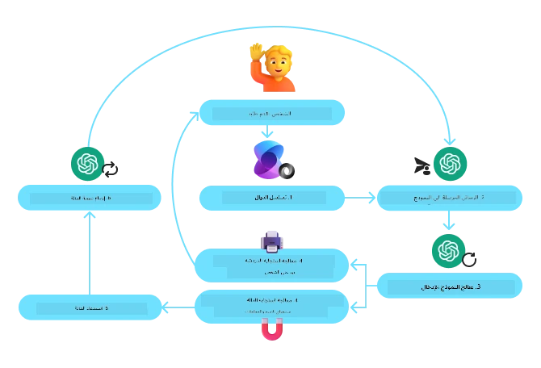
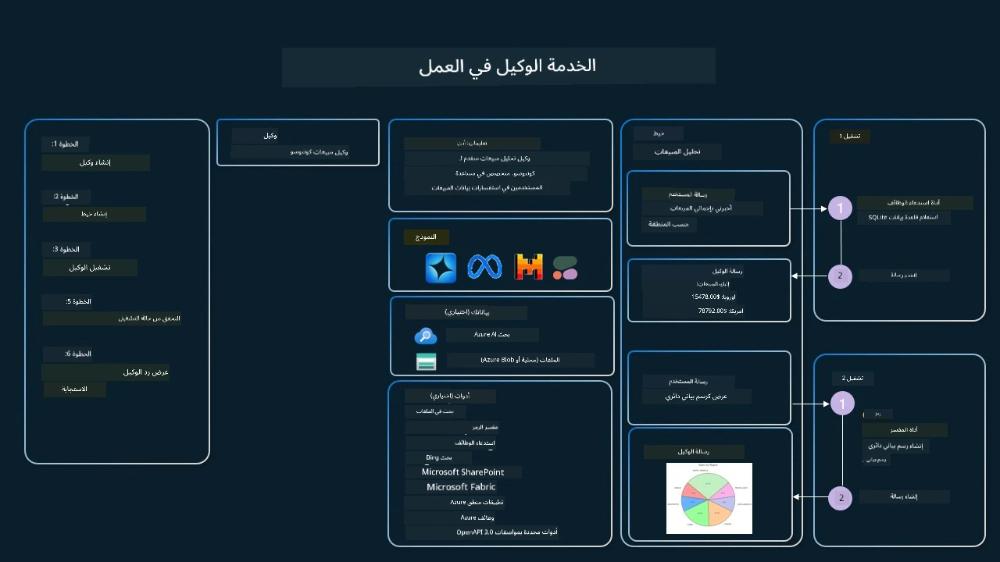

[](https://youtu.be/vieRiPRx-gI?si=cEZ8ApnT6Sus9rhn)

> _(انقر على الصورة أعلاه لمشاهدة فيديو الدرس)_

# نمط تصميم استخدام الأدوات

الأدوات مثيرة للاهتمام لأنها تسمح لوكلاء الذكاء الاصطناعي بامتلاك مجموعة أوسع من القدرات. بدلاً من أن يمتلك الوكيل مجموعة محدودة من الإجراءات التي يمكنه تنفيذها، بإضافة أداة، يمكن للوكلاء الآن تنفيذ نطاق واسع من الإجراءات. في هذا الفصل، سننظر في نمط تصميم استخدام الأدوات، الذي يصف كيف يمكن لوكلاء الذكاء الاصطناعي استخدام أدوات محددة لتحقيق أهدافهم.

## المقدمة

في هذا الدرس، نسعى للإجابة على الأسئلة التالية:

- ما هو نمط تصميم استخدام الأدوات؟
- ما هي حالات الاستخدام التي يمكن تطبيقه عليها؟
- ما هي العناصر/الكتل البنائية اللازمة لتنفيذ نمط التصميم؟
- ما هي الاعتبارات الخاصة باستخدام نمط تصميم استخدام الأدوات لبناء وكلاء ذكاء اصطناعي موثوقين؟

## أهداف التعلم

بعد إكمال هذا الدرس، ستكون قادرًا على:

- تعريف نمط تصميم استخدام الأدوات وهدفه.
- تحديد حالات الاستخدام حيث ينطبق نمط تصميم استخدام الأدوات.
- فهم العناصر الرئيسية اللازمة لتنفيذ نمط التصميم.
- التعرف على الاعتبارات لضمان الموثوقية في وكلاء الذكاء الاصطناعي الذين يستخدمون هذا النمط.

## ما هو نمط تصميم استخدام الأدوات؟

يركز **نمط تصميم استخدام الأدوات** على منح نماذج اللغة الكبيرة (LLMs) القدرة على التفاعل مع أدوات خارجية لتحقيق أهداف محددة. الأدوات هي كود يمكن للوكيل تنفيذه لأداء إجراءات. يمكن أن تكون الأداة دالة بسيطة مثل آلة حاسبة، أو نداء API لخدمة طرف ثالث مثل البحث عن سعر السهم أو توقع الطقس. في سياق وكلاء الذكاء الاصطناعي، تُصمم الأدوات لتنفيذها بواسطة الوكلاء استجابةً لـ **نداءات الدوال التي تولدها النماذج**.

## ما هي حالات الاستخدام التي يمكن تطبيقه عليها؟

يمكن لوكلاء الذكاء الاصطناعي الاستفادة من الأدوات لإكمال مهام معقدة، أو استرجاع المعلومات، أو اتخاذ قرارات. يُستخدم نمط تصميم استخدام الأدوات غالبًا في السيناريوهات التي تتطلب تفاعلًا ديناميكيًا مع أنظمة خارجية، مثل قواعد البيانات، خدمات الويب، أو مفسري الكود. هذه القدرة مفيدة لعدد من حالات الاستخدام المختلفة بما في ذلك:

- **استرجاع المعلومات الديناميكي:** يمكن للوكلاء استعلام APIs أو قواعد بيانات خارجية لجلب بيانات محدثة (مثل استعلام قاعدة بيانات SQLite للتحليل، أو جلب أسعار الأسهم أو معلومات الطقس).
- **تنفيذ وتأويل الكود:** يمكن للوكلاء تنفيذ كود أو سكريبتات لحل مشاكل رياضية، إنشاء تقارير، أو إجراء محاكاة.
- **أتمتة سير العمل:** أتمتة المهام المتكررة أو متعددة الخطوات من خلال دمج أدوات مثل جدولة المهام، خدمات البريد الإلكتروني، أو خطوط أنابيب البيانات.
- **دعم العملاء:** يمكن للوكلاء التفاعل مع أنظمة CRM، منصات التذاكر، أو قواعد المعرفة لحل استفسارات المستخدمين.
- **توليد المحتوى وتحريره:** يمكن للوكلاء استخدام أدوات مثل مدققات القواعد النحوية، مُلخصات النصوص، أو مُقيمي أمان المحتوى للمساعدة في مهام إنشائه.

## ما هي العناصر/الكتل البنائية اللازمة لتنفيذ نمط تصميم استخدام الأدوات؟

تتيح هذه الكتل البنائية لوكيل الذكاء الاصطناعي أداء مجموعة واسعة من المهام. لننظر في العناصر الرئيسية اللازمة لتنفيذ نمط تصميم استخدام الأدوات:

- **مخططات الدوال/الأدوات**: تعاريف مفصلة للأدوات المتاحة، بما في ذلك اسم الدالة، الهدف منها، المعلمات المطلوبة، والمخرجات المتوقعة. تتيح هذه المخططات لموديل اللغة الكبيرة فهم الأدوات المتاحة وكيفية بناء طلبات صحيحة.

- **منطق تنفيذ الدوال**: يحدد كيف ومتى تُستدعى الأدوات بناءً على نية المستخدم وسياق المحادثة. قد يشمل ذلك وحدات التخطيط، آليات التوجيه، أو التدفقات الشرطية التي تحدد استخدام الأداة ديناميكيًا.

- **نظام التعامل مع الرسائل**: المكونات التي تدير تدفق المحادثة بين مدخلات المستخدم، ردود موديل اللغة، نداءات الأدوات، ومخرجات الأدوات.

- **إطار تكامل الأدوات**: البنية التحتية التي تربط الوكيل بمختلف الأدوات، سواء كانت دوال بسيطة أو خدمات خارجية معقدة.

- **معالجة الأخطاء والتحقق**: الآليات التي تتعامل مع الفشل في تنفيذ الأدوات، التحقق من المعلمات، وإدارة الردود غير المتوقعة.

- **إدارة الحالة**: تتبع سياق المحادثة، التفاعلات السابقة مع الأدوات، والبيانات الدائمة لضمان الاتساق عبر التفاعلات متعددة الأدوار.

بعد ذلك، لننظر في نداء الدوال/الأدوات بمزيد من التفصيل.
 
### نداء الدوال/الأدوات

نداء الدوال هو الطريقة الأساسية التي تمكن نماذج اللغة الكبيرة (LLMs) من التفاعل مع الأدوات. سترى غالبًا كلمة "دالة" و"أداة" تُستخدمان بالتبادل لأن "الدوال" (كتل من الكود القابل لإعادة الاستخدام) هي "الأدوات" التي يستخدمها الوكلاء لأداء المهام. لكي يُستدعى كود دالة، يجب على النموذج مقارنة طلب المستخدم مع وصف الدوال. يتم إرسال مخطط يحتوي على أوصاف جميع الدوال المتاحة إلى النموذج. ثم يختار النموذج الدالة الأنسب للمهمة ويعيد اسمها والمعطيات الخاصة بها. تُستدعى الدالة المختارة، ويرسل ردها مرة أخرى إلى النموذج الذي يستخدم المعلومات للرد على طلب المستخدم.

لتنفيذ نداء الدوال للوكلاء، ستحتاج إلى:

1. نموذج LLM يدعم نداء الدوال
2. مخطط يحتوي على أوصاف الدوال
3. الكود الخاص بكل دالة موصوفة

لنستخدم مثال الحصول على الوقت الحالي في مدينة لتوضيح:

1. **تهيئة نموذج LLM يدعم نداء الدوال:**

    ليست كل النماذج تدعم نداء الدوال، لذا من المهم التحقق من أن النموذج الذي تستخدمه يدعم ذلك. <a href="https://learn.microsoft.com/azure/ai-services/openai/how-to/function-calling" target="_blank">Azure OpenAI</a> يدعم نداء الدوال. يمكننا البدء بتهيئة عميل OpenAI مقابل **Responses API** الخاص بـ Azure OpenAI (نقطة النهاية `/openai/v1/` المستقرة — لا حاجة إلى `api_version`).

    ```python
    # Initialize the OpenAI client for Azure OpenAI (Responses API, v1 endpoint)
    client = OpenAI(
        base_url=f"{os.environ['AZURE_OPENAI_ENDPOINT'].rstrip('/')}/openai/v1/",
        api_key=os.environ["AZURE_OPENAI_API_KEY"],
    )
    deployment_name = os.environ["AZURE_OPENAI_DEPLOYMENT"]
    ```

1. **إنشاء مخطط دالة:**

    بعد ذلك سنحدد مخطط JSON يحتوي على اسم الدالة، وصف ما تقوم به الدالة، وأسماء المعلمات وأوصافها.
    ثم سنأخذ هذا المخطط ونمرره إلى العميل الذي أنشأناه سابقًا، مع طلب المستخدم للعثور على الوقت في سان فرانسيسكو. المهم هو أن **نداء الأداة** هو الذي يُعاد، **ليس** الإجابة النهائية على السؤال. كما ذكرنا سابقًا، يعيد النموذج اسم الدالة التي اختارها للمهمة والمعطيات التي ستُمرر إليها.

    ```python
    # Function description for the model to read (Responses API flat tool format)
    tools = [
        {
            "type": "function",
            "name": "get_current_time",
            "description": "Get the current time in a given location",
            "parameters": {
                "type": "object",
                "properties": {
                    "location": {
                        "type": "string",
                        "description": "The city name, e.g. San Francisco",
                    },
                },
                "required": ["location"],
            },
        }
    ]
    ```
   
    ```python
  
    # Initial user message
    messages = [{"role": "user", "content": "What's the current time in San Francisco"}]

    # First API call: Ask the model to use the function
    response = client.responses.create(
        model=deployment_name,
        input=messages,
        tools=tools,
        tool_choice="auto",
        store=False,
    )

    # The Responses API returns tool calls as function_call items in response.output.
    # Append them to the conversation so the model has full context on the next turn.
    messages += response.output

    print("Model's response:")
    print(response.output)
  
    ```

    ```bash
    Model's response:
    [ResponseFunctionToolCall(arguments='{"location":"San Francisco"}', call_id='call_pOsKdUlqvdyttYB67MOj434b', name='get_current_time', type='function_call')]
    ```
  
1. **كود الدالة اللازم لأداء المهمة:**

    الآن بعد أن اختار النموذج الدالة التي يجب تشغيلها، يجب تنفيذ الكود الذي ينفذ المهمة.
    يمكننا تنفيذ الكود للحصول على الوقت الحالي في Python. سنحتاج أيضًا إلى كتابة الكود لاستخراج الاسم والمعطيات من رسالة الاستجابة للحصول على النتيجة النهائية.

    ```python
      def get_current_time(location):
        """Get the current time for a given location"""
        print(f"get_current_time called with location: {location}")  
        location_lower = location.lower()
        
        for key, timezone in TIMEZONE_DATA.items():
            if key in location_lower:
                print(f"Timezone found for {key}")  
                current_time = datetime.now(ZoneInfo(timezone)).strftime("%I:%M %p")
                return json.dumps({
                    "location": location,
                    "current_time": current_time
                })
      
        print(f"No timezone data found for {location_lower}")  
        return json.dumps({"location": location, "current_time": "unknown"})
    ```

     ```python
    # Handle function calls
    tool_calls = [item for item in response.output if item.type == "function_call"]
    if tool_calls:
        for tool_call in tool_calls:
            if tool_call.name == "get_current_time":

                function_args = json.loads(tool_call.arguments)

                time_response = get_current_time(
                    location=function_args.get("location")
                )

                # Return the tool result as a function_call_output item
                messages.append({
                    "type": "function_call_output",
                    "call_id": tool_call.call_id,
                    "output": time_response,
                })
    else:
        print("No tool calls were made by the model.")

    # Second API call: Get the final response from the model
    final_response = client.responses.create(
        model=deployment_name,
        input=messages,
        tools=tools,
        store=False,
    )

    return final_response.output_text
     ```

     ```bash
      get_current_time called with location: San Francisco
      Timezone found for san francisco
      The current time in San Francisco is 09:24 AM.
     ```

نداء الدوال هو في صميم معظم، إن لم يكن كل، تصميم استخدام أدوات الوكلاء، مع ذلك تنفيذه من الصفر قد يكون أحيانًا تحديًا.
كما تعلمنا في [الدرس 2](../../../02-explore-agentic-frameworks) توفر أُطُر العمل الوكيلية لبنائنا كتلًا بناءً مسبقة لتطبيق استخدام الأدوات.
 
## أمثلة استخدام الأدوات مع أُطُر العمل الوكيلية

فيما يلي بعض الأمثلة على كيفية تنفيذ نمط تصميم استخدام الأدوات باستخدام أطر العمل الوكيلية المختلفة:

### إطار عمل Microsoft Agent

<a href="https://learn.microsoft.com/azure/ai-services/agents/overview" target="_blank">Microsoft Agent Framework</a> هو إطار عمل مفتوح المصدر لبناء وكلاء الذكاء الاصطناعي. يبسط عملية استخدام نداء الدوال من خلال السماح لك بتعريف الأدوات كدوال Python مزينة بـ `@tool`. يدير الإطار الاتصال ذهابًا وإيابًا بين النموذج والكود الخاص بك. كما يوفر وصولًا إلى أدوات مدمجة مسبقًا مثل بحث الملفات ومفسر الكود عبر `FoundryChatClient`.

يوضح المخطط التالي عملية نداء الدوال باستخدام منصة Microsoft Agent:



في إطار عمل Microsoft Agent، تُعرّف الأدوات كدوال مزينة. يمكننا تحويل الدالة `get_current_time` التي رأيناها سابقًا إلى أداة باستخدام المزينة `@tool`. سيقوم الإطار تلقائيًا بتسلسل الدالة ومعلماتها، وإنشاء المخطط لإرساله إلى النموذج.

```python
import os
from agent_framework import tool
from agent_framework.foundry import FoundryChatClient
from azure.identity import AzureCliCredential

@tool(approval_mode="never_require")
def get_current_time(location: str) -> str:
    """Get the current time for a given location"""
    ...

# Create the client
provider = FoundryChatClient(
    project_endpoint=os.environ["AZURE_AI_PROJECT_ENDPOINT"],
    model=os.environ["AZURE_AI_MODEL_DEPLOYMENT_NAME"],
    credential=AzureCliCredential(),
)

# Create an agent and run with the tool
agent = provider.as_agent(name="TimeAgent", instructions="Use available tools to answer questions.", tools=get_current_time)
response = await agent.run("What time is it?")
```

#### أدوات من خادم MCP

الأدوات لا يجب أن تكون دوال في الكود الخاص بك فقط. الخادم الذي يتحدث بروتوكول سياق النموذج (MCP، المغطى في [الدرس 11](../11-agentic-protocols/README.md)) ينشر أدواته مع مخططاتها، ويمكن للإطار تحميلها بنفس طريقة تسلسل الدالة المزينة. `MCPStreamableHTTPTool` يتصل بمثل هذا الخادم عبر HTTP، يقرأ مخططات الأدوات، ويقدمها للنموذج إلى جانب أي أدوات محلية.

المثال أدناه يستخدم خادم بحث الويب المستضاف من <a href="https://keenable.ai" target="_blank">Keenable</a>. يمكن استخدامه مجانًا دون حساب أو مفتاح API (الطلبات محدودة بمعدل لكل عنوان IP)، لذا فإن الاعتمادات الوحيدة التي تحتاجها هي تلك الخاصة بنموذجك. كما هو الحال مع أي أداة بعيدة، تُرسل الاستعلامات التي يكتبها النموذج إلى ذلك الخادم.

```python
from agent_framework import MCPStreamableHTTPTool

web_search = MCPStreamableHTTPTool(
    name="Keenable web search",
    url="https://api.keenable.ai/mcp",
)

# Connecting loads the server's tool schemas; the agent decides when to call them
async with web_search:
    agent = provider.as_agent(
        name="ResearchAgent",
        instructions="Use available tools to answer questions.",
        tools=[web_search],
    )
    response = await agent.run("What is new in the latest Python release?")
    print(response.text)
```

ينشر الخادم أداتين، `search_web_pages` و `fetch_page_content`. عندما يحتاج السؤال إلى معلومات حالية، يستدعي النموذج `search_web_pages`، يحصل على العناوين، عناوين URL ومقتطفات النص، ويكتب إجابته منها، نفس الحلقة كما في مثال `get_current_time` أعلاه.
  
### خدمة وكلاء Microsoft Foundry

<a href="https://learn.microsoft.com/azure/ai-services/agents/overview" target="_blank">خدمة وكلاء Microsoft Foundry</a> هي إطار عمل وكيل حديث مصمم لتمكين المطورين من بناء، نشر، وتوسيع نطاق وكلاء ذكاء اصطناعي عالي الجودة وقابل للتمديد بأمان دون الحاجة لإدارة موارد الحوسبة والتخزين الأساسية. وهو مفيد بشكل خاص لتطبيقات المؤسسات لأنه خدمة مُدارة بالكامل بأمان على مستوى المؤسسات.

مقارنةً بالتطوير باستخدام API الخاص بنموذج اللغة الكبير مباشرة، تقدم خدمة وكلاء Microsoft Foundry بعض المزايا، منها:

- نداء الأدوات تلقائيًا – لا حاجة لتحليل نداء الأدوات، استدعاء الأداة، والتعامل مع الرد؛ يتم كل ذلك الآن على الخادم
- إدارة البيانات بأمان – بدلاً من إدارة حالة المحادثة بنفسك، يمكنك الاعتماد على الخيوط لتخزين كل المعلومات التي تحتاجها
- أدوات جاهزة للاستخدام – أدوات يمكنك استخدامها للتفاعل مع مصادر بياناتك، مثل Bing، Azure AI Search، ووظائف Azure.

يمكن تقسيم الأدوات المتاحة في خدمة وكلاء Microsoft Foundry إلى فئتين:

1. أدوات المعرفة:
    - <a href="https://learn.microsoft.com/azure/ai-services/agents/how-to/tools/bing-grounding?tabs=python&pivots=overview" target="_blank">التأسيس مع Bing Search</a>
    - <a href="https://learn.microsoft.com/azure/ai-services/agents/how-to/tools/file-search?tabs=python&pivots=overview" target="_blank">بحث الملفات</a>
    - <a href="https://learn.microsoft.com/azure/ai-services/agents/how-to/tools/azure-ai-search?tabs=azurecli%2Cpython&pivots=overview-azure-ai-search" target="_blank">Azure AI Search</a>

2. أدوات التنفيذ:
    - <a href="https://learn.microsoft.com/azure/ai-services/agents/how-to/tools/function-calling?tabs=python&pivots=overview" target="_blank">نداء الدوال</a>
    - <a href="https://learn.microsoft.com/azure/ai-services/agents/how-to/tools/code-interpreter?tabs=python&pivots=overview" target="_blank">مفسر الكود</a>
    - <a href="https://learn.microsoft.com/azure/ai-services/agents/how-to/tools/openapi-spec?tabs=python&pivots=overview" target="_blank">أدوات معرفة OpenAPI</a>
    - <a href="https://learn.microsoft.com/azure/ai-services/agents/how-to/tools/azure-functions?pivots=overview" target="_blank">وظائف Azure</a>

تتيح لنا خدمة الوكيل استخدام هذه الأدوات معًا كـ `toolset`. كما تستخدم `threads` التي تتتبع تاريخ الرسائل من محادثة معينة.

تخيل أنك وكيل مبيعات في شركة تسمى Contoso. تريد تطوير وكيل محادثة يمكنه الإجابة على الأسئلة حول بيانات مبيعاتك.

توضح الصورة التالية كيف يمكنك استخدام خدمة وكلاء Microsoft Foundry لتحليل بيانات المبيعات الخاصة بك:



لاستخدام أي من هذه الأدوات مع الخدمة، يمكننا إنشاء عميل وتحديد أداة أو مجموعة أدوات. لتنفيذ ذلك عمليًا يمكننا استخدام كود Python التالي. سيكون النموذج قادرًا على النظر إلى مجموعة الأدوات واتخاذ قرار باستخدام الدالة التي أنشأها المستخدم، `fetch_sales_data_using_sqlite_query`، أو مفسر الكود المدمج بناءً على طلب المستخدم.

```python 
import os
from azure.ai.projects import AIProjectClient
from azure.identity import DefaultAzureCredential
from fetch_sales_data_functions import fetch_sales_data_using_sqlite_query # fetch_sales_data_using_sqlite_query function which can be found in a fetch_sales_data_functions.py file.
from azure.ai.projects.models import ToolSet, FunctionTool, CodeInterpreterTool

project_client = AIProjectClient.from_connection_string(
    credential=DefaultAzureCredential(),
    conn_str=os.environ["PROJECT_CONNECTION_STRING"],
)

# Initialize toolset
toolset = ToolSet()

# Initialize function calling agent with the fetch_sales_data_using_sqlite_query function and adding it to the toolset
fetch_data_function = FunctionTool(fetch_sales_data_using_sqlite_query)
toolset.add(fetch_data_function)

# Initialize Code Interpreter tool and adding it to the toolset. 
code_interpreter = CodeInterpreterTool()toolset.add(code_interpreter)

agent = project_client.agents.create_agent(
    model="gpt-5-mini", name="my-agent", instructions="You are helpful agent", 
    toolset=toolset
)
```

## ما هي الاعتبارات الخاصة لاستخدام نمط تصميم استخدام الأدوات لبناء وكلاء ذكاء اصطناعي موثوقين؟

قلق شائع مرتبط بـ SQL التي تُولد ديناميكيًا بواسطة نماذج اللغة الكبيرة هو الأمان، وبشكل خاص خطر حقن SQL أو الإجراءات الخبيثة، مثل حذف أو التلاعب بقاعدة البيانات. على الرغم من صحة هذه المخاوف، يمكن التخفيف منها بفعالية عن طريق تكوين أذونات الوصول إلى قاعدة البيانات بشكل صحيح. بالنسبة لمعظم قواعد البيانات، يتضمن ذلك تكوين قاعدة البيانات كقراءة فقط. لخدمات قواعد البيانات مثل PostgreSQL أو Azure SQL، ينبغي تعيين التطبيق في دور للقراءة فقط (SELECT).

تشغيل التطبيق في بيئة آمنة يزيد من الحماية. في سيناريوهات المؤسسات، يتم عادةً استخراج وتحويل البيانات من الأنظمة التشغيلية إلى قاعدة بيانات أو مستودع بيانات للقراءة فقط مع مخطط صديق للمستخدم. يضمن هذا النهج أن تكون البيانات آمنة، ومحسّنة للأداء وسهولة الوصول، وأن يكون للتطبيق حق وصول محدود للقراءة فقط.

## أكواد نموذجية

- Python: [إطار عمل الوكيل](./code_samples/04-python-agent-framework.ipynb)
- .NET: [إطار عمل الوكيل](./code_samples/04-dotnet-agent-framework.md)

## هل لديك المزيد من الأسئلة حول أنماط تصميم استخدام الأدوات؟

انضم إلى [Microsoft Foundry Discord](https://discord.com/invite/ATgtXmAS5D) للقاء متعلمين آخرين، وحضور ساعات العمل والإجابة على أسئلة وكلاء الذكاء الاصطناعي.

## موارد إضافية

- <a href="https://microsoft.github.io/build-your-first-agent-with-azure-ai-agent-service-workshop/" target="_blank">ورشة عمل خدمة وكلاء Azure AI</a>
- <a href="https://github.com/Azure-Samples/contoso-creative-writer/tree/main/docs/workshop" target="_blank">ورشة عمل كاتب Contoso Creative متعددة الوكلاء</a>
- <a href="https://learn.microsoft.com/azure/ai-services/agents/overview" target="_blank">نظرة عامة على إطار عمل الوكيل من مايكروسوفت</a>

## اختبار سريع لهذا الوكيل (اختياري)

بعد أن تتعلم كيفية نشر الوكلاء في [الدرس 16](../16-deploying-scalable-agents/README.md)، يمكنك اختبار سريع `TravelToolAgent` الخاص بهذا الدرس (هل لا يزال ينادي أدواته ويجيب؟) باستخدام [`tests/lesson-04-smoke-tests.json`](../../../tests/lesson-04-smoke-tests.json). انظر [`tests/README.md`](../tests/README.md) لمعرفة كيفية تشغيله.

## الدرس السابق

[فهم أنماط تصميم الوكيل](../03-agentic-design-patterns/README.md)

## الدرس التالي

[Agentic RAG](../05-agentic-rag/README.md)

---

<!-- CO-OP TRANSLATOR DISCLAIMER START -->
**تنويه**:
تمت ترجمة هذا المستند باستخدام خدمة الترجمة بالذكاء الاصطناعي [Co-op Translator](https://github.com/Azure/co-op-translator). بينما نسعى للدقة، يرجى العلم أن الترجمات الآلية قد تحتوي على أخطاء أو عدم دقة. يجب اعتبار المستند الأصلي بلغته الأصلية المصدر الرسمي والمعتمد. للمعلومات الهامة، يُنصح بالاستعانة بترجمة بشرية محترفة. نحن غير مسؤولين عن أي سوء فهم أو تفسير ناتج عن استخدام هذه الترجمة.
<!-- CO-OP TRANSLATOR DISCLAIMER END -->