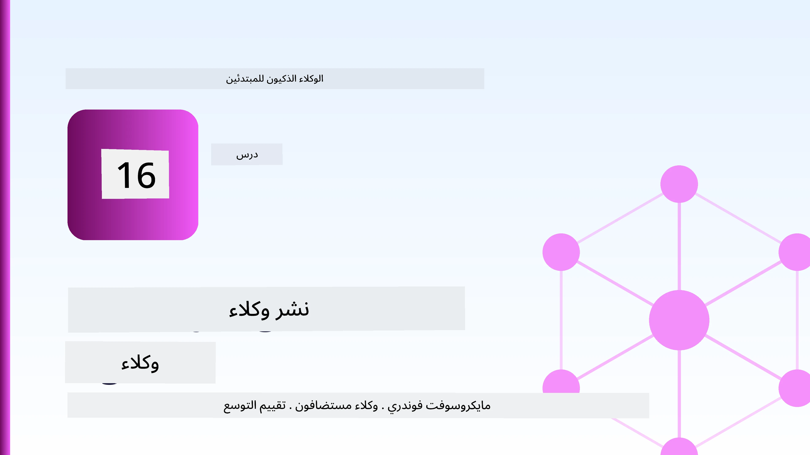
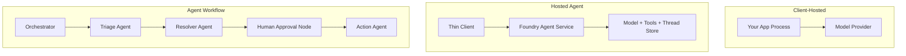
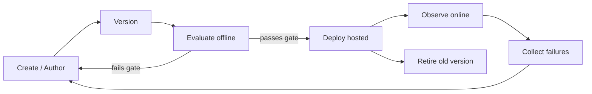
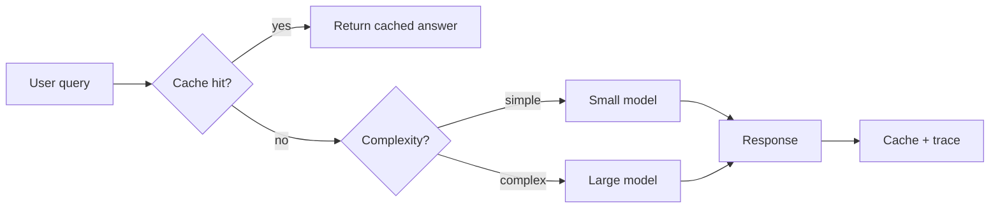
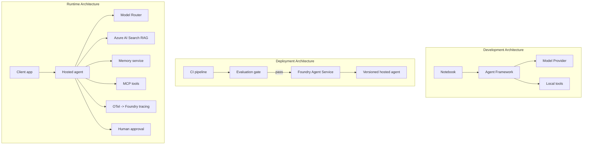

# نشر الوكلاء القابلين للتوسع باستخدام Microsoft Foundry



حتى هذه اللحظة في الدورة، قمت ببناء وكلاء يعملون على حاسوبك المحمول، داخل دفتر ملاحظات، مدفوعين بـ `az login` وعدد قليل من متغيرات البيئة. هذا هو السبيل الصحيح تمامًا للتعلم. لكنه ليس الطريقة الصحيحة لتشغيل وكيل يعتمد عليه آلاف العملاء في الساعة الثالثة صباحًا.

هذه الدرسة تتناول الفجوة بين "يعمل على جهازي" و"يعمل بشكل موثوق وميسور التكلفة في الإنتاج." نغلق هذه الفجوة باستخدام **Microsoft Foundry** و **خدمة وكلاء Microsoft Foundry**، ونفعل ذلك من خلال بناء وكيل دعم عملاء حقيقي يحتوي على أدوات واسترجاع وذاكرة وتقييم ومراقبة.

## مقدمة

ستتضمن هذه الدرسة:

- الفرق بين **وكيل النموذج الأولي** و **وكيل النشر**، ولماذا الانتقال يتعلق في الغالب بكل ما *يحيط* بالنموذج.
- **أنماط النشر** للوكلاء: الاستضافة من جانب العميل، الاستضافة كخدمة (الوكلاء المستضافون)، والتنظيم بواسطة سير العمل.
- **دورة حياة الوكيل** على Microsoft Foundry — الإنشاء، الإصدار، النشر، التقييم، المراقبة، الإيقاف.
- **استراتيجيات التوسع**: توجيه النموذج، التخزين المؤقت، التزامن، والتصميم بلا حالة.
- **المراقبة** باستخدام OpenTelemetry وتتبع Foundry.
- **تحسين التكلفة** من خلال اختيار النموذج، التوجيه، وبوابات التقييم.
- **اعتبارات المؤسسات**: الحوكمة، الموافقة البشرية، وتشغيل خوادم MCP بأمان في بيئة الإنتاج.

## أهداف التعلم

بعد إكمال هذه الدرسة، ستعرف كيف:

- اختيار نمط النشر المناسب لعبء العمل المحدد لوكيل معين.
- نشر وكيل إلى خدمة وكلاء Microsoft Foundry بحيث يكون له إصدار، محكمًا، وقابلاً للرصد.
- تجهيز وكيل للتتبع وربط خط تقييم يعمل قبل كل إصدار.
- تطبيق توجيه النموذج والتخزين المؤقت للسيطرة على الكمون والتكلفة على نطاق واسع.
- إضافة بوابة موافقة بشرية للإجراءات عالية المخاطر ودمج خادم MCP بطريقة آمنة للإنتاج.

## المتطلبات الأساسية

تفترض هذه الدرسة أنك أتممت الدروس السابقة وترتاح للـ:

- بناء وكلاء باستخدام [Microsoft Agent Framework](../14-microsoft-agent-framework/README.md) (الدرس 14).
- [استخدام الأدوات](../04-tool-use/README.md) (الدرس 4) و [Agentic RAG](../05-agentic-rag/README.md) (الدرس 5).
- [ذاكرة الوكيل](../13-agent-memory/README.md) (الدرس 13) و [بروتوكولات الوكيل / MCP](../11-agentic-protocols/README.md) (الدرس 11).
- [المراقبة والتقييم](../10-ai-agents-production/README.md) (الدرس 10) — تبني هذه الدرسة مباشرة عليه.

ستحتاج أيضًا إلى:

- **اشتراك Azure** و **مشروع Microsoft Foundry** به على الأقل نموذج دردشة منشور واحد.
- مصادقة **Azure CLI** (`az login`).
- Python 3.12+ والحزم في المستودع [`requirements.txt`](../../../requirements.txt).

## من النموذج الأولي إلى الإنتاج: ما الذي يتغير فعلًا

يشترك الوكيل النموذجي والوكيل الإنتاجي في نفس الحلقة الأساسية — التفكير، استدعاء الأدوات، الاستجابة. ما يتغير هو كل ما يحيط بتلك الحلقة. النموذج يشكل ربما 20% من وكيل الإنتاج؛ والباقي 80% هو الهيكل التشغيلي.

| الاهتمام | النموذج الأولي | الإنتاج |
| --- | --- | --- |
| **الاستضافة** | يعمل في دفتر ملاحظاتك | يعمل كخدمة مستضافة، ذات إصدار ومدارة للنشر |
| **الهوية** | رمز `az login` الخاص بك | هوية مُدارة مع RBAC محدودة |
| **الحالة** | في الذاكرة، تفقد عند إعادة التشغيل | معزولة (مخزن الخيوط، خدمة الذاكرة) |
| **الفشل** | ترى أثر الخطأ | محاولات إعادة، حلول بديلة، رسائل خاطئة، تنبيهات |
| **التكلفة** | "قليل جدًا" | تتبع لكل طلب، توجيه، تخزين مؤقت، ميزانية محددة |
| **الجودة** | تراقب المخرجات بصريًا | تقييم تلقائي قبل كل إصدار |
| **الثقة** | توافق على كل إجراء | سياسة + إدخال بشري للإجراءات عالية المخاطر |

احتفظ بهذا الجدول في ذهنك. كل قسم أدناه يُطابق أحد هذه الصفوف.

## أنماط نشر الوكلاء

هناك ثلاث أنماط ستستخدمها، غالبًا معًا.

### 1. الوكلاء المستضافون من العميل

كائن الوكيل يعيش داخل *عملية تطبيقك* الخاصة. يُستدعى مزود النموذج مباشرة في كودك؛ حلقة التفكير تعمل في خدمتك. هذا ما تم في كل درس سابق.

- **استخدمه عندما** تحتاج تحكمًا كاملاً في الحلقة، وسيطًا مخصصًا، أو عند دمج الوكيل داخل خلفية موجودة.
- **المقابل**: أنت تتحكم في التوسع، الحالة، والمرونة بنفسك.

### 2. الوكلاء المستضافون (خدمة وكلاء Foundry)

يتم *تسجيل الوكيل كمورد* في Microsoft Foundry. تستضيف Foundry حلقة التفكير، تخزن الخيوط، تفرض أمان المحتوى وRBAC، وتجعل الوكيل مرئيًا في بوابة Foundry. يصبح تطبيقك عميلًا خفيف الوزن ينشئ الخيوط ويقرأ الردود.

- **استخدمه عندما** تريد متانة، مراقبة مدمجة، حوكمة، وتقليل مساحة التشغيل.
- **المقابل**: تحكم أقل على المستوى المنخفض مقابل وقت تشغيل مدار.

### 3. سير عمل الوكلاء

يتم تركيب عدة وكلاء (وأدوات) في رسم بياني مع تدفق تحكم صريح — خطوات تسلسلية، تفرع، نقاط موافقة بشرية، ونقاط تحقق دائمة يمكن إيقافها واستئنافها. هذا هو قدرة **سير العمل** في Microsoft Agent Framework المطبقة على نطاق النشر.

- **استخدمه عندما** تمتد مهمة واحدة عبر عدة وكلاء متخصصين أو تتطلب خطوة موافقة في الوسط.
- **المقابل**: أجزاء متحركة أكثر؛ يتطلب مراقبة على مستوى التنظيم.



## دورة حياة الوكيل على Microsoft Foundry

نشر وكيل ليس عملًا لمرة واحدة `push`. إنها حلقة، وتشبه كثيرًا دورة إصدار البرامج لأنها كذلك بالضبط.



الفكرة الرئيسية، المستمدة من [الدرس 10](../10-ai-agents-production/README.md): **التقييم غير المتصل بالإنترنت هو بوابة، وليس مجرد فكرة لاحقة.** لا يُرسل إصدار جديد من الوكيل ما لم يجتاز حدود تقييمك. ثم تغذي المراقبة عبر الإنترنت إخفاقات العالم الحقيقي إلى مجموعة اختبارك غير المتصلة. هذه هي الحلقة كاملة.

## استراتيجيات التوسع

توسيع وكيل يختلف عن توسيع واجهة برمجة تطبيقات ويب بلا حالة، لأن كل طلب قد يؤدي إلى عدة مكالمات مكلفة للنموذج والأدوات. أربعة تقنيات تحمل معظم الحمل.

**معالجة الطلبات بلا حالة.** لا تحتفظ بأي حالة لكل مستخدم في ذاكرة العملية. احتفظ بخيوط المحادثة في متجر خيوط Foundry أو خدمة ذاكرة ليتمكن أي مثيل من التعامل مع أي طلب. هذا ما يسمح لك بالتوسع أفقيًا — إضافة مثيلات، بدون جلسات ملتصقة.

**توجيه النموذج.** ليس كل طلب يحتاج إلى أكثر نماذجك قدرة (وعالية التكلفة). قم بتوجيه الطلبات البسيطة — تصنيف النوايا، الإجابات القصيرة الواقعية — إلى نموذج صغير وسريع، واحتفظ بالنموذج الكبير للتفكير الحقيقي. يمكن لـ **موجه النماذج** في Foundry القيام بذلك لك، أو يمكنك تنفيذ مصنف خفيف بنفسك. ستبني النسخة ذاتية الصنع في المختبر.

**التخزين المؤقت للردود.** العديد من استفسارات الدعم هي نسخ متكررة تقريبًا ("كيف أعيد تعيين كلمة المرور؟"). خزّن إجابات الأسئلة الشائعة وقدمها بدون الرجوع إلى النموذج على الإطلاق. حتى معدل وصول متوسط في التخزين المؤقت يقلل التكلفة والكمون بشكل ملموس.

**التزامن والضغط العكسي.** لمزودي النموذج حدود معدل. حدد تزامنك، استخدم المحاولات مع التراجع الأسي، وفش بأناقة (رد "نعمل على ذلك" في قائمة الانتظار أفضل من خطأ 500).



## المراقبة في الإنتاج

لا يمكنك تشغيل ما لا يمكنك رؤيته. كما في الدرس 10، يرسل Microsoft Agent Framework تتبعات **OpenTelemetry** أصليًا — كل مكالمة نموذج، استدعاء أداة، وخطوة تنظيم تصبح عبورًا. في الإنتاج تصدر تلك العبور إلى Microsoft Foundry (أو أي خلفية متوافقة مع OTel) لتتمكن من:

- تتبع شكوى واحدة للعميل من البداية للنهاية عبر كل مكالمة نموذج وأداة.
- مراقبة كمون p50/p95 والتكلفة لكل طلب مع مرور الوقت.
- التنبيه على ارتفاع معدلات الأخطاء وشذوذ التكاليف قبل أن يلاحظها المستخدمون (أو فريق المالية).

```python
from agent_framework.observability import get_tracer

tracer = get_tracer()

with tracer.start_as_current_span("support_request") as span:
    span.set_attribute("customer.tier", "enterprise")
    span.set_attribute("routed.model", "gpt-5-nano")
    # agent execution is traced automatically inside this span
```

السمات مثل `customer.tier` و `routed.model` تحول جدار التتبعات إلى أسئلة قابلة للإجابة ("هل يتم توجيه عملاء المؤسسات إلى النموذج الصغير كثيرًا؟").

## تحسين التكلفة

تسيطر التوكنات على تكلفة الوكلاء في الإنتاج. هناك ثلاث رافعات، حسب التأثير:

1. **اختيار حجم النموذج المناسب.** نموذج صغير ينجح في بوابة التقييم الخاصة بك أرخص تقريبًا دائمًا من نموذج كبير ينجح أيضًا. استخدم التقييم *لإثبات* أن النموذج الصغير جيد بما فيه الكفاية بدلاً من اختيار أكبر نموذج احترازيًا.
2. **التوجيه حسب التعقيد.** كما سبق — ادفع ثمن النموذج الكبير فقط للطلبات التي تحتاج إلى تفكير نموذج كبير.
3. **التخزين المؤقت بقوة.** أرخص مكالمة نموذج هي التي لا تجريها أبدًا.

بوابات التقييم والتحكم في التكلفة هي الانضباط ذاته من زاويتين: التقييم يحدد *أدنى جودة*، والتوجيه والتخزين المؤقت يحافظان على تكلفة قريبة من هذا الحد الأدنى.

## اعتبارات نشر المؤسسات

**الحوكمة.** يرث الوكلاء المستضافون RBAC وأمان المحتوى وتسجيل التدقيق في Foundry. امنح كل وكيل هوية مُدارة بأقل امتيازات يحتاجها — وصول للقراءة فقط إلى قاعدة المعرفة، وصول محدود إلى واجهة تذاكر الدعم، لا أكثر.

**إدخال إنساني في الحلقة.** بعض الإجراءات حساسة جدًا لأتمتتها بالكامل — إصدار استرداد، حذف حساب، التصعيد إلى الفريق القانوني. يدعم Microsoft Agent Framework أدوات **الموافقة المطلوبة**: يقترح الوكيل الإجراء، يتوقف التنفيذ، يوافق إنسان أو يرفض، ثم يستأنف سير العمل. شاهدت البدائية في [الدرس 6](../06-building-trustworthy-agents/README.md)؛ وهنا تنشرها.

**MCP في الإنتاج.** يسمح [MCP](../11-agentic-protocols/README.md) لوكيلك باستخدام أدوات خارجية عبر واجهة قياسية. في الإنتاج، اعتبر كل خادم MCP كنطاق غير موثوق به: ثبت إصدار الخادم، شغله بهوية محدودة، تحقق من مخرجاته، ولا تكشف له عن أسرار. خادم MCP هو تبعية، والتبعيات تُصحح وتُراجع وتُقيد معدلاتها.



تلك المخططات الثلاثة — التطوير، النشر، وقت التشغيل — هي نفس الوكيل في ثلاث مراحل من حياته. المختبر التالي يرشدك لبنائه.

## مختبر عملي: وكيل دعم عملاء جاهز للإنتاج

افتح [`code_samples/16-python-agent-framework.ipynb`](./code_samples/16-python-agent-framework.ipynb) واطلع عليها من البداية للنهاية. ستجمع **وكيل دعم عملاء Contoso** مع كل اعتبار إنتاج موصل:

1. **استدعاء الأدوات** — تحقق من حالة الطلب وافتح تذاكر الدعم.
2. **RAG** — أجب عن أسئلة السياسات من قاعدة معرفة (Azure AI Search، مع بديل في الذاكرة حتى يعمل الدفتر بدون مورد بحث).
3. **الذاكرة** — تذكر العميل عبر تحولات المحادثة.
4. **توجيه النموذج** — يصنف التعقيد ويوجه كل طلب لنموذج صغير أو كبير.
5. **التخزين المؤقت للردود** — تُقدم الأسئلة المتكررة من التخزين المؤقت.
6. **الموافقة البشرية** — توقف الاستردادات فوق حد معين لموافقة إنسانية.
7. **خط تقييم** — مجموعة اختبار صغيرة غير متصلة تسجل وكيل وتعمل كبوابة إصدار.
8. **المراقبة** — تتبع OpenTelemetry حول كل طلب.

### التمرير

يتم تنظيم الدفتر بحيث يكون كل اعتبار إنتاج قسمًا قائمًا بذاته وقابلًا للتشغيل. القلب منه هو معالج الطلبات مع التوجيه والتخزين المؤقت:

```python
async def handle_support_request(query: str, customer_id: str) -> str:
    # 1. Serve from cache when we can.
    cached = response_cache.get(normalize(query))
    if cached:
        return cached

    # 2. Route by complexity to control cost.
    model = "gpt-5-nano" if is_simple(query) else "gpt-5-mini"

    # 3. Run the agent inside a trace span for observability.
    with tracer.start_as_current_span("support_request") as span:
        span.set_attribute("routed.model", model)
        span.set_attribute("customer.id", customer_id)
        response = await support_agent.run(query, model=model)

    # 4. Cache and return.
    response_cache.set(normalize(query), response.text)
    return response.text
```

بوابة التقييم التي تحرس الإصدار تبدو هكذا:

```python
async def evaluation_gate(agent, test_cases, threshold: float = 0.8) -> bool:
    passed = 0
    for case in test_cases:
        result = await agent.run(case["input"])
        if score_response(result.text, case["expected"]) >= 0.8:
            passed += 1
    pass_rate = passed / len(test_cases)
    print(f"Evaluation pass rate: {pass_rate:.0%} (gate: {threshold:.0%})")
    return pass_rate >= threshold  # only deploy if the gate passes
```

اقرأ كل سطر — الدفتر يحافظ عمداً على البنى صغيرة حتى لا يُخفي شيئًا خلف استدعاء إطار عمل.

## التحقق من وكيل منشور باختبارات الدخان

بوابة التقييم أعلاه تعمل *خارج الاتصال* ضد كائن الوكيل الخاص بك. بمجرد نشر الوكيل كوكيلي مستضاف، تحتاج تحققًا آخر، أرخص: **هل نقطة النهاية المنشورة ترد فعلًا؟**

نشر "ناجح" يثبت فقط أن مستوى التحكم قبل التعريف تم قبوله — لا يثبت أن الوكيل يستجيب. قد يترك فقدان تبعية أو توجيه نموذج خاطئ أو اتصال منتهي نشرًا أخضر لا يعيد شيئًا. **اختبار الدخان** يكتشف ذلك في ثوانٍ، في كل نشر، دون تكلفة تقييم كامل.

هذا المستودع يشحن خط تقييم اختبار دخان جاهز للاستخدام مبني على [اختبار دخان AI](https://github.com/marketplace/actions/ai-smoke-test) في GitHub Action:

- **الأرشيف** — [`tests/lesson-16-smoke-tests.json`](../../../tests/lesson-16-smoke-tests.json) يحتوي على محفزات وتأكيدات لوكيل دعم Contoso (إجابات سياسة محددة، استعلام طلب، البقاء في الموضوع، واستمرارية خيط متعددة الأدوار). الأرشيفات لوكلاء الدروس الأخرى موجودة بجواره — انظر [`tests/README.md`](../tests/README.md).
- **سير العمل** — [`.github/workflows/smoke-test.yml`](../../../.github/workflows/smoke-test.yml) يسجل الدخول باستخدام Azure OIDC ويرسل كل محفز إلى نقطة استجابات الوكيل، ويفشل المهمة إذا فشل أي تأكيد.

```yaml
- name: Smoke-test hosted agent
  uses: JFolberth/ai-smoketest@v1
  with:
    project_endpoint: ${{ inputs.project_endpoint }}
    agent_name: ContosoSupportAgent
    tests_file: tests/lesson-16-smoke-tests.json
```

قم بتشغيله من علامة التبويب **Actions** بمجرد نشر الوكيل الخاص بك، مع توفير نقطة نهاية مشروع Foundry واسم الوكيل. يحتاج الهوية الفيدرالية إلى دور **Azure AI User** في نطاق مشروع Foundry. فكر في الطبقات على شكل هرم: اختبارات التدخين (هل يمكن الوصول إليها وتستجيب؟) تُجرى عند كل نشر، التقييم غير المتصل بالإنترنت (هل هو جيد بما يكفي للإصدار؟) يُجرى قبل الترقية، والتقييم عبر الإنترنت (كيف هو أداؤه في الظروف الواقعية؟) يُجرى بشكل مستمر.

## فحص المعرفة

اختبر فهمك قبل الانتقال إلى الواجب.

**1. تقريبًا، ما نسبة "النموذج" في وكيل الإنتاج، وما هو الباقي؟**

<details>
<summary>الإجابة</summary>

النموذج هو أقلية في النظام — وغالبًا ما يُذكر بحوالي 20%. الباقي هو الهيكل التشغيلي: الاستضافة والإصدار، الهوية وإدارة الوصول القائمة على الأدوار، الحالة الخارجية، التعامل مع الفشل، تتبع التكاليف، التقييم، والتحكم البشري داخل الحلقة. التحويل إلى الإنتاج يتعلق في الغالب ببناء كل شيء *حول* حلقة الاستدلال.
</details>

**2. متى تختار وكيل مستضاف بدل وكيل مستضاف على العميل؟**

<details>
<summary>الإجابة</summary>

عندما تريد وقت تشغيل مدار مع متانة مدمجة (خيوط تستمر ويمكن استئنافها)، القدرة على المراقبة، سلامة المحتوى، وإدارة الوصول القائمة على الأدوار، وأنت مستعد للتخلي عن بعض التحكم منخفض المستوى في حلقة الاستدلال مقابل تقليل التعقيدات التشغيلية. يفضل الوكيل المستضاف على العميل عندما تحتاج إلى التحكم الكامل في الحلقة أو تقوم بدمج الوكيل في نظام خلفي قائم.
</details>

**3. لماذا يجب أن يكون الوكيل القابل للتوسع عديم الحالة في ذاكرة العملية الخاصة به؟**

<details>
<summary>الإجابة</summary>

حتى تتمكن أي نسخة من التعامل مع أي طلب، وهذا ما يسمح بالتوسع الأفقي بدون جلسات مخصصة. يتم تعيين حالة المحادثة لكل مستخدم في مخزن خيوط أو خدمة ذاكرة خارجية. إذا كانت الحالة تعيش في ذاكرة العملية، فسوف تفقدها عند إعادة التشغيل ولا يمكنك توزيع الحمل بحرية.
</details>

**4. ما المشكلة التي يحلها توجيه النموذج، وكيف يرتبط بالتقييم؟**

<details>
<summary>الإجابة</summary>

التوجيه يرسل الطلبات البسيطة إلى نموذج صغير ورخيص وسريع ويحتفظ بالنموذج الكبير للاستدلال الجوهري، مما يتحكم في الكمون والتكلفة على حد سواء. يتعلق الأمر بالتقييم لأن التقييم هو ما *يثبت* أن النموذج الصغير جيد بما يكفي لفئة معينة من الطلبات — التوجيه بدون تقييم هو مجرد تخمين.
</details>

**5. ما هو "باب التقييم" وأين يقع في دورة الحياة؟**

<details>
<summary>الإجابة</summary>

باب التقييم يُشغّل مجموعة اختبارات غير متصلة بالإنترنت على إصدار جديد من الوكيل ويمنع النشر إلا إذا تجاوز معدل النجاح العتبة المحددة. يقع بين "الإصدار" و"النشر" في دورة الحياة، مما يجعل الجودة شرطًا مسبقًا للإصدار بدلاً من شيء يتم التحقق منه بعد الإطلاق.
</details>

**6. لماذا يجب اعتبار خادم MCP كحدود غير موثوق بها في الإنتاج؟**

<details>
<summary>الإجابة</summary>

لأنه اعتماد خارجي يستدعيه وكيلك. يجب تثبيت إصداره، تشغيله بهوية محدودة النطاق، التحقق من مخرجاته، تقييد معدله، وعدم كشف الأسرار له — نفس الانضباط الذي تطبقه على أي اعتماد خارجي. مخرجاته تدخل في استدلال وكيلك، لذا الثقة غير المحققة تشكل خطرًا أمنيًا.
</details>

**7. ما التغيير الوحيد الذي عادةً ما يكون له أكبر أثر على تكلفة وكيل الإنتاج، ولماذا؟**

<details>
<summary>الإجابة</summary>

تحديد حجم النموذج المناسب — استخدام أصغر نموذج لا يزال يمر بباب التقييم الخاص بك. التكاليف تهيمن عليها الرموز (tokens)، والنموذج الأصغر الذي يفي بمعايير الجودة يكون دائمًا أرخص تقريبًا من النموذج الأكبر. التخزين المؤقت والتوجيه يقللان التكاليف أكثر، لكن اختيار النموذج الأساسي الصحيح له التأثير الأولي الأكبر.
</details>

**8. ما الدور الذي تلعبه سمات النطاق مثل `customer.tier` و`routed.model` في المراقبة؟**

<details>
<summary>الإجابة</summary>

تحول التتبع الخام إلى أسئلة أعمال قابلة للإجابة. بدون السمات لديك جدار من النطاقات؛ معها يمكنك أن تسأل "هل يتم توجيه العملاء من الشركات إلى النموذج الصغير كثيرًا جدًا؟" أو "أي نموذج يتعامل مع أبطأ طلباتنا؟" السمات هي كيفية تقطيع القياس عن بُعد إلى الأبعاد التي تهم تشغيلك.
</details>

## الواجب

خذ وكيل دعم العملاء من المختبر وقم بتقويته لسيناريو محدد: **وكيل دعم فواتير الاشتراك لشركة SaaS.**

يجب أن يشمل تقديمك:

1. **استبدال الأدوات** بأدوات ذات صلة بالفواتير: `get_subscription_status`، `get_invoice`، و`issue_credit` (الاعتمادات فوق 50 دولارًا تتطلب موافقة بشرية).
2. **إضافة ثلاثة مستندات RAG** تغطي سياسة الاسترداد، دورة الفواتير، وسياسة الإلغاء الخاصة بالشركة.
3. **توسيع مجموعة التقييم** إلى ثمانية حالات على الأقل، بما في ذلك حالتان على الأقل *يجب* أن تحفزا مسار الموافقة البشرية، وتحقق من أن باب التقييم يمر أو يفشل بشكل صحيح.
4. **إضافة تقرير تكلفة واحد**: بعد تشغيل عشرة استفسارات مختلطة عبر الوكيل، اطبع عدد الطلبات التي ذهبت إلى النموذج الصغير، وعدد الطلبات للنموذج الكبير، وعدد الطلبات التي تم خدمتها من التخزين المؤقت.

اكتب فقرة قصيرة (في خلية ماركداون) تشرح فيها قاعدة توجيه النماذج التي اخترتها وكيف ستتحقق منها مع حركة المرور الحقيقية. لا يوجد جواب صحيح واحد — سيتم تقييمك على مدى ترابط اهتمامات الإنتاج بشكل متماسك.

## ملخص

في هذا الدرس نَقَلتَ وكيلًا من نموذج أولي إلى الإنتاج باستخدام Microsoft Foundry:

- القفزة إلى الإنتاج تتعلق في الغالب بـ **الهيكل التشغيلي** حول النموذج — الاستضافة، الهوية، الحالة، التعامل مع الفشل، التكلفة، الجودة، والثقة.
- تعلمت ثلاث **أنماط نشر** — استضافة العميل، الوكلاء المستضافون، وتدفقات عمل الوكيل — ومتى يناسب كل منها.
- استعرضت **دورة حياة الوكيل**، حيث يعمل التقييم غير المتصل كبوابة إصدار وتغذي المراقبة عبر الإنترنت حالات الفشل مرة أخرى إلى مجموعة الاختبار.
- طبقت **استراتيجيات التوسع** — التصميم عديم الحالة، توجيه النموذج، التخزين المؤقت، والتزامن المحدود — وربطتها بـ **تحسين التكلفة**.
- ربَطت ضوابط **المؤسسات**: إدارة الوصول القائمة على الأدوار، الموافقة البشرية داخل الحلقة، وتكامل MCP الآمن للإنتاج.
- بنيت وكيل دعم عملاء **جاهز للإنتاج** يربط كل هذه الاهتمامات معًا في رمز قابل للتشغيل.

الدرس التالي يسلك الرحلة المعاكسة: بدلاً من توسيع الوكلاء إلى السحابة، ستقوم بخفضهم إلى جهاز مطور واحد وتشغيلهم محليًا بالكامل.

## موارد إضافية

- <a href="https://learn.microsoft.com/azure/ai-foundry/what-is-azure-ai-foundry" target="_blank">توثيق Microsoft Foundry</a>
- <a href="https://learn.microsoft.com/azure/ai-foundry/agents/overview" target="_blank">نظرة عامة على خدمة Microsoft Foundry Agent</a>
- <a href="https://learn.microsoft.com/en-us/agent-framework/overview/?wt.mc_id=youtube_26688_organicsocial_reactor&pivots=programming-language-python" target="_blank">إطار عمل Microsoft Agent</a>
- <a href="https://learn.microsoft.com/en-us/azure/ai-foundry/openai/concepts/model-router" target="_blank">موجه النموذج في Microsoft Foundry</a>
- <a href="https://learn.microsoft.com/azure/search/search-what-is-azure-search" target="_blank">Azure AI Search</a>
- <a href="https://opentelemetry.io/" target="_blank">OpenTelemetry</a>
- <a href="https://github.com/marketplace/actions/ai-smoke-test" target="_blank">إجراء AI Smoke Test على GitHub</a>
- <a href="https://modelcontextprotocol.io/" target="_blank">بروتوكول سياق النموذج (MCP)</a>

## الدرس السابق

[بناء وكلاء استخدام الكمبيوتر (CUA)](../15-browser-use/README.md)

## الدرس التالي

[إنشاء وكلاء AI محليين](../17-creating-local-ai-agents/README.md)

---

<!-- CO-OP TRANSLATOR DISCLAIMER START -->
**تنويه**:
تمت ترجمة هذا المستند باستخدام خدمة الترجمة بالذكاء الاصطناعي [Co-op Translator](https://github.com/Azure/co-op-translator). بينما نسعى للدقة، يرجى العلم أن الترجمات الآلية قد تحتوي على أخطاء أو عدم دقة. يجب اعتبار المستند الأصلي بلغته الأصلية المصدر الرسمي والمعتمد. للمعلومات الهامة، يُنصح بالاستعانة بترجمة بشرية محترفة. نحن غير مسؤولين عن أي سوء فهم أو تفسير ناتج عن استخدام هذه الترجمة.
<!-- CO-OP TRANSLATOR DISCLAIMER END -->