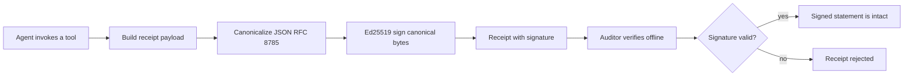
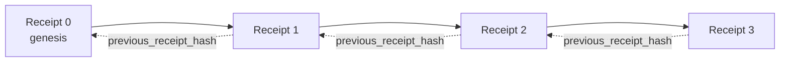

[شاهد فيديو الدرس: تأمين وكلاء الذكاء الاصطناعي باستخدام الإيصالات التشفيرية](https://youtu.be/PLACEHOLDER_VIDEO_ID)

> _(فيديو الدرس والصورة المصغرة سيتم إضافتهما بواسطة فريق محتوى مايكروسوفت بعد الدمج، بما يتوافق مع نمط الدرس 14 / 15.)_

# تأمين وكلاء الذكاء الاصطناعي باستخدام الإيصالات التشفيرية

## مقدمة

يغطي هذا الدرس:

- لماذا تعد آثار التدقيق لوكلاء الذكاء الاصطناعي مهمة للامتثال، وتصحيح الأخطاء، والثقة.
- ما هو الإيصال التشفيري وكيف يختلف عن سجل السجلات غير الموقع.
- كيفية إنتاج إيصال موقع لاستدعاء أداة من قبل الوكيل باستخدام بايثون بسيط.
- كيفية التحقق من الإيصال دون اتصال واكتشاف التلاعب.
- كيفية ربط الإيصالات بحيث يؤدي إزالة أو إعادة ترتيب واحد إلى كسر السلسلة.
- ما الذي تثبّته الإيصالات وما الذي لا تثبّته صراحة.

## أهداف التعلم

بعد إكمال هذا الدرس، ستعرف كيفية:

- تحديد أنماط الفشل التي تحفز توثيق الأصل التشفيري لأفعال الوكيل.
- إنتاج إيصال موقع بواسطة Ed25519 على حمولة JSON معيارية.
- التحقق من الإيصال بشكل مستقل باستخدام المفتاح العام للموثّق فقط.
- اكتشاف التلاعب بإعادة تشغيل التحقق على إيصال معدل.
- بناء تسلسل إيصالات مرتبط بالهاش وشرح سبب أهمية السلسلة.
- التمييز بين حدود ما تثبّته الإيصالات (النسبة، السلامة، الترتيب) وما لا تثبّته (صحة الفعل، صحة السياسة).

## المشكلة: أثر التدقيق لوكيلك

تخيل أنك نشرت وكيلاً للذكاء الاصطناعي لشركة Contoso Travel. يقرأ الوكيل طلبات العملاء، يستدعي API الرحلات للبحث عن الخيارات، ويحجز المقاعد نيابة عن العميل. في الربع الأخير، عالج الوكيل 50,000 حجز.

اليوم وصل المدقق. يسأل سؤالًا بسيطًا: "أرني ما فعله وكيلك."

تسلمه ملفات السجل الخاصة بك. ينظر المدقق إليها ويسأل السؤال الأصعب: "كيف أعرف أن هذه السجلات لم تُعدّل؟"

هذه هي مشكلة أثر التدقيق. تعتمد معظم نشرات الوكلاء اليوم على:

- **سجلات التطبيقات**: يكتبها الوكيل نفسه، ويمكن تعديلها من قبل أي شخص لديه حق الوصول إلى نظام الملفات.
- **خدمات تسجيل الدخول السحابية**: مقاومة للتلاعب على مستوى النظام لكن فقط إذا وثق المدقق مشغل النظام.
- **سجلات معاملات قواعد البيانات**: مناسبة لتغييرات قواعد البيانات لكنها ليست مناسبة لاستدعاءات الأدوات العشوائية.

لا يستطيع أي من هذه الخيارات الإجابة على سؤال المدقق دون أن يضطر المدقق إلى الوثوق بشخص ما (أنت، مزود السحابة الخاص بك، بائع قاعدة البيانات). للاستخدام الداخلي، غالبًا ما يكون هذا الثقة مقبولًا. للعمليات المنظمة (المالية، الرعاية الصحية، أي شيء يخضع لقانون الذكاء الاصطناعي للاتحاد الأوروبي)، فهو غير مقبول.

تضيق الإيصالات التشفيرية هذه المشكلة بجعل بيان موقع يمكن التحقق منه بشكل مستقل. لا يزال المدقق يحتاج إلى سبب خارج النطاق ليثق بمفتاح التوقيع
وبالمكون الذي أنتج البيان. المفتاح المضمن يثبت الاتساق الذاتي،
وليس هوية المصدر أو مكان التنفيذ.


## ما هو الإيصال التشفيري؟

الإيصال هو كائن JSON يسجل ما فعله الوكيل، موقعًا بتوقيع رقمي.



يبدو الإيصال الأدنى كما يلي:

```json
{
  "type": "agent.tool_call.v1",
  "agent_id": "contoso-travel-bot",
  "tool_name": "lookup_flights",
  "tool_args_hash": "sha256:a3f9c1...",
  "result_hash": "sha256:7b2e1d...",
  "policy_id": "contoso-travel-policy-v3",
  "timestamp": "2026-04-25T14:30:00Z",
  "sequence": 47,
  "previous_receipt_hash": "sha256:9d4e6a...",
  "signature": {
    "alg": "EdDSA",
    "sig": "c5af83...",
    "public_key": "8f3b2c..."
  }
}
```

ثلاث خصائص تقوم بالعمل:

1. **التوقيع**. يتم توقيع الإيصال بواسطة بوابة الوكيل باستخدام مفتاح خاص Ed25519. يمكن لأي شخص لديه المفتاح العام المقابل التحقق من التوقيع دون اتصال. يجب على الطرف المعتمد تثبيت هذا المفتاح أو حله من سجل موثوق خارجي خارج الإيصال. يؤدي التلاعب بأي حقل موقع إلى إبطال التوقيع.

2. **الترميز المعياري**. قبل التوقيع، يتم تسلسل الإيصال باستخدام مخطط التقييس JSON Canonicalization Scheme (JCS, RFC 8785). هذا يضمن أن تنفيذين ينتجان نفس الإيصال المنطقي ينتجان نفس البايتات بالضبط. بدون التقييس، تنتج مُسلسلات JSON مختلفة توقيعات مختلفة للمحتوى نفسه.

3. **ربط الهاش**. يربط الحقل `previous_receipt_hash` كل إيصال بالذي قبله. يؤدي إزالة أو إعادة ترتيب إيصال إلى كسر التسلسل المقدم. يتطلب اكتشاف القطع أو إعادة كتابة يتحكم بها الموقع أيضًا تثبيت رأس السلسلة الحالي، أو نقطة تحقق مشهودة مستقلة، أو التزام مصادق عليه من مجتمع مغلق.

توفر هذه الخصائص معًا ثلاث ضمانات:

- **نسبة إلى مفتاح**: هذا المفتاح وقع هذا المحتوى. تتطلب الهوية التنظيمية أو البشرية ربط مفتاح موثوق.
- **السلامة**: لم يتغير المحتوى منذ التوقيع.
- **الترتيب ضمن التسلسل المُثبت**: يربط هذا الإيصال بذلك السابق.

## إنتاج إيصال في بايثون

لا تحتاج إلى مكتبة خاصة لإنتاج إيصال. المتطلبات التشفيرية متوفرة على نطاق واسع والمنطق عدة عشرات من أسطر بايثون.

تمشيك التمارين العملية في `code_samples/18-signed-receipts.ipynb` عبر التدفق الكامل. يسجل `code_samples/18-signed-receipts.execution-receipt.json` الخاضع للتحكم في المصدر التجزئة الدقيقة لدفتر الملاحظات، وبيئة بايثون، وعدد الخلايا، والتحققات من أحدث تنفيذ نظيف دون تغيير مخرجات الدرس المحفوظة. الملخص:

```python
import json
import hashlib
import base64
from nacl import signing
from jcs import canonicalize  # RFC 8785 canonical JSON

def b64url_nopad(data: bytes) -> str:
    return base64.urlsafe_b64encode(data).decode("ascii").rstrip("=")

def sha256_canonical(obj) -> str:
    """SHA-256 of a Python object's JCS-canonical JSON form."""
    return f"sha256:{hashlib.sha256(canonicalize(obj)).hexdigest()}"

# Generate or load a signing key (in production, store in a key vault)
signing_key = signing.SigningKey.generate()
verify_key = signing_key.verify_key
TRUSTED_PUBLIC_KEYS = {b64url_nopad(bytes(verify_key))}  # pinned out of band by the verifier

# Build the receipt payload (no signature yet)
tool_args = {"origin": "SYD", "destination": "LAX"}
tool_result = [{"flight": "QF11", "price": 1850, "stops": 0}]

payload = {
    "type": "agent.tool_call.v1",
    "agent_id": "contoso-travel-bot",
    "tool_name": "lookup_flights",
    "tool_args_hash": sha256_canonical(tool_args),
    "result_hash": sha256_canonical(tool_result),
    "policy_id": "contoso-travel-policy-v3",
    "timestamp": "2026-04-25T14:30:00Z",
    "sequence": 0,
    "previous_receipt_hash": None,
}

# Canonicalize and sign the JCS bytes directly. PureEdDSA hashes internally.
canonical_bytes = canonicalize(payload)
signature_bytes = signing_key.sign(canonical_bytes).signature

# Attach a structured signature object.
receipt = {
    **payload,
    "signature": {
        "alg": "EdDSA",
        "sig": b64url_nopad(signature_bytes),
        "public_key": b64url_nopad(bytes(verify_key)),
    },
}
```

هذه هي كل سلسلة التوقيع. تمشيك التمارين في الدفتر يمر بكل خطوة.

## التحقق من الإيصال واكتشاف التلاعب

التحقق هو العملية المعاكسة:

```python
import base64
import hashlib
from nacl import signing
from nacl.exceptions import CryptoError
from jcs import canonicalize

def b64url_decode(s: str) -> bytes:
    # Strict: Python's decoder skips characters outside the alphabet and also
    # accepts padding, the standard +/ alphabet and non-zero spare bits.
    # Re-encoding and comparing accepts only the one unpadded base64url form.
    padding = "=" * ((4 - len(s) % 4) % 4)
    data = base64.urlsafe_b64decode(s + padding)
    if base64.urlsafe_b64encode(data).decode("ascii").rstrip("=") != s:
        raise ValueError("not canonical unpadded base64url")
    return data

def verify_receipt(receipt: dict, trusted_public_key: str) -> bool:
    # trusted_public_key is the issuer's key, obtained from somewhere other
    # than this receipt. Never use receipt["signature"]["public_key"] here:
    # see "What Receipts Prove (and What They Do Not)" below.
    # Fails closed: anything malformed returns False instead of raising.
    if not isinstance(receipt, dict) or not isinstance(trusted_public_key, str):
        return False
    sig_obj = receipt.get("signature")
    if not isinstance(sig_obj, dict) or sig_obj.get("alg") != "EdDSA":
        return False
    sig_b64 = sig_obj.get("sig")
    if not isinstance(sig_b64, str):
        return False

    try:
        # Reconstruct the payload that was actually signed (everything except signature).
        payload = {k: v for k, v in receipt.items() if k != "signature"}
        canonical_bytes = canonicalize(payload)
        verify_key = signing.VerifyKey(b64url_decode(trusted_public_key))
        verify_key.verify(canonical_bytes, b64url_decode(sig_b64))
        return True
    except (CryptoError, TypeError, ValueError, KeyError, OverflowError):
        return False
    except Exception:
        # An undecodable key or signature, or a payload that cannot be
        # canonicalized: fail closed rather than raise.
        return False
```

تأخذ هذه الدالة إيصالًا والمفتاح العمومي للجهة المصدرة، وتعيد `True` إذا كان التوقيع صحيحًا و`False` خلاف ذلك، بما في ذلك عند إدخال بيانات غير سليمة. لا مكالمة شبكة ولا خدمة تحقق: بمجرد حصولك على مفتاح المصدّر، يكون التحقق محليًا تمامًا ودون اتصال. ما يزال يتطلب ذلك المفتاح، الذي يجب الحصول عليه من مكان خارج الإيصال نفسه.

لرؤية اكتشاف التلاعب عمليًا، يمر الدفتر بـ:

1. إنتاج إيصال صالح والتأكد من صحّة التحقق.
2. تعديل بايت واحد من حقل `tool_args_hash`.
3. إعادة تشغيل التحقق ورؤية فشل العملية.
4. التلاعب مرة أخرى لكن هذه المرة بإعادة التوقيع باستخدام مفتاح أنشأه المهاجم وتضمين ذلك المفتاح في الإيصال.

الخطوة 4 هي التي تستحق التوقف عندها. الإيصال داخليًا متسق: توقيعه أصلي بالنسبة لمحتواه وللمفتاح الذي يحمله، لذا يتحقق من المفتاح الموجود بداخله. يفشل فقط عند التحقق من المفتاح الحقيقي للجهة المصدرة. الخطوتان 2 و3 تلتقطان مهاجمًا لم يبذل جهدًا لإعادة التوقيع؛ الخطوة 4 تلتقط من قام بإعادة التوقيع.

هذا هو الدليل العملي على أن الإيصالات مقاومة للتلاعب: أي تغيير في حقل موقع يكسر التوقيع، شرط التحقق من مفتاح لم يزوّده المهاجم. كائن `signature` نفسه يقع خارج البايتات الموقعة، وهذا هو سبب وجوب أن يأتي المفتاح الذي تتحقق منه من مكان خارج الإيصال.

## ربط الإيصالات لوكلاء متعددين الخطوات

يحمي إيصال موقع واحد فعلًا واحدًا. تحمي سلسلة الإيصالات تسلسلًا.



يسجل كل إيصال هاش الإيصال السابق له. لإزالة الإيصال 2 بهدوء، يحتاج المهاجم إلى إما:

- تعديل حقل `previous_receipt_hash` في الإيصال 3 (يكسر توقيع الإيصال 3)، أو
- تزوير توقيع جديد على الإيصال 3 المعدل (يتطلب المفتاح الخاص للوكيل).

إذا كان المفتاح الخاص في خزانة مفاتيح مادية ويتحقق المصدقون من كل إيصال مقابل المفتاح العام للجهة المصدرة، الذي يتم الحصول عليه بشكل مستقل (مجموعة JWK منشورة أو قيمة تكوين مثبتة)، فلا هجوم من هذين النوعين ممكن دون الكشف. نشر المفتاح داخل كل إيصال ليس كافيًا: يمكن للمهاجم إعادة التوقيع بمفتاحه الخاص وتضمينه بدلًا من ذلك، وهذا هو حقل `04_resigned_receipt.json`.

يمر الدفتر عبر:

1. بناء سلسلة من ثلاثة إيصالات.
2. التحقق من أن حقل `previous_receipt_hash` لكل إيصال يطابق التجزئة الفعلية للإيصال السابق.
3. التلاعب بإيصال في المنتصف ورؤية السلسلة تُكسر عند تلك النقطة بالضبط.

هذه هي الطريقة التي تنتج بها أثر تدقيق يمكن لمدقق خارجي التحقق منه تحت
مفاتيح إصدار مثبتة propias ونقاط تحقق في السلسلة، دون الثقة بمخزن سجلاتك القابل للتغيير.

## ما تثبته الإيصالات (وما لا تثبته)

هذا هو القسم الأهم في هذا الدرس. الإيصالات قوية ولكن قوتها محدودة.

**تثبت الإيصالات ثلاثة أشياء:**

1. **النسبة**: وقع مفتاح محدد حمولة محددة.
2. **السلامة**: لم تتغير الحمولة منذ التوقيع.
3. **الترتيب ضمن تسلسل مقدم ومثبت**: يربط هذا الإيصال بذلك السابق.

**لا تثبت الإيصالات:**

1. **الصحة**: أن يكون فعل الوكيل هو الفعل الصحيح. يمكن توقيع إيصال على إجابة خاطئة بنفس سهولة الإجابة الصحيحة.
2. **الامتثال للسياسة**: أن السياسة المشار إليها في `policy_id` قد قُيمت فعليًا، أو أنها كانت ستسمح بهذا الفعل إذا تم التحقق منها. يسجل الإيصال ما تم الادعاء به، لا ما تم تنفيذه.
3. **الهوية بما يتجاوز المفتاح**: يقول الإيصال "هذا المفتاح وقع هذا المحتوى". لا يقول "هذا الإنسان أذن بذلك". ربط مفتاح بشخص أو منظمة يتطلب بنية هوية منفصلة (دليل، سجل مفاتيح عامة، إلخ).
4. **صدق المدخلات**: إذا تلقى الوكيل مطالبة معدلة وتصرف بناءً عليها، يسجل الإيصال الفعل بأمانة. الإيصالات تلي التحقق من المدخلات وليس بديلاً له.
5. **التنفيذ أو التأثير في العالم الحقيقي**: يسجل إيصال ما بعد الاستدعاء ما يدعيه مصدره أنه حدث. إثبات القبول أو تسوية تأثير خارجي تتطلب أدلة من منفذ الفعل أو حدود المزود الفعلية.
6. **الكمال**: قد يعني غياب الإيصال أنه محتجز، أو محذوف، أو مفقود، أو غير موثق. الغياب يصبح دليلاً فقط ضمن مجتمع مغلق معتمد.
7. **الوقت الموثوق**: يثبت الطابع الزمني الموقع أن الموقع احتفظ بتلك القيمة، لا أن القيمة كانت صحيحة. يحتاج الوقت الموثوق إلى سلطة زمنية منفصلة أو نقطة تحقق مشهودة.

**المفتاح في الإيصال ليس هو المفتاح الذي تتحقق به.** هذا يتبع النقطة 3، وهو المكان الوحيد حيث يجب أن يغير التمييز شفرتك بدلاً من فهمك. `public_key` في المثال أعلاه موجود بحيث يكون المثال مكتفياً بذاته. يجب ألا يثق المدقق به أبداً. يمكن لأي شخص أن يأخذ إيصالاً، يغيّره، يوقّعه باستخدام مفتاح قام بإنشائه، ويضمّن ذلك المفتاح؛ النتيجة تتحقق بشكل مثالي ضد نفسها. هذا هو Fixture `04_resigned_receipt.json` في `sample_receipts/`، ولهذا السبب `verify_receipt` أعلاه يأخذ المفتاح كمعامل بدلاً من قراءته من الإيصال. احصل على مفتاح المُصدر بشكل مستقل، من مجموعة JWK في قائمة التحقق للإنتاج أدناه أو من مرجع آخر ثبتّه مسبقاً، وتحقق بناءً على ذلك. التوقيع الذي تم التحقق منه بمفتاح وصل في نفس الظرف يثبت فقط أن الظرف متماسك ذاتياً.

هذا الحد الفاصل مهم لسببين:

- يخبرك لما الإيصالات مفيدة: لجعل سلوك الوكيل قابل للتدقيق واضح العبث، حتى عبر الحدود التنظيمية.
- يخبرك لما الطبقات الإضافية التي لا تزال تحتاجها: التحقق من صحة الإدخال (الدرس 6)، إنفاذ السياسات (مغطى باختصار أدناه)، وبنية الهوية (خارج نطاق هذا الدرس).

خطأ شائع هو افتراض أن "لدينا إيصالات" يعني "نحن محكومون". لا يعني ذلك. الإيصالات هي الأساس. الحوكمة هي النظام الذي تبنيه فوقها.

## ربط توقيع الموافق بالإجراء الدقيق

النقطة 3 أعلاه تستحق قسمها الخاص: إيصال الإجراء يقول "هذا المفتاح وقع هذا المحتوى"، أبداً "أذن إنسان بهذا." للإجراءات عالية المخاطر (استرداد الأموال، الحذف، التحويلات البنكية)، يمكن لتوقيع موافق منفصل ربط الإجراء الدقيق. ربط ذلك المفتاح بإنسان وفحص وجود الإنسان يبقى مسؤولية منفصلة.

الدفتر التالي `code_samples/human-authorization-receipts.ipynb` يضيف نوع إيصال ثانٍ، `human.approval.v1`، بشكل الغلاف نفسه كإيصالات الدرس (حمولة مكتوبة موقع عليها بـ Ed25519 على بايتات JCS الكانونية، مع كائن `signature` خارج البايتات الموقعة). مفتاح الموافق يوقع **الإجراء الكانوني الكامل وهاشه**؛ مفتاح الوكيل يوقع على تصريح يحمل **نفس هاش الإجراء** و `parent_approval_ref`، `receipt_hash` للموافقة، نفس الاتفاقية كـ `previous_receipt_hash` في السلسلة التي بنيتها أعلاه. أحد `verify_chain` يمشي على كلا الأثرين تحت **سجلات مفاتيح مثبتة منفصلة** (مفاتيح الموافق مقابل مفاتيح الوكيل)، بحيث يُشارك مسار الشفرة لكن السلطات لا تتشارك أبداً.

الخاصية التي يحققها هذا، معلنة بحرص: *المفتاح المثبت للموافق وقع هذا الإجراء بالضبط،*
وامتياز الوكيل وقع لاحقًا على بيان يحمل نفس هاش الإجراء.*
هذا دليل مفيد، لكنه ليس بحد ذاته إثباتاً أن الإجراء نُفذ. للتحكم في التنفيذ، يجب أيضاً حجز ونفاذ الموافقة الدقيقية مرة واحدة فقط عند
حد المنفذ الفعلي؛ يجب أن تظل نتائج المزود المجهولة مجهولة بدلاً من إعادة المحاولة عمياء. يتم اختبار طبقة سلسلة الإيصالات في دفتر الرفض:

- العبث، نائب مرتبك، مفاتيح مزورة على أي من الجانبين، والمدخلات المشوهة؛

- التلاعب، النائب المشوش، المفاتيح المزورة على أي من الجانبين، والمدخلات المشوهة؛
- **سلطة قديمة**: توقيع لا يزال يتحقق منه، مرفوض على أي حال لأن إصدار السياسة تم تغييره، أو تم تدوير مفتاح الموافقة خارج السجل المثبت، أو انتهت صلاحية الموافقة قبل وقت التحقق المقدم؛
- **استبدال التجزئة**: إيصال إجراءات موقع بشكل صحيح يشير إلى موافقة *حقيقية* تلزم إجراءًا قانونيًا *مختلفًا*.

كل فشل يرفض لسبب مميز، لذا يمكن للمراجع الذي يقرأ الرفض معرفة ما إذا كانت السلطة قديمة أو أن الإجراء المطالب به قد تغير. التحقق قراءة فقط وقابل للتكرار: لا يستهلك الموافقة ولا يستدعي مزودًا. يحتاج منفذ منفصل إلى حماية إعادة تشغيل متينة وذرية ونتائج صريحة للنجاح أو الفشل أو الحالات غير المحددة. إيصال الموافقة البشرية هو تركيب تعليمي معرف بواسطة هذا الدرس، وليس نوع إيصال معرف بواسطة `draft-farley-acta-signed-receipts`.

## مراجع الإنتاج

كود بايثون في هذا الدرس مقصود أن يكون بسيطًا حتى تتمكن من قراءة كل سطر وفهم ما يحدث بالضبط. في الإنتاج، لديك خياران:

1. **البناء مباشرة على البنى التشفيرية الأساسية.** الخمسون سطرًا التي رأيتها أعلاه كافية للعديد من حالات الاستخدام. مكتبات PyNaCl (Ed25519) و`jcs` (canonical JSON) مكتبات مُصانة ومدققة جيدًا.

2. **استخدام مكتبة إيصالات للإنتاج.** تنفذ عدة مشاريع مفتوحة المصدر نفس النمط مع ميزات إضافية (تدوير المفاتيح، التحقق الجماعي، توزيع JWK Set، التكامل مع محركات السياسات):
   - يستخدم خط توقيع الإيصالات JCS واتفاقيات نطاق التوقيع في مسودة مستقلة من IETF Internet-Draft ([`draft-farley-acta-signed-receipts`](https://datatracker.ietf.org/doc/draft-farley-acta-signed-receipts/)، المراجعة 02). تختلف إيصال التعليم المسطح في هذا الدرس عن `{payload, signature}` في هذه المسودة ولا يُعرض كتنفيذ متوافق. تنشر المسودة مجموعة توافق مشتركة ([agent-governance-testvectors](https://github.com/ScopeBlind/agent-governance-testvectors)) للتنفيذات التي تستهدف تنسيق السلك الخاص بها.
   - يقوم Microsoft Agent Governance Toolkit بتكوين الإيصالات مع قرارات السياسات المعتمدة على Cedar؛ انظر الدرس 33 في ذلك المستودع لمثال شامل من البداية إلى النهاية.
   - توفر حزمتا `protect-mcp` (npm) و`@veritasacta/verify` (npm) تنفيذًا قائمًا على Node لتوقيع الإيصالات والتحقق غير المتصل، مخصصان لتغليف أي خادم MCP مع سجل تدقيق مقاوم للتلاعب، بما في ذلك تدفق الحجز للتوقيع المشترك حيث تصدر إجراءً متوقّف إقرارًا بالقبول مرتبطًا بهضم الإجراء (مدعوم بـ WebAuthn في تدفق سطح المكتب)، نفس نمط إيصال القبول كما في دفتر تفويض الإنسان أعلاه.
   - يوفر **[nobulex](https://github.com/arian-gogani/nobulex)** حزمة Python SDK (`pip install nobulex`) نفس نمط توقيع Ed25519 + JCS في بايثون مع تكاملات LangChain وCrewAI، بما في ذلك نشر متجهات اختبار التحقق المتقاطع وتخطيط الالتزام المساهم به عبر [OWASP PR #2210](https://github.com/OWASP/CheatSheetSeries/pull/2210).
   - يوفر **[EMILIA Protocol](https://github.com/emiliaprotocol/emilia-protocol)** طبقة تنفيذ الإجراءات الدقيقة التكميلية: إيصالات قبول يمكن التحقق منها غير متصلة، WebAuthn مثبتة أو سلطة الإجماع، استهلاك لمرة واحدة عند حدود المنفذ، ومسار صريح للنتيجة غير المحددة. تتعامل محولات إطار العمل الخاصة به مع الإيصال كدليل ضروري بدلاً من إثبات وقوع تأثير خارجي.

القرار بين بناء مكتبتك الخاصة واستخدام مكتبة يعكس القرار بين كتابة مكتبة JWT الخاصة بك واستخدام مكتبة مجربة: كلاهما معقول؛ المكتبة توفر الوقت وتقلل من مساحة التدقيق؛ النهج من الصفر يجبرك على فهم كل بنية أساسية. يعلمك هذا الدرس مسار البناء من الصفر حتى يكون لديك الأساس لأي خيار.

## اختبار المعرفة

اختبر فهمك قبل الانتقال إلى تمارين التطبيق.

**1. يتم توقيع الإيصال بمفتاح Ed25519 الخاص بالوكيل. المراجع لديه فقط المفتاح العمومي. هل يمكن للمراجع التحقق من الإيصال دون اتصال؟**

<details>
<summary>الإجابة</summary>

نعم، التحقق التشفيري يتطلب فقط المفتاح العمومي والبايتات الموقعة. يجب أن
يحصل المراجع ويثبت المفتاح العمومي المقبول بشكل مستقل عن الإيصال.
لا حاجة لاتصال بالشبكة بعد تأسيس تلك الثقة.
</details>

**2. قام مهاجم بتعديل حقل `policy_id` في الإيصال ليدعي أنه كان محكومًا بسياسة أكثر تساهلاً. كان التوقيع على الحمولة الأصلية. ماذا يحدث أثناء التحقق؟**

<details>
<summary>الإجابة</summary>

يفشل التحقق. تم حساب التوقيع على البايتات القانونية للحمولة الأصلية؛ تعديل أي حقل في الحمولة يغير تلك البايتات، مما يجعل التوقيع غير صالح. يحتاج المهاجم إلى المفتاح الخاص لإنتاج توقيع صالح جديد، وهو غير متوفر له.
</details>

**3. لماذا يتضمن الإيصال `tool_args_hash` و`result_hash` بدلاً من الوسائط والنتيجة الخام؟**

<details>
<summary>الإجابة</summary>

هناك سببان. أولاً، قد يحتاج الإيصال إلى أرشفة أو نقل في بيئات يكون فيها تسرب المحتوى الخام (PII، بيانات الأعمال) مشكلة. يحافظ التجزئة على صغر الإيصال وخصوصية المحتوى؛ يتحقق المراجع من تطابق التجزئة مع نسخة مخزنة بشكل منفصل من المحتوى الفعلي. ثانيًا، التجزئة ذات حجم ثابت؛ الإيصال بتجزئات له حجم محدود بغض النظر عن حجم المدخلات والمخرجات.
</details>

**4. يربط حقل `previous_receipt_hash` كل إيصال بسابقه. إذا حذف مهاجم إيصالًا بهدوء من وسط السلسلة، ماذا يصبح غير صالح؟**

<details>
<summary>الإجابة</summary>

كل إيصال يأتي بعد الإيصال المحذوف. لم تعد حقول `previous_receipt_hash` الخاصة بهم تطابق السلسلة الفعلية (لأن الإيصال الذي كانوا يشيرون إليه لم يعد موجودًا، أو أن السلسلة الآن تشير إلى سابق مختلف). لإخفاء الحذف، يجب أن يعاد توقيع كل إيصال لاحق، وهو ما يتطلب المفتاح الخاص للجهة المُصدرة. يفشل التوقيع من جديد بأي مفتاح آخر عند التحقق مقابل مفتاح الجهة المُصدرة.
</details>

**5. يتم التحقق من الإيصال بشكل نظيف. هل يثبت ذلك أن إجراء الوكيل كان صحيحًا أو سليمًا أو متوافقًا مع السياسة؟**

<details>
<summary>الإجابة</summary>

لا. تحت مفتاح وسياق سلسلة مثبت، يثبت الإيصال الصالح صحة التوقيع،
سلامة المحتوى، ورابطًا إلى السلف المعروض. لا يثبت أن
الإجراء كان صحيحًا أو مُنفذًا، أن السياسة تم تقييمها، أن الطابع الزمني
موثوق، أو أن مجموعة السجلات كاملة. هذا هو الحد الأكثر أهمية في الدرس.
</details>

## تمرين التطوير العملي

افتح `code_samples/18-signed-receipts.ipynb` وأكمل الأقسام الأربعة كلها:

1. **القسم 1**: وقّع إيصالك الأول وتحقق منه.
2. **القسم 2**: عبث بالإيصال ولاحظ فشل التحقق.
3. **القسم 3**: ابنِ سلسلة من ثلاثة إيصالات وتحقق من تكامل السلسلة.
4. **القسم 4**: طبق النمط على وكيل مُبني باستخدام Microsoft Agent Framework: غلف استدعاء أداة بتوقيع الإيصال، ثم تحقق من الإيصال بشكل مستقل.

**تحدي إضافي 1:** مدّد مخطط الإيصال بحقل إضافي من اختيارك (مثل معرف طلب للتتبع)، وحَدِّث منطق التوقيع القانوني ليشمله، وتأكد من أن الإيصال لا يزال يمر بعملية التحقق بنجاح. ثم عدّل الحقل بعد التوقيع وتأكد من فشل التحقق. هذا يجبرك على فهم كيف يساهم كل بايت في الترميز القانوني في التوقيع.

**تحدي التمدد 2:** قم بعمل تجزئة SHA-256 لنسختين من إيصالاتك معًا (بتسلسل بايتاتها الرسمية بترتيب حتمي) وادمج التجزئة الناتجة كحقل جديد في إيصال ثالث قبل توقيعه. تحقق من أن جميع الإيصالات الثلاثة لا تزال قابلة للعودة. لقد بنيت للتو دليل إدراج خطوة واحدة: يمكن لأي شخص يحمل الإيصال الثالث أن يثبت أن الإيصالين الأولين كانا موجودين في وقت توقيعه، دون الحاجة إلى الكشف عن محتوياتهما. هذا هو النمط الذي تستخدمه الإيصالات الانتقائية للكشف على نطاق واسع (التزامات ميركل، RFC 6962).

## الخاتمة

توفر الإيصالات التشفيرية لوكلاء الذكاء الاصطناعي سجل تدقيق يكون:

- **قابل للتحقق بشكل مستقل تحت ثقة مثبتة**: يمكن لطرف يمتلك المفاتيح العامة المقبولة والبايتات الموقعة التحقق بدون الاعتماد على خدمة.
- **مقاوم للتلاعب**: أي تعديل يبطل التوقيع.
- **قابل للنقل**: الإيصال هو ملف JSON صغير؛ يمكن أرشفته ونقله والتحقق منه في أي مكان.
- **متوافق مع المعايير**: مبني على Ed25519 (RFC 8032)، JCS (RFC 8785)، و SHA-256، جميعها بدائل مستخدمة على نطاق واسع.

ليست بديلاً عن التحقق من صحة الإدخال، تطبيق السياسات، قبول المنفذ، أدلة النتائج، ضوابط الاكتمال، أو بنية الهوية. هي أساس لتلك الطبقات. في بيئات منظمة أو متعددة المؤسسات، تجعل الإيصالات بيانات الجهات المصدرة المحددة قابلة للتحقق بشكل مستقل ضمن تكوين الثقة للمراجع.

النقطة الأهم: تثبت الإيصالات أن مفتاحًا معينًا وقع محتوى معينًا. التاريخ المحمّل هو تصريح بالتوقيع ما لم يُثبت زمنه بشكل منفصل. لا يثبت الإيصال أن المحتوى كان صحيحًا، أو أن الإجراء نُفذ، أو أن مجموعة السجلات كاملة. احرص على هذه الفروق.


عندما تكون مستعدًا للانتقال من هذا الدرس إلى نشر وكلاء موقعين بالإيصالات في بيئة حقيقية:

- [ ] **انقل مفتاح التوقيع بعيدًا عن لابتوب المطور.** استخدم Azure Key Vault، AWS KMS، أو وحدة أمان الأجهزة. يجب ألا يعيش المفتاح الخاص الذي يوقع إيصالاتك أبدًا ضمن التحكم في المصدر أو كنص عادي على أجهزة التطبيق.

- [ ] **ثبت السلسلة خارجيًا.** اكتب دوريًا تجزئة رأس السلسلة الأخيرة إلى سجل شفاف (Sigstore Rekor، سلطة توقيت RFC 3161، أو نظام داخلي ثانٍ) حتى يتمكن طرف خارجي من التأكد من "وجود هذه السلسلة في هذا الوقت".

- [ ] **قرر سياسة الاحتفاظ.** تتطلب العديد من لوائح الامتثال الاحتفاظ لسنوات متعددة. خطط لنمو الإيصالات (كل إيصال حوالي 500 بايت؛ الوكيل الذي يجري 10 آلاف مكالمة يوميًا ينتج نحو 1.8 جيجابايت سنويًا).


### هل لديك المزيد من الأسئلة حول تأمين وكلاء الذكاء الاصطناعي؟

- [ ] **تخزين الإيصالات بشكل غير قابل للتغيير.** يمنع تخزين الكتل القابل للإضافة فقط (تخزين Azure مع سياسات عدم القابلية للتغيير، قفل الكائن في AWS S3) المطلعين من إعادة كتابة التاريخ على طبقة التخزين.
- [ ] **حدد سياسة الاحتفاظ.** تتطلب العديد من نظم الامتثال الاحتفاظ لسنوات متعددة. خطط لنمو الإيصالات (كل إيصال يبلغ حجمه حوالي 500 بايت؛ حيث ينتج وكيل يُجري 10 آلاف مكالمة يوميًا حوالي 1.8 جيجابايت سنويًا).
- [ ] **وثق ما لا تغطيه الإيصالات.** تثبت الإيصالات النسبية، والسلامة، والترتيب. يجب أن يسرد دليل التشغيل الخاص بك بوضوح ما هي الضوابط الإضافية (التحقق من صحة الإدخال، تنفيذ السياسات، تحديد المعدل، بنية الهوية) التي تجاور الإيصالات في موقف الحوكمة الخاص بك.

### هل لديك المزيد من الأسئلة حول تأمين وكلاء الذكاء الاصطناعي؟

انضم إلى [Microsoft Foundry Discord](https://aka.ms/ai-agents/discord) للتواصل مع متعلمين آخرين، وحضور ساعات المكتب، والحصول على إجابات لأسئلتك حول وكلاء الذكاء الاصطناعي.

## ما بعد هذا الدرس

يغطي هذا الدرس توقيع الإيصال المفرد وتسلسلات السلاسل المجزأة. تتكون هذه البدائل الأساسية نفسها في عدة أنماط أكثر تقدمًا قد تواجهها مع نضج موقف الحوكمة الخاص بك:

- **الإفصاح الانتقائي.** عندما يتم الالتزام بحقول الإيصال بشكل مستقل (شجرة ميركل على نمط RFC 6962)، يمكنك الكشف عن حقول معينة لمراجعين محددين وإثبات أن الباقي لم يتغير دون الكشف عنها. مفيد عندما يجب على نفس الإيصال تلبية كل من مراجعة شاملة (التي تريد الكمال) ولوائح تقليل البيانات مثل GDPR (التي تريد أن يرى المراجع أقل ما يمكن).
- **إلغاء الإيصال.** إذا تم اختراق مفتاح التوقيع، تحتاج إلى طريقة لوضع علامة على جميع الإيصالات الموقعة بذلك المفتاح على أنها غير موثوقة من نقطة زمنية معينة فصاعدًا. الأنماط القياسية: مفاتيح توقيع قصيرة الأمد مع قائمة إلغاء منشورة، أو سجل شفافية مع إدخالات إلغاء.
- **الإيصالات الثنائية / توقيعات مقسمة.** بعض التطبيقات تقسم الحمولة الموقعة إلى نصف ما قبل التنفيذ (`authorization_*`) ونصف ما بعد التنفيذ (`result_*`) مع توقيعات مستقلة، مفيدة عندما يتم اتخاذ قرار التفويض وإنتاج النتيجة المرصودة بواسطة أطراف أو أوقات مختلفة. يتم تركيب هذا بشكل تراكمي على تنسيق الإيصال الذي تم تدريسه في هذا الدرس.
- **تركيب الحمولة.** يختم الإيصال أياً كانت البايتات التي تضعها في `result_hash`. غالبًا ما تكون الحمولات الواقعية أغنى من نتيجة استدعاء أداة واحدة: يمكن أن يعيش داخل الحمولة تفسير ما قبل القرار (تنبؤ النموذج، الخيارات التي تم النظر فيها، الأدلة وكمالها، الموقف المخاطري، سلسلة المساءلة، نتيجة البوابة)، مختومة بواسطة إيصال واحد. يحافظ هذا على تنسيق الإيصال بسيطًا بينما يسمح لمخططات الحمولة بالتطور مجالًا بعد آخر.
- **التوافق بين التطبيقات المختلفة.** تتحقق عدة تطبيقات مستقلة لنفس تنسيق الإيصال (Python، TypeScript، Rust، Go) من صحة بعضها البعض عبر متجهات اختبار مشتركة. إذا بنيت تطبيقك الخاص، فإن التحقق من صحة مقابل المتجهات المنشورة يؤكد توافق الأسلاك.
- **الهجرة بعد الكم.** Ed25519 منتشر على نطاق واسع اليوم لكنه ليس مقاومًا للكم. مجرد وجود تسمية `alg` لا يعني الهجرة: يجب أن يعرف الملف الشخصي ترميز مفتاح ML-DSA، البايتات الموقعة الرسمية، التحقق، سياسة الطرف المعتمد، مقاومة الانخفاض، ودلالات الانتقال. خطط واختبر انتقال توقيع مزدوج مقابل متجهات مشتركة قبل تقديم ادعاءات التوافق.

## موارد إضافية

- <a href="https://datatracker.ietf.org/doc/draft-farley-acta-signed-receipts/" target="_blank">مسودة IETF للإنترنت: إيصالات قرارات موقعة للتحكم في الوصول بين الآلات</a>
- <a href="https://learn.microsoft.com/azure/ai-studio/responsible-use-of-ai-overview" target="_blank">نظرة عامة على الذكاء الاصطناعي المسؤول (Azure AI)</a>
- <a href="https://datatracker.ietf.org/doc/html/rfc8032" target="_blank">RFC 8032: خوارزمية التوقيع الرقمي لمنحنى إدواردز (EdDSA)</a>
- <a href="https://datatracker.ietf.org/doc/html/rfc8785" target="_blank">RFC 8785: مخطط تقنين JSON (JCS)</a>
- <a href="https://datatracker.ietf.org/doc/html/rfc6962" target="_blank">RFC 6962: شفافية الشهادة</a> (بناء شجرة ميركل المستخدم في إيصالات الإفصاح الانتقائي)
- <a href="https://github.com/microsoft/agent-governance-toolkit/blob/main/docs/tutorials/33-offline-verifiable-receipts.md" target="_blank">أداة حوكمة الوكلاء من Microsoft، الدرس 33: إيصالات قرارات يمكن التحقق منها دون اتصال</a>
- <a href="https://github.com/ScopeBlind/agent-governance-testvectors" target="_blank">متجهات اختبار التوافق عبر التنفيذ</a> لتنسيق الإيصال المستخدم في هذا الدرس (Apache-2.0)
- <a href="https://pynacl.readthedocs.io/" target="_blank">توثيق PyNaCl</a> (Ed25519 في بايثون)

## الدرس السابق

[إنشاء وكلاء الذكاء الاصطناعي المحليين](../17-creating-local-ai-agents/README.md)

---

<!-- CO-OP TRANSLATOR DISCLAIMER START -->
**تنويه**:
تمت ترجمة هذا المستند باستخدام خدمة الترجمة بالذكاء الاصطناعي [Co-op Translator](https://github.com/Azure/co-op-translator). بينما نسعى للدقة، يرجى العلم أن الترجمات الآلية قد تحتوي على أخطاء أو عدم دقة. يجب اعتبار المستند الأصلي بلغته الأصلية المصدر الرسمي والمعتمد. للمعلومات الهامة، يُنصح بالاستعانة بترجمة بشرية محترفة. نحن غير مسؤولين عن أي سوء فهم أو تفسير ناتج عن استخدام هذه الترجمة.
<!-- CO-OP TRANSLATOR DISCLAIMER END -->