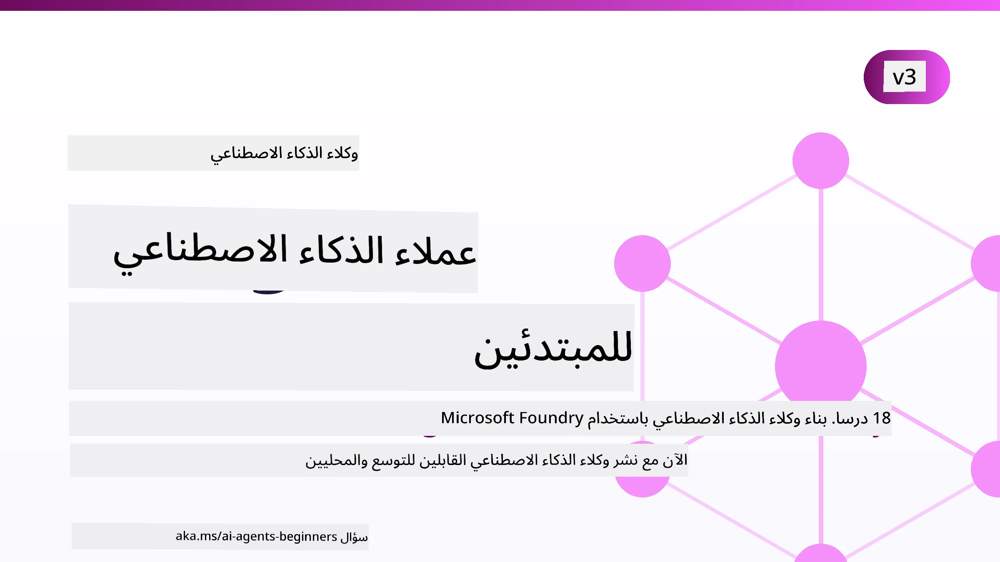

# وكلاء الذكاء الاصطناعي للمبتدئين - دورة تعليمية



## دورة تُعلّم كل ما تحتاج إلى معرفته لبدء بناء وكلاء الذكاء الاصطناعي

[](https://github.com/microsoft/ai-agents-for-beginners/blob/master/LICENSE?WT.mc_id=academic-105485-koreyst)
[](https://GitHub.com/microsoft/ai-agents-for-beginners/graphs/contributors/?WT.mc_id=academic-105485-koreyst)
[](https://GitHub.com/microsoft/ai-agents-for-beginners/issues/?WT.mc_id=academic-105485-koreyst)
[](https://GitHub.com/microsoft/ai-agents-for-beginners/pulls/?WT.mc_id=academic-105485-koreyst)
[](http://makeapullrequest.com?WT.mc_id=academic-105485-koreyst)

### 🌐 دعم لغات متعددة

#### ترجمات تتم صيانتها باستخدام [Co-op Translator](https://github.com/Azure/co-op-translator)

<!-- CO-OP TRANSLATOR LANGUAGES TABLE START -->
[Arabic](./README.md) | [Bengali](../bn/README.md) | [Bulgarian](../bg/README.md) | [Burmese (Myanmar)](../my/README.md) | [Chinese (Simplified)](../zh-CN/README.md) | [Chinese (Traditional, Hong Kong)](../zh-HK/README.md) | [Chinese (Traditional, Macau)](../zh-MO/README.md) | [Chinese (Traditional, Taiwan)](../zh-TW/README.md) | [Croatian](../hr/README.md) | [Czech](../cs/README.md) | [Danish](../da/README.md) | [Dutch](../nl/README.md) | [Estonian](../et/README.md) | [Finnish](../fi/README.md) | [French](../fr/README.md) | [German](../de/README.md) | [Greek](../el/README.md) | [Hebrew](../he/README.md) | [Hindi](../hi/README.md) | [Hungarian](../hu/README.md) | [Indonesian](../id/README.md) | [Italian](../it/README.md) | [Japanese](../ja/README.md) | [Kannada](../kn/README.md) | [Khmer](../km/README.md) | [Korean](../ko/README.md) | [Lithuanian](../lt/README.md) | [Malay](../ms/README.md) | [Malayalam](../ml/README.md) | [Marathi](../mr/README.md) | [Nepali](../ne/README.md) | [Nigerian Pidgin](../pcm/README.md) | [Norwegian](../no/README.md) | [Persian (Farsi)](../fa/README.md) | [Polish](../pl/README.md) | [Portuguese (Brazil)](../pt-BR/README.md) | [Portuguese (Portugal)](../pt-PT/README.md) | [Punjabi (Gurmukhi)](../pa/README.md) | [Romanian](../ro/README.md) | [Russian](../ru/README.md) | [Serbian (Cyrillic)](../sr/README.md) | [Slovak](../sk/README.md) | [Slovenian](../sl/README.md) | [Spanish](../es/README.md) | [Swahili](../sw/README.md) | [Swedish](../sv/README.md) | [Tagalog (Filipino)](../tl/README.md) | [Tamil](../ta/README.md) | [Telugu](../te/README.md) | [Thai](../th/README.md) | [Turkish](../tr/README.md) | [Ukrainian](../uk/README.md) | [Urdu](../ur/README.md) | [Vietnamese](../vi/README.md)

> **تفضل الاستنساخ محليًا؟**
>
> هذا المستودع يشمل ترجمات لأكثر من 50 لغة مما يزيد حجم التنزيل بشكل كبير. للاستنساخ بدون الترجمات، استخدم الاستعانة الانتقائية:
>
> **باش / macOS / لينكس:**
> ```bash
> git clone --filter=blob:none --sparse https://github.com/microsoft/ai-agents-for-beginners.git
> cd ai-agents-for-beginners
> git sparse-checkout set --no-cone '/*' '!translations' '!translated_images'
> ```
>
> **CMD (ويندوز):**
> ```cmd
> git clone --filter=blob:none --sparse https://github.com/microsoft/ai-agents-for-beginners.git
> cd ai-agents-for-beginners
> git sparse-checkout set --no-cone "/*" "!translations" "!translated_images"
> ```
>
> هذا يمنحك كل ما تحتاجه لإكمال الدورة مع تنزيل أسرع بكثير.
<!-- CO-OP TRANSLATOR LANGUAGES TABLE END -->

**لمزيد من خيارات اللغات، راجع [اللغات المدعومة في Co-op Translator](https://github.com/Azure/co-op-translator/blob/main/docs/supported-languages.md).**

[](https://GitHub.com/microsoft/ai-agents-for-beginners/watchers/?WT.mc_id=academic-105485-koreyst)
[](https://GitHub.com/microsoft/ai-agents-for-beginners/network/?WT.mc_id=academic-105485-koreyst)
[](https://GitHub.com/microsoft/ai-agents-for-beginners/stargazers/?WT.mc_id=academic-105485-koreyst)

[](https://discord.com/invite/ATgtXmAS5D)


## 🌱 بدء الاستخدام

تغطي هذه الدورة دروسًا أساسية لبناء وكلاء الذكاء الاصطناعي. كل درس يغطي موضوعه الخاص لذا يمكنك البدء من حيث تشاء!

يتوفر دعم متعدد اللغات لهذه الدورة. اذهب إلى [اللغات المتاحة هنا](#-multi-language-support).

إذا كانت هذه هي المرة الأولى التي تبني فيها باستخدام نماذج الذكاء الاصطناعي التوليدية، اطلع على دورة [الذكاء الاصطناعي التوليدي للمبتدئين](https://aka.ms/genai-beginners) التي تشمل 21 درسًا عن البناء باستخدام GenAI.

لا تنسَ [وضع نجمة (🌟) على هذا المستودع](https://docs.github.com/en/get-started/exploring-projects-on-github/saving-repositories-with-stars?WT.mc_id=academic-105485-koreyst) و[تفرع هذا المستودع](https://github.com/microsoft/ai-agents-for-beginners/fork) لتشغيل الكود.

### التقاء المتعلمين الآخرين، والحصول على إجابات لأسئلتك

إذا واجهتك صعوبات أو كان لديك أسئلة حول بناء وكلاء الذكاء الاصطناعي، انضم إلى قناتنا المخصصة على ديسكورد في [Microsoft Foundry Discord](https://aka.ms/ai-agents/discord).

### ما تحتاجه

كل درس في هذه الدورة يحتوي على أمثلة برمجية يمكن العثور عليها في مجلد code_samples. يمكنك [تفرع هذا المستودع](https://github.com/microsoft/ai-agents-for-beginners/fork) لإنشاء نسختك الخاصة.

تستفيد أمثلة الكود في هذه التمارين من Microsoft Agent Framework مع Microsoft Foundry Agent Service V2:

- [Microsoft Foundry](https://aka.ms/ai-agents-beginners/ai-foundry) - يتطلب حساب Azure

تستخدم هذه الدورة أطر عمل وخدمات وكلاء الذكاء الاصطناعي التالية من مايكروسوفت:

- [Microsoft Agent Framework (MAF)](https://learn.microsoft.com/agent-framework/overview/)
- [Microsoft Foundry Agent Service V2](https://aka.ms/ai-agents-beginners/ai-agent-service)

تدعم بعض عينات الكود أيضًا مزودين بديلين متوافقين مع OpenAI مثل [MiniMax](https://platform.minimaxi.com/)، الذي يقدم نماذج ذات سياق كبير (حتى 204 ألف رمز). راجع [إعداد الدورة](./00-course-setup/README.md) لمزيد من التفاصيل.

لمزيد من المعلومات حول تشغيل الكود لهذه الدورة، راجع [إعداد الدورة](./00-course-setup/README.md).

## 🙏 هل ترغب بالمساعدة؟

هل لديك اقتراحات أو وجدت أخطاء إملائية أو برمجية؟ [افتح مسألة](https://github.com/microsoft/ai-agents-for-beginners/issues?WT.mc_id=academic-105485-koreyst) أو [أنشئ طلب سحب](https://github.com/microsoft/ai-agents-for-beginners/pulls?WT.mc_id=academic-105485-koreyst)


## 📂 كل درس يتضمن

- درسًا مكتوبًا موجودًا في README وفيديو قصير
- أمثلة كود بايثون تستخدم Microsoft Agent Framework مع Microsoft Foundry
- روابط لموارد إضافية لمواصلة التعلم


## 🗃️ الدروس

| **الدرس**                                   | **النص والكود**                                    | **الفيديو**                                                  | **تعلم إضافي**                                                                     |
|----------------------------------------------|----------------------------------------------------|------------------------------------------------------------|----------------------------------------------------------------------------------------|
| مقدمة عن وكلاء الذكاء الاصطناعي وحالات استخدام الوكيل       | [رابط](./01-intro-to-ai-agents/README.md)          | [فيديو](https://youtu.be/3zgm60bXmQk?si=z8QygFvYQv-9WtO1)  | [رابط](https://aka.ms/ai-agents-beginners/collection?WT.mc_id=academic-105485-koreyst) |
| استكشاف أطر عمل وكلاء الذكاء الاصطناعي              | [رابط](./02-explore-agentic-frameworks/README.md)  | [فيديو](https://youtu.be/ODwF-EZo_O8?si=Vawth4hzVaHv-u0H)  | [رابط](https://aka.ms/ai-agents-beginners/collection?WT.mc_id=academic-105485-koreyst) |
| فهم أنماط تصميم وكلاء الذكاء الاصطناعي     | [رابط](./03-agentic-design-patterns/README.md)     | [فيديو](https://youtu.be/m9lM8qqoOEA?si=BIzHwzstTPL8o9GF)  | [رابط](https://aka.ms/ai-agents-beginners/collection?WT.mc_id=academic-105485-koreyst) |
| نمط تصميم استخدام الأدوات                      | [رابط](./04-tool-use/README.md)                    | [فيديو](https://youtu.be/vieRiPRx-gI?si=2z6O2Xu2cu_Jz46N)  | [رابط](https://aka.ms/ai-agents-beginners/collection?WT.mc_id=academic-105485-koreyst) |
| RAG الوكلي                                  | [رابط](./05-agentic-rag/README.md)                 | [فيديو](https://youtu.be/WcjAARvdL7I?si=gKPWsQpKiIlDH9A3)  | [رابط](https://aka.ms/ai-agents-beginners/collection?WT.mc_id=academic-105485-koreyst) |
| بناء وكلاء ذكاء اصطناعي موثوقين               | [رابط](./06-building-trustworthy-agents/README.md) | [فيديو](https://youtu.be/iZKkMEGBCUQ?si=jZjpiMnGFOE9L8OK ) | [رابط](https://aka.ms/ai-agents-beginners/collection?WT.mc_id=academic-105485-koreyst) |
| نمط تصميم التخطيط                      | [رابط](./07-planning-design/README.md)             | [فيديو](https://youtu.be/kPfJ2BrBCMY?si=6SC_iv_E5-mzucnC)  | [رابط](https://aka.ms/ai-agents-beginners/collection?WT.mc_id=academic-105485-koreyst) |
| نمط تصميم الوكلاء المتعددين                   | [رابط](./08-multi-agent/README.md)                 | [فيديو](https://youtu.be/V6HpE9hZEx0?si=rMgDhEu7wXo2uo6g)  | [رابط](https://aka.ms/ai-agents-beginners/collection?WT.mc_id=academic-105485-koreyst) |
| نمط التصميم الاستدراكي                 | [رابط](./09-metacognition/README.md)               | [فيديو](https://youtu.be/His9R6gw6Ec?si=8gck6vvdSNCt6OcF)  | [رابط](https://aka.ms/ai-agents-beginners/collection?WT.mc_id=academic-105485-koreyst) |
| وكلاء الذكاء الاصطناعي في الإنتاج                      | [رابط](./10-ai-agents-production/README.md)        | [فيديو](https://youtu.be/l4TP6IyJxmQ?si=31dnhexRo6yLRJDl)  | [رابط](https://aka.ms/ai-agents-beginners/collection?WT.mc_id=academic-105485-koreyst) |
| استخدام بروتوكولات الوكلاء (MCP، A2A و NLWeb) | [رابط](./11-agentic-protocols/README.md)           | [فيديو](https://youtu.be/X-Dh9R3Opn8)                                 | [رابط](https://aka.ms/ai-agents-beginners/collection?WT.mc_id=academic-105485-koreyst) |
| هندسة السياق لوكلاء الذكاء الاصطناعي            | [رابط](./12-context-engineering/README.md)         | [فيديو](https://youtu.be/F5zqRV7gEag)                                 | [رابط](https://aka.ms/ai-agents-beginners/collection?WT.mc_id=academic-105485-koreyst) |
| إدارة ذاكرة الوكلاء                      | [رابط](./13-agent-memory/README.md)     |      [فيديو](https://youtu.be/QrYbHesIxpw?si=vZkVwKrQ4ieCcIPx)                                                      |                                                                                        |
| استكشاف Microsoft Agent Framework                         | [رابط](./14-microsoft-agent-framework/README.md)                            |                                                            |                                                                                        |
| بناء وكلاء استخدام الحاسوب (CUA)           | [رابط](./15-browser-use/README.md)     |                                                            | [رابط](https://docs.browser-use.com/examples/templates/playwright-integration)         |
| نشر وكلاء قابلين للتوسع                    | [رابط](./16-deploying-scalable-agents/README.md) |                                                    | [رابط](https://learn.microsoft.com/azure/ai-foundry/agents/overview)                   |
| إنشاء وكلاء ذكاء اصطناعي محليين                     | [رابط](./17-creating-local-ai-agents/README.md)  |                                                    | [رابط](https://learn.microsoft.com/azure/ai-foundry/foundry-local/)                    |
| تأمين وكلاء الذكاء الاصطناعي                           | [رابط](./18-securing-ai-agents/README.md)  |                                                            | [رابط](https://aka.ms/ai-agents-beginners/collection?WT.mc_id=academic-105485-koreyst) |

## 🎒 دورات أخرى

ينتج فريقنا دورات أخرى! اطلع على:

<!-- CO-OP TRANSLATOR OTHER COURSES START -->
### LangChain
[](https://aka.ms/langchain4j-for-beginners)
[](https://aka.ms/langchainjs-for-beginners?WT.mc_id=m365-94501-dwahlin)
[](https://github.com/microsoft/langchain-for-beginners?WT.mc_id=m365-94501-dwahlin)
---

### Azure / Edge / MCP / Agents
[](https://github.com/microsoft/AZD-for-beginners?WT.mc_id=academic-105485-koreyst)
[](https://github.com/microsoft/edgeai-for-beginners?WT.mc_id=academic-105485-koreyst)
[](https://github.com/microsoft/mcp-for-beginners?WT.mc_id=academic-105485-koreyst)
[](https://github.com/microsoft/ai-agents-for-beginners?WT.mc_id=academic-105485-koreyst)

---
 
### سلسلة الذكاء الاصطناعي التوليدي
[](https://github.com/microsoft/generative-ai-for-beginners?WT.mc_id=academic-105485-koreyst)
[-9333EA?style=for-the-badge&labelColor=E5E7EB&color=9333EA)](https://github.com/microsoft/Generative-AI-for-beginners-dotnet?WT.mc_id=academic-105485-koreyst)
[-C084FC?style=for-the-badge&labelColor=E5E7EB&color=C084FC)](https://github.com/microsoft/generative-ai-for-beginners-java?WT.mc_id=academic-105485-koreyst)
[-E879F9?style=for-the-badge&labelColor=E5E7EB&color=E879F9)](https://github.com/microsoft/generative-ai-with-javascript?WT.mc_id=academic-105485-koreyst)

---
 
### التعلم الأساسي
[](https://aka.ms/ml-beginners?WT.mc_id=academic-105485-koreyst)
[](https://aka.ms/datascience-beginners?WT.mc_id=academic-105485-koreyst)
[](https://aka.ms/ai-beginners?WT.mc_id=academic-105485-koreyst)
[](https://github.com/microsoft/Security-101?WT.mc_id=academic-96948-sayoung)
[](https://aka.ms/webdev-beginners?WT.mc_id=academic-105485-koreyst)
[](https://aka.ms/iot-beginners?WT.mc_id=academic-105485-koreyst)
[](https://github.com/microsoft/xr-development-for-beginners?WT.mc_id=academic-105485-koreyst)

---
 
### سلسلة كوبيلوت
[](https://aka.ms/GitHubCopilotAI?WT.mc_id=academic-105485-koreyst)
[](https://github.com/microsoft/mastering-github-copilot-for-dotnet-csharp-developers?WT.mc_id=academic-105485-koreyst)
[](https://github.com/microsoft/CopilotAdventures?WT.mc_id=academic-105485-koreyst)
<!-- CO-OP TRANSLATOR OTHER COURSES END -->

## 🌟 شكر المجتمع

شكرًا لـ [شيفام جويل](https://www.linkedin.com/in/shivam2003/) لمساهمته بأمثلة مهمة للرمز تُظهر Agentic RAG.

## المساهمة

يرحب هذا المشروع بالمساهمات والاقتراحات. تتطلب معظم المساهمات موافقتك على
اتفاقية ترخيص المساهمة (CLA) التي تُصرح بأن لديك الحق في، وأنك بالفعل تمنحنا
الحقوق لاستخدام مساهمتك. للتفاصيل، قم بزيارة <https://cla.opensource.microsoft.com>.

عند تقديم طلب سحب، سيحدد بوت CLA تلقائيًا ما إذا كنت بحاجة إلى تقديم
الاتفاقية ويُزيّن طلب السحب وفقًا لذلك (مثل، فحص الحالة، التعليق). ببساطة اتبع التعليمات
التي يقدمها البوت. ستحتاج للقيام بذلك مرة واحدة فقط لكل المستودعات التي تستخدم اتفاقيتنا.

اعتمد هذا المشروع [مدونة قواعد السلوك مفتوحة المصدر من مايكروسوفت](https://opensource.microsoft.com/codeofconduct/).
للمزيد من المعلومات، راجع [الأسئلة الشائعة عن مدونة السلوك](https://opensource.microsoft.com/codeofconduct/faq/) أو
اتصل بـ [opencode@microsoft.com](mailto:opencode@microsoft.com) لأي أسئلة أو تعليقات إضافية.

## العلامات التجارية

قد يحتوي هذا المشروع على علامات تجارية أو شعارات لمشاريع، منتجات، أو خدمات. يجب أن يكون الاستخدام المخول لعلامات
مايكروسوفت التجارية أو شعاراتها ملتزمًا ويتبع
[إرشادات العلامات التجارية والهوية الخاصة بمايكروسوفت](https://www.microsoft.com/legal/intellectualproperty/trademarks/usage/general).
يجب ألا يؤدي استخدام علامات أو شعارات مايكروسوفت في نسخ معدلة من هذا المشروع إلى الالتباس أو الإيحاء برعاية مايكروسوفت.
أي استخدام لعلامات تجارية أو شعارات لطرف ثالث يخضع لسياسات تلك الأطراف.

## الحصول على المساعدة


إذا واجهت مشكلة أو لديك أي أسئلة حول بناء تطبيقات الذكاء الاصطناعي، انضم إلى:

[](https://aka.ms/foundry/discord)

إذا كان لديك ملاحظات على المنتج أو أخطاء أثناء البناء، قم بزيارة:

[](https://aka.ms/foundry/forum)

---

<!-- CO-OP TRANSLATOR DISCLAIMER START -->
**تنويه**:
تمت ترجمة هذا المستند باستخدام خدمة الترجمة بالذكاء الاصطناعي [Co-op Translator](https://github.com/Azure/co-op-translator). بينما نسعى للدقة، يرجى العلم أن الترجمات الآلية قد تحتوي على أخطاء أو عدم دقة. يجب اعتبار المستند الأصلي بلغته الأصلية المصدر الرسمي والمعتمد. للمعلومات الهامة، يُنصح بالاستعانة بترجمة بشرية محترفة. نحن غير مسؤولين عن أي سوء فهم أو تفسير ناتج عن استخدام هذه الترجمة.
<!-- CO-OP TRANSLATOR DISCLAIMER END -->