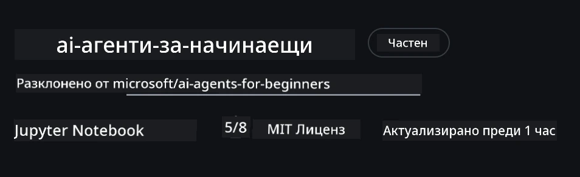
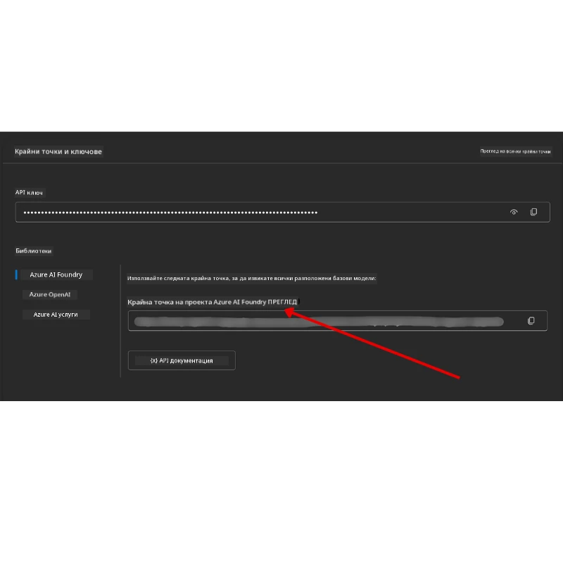

# Настройка на курса

## Въведение

Този урок ще обхване как да стартирате примерите с код от този курс.

## Присъединете се към други обучаващи се и потърсете помощ

Преди да започнете с клонирането на вашето хранилище, присъединете се към [AI Agents For Beginners Discord канала](https://aka.ms/ai-agents/discord), за да получите помощ с настройката, въпроси относно курса или за свързване с други обучаващи се.

## Клониране или Форкване на това хранилище

За да започнете, моля клонирайте или форкнете GitHub хранилището. Това ще създаде ваша версия на материалите от курса, така че да можете да стартирате, тествате и променяте кода!

Това може да бъде направено като кликнете върху връзката за <a href="https://github.com/microsoft/ai-agents-for-beginners/fork" target="_blank">форкване на хранилището</a>

Сега трябва да имате собствена форкната версия на този курс на следния линк:



### Повърхностно клониране (препоръчително за работилници / Codespaces)

  > Пълното хранилище може да е голямо (~3 GB), ако изтеглите цялата история и всички файлове. Ако посещавате само работилницата или се нуждаете само от няколко папки с уроци, повърхностното клониране (или частично клониране) изтегля много по-малко.

#### Бързо повърхностно клониране — минимална история, всички файлове

Заменете `<your-username>` в командите по-долу с URL адреса на вашия форк (или изходния URL, ако предпочитате).

За да клонирате само най-новата история на комитите (малко теглене):

```bash
git clone --depth 1 https://github.com/<your-username>/ai-agents-for-beginners.git
```

За да клонирате конкретен клон:

```bash
git clone --depth 1 --branch <branch-name> https://github.com/<your-username>/ai-agents-for-beginners.git
```

#### Частично (разредено) клониране — минимални блобове + само избрани папки

Това използва частично клониране и sparse-checkout (изисква Git 2.25+ и препоръчително съвременен Git с поддръжка на частично клониране):

```bash
git clone --depth 1 --filter=blob:none --sparse https://github.com/<your-username>/ai-agents-for-beginners.git
```

Влезте в папката на хранилището:

```bash
cd ai-agents-for-beginners
```

След това посочете кои папки искате (примерът по-долу показва две папки):

```bash
git sparse-checkout set 00-course-setup 01-intro-to-ai-agents
```

След клониране и проверка на файловете, ако имате нужда само от файловете и искате да освободите място (без историята от git), моля, изтрийте метаданните на хранилището (💀необратимо — ще загубите цялата функционалност на Git):

```bash
# zsh/bash
rm -rf .git
```

```powershell
# PowerShell
Remove-Item -Recurse -Force .git
```

#### Използване на GitHub Codespaces (препоръчва се за избягване на локални големи изтегляния)

- Създайте нов Codespace за това хранилище чрез [GitHub UI](https://github.com/codespaces).  

- В терминала на новосъздадения codespace изпълнете една от горните команди за повърхностно или разредено клониране, за да донесете само нужните ви папки с уроци в работната среда на Codespace.
- По желание: след клониране в Codespaces премахнете .git за да възстановите допълнително място (виж командите за премахване по-горе).
- Забележка: Ако предпочитате да отворите хранилището директно в Codespaces (без допълнително клониране), имайте предвид, че Codespaces ще конструира средата на devcontainer и може да провизира повече от необходимото.

#### Съвети

- Винаги заменяйте URL-а за клониране с вашия форк, ако искате да редактирате/записвате.
- Ако по-късно ви трябва повече история или файлове, можете да ги изтеглите или да коригирате sparse-checkout, за да включите допълнителни папки.

## Стартиране на кода

Този курс предлага серия от Jupyter бележници, които можете да стартирате за практически опит с изграждането на AI агенти.

Примерите с код използват **Microsoft Agent Framework (MAF)** с `FoundryChatClient`, който се свързва с **Microsoft Foundry Agent Service V2** (Responses API) през **Microsoft Foundry**.

Всички Python бележници са обозначени с `*-python-agent-framework.ipynb`.

## Изисквания

- Python 3.12+
  - **ЗАБЕЛЕЖКА**: Ако нямате инсталиран Python3.12, уверете се, че го инсталирате. След това създайте вашата виртуална среда с python3.12, за да се гарантира, че правилните версии ще се инсталират от файла requirements.txt.
  
    >Пример

    Създаване на директория за Python виртуална среда:

    ```bash
    python -m venv venv
    ```

    След това активирайте venv средата за:

    ```bash
    # zsh/bash
    source venv/bin/activate
    ```
  
    ```dos
    # Command Prompt for Windows
    venv\Scripts\activate
    ```

- .NET 10+: За примерните кодове с .NET, уверете се, че сте инсталирали [.NET 10 SDK](https://dotnet.microsoft.com/download/dotnet/10.0) или по-нова версия. След това проверете инсталираната версия на .NET SDK:

    ```bash
    dotnet --list-sdks
    ```

- **Azure CLI** — Необходим за аутентикация. Инсталирайте от [aka.ms/installazurecli](https://aka.ms/installazurecli).
- **Azure Абонамент** — За достъп до Microsoft Foundry и Microsoft Foundry Agent Service.
- **Microsoft Foundry Проект** — Проект с внедрен модел (например `gpt-5-mini`). Вижте [Стъпка 1](#step-1-create-a-microsoft-foundry-project) по-долу.

Включили сме файл `requirements.txt` в корена на това хранилище, който съдържа всички необходими Python пакети за стартиране на примерите с код.

Можете да ги инсталирате като изпълните следната команда в терминала в корена на хранилището:

```bash
pip install -r requirements.txt
```

Препоръчваме да създадете Python виртуална среда, за да избегнете конфликти и проблеми.

## Настройка на VSCode

Уверете се, че използвате правилната версия на Python във VSCode.


## Настройка на Microsoft Foundry и Microsoft Foundry Agent Service

### Стъпка 1: Създаване на Microsoft Foundry проект

Необходим ви е Microsoft Foundry **проект** с внедрен модел, за да стартирате бележниците. Създайте проекта директно в текущото Microsoft Foundry преживяване; hub не е необходим.

1. Отидете на [ai.azure.com](https://ai.azure.com) и влезте с вашия Azure акаунт.
2. Изберете **Create project** и следвайте инструкциите, за да създадете проекта си.
3. В проекта внедрете модел (например `gpt-5-mini`) от **Models + Endpoints** → **Deploy model**.

### Стъпка 2: Вземете URL на вашия проект и името на внедрения модел

От вашия проект в портала Microsoft Foundry:

- **Project Endpoint** — Отидете на страницата **Overview** и копирайте URL адреса на endpoint.



- **Model Deployment Name** — Отидете в **Models + Endpoints**, изберете внедрения модел и запишете **Deployment name** (напр. `gpt-5-mini`).

### Стъпка 3: Влезте в Azure с `az login`

Повечето бележници се удостоверяват чрез вашия **Azure CLI вход** — използвайки `AzureCliCredential` или `DefaultAzureCredential` (и двете използват текущата ви `az login` сесия) от пакета `azure-identity` — така че не е необходимо API ключове. Някои уроци и опционални интеграции използват API ключове; проверете предварителните изисквания на всеки урок за допълнителни променливи на средата. Това изисква да сте влезли чрез Azure CLI.

1. **Инсталирайте Azure CLI** ако още не сте: [aka.ms/installazurecli](https://aka.ms/installazurecli)

2. **Влезте** като изпълните:

    ```bash
    az login
    ```

    Или ако сте в отдалечена среда/Codespace без браузър:

    ```bash
    az login --use-device-code
    ```

3. **Изберете своя абонамент** ако бъдете подканени — изберете този, който съдържа вашия Foundry проект.

4. **Проверете** дали сте влезли:

    ```bash
    az account show
    ```

> **Защо `az login`?** Бележниците се удостоверяват чрез `AzureCliCredential` (или `DefaultAzureCredential`, който също използва Azure CLI входа ви) от пакета `azure-identity`. Това означава, че вашата Azure CLI сесия предоставя идентификационните данни — без API ключове или тайни в `.env` файла ви. Това е [добра практика за сигурност](https://learn.microsoft.com/azure/developer/ai/keyless-connections).

### Стъпка 4: Създайте своя `.env` файл

Копирайте примерния файл:

```bash
# zsh/bash
cp .env.example .env
```

```powershell
# PowerShell
Copy-Item .env.example .env
```

Отворете `.env` и попълнете тези две стойности:

```env
AZURE_AI_PROJECT_ENDPOINT=https://<your-project>.services.ai.azure.com/api/projects/<your-project-id>
AZURE_AI_MODEL_DEPLOYMENT_NAME=gpt-5-mini
```

| Променлива | Къде да я намерите |
|----------|-----------------|
| `AZURE_AI_PROJECT_ENDPOINT` | Портал Foundry → вашият проект → **Обзор** страница |
| `AZURE_AI_MODEL_DEPLOYMENT_NAME` | Портал Foundry → **Модели + Крайни точки** → името на вашия разположен модел |

Това е всичко за повечето уроци! Тефтерите ще се удостоверят автоматично чрез вашата `az login` сесия.

### Стъпка 5: Инсталирайте Python зависимости

```bash
pip install -r requirements.txt
```

Препоръчваме да изпълните това във виртуалната среда, която създадохте по-рано.

## Опционална настройка: Azure AI Search (Уроци 5 и 16)

Тефтерите от Урок 5 (Agentic RAG) и Урок 16 работят веднага с **паметна база знания** — не са необходими допълнителни Azure ресурси. Ако искате да ги поддържате с реален **Azure AI Search** индекс, имайте предвид, че **тефтерът от Урок 16 в момента използва удостоверяване на база ключ**: превключва от търсене в паметта към Azure AI Search само когато **и** `AZURE_SEARCH_SERVICE_ENDPOINT` **и** `AZURE_SEARCH_API_KEY` са зададени, и в противен случай остава с търсенето в паметта — така че за да го изпълните срещу реален индекс, трябва да зададете и администраторския ключ. Удостоверяването без ключ с Microsoft Entra ID (RBAC) е препоръчителният подход за вашия собствен продукционен код, съвместим с потока `az login`, използван навсякъде другаде в този курс.

Стъпките с RBAC по-долу се прилагат за примерите от наръчника за настройка и за вашия собствен код. Те не активират удостоверяване без ключ в тефтерът Урок 16; Урок 16 все още изисква както крайната точка, така и администраторския ключ за използване на Azure AI Search.

1. **Активирайте достъп с ролеви права** на вашата услуга за търсене:

    ```bash
    az search service update --name <service-name> --resource-group <resource-group> --auth-options aadOrApiKey
    ```

2. **Присвоете си необходимите роли** (създаване/зареждане на индекси и заявки):

    ```bash
    az role assignment create --assignee <your-user-or-principal-id> --role "Search Service Contributor" --scope $(az search service show -g <resource-group> -n <service-name> --query id -o tsv)
    az role assignment create --assignee <your-user-or-principal-id> --role "Search Index Data Contributor" --scope $(az search service show -g <resource-group> -n <service-name> --query id -o tsv)
    ```

3. **Добавете крайната точка** във вашия `.env` файл:

| Променлива | Къде да я намерите |
|----------|-----------------|
| `AZURE_SEARCH_SERVICE_ENDPOINT` | Azure портал → ваш ресурс **Azure AI Search** → **Обзор** → URL |
| `AZURE_SEARCH_API_KEY` | Необходимо (заедно с крайната точка) за активиране на Azure AI Search в тефтерът Урок 16, който използва удостоверяване на база ключ. Azure портал → **Настройки** → **Ключове** → основен администраторски ключ |

> **Защо без ключ?** Администраторските ключове дават пълен достъп за запис към вашата услуга за търсене и могат да изтекат чрез `.env` файлове. С RBAC се използва вашата `az login` идентичност — същият безключов Entra ID модел, който използват тефтерите от курса (чрез `AzureCliCredential` / `DefaultAzureCredential`). Вижте [Свързване с Azure AI Search чрез роли](https://learn.microsoft.com/azure/search/search-security-rbac).

Вижте [Наръчника за настройка на Azure AI Search](./AzureSearch.md) за пълни примери за създаване на индекси на Python и .NET.

## Допълнителна настройка за уроци, които извикват Azure OpenAI директно (Уроци 6 и 8)

Някои тефтери в уроци 6 и 8 извикват **Azure OpenAI** директно (чрез **Responses API**) вместо чрез проект Microsoft Foundry. Тези примери преди това използваха GitHub Models, които са оттеглени и не поддържат Responses API. Добавете тези променливи във вашия `.env` файл:

| Променлива | Къде да я намерите |
|----------|-----------------|
| `AZURE_OPENAI_ENDPOINT` | Azure портал → ваш ресурс **Azure OpenAI** → **Ключове и крайна точка** → Крайна точка (напр. `https://<your-resource>.openai.azure.com`) |
| `AZURE_OPENAI_DEPLOYMENT` | Името на вашия разположен модел (напр. `gpt-5-mini`), който поддържа Responses API |
| `AZURE_OPENAI_API_KEY` | По избор — само ако използвате удостоверяване на база ключ, вместо `az login` / Entra ID |

> Responses API използва стабилната `/openai/v1/` крайна точка, така че не е необходим `api-version`. Влезте с `az login`, за да използвате удостоверяване без ключ с Entra ID.

## Алтернативен доставчик: MiniMax (съвместим с OpenAI)

[MiniMax](https://platform.minimaxi.com/) предоставя модели с голям контекст (до 204K токена) чрез API, съвместим с OpenAI. Тъй като `OpenAIChatClient` на Microsoft Agent Framework работи с всяка крайна точка, съвместима с OpenAI, можете да използвате MiniMax като директна алтернатива за уроци, които използват `OpenAIChatClient`.

Добавете тези променливи във вашия `.env` файл:

| Променлива | Къде да я намерите |
|----------|-----------------|
| `MINIMAX_API_KEY` | [MiniMax Platform](https://platform.minimaxi.com/) → API Ключове |
| `MINIMAX_BASE_URL` | Използвайте `https://api.minimax.io/v1` (стойност по подразбиране) |
| `MINIMAX_MODEL_ID` | Име на модела за използване (напр. `MiniMax-M3`) |

**Примерни модели**: `MiniMax-M3` (препоръчано), `MiniMax-M2.7`, `MiniMax-M2.7-highspeed` (по-бързи отговори). Имената на моделите и наличността могат да се променят с течение на времето, а достъпът до даден модел може да зависи от вашия акаунт.

Примерните кодове, които използват `OpenAIChatClient` (напр. в урок 14 при резервация на хотел), автоматично ще разпознаят и използват вашата конфигурация MiniMax, когато `MINIMAX_API_KEY` е зададено.

## Алтернативен доставчик: Novita AI (съвместим с OpenAI)

[Novita AI](https://novita.ai/llm-api) предоставя OpenAI-съвместимо API за отворени и новаторски LLM (DeepSeek, Llama, Qwen и др.). Тъй като `OpenAIChatClient` на Microsoft Agent Framework работи с всяка OpenAI-съвместима крайна точка, можете да използвате Novita AI като заместител на Azure OpenAI или OpenAI.

Добавете тези променливи във вашия `.env` файл:

| Променлива | Къде да я намерите |
|----------|-----------------|
| `NOVITA_API_KEY` | [Табло Novita AI](https://novita.ai/settings/key-management) → API ключове |
| `NOVITA_BASE_URL` | Използвайте `https://api.novita.ai/openai/v1` (по подразбиране) |
| `NOVITA_MODEL_ID` | Име на модела за използване (напр. `moonshotai/kimi-k3`) |

**Примерни модели**: `moonshotai/kimi-k3`, `zai-org/glm-5.2`, `deepseek/deepseek-v4-flash-0731`. Novita AI също хоства много други семейства от отворени модели (Llama, Qwen, GLM и други) — вижте [библиотеката с модели на Novita AI](https://novita.ai/llm-api) за текущия списък с налични модели и техните идентификатори.

Текущите примери не използват автоматично `NOVITA_*` променливи. За да използвате Novita AI, подавайте тези стойности изрично при създаване на `OpenAIChatClient` в изпълнявания пример.

## Алтернативен доставчик: Foundry Local (Изпълнявайте модели локално)

[Foundry Local](https://foundrylocal.ai) е лек рантайм, който изтегля, управлява и предоставя езикови модели **изцяло на вашата машина** чрез OpenAI-съвместимо API — без нужда от облак.

Тъй като `OpenAIChatClient` на Microsoft Agent Framework работи с всяка OpenAI-съвместима крайна точка, Foundry Local е локална алтернатива на Azure OpenAI.

**1. Инсталирайте Foundry Local**

```bash
# Windows
winget install Microsoft.FoundryLocal

# macOS
brew install foundrylocal
```

**2. Изтеглете и стартирайте модел** (това стартира и локалната услуга):

```bash
foundry model list          # see available models
foundry model run phi-4-mini
```

**3. Инсталирайте Python SDK** за откриване на локалната крайна точка:

```bash
pip install foundry-local-sdk
```

**4. Насочете Microsoft Agent Framework към вашия локален модел:**

```python
from foundry_local import FoundryLocalManager
from agent_framework.openai import OpenAIChatClient

# Downloads (if needed) and serves the model locally, then discovers the endpoint/port.
manager = FoundryLocalManager("phi-4-mini")

chat_client = OpenAIChatClient(
    base_url=manager.endpoint,      # e.g. http://localhost:<port>/v1
    api_key=manager.api_key,        # always "not-required" for Foundry Local
    model_id=manager.get_model_info("phi-4-mini").id,
)

agent = chat_client.as_agent(
    name="LocalAgent",
    instructions="You are a helpful assistant running fully on-device.",
)
```

> **Забележка:** Foundry Local предоставя OpenAI-съвместима крайна точка за **Chat Completions**. Използвайте я за локална разработка и офлайн сценарии. За пълния набор от функции на **Responses API** (състояния на разговори и др.) използвайте Azure OpenAI или проект на Microsoft Foundry.

## Допълнителна настройка за урок 8 (Bing Grounding Workflow)

Условният работен процес в урок 8 използва **Bing grounding** чрез Microsoft Foundry. Ако планирате да изпълнявате този пример, добавете тази променлива във вашия `.env` файл:

| Променлива | Къде да я намерите |
|----------|-----------------|
| `BING_CONNECTION_ID` | Портал Microsoft Foundry → вашия проект → **Management** → **Connected resources** → вашата Bing връзка → копирайте ID на връзката |

## Отстраняване на неизправности

### Грешки при проверка на SSL сертификат на macOS

Ако сте на macOS и получите грешка като:

```plaintext
ssl.SSLCertVerificationError: [SSL: CERTIFICATE_VERIFY_FAILED] certificate verify failed: self-signed certificate in certificate chain
```

Това е известен проблем с Python на macOS, при който системните SSL сертификати не се доверяват автоматично. Опитайте следните решения по ред:

**Опция 1: Стартирайте Install Certificates скрипта на Python (препоръчително)**

```bash
# Replace 3.XX with your installed Python version (e.g., 3.12 or 3.13):
/Applications/Python\ 3.XX/Install\ Certificates.command
```

**Опция 2: Използвайте `connection_verify=False` в своя тетрадка (само за GitHub Models тетрадки)**

В тетрадката за Урок 6 (`06-building-trustworthy-agents/code_samples/06-system-message-framework.ipynb`) вече има включено закоментирано решение. Разкоментирайте `connection_verify=False` при срив наради грешки с сертификати:

```python
client = ChatCompletionsClient(
    endpoint=endpoint,
    credential=AzureKeyCredential(token),
    connection_verify=False,  # Disable SSL verification if you encounter certificate errors
)
```

> **⚠️ Внимание:** Изключването на SSL верификация (`connection_verify=False`) намалява сигурността, като пропуска проверката на сертификати. Използвайте това само временно в среди за разработка. Никога не го използвайте в продукция.

**Опция 3: Инсталирайте и използвайте `truststore`**

```bash
pip install truststore
```

След това добавете следното в началото на тетрадката или скрипта преди всички мрежови заявки:

```python
import truststore
truststore.inject_into_ssl()
```

## Закъсали ли сте някъде?

Ако имате проблеми с изпълнението на тази настройка, присъединете се към нашия <a href="https://discord.gg/kzRShWzttr" target="_blank">Azure AI Community Discord</a> или <a href="https://github.com/microsoft/ai-agents-for-beginners/issues?WT.mc_id=academic-105485-koreyst" target="_blank">създайте проблем</a>.

## Следващ урок

Вече сте готови да изпълните кода за този курс. Приятно учене за света на AI агентите! 

[Въведение в AI агенти и случаи на използване на агенти](../01-intro-to-ai-agents/README.md)

---

<!-- CO-OP TRANSLATOR DISCLAIMER START -->
**Отказ от отговорност**:
Този документ е преведен с помощта на AI преводачески услуга [Co-op Translator](https://github.com/Azure/co-op-translator). Въпреки че се стремим към точност, моля имайте предвид, че автоматизираните преводи могат да съдържат грешки или неточности. Оригиналният документ на неговия роден език трябва да се счита за авторитетен източник. За критична информация се препоръчва професионален човешки превод. Ние не носим отговорност за каквито и да е недоразумения или неправилни тълкувания, произтичащи от използването на този превод.
<!-- CO-OP TRANSLATOR DISCLAIMER END -->