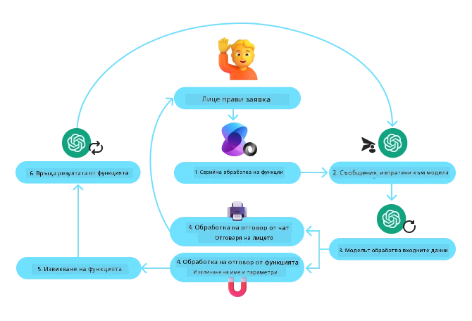
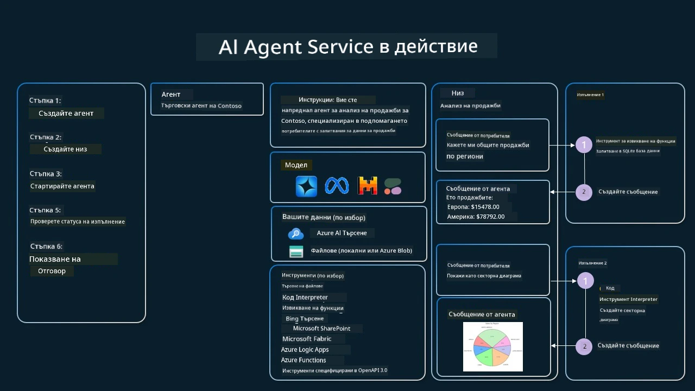

[](https://youtu.be/vieRiPRx-gI?si=cEZ8ApnT6Sus9rhn)

> _(Кликнете върху изображението по-горе, за да гледате видео на този урок)_

# Дизайнерски модел за използване на инструменти

Инструментите са интересни, защото позволяват на AI агентите да имат по-широк набор от възможности. Вместо агентът да има ограничен набор от действия, които може да изпълнява, с добавянето на инструмент агентът вече може да изпълнява широк диапазон от действия. В тази глава ще разгледаме Дизайнерския модел за използване на инструменти, който описва как AI агентите могат да използват конкретни инструменти, за да постигнат целите си.

## Въведение

В този урок ще се опитаме да отговорим на следните въпроси:

- Какво е дизайнерският модел за използване на инструменти?
- За какви случаи на употреба може да се приложи?
- Какви са елементите/строителните блокове, необходими за реализиране на дизайна?
- Какви са специалните съображения при използване на Дизайнерския модел за използване на инструменти за изграждане на надеждни AI агенти?

## Цели на учене

След завършването на този урок ще можете да:

- Дефинирате Дизайнерския модел за използване на инструменти и неговото предназначение.
- Идентифицирате случаи на употреба, при които този модел е приложим.
- Разберете ключовите елементи, необходими за реализиране на дизайна.
- Разпознавате съображения за осигуряване на надеждност в AI агенти, използващи този дизайн.

## Какво е Дизайнерският модел за използване на инструменти?

**Дизайнерският модел за използване на инструменти** се фокусира върху предоставянето на големите езикови модели (LLM) с възможност да взаимодействат с външни инструменти за постигане на конкретни цели. Инструментите са код, който може да бъде изпълнен от агент, за да извършва действия. Инструмент може да бъде проста функция като калкулатор или повикване на API към външна услуга, например за проверка на цени на акции или прогноза за времето. В контекста на AI агентите инструментите са проектирани да се изпълняват от агентите в отговор на **функционални повиквания, генерирани от модела**.

## За какви случаи на употреба може да се приложи?

AI агенти могат да използват инструменти за изпълнение на сложни задачи, извличане на информация или вземане на решения. Дизайнерският модел за използване на инструменти често се използва в сценарии, изискващи динамично взаимодействие с външни системи като бази данни, уеб услуги или интерпретатори на код. Тази възможност е полезна за редица различни употреби, включително:

- **Динамично извличане на информация:** Агентите могат да изпращат заявки към външни API или бази данни за получаване на актуални данни (например заявка към SQLite база данни за анализ на данни, извличане на цени на акции или информация за времето).
- **Изпълнение и интерпретиране на код:** Агентите могат да изпълняват код или скриптове за решаване на математически задачи, генериране на отчети или изпълнение на симулации.
- **Автоматизация на работни процеси:** Автоматизиране на повтарящи се или многоетапни работни процеси чрез интегриране на инструменти като планировчици на задачи, имейл услуги или потоци за обработка на данни.
- **Поддръжка на клиенти:** Агентите могат да взаимодействат с CRM системи, платформи за обслужване на билети или бази знания за разрешаване на потребителски запитвания.
- **Генериране и редактиране на съдържание:** Агентите могат да използват инструменти като проверка на граматика, обобщаване на текст или оценка на безопасността на съдържанието, за да помогнат при създаването на съдържание.

## Какви са елементите/строителните блокове, необходими за реализиране на модела за използване на инструменти?

Тези строителни блокове позволяват на AI агента да изпълнява широк диапазон от задачи. Нека разгледаме ключовите елементи за реализация на Дизайнерския модел за използване на инструменти:

- **Схеми на функции/инструменти**: Подробни дефиниции на наличните инструменти, включително име на функцията, предназначение, изисквани параметри и очаквани резултати. Тези схеми позволяват на LLM да разбере какви инструменти има и как да конструира валидни заявки.

- **Логика за изпълнение на функции**: Определя кога и как се извикват инструментите въз основа на намерението на потребителя и контекста на разговора. Това може да включва модули за планиране, механизми за маршрутизиране или условни потоци за динамично определяне на използването на инструменти.

- **Система за управление на съобщения**: Компоненти, които управляват потока на разговора между входовете на потребителя, отговорите на LLM, повикванията на инструменти и резултатите от тях.

- **Рамка за интеграция на инструменти**: Инфраструктура, която свързва агента с различни инструменти, независимо дали са прости функции или сложни външни услуги.

- **Обработка на грешки и валидация**: Механизми за справяне с грешки при изпълнението на инструментите, валидиране на параметрите и управление на неочаквани отговори.

- **Управление на състоянието**: Следи контекста на разговора, предишните взаимодействия с инструментите и постоянните данни, за да гарантира последователност в течение на многоетапни взаимодействия.

Нека сега разгледаме извикването на функции/инструменти по-подробно.
 
### Извикване на функция/инструмент

Извикването на функции е основният начин, по който позволяваме на Големите Езикови Модели (LLM) да взаимодействат с инструменти. Често ще видите „Функция“ и „Инструмент“ използвани взаимозаменяемо, тъй като „функциите“ (блокове от многократно използваем код) са „инструментите“, които агентите използват за изпълнение на задачи. За да бъде извикан кодът на дадена функция, LLM трябва да сравни заявката на потребителя с описанието на функциите. За тази цел в LLM се изпраща схема, съдържаща описания на всички налични функции. След това LLM избира най-подходящата функция за задачата и връща нейното име и аргументи. Избраната функция се извиква, нейният отговор се изпраща обратно към LLM, който използва информацията, за да отговори на заявката на потребителя.

За разработчиците, които искат да реализират извикване на функции за агенти, ще са необходими:

1. LLM модел, който поддържа извикване на функции
2. Схема, съдържаща описания на функциите
3. Кодът за всяка описана функция

Нека илюстрираме с пример за получаване на текущото време в даден град:

1. **Инициализирайте LLM, който поддържа извикване на функции:**

    Не всички модели поддържат извикване на функции, затова е важно да проверите дали използваният от вас LLM го поддържа. <a href="https://learn.microsoft.com/azure/ai-services/openai/how-to/function-calling" target="_blank">Azure OpenAI</a> поддържа извикване на функции. Можем да започнем, като инициираме OpenAI клиента спрямо Azure OpenAI **Responses API** (стабилния `/openai/v1/` крайна точка — не е нужен `api_version`). 

    ```python
    # Initialize the OpenAI client for Azure OpenAI (Responses API, v1 endpoint)
    client = OpenAI(
        base_url=f"{os.environ['AZURE_OPENAI_ENDPOINT'].rstrip('/')}/openai/v1/",
        api_key=os.environ["AZURE_OPENAI_API_KEY"],
    )
    deployment_name = os.environ["AZURE_OPENAI_DEPLOYMENT"]
    ```

1. **Създайте схема на функцията**:

    След това ще дефинираме JSON схема, която съдържа името на функцията, описание на това какво прави функцията, и имената и описанията на параметрите на функцията.
    След това ще подадем тази схема на клиента, създаден по-рано, заедно със заявката на потребителя за намиране на времето в Сан Франциско. Важно е да се отбележи, че се връща **извикване на инструмент**, **не** окончателният отговор на въпроса. Както беше споменато по-рано, LLM връща името на функцията, която е избрал за задачата, и аргументите, които ще му бъдат подадени.

    ```python
    # Function description for the model to read (Responses API flat tool format)
    tools = [
        {
            "type": "function",
            "name": "get_current_time",
            "description": "Get the current time in a given location",
            "parameters": {
                "type": "object",
                "properties": {
                    "location": {
                        "type": "string",
                        "description": "The city name, e.g. San Francisco",
                    },
                },
                "required": ["location"],
            },
        }
    ]
    ```
   
    ```python
  
    # Initial user message
    messages = [{"role": "user", "content": "What's the current time in San Francisco"}]

    # First API call: Ask the model to use the function
    response = client.responses.create(
        model=deployment_name,
        input=messages,
        tools=tools,
        tool_choice="auto",
        store=False,
    )

    # The Responses API returns tool calls as function_call items in response.output.
    # Append them to the conversation so the model has full context on the next turn.
    messages += response.output

    print("Model's response:")
    print(response.output)
  
    ```

    ```bash
    Model's response:
    [ResponseFunctionToolCall(arguments='{"location":"San Francisco"}', call_id='call_pOsKdUlqvdyttYB67MOj434b', name='get_current_time', type='function_call')]
    ```
  
1. **Кодът на функцията, необходим за изпълнение на задачата:**

    След като LLM избере коя функция трябва да се изпълни, кодът, който извършва задачата, трябва да бъде реализиран и изпълнен.
    Можем да реализираме кода за получаване на текущото време на Python. Също така ще трябва да напишем код, който да извлича името и аргументите от response_message, за да получим крайния резултат.

    ```python
      def get_current_time(location):
        """Get the current time for a given location"""
        print(f"get_current_time called with location: {location}")  
        location_lower = location.lower()
        
        for key, timezone in TIMEZONE_DATA.items():
            if key in location_lower:
                print(f"Timezone found for {key}")  
                current_time = datetime.now(ZoneInfo(timezone)).strftime("%I:%M %p")
                return json.dumps({
                    "location": location,
                    "current_time": current_time
                })
      
        print(f"No timezone data found for {location_lower}")  
        return json.dumps({"location": location, "current_time": "unknown"})
    ```

     ```python
    # Handle function calls
    tool_calls = [item for item in response.output if item.type == "function_call"]
    if tool_calls:
        for tool_call in tool_calls:
            if tool_call.name == "get_current_time":

                function_args = json.loads(tool_call.arguments)

                time_response = get_current_time(
                    location=function_args.get("location")
                )

                # Return the tool result as a function_call_output item
                messages.append({
                    "type": "function_call_output",
                    "call_id": tool_call.call_id,
                    "output": time_response,
                })
    else:
        print("No tool calls were made by the model.")

    # Second API call: Get the final response from the model
    final_response = client.responses.create(
        model=deployment_name,
        input=messages,
        tools=tools,
        store=False,
    )

    return final_response.output_text
     ```

     ```bash
      get_current_time called with location: San Francisco
      Timezone found for san francisco
      The current time in San Francisco is 09:24 AM.
     ```

Извикването на функции е в сърцето на повечето, ако не и на всички, дизайнерски модели за използване на инструменти при агенти, но неговото реализиране от нулата понякога може да бъде предизвикателство.
Както научихме в [Урок 2](../../../02-explore-agentic-frameworks), агентните рамки ни предоставят преизградени блокове за реализиране на използването на инструменти.
 
## Примери за използване на инструменти с агентни рамки

Ето няколко примера как можете да реализирате Дизайнерския модел за използване на инструменти с различни агентни рамки:

### Рамка за агенти на Microsoft

<a href="https://learn.microsoft.com/azure/ai-services/agents/overview" target="_blank">Рамката за агенти на Microsoft</a> е отворена рамка за AI агенти. Тя опростява процеса на използване на извикване на функции, като ви позволява да дефинирате инструменти като Python функции с декоратора `@tool`. Рамката управлява двупосочната комуникация между модела и кода ви. Също така осигурява достъп до предварително изградени инструменти като Търсене на файлове и Интерпретатор на код чрез `FoundryChatClient`.

Следната диаграма илюстрира процеса на извикване на функции с Рамката за агенти на Microsoft:



В Рамката за агенти на Microsoft инструментите се дефинират като декорирани функции. Можем да превърнем функцията `get_current_time`, която видяхме по-рано, в инструмент, като използваме декоратора `@tool`. Рамката автоматично сериализира функцията и нейните параметри, създавайки схемата за изпращане към LLM.

```python
import os
from agent_framework import tool
from agent_framework.foundry import FoundryChatClient
from azure.identity import AzureCliCredential

@tool(approval_mode="never_require")
def get_current_time(location: str) -> str:
    """Get the current time for a given location"""
    ...

# Create the client
provider = FoundryChatClient(
    project_endpoint=os.environ["AZURE_AI_PROJECT_ENDPOINT"],
    model=os.environ["AZURE_AI_MODEL_DEPLOYMENT_NAME"],
    credential=AzureCliCredential(),
)

# Create an agent and run with the tool
agent = provider.as_agent(name="TimeAgent", instructions="Use available tools to answer questions.", tools=get_current_time)
response = await agent.run("What time is it?")
```

#### Инструменти от MCP сървър

Инструментите не е необходимо да са функции в собствения ви код. Сървър, който поддържа Модел Контекст Протокол (MCP, разгледан в [Урок 11](../11-agentic-protocols/README.md)), публикува своите инструменти заедно с техните схеми, а рамката може да ги зареди по същия начин, по който сериализира декорирана функция. `MCPStreamableHTTPTool` се свързва към такъв сървър чрез HTTP, чете схемите на инструментите и ги предлага на модела заедно с всички локални инструменти.

Примерът по-долу използва уеб сървър за търсене, хостван от <a href="https://keenable.ai" target="_blank">Keenable</a>. Той е безплатен за ползване без акаунт или API ключ (заявките са ограничени по брой на IP адрес), така че единствените идентификационни данни, от които се нуждаете, са тези за вашия модел. Както при всеки отдалечен инструмент, заявките на модела се изпращат към този сървър.

```python
from agent_framework import MCPStreamableHTTPTool

web_search = MCPStreamableHTTPTool(
    name="Keenable web search",
    url="https://api.keenable.ai/mcp",
)

# Connecting loads the server's tool schemas; the agent decides when to call them
async with web_search:
    agent = provider.as_agent(
        name="ResearchAgent",
        instructions="Use available tools to answer questions.",
        tools=[web_search],
    )
    response = await agent.run("What is new in the latest Python release?")
    print(response.text)
```

Сървърът публикува два инструмента, `search_web_pages` и `fetch_page_content`. Когато възникне нужда от актуална информация, моделът извиква `search_web_pages`, получава заглавия, URL адреси и текстови откъси и пише своя отговор на тяхна база, същият цикъл като в примера по-горе с `get_current_time`.
  
### Microsoft Foundry Agent Service

<a href="https://learn.microsoft.com/azure/ai-services/agents/overview" target="_blank">Microsoft Foundry Agent Service</a> е по-нова агентна рамка, предназначена да даде възможност на разработчиците сигурно да изграждат, разгръщат и мащабират висококачествени и разширими AI агенти без необходимост от управление на подлежащите изчислителни и съхранителни ресурси. Особено полезна е за корпоративни приложения, тъй като е напълно управляема услуга с корпоративно ниво на защита.

В сравнение с разработването директно с API на LLM, Microsoft Foundry Agent Service предлага някои предимства, включително:

- Автоматично извикване на инструменти – не е необходимо да парсирате извикване на инструмент, да го извиквате и да обработвате отговора; всичко това вече се прави от сървърната страна
- Сигурно управлявани данни – вместо сами да управлявате състоянието на разговора, можете да разчитате на нишки за съхранение на цялата необходима информация
- Инструменти готови за ползване – инструменти, с които можете да взаимодействате с вашите източници на данни, като Bing, Azure AI Search и Azure Functions.

Инструментите, налични в Microsoft Foundry Agent Service, могат да се разделят на две категории:

1. Инструменти за знание:
    - <a href="https://learn.microsoft.com/azure/ai-services/agents/how-to/tools/bing-grounding?tabs=python&pivots=overview" target="_blank">Основаване с Bing Search</a>
    - <a href="https://learn.microsoft.com/azure/ai-services/agents/how-to/tools/file-search?tabs=python&pivots=overview" target="_blank">Търсене във файлове</a>
    - <a href="https://learn.microsoft.com/azure/ai-services/agents/how-to/tools/azure-ai-search?tabs=azurecli%2Cpython&pivots=overview-azure-ai-search" target="_blank">Azure AI Search</a>

2. Инструменти за действия:
    - <a href="https://learn.microsoft.com/azure/ai-services/agents/how-to/tools/function-calling?tabs=python&pivots=overview" target="_blank">Извикване на функции</a>
    - <a href="https://learn.microsoft.com/azure/ai-services/agents/how-to/tools/code-interpreter?tabs=python&pivots=overview" target="_blank">Интерпретатор на код</a>
    - <a href="https://learn.microsoft.com/azure/ai-services/agents/how-to/tools/openapi-spec?tabs=python&pivots=overview" target="_blank">Инструменти, дефинирани чрез OpenAPI</a>
    - <a href="https://learn.microsoft.com/azure/ai-services/agents/how-to/tools/azure-functions?pivots=overview" target="_blank">Azure Functions</a>

Службата на агента ни позволява да използваме тези инструменти заедно като `toolset`. Тя също използва `threads`, които следят историята на съобщенията от даден разговор.

Представете си, че сте търговски агент в компания на име Contoso. Искате да разработите разговорен агент, който може да отговаря на въпроси за вашите търговски данни.

Следното изображение илюстрира как можете да използвате Microsoft Foundry Agent Service за анализ на търговските си данни:



За да използваме някой от тези инструменти със службата, можем да създадем клиент и да дефинираме инструмент или комплект инструменти. За практическа реализация можем да използваме следния Python код. LLM ще може да разгледа набора от инструменти и да реши дали да използва функция, създадена от потребителя, `fetch_sales_data_using_sqlite_query`, или предварително изградения Интерпретатор на код, в зависимост от заявката на потребителя.

```python 
import os
from azure.ai.projects import AIProjectClient
from azure.identity import DefaultAzureCredential
from fetch_sales_data_functions import fetch_sales_data_using_sqlite_query # fetch_sales_data_using_sqlite_query function which can be found in a fetch_sales_data_functions.py file.
from azure.ai.projects.models import ToolSet, FunctionTool, CodeInterpreterTool

project_client = AIProjectClient.from_connection_string(
    credential=DefaultAzureCredential(),
    conn_str=os.environ["PROJECT_CONNECTION_STRING"],
)

# Initialize toolset
toolset = ToolSet()

# Initialize function calling agent with the fetch_sales_data_using_sqlite_query function and adding it to the toolset
fetch_data_function = FunctionTool(fetch_sales_data_using_sqlite_query)
toolset.add(fetch_data_function)

# Initialize Code Interpreter tool and adding it to the toolset. 
code_interpreter = CodeInterpreterTool()toolset.add(code_interpreter)

agent = project_client.agents.create_agent(
    model="gpt-5-mini", name="my-agent", instructions="You are helpful agent", 
    toolset=toolset
)
```

## Какви са специалните съображения при използване на Дизайнерския модел за използване на инструменти за изграждане на надеждни AI агенти?

Често срещано безпокойство при SQL, динамично генериран от LLM, е сигурността, особено рискът от SQL инжекции или злонамерени действия, като изтриване или манипулация на базата данни. Въпреки че тези опасения са оправдани, те могат ефективно да се смекчат чрез правилно конфигуриране на разрешенията за достъп до базата данни. За повечето бази данни това означава конфигуриране на базата данни в режим само за четене. За бази данни като PostgreSQL или Azure SQL приложението трябва да има зададена роля само за четене (SELECT).

Изпълнението на приложението в защитена среда допълнително усилва защитата. В корпоративни сценарии данните обикновено се извличат и трансформират от оперативни системи в база данни само за четене или хранилище за данни с потребителски удобна схема. Този подход гарантира, че данните са защитени, оптимизирани за производителност и достъпност и че приложението има ограничен, само за четене достъп.

## Примери за код

- Python: [Agent Framework](./code_samples/04-python-agent-framework.ipynb)
- .NET: [Agent Framework](./code_samples/04-dotnet-agent-framework.md)

## Имате още въпроси относно Дизайнерския модел за използване на инструменти?

Присъединете се към [Microsoft Foundry Discord](https://discord.com/invite/ATgtXmAS5D), за да се срещнете с други учащи, да посетите работни часове и да получите отговори на въпросите си за AI агенти.

## Допълнителни ресурси

- <a href="https://microsoft.github.io/build-your-first-agent-with-azure-ai-agent-service-workshop/" target="_blank">Работилница за Azure AI Agents Service</a>
- <a href="https://github.com/Azure-Samples/contoso-creative-writer/tree/main/docs/workshop" target="_blank">Работилница за многоагентен творчески писател Contoso</a>
- <a href="https://learn.microsoft.com/azure/ai-services/agents/overview" target="_blank">Преглед на Microsoft Agent Framework</a>

## Тест за основна функционалност на този агент (по избор)

След като научите как да разгръщате агенти в [Урок 16](../16-deploying-scalable-agents/README.md), можете да тествате основната функционалност на `TravelToolAgent` от този урок (дали все още използва своите инструменти и отговаря?) с [`tests/lesson-04-smoke-tests.json`](../../../tests/lesson-04-smoke-tests.json). Вижте [`tests/README.md`](../tests/README.md) за инструкции как да го стартирате.

## Предишен урок

[Разбиране на агентските дизайни](../03-agentic-design-patterns/README.md)

## Следващ урок

[Агентен RAG](../05-agentic-rag/README.md)

---

<!-- CO-OP TRANSLATOR DISCLAIMER START -->
**Отказ от отговорност**:
Този документ е преведен с помощта на AI преводачески услуга [Co-op Translator](https://github.com/Azure/co-op-translator). Въпреки че се стремим към точност, моля имайте предвид, че автоматизираните преводи могат да съдържат грешки или неточности. Оригиналният документ на неговия роден език трябва да се счита за авторитетен източник. За критична информация се препоръчва професионален човешки превод. Ние не носим отговорност за каквито и да е недоразумения или неправилни тълкувания, произтичащи от използването на този превод.
<!-- CO-OP TRANSLATOR DISCLAIMER END -->