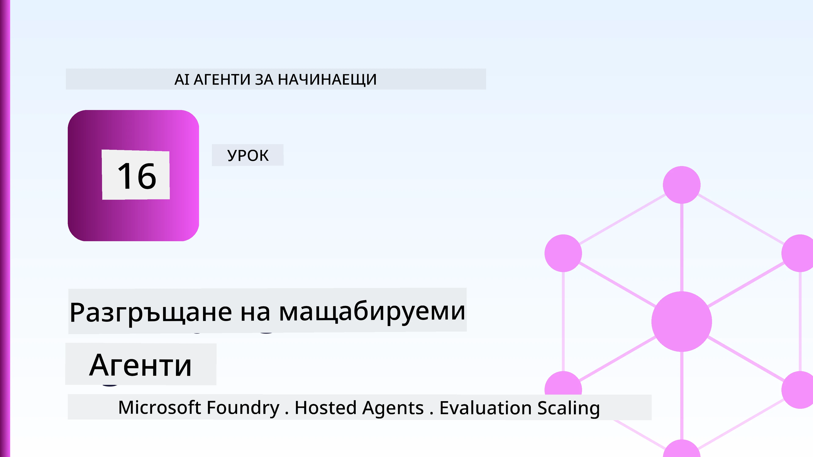
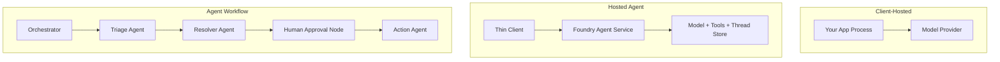
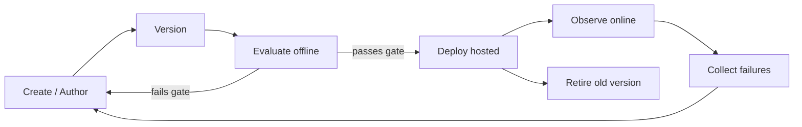
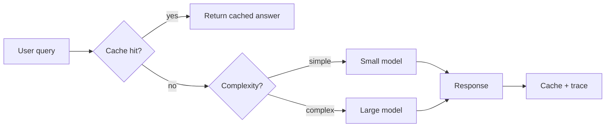
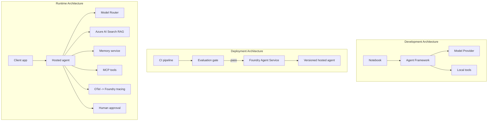

# Разполагане на мащабируеми агенти с Microsoft Foundry



До този момент в курса сте изграждали агенти, които работят на вашия лаптоп, вътре в тетрадка, управлявани чрез `az login` и няколко променливи на средата. Това е точно правилният начин да се научите. Не е правилният начин да управлявате агент, на когото хиляди клиенти разчитат в 3 сутринта.

Този урок е за разликата между „работи на моята машина“ и „работи надеждно и достъпно в продукция“. Ние затваряме тази разлика, като използваме **Microsoft Foundry** и **Microsoft Foundry Agent Service**, и го правим, като изграждаме реален агент за поддръжка на клиенти, който разполага с инструменти, извличане, памет, оценка и мониторинг.

## Въведение

Този урок ще обхване:

- Разликата между **прототипен агент** и **разположен агент**, и защо преходът е основно за всичко *около* модела.
- **Модели на разполагане** за агенти: хостван от клиента, хостван от услугата (Hosted Agents) и оркестриран чрез работни потоци.
- **Жизнен цикъл на агента** на Microsoft Foundry — създаване, версиониране, разполагане, оценка, наблюдение, пенсиониране.
- **Стратегии за мащабиране**: маршрутизиране на модели, кеширане, конкурентност и дизайн без състояние.
- **Наблюдаемост** с OpenTelemetry и проследяване в Foundry.
- **Оптимизация на разходите** чрез подбор на модел, маршрутизиране и гейтове за оценка.
- **Предприятни съображения**: управление, човешко одобрение и безопасно стартиране на MCP сървъри в продукция.

## Учебни цели

След приключване на този урок, ще знаете как да:

- Изберете правилния модел на разполагане за дадена работна натовареност на агент.
- Разположите агент в Microsoft Foundry Agent Service, така че да бъде версиониран, управляван и наблюдаем.
- Инструктирате агент за проследяване и свържете оценъчен канал, който се изпълнява преди всяко пускане.
- Прилагате маршрутизиране на модели и кеширане, за да поддържате латентността и разходите под контрол при мащабиране.
- Добавите гейт за човешко одобрение за действия с висок риск и интегрирате MCP сървър по безопасен за продукцията начин.

## Предварителни условия

Този урок предполага, че сте изпълнили предишните уроци и сте комфортни с:

- Изграждане на агенти с [Microsoft Agent Framework](../14-microsoft-agent-framework/README.md) (Урок 14).
- [Използване на инструменти](../04-tool-use/README.md) (Урок 4) и [Agentic RAG](../05-agentic-rag/README.md) (Урок 5).
- [Агент памет](../13-agent-memory/README.md) (Урок 13) и [Agentic протоколи / MCP](../11-agentic-protocols/README.md) (Урок 11).
- [Наблюдаемост и оценка](../10-ai-agents-production/README.md) (Урок 10) — този урок се изгражда директно върху него.

Също така ще имате нужда от:

- **Azure абонамент** и **Microsoft Foundry проект** с поне един разположен чат модел.
- **Azure CLI** с удостоверяване (`az login`).
- Python 3.12+ и пакетите в хранилището [`requirements.txt`](../../../requirements.txt).

## От прототип до продукция: Какво всъщност се променя

Прототипен агент и продукционен агент споделят основния цикъл — логика, извикване на инструменти, отговор. Това, което се променя, е всичко, което е обвито около този цикъл. Моделът е може би 20% от продукционния агент; останалите 80% са оперативния скелет.

| Въпрос | Прототип | Продукция |
| --- | --- | --- |
| **Хостване** | Работи в тетрадката ви | Работи като хоствана услуга, версионирана и разгръщана |
| **Идентичност** | Вашият `az login` токен | Управлявана идентичност с ограничен RBAC |
| **Състояние** | В паметта, губи се при рестарт | Екстернализирано (нишков магазин, услуга за памет) |
| **Провали** | Виждате проследяването на грешката | Повторни опити, резервни, мъртви писма, аларми |
| **Разходи** | „Няколко цента“ | Следени на заявка, маршрутизирани, кеширани, бюджетирани |
| **Качество** | Поглеждате резултата | Автоматично оценявано преди всяко пускане |
| **Доверие** | Одобрявате всяко действие | Политика + човешко участие за рискови действия |

Запомнете тази таблица. Всеки раздел по-долу съответства на един от тези редове.

## Модели за разполагане на агенти

Има три модела, които ще използвате, често в комбинация.

### 1. Клиент-хоствани агенти

Агентският обект живее вътре в *вашия* процес на приложение. Вашият код извиква директно доставчика на модел; логическият цикъл се изпълнява във вашата услуга. Това е онова, което всеки предишен урок е направил.

- **Използвайте когато** имате нужда от пълен контрол над цикъла, потребителски междинен слой или внедрявате агента в съществуващ бекенд.
- **Компромис**: вие сте отговорни за мащабирането, състоянието и устойчивостта.

### 2. Хоствани агенти (Foundry Agent Service)

Агентът е *регистриран като ресурс* в Microsoft Foundry. Foundry хоства логическия цикъл, съхранява нишките, прилага контрол на съдържанието и RBAC, и прави агента видим в портала на Foundry. Вашето приложение става тънък клиент, който създава нишки и чете отговори.

- **Използвайте когато** искате издържливост, вградена наблюдаемост, управление и по-малка оперативна област.
- **Компромис**: по-малък ниско-ниво контрол в замяна на управляван runtime.

### 3. Работни потоци на агенти

Няколко агенти (и инструменти) се съставят в граф с изричен контрол на потока — последователни стъпки, разклонения, възли за човешко одобрение и трайни контролни точки, които могат да паузират и възобновяват. Това е капацитетът на Microsoft Agent Framework **Workflows**, приложен на мащаба на разполагането.

- **Използвайте когато** една задача обхваща няколко специализирани агенти или изисква стъпка за одобрение по средата.
- **Компромис**: повече движещи се части; изисква наблюдаемост от оркестрационен слой.



## Жизнен цикъл на агента на Microsoft Foundry

Разполагането на агент не е еднократна `push`. Това е цикъл и много прилича на цикъл на софтуерно издание, защото точно това е.



Ключовата идея, пренесена от [Урок 10](../10-ai-agents-production/README.md): **оценката офлайн е гейт, а не мисъл след това.** Нова версия на агент не се пуска, освен ако не премине вашите прагове за оценка. Онлайн наблюдаемостта след това подава обратно в офлайн тестовия набор реални грешки от продукция. Това е целият цикъл.

## Стратегии за мащабиране

Мащабирането на агент е различно от мащабирането на безсърдечен Web API, защото всяка заявка може да задейства множество скъпи извиквания на модели и инструменти. Четири техники носят по-голямата част от товара.

**Обработка на безсърдечни заявки.** Не съхранявайте състояние на потребителя в паметта на процеса. Записвайте нишковите разговори в Foundry thread store или услуга за памет, така че всеки екземпляр може да обработва всяка заявка. Това позволява хоризонтално мащабиране — добавяне на екземпляри, без залепващи сесии.

**Маршрутизиране на модела.** Не всяка заявка се нуждае от най-способния (и най-скъп) модел. Маршрутизирайте простите заявки — класификация на намерения, кратки фактически отговори — към малък, бърз модел и резерва за големия само за същински разсъждения. Foundry's **Model Router** може да направи това за вас, или можете сами да имплементирате лек класификатор. Ще построите DIY версията в лабораторията.

**Кеширане на отговори.** Много поддържащи заявки са почти дубликати („как да нулирам паролата си?“). Кеширайте отговорите на чести въпроси и ги подавайте без да извиквате модела изобщо. Дори скромен процент на кеш хайта значително намалява разходите и латентността.

**Едновременност и бекпрешър.** Доставчиците на модели имат лимити на скоростта. Ограничете едновременността, използвайте повторни опити с експоненциален бекоф, и отказвайте се грациозно (очереден отговор „работим по въпроса“ е по-добър от грешка 500).



## Наблюдаемост в продукция

Не можете да оперирате това, което не виждате. Както беше разгледано в Урок 10, Microsoft Agent Framework излъчва родно **OpenTelemetry** проследяване — всяко модулно извикване, инструментално извикване и оркестрационна стъпка се превръща в span. В продукция експортирате тези span към Microsoft Foundry (или всеки бекенд съвместим с OTel), за да можете:

- Да проследите една клиентска жалба от край до край през всяко модулно и инструментално извикване.
- Да наблюдавате латентността p50/p95 и разходите по заявки във времето.
- Да получавате аларми при скокове в честотата на грешките и аномалии в разходите преди вашите потребители (или финансовия ви екип) да ги забележат.

```python
from agent_framework.observability import get_tracer

tracer = get_tracer()

with tracer.start_as_current_span("support_request") as span:
    span.set_attribute("customer.tier", "enterprise")
    span.set_attribute("routed.model", "gpt-5-nano")
    # agent execution is traced automatically inside this span
```

Атрибути като `customer.tier` и `routed.model` са тези, които превръщат стена от трасета в отговори на въпроси („дали корпоративните клиенти се пренасочват твърде често към малкия модел?“).

## Оптимизация на разходите

Разходите в продукционни агенти се доминират от токени. Три лоста, по ред на влияние:

1. **Правилен размер на модела.** Малък модел, който преминава гейта за оценка, почти винаги е по-евтин от голям, който също преминава. Използвайте оценка, за да *докажете*, че малкият модел е достатъчно добър, вместо по подразбиране да избирате най-големия от предпазливост.
2. **Маршрутизиране по сложност.** Както горе — плащайте цените на големия модел само за заявки, които се нуждаят от разсъждения на голям модел.
3. **Агресивно кеширане.** Най-евтиното извикване на модел е това, което никога не правите.

Гейтовете за оценка и контролът на разходите са една и съща дисциплина, гледана от две страни: оценката ви казва *подовото качество*, маршрутизирането и кешът ви държат близо до *разходния* под.

## Предприятни съображения при разполагане

**Управление.** Hosted Agents наследяват RBAC, безопасност на съдържанието и записване на проверки от Foundry. Дайте на всеки агент управлявана идентичност с най-малките привилегии, от които се нуждае — само за четене на база знания, ограничен достъп до тикет API, нищо повече.

**Човек в цикъла.** Някои действия са твърде важни, за да бъдат автоматизирани напълно — издаване на възстановяване, изтриване на акаунт, ескалация към юридически екип. Microsoft Agent Framework поддържа **инструменти със задължително одобрение**: агентът предлага действие, изпълнението спира, човек одобрява или отказва, и работният поток продължава. Видяхте примитива в [Урок 6](../06-building-trustworthy-agents/README.md); тук го разполагате.

**MCP в продукция.** [MCP](../11-agentic-protocols/README.md) позволява на вашия агент да използва външни инструменти чрез стандартен интерфейс. В продукция тритирайте всеки MCP сървър като ненадеждна граница: задайте версията на сървъра, стартирайте го с ограничена идентичност, валидирайте изходите му и никога не излагайте тайни на него. MCP сървър е зависимост, а зависимостите се поправят, проверяват и ограничават по скорост.



Тези три диаграми — разработка, разполагане, време на работа — са един и същи агент на три етапа от живота му. Следващата лаборатория ви води през изграждането му.

## Практическа лаборатория: Агент за поддръжка в продукционна среда

Отворете [`code_samples/16-python-agent-framework.ipynb`](./code_samples/16-python-agent-framework.ipynb) и го разгледайте изцяло. Ще съставите **агент за поддръжка на клиенти Contoso** с всички продукциини грижи свързани:

1. **Извикване на инструменти** — проверка на статус на поръчки и откриване на тикети за поддръжка.
2. **RAG** — отговаряне на въпроси за политики от база знания (Azure AI Search, с резервен паметен fallback, така че тетрадката работи без Search ресурс).
3. **Памет** — помни клиента през ходовете на разговора.
4. **Маршрутизиране на модел** — класификатор за сложност насочва всяка заявка към малък или голям модел.
5. **Кеширане на отговори** — повтарящи се въпроси се обслужват от кеша.
6. **Човешко одобрение** — възстановявания над праг спират за човешко потвърждение.
7. **Оценъчен канал** — малък офлайн тестов набор оценява агента и действа като гейт за издание.
8. **Наблюдаемост** — OpenTelemetry проследяване около всяка заявка.

### Преглед

Тетрадката е организирана така, че всяка продукционна грижа е самостоятелен, изпълним раздел. Сърцето ѝ е маршрутизирането плюс кеширането в обработващия заявките код:

```python
async def handle_support_request(query: str, customer_id: str) -> str:
    # 1. Serve from cache when we can.
    cached = response_cache.get(normalize(query))
    if cached:
        return cached

    # 2. Route by complexity to control cost.
    model = "gpt-5-nano" if is_simple(query) else "gpt-5-mini"

    # 3. Run the agent inside a trace span for observability.
    with tracer.start_as_current_span("support_request") as span:
        span.set_attribute("routed.model", model)
        span.set_attribute("customer.id", customer_id)
        response = await support_agent.run(query, model=model)

    # 4. Cache and return.
    response_cache.set(normalize(query), response.text)
    return response.text
```

Гейтът за оценка, който пази изданието, изглежда така:

```python
async def evaluation_gate(agent, test_cases, threshold: float = 0.8) -> bool:
    passed = 0
    for case in test_cases:
        result = await agent.run(case["input"])
        if score_response(result.text, case["expected"]) >= 0.8:
            passed += 1
    pass_rate = passed / len(test_cases)
    print(f"Evaluation pass rate: {pass_rate:.0%} (gate: {threshold:.0%})")
    return pass_rate >= threshold  # only deploy if the gate passes
```

Прочетете всеки ред — тетрадката държи примитивите нарочно малки, за да няма нищо скрито зад рамка повикване.

## Валидация на разположен агент със Smoke тестове

Гейтът за оценка по-горе се изпълнява *офлайн* спрямо вашия агентски обект. След като агентът е разположен като Hosted Agent, имате нужда от още една, още по-евтина проверка: **дали разположената крайна точка всъщност отговаря?**

„Успешното“ разполагане само доказва, че контролната плоскост е приела дефиницията — не доказва, че агентът отговаря. Липсваща зависимост, лошо маршрутизиране на модела, или изтекла връзка могат да оставят зелено разполагане, което не връща нищо. **Smoke тест** хваща това за секунди, при всяко пускане, без разходите на пълна оценка.

Това хранилище съдържа готова за използване smoke-тест pipeline, построена върху [AI Smoke Test](https://github.com/marketplace/actions/ai-smoke-test) GitHub Action:

- **Каталог** — [`tests/lesson-16-smoke-tests.json`](../../../tests/lesson-16-smoke-tests.json) съдържа подканвания и твърдения за агента за поддръжка Contoso (отговарящи на политики, проверка на поръчка, оставане в темата, и мулти-нишкова последователност). Каталози за агенти от други уроци живеят заедно с него — вижте [`tests/README.md`](../tests/README.md).
- **Работен поток** — [`.github/workflows/smoke-test.yml`](../../../.github/workflows/smoke-test.yml) се логва с Azure OIDC и изпраща всяка подканваща към Responses endpoint на агента, като проваля задачата при всяко пропускане на твърдение.

```yaml
- name: Smoke-test hosted agent
  uses: JFolberth/ai-smoketest@v1
  with:
    project_endpoint: ${{ inputs.project_endpoint }}
    agent_name: ContosoSupportAgent
    tests_file: tests/lesson-16-smoke-tests.json
```

Стартирайте го от раздела **Actions** след като вашият агент бъде внедрен, като посочите вашия крайна точка на проекта в Foundry и името на агента. Федеративната самоличност трябва да има ролята **Azure AI User** в обхвата на проекта Foundry. Помислете за слоевете като за пирамида: тестовете за дим (достъпен и отговаря ли?) се изпълняват при всяко внедряване, офлайн оценката (достатъчно добра ли е за доставка?) се изпълнява преди промоция, а онлайн оценката (как се представя в реална среда?) работи непрекъснато.

## Проверка на знания

Тествайте разбирането си преди да преминете към заданието.

**1. Приблизително колко голяма част от производствения агент е "моделът" и какво е останалото?**

<details>
<summary>Отговор</summary>

Моделът е малцинство в системата — често се посочва около 20%. Останалото е оперативният скелет: хостинг и версиониране, идентичност и RBAC, външно съхранение на състоянието, обработка на грешки, проследяване на разходи, оценка и контроли с човек в цикъла. Преминаването към продукция е предимно за изграждане на всичко *около* цикъла на разсъждение.
</details>

**2. Кога бихте избрали хостван агент пред агент, хостван от клиента?**

<details>
<summary>Отговор</summary>

Когато искате управляема среда за изпълнение с вградена издръжливост (нишки, които запазват състояние и могат да продължат), възможност за наблюдение, безопасност на съдържанието и RBAC, и сте готови да жертвате някакъв ниско ниво контрол на цикъла за по-малка оперативна площ. Агент, хостван от клиента, е предпочитателен, когато имате нужда от пълен контрол над цикъла или когато вписвате агента в съществуващ бекенд.
</details>

**3. Защо мащабируем агент трябва да бъде безсъстояние в собствената си памет на процеса?**

<details>
<summary>Отговор</summary>

За да може всеки инстанс да обработва всяка заявка, което позволява хоризонтално мащабиране без запазване на сесии. Състоянието на разговора за всеки потребител е външно съхранено в хранилище за нишки или мемори услуга. Ако състоянието се пазеше в паметта на процеса, то би се изгубило при рестарт и не би могло свободно да се разпределя натоварване.
</details>

**4. Какъв проблем решава маршрутизирането на модели и как се отнася до оценката?**

<details>
<summary>Отговор</summary>

Маршрутизирането изпраща прости заявки към малък, евтин и бърз модел и резервира големия модел за действително разсъждение, като контролира както латентността, така и разходите. Свързано е с оценката, защото оценката *доказва*, че малкият модел е достатъчно добър за даден клас заявки — маршрутизирането без оценка е предположение.
</details>

**5. Какво представлява "преминаването през оценъчен праг" и къде се разполага в жизнения цикъл?**

<details>
<summary>Отговор</summary>

Преминаването през оценъчен праг изпълнява офлайн тестов набор върху нова версия на агента и блокира внедряването, освен ако процентът на успешни тестове не надвиши даден праг. То се намира между "версия" и "внедряване" в жизнения цикъл, като прави качеството предпоставка за пускане, а не нещо, което се проверява след пускането.
</details>

**6. Защо MCP сървър трябва да се третира като ненадеждна граница в продукция?**

<details>
<summary>Отговор</summary>

Защото е външна зависимост, към която вашият агент прави обаждания. Трябва да заключите версията му, да го пускате с ограничена самоличност, да валидирате изходните данни, да ограничавате честотата му и никога да не излагате тайни към него — същата дисциплина, която прилагате към всяка външна зависимост. Неговите изходни данни се вливат в логиката на агента, така че ненавалидираното доверие е рисков фактор за сигурността.
</details>

**7. Коя една промяна обикновено има най-голямо въздействие върху разходите за производствения агент и защо?**

<details>
<summary>Отговор</summary>

Подходящият размер на модела — използване на най-малкия модел, който все още преминава оценъчния ви праг. Разходите са доминирани от токените, а по-малкият модел, който отговаря на стандартите за качество, почти винаги е по-евтин от по-големия. Кеширането и маршрутизирането намаляват допълнително разходите, но изборът на правилния базов модел има най-голям първичен ефект.
</details>

**8. Каква роля играят атрибути на спана като `customer.tier` и `routed.model` в наблюдаемостта?**

<details>
<summary>Отговор</summary>

Те превръщат суровите траси в въпроси, на които може да се отговори в бизнес контекста. Без атрибути имате стена от спанове; с тях можете да питате "дали корпоративните клиенти биват маршрутизирани към малкия модел твърде често?" или "кой модел обработва нашите най-бавни заявки?" Атрибутите са начинът да сегментирате телеметрията по измеренията, които са важни за работата ви.
</details>

## Задание

Вземете агента за обслужване на клиенти от лабораторията и го адаптирайте за конкретен сценарий: **агент за поддръжка на абонаментно фактуриране за SaaS компания.**

Вашето задание трябва да:

1. **Замените инструментите** с такива, свързани с фактурирането: `get_subscription_status`, `get_invoice` и `issue_credit` (кредити над $50 изискват одобрение от човек).
2. **Добавите три RAG документа**, обхващащи политиката за възстановяване на средства, цикъла на фактуриране и политиката за анулиране на компанията.
3. **Разширите оценъчния набор** до поне осем случая, включително поне два, които *трябва* да задействат пътя за одобрение от човек, и потвърдите, че оценъчният ви праг правилно допуска или отказва.
4. **Добавите един доклад за разходите**: след като изпълните десет разнообразни заявки през агента, отпечатайте колко са отишли към малкия модел, колко към големия модел и колко са обслужени от кеша.

Напишете кратък параграф (в markdown клетка), обясняващ коя правилото за маршрутизиране на модели сте избрали и как бихте го валидирали с реален трафик. Няма единствено правилен отговор — оценяват се дали въпросите по продукцията са свързани логично.

## Резюме

В този урок преместихте агент от прототип към продукция с Microsoft Foundry:

- Преминаването към продукция е предимно въпрос на **оперативния скелет** около модела — хостинг, идентичност, състояние, обработка на грешки, разходи, качество и доверие.
- Научихте трите **модела на внедряване** — хостван от клиента, хоствани агенти и работни потоци на агенти — и кога кой е подходящ.
- Проследихте **жизнения цикъл на агента**, където офлайн **оценката служи като прагов врата за пускане** и онлайн наблюдението връща неуспехите обратно в тестовия набор.
- Приложихте **стратегии за мащабиране** — безсъстоянен дизайн, маршрутизиране на модели, кеширане и ограничена конкуренция — и свързахте това с **оптимизация на разходите**.
- Вградихте **контроли за корпоративна среда**: RBAC, одобрение от човек в цикъла, и интеграция с MCP, безопасна за продукция.
- Изградихте **агент за поддръжка на клиенти, готов за продукция**, който събира всички тези въпроси в изпълним код.

Следващият урок поема в обратната посока: вместо да мащабирате агентите към облака, ще ги свалите *надолу* на една разработчикова машина и ще ги стартирате изцяло локално.

## Допълнителни ресурси

- <a href="https://learn.microsoft.com/azure/ai-foundry/what-is-azure-ai-foundry" target="_blank">Документация на Microsoft Foundry</a>
- <a href="https://learn.microsoft.com/azure/ai-foundry/agents/overview" target="_blank">Преглед на Microsoft Foundry Agent Service</a>
- <a href="https://learn.microsoft.com/en-us/agent-framework/overview/?wt.mc_id=youtube_26688_organicsocial_reactor&pivots=programming-language-python" target="_blank">Microsoft Agent Framework</a>
- <a href="https://learn.microsoft.com/en-us/azure/ai-foundry/openai/concepts/model-router" target="_blank">Model Router в Microsoft Foundry</a>
- <a href="https://learn.microsoft.com/azure/search/search-what-is-azure-search" target="_blank">Azure AI Search</a>
- <a href="https://opentelemetry.io/" target="_blank">OpenTelemetry</a>
- <a href="https://github.com/marketplace/actions/ai-smoke-test" target="_blank">GitHub Action за AI Smoke Test</a>
- <a href="https://modelcontextprotocol.io/" target="_blank">Model Context Protocol (MCP)</a>

## Предишен урок

[Създаване на агенти за ползване на компютър (CUA)](../15-browser-use/README.md)

## Следващ урок

[Създаване на локални AI агенти](../17-creating-local-ai-agents/README.md)

---

<!-- CO-OP TRANSLATOR DISCLAIMER START -->
**Отказ от отговорност**:
Този документ е преведен с помощта на AI преводачески услуга [Co-op Translator](https://github.com/Azure/co-op-translator). Въпреки че се стремим към точност, моля имайте предвид, че автоматизираните преводи могат да съдържат грешки или неточности. Оригиналният документ на неговия роден език трябва да се счита за авторитетен източник. За критична информация се препоръчва професионален човешки превод. Ние не носим отговорност за каквито и да е недоразумения или неправилни тълкувания, произтичащи от използването на този превод.
<!-- CO-OP TRANSLATOR DISCLAIMER END -->