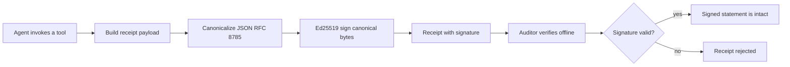
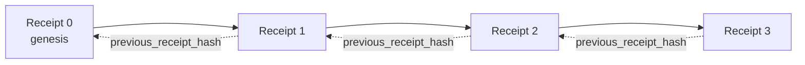

[Гледайте видеоурока: Осигуряване на AI агенти с криптографски разписки](https://youtu.be/PLACEHOLDER_VIDEO_ID)

> _(Видео на урока и миниатюра ще бъдат добавени от екипа за съдържание на Microsoft след сливането, съобразени с шаблона за урок 14 / 15.)_

# Осигуряване на AI агенти с криптографски разписки

## Въведение

Този урок ще разгледа:

- Защо пътеките за одит на AI агенти са важни за съответствие, отстраняване на грешки и доверие.
- Какво представлява криптографската разписка и как се различава от не подписан лог ред.
- Как да се създаде подписана разписка за повикване на инструмент от агента с чист Python.
- Как да се провери разписка офлайн и да се открие манипулиране.
- Как да се свържат разписките така, че премахването или пренареждането на една да наруши веригата.
- Какво доказват разписките и какво изрично не доказват.

## Цели на обучението

След завършване на този урок, ще знаете как да:

- Идентифицирате режимите на неизправност, които мотивират криптографски произход за действията на агента.
- Създавате подписана с Ed25519 разписка над канонизиран JSON товар.
- Проверявате разписка независимо, използвайки само публичния ключ на подписвача.
- Откривате манипулация чрез повторно изпълнение на проверката върху модифицирана разписка.
- Създавате хеш-верижна последователност от разписки и обяснявате защо веригата е важна.
- Разпознавате границата между това, което разписките доказват (атрибуция, интегритет, подредба) и това, което не доказват (коректност на действието, съгласуваност на политиката).

## Проблемът: Пътеката за одит на вашия агент

Представете си, че сте внедрили AI агент за Contoso Travel. Агентът чете клиентски заявки, извиква API за полети, за да търси възможности, и резервира места от името на клиента. През последното тримесечие агентът е обработил 50 000 резервации.

Днес идва одитор. Той задава прост въпрос: "Покажете ми какво е направил вашият агент."

Вие предоставяте вашите лог файлове. Одиторът ги разглежда и задава по-трудния въпрос: "Как да знам, че тези логове не са редактирани?"

Това е проблемът с пътеката за одит. Повечето съвременни внедрения на агенти разчитат на:

- **Логове на приложението**: писани от самия агент, редактуеми от всеки с достъп до файловата система.
- **Облачни услуги за логване**: доказуеми срещу манипулация на платформено ниво, но само ако одиторът има доверие на оператора на платформата.
- **Логове на транзакции в база данни**: подходящи за промени в базата данни, но не и за произволни повиквания на инструменти.

Нито един от тези методи не може да отговори на въпроса на одитора без изискване той да има доверие на някого (вас, вашия облачен доставчик, вашия доставчик на база данни). За вътрешна употреба това доверие често е приемливо. За регулирани натоварвания (финанси, здравеопазване, всичко подлежащо на EU AI Act) – не е.

Криптографските разписки стесняват този проблем чрез създаване на подписано изявление, което може да бъде независимо
проверено. Одиторът все още се нуждае от външна причина да се довери на подписващия ключ и
на компонента, който е издал изявлението. Вграденият ключ доказва само вътрешна съгласуваност,
не и идентичност на издаващия или мястото на прилагане.

## Какво представлява криптографската разписка?

Разписката е JSON обект, който записва какво е направил агентът, подписан с дигитален подпис.



Минимална разписка изглежда така:

```json
{
  "type": "agent.tool_call.v1",
  "agent_id": "contoso-travel-bot",
  "tool_name": "lookup_flights",
  "tool_args_hash": "sha256:a3f9c1...",
  "result_hash": "sha256:7b2e1d...",
  "policy_id": "contoso-travel-policy-v3",
  "timestamp": "2026-04-25T14:30:00Z",
  "sequence": 47,
  "previous_receipt_hash": "sha256:9d4e6a...",
  "signature": {
    "alg": "EdDSA",
    "sig": "c5af83...",
    "public_key": "8f3b2c..."
  }
}
```

Три свойства вършат работата:

1. **Подписът**. Разписката е подписана от портала на агента, използвайки частен Ed25519 ключ. Всеки с публичния съответстващ ключ може да провери подписа офлайн. Проверяващата страна трябва или да фиксира този ключ, или да го извлече от доверен регистър извън разписката. Манипулирането на всяко подписано поле прави подписа невалиден.

2. **Канонично кодиране**. Преди подписването, разписката се сериализира с JSON Canonicalization Scheme (JCS, RFC 8785). Това осигурява, че два различни имплементации, които създават същата логична разписка, генерират байт-идентичен изход. Без каноникализация, различни JSON сериализатори биха произвели различни подписи за едно и също съдържание.

3. **Хеш веригa**. Полето `previous_receipt_hash` свързва всяка разписка с предходната. Премахването или пренареждането на разписка нарушава представената последователност. Откриването на съкращаване или пренаписване под контрол на подписвача изисква или фиксирана текуща верига, независимо засвидетелстван контролен пункт, или удостоверено задкръглено обвързване на популацията.

Заедно тези свойства дават три гаранции:

- **Атрибуция към ключ**: този ключ е подписал това съдържание. Организационна или човешка идентичност изисква доверено свързване на ключа.
- **Интегритет**: съдържанието не се е променило от подписването.
- **Подредба в рамките на проверената последователност**: тази разписка се свързва с предходника си.

## Създаване на разписка в Python

Не ви е необходима специална библиотека за създаване на разписка. Криптографските примитиви са широко достъпни, а логиката е няколко десетки реда Python.

Практическите упражнения в `code_samples/18-signed-receipts.ipynb` преминават през целия процес. Контролираният изходен код `code_samples/18-signed-receipts.execution-receipt.json` записва точния хеш на тетрадката, Python среда, броя клетки и проверки от последното чисто изпълнение, без да променя съхранените изходи на урока. Кратката версия:

```python
import json
import hashlib
import base64
from nacl import signing
from jcs import canonicalize  # RFC 8785 canonical JSON

def b64url_nopad(data: bytes) -> str:
    return base64.urlsafe_b64encode(data).decode("ascii").rstrip("=")

def sha256_canonical(obj) -> str:
    """SHA-256 of a Python object's JCS-canonical JSON form."""
    return f"sha256:{hashlib.sha256(canonicalize(obj)).hexdigest()}"

# Generate or load a signing key (in production, store in a key vault)
signing_key = signing.SigningKey.generate()
verify_key = signing_key.verify_key
TRUSTED_PUBLIC_KEYS = {b64url_nopad(bytes(verify_key))}  # pinned out of band by the verifier

# Build the receipt payload (no signature yet)
tool_args = {"origin": "SYD", "destination": "LAX"}
tool_result = [{"flight": "QF11", "price": 1850, "stops": 0}]

payload = {
    "type": "agent.tool_call.v1",
    "agent_id": "contoso-travel-bot",
    "tool_name": "lookup_flights",
    "tool_args_hash": sha256_canonical(tool_args),
    "result_hash": sha256_canonical(tool_result),
    "policy_id": "contoso-travel-policy-v3",
    "timestamp": "2026-04-25T14:30:00Z",
    "sequence": 0,
    "previous_receipt_hash": None,
}

# Canonicalize and sign the JCS bytes directly. PureEdDSA hashes internally.
canonical_bytes = canonicalize(payload)
signature_bytes = signing_key.sign(canonical_bytes).signature

# Attach a structured signature object.
receipt = {
    **payload,
    "signature": {
        "alg": "EdDSA",
        "sig": b64url_nopad(signature_bytes),
        "public_key": b64url_nopad(bytes(verify_key)),
    },
}
```

Това е цялата верига за подписване. Упражненията в тетрадката разглеждат всяка стъпка подробно.

## Проверка на разписка и откриване на манипулация

Проверката е обратната операция:

```python
import base64
import hashlib
from nacl import signing
from nacl.exceptions import CryptoError
from jcs import canonicalize

def b64url_decode(s: str) -> bytes:
    # Strict: Python's decoder skips characters outside the alphabet and also
    # accepts padding, the standard +/ alphabet and non-zero spare bits.
    # Re-encoding and comparing accepts only the one unpadded base64url form.
    padding = "=" * ((4 - len(s) % 4) % 4)
    data = base64.urlsafe_b64decode(s + padding)
    if base64.urlsafe_b64encode(data).decode("ascii").rstrip("=") != s:
        raise ValueError("not canonical unpadded base64url")
    return data

def verify_receipt(receipt: dict, trusted_public_key: str) -> bool:
    # trusted_public_key is the issuer's key, obtained from somewhere other
    # than this receipt. Never use receipt["signature"]["public_key"] here:
    # see "What Receipts Prove (and What They Do Not)" below.
    # Fails closed: anything malformed returns False instead of raising.
    if not isinstance(receipt, dict) or not isinstance(trusted_public_key, str):
        return False
    sig_obj = receipt.get("signature")
    if not isinstance(sig_obj, dict) or sig_obj.get("alg") != "EdDSA":
        return False
    sig_b64 = sig_obj.get("sig")
    if not isinstance(sig_b64, str):
        return False

    try:
        # Reconstruct the payload that was actually signed (everything except signature).
        payload = {k: v for k, v in receipt.items() if k != "signature"}
        canonical_bytes = canonicalize(payload)
        verify_key = signing.VerifyKey(b64url_decode(trusted_public_key))
        verify_key.verify(canonical_bytes, b64url_decode(sig_b64))
        return True
    except (CryptoError, TypeError, ValueError, KeyError, OverflowError):
        return False
    except Exception:
        # An undecodable key or signature, or a payload that cannot be
        # canonicalized: fail closed rather than raise.
        return False
```

Тази функция приема разписка и публичния ключ на издателя и връща `True` ако подписът е валиден и `False` в противен случай, включително при неправилен вход. Няма мрежова заявка и няма услуга за проверка: щом имате ключа на издателя, проверката е изцяло локална и офлайн. Трябва обаче да имате този ключ, получен от друго място, различно от разписката.

За да видите откриването на манипулация в действие, тетрадката разглежда:

1. Създаване на валидна разписка и потвърждаване, че се проверява успешно.
2. Модифициране на един байт от полето `tool_args_hash`.
3. Повторна проверка и виждане на неуспех.
4. Отново манипулиране, но този път повторно подписване с ключ, генериран от нападателя, и вграждане на този ключ в разписката.

Стъпка 4 е тази, която си заслужава да обмислите. Тази разписка е вътрешно последователна: нейният подпис е автентичен за съдържанието ѝ и за ключа, който носи, така че се проверява успешно срещу ключа вътре в нея. Тя не преминава проверката само когато се проверява срещу истинския ключ на издателя. Стъпки 2 и 3 хващат нападател, който не е положил усилия да повторно подпише; стъпка 4 хваща този, който го е направил.

Това е практическата демонстрация, че разписките са доказуеми срещу манипулация: всяка промяна в подписано поле нарушава подписа, при условие че проверявате срещу ключ, който нападателят не е предоставил. Самият `signature` обект е извън подписаните байтове, затова ключът, срещу който проверявате, трябва да идва от друго място, различно от разписката.

## Свързване на разписки за многократни действия на агенти

Една подписана разписка защитава едно действие. Веригата от разписки защитава последователност.



Всяка разписка записва хеша на предишната разписка. За да премахне тихомълком разписка 2, нападателят би трябвало или:

- Да модифицира `previous_receipt_hash` полето на разписка 3 (нарушава подписа на разписка 3), ИЛИ
- Да изфабрикува нов подпис на модифицирана разписка 3 (изисква частния ключ на агента).

Ако частният ключ е в хардуерен ключов сейф и проверяващите сравняват всяка разписка срещу публичния ключ на издателя, получен независимо (публикуван JWK сет или фиксирана конфигурация), нито една от двете атаки не е възможна без да бъде открита. Публикуването на ключа в самата разписка не е достатъчно: нападателят може да пре-подпише с собствен ключ и да го вгради там вместо него, което е фиксирано във `04_resigned_receipt.json`.

Тетрадката разглежда:

1. Създаване на верига от три разписки.
2. Проверка, че `previous_receipt_hash` на всяка разписка съвпада с реалния хеш на предишната.
3. Манипулиране на една разписка в средата и виждане как веригата се скъсва точно на това място.

Това е начинът да създадете пътека за одит, която външен одитор може да провери под
собствените си фиксирани ключове на издателя и контролни пунктове на веригата, без да се доверява на изменяемото ви лог хранилище.

## Какво доказват разписките (и какво не)

Това е най-важната част на този урок. Разписките са мощни, но тяхната мощ има граници.

**Разписките доказват три неща:**

1. **Атрибуция**: конкретен ключ е подписал конкретен товар.
2. **Интегритет**: товарът не се е променил от подписването.
3. **Подредба в представената, проверена последователност**: тази разписка е свързана с предходника си.

**Разписките НЕ доказват:**

1. **Коректност**: че действието на агента е било правилното действие. Разписка може да бъде подписана за грешен отговор също толкова лесно, колкото и за правилен.
2. **Съответствие с политика**: че политиката, упомената в `policy_id`, е била действително оценена, или че би разрешила това действие, ако е била проверена. Разписката записва какво е заявено, не какво е било приложено.
3. **Идентичност отвъд ключа**: разписката казва "този ключ е подписал това съдържание." Тя не казва "този човек е одобрил това." Свързването на ключ с лице или организация изисква отделна инфраструктура за идентичност (директория, регистър на публични ключове и др.).
4. **Истинност на входните данни**: ако агентът получи манипулиран подканващ текст и действа по него, разписката вярно записва действието. Разписките са след валидацията на входа, не заместват тази валидация.
5. **Изпълнение или реален ефект**: разписката след повикване записва какво издателят твърди, че се е случило. Доказването на приемане или съгласуване на външен ефект изисква свидетелства от действителния изпълнител или доставчик.
6. **Пълнота**: липсваща разписка може да означава блокирана, пропусната, изгубена или неинструментирана. Липсата става доказателство само в рамките на удостоверена затворена популация.
7. **Доверено време**: подписаното време доказва, че подписвачът е носил тази стойност, не че стойността е била вярна. Довереното време изисква отделен времеви орган или засвидетелстван контролен пункт.

**Ключът в разписката не е ключът, с който верифицирате.** Това следва от точка 3 и е единственото място, където разграничението трябва да промени вашия код, а не разбирането ви. `public_key` в примера по-горе е там, за да е примерът самостоятелен. Проверяващ никога не трябва да му се доверява. Всеки може да вземе разписка, да я промени, да я подпише с ключ, който е генерирал, и да вгради този ключ; резултатът ще се проверява перфектно срещу себе си. Това е фиксирано във `04_resigned_receipt.json` в `sample_receipts/`, и поради това `verify_receipt` по-горе приема ключа като аргумент, вместо да го чете от разписката. Вземете ключа на издателя независимо, от JWK сета в Производствения контролен списък по-долу или друг закрепващ елемент, който сте фиксирали предварително, и проверявайте срещу него. Подпис, проверен с ключ, който е пристигнал в същия плик, доказва само, че пликът е вътрешно съгласуван.

Тази граница е важна по две причини:

- Тя ви казва за какво са полезни разписките: за да направят поведението на агента одитируемо и доказуемо срещу манипулация, дори през организационни граници.
- Тя ви казва какви допълнителни нива все още са ви необходими: валидация на входа (Урок 6), прилагане на политика (засегнато накратко по-долу) и инфраструктура за идентичност (извън обхвата на този урок).

Честа грешка е да се предполага, че "имаме разписки" означава "ние сме управлявани." Не е така. Разписките са основа. Управлението е системата, която изграждате върху нея.

## Свързване на подписа на одобряващ с точното действие

Точка 3 по-горе заслужава собствен раздел: разписката за действие казва "този ключ е подписал това съдържание," никога "човек е одобрил това." За действия с висок риск (връщания, изтривания, банкови преводи), отделен подпис на одобряващ може да свърже точното действие. Свързването на този ключ с човек и проверката на човешко присъствие остават отделни отговорности.

Продължаващата тетрадка `code_samples/human-authorization-receipts.ipynb` добавя втори вид разписка, `human.approval.v1`, със същата форма на плика като разписките в урока (типизиран товар, подписан с Ed25519 върху каноничните JCS байтове, с `signature` обекта извън подписаните байтове). Ключът на одобряващия подписва **пълното канонично действие и неговия хеш**; ключът на агента подписва изявление, носещо **същия хеш на действие** и `parent_approval_ref`, `receipt_hash` на одобрението, същата конвенция като `previous_receipt_hash` във веригата, която сте изградили по-горе. Един `verify_chain` обработва и двата артефакта под **отделни фиксирани регистри на ключове** (ключове на одобряващи срещу ключове на агенти), така че кодът е споделен, но властите никога не се припокриват.

Свойството, което това осигурява, казано внимателно: *фиксираният ключ на одобряващ е подписал точно това
действие, а ключът на агента по-късно е подписал изявление, носещо същия хеш на действие.*
Това е полезно свидетелство, но само по себе си не доказва, че действието е изпълнено. За
контрол върху изпълнението, точното одобрение трябва да бъде резервирано и използвано само веднъж на
реалната граница на изпълнителя; неизвестните резултати от доставчика трябва да останат неизвестни, а не
безусловно повторни опити. Отказите в тетрадката тестват слоя на веригата от разписки:

- манипулация, объркан представител, фалшифицирани ключове от която и да е страна, и неправилен вход;
- **остаряла власт**: подпис, който все още се проверява успешно, отказан все пак, защото версията на политиката се е променила, ключът на одобряващия е премахнат от фиксирания регистър, или одобрението е изтекло преди предоставеното време за проверка;
- **замяна на хеш**: валидно подписана разписка за действие, сочеща към *реално* одобрение, което обвързва *различно* канонично действие.

Всеки провал отказва с различна причина, така че одиторът при четене на отказ може да разбере дали властта е остаряла или заявеното действие се е променило. Проверката е само за четене и повтаряема: тя не консумира одобрението и не задейства доставчик. Отделен изпълнител се нуждае от трайна, атомна защита срещу повторение и явни резултати за успех, неуспех и неизяснен изход. Разписката за човешко одобрение е образователна композиция, дефинирана от този урок, а не вид разписка, дефиниран от `draft-farley-acta-signed-receipts`.

## Препратки за производство

Python кодът в този урок е умишлено минимален, за да можете да прочетете всеки ред и да разберете точно какво се случва. В продукция имате две възможности:

1. **Изградете директно върху криптографските примитиви.** 50-те реда, които видяхте по-горе, са достатъчни за много случаи на употреба. PyNaCl (Ed25519) и `jcs` пакетът (каноничен JSON) са добре поддържани и проверени библиотеки.

2. **Използвайте библиотека за продукционни разписки.** Няколко проекта с отворен код прилагат същия модел с допълнителни функции (ротация на ключове, верификация на партиди, разпространение на JWK Set, интеграция с политически двигатели):
   - Потокът за подписване използва JCS и конвенциите за обхват на подписа в независим IETF Internet-Draft ([`draft-farley-acta-signed-receipts`](https://datatracker.ietf.org/doc/draft-farley-acta-signed-receipts/), ревизия 02). Образователната плоска разписка от този урок се различава от `{payload, signature}` плика на драфта и не се представя като съвместимо изпълнение. Драфтът публикува споделен комплект за съответствие ([agent-governance-testvectors](https://github.com/ScopeBlind/agent-governance-testvectors)) за имплементации, насочени към неговия wire формат.
   - Microsoft Agent Governance Toolkit съставя разписки с решения на политики, базирани на Cedar; вижте Урок 33 в това хранилище за пример от край до край.
   - `protect-mcp` (npm) и `@veritasacta/verify` (npm) пакетите предоставят Node-базирана имплементация на подписване на разписки и офлайн верификация, предназначена за обвиване на всеки MCP сървър с доказуема неизменяемост на одитния след, включително поток, задържан за съ-съгласуване, при който паузирано действие издава разписка за одобрение, свързана с дайджеста на действието (поддържана от WebAuthn в десктоп потока), същият модел за разписка за одобрение като горната бележка за човешка авторизация.
   - **[nobulex](https://github.com/arian-gogani/nobulex)** Python SDK (`pip install nobulex`) предоставя същия модел за подписване Ed25519 + JCS на Python с интеграции за LangChain и CrewAI, включително публикувани вектори за тестове за крос-валидация и карта за съответствие, допринесена чрез [OWASP PR #2210](https://github.com/OWASP/CheatSheetSeries/pull/2210).
   - **[EMILIA Protocol](https://github.com/emiliaprotocol/emilia-protocol)** осигурява допълнителен слой за налагане на точни действия: одобрителни разписки, проверими офлайн, фиксиран WebAuthn или кворумна власт, еднократна употреба на границата на изпълнителя и изразен път с неопределен резултат. Неговите адаптери към рамката третират разписката като необходимо доказателство, а не като доказателство, че е въздействано външно.

Изборът между създаване на собствено решение и използване на библиотека се отнася както до избора между написването на собствена JWT библиотека и използването на тествана: и двете са разумни; библиотеката спестява време и намалява обхвата на одита; подходът от нулата ви принуждава да разберете всеки примитив. Този урок преподава пътя от нулата, за да имате основа за който и да е избор.

## Проверка на знанията

Тествайте разбирането си преди да преминете към практическото упражнение.

**1. Разписката е подписана с частния Ed25519 ключ на агента. Одиторът разполага само с публичния ключ. Може ли одиторът да провери разписката офлайн?**

<details>
<summary>Отговор</summary>

Да, криптографската верификация изисква само публичния ключ и подписаните байтове. 
Одиторът все пак трябва да получи и фиксира приетия публичен ключ независимо от разписката.
След установяването на тази конфигурация за доверие не е необходима мрежова връзка.
</details>

**2. Зловреден потребител променя полето `policy_id` на разписка, за да твърди, че тя е била управлявана от по-либерална политика. Подписът е върху оригиналното съдържание. Какво се случва по време на верификацията?**

<details>
<summary>Отговор</summary>

Потвърждението не успява. Подписът е изчислен върху каноничните байтове на оригиналното съдържание; промяната на някое поле в съдържанието променя тези байтове, което прави подписа невалиден. Нападателят би трябвало да има частния ключ, за да създаде нов валиден подпис, което той няма.
</details>

**3. Защо касовата бележка включва `tool_args_hash` и `result_hash`, а не суровите аргументи и резултат?**

<details>
<summary>Отговор</summary>

Два са основните причини. Първо, касовата бележка може да се архивира или предава в среди, където изтичането на суровото съдържание (лични данни, бизнес данни) е проблем. Хеширането поддържа касовата бележка малка и съдържанието поверително; одиторът проверява дали хешът съвпада с отделно съхранено копие на действителното съдържание. Второ, хешовете имат фиксиран размер; касовата бележка с хешове е с ограничен размер без значение колко големи са били входните и изходните данни.
</details>

**4. Полето `previous_receipt_hash` свързва всяка касова бележка с предшественика ѝ. Ако нападател тихо изтрие една бележка от средата на веригата, какво ще стане невалидно?**

<details>
<summary>Отговор</summary>

Всички касови бележки, които са следвали изтритата. Техните полета `previous_receipt_hash` вече не съвпадат с действителната верига (защото бележката, към която са препращали, вече не съществува или верига вече сочи към друг предшественик). За да скрие изтриването, нападателят трябва да презапише подписа на всяка следваща бележка, което изисква частния ключ на издателя. Презапис с друг ключ не минава проверката спрямо ключа на издателя.
</details>

**5. Ако касовата бележка се провери успешно, доказва ли това, че действието на агента е било правилно, коректно или в съответствие с политиката?**

<details>
<summary>Отговор</summary>

Не. Под фиксиран ключ и контекст на веригата валидна касова бележка доказва приписване на подписа,
интегритет на съдържанието и връзка с предшественика. Тя НЕ доказва,
че действието е било правилно или изпълнено, че е била оценена политиката, че таймстампът е
надежден или че наборът от записи е пълен. Това е най-важната граница в урока.
</details>

## Упражнение за практика

Отворете `code_samples/18-signed-receipts.ipynb` и завършете всички четири секции:

1. **Секция 1**: Подпишете първата си касова бележка и я проверете.
2. **Секция 2**: Манипулирайте касовата бележка и наблюдавайте провала на проверката.
3. **Секция 3**: Създайте верига от три касови бележки и проверете цялостта на веригата.
4. **Секция 4**: Приложете шаблона към агент, създаден с Microsoft Agent Framework: обвийте повикване на инструмент в подписване на касовата бележка, след което проверете касовата бележка независимо.

**Предизвикателство за разширение 1:** разширете схемата на касовата бележка с допълнително поле по ваш избор (например, идентификатор на заявка за проследяване), обновете логиката за каноничен подпис, за да го включите, и потвърдете, че касовата бележка все още минава проверката. След това променете полето след подписване и потвърдете, че проверката се проваля. Това ви принуждава да разберете как всеки байт от каноничното кодиране допринася за подписа.

**Предизвикателство Stretch 2:** Хеширайте с SHA-256 две от вашите разписки заедно (конкатенирайте техните канонични байтове в детерминиран ред) и вградете получения хеш като ново поле в трета разписка преди да я подпишете. Проверете, че и трите разписки все още могат да преминат успешно през проверката. Току-що изградихте доказателство за едноетапно включване: всеки, който държи третата разписка, може да докаже, че първите две са съществували по времето на подписването ѝ, без да е нужно да разкрива съдържанието им. Това е моделът, който използват разписките с селективно разкриване в голям мащаб (Merkle commitments, RFC 6962).

## Заключение

Криптографските разписки дават на AI агентите одитна следа, която е:

- **Независимо проверима при фиксирано доверие**: страна с приети публични ключове и подписани байтове може да проверява без зависимост от услуга.
- **Устойчивa на манипулация**: всяка промяна прави подписа невалиден.
- **Преносима**: разписката е малък JSON файл; може да се архивира, предава и проверява навсякъде.
- **Съобразена със стандартите**: изградена върху Ed25519 (RFC 8032), JCS (RFC 8785) и SHA-256, всички широко използвани примитиви.

Те не заменят валидирането на входовете, прилагането на политика, допускането на изпълнението,
доказателства за резултата, контролите за пълнота или инфраструктурата за идентичност. Те са основа
за тези слоеве. В регулирани или мултиорганизационни работни процеси разписките правят конкретни
твърдения на издателя независимо проверими при собствената настройка на доверие на одитора.

Най-важният извод: разписките доказват, че конкретен ключ е подписал конкретно
съдържание. Прилежащият времеви печат е твърдение на подписващия, освен ако не е потвърден отделно по време. Разписка
не доказва, че съдържанието ѝ е вярно, че действието е изпълнено или че
наборът от записи е пълен. Държете тези разграничения ясно.

## Проверъчен списък за производство

Когато сте готови да преминете от този урок към внедряване на агенти с подписани разписки в реална среда:

- [ ] **Преместете ключа за подписване от лаптопа на разработчика.** Използвайте Azure Key Vault, AWS KMS или хардуерен модул за сигурност. Частният ключ, подписващ разписките ви, никога не трябва да бъде съхраняван в изходния код или в незашифрован вид на приложни машини.
- [ ] **Установете доверие в ключа на проверяващия.** Публикувайте ключове чрез JWK Set или регистър, след което страните, които разчитат на тях, „заключват“ приетата идентичност на издателя, набора от ключове и правилата за въртене извън отделните разписки. Самостоятелният ключ вътре в разписката не е доверителен котва.
- [ ] **Закотвяйте веригата външно.** Периодично записвайте хеша на най-новата глава на веригата в дневник за прозрачност (Sigstore Rekor, RFC 3161 timestamp authority или втора вътрешна система), за да може външна страна да потвърди „тази верига е съществувала по това време“.
- [ ] **Съхранявайте разписките неизменни.** Складове само за добавяне (Azure Storage с политики за неизменност, AWS S3 Object Lock) предотвратяват пренаписване на историята от вътрешен човек на слоя за съхранение.
- [ ] **Определете политика за съхранение.** Много регулаторни режими изискват многогодишно съхранение. Планирайте растежа на разписките (всяка разписка е около 500 байта; агент, правещ 10 000 извиквания на ден, произвежда около 1,8 ГБ годишно).
- [ ] **Документирайте какво не покриват разписките.** Разписките доказват авторство, цялост и подредба. Вашият ръководен документ трябва изрично да изброява какви допълнителни контроли (валидиране на вход, прилагане на политика, ограничаване на скоростта, инфраструктура за идентичност) стоят рамо до рамо с разписките във вашата управленска позиция.

### Имате ли още въпроси за защита на AI агенти?

Присъединете се към [Microsoft Foundry Discord](https://aka.ms/ai-agents/discord), за да се срещнете с други учащи, да посетите работни часове и да получите отговори на въпросите си за AI агенти.

## Извън този урок

Този урок обхваща подписване на единично потвърждение и последователности с хеш верига. Същите примитиви се съчетават в няколко по-усъвършенствани модела, с които може да се сблъскате, когато вашият начин на управление узрее:

- **Избирателно разкриване.** Когато полетата на потвърждението са независимо потвърдени (Merkle дърво в стил RFC 6962), можете да разкриете конкретни полета на определени одитори и да докажете, че останалите не са променени, без да ги излагате. Полезно, когато едно и също потвърждение трябва да задоволи както пълен одит (който иска пълнота), така и регулациите за минимизиране на данните като GDPR (които искат одиторът да вижда колкото е необходимо).
- **Отказ на потвърждение.** Ако ключ за подписване бъде компрометиран, трябва да има начин да маркирате всички потвърждения, подписани с този ключ, като ненадеждни от даден момент нататък. Стандартни модели: ключове за подписване с кратък живот и публикуван списък за откази или журнал за прозрачност с записи за откази.
- **Двустранни / разделени подписни потвърждения.** Някои реализации разделят подписаното съдържание на половини преди изпълнение (`authorization_*`) и след изпълнение (`result_*`) с независими подписи, полезно когато решението за упълномощаване и наблюдаваният резултат се генерират от различни участници или по различно време. Това се комбинира добавъчно върху формата за потвърждение, преподаван в този урок.
- **Съставяне на съдържанието.** Потвърждението запечатва каквито и да е байтове, които поставите в `result_hash`. Реалните полезни натоварвания често са по-богати от един резултат от извикване на инструмент: разсъждения преди решението (предвиждане на модел, разглеждани опции, доказателства и тяхната пълнота, рискова позиция, верига на отчетност, резултат от контролната точка) могат всички да живеят вътре в съдържанието, запечатано с едно единствено потвърждение. Това запазва формата на потвърждението минимален, като позволява схемите на съдържанието да се развиват домейн по домейн.
- **Съвместимост между реализации.** Няколко независими реализации на същия формат за потвърждение (Python, TypeScript, Rust, Go) се проверяват една срещу друга с използване на общи тестови вектори. Ако изградите собствена реализация, валидирането с публикувани вектори потвърждава съвместимост по протокол.
- **Постквантова миграция.** Ed25519 е широко използван днес, но не е квантово устойчив. Само етикет `alg` не е миграция: профилът трябва да дефинира кодиране на ключове ML-DSA, канонични подписани байтове, проверка, политика за зависещи страни, устойчивост на понижаване на сигурността и семантика на прехода. Планирайте и тествайте преход с двойни подписи с общи вектори преди да правите твърдения за съвместимост.

## Допълнителни ресурси

- <a href="https://datatracker.ietf.org/doc/draft-farley-acta-signed-receipts/" target="_blank">IETF Internet-Draft: Подписани решения за контрол на достъп машина-към-машина</a>
- <a href="https://learn.microsoft.com/azure/ai-studio/responsible-use-of-ai-overview" target="_blank">Обзор на отговорното ИИ (Azure AI)</a>
- <a href="https://datatracker.ietf.org/doc/html/rfc8032" target="_blank">RFC 8032: Алгоритъм за цифров подпис Edwards-Curve (EdDSA)</a>
- <a href="https://datatracker.ietf.org/doc/html/rfc8785" target="_blank">RFC 8785: Схема за канонизация на JSON (JCS)</a>
- <a href="https://datatracker.ietf.org/doc/html/rfc6962" target="_blank">RFC 6962: Прозрачност на сертификатите</a> (Конструкция с Merkle дърво, използвана от потвърждения с избирателно разкриване)
- <a href="https://github.com/microsoft/agent-governance-toolkit/blob/main/docs/tutorials/33-offline-verifiable-receipts.md" target="_blank">Microsoft Agent Governance Toolkit, Урок 33: Офлайн-потвърждаеми решения</a>
- <a href="https://github.com/ScopeBlind/agent-governance-testvectors" target="_blank">Тестови вектори за съвместимост между реализации</a> за формата на разписката, използван в този урок (Apache-2.0)
- <a href="https://pynacl.readthedocs.io/" target="_blank">Документация PyNaCl</a> (Ed25519 в Python)

## Предишен урок

[Създаване на локални AI агенти](../17-creating-local-ai-agents/README.md)

---

<!-- CO-OP TRANSLATOR DISCLAIMER START -->
**Отказ от отговорност**:
Този документ е преведен с помощта на AI преводачески услуга [Co-op Translator](https://github.com/Azure/co-op-translator). Въпреки че се стремим към точност, моля имайте предвид, че автоматизираните преводи могат да съдържат грешки или неточности. Оригиналният документ на неговия роден език трябва да се счита за авторитетен източник. За критична информация се препоръчва професионален човешки превод. Ние не носим отговорност за каквито и да е недоразумения или неправилни тълкувания, произтичащи от използването на този превод.
<!-- CO-OP TRANSLATOR DISCLAIMER END -->