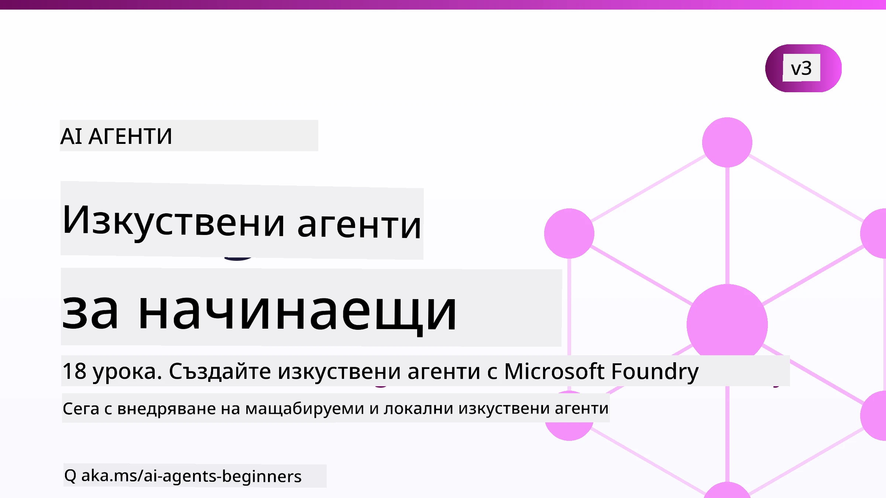

# AI агенти за начинаещи - курс



## Курс, който преподава всичко необходимо, за да започнете да създавате AI агенти

[](https://github.com/microsoft/ai-agents-for-beginners/blob/master/LICENSE?WT.mc_id=academic-105485-koreyst)
[](https://GitHub.com/microsoft/ai-agents-for-beginners/graphs/contributors/?WT.mc_id=academic-105485-koreyst)
[](https://GitHub.com/microsoft/ai-agents-for-beginners/issues/?WT.mc_id=academic-105485-koreyst)
[](https://GitHub.com/microsoft/ai-agents-for-beginners/pulls/?WT.mc_id=academic-105485-koreyst)
[](http://makeapullrequest.com?WT.mc_id=academic-105485-koreyst)

### 🌐 Поддръжка на много езици

#### Преводите се поддържат с [Co-op Translator](https://github.com/Azure/co-op-translator)

<!-- CO-OP TRANSLATOR LANGUAGES TABLE START -->
[Арабски](../ar/README.md) | [Бенгалски](../bn/README.md) | [Български](./README.md) | [Бирмански (Мианмар)](../my/README.md) | [Китайски (опростен)](../zh-CN/README.md) | [Китайски (традиционен, Хонконг)](../zh-HK/README.md) | [Китайски (традиционен, Макао)](../zh-MO/README.md) | [Китайски (традиционен, Тайван)](../zh-TW/README.md) | [Хърватски](../hr/README.md) | [Чешки](../cs/README.md) | [Датски](../da/README.md) | [Холандски](../nl/README.md) | [Естонски](../et/README.md) | [Фински](../fi/README.md) | [Френски](../fr/README.md) | [Немски](../de/README.md) | [Гръцки](../el/README.md) | [Еврейски](../he/README.md) | [Хинди](../hi/README.md) | [Унгарски](../hu/README.md) | [Индонезийски](../id/README.md) | [Италиански](../it/README.md) | [Японски](../ja/README.md) | [Каннада](../kn/README.md) | [Хмерски](../km/README.md) | [Корейски](../ko/README.md) | [Литвански](../lt/README.md) | [Малайски](../ms/README.md) | [Малаялам](../ml/README.md) | [Марати](../mr/README.md) | [Непалски](../ne/README.md) | [Нигерийски пиджин](../pcm/README.md) | [Норвежки](../no/README.md) | [Персийски (фарси)](../fa/README.md) | [Полски](../pl/README.md) | [Португалски (Бразилия)](../pt-BR/README.md) | [Португалски (Португалия)](../pt-PT/README.md) | [Пунджаби (гурмукхи)](../pa/README.md) | [Румънски](../ro/README.md) | [Руски](../ru/README.md) | [Сръбски (кирилица)](../sr/README.md) | [Словашки](../sk/README.md) | [Словенски](../sl/README.md) | [Испански](../es/README.md) | [Суахили](../sw/README.md) | [Шведски](../sv/README.md) | [Тагалог (Филипински)](../tl/README.md) | [Тамилски](../ta/README.md) | [Телугу](../te/README.md) | [Тайски](../th/README.md) | [Турски](../tr/README.md) | [Украински](../uk/README.md) | [Урду](../ur/README.md) | [Виетнамски](../vi/README.md)

> **Предпочитате клониране локално?**
>
> Това хранилище включва над 50 езикови превода, което значително увеличава размера на изтегляне. За да клонирате без преводи, използвайте sparse checkout:
>
> **Bash / macOS / Linux:**
> ```bash
> git clone --filter=blob:none --sparse https://github.com/microsoft/ai-agents-for-beginners.git
> cd ai-agents-for-beginners
> git sparse-checkout set --no-cone '/*' '!translations' '!translated_images'
> ```
>
> **CMD (Windows):**
> ```cmd
> git clone --filter=blob:none --sparse https://github.com/microsoft/ai-agents-for-beginners.git
> cd ai-agents-for-beginners
> git sparse-checkout set --no-cone "/*" "!translations" "!translated_images"
> ```
>
> Това ви осигурява всичко необходимо, за да завършите курса с много по-бързо изтегляне.
<!-- CO-OP TRANSLATOR LANGUAGES TABLE END -->

**За допълнителни езикови опции, вижте [поддържаните езици на Co-op Translator](https://github.com/Azure/co-op-translator/blob/main/docs/supported-languages.md).**

[](https://GitHub.com/microsoft/ai-agents-for-beginners/watchers/?WT.mc_id=academic-105485-koreyst)
[](https://GitHub.com/microsoft/ai-agents-for-beginners/network/?WT.mc_id=academic-105485-koreyst)
[](https://GitHub.com/microsoft/ai-agents-for-beginners/stargazers/?WT.mc_id=academic-105485-koreyst)

[](https://discord.com/invite/ATgtXmAS5D)


## 🌱 Започване

Този курс има уроци, покриващи основите на създаването на AI агенти. Всеки урок покрива отделна тема, така че започнете, откъдето пожелаете!

Има поддръжка на много езици за този курс. Отидете на [наличните езици тук](#-multi-language-support).

Ако това е вашето първо време да работите с генеративни AI модели, разгледайте нашия курс [Генеративен AI за начинаещи](https://aka.ms/genai-beginners), който включва 21 урока за работа с GenAI.

Не забравяйте да [звездичкайте (🌟) това хранилище](https://docs.github.com/en/get-started/exploring-projects-on-github/saving-repositories-with-stars?WT.mc_id=academic-105485-koreyst) и да [форкнете това хранилище](https://github.com/microsoft/ai-agents-for-beginners/fork), за да стартирате кода.

### Запознайте се с други учащи, получете отговори на вашите въпроси

Ако се затрудните или имате въпроси за създаването на AI агенти, присъединете се към нашия специализиран Discord канал в [Microsoft Foundry Discord](https://aka.ms/ai-agents/discord).

### Какво ви е необходимо

Всеки урок в този курс включва примери с код, които можете да намерите в папката code_samples. Можете да [форкнете това хранилище](https://github.com/microsoft/ai-agents-for-beginners/fork), за да създадете собствено копие.

Примерите с код в тези упражнения използват Microsoft Agent Framework с Microsoft Foundry Agent Service V2:

- [Microsoft Foundry](https://aka.ms/ai-agents-beginners/ai-foundry) - изисква Azure акаунт

Този курс използва следните AI Agent рамки и услуги на Microsoft:

- [Microsoft Agent Framework (MAF)](https://learn.microsoft.com/agent-framework/overview/)
- [Microsoft Foundry Agent Service V2](https://aka.ms/ai-agents-beginners/ai-agent-service)

Някои примери с код поддържат и алтернативни провайдъри, съвместими с OpenAI, като [MiniMax](https://platform.minimaxi.com/), който предлага модели с голям контекст (до 204K токени). Вижте [Course Setup](./00-course-setup/README.md) за подробности около конфигурацията.

За повече информация относно стартирането на кода за този курс, посетете [Course Setup](./00-course-setup/README.md).

## 🙏 Искате да помогнете?

Имате предложения или открихте правописни или кодови грешки? [Отворете проблем](https://github.com/microsoft/ai-agents-for-beginners/issues?WT.mc_id=academic-105485-koreyst) или [Създайте pull-заявка](https://github.com/microsoft/ai-agents-for-beginners/pulls?WT.mc_id=academic-105485-koreyst)


## 📂 Всеки урок включва

- Писмен урок, разположен в README и кратко видео
- Примери на Python код, използващи Microsoft Agent Framework с Microsoft Foundry
- Връзки към допълнителни ресурси за продължаване на обучението


## 🗃️ Уроци

| **Урок**                                   | **Текст и Код**                                    | **Видео**                                                  | **Допълнително обучение**                                                                     |
|----------------------------------------------|----------------------------------------------------|------------------------------------------------------------|----------------------------------------------------------------------------------------|
| Въведение в AI агенти и случаи на употреба       | [Връзка](./01-intro-to-ai-agents/README.md)          | [Видео](https://youtu.be/3zgm60bXmQk?si=z8QygFvYQv-9WtO1)  | [Връзка](https://aka.ms/ai-agents-beginners/collection?WT.mc_id=academic-105485-koreyst) |
| Изследване на AI агентски рамки              | [Връзка](./02-explore-agentic-frameworks/README.md)  | [Видео](https://youtu.be/ODwF-EZo_O8?si=Vawth4hzVaHv-u0H)  | [Връзка](https://aka.ms/ai-agents-beginners/collection?WT.mc_id=academic-105485-koreyst) |
| Разбиране на AI агентски проектни модели     | [Връзка](./03-agentic-design-patterns/README.md)     | [Видео](https://youtu.be/m9lM8qqoOEA?si=BIzHwzstTPL8o9GF)  | [Връзка](https://aka.ms/ai-agents-beginners/collection?WT.mc_id=academic-105485-koreyst) |
| Проектен модел за използване на инструменти                      | [Връзка](./04-tool-use/README.md)                    | [Видео](https://youtu.be/vieRiPRx-gI?si=2z6O2Xu2cu_Jz46N)  | [Връзка](https://aka.ms/ai-agents-beginners/collection?WT.mc_id=academic-105485-koreyst) |
| Агентски RAG                                  | [Връзка](./05-agentic-rag/README.md)                 | [Видео](https://youtu.be/WcjAARvdL7I?si=gKPWsQpKiIlDH9A3)  | [Връзка](https://aka.ms/ai-agents-beginners/collection?WT.mc_id=academic-105485-koreyst) |
| Създаване на надеждни AI агенти               | [Връзка](./06-building-trustworthy-agents/README.md) | [Видео](https://youtu.be/iZKkMEGBCUQ?si=jZjpiMnGFOE9L8OK ) | [Връзка](https://aka.ms/ai-agents-beginners/collection?WT.mc_id=academic-105485-koreyst) |
| Проектен модел за планиране                      | [Връзка](./07-planning-design/README.md)             | [Видео](https://youtu.be/kPfJ2BrBCMY?si=6SC_iv_E5-mzucnC)  | [Връзка](https://aka.ms/ai-agents-beginners/collection?WT.mc_id=academic-105485-koreyst) |
| Проектен модел за многоагентни системи                   | [Връзка](./08-multi-agent/README.md)                 | [Видео](https://youtu.be/V6HpE9hZEx0?si=rMgDhEu7wXo2uo6g)  | [Връзка](https://aka.ms/ai-agents-beginners/collection?WT.mc_id=academic-105485-koreyst) |
| Проектен модел за метакогниция                 | [Връзка](./09-metacognition/README.md)               | [Видео](https://youtu.be/His9R6gw6Ec?si=8gck6vvdSNCt6OcF)  | [Връзка](https://aka.ms/ai-agents-beginners/collection?WT.mc_id=academic-105485-koreyst) |
| AI агенти в продукция                      | [Връзка](./10-ai-agents-production/README.md)        | [Видео](https://youtu.be/l4TP6IyJxmQ?si=31dnhexRo6yLRJDl)  | [Връзка](https://aka.ms/ai-agents-beginners/collection?WT.mc_id=academic-105485-koreyst) |
| Използване на агентски протоколи (MCP, A2A и NLWeb) | [Връзка](./11-agentic-protocols/README.md)           | [Видео](https://youtu.be/X-Dh9R3Opn8)                                 | [Връзка](https://aka.ms/ai-agents-beginners/collection?WT.mc_id=academic-105485-koreyst) |
| Контекстно инженерство за AI агенти            | [Връзка](./12-context-engineering/README.md)         | [Видео](https://youtu.be/F5zqRV7gEag)                                 | [Връзка](https://aka.ms/ai-agents-beginners/collection?WT.mc_id=academic-105485-koreyst) |
| Управление на агентска памет                      | [Връзка](./13-agent-memory/README.md)     |      [Видео](https://youtu.be/QrYbHesIxpw?si=vZkVwKrQ4ieCcIPx)                                                      |                                                                                        |
| Изследване на Microsoft Agent Framework                         | [Връзка](./14-microsoft-agent-framework/README.md)                            |                                                            |                                                                                        |
| Създаване на агенти за компютърна употреба (CUA)           | [Връзка](./15-browser-use/README.md)     |                                                            | [Връзка](https://docs.browser-use.com/examples/templates/playwright-integration)         |
| Разгръщане на мащабируеми агенти                    | [Връзка](./16-deploying-scalable-agents/README.md) |                                                    | [Връзка](https://learn.microsoft.com/azure/ai-foundry/agents/overview)                   |
| Създаване на локални AI агенти                     | [Връзка](./17-creating-local-ai-agents/README.md)  |                                                    | [Връзка](https://learn.microsoft.com/azure/ai-foundry/foundry-local/)                    |
| Защита на AI агенти                           | [Връзка](./18-securing-ai-agents/README.md)  |                                                            | [Връзка](https://aka.ms/ai-agents-beginners/collection?WT.mc_id=academic-105485-koreyst) |

## 🎒 Други курсове

Нашият екип създава и други курсове! Разгледайте:

<!-- CO-OP TRANSLATOR OTHER COURSES START -->
### LangChain
[](https://aka.ms/langchain4j-for-beginners)
[](https://aka.ms/langchainjs-for-beginners?WT.mc_id=m365-94501-dwahlin)
[](https://github.com/microsoft/langchain-for-beginners?WT.mc_id=m365-94501-dwahlin)
---

### Azure / Edge / MCP / Агенти
[](https://github.com/microsoft/AZD-for-beginners?WT.mc_id=academic-105485-koreyst)
[](https://github.com/microsoft/edgeai-for-beginners?WT.mc_id=academic-105485-koreyst)
[](https://github.com/microsoft/mcp-for-beginners?WT.mc_id=academic-105485-koreyst)
[](https://github.com/microsoft/ai-agents-for-beginners?WT.mc_id=academic-105485-koreyst)

---
 
### Серия генeративен AI
[](https://github.com/microsoft/generative-ai-for-beginners?WT.mc_id=academic-105485-koreyst)
[-9333EA?style=for-the-badge&labelColor=E5E7EB&color=9333EA)](https://github.com/microsoft/Generative-AI-for-beginners-dotnet?WT.mc_id=academic-105485-koreyst)
[-C084FC?style=for-the-badge&labelColor=E5E7EB&color=C084FC)](https://github.com/microsoft/generative-ai-for-beginners-java?WT.mc_id=academic-105485-koreyst)
[-E879F9?style=for-the-badge&labelColor=E5E7EB&color=E879F9)](https://github.com/microsoft/generative-ai-with-javascript?WT.mc_id=academic-105485-koreyst)

---
 
### Основно обучение
[](https://aka.ms/ml-beginners?WT.mc_id=academic-105485-koreyst)
[](https://aka.ms/datascience-beginners?WT.mc_id=academic-105485-koreyst)
[](https://aka.ms/ai-beginners?WT.mc_id=academic-105485-koreyst)
[](https://github.com/microsoft/Security-101?WT.mc_id=academic-96948-sayoung)
[](https://aka.ms/webdev-beginners?WT.mc_id=academic-105485-koreyst)
[](https://aka.ms/iot-beginners?WT.mc_id=academic-105485-koreyst)
[](https://github.com/microsoft/xr-development-for-beginners?WT.mc_id=academic-105485-koreyst)

---
 
### Серия Copilot
[](https://aka.ms/GitHubCopilotAI?WT.mc_id=academic-105485-koreyst)
[](https://github.com/microsoft/mastering-github-copilot-for-dotnet-csharp-developers?WT.mc_id=academic-105485-koreyst)
[](https://github.com/microsoft/CopilotAdventures?WT.mc_id=academic-105485-koreyst)
<!-- CO-OP TRANSLATOR OTHER COURSES END -->

## 🌟 Благодарности на общността

Благодарим на [Shivam Goyal](https://www.linkedin.com/in/shivam2003/) за предоставянето на важни кодови примери, демонстриращи Agentic RAG.

## Принос

Този проект приветства приноси и предложения. Повечето приноси изискват да се съгласите с
Споразумение за лицензиране на приноси (CLA), с което декларирате, че имате право и всъщност предоставяте
правата да използваме вашия принос. За подробности посетете <https://cla.opensource.microsoft.com>.

Когато изпращате заявка за изтегляне, бот за CLA автоматично ще определи дали трябва да предоставите
CLA и ще маркира заявката съответно (например, проверка на статус, коментар). Просто следвайте инструкциите,
дадени от бота. Ще трябва да направите това само веднъж за всички хранилища, използващи нашия CLA.

Този проект е възприел [Кодекса за поведение на Microsoft Open Source](https://opensource.microsoft.com/codeofconduct/).
За повече информация вижте [Често задавани въпроси за Кодекса за поведение](https://opensource.microsoft.com/codeofconduct/faq/) или
се свържете с [opencode@microsoft.com](mailto:opencode@microsoft.com) за допълнителни въпроси или коментари.

## Търговски марки

Този проект може да съдържа търговски марки или логотипи за проекти, продукти или услуги. Упълномощената употреба на търговски марки или логотипи на Microsoft
подлежи на и трябва да следва
[Указанията за търговски марки и брандове на Microsoft](https://www.microsoft.com/legal/intellectualproperty/trademarks/usage/general).
Използването на търговски марки или логотипи на Microsoft в модифицирани версии на този проект не трябва да създава объркване или да предполага спонсорство от Microsoft.
Всяко използване на търговски марки или логотипи на трети страни е предмет на правилата на тези трети страни.

## Получаване на помощ


Ако срещнете затруднения или имате въпроси относно създаването на AI приложения, присъединете се към:

[](https://aka.ms/foundry/discord)

Ако имате обратна връзка за продукта или грешки при изграждането посетете:

[](https://aka.ms/foundry/forum)

---

<!-- CO-OP TRANSLATOR DISCLAIMER START -->
**Отказ от отговорност**:
Този документ е преведен с помощта на AI преводачески услуга [Co-op Translator](https://github.com/Azure/co-op-translator). Въпреки че се стремим към точност, моля имайте предвид, че автоматизираните преводи могат да съдържат грешки или неточности. Оригиналният документ на неговия роден език трябва да се счита за авторитетен източник. За критична информация се препоръчва професионален човешки превод. Ние не носим отговорност за каквито и да е недоразумения или неправилни тълкувания, произтичащи от използването на този превод.
<!-- CO-OP TRANSLATOR DISCLAIMER END -->