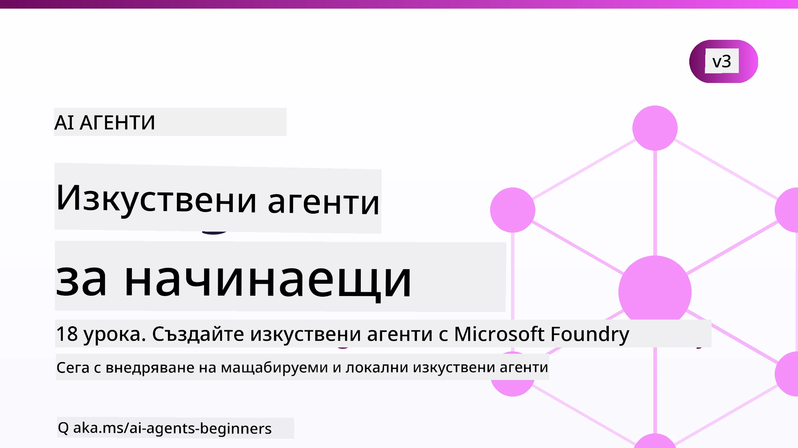

# AI агенти за начинаещи - курс



## Курс, който ви учи на всичко необходимо за започване на изграждане на AI агенти

[](https://github.com/microsoft/ai-agents-for-beginners/blob/master/LICENSE?WT.mc_id=academic-105485-koreyst)
[](https://GitHub.com/microsoft/ai-agents-for-beginners/graphs/contributors/?WT.mc_id=academic-105485-koreyst)
[](https://GitHub.com/microsoft/ai-agents-for-beginners/issues/?WT.mc_id=academic-105485-koreyst)
[](https://GitHub.com/microsoft/ai-agents-for-beginners/pulls/?WT.mc_id=academic-105485-koreyst)
[](http://makeapullrequest.com?WT.mc_id=academic-105485-koreyst)

### 🌐 Многоезична поддръжка

#### Преводите се поддържат чрез [Co-op Translator](https://github.com/Azure/co-op-translator)

<!-- CO-OP TRANSLATOR LANGUAGES TABLE START -->
[Arabic](../ar/README.md) | [Bengali](../bn/README.md) | [Bulgarian](./README.md) | [Burmese (Myanmar)](../my/README.md) | [Chinese (Simplified)](../zh-CN/README.md) | [Chinese (Traditional, Hong Kong)](../zh-HK/README.md) | [Chinese (Traditional, Macau)](../zh-MO/README.md) | [Chinese (Traditional, Taiwan)](../zh-TW/README.md) | [Croatian](../hr/README.md) | [Czech](../cs/README.md) | [Danish](../da/README.md) | [Dutch](../nl/README.md) | [Estonian](../et/README.md) | [Finnish](../fi/README.md) | [French](../fr/README.md) | [German](../de/README.md) | [Greek](../el/README.md) | [Hebrew](../he/README.md) | [Hindi](../hi/README.md) | [Hungarian](../hu/README.md) | [Indonesian](../id/README.md) | [Italian](../it/README.md) | [Japanese](../ja/README.md) | [Kannada](../kn/README.md) | [Khmer](../km/README.md) | [Korean](../ko/README.md) | [Lithuanian](../lt/README.md) | [Malay](../ms/README.md) | [Malayalam](../ml/README.md) | [Manipuri (Meitei Mayek)](../mni/README.md) | [Marathi](../mr/README.md) | [Nepali](../ne/README.md) | [Nigerian Pidgin](../pcm/README.md) | [Norwegian](../no/README.md) | [Persian (Farsi)](../fa/README.md) | [Polish](../pl/README.md) | [Portuguese (Brazil)](../pt-BR/README.md) | [Portuguese (Portugal)](../pt-PT/README.md) | [Punjabi (Gurmukhi)](../pa/README.md) | [Romanian](../ro/README.md) | [Russian](../ru/README.md) | [Serbian (Cyrillic)](../sr/README.md) | [Slovak](../sk/README.md) | [Slovenian](../sl/README.md) | [Spanish](../es/README.md) | [Swahili](../sw/README.md) | [Swedish](../sv/README.md) | [Tagalog (Filipino)](../tl/README.md) | [Tamil](../ta/README.md) | [Telugu](../te/README.md) | [Thai](../th/README.md) | [Turkish](../tr/README.md) | [Ukrainian](../uk/README.md) | [Urdu](../ur/README.md) | [Vietnamese](../vi/README.md)

> **Предпочитате да клонирате локално?**
>
> Това хранилище включва преводи на над 50 езика, което значително увеличава размера за изтегляне. За да клонирате без преводи, използвайте sparse checkout:
>
> **Bash / macOS / Linux:**
> ```bash
> git clone --filter=blob:none --sparse https://github.com/microsoft/ai-agents-for-beginners.git
> cd ai-agents-for-beginners
> git sparse-checkout set --no-cone '/*' '!translations' '!translated_images'
> ```
>
> **CMD (Windows):**
> ```cmd
> git clone --filter=blob:none --sparse https://github.com/microsoft/ai-agents-for-beginners.git
> cd ai-agents-for-beginners
> git sparse-checkout set --no-cone "/*" "!translations" "!translated_images"
> ```
>
> Това ви дава всичко необходимо за завършване на курса с много по-бързо изтегляне.
<!-- CO-OP TRANSLATOR LANGUAGES TABLE END -->

**За допълнителни езикови опции, вижте [поддържаните езици на Co-op Translator](https://github.com/Azure/co-op-translator/blob/main/docs/supported-languages.md).**

[](https://GitHub.com/microsoft/ai-agents-for-beginners/watchers/?WT.mc_id=academic-105485-koreyst)
[](https://GitHub.com/microsoft/ai-agents-for-beginners/network/?WT.mc_id=academic-105485-koreyst)
[](https://GitHub.com/microsoft/ai-agents-for-beginners/stargazers/?WT.mc_id=academic-105485-koreyst)

[](https://discord.com/invite/ATgtXmAS5D)


## 🌱 Започване

Този курс включва уроци, които обхващат основите на изграждане на AI агенти. Всеки урок разглежда своята тема, така че започнете откъдето пожелаете!

Курсът поддържа много езици. Вижте нашите [налични езици тук](#-multi-language-support).

Ако това е първият ви път да работите с генеративни AI модели, разгледайте нашия курс [Generative AI For Beginners](https://aka.ms/genai-beginners), който включва 21 урока за изграждане с GenAI.

Не забравяйте да [даде звезда (🌟) на това хранилище](https://docs.github.com/en/get-started/exploring-projects-on-github/saving-repositories-with-stars?WT.mc_id=academic-105485-koreyst) и да [разклоните това хранилище](https://github.com/microsoft/ai-agents-for-beginners/fork), за да изпълните кода.

### Срещнете други учащи се, получете отговори на вашите въпроси

Ако се затрудните или имате въпроси за изграждане на AI агенти, присъединете се към нашия специализиран Discord канал в [Microsoft Foundry Discord](https://aka.ms/ai-agents/discord).

### Какво ви трябва

Всеки урок в този курс включва примери с код, които могат да се намерят в папката code_samples. Можете да [разклоните това хранилище](https://github.com/microsoft/ai-agents-for-beginners/fork), за да създадете собствено копие.

Примерите с код в тези упражнения използват Microsoft Agent Framework с Microsoft Foundry Agent Service V2:

- [Microsoft Foundry](https://aka.ms/ai-agents-beginners/ai-foundry) - изисква Azure акаунт

Този курс използва следните AI агентни рамки и услуги от Microsoft:

- [Microsoft Agent Framework (MAF)](https://learn.microsoft.com/agent-framework/overview/)
- [Microsoft Foundry Agent Service V2](https://aka.ms/ai-agents-beginners/ai-agent-service)

Някои примерни кодове поддържат алтернативни доставчици, съвместими с OpenAI като [MiniMax](https://platform.minimaxi.com/), който предлага модели с голям контекст (до 204K токена). Вижте [Course Setup](./00-course-setup/README.md) за подробности относно конфигурацията.

За повече информация относно стартирането на кода на курса, посетете [Course Setup](./00-course-setup/README.md).

## 🙏 Искате ли да помогнете?

Имате ли предложения или сте открили правописни или кодови грешки? [Отворете проблем](https://github.com/microsoft/ai-agents-for-beginners/issues?WT.mc_id=academic-105485-koreyst) или [Създайте pull заявка](https://github.com/microsoft/ai-agents-for-beginners/pulls?WT.mc_id=academic-105485-koreyst)


## 📂 Всеки урок включва

- Писмен урок, намиращ се в README, и кратко видео
- Python примери с код, използвайки Microsoft Agent Framework с Microsoft Foundry
- Връзки към допълнителни ресурси за продължаване на обучението


## 🗃️ Уроци

| **Урок**                                   | **Текст и код**                                    | **Видео**                                                  | **Допълнително обучение**                                                                     |
|----------------------------------------------|----------------------------------------------------|------------------------------------------------------------|----------------------------------------------------------------------------------------|
| Въведение в AI агенти и употреба             | [Връзка](./01-intro-to-ai-agents/README.md)          | [Видео](https://youtu.be/3zgm60bXmQk?si=z8QygFvYQv-9WtO1)  | [Връзка](https://aka.ms/ai-agents-beginners/collection?WT.mc_id=academic-105485-koreyst) |
| Изследване на AI агентски рамки              | [Връзка](./02-explore-agentic-frameworks/README.md)  | [Видео](https://youtu.be/ODwF-EZo_O8?si=Vawth4hzVaHv-u0H)  | [Връзка](https://aka.ms/ai-agents-beginners/collection?WT.mc_id=academic-105485-koreyst) |
| Разбиране на AI агентски дизайн модели       | [Връзка](./03-agentic-design-patterns/README.md)     | [Видео](https://youtu.be/m9lM8qqoOEA?si=BIzHwzstTPL8o9GF)  | [Връзка](https://aka.ms/ai-agents-beginners/collection?WT.mc_id=academic-105485-koreyst) |
| Дизайн модел за използване на инструменти    | [Връзка](./04-tool-use/README.md)                    | [Видео](https://youtu.be/vieRiPRx-gI?si=2z6O2Xu2cu_Jz46N)  | [Връзка](https://aka.ms/ai-agents-beginners/collection?WT.mc_id=academic-105485-koreyst) |
| Agentic RAG                                  | [Връзка](./05-agentic-rag/README.md)                 | [Видео](https://youtu.be/WcjAARvdL7I?si=gKPWsQpKiIlDH9A3)  | [Връзка](https://aka.ms/ai-agents-beginners/collection?WT.mc_id=academic-105485-koreyst) |
| Създаване на надеждни AI агенти              | [Връзка](./06-building-trustworthy-agents/README.md) | [Видео](https://youtu.be/iZKkMEGBCUQ?si=jZjpiMnGFOE9L8OK ) | [Връзка](https://aka.ms/ai-agents-beginners/collection?WT.mc_id=academic-105485-koreyst) |
| Дизайн модел за планиране                     | [Връзка](./07-planning-design/README.md)             | [Видео](https://youtu.be/kPfJ2BrBCMY?si=6SC_iv_E5-mzucnC)  | [Връзка](https://aka.ms/ai-agents-beginners/collection?WT.mc_id=academic-105485-koreyst) |
| Модел за множество агенти                     | [Връзка](./08-multi-agent/README.md)                 | [Видео](https://youtu.be/V6HpE9hZEx0?si=rMgDhEu7wXo2uo6g)  | [Връзка](https://aka.ms/ai-agents-beginners/collection?WT.mc_id=academic-105485-koreyst) |
| Дизайн модел за метакогниция                   | [Връзка](./09-metacognition/README.md)               | [Видео](https://youtu.be/His9R6gw6Ec?si=8gck6vvdSNCt6OcF)  | [Връзка](https://aka.ms/ai-agents-beginners/collection?WT.mc_id=academic-105485-koreyst) |
| AI агенти в продукция                          | [Връзка](./10-ai-agents-production/README.md)        | [Видео](https://youtu.be/l4TP6IyJxmQ?si=31dnhexRo6yLRJDl)  | [Връзка](https://aka.ms/ai-agents-beginners/collection?WT.mc_id=academic-105485-koreyst) |
| Използване на агентски протоколи (MCP, A2A и NLWeb) | [Връзка](./11-agentic-protocols/README.md)           | [Видео](https://youtu.be/X-Dh9R3Opn8)                                 | [Връзка](https://aka.ms/ai-agents-beginners/collection?WT.mc_id=academic-105485-koreyst) |
| Контекстно инженерство за AI агенти            | [Връзка](./12-context-engineering/README.md)         | [Видео](https://youtu.be/F5zqRV7gEag)                                 | [Връзка](https://aka.ms/ai-agents-beginners/collection?WT.mc_id=academic-105485-koreyst) |
| Управление на агентска памет                    | [Връзка](./13-agent-memory/README.md)     |      [Видео](https://youtu.be/QrYbHesIxpw?si=vZkVwKrQ4ieCcIPx)                                                      |                                                                                        |
| Изследване на Microsoft Agent Framework         | [Връзка](./14-microsoft-agent-framework/README.md)                            |                                                            |                                                                                        |
| Създаване на агенти за компютърна употреба (CUA)  | [Връзка](./15-browser-use/README.md)     |                                                            | [Връзка](https://docs.browser-use.com/examples/templates/playwright-integration)         |
| Разгръщане на скалируеми агенти                  | [Връзка](./16-deploying-scalable-agents/README.md) |                                                    | [Връзка](https://learn.microsoft.com/azure/ai-foundry/agents/overview)                   |
| Създаване на локални AI агенти                   | [Връзка](./17-creating-local-ai-agents/README.md)  |                                                    | [Връзка](https://learn.microsoft.com/azure/ai-foundry/foundry-local/)                    |
| Защита на AI агенти                              | [Връзка](./18-securing-ai-agents/README.md)  |                                                            | [Връзка](https://aka.ms/ai-agents-beginners/collection?WT.mc_id=academic-105485-koreyst) |

## 🎒 Други курсове

Нашият екип създава и други курсове! Вижте:

<!-- CO-OP TRANSLATOR OTHER COURSES START -->
### LangChain
[](https://aka.ms/langchain4j-for-beginners)
[](https://aka.ms/langchainjs-for-beginners?WT.mc_id=m365-94501-dwahlin)
[](https://github.com/microsoft/langchain-for-beginners?WT.mc_id=m365-94501-dwahlin)
---

### Azure / Edge / MCP / Агенти
[](https://github.com/microsoft/AZD-for-beginners?WT.mc_id=academic-105485-koreyst)
[](https://github.com/microsoft/edgeai-for-beginners?WT.mc_id=academic-105485-koreyst)
[](https://github.com/microsoft/mcp-for-beginners?WT.mc_id=academic-105485-koreyst)
[](https://github.com/microsoft/ai-agents-for-beginners?WT.mc_id=academic-105485-koreyst)

---
 
### Генеративна AI серия
[](https://github.com/microsoft/generative-ai-for-beginners?WT.mc_id=academic-105485-koreyst)
[-9333EA?style=for-the-badge&labelColor=E5E7EB&color=9333EA)](https://github.com/microsoft/Generative-AI-for-beginners-dotnet?WT.mc_id=academic-105485-koreyst)
[-C084FC?style=for-the-badge&labelColor=E5E7EB&color=C084FC)](https://github.com/microsoft/generative-ai-for-beginners-java?WT.mc_id=academic-105485-koreyst)
[-E879F9?style=for-the-badge&labelColor=E5E7EB&color=E879F9)](https://github.com/microsoft/generative-ai-with-javascript?WT.mc_id=academic-105485-koreyst)

---
 
### Основно обучение
[](https://aka.ms/ml-beginners?WT.mc_id=academic-105485-koreyst)
[](https://aka.ms/datascience-beginners?WT.mc_id=academic-105485-koreyst)
[](https://aka.ms/ai-beginners?WT.mc_id=academic-105485-koreyst)
[](https://github.com/microsoft/Security-101?WT.mc_id=academic-96948-sayoung)
[](https://aka.ms/webdev-beginners?WT.mc_id=academic-105485-koreyst)
[](https://aka.ms/iot-beginners?WT.mc_id=academic-105485-koreyst)
[](https://github.com/microsoft/xr-development-for-beginners?WT.mc_id=academic-105485-koreyst)

---
 
### Серия Копилот
[](https://aka.ms/GitHubCopilotAI?WT.mc_id=academic-105485-koreyst)
[](https://github.com/microsoft/mastering-github-copilot-for-dotnet-csharp-developers?WT.mc_id=academic-105485-koreyst)
[](https://github.com/microsoft/CopilotAdventures?WT.mc_id=academic-105485-koreyst)
<!-- CO-OP TRANSLATOR OTHER COURSES END -->

## 🌟 Благодарности към общността

Благодарим на [Shivam Goyal](https://www.linkedin.com/in/shivam2003/) за приноса с важни примери на код, демонстриращи Agentic RAG.

## Принос

Този проект приема приноси и предложения. Повечето приноси изискват да се съгласите с
Лицензионно споразумение за приносител (CLA), с което декларирате, че имате правото и наистина
ни предоставяте правата за използване на вашия принос. За подробности, посетете <https://cla.opensource.microsoft.com>.

Когато изпратите pull request, бот за CLA автоматично ще определи дали трябва да предоставите
CLA и ще маркира подходящо PR (напр. проверка за статус, коментар). Просто следвайте инструкциите,
предоставени от бота. Това трябва да направите само веднъж във всички хранилища, които използват нашия CLA.

Този проект е възприел [Кодекса на поведение за отворен код на Microsoft](https://opensource.microsoft.com/codeofconduct/).
За повече информация вижте [Често задавани въпроси за кодекса на поведение](https://opensource.microsoft.com/codeofconduct/faq/) или
се свържете с [opencode@microsoft.com](mailto:opencode@microsoft.com) за допълнителни въпроси или коментари.

## Търговски марки

Този проект може да съдържа търговски марки или лога за проекти, продукти или услуги. Упълномощената употреба на търговски марки или лога на Microsoft
се подчинява на и трябва да следва
[Насоките за търговски марки и брандове на Microsoft](https://www.microsoft.com/legal/intellectualproperty/trademarks/usage/general).
Използването на търговски марки или лога на Microsoft в модифицирани версии на този проект не трябва да причинява объркване или да подсказва спонсорство от Microsoft.
Всяко използване на търговски марки или лога на трети страни подлежи на политиките на тези трети страни.

## Получаване на помощ


Ако се затрудните или имате въпроси относно изграждането на ИИ приложения, присъединете се към:

[](https://aka.ms/foundry/discord)

Ако имате обратна връзка за продукта или грешки при разработката, посетете:

[](https://aka.ms/foundry/forum)

---

<!-- CO-OP TRANSLATOR DISCLAIMER START -->
**Отказ от отговорност**:
Този документ е преведен с помощта на AI преводачески услуга [Co-op Translator](https://github.com/Azure/co-op-translator). Въпреки че се стремим към точност, моля имайте предвид, че автоматизираните преводи могат да съдържат грешки или неточности. Оригиналният документ на неговия роден език трябва да се счита за авторитетен източник. За критична информация се препоръчва професионален човешки превод. Ние не носим отговорност за каквито и да е недоразумения или неправилни тълкувания, произтичащи от използването на този превод.
<!-- CO-OP TRANSLATOR DISCLAIMER END -->