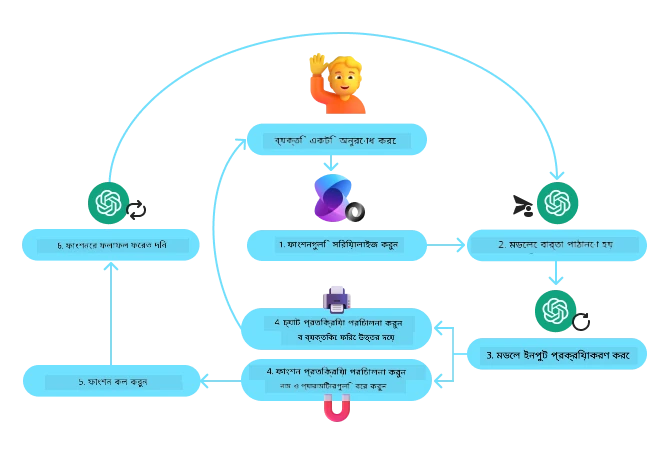
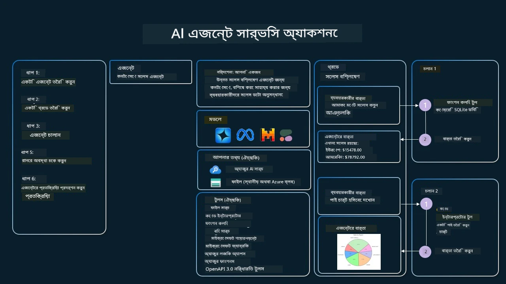

[](https://youtu.be/vieRiPRx-gI?si=cEZ8ApnT6Sus9rhn)

> _(এই পাঠের ভিডিও দেখতে উপরের ছবিতে ক্লিক করুন)_

# টুল ব্যবহারের ডিজাইন প্যাটার্ন

টুলগুলি আকর্ষণীয় কারণ এগুলি AI এজেন্টদের বিস্তৃত ক্ষমতা প্রদান করে। এজেন্টের সীমিত কর্মসংস্থান সেট থাকার পরিবর্তে, একটি টুল যোগ করার মাধ্যমে, এজেন্ট এখন বিভিন্ন ধরনের কাজ সম্পাদন করতে পারে। এই অধ্যায়ে, আমরা টুল ব্যবহারের ডিজাইন প্যাটার্ন দেখবো, যা বর্ণনা করে কিভাবে AI এজেন্ট নির্দিষ্ট টুল ব্যবহার করে তাদের লক্ষ্যমাত্রা অর্জন করতে পারে।

## পরিচিতি

এই পাঠে, আমরা নিচের প্রশ্নগুলোর উত্তর খুঁজছি:

- টুল ব্যবহারের ডিজাইন প্যাটার্ন কী?
- এর প্রযোজ্য ব্যবহারের ক্ষেত্রগুলো কী কী?
- ডিজাইন প্যাটার্ন বাস্তবায়নের জন্য কি উপাদান/বিল্ডিং ব্লক প্রয়োজন?
- বিশ্বাসযোগ্য AI এজেন্ট তৈরির জন্য টুল ব্যবহারের ডিজাইন প্যাটার্ন ব্যবহারের বিশেষ বিবেচ্য বিষয়গুলি কী কী?

## শেখার লক্ষ্য

এই পাঠ শেষ করার পরে, আপনি সক্ষম হবেন:

- টুল ব্যবহারের ডিজাইন প্যাটার্ন এবং এর উদ্দেশ্য নির্ধারণ করতে।
- টুল ব্যবহারের ডিজাইন প্যাটার্ন প্রযোজ্য ব্যবহারের ক্ষেত্র চিহ্নিত করতে।
- ডিজাইন প্যাটার্ন বাস্তবায়নের জন্য মূল উপাদানগুলি বোঝতে।
- এই ডিজাইন প্যাটার্ন ব্যবহার করে AI এজেন্টের বিশ্বাসযোগ্যতা নিশ্চিত করার বিবেচনাগুলি চিনতে।

## টুল ব্যবহারের ডিজাইন প্যাটার্ন কী?

**টুল ব্যবহারের ডিজাইন প্যাটার্ন** LLM-কে বাহ্যিক টুলের সাথে ইন্টারঅ্যাক্ট করার ক্ষমতা দেয় নির্দিষ্ট লক্ষ্যমাত্রা অর্জনের জন্য। টুল হলো কোড যা এজেন্ট দ্বারা কার্যকর করা যায় কোনো কাজ সম্পাদনের জন্য। একটি টুল হতে পারে সরল ফাংশন যেমন ক্যালকুলেটর, অথবা তৃতীয় পক্ষের সার্ভিসের API কল যেমন স্টক প্রাইস তথ্য অনুসন্ধান বা আবহাওয়া পূর্বাভাস। AI এজেন্টের প্রসঙ্গে, টুলগুলো ডিজাইন করা হয় মডেল-জেনারেটেড ফাংশন কলের প্রতিক্রিয়ায় এজেন্ট দ্বারা কার্যকর করার জন্য।

## এর প্রযোজ্য ব্যবহারের ক্ষেত্রগুলো কী কী?

AI এজেন্ট টুল ব্যবহার করে জটিল কাজ সম্পন্ন করতে, তথ্য আহরণ করতে, অথবা সিদ্ধান্ত নিতে পারে। টুল ব্যবহারের ডিজাইন প্যাটার্ন প্রায়ই ব্যবহৃত হয় এমন পরিস্থিতিতে যেখানে বাহ্যিক সিস্টেমের সাথে গতিশীল ইন্টারঅ্যাকশন দরকার, যেমন ডাটাবেস, ওয়েব সার্ভিস, অথবা কোড ইন্টারপ্রেটার। এই ক্ষমতা বিভিন্ন ব্যবহারের ক্ষেত্রে উপযোগী, যেমন:

- **গতিশীল তথ্য আহরণ:** এজেন্ট বাহ্যিক API বা ডাটাবেস থেকে সর্বশেষ তথ্য সংগ্রহ করতে পারে (যেমন, ডাটা বিশ্লেষণের জন্য SQLite ডাটাবেস কুয়েরি করা, স্টক প্রাইস বা আবহাওয়া তথ্য সংগ্রহ করা)।
- **কোড সম্পাদনা ও ব্যাখ্যা:** এজেন্ট কোড বা স্ক্রিপ্ট চালিয়ে গাণিতিক সমস্যা সমাধান, রিপোর্ট তৈরি, বা সিমুলেশন করতে পারে।
- **ওয়ার্কফ্লো স্বয়ংক্রিয়করণ:** টাস্ক শিডিউলার, ইমেইল সার্ভিস, বা ডেটা পাইপলাইন ইত্যাদি টুল একীভূত করে পুনরাবৃত্তি বা বহু ধাপের কাজ স্বয়ংক্রিয়করণ।
- **গ্রাহক সহায়তা:** এজেন্ট CRM সিস্টেম, টিকিটিং প্ল্যাটফর্ম, বা জ্ঞানভান্ডারের সাথে ইন্টারঅ্যাকট করে ব্যবহারকারীর প্রশ্ন সমাধান করতে পারে।
- **কনটেন্ট তৈরি ও সম্পাদনা:** গ্রামার চেকার, টেক্সট সারাংশকারক, অথবা কনটেন্ট সেফটি মূল্যায়ক টুল ব্যবহার করে কনটেন্ট তৈরি কাজে সহায়তা।

## টুল ব্যবহারের ডিজাইন প্যাটার্ন বাস্তবায়নের জন্য কোন উপাদান/বিল্ডিং ব্লক দরকার?

এই বিল্ডিং ব্লকগুলো AI এজেন্টকে ব্যাপক কাজ সম্পাদন করতে সক্ষম করে। আসুন টুল ব্যবহারের ডিজাইন প্যাটার্ন বাস্তবায়নের জন্য মূল উপাদানগুলো দেখি:

- **ফাংশন/টুল স্কিমা:** উপলব্ধ টুলগুলোর বিস্তারিত সংজ্ঞা, যার মধ্যে ফাংশনের নাম, উদ্দেশ্য, প্রয়োজনীয় প্যারামিটার, এবং প্রত্যাশিত আউটপুট। এই স্কিমাগুলো LLM-কে উপলব্ধ টুল ও বৈধ অনুরোধ তৈরি করার উপায় বোঝাতে সাহায্য করে।

- **ফাংশন সম্পাদনার লজিক:** ব্যবহারকারীর ইচ্ছা ও কথোপকথনের প্রেক্ষাপট অনুযায়ী কখন এবং কিভাবে টুলগুলো আহ্বান করা হবে তা নিয়ন্ত্রণ করে। এতে পরিকল্পনাকারী মডিউল, রাউটিং মেকানিজম, বা শর্তাধীন প্রবাহ থাকতে পারে যা গতিশীলভাবে টুল ব্যবহারের সিদ্ধান্ত নেয়।

- **মেসেজ হ্যান্ডলিং সিস্টেম:** ব্যবহারকারীর ইনপুট, LLM প্রতিক্রিয়া, টুল কল, এবং টুল আউটপুটের মধ্যে কথোপকথনের প্রবাহ পরিচালনা করে।

- **টুল ইন্টিগ্রেশন ফ্রেমওয়ার্ক:** এজেন্টকে বিভিন্ন টুলের সাথে সংযুক্ত করে, তা হোক সরল ফাংশন কিংবা জটিল বাহ্যিক সার্ভিস।

- **ত্রুটি ব্যবস্থাপনা ও যাচাই:** টুল সম্পাদনায় ব্যর্থতা মোকাবেলা, প্যারামিটার যাচাই এবং অপ্রত্যাশিত প্রতিক্রিয়া পরিচালনার মেকানিজম।

- **স্টেট ব্যবস্থাপনা:** কথোপকথনের প্রেক্ষাপট, পূর্ববর্তী টুল ইন্টারঅ্যাকশন এবং স্থায়ী তথ্য ট্র্যাক করে মুলতুবি ইন্টারঅ্যাকশনগুলোর মধ্যে স্থিরতা বজায় রাখে।

এবার, আসুন ফাংশন/টুল কলিং বিষয়ে বিস্তারিত জানি।
 
### ফাংশন/টুল কলিং

ফাংশন কলিং হলো প্রধান পন্থা যার মাধ্যমে আমরা বড় ভাষার মডেলগুলোকে (LLM) টুলের সাথে ইন্টারঅ্যাক্ট করার সক্ষমতা দিই। আপনি প্রায়ই 'ফাংশন' ও 'টুল' শব্দ দুটি বিনিময়ে ব্যবহার দেখতে পাবেন কারণ 'ফাংশন' (পুনঃব্যবহারযোগ্য কোডের ব্লক) হলো সেই 'টুল' যা এজেন্টেরা কাজ সম্পন্ন করার জন্য ব্যবহার করে। একটি ফাংশনের কোড আহ্বান করতে, LLM-কে ব্যবহারকারীর অনুরোধকে ফাংশনের বর্ণনার সাথে তুলনা করতে হয়। এজন্য একটি স্কিমা যা সব উপলব্ধ ফাংশনের বর্ণনা ধারণ করে, LLM-এ পাঠানো হয়। তারপর LLM টাস্কের জন্য সবচেয়ে উপযুক্ত ফাংশন নির্বাচন করে তার নাম ও আর্গুমেন্ট ফেরত দেয়। নির্বাচিত ফাংশন আহ্বান করা হয়, এর প্রতিক্রিয়া LLM-এ পাঠানো হয়, যেটি ব্যবহারকারীর অনুরোধ পূরণের জন্য তথ্য ব্যবহার করে।

এজেন্টের জন্য ফাংশন কলিং বাস্তবায়নের জন্য, আপনাকে প্রয়োজন:

১. এমন একটি LLM মডেল যা ফাংশন কলিংকে সমর্থন করে
২. ফাংশন বর্ণনা ধারণকারী একটি স্কিমা
৩. প্রতিটি বর্ণিত ফাংশনের কোড

চলুন একটি শহরের বর্তমান সময় পাওয়ার উদাহরণ দিয়ে বুঝে নিই:

১. **ফাংশন কলিং সমর্থনকারী একটি LLM ইনিশিয়ালাইজ করুন:**

    সব মডেল ফাংশন কলিং সমর্থন করে না, তাই ব্যবহার করা LLM এটি করে কিনা যাচাই করা গুরুত্বপূর্ণ। <a href="https://learn.microsoft.com/azure/ai-services/openai/how-to/function-calling" target="_blank">Azure OpenAI</a> ফাংশন কলিং সমর্থন করে। আমরা Azure OpenAI **Responses API** (স্থির `/openai/v1/` এন্ডপয়েন্ট — কোনো `api_version` প্রয়োজন নেই) এর বিপরীতে OpenAI ক্লায়েন্ট ইনিশিয়েট করতে পারি।

    ```python
    # Initialize the OpenAI client for Azure OpenAI (Responses API, v1 endpoint)
    client = OpenAI(
        base_url=f"{os.environ['AZURE_OPENAI_ENDPOINT'].rstrip('/')}/openai/v1/",
        api_key=os.environ["AZURE_OPENAI_API_KEY"],
    )
    deployment_name = os.environ["AZURE_OPENAI_DEPLOYMENT"]
    ```

২. **একটি ফাংশন স্কিমা তৈরি করুন**:

    পরবর্তীতে আমরা একটি JSON স্কিমা সংজ্ঞায়িত করব, যাতে ফাংশনের নাম, ফাংশনটির কার্যবিবরণী এবং ফাংশন প্যারামিটারগুলোর নাম ও বিবরণ থাকবে।
    তারপর আমরা এই স্কিমাটি পূর্বে তৈরি ক্লায়েন্টকে পাঠাবো, সাথে ব্যবহারকারীর সান ফ্রান্সিসকো শহরের সময় জানার অনুরোধ। গুরুত্বপূর্ণ হল, **টুল কল** ফেরত দেওয়া হয়, প্রশ্নের চূড়ান্ত উত্তর নয়। আগেই বলা হয়েছে, LLM টাস্কের জন্য নির্বাচিত ফাংশনের নাম ও আর্গুমেন্ট ফেরত দেয়।

    ```python
    # Function description for the model to read (Responses API flat tool format)
    tools = [
        {
            "type": "function",
            "name": "get_current_time",
            "description": "Get the current time in a given location",
            "parameters": {
                "type": "object",
                "properties": {
                    "location": {
                        "type": "string",
                        "description": "The city name, e.g. San Francisco",
                    },
                },
                "required": ["location"],
            },
        }
    ]
    ```
   
    ```python
  
    # Initial user message
    messages = [{"role": "user", "content": "What's the current time in San Francisco"}]

    # First API call: Ask the model to use the function
    response = client.responses.create(
        model=deployment_name,
        input=messages,
        tools=tools,
        tool_choice="auto",
        store=False,
    )

    # The Responses API returns tool calls as function_call items in response.output.
    # Append them to the conversation so the model has full context on the next turn.
    messages += response.output

    print("Model's response:")
    print(response.output)
  
    ```

    ```bash
    Model's response:
    [ResponseFunctionToolCall(arguments='{"location":"San Francisco"}', call_id='call_pOsKdUlqvdyttYB67MOj434b', name='get_current_time', type='function_call')]
    ```
  
৩. **কার্য সম্পাদনের জন্য প্রয়োজনীয় ফাংশন কোড:** 

    এখন যখন LLM কোন ফাংশন চালাতে হবে তা বেছে নিয়েছে, আমাদের সেই কাজটি সম্পাদনের কোড বাস্তবায়ন ও চালাতে হবে।
    আমরা পাইথনে বর্তমান সময় পাওয়ার কোড লিখতে পারি। পাশাপাশি response_message থেকে ফাংশনের নাম ও আর্গুমেন্ট বের করার কোডও আমাদের লিখতে হবে মূল ফলাফল পাওয়ার জন্য।

    ```python
      def get_current_time(location):
        """Get the current time for a given location"""
        print(f"get_current_time called with location: {location}")  
        location_lower = location.lower()
        
        for key, timezone in TIMEZONE_DATA.items():
            if key in location_lower:
                print(f"Timezone found for {key}")  
                current_time = datetime.now(ZoneInfo(timezone)).strftime("%I:%M %p")
                return json.dumps({
                    "location": location,
                    "current_time": current_time
                })
      
        print(f"No timezone data found for {location_lower}")  
        return json.dumps({"location": location, "current_time": "unknown"})
    ```

     ```python
    # Handle function calls
    tool_calls = [item for item in response.output if item.type == "function_call"]
    if tool_calls:
        for tool_call in tool_calls:
            if tool_call.name == "get_current_time":

                function_args = json.loads(tool_call.arguments)

                time_response = get_current_time(
                    location=function_args.get("location")
                )

                # Return the tool result as a function_call_output item
                messages.append({
                    "type": "function_call_output",
                    "call_id": tool_call.call_id,
                    "output": time_response,
                })
    else:
        print("No tool calls were made by the model.")

    # Second API call: Get the final response from the model
    final_response = client.responses.create(
        model=deployment_name,
        input=messages,
        tools=tools,
        store=False,
    )

    return final_response.output_text
     ```

     ```bash
      get_current_time called with location: San Francisco
      Timezone found for san francisco
      The current time in San Francisco is 09:24 AM.
     ```

ফাংশন কলিং অধিকাংশ, যদি না সব, এজেন্ট টুল ব্যবহারের ডিজাইন-এর মূল, কিন্তু একে সম্পূর্ণ শূন্য থেকে বাস্তবায়ন করাটা অনেক সময় চ্যালেঞ্জিং হতে পারে।
আমরা [পাঠ ২](../../../02-explore-agentic-frameworks) থেকে জানলাম, এজেন্টিক ফ্রেমওয়ার্কগুলো আমাদের জন্য পূর্বনির্মিত বিল্ডিং ব্লক প্রদান করে টুল ব্যবহারের বাস্তবায়ন সহজ করে।
 
## এজেন্টিক ফ্রেমওয়ার্কের মাধ্যমে টুল ব্যবহারের উদাহরণ

বিভিন্ন এজেন্টিক ফ্রেমওয়ার্ক ব্যবহার করে আপনি কীভাবে টুল ব্যবহারের ডিজাইন প্যাটার্ন বাস্তবায়ন করতে পারেন তার কিছু উদাহরণ:

### মাইক্রোসফট এজেন্ট ফ্রেমওয়ার্ক

<a href="https://learn.microsoft.com/azure/ai-services/agents/overview" target="_blank">মাইক্রোসফট এজেন্ট ফ্রেমওয়ার্ক</a> হলো একটি ওপেন-সোর্স AI ফ্রেমওয়ার্ক AI এজেন্ট তৈরি করার জন্য। এটি ফাংশন কলিং ব্যবহারের প্রক্রিয়া সহজ করে, কারণ আপনি টুলগুলোকে পাইথন ফাংশন হিসেবে `@tool` ডেকোরেটর দিয়ে সংজ্ঞায়িত করতে পারেন। ফ্রেমওয়ার্ক মডেল ও আপনার কোডের মধ্যে যোগাযোগ পরিচালনা করে। এটি আপনাকে File Search ও Code Interpreter মতো পূর্বনির্মিত টুলগুলো ব্যবহারের সুবিধাও দেয় `FoundryChatClient` এর মাধ্যমে।

নিচের চিত্রে মাইক্রোসফট এজেন্ট ফ্রেমওয়ার্ক দিয়ে ফাংশন কলিং প্রক্রিয়া দেখানো হয়েছে:



মাইক্রোসফট এজেন্ট ফ্রেমওয়ার্কে, টুলগুলো ডেকোরেটেড ফাংশন হিসেবে সংজ্ঞায়িত করা হয়। আমরা পূর্বে দেখা `get_current_time` ফাংশনটিকে `@tool` ডেকোরেটর ব্যবহার করে একটি টুলে রূপান্তর করতে পারি। ফ্রেমওয়ার্ক স্বয়ংক্রিয়ভাবে ফাংশন এবং তার প্যারামিটারগুলো সিরিয়ালাইজ করে, LLM-এ পাঠানোর জন্য স্কিমা তৈরি করে।

```python
import os
from agent_framework import tool
from agent_framework.foundry import FoundryChatClient
from azure.identity import AzureCliCredential

@tool(approval_mode="never_require")
def get_current_time(location: str) -> str:
    """Get the current time for a given location"""
    ...

# Create the client
provider = FoundryChatClient(
    project_endpoint=os.environ["AZURE_AI_PROJECT_ENDPOINT"],
    model=os.environ["AZURE_AI_MODEL_DEPLOYMENT_NAME"],
    credential=AzureCliCredential(),
)

# Create an agent and run with the tool
agent = provider.as_agent(name="TimeAgent", instructions="Use available tools to answer questions.", tools=get_current_time)
response = await agent.run("What time is it?")
```

#### MCP সার্ভার থেকে টুল

টুল আপনাকে নিজের কোডের ফাংশন হতে হবে না। একটি সার্ভার যা মডেল কনটেক্সট প্রোটোকল (MCP, বিস্তারিত [পাঠ ১১](../11-agentic-protocols/README.md)) ব্যবহার করে তা তার টুলগুলো তাদের স্কিমাসহ প্রকাশ করে, এবং ফ্রেমওয়ার্ক এগুলোকে একইভাবে লোড করতে পারে যেমন এটি ডেকোরেটেড ফাংশন সিরিয়ালাইজ করে। `MCPStreamableHTTPTool` একটি HTTP সার্ভারের সাথে সংযুক্ত হয়, টুলের স্কিমা পড়ে এবং স্থানীয় টুলের পাশেই এগুলো মডেলকে অফার করে।

নিচের উদাহরণে <a href="https://keenable.ai" target="_blank">Keenable</a> কর্তৃক হোস্ট করা ওয়েব সার্চ সার্ভার ব্যবহার হয়েছে। এটি অ্যাকাউন্ট বা API কী ছাড়াই বিনামূল্যে ব্যবহারযোগ্য (অনুরোধ আইপি অনুযায়ী সীমিত), তাই আপনার মডেলের জন্য প্রয়োজনীয় কেবল ক্রেডেনশিয়াল। যেকোনো দূরবর্তী টুলের মত, মডেল যা কুয়েরি লেখে তা সেই সার্ভারে পাঠানো হয়।

```python
from agent_framework import MCPStreamableHTTPTool

web_search = MCPStreamableHTTPTool(
    name="Keenable web search",
    url="https://api.keenable.ai/mcp",
)

# Connecting loads the server's tool schemas; the agent decides when to call them
async with web_search:
    agent = provider.as_agent(
        name="ResearchAgent",
        instructions="Use available tools to answer questions.",
        tools=[web_search],
    )
    response = await agent.run("What is new in the latest Python release?")
    print(response.text)
```

সার্ভার দুটি টুল প্রকাশ করে, `search_web_pages` এবং `fetch_page_content`। যখন কোনো প্রশ্নের বর্তমান তথ্য প্রয়োজন, মডেল `search_web_pages` কল করে, শিরোনাম, URL এবং টেক্সট স্নিপেট পায়, এবং সেগুলো থেকে উত্তর লেখে, একই লুপ যেমন উপরের `get_current_time` উদাহরণে ছিল।
  
### মাইক্রোসফট ফাউন্ড্রি এজেন্ট সার্ভিস

<a href="https://learn.microsoft.com/azure/ai-services/agents/overview" target="_blank">মাইক্রোসফট ফাউন্ড্রি এজেন্ট সার্ভিস</a> হলো একটি নতুন এজেন্টিক ফ্রেমওয়ার্ক যা ডেভেলপারদের নিরাপদে উচ্চমানের এবং সম্প্রসারিতযোগ্য AI এজেন্ট তৈরি, ডিপ্লয় ও স্কেল করতে সহযোগিতা করে, অথচ মুল কম্পিউট এবং স্টোরেজ সংস্থান নিয়ন্ত্রণের প্রয়োজন হয় না। এটি বিশেষ করে এন্টারপ্রাইজ অ্যাপ্লিকেশনের জন্য উপযোগী কারণ এটি সম্পূর্ণ পরিচালিত সেবা এবং এন্টারপ্রাইজ গ্রেড নিরাপত্তা প্রদান করে।

সরাসরি LLM API ব্যবহার করে ডেভেলপমেন্টের তুলনায়, মাইক্রোসফট ফাউন্ড্রি এজেন্ট সার্ভিস কিছু সুবিধা দেয়, যেমন:

- স্বয়ংক্রিয় টুল কলিং – টুল কল ভাঙা, টুল চালানো এবং প্রতিক্রিয়া পরিচালনা করার প্রয়োজন নেই; সবকিছু এখন সার্ভার-সাইডে হয়
- নিরাপদভাবে পরিচালিত ডেটা – আপনার নিজের কথোপকথন অবস্থা পরিচালনার পরিবর্তে থ্রেডে সব তথ্য সঞ্চয় করতে পারেন
- আউট-অফ-দ্য-বক্স টুল – Bing, Azure AI Search, এবং Azure Functions-এর মত ডেটা সোর্সের সাথে ইন্টারঅ্যাক্ট করার টুল

মাইক্রোসফট ফাউন্ড্রি এজেন্ট সার্ভিসে উপলব্ধ টুল দুটি শ্রেণীতে বিভক্ত:

১. জ্ঞান টুলস:
    - <a href="https://learn.microsoft.com/azure/ai-services/agents/how-to/tools/bing-grounding?tabs=python&pivots=overview" target="_blank">Bing অনুসন্ধান দিয়ে গ্রাউন্ডিং</a>
    - <a href="https://learn.microsoft.com/azure/ai-services/agents/how-to/tools/file-search?tabs=python&pivots=overview" target="_blank">ফাইল অনুসন্ধান</a>
    - <a href="https://learn.microsoft.com/azure/ai-services/agents/how-to/tools/azure-ai-search?tabs=azurecli%2Cpython&pivots=overview-azure-ai-search" target="_blank">Azure AI অনুসন্ধান</a>

২. ক্রিয়াকলাপ টুলস:
    - <a href="https://learn.microsoft.com/azure/ai-services/agents/how-to/tools/function-calling?tabs=python&pivots=overview" target="_blank">ফাংশন কলিং</a>
    - <a href="https://learn.microsoft.com/azure/ai-services/agents/how-to/tools/code-interpreter?tabs=python&pivots=overview" target="_blank">কোড ইন্টারপ্রেটার</a>
    - <a href="https://learn.microsoft.com/azure/ai-services/agents/how-to/tools/openapi-spec?tabs=python&pivots=overview" target="_blank">OpenAPI দ্বারা সংজ্ঞায়িত টুলস</a>
    - <a href="https://learn.microsoft.com/azure/ai-services/agents/how-to/tools/azure-functions?pivots=overview" target="_blank">Azure Functions</a>

এজেন্ট সার্ভিস আমাদেরকে এইসব টুল একসাথে `toolset` হিসেবে ব্যবহার করার সুযোগ দেয়। এটি `threads` ব্যবহার করে যা একটি নির্দিষ্ট কথোপকথনের মেসেজ ইতিহাস ট্র্যাক করে।

ভাবুন, আপনি Contoso নামের একটি কোম্পানির বিক্রয় এজেন্ট। আপনি এমন একটি কথোপকথনমূলক এজেন্ট তৈরি করতে চান যা আপনার বিক্রয় তথ্য সম্পর্কে প্রশ্নের উত্তর দিতে পারে।

নিচের চিত্রে মাইক্রোসফট ফাউন্ড্রি এজেন্ট সার্ভিস ব্যবহার করে কিভাবে আপনার বিক্রয় তথ্য বিশ্লেষণ করা যায় তা প্রদর্শিত হয়েছে:



এই সেবার সাথে যেকোনো টুল ব্যবহার করতে আমরা একটি ক্লায়েন্ট তৈরি করে একটি টুল বা টুলসেট সংজ্ঞায়িত করতে পারি। বাস্তবে এটিকে বাস্তবায়ন করতে আমরা নিচের পাইথন কোড ব্যবহার করতে পারি। LLM টুলসেট দেখে সিদ্ধান্ত নেবে ব্যবহারকারী তৈরি ফাংশন, `fetch_sales_data_using_sqlite_query` অথবা পূর্বনির্মিত কোড ইন্টারপ্রেটার ব্যবহার করবে কি না ব্যবহারকারীর অনুরোধ অনুসারে।

```python 
import os
from azure.ai.projects import AIProjectClient
from azure.identity import DefaultAzureCredential
from fetch_sales_data_functions import fetch_sales_data_using_sqlite_query # fetch_sales_data_using_sqlite_query function which can be found in a fetch_sales_data_functions.py file.
from azure.ai.projects.models import ToolSet, FunctionTool, CodeInterpreterTool

project_client = AIProjectClient.from_connection_string(
    credential=DefaultAzureCredential(),
    conn_str=os.environ["PROJECT_CONNECTION_STRING"],
)

# Initialize toolset
toolset = ToolSet()

# Initialize function calling agent with the fetch_sales_data_using_sqlite_query function and adding it to the toolset
fetch_data_function = FunctionTool(fetch_sales_data_using_sqlite_query)
toolset.add(fetch_data_function)

# Initialize Code Interpreter tool and adding it to the toolset. 
code_interpreter = CodeInterpreterTool()toolset.add(code_interpreter)

agent = project_client.agents.create_agent(
    model="gpt-5-mini", name="my-agent", instructions="You are helpful agent", 
    toolset=toolset
)
```

## বিশ্বাসযোগ্য AI এজেন্ট তৈরির জন্য টুল ব্যবহারের ডিজাইন প্যাটার্ন ব্যবহারের বিশেষ বিবেচনা কী কী?

LLM দ্বারা গতিশীলভাবে তৈরি SQL সাধারণত সুরক্ষার চিন্তা বাড়ায়, বিশেষ করে SQL ইনজেকশন বা ক্ষতিকর ক্রিয়া যেমন ডাটাবেস ড্রপ করা বা পরিবর্তন করার ঝুঁকি সম্পর্কে। যদিও এসব উদ্বেগের যৌক্তিকতা রয়েছে, সেগুলো কার্যকরভাবে হ্রাস করা যায় যথাযথ ডাটাবেস অ্যাক্সেস অনুমতি কনফিগার করে। বেশিরভাগ ডাটাবেসে এর মানে হলো ডাটাবেসকে শুধু পড়ার অনুমতি দেওয়া। PostgreSQL বা Azure SQL মত ডাটাবেস সেবার ক্ষেত্রে, অ্যাপকে শুধুমাত্র পড়ার (SELECT) ভূমিকা প্রদান করা উচিত।

নিরাপদ পরিবেশে অ্যাপ চালানো সুরক্ষা আরও বাড়ায়। এন্টারপ্রাইজ পরিস্থিতিতে, ডেটা সাধারণত অপারেশনাল সিস্টেম থেকে বের করে একটি রিড-ওনলি ডাটাবেস বা ডেটা ওয়্যারহাউসে রূপান্তরিত করা হয় যা ব্যবহারকারী-বান্ধব স্কিমা থাকে। এই পন্থা সুরক্ষা, কর্মক্ষমতা, প্রবেশযোগ্যতা নিশ্চিত করে এবং অ্যাপের রিড-ওনলি অ্যাক্সেস সীমিত করে।

## নমুনা কোড

- পাইথন: [এজেন্ট ফ্রেমওয়ার্ক](./code_samples/04-python-agent-framework.ipynb)
- .NET: [এজেন্ট ফ্রেমওয়ার্ক](./code_samples/04-dotnet-agent-framework.md)

## টুল ব্যবহারের ডিজাইন প্যাটার্ন সম্পর্কে আরও প্রশ্ন আছে?

অন্যান্য শিক্ষার্থীদের সাথে পরিচিত হতে, অফিস আওয়ারসে অংশগ্রহণ করতে এবং আপনার AI এজেন্ট প্রশ্নের উত্তর পেতে [Microsoft Foundry Discord](https://discord.com/invite/ATgtXmAS5D) এ যোগ দিন।

## অতিরিক্ত সম্পদ

- <a href="https://microsoft.github.io/build-your-first-agent-with-azure-ai-agent-service-workshop/" target="_blank">Azure AI Agents Service কার্যশালা</a>
- <a href="https://github.com/Azure-Samples/contoso-creative-writer/tree/main/docs/workshop" target="_blank">কন্টোসো ক্রিয়েটিভ রাইটার মাল্টি-এজেন্ট কর্মশালা</a>
- <a href="https://learn.microsoft.com/azure/ai-services/agents/overview" target="_blank">মাইক্রোসফ্ট এজেন্ট ফ্রেমওয়ার্ক ওভারভিউ</a>

## এই এজেন্টটিকে স্মোক-টেস্টিং (ঐচ্ছিক)

[Lesson 16](../16-deploying-scalable-agents/README.md) এ এজেন্ট মোতায়েন করা শিখার পর, আপনি এই পাঠের `TravelToolAgent` (এটি এখনও কি তার সরঞ্জামগুলি কল করে এবং উত্তর দেয়?) কে [`tests/lesson-04-smoke-tests.json`](../../../tests/lesson-04-smoke-tests.json) দিয়ে স্মোক-টেস্ট করতে পারেন। এটি চালানোর কিভাবে তার জন্য দেখুন [`tests/README.md`](../tests/README.md)।

## পূর্ববর্তী পাঠ

[এজেন্টিক ডিজাইন প্যাটার্নগুলি বোঝা](../03-agentic-design-patterns/README.md)

## পরবর্তী পাঠ

[এজেন্টিক RAG](../05-agentic-rag/README.md)

---

<!-- CO-OP TRANSLATOR DISCLAIMER START -->
**অস্বীকৃতি**:
এই নথিটি AI অনুবাদ পরিষেবা [Co-op Translator](https://github.com/Azure/co-op-translator) ব্যবহার করে অনূদিত হয়েছে। যদিও আমরা শুদ্ধতার জন্য চেষ্টা করি, অনুগ্রহ করে মনে রাখবেন যে স্বয়ংক্রিয় অনুবাদে ত্রুটি বা অসঙ্গতি থাকতে পারে। মূল নথিটি তার স্বভাষায় কর্তৃত্বপূর্ণ উৎস হিসেবে বিবেচিত হওয়া উচিত। গুরুত্বপূর্ণ তথ্যের জন্য পেশাদার মানব অনুবাদ সুপারিশ করা হয়। এই অনুবাদের ব্যবহারে প্রয়োজনীয় ভুল বোঝাবুঝি বা ভুল ব্যাখ্যার জন্য আমরা দায়বদ্ধ নই।
<!-- CO-OP TRANSLATOR DISCLAIMER END -->