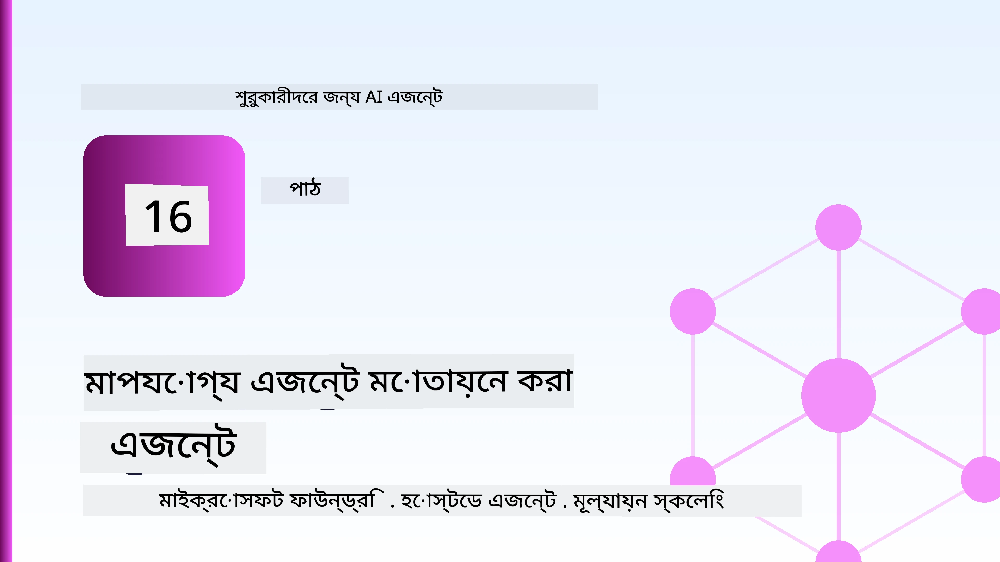
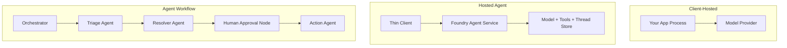
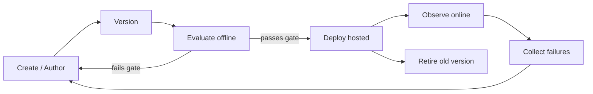
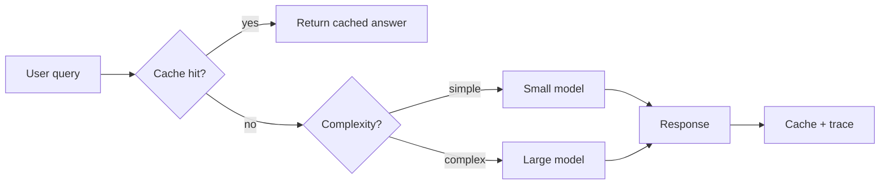
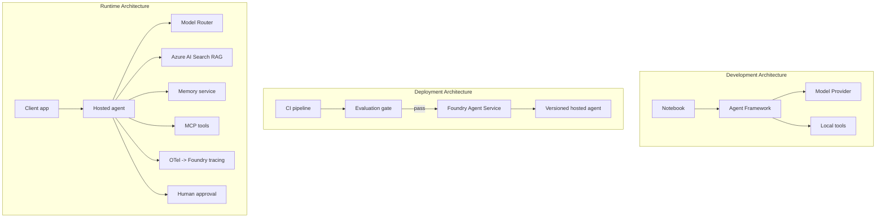

# Microsoft Foundry এর সাথে স্কেলযোগ্য এজেন্টদের স্থাপন



কোর্সের এই পর্যায়ে আপনি এমন এজেন্ট তৈরি করেছেন যা আপনার ল্যাপটপ, নোটবুকের ভিতরে চলে, `az login` এবং কিছু পরিবেশ ভেরিয়েবলের দ্বারা পরিচালিত। এটি শেখার জন্য সঠিক পথ। তবে হাজার হাজার গ্রাহক যারা রাত ৩টার সময় নির্ভর করে তাদের জন্য এজেন্ট চালানো সঠিক পথ নয়।

এই পাঠটি "এটা আমার মেশিনে কাজ করে" এবং "এটা প্রোডাকশনে নির্ভরযোগ্য ও সাশ্রয়ীভাবে কাজ করে" এর মধ্যে থাকা ফাঁক সম্পর্কে। আমরা সেই ফাঁক বন্ধ করি **Microsoft Foundry** এবং **Microsoft Foundry Agent Service** ব্যবহার করে, এবং আমরা এই কাজ করি একটি বাস্তব গ্রাহক সহায়তা এজেন্ট তৈরি করে যার কাছে টুলস, রিট্রিভাল, মেমোরি, মূল্যায়ন, এবং মনিটরিং থাকে।

## পরিচিতি

এই পাঠটি নিম্ন বিষয়গুলো কভার করবে:

- একটি **প্রোটোটাইপ এজেন্ট** এবং একটি **প্রোডাকশন এজেন্ট** এর পার্থক্য, এবং কেন রূপান্তর মূলত মডেলের *ইতিবাচক পাশের* সবকিছু নিয়ে হয়।
- এজেন্টদের জন্য **ডিপ্লয়মেন্ট প্যাটার্ন**: ক্লায়েন্ট-হোস্টেড, সার্ভিস-হোস্টেড (Hosted Agents), এবং ওয়ার্কফ্লো-অর্কেস্ট্রেটেড।
- Microsoft Foundry তে **এজেন্ট লাইফসাইকেল** — তৈরি, ভার্সন করা, ডিপ্লয় করা, মূল্যায়ন, পর্যবেক্ষণ, অবসর গ্রহণ।
- **স্কেলিং কৌশল**: মডেল রাউটিং, ক্যাশিং, সমসাময়িকতা, এবং স্টেটলেস ডিজাইন।
- OpenTelemetry এবং Foundry ট্রেসিং এর মাধ্যমে **অবজারভেবিলিটি**।
- মডেল নির্বাচন, রাউটিং, এবং মূল্যায়ন গেটের মাধ্যমে **খরচ অপ্টিমাইজেশন**।
- **এন্টারপ্রাইজ বিবেচনা**: গভর্নেন্স, মানব অনুমোদন, এবং MCP সার্ভারগুলো প্রোডাকশনে নিরাপদে চালানো।

## শেখার লক্ষ্য

এই পাঠ শেষ করলে আপনি সক্ষম হবেন:

- একটি নির্দিষ্ট এজেন্ট ওয়ার্কলোডের জন্য সঠিক ডিপ্লয়মেন্ট প্যাটার্ন বেছে নিতে।
- Microsoft Foundry Agent Service এ একটি এজেন্ট ডিপ্লয় করতে যাতে এটি ভার্সনযোগ্য, গভর্নড, এবং পর্যবেক্ষণযোগ্য হয়।
- ট্রেসিং এর জন্য এজেন্টকে ইন্সট্রুমেন্ট করা এবং একটি মূল্যায়ন পাইপলাইন তৈরি করা যা প্রতিটি রিলিজের আগে চলে।
- মডেল রাউটিং এবং ক্যাশিং প্রয়োগ করা যাতে স্কেলে লেটেন্সি এবং খরচ নিয়ন্ত্রণে থাকে।
- উচ্চ-ঝুঁকিপূর্ণ কাজের জন্য মানব অনুমোদন গেট যুক্ত করা এবং উৎপাদনে MCP সার্ভার নিরাপদে একীভূত করা।

## পূর্বপ্রয়োজনীয়তা

এই পাঠের জন্য ধরে নেওয়া হয়েছে আপনি পূর্ববর্তী পাঠগুলি সম্পন্ন করেছেন এবং আরামদায়ক:

- [Microsoft Agent Framework](../14-microsoft-agent-framework/README.md) দিয়ে এজেন্ট তৈরি করা (পাঠ ১৪)।
- [টুল ব্যবহার](../04-tool-use/README.md) (পাঠ ৪) এবং [Agentic RAG](../05-agentic-rag/README.md) (পাঠ ৫)।
- [Agent Memory](../13-agent-memory/README.md) (পাঠ ১৩) এবং [Agentic Protocols / MCP](../11-agentic-protocols/README.md) (পাঠ ১১)।
- [অবজারভেবিলিটি এবং মূল্যায়ন](../10-ai-agents-production/README.md) (পাঠ ১০) — এই পাঠ সরাসরি এর উপর ভিত্তি করে তৈরি।

আপনার দরকার:

- একটি **Azure সাবস্ক্রিপশন** এবং একটি **Microsoft Foundry প্রকল্প** যেখানে অন্তত একটি ডিপ্লয়ড চ্যাট মডেল রয়েছে।
- **Azure CLI** প্রমাণীকৃত (`az login`)।
- Python 3.12+ এবং রিপোজিটরির প্যাকেজসমূহ [`requirements.txt`](../../../requirements.txt)।

## প্রোটোটাইপ থেকে প্রোডাকশনে: আসলে কি পরিবর্তিত হয়

একটি প্রোটোটাইপ এজেন্ট এবং একটি প্রোডাকশন এজেন্ট একই মূল লুপ শেয়ার করে — যুক্তি, টুল কল করা, সাড়া দেওয়া। যা পরিবর্তন হয় তা হল ঐ লুপের চারপাশে জড়িত সমস্ত। প্রোডাকশন এজেন্টের মডেল হতে পারে প্রায় ২০%; বাকি ৮০% অপারেশনাল কাঠামো।

| বিষয় | প্রোটোটাইপ | প্রোডাকশন |
| --- | --- | --- |
| **হোস্টিং** | আপনার নোটবুকে চলে | একটি হোস্টেড সার্ভিস হিসাবে চলে, ভার্সন ও রোল আউট সহ |
| **পরিচিতি** | আপনার `az login` টোকেন | স্কোপড RBAC সহ ম্যানেজড পরিচিতি |
| **অবস্থা** | ইন-মেমোরি, রিস্টার্টে হারায় | বহিরাগত (থ্রেড স্টোর, মেমোরি সার্ভিস) |
| **ব্যর্থতা** | আপনি ট্রেসব্যাক দেখেন | রিট্রাই, ফ্যালব্যাক, ডেড-লেটার, এলার্ট |
| **খরচ** | "এটা কয়েক সেন্ট" | প্রতি অনুরোধে ট্র্যাক, রাউট, ক্যাশ, বাজেট দিয়ে |
| **গুণমান** | আপনি আউটপুট দেখেন | প্রতিটি রিলিজের আগে স্বয়ংক্রিয় মূল্যায়ন |
| **বিশ্বাস** | আপনি প্রতিটি ক্রিয়া অনুমোদন করেন | নীতিমালা + ঝুঁকিপূর্ণ কাজের জন্য মানব ইন-দ্য-লুপ |

এই টেবিল মনোযোগ দিয়ে রাখুন। নিচের প্রতিটি বিভাগ এই সারিগুলোর একজনের সঙ্গে মানানসই।

## এজেন্ট ডিপ্লয়মেন্ট প্যাটার্নস

আপনি সাধারণত তিনটি প্যাটার্ন ব্যবহার করবেন, প্রায়ই মিলিতভাবে।

### ১. ক্লায়েন্ট-হোস্টেড এজেন্ট

এজেন্ট অবজেক্ট *আপনার* অ্যাপ্লিকেশন প্রসেসের ভিতরে থাকে। আপনার কোড সরাসরি মডেল প্রদানকারীকে কল করে; যুক্তি লুপ আপনার সার্ভিসে চলে। এটাই পূর্ববর্তী প্রতিটি পাঠে করা হয়েছে।

- **ব্যবহার করুন যখন** আপনি লুপের পূর্ণ নিয়ন্ত্রণ চান, কাস্টম মিডলওয়্যার বা একটি বিদ্যমান ব্যাকএন্ডের মধ্যে এজেন্ট এম্বেড করছেন।
- **লেনদেন**: আপনি নিজেই স্কেলিং, অবস্থা, ও স্থিতিস্থাপকতা নিয়ন্ত্রণ করবেন।

### ২. হোস্টেড এজেন্টস (Foundry Agent Service)

এজেন্টটি Microsoft Foundry তে *রিসোর্স হিসেবে নিবন্ধিত* হয়। Foundry যুক্তি লুপ হোস্ট করে, থ্রেড সংরক্ষণ করে, কন্টেন্ট সেফটি ও RBAC প্রয়োগ করে, এবং এটি Foundry পোর্টালে দৃশ্যমান করে। আপনার অ্যাপ একটি সাদাসিধা ক্লায়েন্ট হয়ে ওঠে যা থ্রেড তৈরি করে এবং প্রতিক্রিয়া পড়ে।

- **ব্যবহার করুন যখন** আপনি স্থায়িত্ব, বিল্ট-ইন অবজারভেবিলিটি, গভর্নেন্স, এবং কম অপারেশনাল মাধ্যম চান।
- **লেনদেন**: কম লেভেলের নিয়ন্ত্রণের পরিবর্তে একটি ব্যবস্থাপিত রানটাইম পান।

### ৩. এজেন্ট ওয়ার্কফ্লো

একাধিক এজেন্ট (এবং টুলস) স্পষ্ট নিয়ন্ত্রণ প্রবাহে একটি গ্রাফে গঠিত — ধারাবাহিক ধাপ, শাখা, মানব অনুমোদন নোড, এবং স্থায়ী চেকপয়েন্ট যা থামিয়ে পুনরায় শুরু করা যায়। এটি Microsoft Agent Framework এর **Workflows** ক্ষমতা যা ডিপ্লয়মেন্ট স্কেলে প্রয়োগ করা হয়।

- **ব্যবহার করুন যখন** একটি একক কাজ অনেক বিশেষায়িত এজেন্ট ছাড়িয়ে যায় বা মাঝে অনুমোদন ধাপ প্রয়োজন।
- **লেনদেন**: আরো চলমান অংশ; অর্কেস্ট্রেশন-স্তরের অবজারভেবিলিটি প্রয়োজন।



## Microsoft Foundry তে এজেন্ট লাইফসাইকেল

একটি এজেন্ট ডিপ্লয় করা একবারের ঘটনা নয় `push`। এটি একটি লুপ, এবং এটি অনেকটা সফটওয়্যার রিলিজ চক্রের মত কারণ সেটাই।



মূল ধারণা, [Lesson 10](../10-ai-agents-production/README.md) থেকে নেওয়া: **অফলাইন মূল্যায়ন একটি গেট, পরবর্তীতে ভাবা নয়।** একটি নতুন এজেন্ট ভার্সন তখনই রিলিজ হয় যখন এটি আপনার মূল্যায়ন মানদণ্ড পার করে। অনলাইন অবজারভেবিলিটি আসল ব্যর্থতাগুলোকে আপনার অফলাইন টেস্ট সেটে ফিড করে। এই হচ্ছে সম্পূর্ণ লুপ।

## স্কেলিং কৌশল

একটি এজেন্ট স্কেল করা স্টেটলেস ওয়েব এপিআই থেকে আলাদা, কারণ প্রতিটি অনুরোধ বহু ব্যয়বহুল মডেল এবং টুল কল ট্রিগার করতে পারে। চারটি কৌশল বেশিরভাগ লোড বহন করে।

**স্টেটলেস রিকোয়েস্ট হ্যান্ডলিং।** আপনার প্রসেস মেমরিতে ব্যবহারকারীর জন্য কোন অবস্থা রাখবেন না। কথোপকথনের থ্রেডগুলি Foundry থ্রেড স্টোর বা মেমোরি সার্ভিসে সংরক্ষণ করুন যাতে যেকোন ইনস্ট্যান্স যেকোন অনুরোধ পরিচালনা করতে পারে। এটাই আপনাকে অনুভূমিকভাবে স্কেল করতে দেয় — ইনস্ট্যান্স যোগ করুন, স্টিকি সেশন নয়।

**মডেল রাউটিং।** প্রতিটি অনুরোধ আপনার সবচেয়ে সক্ষম (এবং সবচেয়ে ব্যয়বহুল) মডেলের প্রয়োজন হয় না। সহজ অনুরোধগুলি — উদ্দেশ্য শ্রেণীবিভাগ, সংক্ষিপ্ত তথ্যমূলক উত্তর — একটি ছোট, দ্রুত মডেলকে রাউট করুন, ও বড় মডেলটি রাখুন সত্যিকারের যুক্তির জন্য। Foundry এর **Model Router** এটা করতে পারে, অথবা আপনি নিজে একটি হালকা ক্লাসিফায়ার তৈরি করতে পারেন। আপনি ল্যাবে DIY ভার্সন তৈরি করবেন।

**প্রতিক্রিয়া ক্যাশিং।** অনেক সহায়তা প্রশ্ন প্রায় শিকড়ের মত ("কীভাবে আমার পাসওয়ার্ড রিসেট করব?")। সাথে সাথে সাধারণ প্রশ্নের উত্তর ক্যাশ করুন এবং মডেল না হিট করেই সার্ভ করুন। এমনকি একটি মাঝারি ক্যাশ হিট রেটেও ব্যয় ও লেটেন্সি অনেক কমে যায়।

**সমসাময়িকতা এবং ব্যাকপ্রেশার।** মডেল প্রদানকারীদের রেট লিমিট থাকে। আপনার সমসাময়িকতা সীমাবদ্ধ করুন, এক্সপোনেনশিয়াল ব্যাকঅফ সহ রিট্রাই করুন, এবং নরমভাবে ব্যর্থ হোন (একটি কিউ তে থাকা "আমরা কাজ করছি" সাড়া সামনের ৫০০ এর তুলনায় ভাল)।



## প্রোডাকশনে অবজারভেবিলিটি

আপনি যা দেখতে পারেন না তা পরিচালনা করতে পারবেন না। যেমন Lesson 10 তে আলোচনা করা হয়েছে, Microsoft Agent Framework নেটিভলি **OpenTelemetry** ট্রেস পাঠায় — প্রতিটি মডেল কল, টুল ইনভোকেশন, ও অর্কেস্ট্রেশন ধাপ একটি স্প্যানে রূপান্তরিত হয়। প্রোডাকশনে আপনি সেই স্প্যানগুলো Microsoft Foundry (বা যেকোনো OTel-সঙ্গত ব্যাকএন্ড) এ রপ্তানি করবেন যাতে আপনি:

- প্রতি গ্রাহকের অভিযোগ এক থেকে শেষ পর্যন্ত ট্রেস করতে পারেন প্রতিটি মডেল ও টুল কল জুড়ে।
- সময়ের সাথে প্রতি অনুরোধে p50/p95 লেটেন্সি ও খরচ লক্ষ্য করুন।
- ত্রুটি-হার বৃদ্ধি ও খরচ অস্বাভাবিকতা সম্পর্কে ব্যবহারকারীদের (বা আপনার ফাইন্যান্স টিম) নজর দেয়ার আগে সতর্কতা পান।

```python
from agent_framework.observability import get_tracer

tracer = get_tracer()

with tracer.start_as_current_span("support_request") as span:
    span.set_attribute("customer.tier", "enterprise")
    span.set_attribute("routed.model", "gpt-5-nano")
    # agent execution is traced automatically inside this span
```

`customer.tier` এবং `routed.model` মত অ্যাট্রিবিউট গুলো ট্রেসের দেয়ালের মধ্যে থেকে উত্তরযোগ্য প্রশ্নে রুপান্তর করে ("এন্টারপ্রাইজ গ্রাহকরা কি খুব বেশি সময়ে ছোট মডেলকে রাউট করা হচ্ছে?")।

## খরচ অপ্টিমাইজেশন

প্রোডাকশন এজেন্টের খরচ টোকেনের দ্বারা প্রাধান্য পায়। প্রভাবের ক্রম অনুসারে তিনটি হাতিয়ার:

1. **সঠিক মডেল নির্বাচন।** একটি ছোট মডেল যা আপনার মূল্যায়ন গেট পাস করে সাধারণত একটি বড় মডেলের তুলনায় সস্তা হয় যা পাস করে। মূল্যায়ন ব্যবহার করে প্রমাণ করুন ছোট মডেল যথেষ্ট ভালো, প্যার ক্যারি করে সবচেয়ে বড় মডেল ব্যবহারের বদলে।
2. **জটিলতা অনুযায়ী রাউট করুন।** উপরের মত — বড় মডেল মূল্য শুধুমাত্র বড় মডেলের যুক্তি দরকার এমন অনুরোধের জন্য দিন।
3. **প্রতিক্রিয়া ক্যাশ করুন।** সবচেয়ে সস্তা মডেল কল হচ্ছে আপনি যা কখনও করেন না।

মূল্যায়ন গেট এবং খরচ নিয়ন্ত্রণ একই ডিসিপ্লিন দুটি ভিন্ন দৃষ্টিকোণ থেকে: মূল্যায়ন বলে দেয় *গুণগত মানের ন্যূনতম*, রাউটিং ও ক্যাশিং খরচকে সেই স্তরের যত কাছে সম্ভব রাখে।

## এন্টারপ্রাইজ ডিপ্লয়মেন্ট বিবেচনা

**গভর্নেন্স।** Hosted Agents Foundry এর RBAC, কন্টেন্ট সেফটি, ও অডিট লগিং উত্তরাধিকার সূত্রে পায়। প্রতিটি এজেন্টকে দেওয়া উচিত একটি ম্যানেজড পরিচিতি যার সর্বনিম্ন প্রিভিলেজ আছে — নলেজ বেস পড়ার জন্য, টিকেটিং API অ্যাক্সেসের জন্য স্কোপড, আর কিছু নয়।

**মানব ইন-দ্য-লুপ।** কিছু কাজ সরাসরি স্বয়ংক্রিয় করা যায় না — ফেরত ইস্যু, অ্যাকাউন্ট মুছে ফেলা, লিগ্যাল টিম এ উন্নীতকরণ। Microsoft Agent Framework **অনুমোদন-প্রয়োজনীয়** টুলসকে সমর্থন করে: এজেন্ট কাজ প্রস্তাব করে, কার্যকরীতা থামে, একজন মানুষ অনুমোদন বা প্রত্যাখ্যান করে, ওয়ার্কফ্লো পুনরায় চালু হয়। আপনি ঐ প্রিমিটিভ [Lesson 6](../06-building-trustworthy-agents/README.md) এ দেখেছেন; এখানে আপনি এটি ডিপ্লয় করবেন।

**MCP প্রোডাকশনে।** [MCP](../11-agentic-protocols/README.md) আপনার এজেন্টকে বাইরের টুলগুলি স্টান্ডার্ড ইন্টারফেসের মাধ্যমে ব্যবহার করতে দেয়। প্রোডাকশনে, প্রতিটি MCP সার্ভারকে একটি অবিশ্বাস যোগ্য সীমানা মনে করুন: সার্ভার ভার্সন পিন করুন, স্কোপড পরিচিতি দিয়ে চালান, এর আউটপুট যাচাই করুন, কখনো সিক্রেটস প্রকাশ করবেন না। MCP সার্ভার একটি নির্ভরযোগ্যতা; নির্ভরযোগ্যতা প্যাচ, অডিট, এবং রেট-লিমিট করা হয়।



ঐ তিনটি ডায়াগ্রাম — ডেভেলপমেন্ট, ডিপ্লয়মেন্ট, রানটাইম — সেগুলো একই এজেন্টের জীবনের তিনটি ধাপ। পরবর্তী ল্যাব আপনাকে এটি তৈরি করতে সহায়তা করবে।

## হাতে-কলমে ল্যাব: একটি প্রোডাকশন-রেডি গ্রাহক সহায়তা এজেন্ট

[`code_samples/16-python-agent-framework.ipynb`](./code_samples/16-python-agent-framework.ipynb) খুলুন এবং শুরু থেকে শেষ পর্যন্ত কাজ করুন। আপনি তৈরি করবেন একটি **Contoso গ্রাহক সহায়তা এজেন্ট** যা সব প্রোডাকশন উদ্বেগ অন্তর্ভুক্ত করে:

১. **টুল কলিং** — অর্ডার স্ট্যাটাস দেখুন এবং সহায়তা টিকেট খুলুন।
২. **RAG** — নলেজ বেস থেকে নীতি প্রশ্নের উত্তর (Azure AI Search, একটি ইন-মেমোরি ফallback সহ যাতে নোটবুক Search রিসোর্স ছাড়াই চলে)।
৩. **মেমোরি** — কথোপকথনের বারে গ্রাহককে মনে রাখে।
৪. **মডেল রাউটিং** — একটি জটিলতা শ্রেণীবিভাজক প্রতিটি অনুরোধকে ছোট বা বড় মডেলে রাউট করে।
৫. **প্রতিক্রিয়া ক্যাশিং** — পুনরাবৃত্ত প্রশ্ন ক্যাশ থেকে পরিবেশন করা হয়।
৬. **মানব অনুমোদন** — নির্দিষ্ট সীমার উপরে ফেরত দেওয়ার জন্য মানব অনুমোদন থামে।
৭. **মূল্যায়ন পাইপলাইন** — একটি ছোট অফলাইন টেস্ট সেট এজেন্টকে স্কোর করে এবং রিলিজ গেট হিসাবে কাজ করে।
৮. **অবজারভেবিলিটি** — প্রতিটি অনুরোধের চারপাশে OpenTelemetry ট্রেসিং।

### ওয়াকথ্রু

নোটবুকটি সংগঠিত যাতে প্রতিটি প্রোডাকশন উদ্বেগ একটি স্ব-নির্ভর, চালানোর উপযোগী অংশ। এর প্রধান অংশ হল রাউটিং-প্লাস-ক্যাশিং রিকোয়েস্ট হ্যান্ডলার:

```python
async def handle_support_request(query: str, customer_id: str) -> str:
    # 1. Serve from cache when we can.
    cached = response_cache.get(normalize(query))
    if cached:
        return cached

    # 2. Route by complexity to control cost.
    model = "gpt-5-nano" if is_simple(query) else "gpt-5-mini"

    # 3. Run the agent inside a trace span for observability.
    with tracer.start_as_current_span("support_request") as span:
        span.set_attribute("routed.model", model)
        span.set_attribute("customer.id", customer_id)
        response = await support_agent.run(query, model=model)

    # 4. Cache and return.
    response_cache.set(normalize(query), response.text)
    return response.text
```

রিলিজ রক্ষা করার মূল্যায়ন গেট এরকম দেখায়:

```python
async def evaluation_gate(agent, test_cases, threshold: float = 0.8) -> bool:
    passed = 0
    for case in test_cases:
        result = await agent.run(case["input"])
        if score_response(result.text, case["expected"]) >= 0.8:
            passed += 1
    pass_rate = passed / len(test_cases)
    print(f"Evaluation pass rate: {pass_rate:.0%} (gate: {threshold:.0%})")
    return pass_rate >= threshold  # only deploy if the gate passes
```

প্রতিটি লাইন পড়ুন — নোটবুকটি সচেতনভাবে ছোট প্রিমিটিভ রাখে যাতে কিছুই ফ্রেমওয়ার্ক কলের পেছনে লুকানো না থাকে।

## ডিপ্লয়ড এজেন্টকে স্মোক টেস্ট দিয়ে যাচাই করা

উপরের মূল্যায়ন গেট *অফলাইন* আপনার এজেন্ট অবজেক্টের বিরুদ্ধে চলে। এজেন্টটি যখন Hosted Agent হিসেবে ডিপ্লয় হয়, তখন আরেকটি, আরও সস্তা পরীক্ষা দরকার: **ডিপ্লয়ড এন্ডপয়েন্ট কি সত্যিই উত্তর দিচ্ছে?**

"সফলভাবে" ডিপ্লয় করা শুধুমাত্র প্রমাণ করে কন্ট্রোল প্লেন সংজ্ঞাটি গ্রহণ করেছে — এটি প্রমাণ করে না যে এজেন্ট উত্তর দেয়। একটি অনুপস্থিত নির্ভরতা, একটি ভুল মডেল রাউটিং, অথবা একটি মেয়াদ উত্তীর্ণ সংযোগ সবুজ ডিপ্লয়মেন্ট থাকতে পারে যা কিছুই ফিরিয়ে দেয় না। একটি **স্মোক টেস্ট** এটি কয়েক সেকেন্ডে ধরতে পারে, প্রতিটি ডিপ্লয়মেন্টে, পূর্ণ মূল্যায়নের খরচ ছাড়াই।

এই রিপোজিটরিটি [AI Smoke Test](https://github.com/marketplace/actions/ai-smoke-test) গিটহাব অ্যাকশনের উপরে নির্মিত একটি প্রস্তুত-ব্যবহারযোগ্য স্মোক-টেস্ট পাইপলাইন সরবরাহ করে:

- **ক্যাটালগ** — [`tests/lesson-16-smoke-tests.json`](../../../tests/lesson-16-smoke-tests.json) এ Contoso সহায়তা এজেন্টের জন্য প্রম্পট এবং প্রত্যয়ন রয়েছে (ভিত্তিক নীতির উত্তর, একটি অর্ডার চেক, বিষয়বস্তুতে থাকার নিয়ম, এবং বহু-বারের থ্রেড ধারাবাহিকতা)। অন্যান্য পাঠের এজেন্টের ক্যাটালগ এর পাশে থাকা থাকে — দেখুন [`tests/README.md`](../tests/README.md)।
- **ওয়ার্কফ্লো** — [`.github/workflows/smoke-test.yml`](../../../.github/workflows/smoke-test.yml) Azure OIDC দিয়ে লগ ইন করে এবং প্রতিটি প্রম্পট এজেন্টের Responses এন্ডপয়েন্টে POST করে, কোন প্রত্যয়ন মিস হলে কাজ ব্যর্থ হয়।

```yaml
- name: Smoke-test hosted agent
  uses: JFolberth/ai-smoketest@v1
  with:
    project_endpoint: ${{ inputs.project_endpoint }}
    agent_name: ContosoSupportAgent
    tests_file: tests/lesson-16-smoke-tests.json
```

আপনার এজেন্ট স্থাপিত হওয়ার পরে **Actions** ট্যাব থেকে এটি চালান, আপনার Foundry প্রকল্পের এন্ডপয়েন্ট এবং এজেন্ট নাম প্রদান করে। ফেডারেটেড পরিচয়টিকে Foundry প্রকল্প স্কোপে **Azure AI User** ভূমিকা প্রয়োজন। স্তরগুলোকে একটি পিরামিড হিসেবে ভাবুন: স্মোক টেস্ট (পৌঁছানো যায় এবং সাড়া দেয়?) প্রতিটি স্থাপনের সময় চালানো হয়, অফলাইন মূল্যায়ন (পরিবহণের জন্য যথেষ্ট ভাল?) পদোন্নতির আগে চালানো হয়, এবং অনলাইন মূল্যায়ন (প্রকৃত পরিবেশে কেমন করছে?) ধারাবাহিকভাবে চালানো হয়।

## জ্ঞান যাচাই

অ্যাসাইনমেন্ট শুরু করার আগে আপনার বোঝাপড়া পরীক্ষা করুন।

**১। এক জন প্রোডাকশন এজেন্টে আনুমানিক কতটুকু "মডেল," এবং বাকি অংশ কী?**

<details>
<summary>উত্তর</summary>

মডেলটি সিস্টেমের একটি সংক্ষিপ্ত অংশ — প্রায় ২০% হিসেবে উল্লেখিত। বাকি হলো অপারেশনাল কাঠামো: হোস্টিং এবং সংস্করণ, পরিচয় এবং RBAC, বাহ্যিক অবস্থা, ত্রুটি পরিচালনা, খরচ ট্র্যাকিং, মূল্যায়ন, এবং হিউম্যান-ইন-দ্য-লুপ নিয়ন্ত্রণ। প্রোডাকশনে যাওয়া মূলত যুক্তি চক্রের *চতুর্দিকে* সবকিছু তৈরি করার ব্যাপার।
</details>

**২। কখন আপনি ক্লায়েন্ট-হোস্টেড এজেন্টের পরিবর্তে হোস্টেড এজেন্ট নির্বাচন করবেন?**

<details>
<summary>উত্তর</summary>

যখন আপনি একটি নিয়ন্ত্রিত রানটাইম চান, যার মধ্যে নির্মিত স্থায়িত্ব (থ্রেড যা টিকিয়ে রাখা হয় এবং পুনরায় শুরু করতে পারে), প্রভাব পর্যবেক্ষণযোগ্যতা, বিষয়বস্তু নিরাপত্তা, এবং RBAC থাকে, এবং আপনি যুক্তি চক্রের কিছু নিম্নস্তরের নিয়ন্ত্রণ কিছুটা কমাতে রাজি থাকেন কম অপারেশনাল সূচক জমির জন্য। ক্লায়েন্ট-হোস্টেড পছন্দযোগ্য যখন আপনি পুরোপুরি চক্র নিয়ন্ত্রণ করতে চান অথবা আপনার এজেন্ট একটি বিদ্যমান ব্যাকএন্ডে এম্বেড করছেন।
</details>

**৩। কেন একটি স্কেলযোগ্য এজেন্টকে তার নিজস্ব প্রক্রিয়া মেমরিতে স্টেটলেস হতে হবে?**

<details>
<summary>উত্তর</summary>

যাতে যে কোনো ইনস্টান্স যে কোনো অনুরোধ পরিচালনা করতে পারে, যা হরাইজন্টাল স্কেলিং সম্ভব করে স্টিকি সেশন ছাড়াই। ব্যবহারকারী-ভিত্তিক কথোপকথন অবস্থা থ্রেড স্টোর বা মেমরী সার্ভিসে বাহ্যিকীকৃত হয়। যদি অবস্থা প্রক্রিয়া মেমরিতে থাকে, তাহলে পুনরায় শুরু হলে তা হারানো যেত এবং লোড স্বাধীনভাবে বিতরণ সম্ভব হত না।
</details>

**৪। মডেল রাউটিং কোন সমস্যা সমাধান করে, এবং এটি মূল্যায়নের সাথে কীভাবে সম্পর্কিত?**

<details>
<summary>উত্তর</summary>

রাউটিং সরল অনুরোধগুলো একটি ছোট, সস্তা, দ্রুত মডেলে প্রেরণ করে এবং বড় মডেল সংরক্ষণ করে যথার্থ যুক্তির জন্য, যা লেটেন্সি এবং খরচ উভয়ই নিয়ন্ত্রণ করে। এটি মূল্যায়নের সাথে সম্পর্কিত কারণ মূল্যায়নই প্রমাণ করে ছোট মডেলটি একটি শ্রেণীর অনুরোধের জন্য যথেষ্ট ভালো — মূল্যায়ন ছাড়া রাউটিং অনুমান।
</details>

**৫। "মূল্যায়ন গেট" কী এবং এটি জীবনচক্রে কোথায় থাকে?**

<details>
<summary>উত্তর</summary>

একটি মূল্যায়ন গেট নতুন এজেন্ট সংস্করণে একটি অফলাইন পরীক্ষাসমূহ চালায় এবং পাস রেট নির্দিষ্ট সীমা ছাড়িয়ে না গেলে স্থাপন ব্লক করে। এটি "সংস্করণ" এবং "স্থাপন" এর মধ্যে জীবনচক্রে থাকে, গুণগত মানকে রিলিজের পূর্বশর্ত বানায় শিপিংয়ের পরে পরীক্ষা করার পরিবর্তে।
</details>

**৬। কেন একটি MCP সার্ভারকে প্রোডাকশনে অবিশ্বাসযোগ্য সীমানা হিসেবে বিবেচনা করা উচিত?**

<details>
<summary>উত্তর</summary>

কারণ এটি একটি বাহ্যিক ডিপেনডেন্সি যেটিতে আপনার এজেন্ট কল করে। এর সংস্করণ পিন করা উচিত, একটি স্কোপড পরিচয় দিয়ে চালানো উচিত, এর আউটপুট যাচাই করা উচিত, রেট-লিমিট করতে হবে, এবং কখনোই গোপনীয় তথ্য প্রকাশ করা উচিত নয় — যেভাবে আপনি কোনো তৃতীয় পক্ষের ডিপেনডেন্সিতে শৃঙ্খলা প্রয়োগ করেন। এর আউটপুট আপনার এজেন্টের যুক্তিতে প্রবাহিত হয়, তাই যাচাইবিহীন বিশ্বাস নিরাপত্তা ঝুঁকি।
</details>

**৭। কোন একক পরিবর্তন সাধারণত প্রোডাকশন এজেন্টের খরচে সবচেয়ে বড় প্রভাব ফেলে, এবং কেন?**

<details>
<summary>উত্তর</summary>

মডেলের সঠিক আকার নির্ধারণ করা — এমন একটি ছোট মডেল ব্যবহার করা যা এখনও আপনার মূল্যায়ন গেট পেরিয়ে যায়। খরচ মূলত টোকেন দ্বারা প্রভাবিত হয়, এবং একটি ছোট মডেল যা গুণগত মান পূরণ করে প্রায়শই বড় মডেলের চেয়ে সস্তা। ক্যাশিং এবং রাউটিং তারপর খরচ আরও কমায়, তবে সঠিক বেস মডেল নির্বাচন প্রথম পর্যায়ে সবচেয়ে বড় প্রভাব ফেলে।
</details>

**৮. পর্যবেক্ষণীয়তায় `customer.tier` এবং `routed.model` মত স্প্যান বৈশিষ্ট্যগুলো কী ভূমিকা পালন করে?**

<details>
<summary>উত্তর</summary>

তারা কাঁচা ট্রেসগুলোকে উত্তরযোগ্য ব্যবসায়িক প্রশ্নে রূপান্তরিত করে। বৈশিষ্ট্য ছাড়া আপনার কাছে স্প্যানের একটি দেয়াল থাকে; বৈশিষ্ট্য সহ আপনি প্রশ্ন করতে পারেন "এন্টারপ্রাইজ গ্রাহকদের কি খুব বেশি সময় ছোট মডেলে রাউট করা হচ্ছে?" অথবা "কোন মডেল আমাদের সবচেয়ে ধীর অনুরোধগুলো পরিচালনা করে?" বৈশিষ্ট্য হলো কিভাবে আপনি অপারেশনের গুরুত্বপূর্ণ মাত্রা দিয়ে টেলিমেট্রি ভাগ করেন।
</details>

## অ্যাসাইনমেন্ট

ল্যাব থেকে গ্রাহক সহায়তা এজেন্ট নিয়ে একটি নির্দিষ্ট পরিস্থিতির জন্য কঠোর করুন: **একটি SaaS কোম্পানির সাবস্ক্রিপশন বিলিং সহায়তা এজেন্ট।**

আপনার জমা দেওয়া উচিত:

১. বিলিং-সংশ্লিষ্ট যন্ত্রগুলি দিয়ে **টুলগুলি প্রতিস্থাপন করুন**: `get_subscription_status`, `get_invoice`, এবং `issue_credit` ($৫০ এর বেশি ক্রেডিটে মানুষের অনুমোদন প্রয়োজন)।
২. কোম্পানির রিফান্ড নীতি, বিলিং চক্র, এবং বাতিল নীতি সহ তিনটি RAG ডকুমেন্ট যুক্ত করুন।
৩. মূল্যায়ন সেট কমপক্ষে আটটি কেসে সম্প্রসারিত করুন, যার মধ্যে অন্তত দুইটি অবশ্যই মানব-অনুমোদন পথ সক্রিয় করবে, এবং নিশ্চিত করুন আপনার মূল্যায়ন গেট সঠিকভাবে পাশ বা ফেল করে।
৪. একটি খরচ রিপোর্ট যোগ করুন: এজেন্টের মাধ্যমে দশটি মিশ্রিত প্রশ্ন চালানোর পর, কতগুলো ছোট মডেলে গেল, কতগুলো বড় মডেলে, এবং কতগুলো ক্যাশ থেকে পরিবেশন করা হয়েছে তা মুদ্রণ করুন।

একটি সংক্ষিপ্ত অনুচ্ছেদ লিখুন (একটি মার্কডাউন সেলে) ব্যাখ্যা করে আপনি কোন মডেল-রাউটিং নিয়ম বেছে নিয়েছেন এবং কীভাবে বাস্তব ট্রাফিক দিয়ে এটি যাচাই করবেন। কোনো একক সঠিক উত্তর নেই — আপনাকে মূল্যায়ন করা হচ্ছে যে প্রোডাকশন উদ্বেগগুলো যুক্তিসঙ্গতভাবে একত্রিত হয়েছে কিনা।

## সারাংশ

এই পাঠে আপনি Microsoft Foundry এর সাথে একটি এজেন্টকে প্রোটোটাইপ থেকে প্রোডাকশনে নিয়ে গেলেন:

- প্রোডাকশনে যাওয়া মূলত মডেলের চারপাশে থাকা **অপারেশনাল কাঠামো** — হোস্টিং, পরিচয়, অবস্থা, ত্রুটি পরিচালনা, খরচ, গুণগত মান, এবং বিশ্বাসের ব্যাপার।
- আপনি তিনটি **স্থাপন প্যাটার্ন** শিখেছেন — ক্লায়েন্ট-হোস্টেড, হোস্টেড এজেন্ট, এবং এজেন্ট ওয়ার্কফ্লো — এবং কখন কোনটি উপযুক্ত।
- আপনি **এজেন্ট জীবচক্র** অনুসরণ করেছেন, যেখানে অফলাইন **মূল্যায়ন রিলিজ গেট হিসাবে কাজ করে** এবং অনলাইন পর্যবেক্ষণযোগ্যতা ব্যর্থতাগুলোকে আবার পরীক্ষাসমূহে ফেরত পাঠায়।
- আপনি **স্কেলিং কৌশল** প্রয়োগ করেছেন — স্টেটলেস ডিজাইন, মডেল রাউটিং, ক্যাশিং, এবং সীমিত একযোগিতা — এবং এগুলোকে **খরচ অপ্টিমাইজেশনের সাথে** সংযুক্ত করেছেন।
- আপনি **এন্টারপ্রাইজ নিয়ন্ত্রণ** যুক্ত করেছেন: RBAC, হিউম্যান-ইন-দ্য-লুপ অনুমোদন, এবং প্রোডাকশন-নিরাপদ MCP ইন্টিগ্রেশন।
- আপনি একটি **প্রোডাকশন-সক্ষম গ্রাহক সহায়তা এজেন্ট** তৈরি করেছেন যা এই সব উদ্বেগকে রানযোগ্য কোডে একত্রিত করে।

পরবর্তী পাঠের পথে উল্টো যাত্রা শুরু হবে: ক্লাউডে এজেন্টগুলিকে স্কেল আপ করার পরিবর্তে, আপনি সেগুলোকে একটি একক ডেভেলপার মেশিনে নামিয়ে পুরোপুরি স্থানীয়ভাবে চালাবেন।

## অতিরিক্ত সম্পদ

- <a href="https://learn.microsoft.com/azure/ai-foundry/what-is-azure-ai-foundry" target="_blank">Microsoft Foundry ডকুমেন্টেশন</a>
- <a href="https://learn.microsoft.com/azure/ai-foundry/agents/overview" target="_blank">Microsoft Foundry Agent Service ওভারভিউ</a>
- <a href="https://learn.microsoft.com/en-us/agent-framework/overview/?wt.mc_id=youtube_26688_organicsocial_reactor&pivots=programming-language-python" target="_blank">Microsoft Agent Framework</a>
- <a href="https://learn.microsoft.com/en-us/azure/ai-foundry/openai/concepts/model-router" target="_blank">Microsoft Foundry তে মডেল রাউটার</a>
- <a href="https://learn.microsoft.com/azure/search/search-what-is-azure-search" target="_blank">Azure AI Search</a>
- <a href="https://opentelemetry.io/" target="_blank">OpenTelemetry</a>
- <a href="https://github.com/marketplace/actions/ai-smoke-test" target="_blank">AI Smoke Test GitHub Action</a>
- <a href="https://modelcontextprotocol.io/" target="_blank">মডেল কনটেক্সট প্রোটোকল (MCP)</a>

## পূর্ববর্তী পাঠ

[কম্পিউটার ইউজ এজেন্ট তৈরি (CUA)](../15-browser-use/README.md)

## পরবর্তী পাঠ

[স্থানীয় AI এজেন্ট তৈরি](../17-creating-local-ai-agents/README.md)

---

<!-- CO-OP TRANSLATOR DISCLAIMER START -->
**অস্বীকৃতি**:
এই নথিটি AI অনুবাদ পরিষেবা [Co-op Translator](https://github.com/Azure/co-op-translator) ব্যবহার করে অনূদিত হয়েছে। যদিও আমরা শুদ্ধতার জন্য চেষ্টা করি, অনুগ্রহ করে মনে রাখবেন যে স্বয়ংক্রিয় অনুবাদে ত্রুটি বা অসঙ্গতি থাকতে পারে। মূল নথিটি তার স্বভাষায় কর্তৃত্বপূর্ণ উৎস হিসেবে বিবেচিত হওয়া উচিত। গুরুত্বপূর্ণ তথ্যের জন্য পেশাদার মানব অনুবাদ সুপারিশ করা হয়। এই অনুবাদের ব্যবহারে প্রয়োজনীয় ভুল বোঝাবুঝি বা ভুল ব্যাখ্যার জন্য আমরা দায়বদ্ধ নই।
<!-- CO-OP TRANSLATOR DISCLAIMER END -->