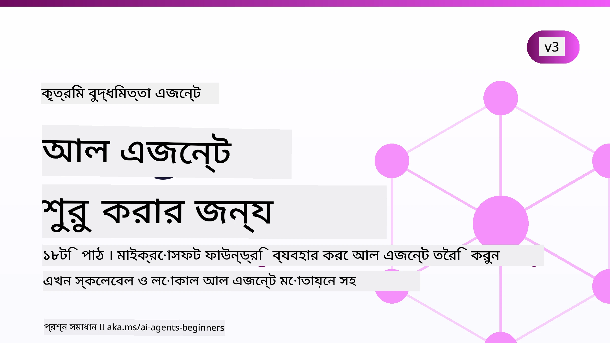

# শুরুদের জন্য AI এজেন্ট - একটি কোর্স



## AI এজেন্ট তৈরি শুরু করার জন্য যা যা জানা দরকার, সেসব কিছু শেখানো একটি কোর্স

[](https://github.com/microsoft/ai-agents-for-beginners/blob/master/LICENSE?WT.mc_id=academic-105485-koreyst)
[](https://GitHub.com/microsoft/ai-agents-for-beginners/graphs/contributors/?WT.mc_id=academic-105485-koreyst)
[](https://GitHub.com/microsoft/ai-agents-for-beginners/issues/?WT.mc_id=academic-105485-koreyst)
[](https://GitHub.com/microsoft/ai-agents-for-beginners/pulls/?WT.mc_id=academic-105485-koreyst)
[](http://makeapullrequest.com?WT.mc_id=academic-105485-koreyst)

### 🌐 বহু ভাষা সমর্থন

#### অনুবাদগুলি [Co-op Translator](https://github.com/Azure/co-op-translator) দ্বারা রক্ষণাবেক্ষণ করা হয়

<!-- CO-OP TRANSLATOR LANGUAGES TABLE START -->
[আরবি](../ar/README.md) | [বাংলা](./README.md) | [বুলগেরিয়ান](../bg/README.md) | [বার্মিজ (মায়ানমার)](../my/README.md) | [চীনা (সহজীকৃত)](../zh-CN/README.md) | [চীনা (প্রচলিত, হংকং)](../zh-HK/README.md) | [চীনা (প্রচলিত, ম্যাকাও)](../zh-MO/README.md) | [চীনা (প্রচলিত, তাইওয়ান)](../zh-TW/README.md) | [ক্রোয়াটিয়ান](../hr/README.md) | [চেক](../cs/README.md) | [ডেনিশ](../da/README.md) | [ডাচ](../nl/README.md) | [এস্তোনিয়ান](../et/README.md) | [ফিনিশ](../fi/README.md) | [ফরাসি](../fr/README.md) | [জার্মান](../de/README.md) | [গ্রিক](../el/README.md) | [হিব্রু](../he/README.md) | [হিন্দি](../hi/README.md) | [হাঙ্গেরিয়ান](../hu/README.md) | [ইন্দোনেশিয়ান](../id/README.md) | [ইতালিয়ান](../it/README.md) | [জাপানি](../ja/README.md) | [কন্নড়](../kn/README.md) | [খমের](../km/README.md) | [কোরিয়ান](../ko/README.md) | [লিথুয়ানিয়ান](../lt/README.md) | [মালয়](../ms/README.md) | [মালয়ালাম](../ml/README.md) | [মণিপুরী (মেইতেই মায়েক)](../mni/README.md) | [মারাঠি](../mr/README.md) | [নেপালি](../ne/README.md) | [নাইজেরিয়ান পিজিন](../pcm/README.md) | [নরওয়েজিয়ান](../no/README.md) | [পার্সিয়ান (ফার্সি)](../fa/README.md) | [পোলিশ](../pl/README.md) | [পর্তুগিজ (ব্রাজিল)](../pt-BR/README.md) | [পর্তুগিজ (পর্তুগাল)](../pt-PT/README.md) | [পাঞ্জাবি (গুরমুখী)](../pa/README.md) | [রোমানিয়ান](../ro/README.md) | [রাশিয়ান](../ru/README.md) | [সার্বিয়ান (সিরিলিক)](../sr/README.md) | [স্লোভাক](../sk/README.md) | [স্লোভেনিয়ান](../sl/README.md) | [স্প্যানিশ](../es/README.md) | [সোয়াহিলি](../sw/README.md) | [সুইডিশ](../sv/README.md) | [তাগালোগ (ফিলিপিনো)](../tl/README.md) | [তামিল](../ta/README.md) | [তেলুগু](../te/README.md) | [থাই](../th/README.md) | [তুর্কি](../tr/README.md) | [ইউক্রেনীয়](../uk/README.md) | [উর্দু](../ur/README.md) | [ভিয়েতনামী](../vi/README.md)

> **লোকাল ক্লোন পছন্দ করেন?**
>
> এই রিপোজিটরিতে ৫০+ ভাষার অনুবাদ রয়েছে যা ডাউনলোড সাইজ অনেক বাড়ায়। অনুবাদ ছাড়া ক্লোন করতে, sparse checkout ব্যবহার করুন:
>
> **Bash / macOS / Linux:**
> ```bash
> git clone --filter=blob:none --sparse https://github.com/microsoft/ai-agents-for-beginners.git
> cd ai-agents-for-beginners
> git sparse-checkout set --no-cone '/*' '!translations' '!translated_images'
> ```
>
> **CMD (Windows):**
> ```cmd
> git clone --filter=blob:none --sparse https://github.com/microsoft/ai-agents-for-beginners.git
> cd ai-agents-for-beginners
> git sparse-checkout set --no-cone "/*" "!translations" "!translated_images"
> ```
>
> এর মাধ্যমে আপনি কোর্স শেষ করার জন্য যা যা দরকার সব পেতে পারেন কম সময়ের ডাউনলোডে।
<!-- CO-OP TRANSLATOR LANGUAGES TABLE END -->

**অতিরিক্ত ভাষার বিকল্পের জন্য দেখুন [Co-op Translator এর সমর্থিত ভাষাগুলো](https://github.com/Azure/co-op-translator/blob/main/docs/supported-languages.md)।**

[](https://GitHub.com/microsoft/ai-agents-for-beginners/watchers/?WT.mc_id=academic-105485-koreyst)
[](https://GitHub.com/microsoft/ai-agents-for-beginners/network/?WT.mc_id=academic-105485-koreyst)
[](https://GitHub.com/microsoft/ai-agents-for-beginners/stargazers/?WT.mc_id=academic-105485-koreyst)

[](https://discord.com/invite/ATgtXmAS5D)


## 🌱 শুরু করা

এই কোর্সে AI এজেন্ট তৈরি করার মৌলিক বিষয়বস্তু শেখানো হয়েছে। প্রতিটি পাঠ তার নিজস্ব বিষয় আলোচনা করে, তাই যেখানে ইচ্ছা শুরু করুন!

এই কোর্সে বহু ভাষার সমর্থন রয়েছে। আমাদের [উপলব্ধ ভাষাগুলো এখানে](#-multi-language-support) দেখুন।

যদি এটি আপনার প্রথম বার জেনারেটিভ AI মডেল নিয়ে কাজ হয়, তবে আমাদের [শুরুদের জন্য জেনারেটিভ AI](https://aka.ms/genai-beginners) কোর্স দেখুন, যেখানে GenAI নিয়ে ২১টি পাঠ রয়েছে।

ভুলবেন না [🌟 এই রিপোতে স্টার দিন](https://docs.github.com/en/get-started/exploring-projects-on-github/saving-repositories-with-stars?WT.mc_id=academic-105485-koreyst) এবং [এই রিপো ফোর্ক করুন](https://github.com/microsoft/ai-agents-for-beginners/fork) কোড চালানোর জন্য।

### অন্য শিক্ষার্থীদের সাথে পরিচিত হন, প্রশ্নের উত্তর পান

যদি আটকে যান কিংবা AI এজেন্ট তৈরি নিয়ে কোনো প্রশ্ন থাকে, আমাদের বিশেষায়িত ডিসকর্ড চ্যানেল [Microsoft Foundry Discord](https://aka.ms/ai-agents/discord) এ যোগ দিন।

### যা প্রয়োজন

এই কোর্সের প্রতিটি পাঠে কোড উদাহরণ রয়েছে, যা code_samples ফোল্ডারে পাওয়া যাবে। নিজের কপি তৈরি করতে [এই রিপো ফোর্ক করুন](https://github.com/microsoft/ai-agents-for-beginners/fork)।

এই উদাহরণমূলক কোডগুলো Microsoft Agent Framework এবং Microsoft Foundry Agent Service V2 ব্যবহার করে:

- [Microsoft Foundry](https://aka.ms/ai-agents-beginners/ai-foundry) - Azure অ্যাকাউন্ট আবশ্যক

এই কোর্সে Microsoft এর নিম্নলিখিত AI Agent ফ্রেমওয়ার্ক ও সার্ভিস ব্যবহৃত হয়:

- [Microsoft Agent Framework (MAF)](https://learn.microsoft.com/agent-framework/overview/)
- [Microsoft Foundry Agent Service V2](https://aka.ms/ai-agents-beginners/ai-agent-service)

কিছু কোড উদাহরণ বিকল্প OpenAI-সঙ্গত প্রদানকারী যেমন [MiniMax](https://platform.minimaxi.com/), যা বড় প্রসঙ্গ মডেল (প্রায় ২০৪ কে টোকেন) প্রস্তাব করে, সমর্থন করে। কনফিগারেশনের বিস্তারিত জানার জন্য [কোর্স সেটআপ](./00-course-setup/README.md) দেখুন।

কোড চালানোর আরও তথ্যের জন্য [কোর্স সেটআপ](./00-course-setup/README.md) দেখুন।

## 🙏 সাহায্য করতে চান?

আপনার কোন পরামর্শ বা বানান/কোড ত্রুটি পেলে [ইস্যু তৈরি করুন](https://github.com/microsoft/ai-agents-for-beginners/issues?WT.mc_id=academic-105485-koreyst) অথবা [পুল রিকোয়েস্ট করুন](https://github.com/microsoft/ai-agents-for-beginners/pulls?WT.mc_id=academic-105485-koreyst)


## 📂 প্রতিটি পাঠে অন্তর্ভুক্ত

- README তে লেখা পাঠ ও একটি সংক্ষিপ্ত ভিডিও
- Microsoft Agent Framework ও Microsoft Foundry ব্যবহার করে Python কোড উদাহরণ
- শেখা চালিয়ে যেতে অতিরিক্ত রিসোর্সের লিংক


## 🗃️ পাঠগুলো

| **পাঠ**                                      | **লেখা ও কোড**                                        | **ভিডিও**                                                 | **অতিরিক্ত শেখার রিসোর্স**                                                              |
|----------------------------------------------|--------------------------------------------------------|------------------------------------------------------------|------------------------------------------------------------------------------------------|
| AI এজেন্ট ও এজেন্ট ব্যবহারের পরিচিতি       | [লিংক](./01-intro-to-ai-agents/README.md)               | [ভিডিও](https://youtu.be/3zgm60bXmQk?si=z8QygFvYQv-9WtO1)   | [লিংক](https://aka.ms/ai-agents-beginners/collection?WT.mc_id=academic-105485-koreyst)  |
| AI Agentic Frameworks অন্বেষণ                 | [লিংক](./02-explore-agentic-frameworks/README.md)     | [ভিডিও](https://youtu.be/ODwF-EZo_O8?si=Vawth4hzVaHv-u0H)   | [লিংক](https://aka.ms/ai-agents-beginners/collection?WT.mc_id=academic-105485-koreyst)  |
| AI Agentic ডিজাইন প্যাটার্ন বুঝতে             | [লিংক](./03-agentic-design-patterns/README.md)        | [ভিডিও](https://youtu.be/m9lM8qqoOEA?si=BIzHwzstTPL8o9GF)   | [লিংক](https://aka.ms/ai-agents-beginners/collection?WT.mc_id=academic-105485-koreyst)  |
| টুল ব্যবহারের ডিজাইন প্যাটার্ন                | [লিংক](./04-tool-use/README.md)                      | [ভিডিও](https://youtu.be/vieRiPRx-gI?si=2z6O2Xu2cu_Jz46N)   | [লিংক](https://aka.ms/ai-agents-beginners/collection?WT.mc_id=academic-105485-koreyst)  |
| Agentic RAG                                   | [লিংক](./05-agentic-rag/README.md)                    | [ভিডিও](https://youtu.be/WcjAARvdL7I?si=gKPWsQpKiIlDH9A3)   | [লিংক](https://aka.ms/ai-agents-beginners/collection?WT.mc_id=academic-105485-koreyst)  |
| বিশ্বাসযোগ্য AI এজেন্ট তৈরি                   | [লিংক](./06-building-trustworthy-agents/README.md)       | [ভিডিও](https://youtu.be/iZKkMEGBCUQ?si=jZjpiMnGFOE9L8OK )  | [লিংক](https://aka.ms/ai-agents-beginners/collection?WT.mc_id=academic-105485-koreyst)  |
| পরিকল্পনা ডিজাইন প্যাটার্ন                     | [লিংক](./07-planning-design/README.md)               | [ভিডিও](https://youtu.be/kPfJ2BrBCMY?si=6SC_iv_E5-mzucnC)   | [লিংক](https://aka.ms/ai-agents-beginners/collection?WT.mc_id=academic-105485-koreyst)  |
| মাল্টি-এজেন্ট ডিজাইন প্যাটার্ন                | [লিংক](./08-multi-agent/README.md)                    | [ভিডিও](https://youtu.be/V6HpE9hZEx0?si=rMgDhEu7wXo2uo6g)   | [লিংক](https://aka.ms/ai-agents-beginners/collection?WT.mc_id=academic-105485-koreyst)  |
| মেটাকগনিশন ডিজাইন প্যাটার্ন                   | [লিংক](./09-metacognition/README.md)                  | [ভিডিও](https://youtu.be/His9R6gw6Ec?si=8gck6vvdSNCt6OcF)   | [লিংক](https://aka.ms/ai-agents-beginners/collection?WT.mc_id=academic-105485-koreyst)  |
| প্রোডাকশনে AI এজেন্ট                         | [লিংক](./10-ai-agents-production/README.md)            | [ভিডিও](https://youtu.be/l4TP6IyJxmQ?si=31dnhexRo6yLRJDl)   | [লিংক](https://aka.ms/ai-agents-beginners/collection?WT.mc_id=academic-105485-koreyst)  |
| Agentic Protocols ব্যবহার (MCP, A2A ও NLWeb)  | [লিংক](./11-agentic-protocols/README.md)             | [ভিডিও](https://youtu.be/X-Dh9R3Opn8)                                  | [লিংক](https://aka.ms/ai-agents-beginners/collection?WT.mc_id=academic-105485-koreyst)  |
| AI এজেন্টদের জন্য কন্টেক্সট ইঞ্জিনিয়ারিং      | [লিংক](./12-context-engineering/README.md)               | [ভিডিও](https://youtu.be/F5zqRV7gEag)                                  | [লিংক](https://aka.ms/ai-agents-beginners/collection?WT.mc_id=academic-105485-koreyst)  |
| Agentic মেমরি পরিচালনা                        | [লিংক](./13-agent-memory/README.md)         |      [ভিডিও](https://youtu.be/QrYbHesIxpw?si=vZkVwKrQ4ieCcIPx)                                                      |                                                                                          |
| Microsoft Agent Framework অন্বেষণ              | [লিংক](./14-microsoft-agent-framework/README.md)                              |                                                            |                                                                                          |
| কম্পিউটার ইউজ এজেন্ট তৈরি (CUA)              | [লিংক](./15-browser-use/README.md)         |                                                            | [লিংক](https://docs.browser-use.com/examples/templates/playwright-integration)           |
| স্কেলেবল এজেন্ট মোতায়েন                     | [লিংক](./16-deploying-scalable-agents/README.md)         |                                                    | [লিংক](https://learn.microsoft.com/azure/ai-foundry/agents/overview)                     |
| লোকাল AI এজেন্ট তৈরি                          | [লিংক](./17-creating-local-ai-agents/README.md)          |                                                    | [লিংক](https://learn.microsoft.com/azure/ai-foundry/foundry-local/)                      |
| AI এজেন্ট নিরাপদকরণ                          | [লিংক](./18-securing-ai-agents/README.md)          |                                                            | [লিংক](https://aka.ms/ai-agents-beginners/collection?WT.mc_id=academic-105485-koreyst)  |

## 🎒 অন্যান্য কোর্সসমূহ

আমাদের দল অন্যান্য কোর্সও তৈরি করে! দেখুন:

<!-- CO-OP TRANSLATOR OTHER COURSES START -->
### LangChain
[](https://aka.ms/langchain4j-for-beginners)
[](https://aka.ms/langchainjs-for-beginners?WT.mc_id=m365-94501-dwahlin)
[](https://github.com/microsoft/langchain-for-beginners?WT.mc_id=m365-94501-dwahlin)
---

### Azure / Edge / MCP / Agents
[](https://github.com/microsoft/AZD-for-beginners?WT.mc_id=academic-105485-koreyst)
[](https://github.com/microsoft/edgeai-for-beginners?WT.mc_id=academic-105485-koreyst)
[](https://github.com/microsoft/mcp-for-beginners?WT.mc_id=academic-105485-koreyst)
[](https://github.com/microsoft/ai-agents-for-beginners?WT.mc_id=academic-105485-koreyst)

---
 
### Generative AI সিরিজ
[](https://github.com/microsoft/generative-ai-for-beginners?WT.mc_id=academic-105485-koreyst)
[-9333EA?style=for-the-badge&labelColor=E5E7EB&color=9333EA)](https://github.com/microsoft/Generative-AI-for-beginners-dotnet?WT.mc_id=academic-105485-koreyst)
[-C084FC?style=for-the-badge&labelColor=E5E7EB&color=C084FC)](https://github.com/microsoft/generative-ai-for-beginners-java?WT.mc_id=academic-105485-koreyst)
[-E879F9?style=for-the-badge&labelColor=E5E7EB&color=E879F9)](https://github.com/microsoft/generative-ai-with-javascript?WT.mc_id=academic-105485-koreyst)

---
 
### মূল শেখা
[](https://aka.ms/ml-beginners?WT.mc_id=academic-105485-koreyst)
[](https://aka.ms/datascience-beginners?WT.mc_id=academic-105485-koreyst)
[](https://aka.ms/ai-beginners?WT.mc_id=academic-105485-koreyst)
[](https://github.com/microsoft/Security-101?WT.mc_id=academic-96948-sayoung)
[](https://aka.ms/webdev-beginners?WT.mc_id=academic-105485-koreyst)
[](https://aka.ms/iot-beginners?WT.mc_id=academic-105485-koreyst)
[](https://github.com/microsoft/xr-development-for-beginners?WT.mc_id=academic-105485-koreyst)

---
 
### কোপাইলট সিরিজ
[](https://aka.ms/GitHubCopilotAI?WT.mc_id=academic-105485-koreyst)
[](https://github.com/microsoft/mastering-github-copilot-for-dotnet-csharp-developers?WT.mc_id=academic-105485-koreyst)
[](https://github.com/microsoft/CopilotAdventures?WT.mc_id=academic-105485-koreyst)
<!-- CO-OP TRANSLATOR OTHER COURSES END -->

## 🌟 সম্প্রদায়ের ধন্যবাদ

Agentic RAG প্রদর্শন করে গুরুত্বপূর্ণ কোড নমুনা প্রদান করার জন্য [শিবম গোয়াল](https://www.linkedin.com/in/shivam2003/)-কে ধন্যবাদ।

## অবদান রাখা

এই প্রকল্পে অবদান এবং পরামর্শ গ্রহণ করা হয়। বেশিরভাগ অবদানের জন্য আপনাকে একটি
অবদানকারীর লাইসেন্স চুক্তি (CLA)তে সম্মত হতে হবে যা ঘোষণা করে যে আপনি আপনার অবদান ব্যবহারের অধিকার রাখেন এবং প্রকৃতপক্ষে দিয়েছেন।
বিস্তারিত জানতে <https://cla.opensource.microsoft.com> দেখুন।

যখন আপনি একটি পুল রিকুয়েস্ট জমা দেবেন, তখন একটি CLA বট স্বয়ংক্রিয়ভাবে নির্ধারণ করবে যে আপনাকে CLA প্রদান করতে হবে কিনা
এবং PR যথাযথভাবে চিহ্নিত করবে (উদাহরণস্বরূপ, স্ট্যাটাস চেক, মন্তব্য)।
বট প্রদত্ত নির্দেশাবলী অনুসরণ করুন। আমাদের CLA ব্যবহার করা সমস্ত রিপো জুড়ে এটি একবারই করতে হবে।

এই প্রকল্পটি [মাইক্রোসফট ওপেন সোর্স কোড অফ কন্ডাক্ট](https://opensource.microsoft.com/codeofconduct/) গ্রহণ করেছে।
আরও তথ্যের জন্য [কোড অফ কন্ডাক্ট FAQ](https://opensource.microsoft.com/codeofconduct/faq/) দেখুন অথবা
অতিরিক্ত কোনো প্রশ্ন বা মন্তব্যের জন্য [opencode@microsoft.com](mailto:opencode@microsoft.com) এ যোগাযোগ করুন।

## ট্রেডমার্ক

এই প্রকল্পে প্রকল্প, পণ্য, বা পরিষেবাগুলোর ট্রেডমার্ক বা লোগো থাকতে পারে। মাইক্রোসফটের অনুমোদিত ব্যবহার
ট্রেডমার্ক বা লোগো ব্যবহারের ক্ষেত্রে এবং তা অবশ্যই অনুসরণ করতে হবে
[Microsoft's Trademark & Brand Guidelines](https://www.microsoft.com/legal/intellectualproperty/trademarks/usage/general)।
এই প্রকল্পের পরিবর্তিত সংস্করণে মাইক্রোসফটের ট্রেডমার্ক বা লোগো ব্যবহারে বিভ্রান্তি সৃষ্টি করা বা মাইক্রোসফট স্পনসরশিপের ইঙ্গিত দেওয়া যাবে না।
তৃতীয় পক্ষের ট্রেডমার্ক বা লোগো ব্যবহারের ক্ষেত্রে সংশ্লিষ্ট তৃতীয় পক্ষের নীতিমালা প্রযোজ্য।

## সাহায্য নেয়া


আপনি আটকে গেলে বা AI অ্যাপ নির্মাণ সংক্রান্ত কোনো প্রশ্ন থাকলে যোগ দিন:

[](https://aka.ms/foundry/discord)

পণ্য обратប្រতিক্রিয়া বা ত্রুটি থাকলে নির্মাণকালে ভিজিট করুন:

[](https://aka.ms/foundry/forum)

---

<!-- CO-OP TRANSLATOR DISCLAIMER START -->
**অস্বীকৃতি**:
এই নথিটি AI অনুবাদ পরিষেবা [Co-op Translator](https://github.com/Azure/co-op-translator) ব্যবহার করে অনূদিত হয়েছে। যদিও আমরা শুদ্ধতার জন্য চেষ্টা করি, অনুগ্রহ করে মনে রাখবেন যে স্বয়ংক্রিয় অনুবাদে ত্রুটি বা অসঙ্গতি থাকতে পারে। মূল নথিটি তার স্বভাষায় কর্তৃত্বপূর্ণ উৎস হিসেবে বিবেচিত হওয়া উচিত। গুরুত্বপূর্ণ তথ্যের জন্য পেশাদার মানব অনুবাদ সুপারিশ করা হয়। এই অনুবাদের ব্যবহারে প্রয়োজনীয় ভুল বোঝাবুঝি বা ভুল ব্যাখ্যার জন্য আমরা দায়বদ্ধ নই।
<!-- CO-OP TRANSLATOR DISCLAIMER END -->