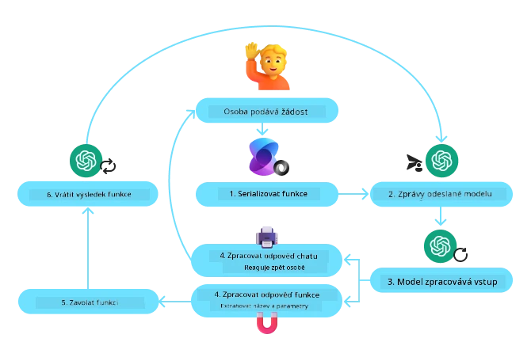
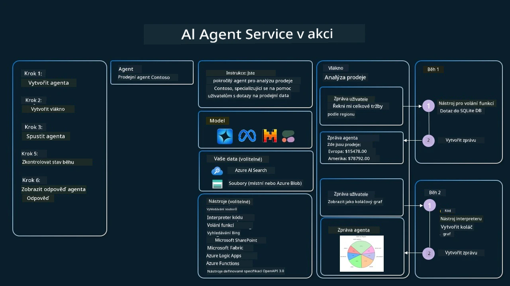

[](https://youtu.be/vieRiPRx-gI?si=cEZ8ApnT6Sus9rhn)

> _(Klikněte na obrázek výše pro zobrazení videa této lekce)_

# Vzor návrhu používání nástrojů

Nástroje jsou zajímavé, protože umožňují AI agentům mít širší škálu schopností. Místo toho, aby agent měl omezenou sadu akcí, které může provádět, přidáním nástroje může agent nyní provádět širokou škálu akcí. V této kapitole se podíváme na vzor návrhu používání nástrojů, který popisuje, jak AI agenti mohou používat konkrétní nástroje k dosažení svých cílů.

## Úvod

V této lekci se pokusíme odpovědět na následující otázky:

- Co je vzor návrhu používání nástrojů?
- Pro jaké případy použití lze tento vzor uplatnit?
- Jaké jsou prvky/stavební bloky potřebné k implementaci tohoto vzoru?
- Jaká jsou speciální opatření pro použití vzoru návrhu používání nástrojů k vytvoření důvěryhodných AI agentů?

## Cíle učení

Po dokončení této lekce budete schopni:

- Definovat vzor návrhu používání nástrojů a jeho účel.
- Identifikovat případy použití, kde je vzor návrhu používání nástrojů vhodný.
- Porozumět klíčovým prvkům potřebným k implementaci tohoto vzoru.
- Uvědomit si opatření k zajištění důvěryhodnosti AI agentů používajících tento vzor.

## Co je vzor návrhu používání nástrojů?

**Vzor návrhu používání nástrojů** se zaměřuje na umožnění LLM interakce s externími nástroji k dosažení konkrétních cílů. Nástroje jsou kódy, které může agent spustit k provádění akcí. Nástroj může být jednoduchá funkce, jako je kalkulačka, nebo volání API třetí strany, jako je vyhledávání ceny akcií nebo předpověď počasí. V kontextu AI agentů jsou nástroje navrženy tak, aby je agenti spouštěli v reakci na **funkční volání generované modelem**.

## Pro jaké případy použití lze tento vzor aplikovat?

AI agenti mohou využívat nástroje k dokončení složitých úkolů, získávání informací nebo rozhodování. Vzor návrhu používání nástrojů se často používá ve scénářích vyžadujících dynamickou interakci s externími systémy, jako jsou databáze, webové služby nebo interpretory kódu. Tato schopnost je užitečná pro řadu různých případů použití, včetně:

- **Dynamické získávání informací:** Agenti mohou dotazovat externí API nebo databáze, aby získali aktuální data (např. dotazování SQLite databáze pro datovou analýzu, získávání cen akcií nebo informací o počasí).
- **Spouštění a interpretace kódu:** Agenti mohou spouštět kód nebo skripty k řešení matematických úloh, generování zpráv nebo realizaci simulací.
- **Automatizace pracovních postupů:** Automatizace opakujících se nebo víceúrovňových pracovních postupů integrací nástrojů jako plány úkolů, emailové služby nebo datové toky.
- **Zákaznická podpora:** Agenti mohou komunikovat s CRM systémy, platformami pro správu ticketů nebo znalostními databázemi pro řešení uživatelských dotazů.
- **Generování a úprava obsahu:** Agenti mohou využívat nástroje jako kontroly gramatiky, shrnovače textu nebo vyhodnocovače bezpečnosti obsahu pro asistenci při tvorbě obsahu.

## Jaké jsou prvky/stavební bloky potřebné k implementaci vzoru používání nástrojů?

Tyto stavební bloky umožňují AI agentovi vykonávat širokou škálu úkolů. Podívejme se na klíčové prvky potřebné k implementaci vzoru návrhu používání nástrojů:

- **Schémata funkcí/nástrojů**: Podrobné definice dostupných nástrojů, včetně názvu funkce, účelu, požadovaných parametrů a očekávaných výstupů. Tato schémata umožňují LLM pochopit, jaké nástroje jsou k dispozici a jak sestavit platné požadavky.

- **Logika vykonání funkcí**: Řídí, jak a kdy jsou nástroje volány na základě záměru uživatele a kontextu konverzace. Může zahrnovat plánovací moduly, směrovací mechanismy nebo podmíněné toky určující dynamické používání nástrojů.

- **Systém zpracování zpráv**: Komponenty, které řídí konverzační tok mezi uživatelskými vstupy, odpověďmi LLM, voláním nástrojů a jejich výstupy.

- **Rámec integrace nástrojů**: Infrastruktura, která spojuje agenta s různými nástroji, ať už jsou to jednoduché funkce nebo složité externí služby.

- **Zpracování chyb & validace**: Mechanismy pro řešení selhání při vykonání nástroje, ověřování parametrů a řízení neočekávaných odpovědí.

- **Správa stavu**: Sleduje kontext konverzace, předchozí interakce s nástroji a trvalá data, aby zajistila konzistenci během vícekolových interakcí.

Dále si podrobněji probereme volání funkcí/nástrojů.
 
### Volání funkcí/nástrojů

Volání funkcí je hlavní způsob, jakým umožňujeme velkým jazykovým modelům (LLM) interagovat s nástroji. Často uvidíte, že se „funkce“ a „nástroj“ používají zaměnitelně, protože „funkce“ (bloky znovupoužitelného kódu) jsou „nástroje“, které agenti používají k vykonávání úkolů. Aby mohl být kód funkce vyvolán, musí LLM porovnat uživatelův požadavek s popisem funkcí. K tomu je LLM zasláno schéma obsahující popisy všech dostupných funkcí. LLM pak vybere nejvhodnější funkci pro úkol a vrátí její název a argumenty. Vybraná funkce je vyvolána, její odpověď je zaslána zpět do LLM, které využívá informace k odpovědi na uživatelův požadavek.

Pro vývojáře, kteří chtějí implementovat volání funkcí pro agenty, budete potřebovat:

1. LLM model, který podporuje volání funkcí
2. Schéma obsahující popisy funkcí
3. Kód pro každou popsanou funkci

Použijme příklad získání aktuálního času ve městě k ilustraci:

1. **Inicializujte LLM, který podporuje volání funkcí:**

    Ne všechny modely podporují volání funkcí, proto je důležité zkontrolovat, zda to váš LLM umí.     <a href="https://learn.microsoft.com/azure/ai-services/openai/how-to/function-calling" target="_blank">Azure OpenAI</a> podporuje volání funkcí. Můžeme začít inicializací OpenAI klienta vůči Azure OpenAI **Responses API** (stabilní `/openai/v1/` endpoint — bez potřeby `api_version`). 

    ```python
    # Initialize the OpenAI client for Azure OpenAI (Responses API, v1 endpoint)
    client = OpenAI(
        base_url=f"{os.environ['AZURE_OPENAI_ENDPOINT'].rstrip('/')}/openai/v1/",
        api_key=os.environ["AZURE_OPENAI_API_KEY"],
    )
    deployment_name = os.environ["AZURE_OPENAI_DEPLOYMENT"]
    ```

1. **Vytvořte schéma funkce**:

    Dále definujeme JSON schéma, které obsahuje název funkce, popis co funkce dělá a názvy a popisy parametrů funkce.
    Toto schéma poté předáme klientovi vytvořenému dříve spolu s uživatelovým požadavkem zjistit čas v San Franciscu. Co je důležité poznamenat, je že je vráceno **volání nástroje**, **nikoli** konečná odpověď na otázku. Jak bylo zmíněno, LLM vrací název funkce, kterou vybral pro úkol, a argumenty, které budou předány.

    ```python
    # Function description for the model to read (Responses API flat tool format)
    tools = [
        {
            "type": "function",
            "name": "get_current_time",
            "description": "Get the current time in a given location",
            "parameters": {
                "type": "object",
                "properties": {
                    "location": {
                        "type": "string",
                        "description": "The city name, e.g. San Francisco",
                    },
                },
                "required": ["location"],
            },
        }
    ]
    ```
   
    ```python
  
    # Initial user message
    messages = [{"role": "user", "content": "What's the current time in San Francisco"}]

    # First API call: Ask the model to use the function
    response = client.responses.create(
        model=deployment_name,
        input=messages,
        tools=tools,
        tool_choice="auto",
        store=False,
    )

    # The Responses API returns tool calls as function_call items in response.output.
    # Append them to the conversation so the model has full context on the next turn.
    messages += response.output

    print("Model's response:")
    print(response.output)
  
    ```

    ```bash
    Model's response:
    [ResponseFunctionToolCall(arguments='{"location":"San Francisco"}', call_id='call_pOsKdUlqvdyttYB67MOj434b', name='get_current_time', type='function_call')]
    ```
  
1. **Kód funkce potřebný k vykonání úkolu:**

    Nyní, když LLM vybral, kterou funkci je třeba spustit, musí být implementován a vykonán kód, který úkol provede.
    Můžeme implementovat kód v Pythonu pro získání aktuálního času. Také budeme potřebovat napsat kód pro extrakci názvu a argumentů z response_message, abychom získali konečný výsledek.

    ```python
      def get_current_time(location):
        """Get the current time for a given location"""
        print(f"get_current_time called with location: {location}")  
        location_lower = location.lower()
        
        for key, timezone in TIMEZONE_DATA.items():
            if key in location_lower:
                print(f"Timezone found for {key}")  
                current_time = datetime.now(ZoneInfo(timezone)).strftime("%I:%M %p")
                return json.dumps({
                    "location": location,
                    "current_time": current_time
                })
      
        print(f"No timezone data found for {location_lower}")  
        return json.dumps({"location": location, "current_time": "unknown"})
    ```

     ```python
    # Handle function calls
    tool_calls = [item for item in response.output if item.type == "function_call"]
    if tool_calls:
        for tool_call in tool_calls:
            if tool_call.name == "get_current_time":

                function_args = json.loads(tool_call.arguments)

                time_response = get_current_time(
                    location=function_args.get("location")
                )

                # Return the tool result as a function_call_output item
                messages.append({
                    "type": "function_call_output",
                    "call_id": tool_call.call_id,
                    "output": time_response,
                })
    else:
        print("No tool calls were made by the model.")

    # Second API call: Get the final response from the model
    final_response = client.responses.create(
        model=deployment_name,
        input=messages,
        tools=tools,
        store=False,
    )

    return final_response.output_text
     ```

     ```bash
      get_current_time called with location: San Francisco
      Timezone found for san francisco
      The current time in San Francisco is 09:24 AM.
     ```

Volání funkcí je jádrem většiny, pokud ne všech, návrhů používání nástrojů agentů, ale implementace od začátku může být někdy náročná.
Jak jsme se naučili v [Lekci 2](../../../02-explore-agentic-frameworks), agentové rámce nám poskytují předem připravené stavební bloky k implementaci používání nástrojů.
 
## Příklady používání nástrojů s agentovými rámci

Zde jsou některé příklady, jak můžete implementovat vzor návrhu používání nástrojů pomocí různých agentových rámců:

### Microsoft Agent Framework

<a href="https://learn.microsoft.com/azure/ai-services/agents/overview" target="_blank">Microsoft Agent Framework</a> je open-source AI rámec pro vytváření AI agentů. Zjednodušuje proces používání volání funkcí tím, že umožňuje definovat nástroje jako Python funkce s dekorátorem `@tool`. Rámec zajišťuje obousměrnou komunikaci mezi modelem a vaším kódem. Také poskytuje přístup k předpřipraveným nástrojům jako Vyhledávání souborů a Interpret kódu přes `FoundryChatClient`.

Následující diagram ilustruje proces volání funkcí s Microsoft Agent Framework:



V Microsoft Agent Framework jsou nástroje definovány jako dekorované funkce. Můžeme převést funkci `get_current_time`, kterou jsme viděli dříve, na nástroj použitím dekorátoru `@tool`. Rámec automaticky serializuje funkci a její parametry a vytvoří schéma, které se odešle LLM.

```python
import os
from agent_framework import tool
from agent_framework.foundry import FoundryChatClient
from azure.identity import AzureCliCredential

@tool(approval_mode="never_require")
def get_current_time(location: str) -> str:
    """Get the current time for a given location"""
    ...

# Create the client
provider = FoundryChatClient(
    project_endpoint=os.environ["AZURE_AI_PROJECT_ENDPOINT"],
    model=os.environ["AZURE_AI_MODEL_DEPLOYMENT_NAME"],
    credential=AzureCliCredential(),
)

# Create an agent and run with the tool
agent = provider.as_agent(name="TimeAgent", instructions="Use available tools to answer questions.", tools=get_current_time)
response = await agent.run("What time is it?")
```

#### Nástroje z MCP serveru

Nástroje nemusí být vždy funkce ve vašem vlastním kódu. Server, který podporuje Model Context Protocol (MCP, popsáno v [Lekci 11](../11-agentic-protocols/README.md)), publikuje své nástroje spolu s jejich schématy, a rámec je může načíst stejným způsobem, jako serializuje dekorovanou funkci. `MCPStreamableHTTPTool` se připojuje k takovému serveru přes HTTP, čte schémata nástrojů a nabízí je modelu vedle jakýchkoli lokálních nástrojů.

Následující příklad používá webový vyhledávací server hostovaný <a href="https://keenable.ai" target="_blank">Keenable</a>. Je zdarma k použití bez účtu nebo klíče API (požadavky jsou omezeny rychlostí podle IP), takže jediné přihlašovací údaje, které potřebujete, jsou ty pro váš model. Jako u každého vzdáleného nástroje, dotazy, které model vytváří, jsou posílány tomuto serveru.

```python
from agent_framework import MCPStreamableHTTPTool

web_search = MCPStreamableHTTPTool(
    name="Keenable web search",
    url="https://api.keenable.ai/mcp",
)

# Connecting loads the server's tool schemas; the agent decides when to call them
async with web_search:
    agent = provider.as_agent(
        name="ResearchAgent",
        instructions="Use available tools to answer questions.",
        tools=[web_search],
    )
    response = await agent.run("What is new in the latest Python release?")
    print(response.text)
```

Server publikuje dva nástroje, `search_web_pages` a `fetch_page_content`. Když je potřeba aktuální informace, model volá `search_web_pages`, získává zpět titulky, URL a textové úryvky a na jejich základě vytváří odpověď, stejný cyklus jako v příkladu `get_current_time` výše.
  
### Microsoft Foundry Agent Service

<a href="https://learn.microsoft.com/azure/ai-services/agents/overview" target="_blank">Microsoft Foundry Agent Service</a> je novější agentový rámec navržený tak, aby umožnil vývojářům bezpečně vytvářet, nasazovat a škálovat vysoce kvalitní a rozšiřitelné AI agenty, aniž by museli spravovat základní výpočetní a úložné zdroje. Je zvláště užitečný pro podnikové aplikace, protože jde o plně spravovanou službu s podnikovou bezpečností.

Ve srovnání s vývojem přímo přes LLM API poskytuje Microsoft Foundry Agent Service některé výhody, včetně:

- Automatické volání nástrojů – není třeba analyzovat volání nástroje, vyvolávat ho a zpracovávat odpověď; vše se nyní děje na straně serveru.
- Bezpečně spravovaná data – místo správy vlastního stavu konverzace můžete spoléhat na vlákna, která uchovávají všechny potřebné informace.
- Nástroje dostupné ihned – Nástroje, které můžete použít k interakci se svými datovými zdroji, jako jsou Bing, Azure AI Search a Azure Functions.

Nástroje dostupné v Microsoft Foundry Agent Service lze rozdělit do dvou kategorií:

1. Nástroje znalostí:
    - <a href="https://learn.microsoft.com/azure/ai-services/agents/how-to/tools/bing-grounding?tabs=python&pivots=overview" target="_blank">Základy s Bing Search</a>
    - <a href="https://learn.microsoft.com/azure/ai-services/agents/how-to/tools/file-search?tabs=python&pivots=overview" target="_blank">Vyhledávání souborů</a>
    - <a href="https://learn.microsoft.com/azure/ai-services/agents/how-to/tools/azure-ai-search?tabs=azurecli%2Cpython&pivots=overview-azure-ai-search" target="_blank">Azure AI Search</a>

2. Akční nástroje:
    - <a href="https://learn.microsoft.com/azure/ai-services/agents/how-to/tools/function-calling?tabs=python&pivots=overview" target="_blank">Volání funkcí</a>
    - <a href="https://learn.microsoft.com/azure/ai-services/agents/how-to/tools/code-interpreter?tabs=python&pivots=overview" target="_blank">Interpret kódu</a>
    - <a href="https://learn.microsoft.com/azure/ai-services/agents/how-to/tools/openapi-spec?tabs=python&pivots=overview" target="_blank">Nástroje definované OpenAPI</a>
    - <a href="https://learn.microsoft.com/azure/ai-services/agents/how-to/tools/azure-functions?pivots=overview" target="_blank">Azure Functions</a>

Agent Service nám umožňuje používat tyto nástroje společně jako `toolset`. Také využívá `threads`, které sledují historii zpráv z konkrétní konverzace.

Představte si, že jste prodejní agent ve společnosti Contoso. Chcete vyvinout konverzačního agenta, který bude odpovídat na otázky o vašich prodejních datech.

Následující obrázek ilustruje, jak byste mohli použít Microsoft Foundry Agent Service k analýze svých prodejních dat:



Pro použití jakéhokoli z těchto nástrojů ve službě můžeme vytvořit klienta a definovat nástroj nebo sadu nástrojů. Pro praktickou implementaci můžeme použít následující Python kód. LLM bude schopen prohlédnout sadu nástrojů a rozhodnout, zda použít uživatelsky vytvořenou funkci `fetch_sales_data_using_sqlite_query`, nebo předpřipravený Interpret kódu podle požadavku uživatele.

```python 
import os
from azure.ai.projects import AIProjectClient
from azure.identity import DefaultAzureCredential
from fetch_sales_data_functions import fetch_sales_data_using_sqlite_query # fetch_sales_data_using_sqlite_query function which can be found in a fetch_sales_data_functions.py file.
from azure.ai.projects.models import ToolSet, FunctionTool, CodeInterpreterTool

project_client = AIProjectClient.from_connection_string(
    credential=DefaultAzureCredential(),
    conn_str=os.environ["PROJECT_CONNECTION_STRING"],
)

# Initialize toolset
toolset = ToolSet()

# Initialize function calling agent with the fetch_sales_data_using_sqlite_query function and adding it to the toolset
fetch_data_function = FunctionTool(fetch_sales_data_using_sqlite_query)
toolset.add(fetch_data_function)

# Initialize Code Interpreter tool and adding it to the toolset. 
code_interpreter = CodeInterpreterTool()toolset.add(code_interpreter)

agent = project_client.agents.create_agent(
    model="gpt-5-mini", name="my-agent", instructions="You are helpful agent", 
    toolset=toolset
)
```

## Jaká jsou speciální opatření pro použití vzoru návrhu používání nástrojů k vytvoření důvěryhodných AI agentů?

Běžnou obavou u SQL dynamicky generovaných LLM je bezpečnost, zejména riziko SQL injection nebo škodlivých činů, jako je odstranění nebo poškození databáze. Ačkoliv jsou tyto obavy oprávněné, lze je efektivně zmírnit správnou konfigurací přístupových oprávnění do databáze. U většiny databází to znamená konfiguraci databáze jako pouze pro čtení. U databázových služeb jako PostgreSQL nebo Azure SQL by aplikace měla mít přiřazenu roli pouze pro čtení (SELECT).

Spuštění aplikace v zabezpečeném prostředí dále zvyšuje ochranu. V podnikových scénářích se typicky data extrahují a transformují z provozních systémů do databáze nebo datového skladu pouze pro čtení s uživatelsky přívětivým schématem. Tento přístup zajišťuje bezpečnost dat, optimalizaci výkonu a dostupnost a omezený přístup aplikace pouze pro čtení.

## Ukázkové kódy

- Python: [Agent Framework](./code_samples/04-python-agent-framework.ipynb)
- .NET: [Agent Framework](./code_samples/04-dotnet-agent-framework.md)

## Máte více otázek ohledně vzoru návrhu používání nástrojů?

Připojte se k [Microsoft Foundry Discord](https://discord.com/invite/ATgtXmAS5D), kde se setkáte s dalšími studenty, zúčastníte se konzultačních hodin a získáte odpovědi na otázky týkající se AI agentů.

## Další zdroje

- <a href="https://microsoft.github.io/build-your-first-agent-with-azure-ai-agent-service-workshop/" target="_blank">Workshop Azure AI Agents Service</a>
- <a href="https://github.com/Azure-Samples/contoso-creative-writer/tree/main/docs/workshop" target="_blank">Workshop víceagentového tvůrce Contoso</a>
- <a href="https://learn.microsoft.com/azure/ai-services/agents/overview" target="_blank">Přehled Microsoft Agent Framework</a>

## Rychlotestování tohoto agenta (volitelné)

Po naučení nasazovat agenty v [Lekce 16](../16-deploying-scalable-agents/README.md) můžete rychlotestovat `TravelToolAgent` z této lekce (zda stále volá své nástroje a odpovídá) pomocí [`tests/lesson-04-smoke-tests.json`](../../../tests/lesson-04-smoke-tests.json). Viz [`tests/README.md`](../tests/README.md) jak jej spustit.

## Předchozí lekce

[Pochopení agentních návrhových vzorů](../03-agentic-design-patterns/README.md)

## Další lekce

[Agentic RAG](../05-agentic-rag/README.md)

---

<!-- CO-OP TRANSLATOR DISCLAIMER START -->
**Prohlášení o omezení odpovědnosti**:
Tento dokument byl přeložen pomocí AI překladatelské služby [Co-op Translator](https://github.com/Azure/co-op-translator). Přestože usilujeme o co největší přesnost, mějte prosím na paměti, že automatizované překlady mohou obsahovat chyby nebo nepřesnosti. Originální dokument v jeho mateřském jazyce by měl být považován za autoritativní zdroj. Pro kritické informace se doporučuje profesionální lidský překlad. Nejsme odpovědní za jakékoli nedorozumění nebo nesprávné interpretace vzniklé použitím tohoto překladu.
<!-- CO-OP TRANSLATOR DISCLAIMER END -->