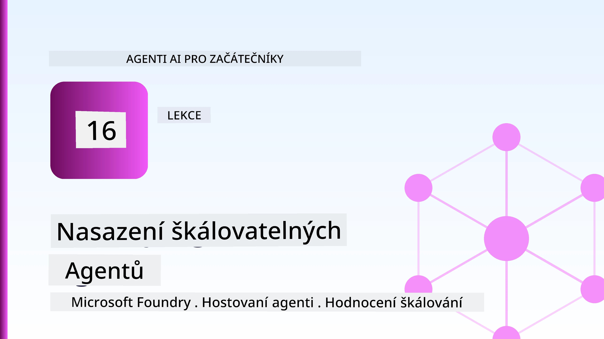
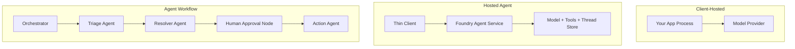
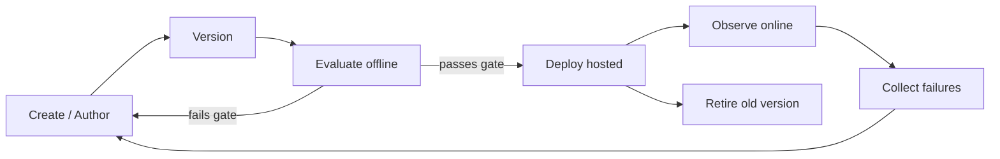
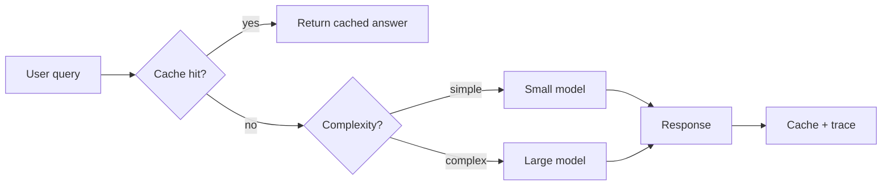
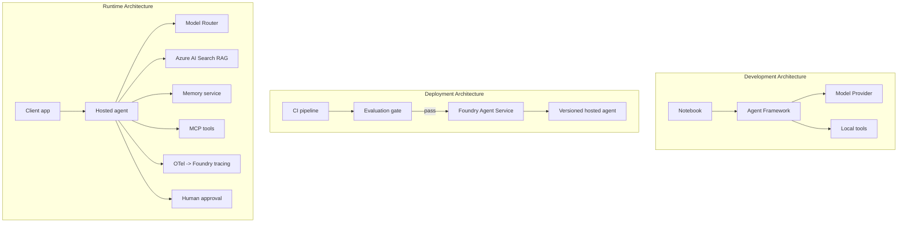

# Nasazení škálovatelných agentů s Microsoft Foundry



Do tohoto bodu v kurzu jste vytvářeli agenty, kteří běží na vašem laptopu, uvnitř notebooku, řízeni `az login` a hrstkou proměnných prostředí. To je přesně ten správný způsob, jak se učit. Není to však správný způsob, jak provozovat agenta, na kterého spoléhají tisíce zákazníků ve 3 hodiny ráno.

Tato lekce pojednává o rozdílu mezi „funguje to na mém stroji“ a „funguje to spolehlivě a cenově dostupně v produkci.“ Tento rozdíl uzavíráme pomocí **Microsoft Foundry** a **Microsoft Foundry Agent Service** tím, že postavíme skutečného zákaznického podpůrného agenta, který má nástroje, vyhledávání, paměť, hodnocení a monitoring.

## Úvod

Tato lekce pokryje:

- Rozdíl mezi **prototypovým agentem** a **nasazeným agentem** a proč je přechod převážně o všem *kolem* modelu.
- **Vzory nasazení** pro agenty: hostované na klientovi, hostované jako služba (Hosted Agents) a workflow-orchestrace.
- **Životní cyklus agenta** na Microsoft Foundry — vytvoření, verze, nasazení, hodnocení, sledování, vyřazení.
- **Strategie škálování**: směrování modelu, kešování, paralelismus a bezstavový design.
- **Pozorovatelnost** s OpenTelemetry a Foundry tracingem.
- **Optimalizace nákladů** pomocí volby modelu, směrování a hodnotících bran.
- **Podnikové úvahy**: správa, lidské schválení a bezpečný provoz MCP serverů v produkci.

## Cíle učení

Po dokončení této lekce budete umět:

- Vybrat správný vzor nasazení pro danou zátěž agenta.
- Nasadit agenta do Microsoft Foundry Agent Service tak, aby byl verzován, řízen a pozorovatelný.
- Instrumentovat agenta pro tracing a propojit hodnotící pipeline, která běží před každým vydáním.
- Použít směrování modelu a kešování k udržení nízké latence a nákladů ve velkém měřítku.
- Přidat bránu s lidským schválením pro vysoce rizikové akce a integrovat MCP server bezpečně pro produkci.

## Předpoklady

Tato lekce předpokládá, že jste absolvovali předchozí lekce a jste pohodlní s:

- Stavbou agentů pomocí [Microsoft Agent Framework](../14-microsoft-agent-framework/README.md) (Lekce 14).
- [Používáním nástrojů](../04-tool-use/README.md) (Lekce 4) a [Agentic RAG](../05-agentic-rag/README.md) (Lekce 5).
- [Pamětí agenta](../13-agent-memory/README.md) (Lekce 13) a [Agentic Protocols / MCP](../11-agentic-protocols/README.md) (Lekce 11).
- [Pozorovatelností a hodnocením](../10-ai-agents-production/README.md) (Lekce 10) — tato lekce na ní přímo navazuje.

Také budete potřebovat:

- **Předplatné Azure** a **projekt Microsoft Foundry** s alespoň jedním nasazeným chatovacím modelem.
- Autentizované **Azure CLI** (`az login`).
- Python 3.12+ a balíčky v repozitáři [`requirements.txt`](../../../requirements.txt).

## Z prototypu do produkce: co se vlastně mění

Prototypový agent a produkční agent sdílejí stejný hlavní cyklus — uvažuj, zavolej nástroje, reaguj. Co se mění, je vše kolem tohoto cyklu. Model tvoří asi 20 % produkčního agenta; zbývajících 80 % je operační kostra.

| Oblast | Prototyp | Produkce |
| --- | --- | --- |
| **Hostování** | Běží ve vašem notebooku | Běží jako hostovaná služba, verzovaná a nasazovaná postupně |
| **Identita** | Váš `az login` token | Spravovaná identita s omezeným RBAC |
| **Stav** | V paměti, ztracen při restartu | Externě uložený (úložiště vláken, paměťová služba) |
| **Selhání** | Vidíte traceback | Opakování, zálohy, dead-letter, upozornění |
| **Náklady** | „Jsou to pár centů“ | Sledované na požadavek, směrované, kešované, v rozpočtu |
| **Kvalita** | Kontrolujete výstup okem | Automaticky hodnoceno před každým vydáním |
| **Důvěra** | Schvalujete každou akci | Politika + člověk v cyklu u riskantních akcí |

Mějte tuto tabulku na paměti. Každá sekce níže odpovídá jednomu řádku.

## Vzory nasazení agentů

Existují tři vzory, které často použijete v kombinaci.

### 1. Klientsky hostovaní agenti

Objekt agenta žije uvnitř *vašeho* aplikačního procesu. Váš kód volá poskytovatele modelu přímo; smyčka uvažování běží ve vaší službě. To je to, co dělala každá předchozí lekce.

- **Použijte, když** potřebujete plnou kontrolu nad smyčkou, vlastní middleware, nebo integrujete agenta v existujícím backendu.
- **Kompromis**: sami spravujete škálování, stav a odolnost.

### 2. Hostovaní agenti (Foundry Agent Service)

Agent je *registrován jako zdroj* v Microsoft Foundry. Foundry hostí smyčku uvažování, ukládá vlákna, vynucuje bezpečnost obsahu a RBAC, a zpřístupňuje agenta v portálu Foundry. Vaše aplikace se stává tenkým klientem, který vytváří vlákna a čte odpovědi.

- **Použijte, když** chcete trvanlivost, zabudovanou pozorovatelnost, správu a menší operační zátěž.
- **Kompromis**: méně nízkoúrovňové kontroly výměnou za spravované běhové prostředí.

### 3. Workflow agentů

Více agentů (a nástrojů) je složeno do grafu s explicitním tokem řízení — sekvenční kroky, větvení, schvalovací uzly s lidmi a trvalé kontrolní body, které mohou pozastavit a obnovit tok. Toto je schopnost Microsoft Agent Framework **Workflows** aplikovaná ve výrobním měřítku.

- **Použijte, když** jedna úloha zahrnuje několik specializovaných agentů nebo vyžaduje schvalovací krok uprostřed.
- **Kompromis**: více pohyblivých částí; potřebuje observabilitu na úrovni orchestrací.



## Životní cyklus agenta na Microsoft Foundry

Nasazení agenta není jednorázová akce `push`. Je to smyčka a vypadá hodně jako cyklus vydávání softwaru, protože přesně tím je.



Klíčová myšlenka, převzatá z [Lekce 10](../10-ai-agents-production/README.md): **offline hodnocení je brána, ne dodatek.** Nová verze agenta nevyjde, pokud nepřekročí vámi nastavené prahové hodnoty hodnocení. Online observabilita pak přivádí selhání z reálného světa zpět do offline testovací sady. To je celá smyčka.

## Strategie škálování

Škálování agenta se liší od škálování bezstavového webového API, protože každý požadavek může spustit více nákladných volání modelu a nástrojů. Čtyři techniky nesou většinu zátěže.

**Bezstavné zpracování požadavků.** Neukládejte žádný uživatelský stav v paměti vašeho procesu. Uchovávejte vlákna konverzace ve Foundry thread store nebo v paměťové službě, aby jakákoliv instance mohla zpracovat jakýkoliv požadavek. To vám umožní škálovat horizontálně — přidávat instance, žádné přilepené session.

**Směrování modelu.** Ne každý požadavek potřebuje váš nejschopnější (a nejdražší) model. Směřujte jednoduché požadavky — klasifikaci záměru, krátké faktické odpovědi — na malý, rychlý model a ponechejte velký model pro opravdové uvažování. Foundry **Model Router** to může dělat za vás, nebo můžete implementovat lehký klasifikátor sami. DIY verzi postavíte v laboratoři.

**Kešování odpovědí.** Mnoho dotazů na podporu jsou téměř duplicitní ("jak resetuji heslo?"). Kešujte odpovědi na běžné otázky a podávejte je bez volání modelu vůbec. I mírná míra zásahů do keše významně snižuje náklady a latenci.

**Paralelismus a zpětný tlak.** Poskytovatelé modelů mají limity frekvence. Omezte svůj paralelismus, používejte opakování s exponenciálním náběhem a selhávejte elegantně (řazená odpověď „pracujeme na tom“ je lepší než chyba 500).



## Pozorovatelnost v produkci

Nemůžete řídit, co nevidíte. Jak bylo pokryto v Lekci 10, Microsoft Agent Framework nativně vydává **OpenTelemetry** stopy — každé volání modelu, vyvolání nástroje a orchestrální krok se stává spanem. V produkci exportujete tyto spany do Microsoft Foundry (nebo jakéhokoliv backendu kompatibilního s OTel), abyste mohli:

- Sledovat jednotlivé zákaznické stížnosti od začátku do konce přes každé volání modelu a nástroje.
- Sledovat latenci p50/p95 a náklady na požadavek v čase.
- Upozorňovat na nárůsty chybovosti a anomálie v nákladech dříve, než si jich uživatelé (nebo vaše finanční oddělení) všimnou.

```python
from agent_framework.observability import get_tracer

tracer = get_tracer()

with tracer.start_as_current_span("support_request") as span:
    span.set_attribute("customer.tier", "enterprise")
    span.set_attribute("routed.model", "gpt-5-nano")
    # agent execution is traced automatically inside this span
```

Atributy jako `customer.tier` a `routed.model` promění zeď stop v otázky, na které se dá odpovědět („jsou podnikové zákazníky příliš často směrováni na malý model?“).

## Optimalizace nákladů

Náklady u produkčních agentů dominují tokeny. Tři páky, podle dopadu:

1. **Správná velikost modelu.** Malý model, který projde branou hodnocení, je téměř vždy levnější než velký model, který ji také projde. Použijte hodnocení k *dokazování*, že malý model je dost dobrý, místo abyste automaticky volili největší model z opatrnosti.
2. **Směrování podle složitosti.** Jak výše — plaťte cenu velkého modelu pouze za požadavky, které vyžadují uvažování velkým modelem.
3. **Agresivní kešování.** Nejlevnější volání modelu je to, které nikdy neprovedete.

Hodnotící brány a kontrola nákladů jsou stejná disciplína z dvoch pohledů: hodnocení vám říká *kvalitativní spodní hranici*, směrování a kešování vás drží co nejblíže té hranice *z hlediska nákladů*.

## Podnikové úvahy při nasazení

**Správa.** Hosted Agents dědí RBAC Foundry, bezpečnost obsahu a auditní protokolování. Dejte každému agentovi spravovanou identitu s minimálními právy — přístup jen pro čtení k znalostní bázi, omezený přístup k API ticketingu, nic víc.

**Člověk v cyklu.** Některé akce jsou příliš zásadní na plnou automatizaci — vystavení refundace, smazání účtu, eskalace na právní tým. Microsoft Agent Framework podporuje nástroje vyžadující **schválení**: agent navrhne akci, provedení se pozastaví, člověk schválí nebo odmítne a workflow pokračuje. Primitivum jste viděli v [Lekci 6](../06-building-trustworthy-agents/README.md); zde ho nasazujete.

**MCP v produkci.** [MCP](../11-agentic-protocols/README.md) umožňuje vašemu agentovi používat externí nástroje přes standardní rozhraní. V produkci považujte každý MCP server za nedůvěryhodnou hranici: připněte verzi serveru, spusťte ho s omezenou identitou, validujte jeho výstupy a nikdy mu neodhalujte tajemství. MCP server je závislost a závislosti se záplatují, auditují a mají omezení frekvence.



Tyto tři diagramy — vývoj, nasazení, běh — ukazují toho samého agenta v třech fázích jeho života. Následující laboratoř vás provede jeho tvorbou.

## Praktická laboratoř: Produkčně připravený zákaznický podpůrný agent

Otevřete [`code_samples/16-python-agent-framework.ipynb`](./code_samples/16-python-agent-framework.ipynb) a projděte ho od začátku do konce. Sestavíte **zákaznického podpůrného agenta Contoso** s každou produkční záležitostí zapojenou:

1. **Volání nástrojů** — vyhledání stavu objednávky a otevření podpůrných tiketů.
2. **RAG** — odpovídání na otázky ohledně politiky ze znalostní báze (Azure AI Search s paměťovým záložním řešením, aby notebook mohl běžet bez Search zdroje).
3. **Paměť** — zapamatování zákazníka napříč průběhem konverzace.
4. **Směrování modelu** — klasifikátor složitosti směruje každý požadavek na malý nebo velký model.
5. **Kešování odpovědí** — opakující se otázky jsou podávány z keše.
6. **Lidské schválení** — refundace nad určitou hranici čekají na lidské potvrzení.
7. **Hodnotící pipeline** — malá offline testovací sada skóruje agenta a funguje jako brána pro vydání.
8. **Pozorovatelnost** — OpenTelemetry tracing kolem každého požadavku.

### Průchod kódem

Notebook je uspořádán tak, že každá produkční záležitost je samostatná spustitelná část. Jádrům je obslužná rutina směrování a kešování požadavků:

```python
async def handle_support_request(query: str, customer_id: str) -> str:
    # 1. Serve from cache when we can.
    cached = response_cache.get(normalize(query))
    if cached:
        return cached

    # 2. Route by complexity to control cost.
    model = "gpt-5-nano" if is_simple(query) else "gpt-5-mini"

    # 3. Run the agent inside a trace span for observability.
    with tracer.start_as_current_span("support_request") as span:
        span.set_attribute("routed.model", model)
        span.set_attribute("customer.id", customer_id)
        response = await support_agent.run(query, model=model)

    # 4. Cache and return.
    response_cache.set(normalize(query), response.text)
    return response.text
```

Hodnotící brána, která střeží vydání, vypadá takto:

```python
async def evaluation_gate(agent, test_cases, threshold: float = 0.8) -> bool:
    passed = 0
    for case in test_cases:
        result = await agent.run(case["input"])
        if score_response(result.text, case["expected"]) >= 0.8:
            passed += 1
    pass_rate = passed / len(test_cases)
    print(f"Evaluation pass rate: {pass_rate:.0%} (gate: {threshold:.0%})")
    return pass_rate >= threshold  # only deploy if the gate passes
```

Čtěte každý řádek — notebook udržuje primitiva záměrně malá, aby nic nebylo schováno za voláním frameworku.

## Validace nasazeného agenta pomocí smoke testů

Výše uvedená hodnotící brána běží *offline* proti vašemu objektu agenta. Jakmile je agent nasazen jako Hosted Agent, potřebujete ještě jednu, ještě levnější kontrolu: **odpovídá nasazený endpoint vůbec?**

"Úspěšné" nasazení pouze dokazuje, že řídící rovina přijala definici — nedokazuje, že agent odpovídá. Chybějící závislost, špatné směrování modelu nebo vypršelé připojení může nechat zelené nasazení vracet prázdný výsledek. **Smoke test** to odhalí během sekund, při každém nasazení, bez nákladů na plné hodnocení.

Tento repozitář dodává připravenou smoke-test pipeline postavenou na [AI Smoke Test](https://github.com/marketplace/actions/ai-smoke-test) GitHub Action:

- **Katalog** — [`tests/lesson-16-smoke-tests.json`](../../../tests/lesson-16-smoke-tests.json) obsahuje promptové i aserční popisy pro zákaznického podpůrného agenta Contoso (odpovědi založené na politice, vyhledávání objednávek, udržování tématu a kontinuita multi-turn vláken). Katalogy pro agenty z jiných lekcí jsou vedle něj — viz [`tests/README.md`](../tests/README.md).
- **Workflow** — [`.github/workflows/smoke-test.yml`](../../../.github/workflows/smoke-test.yml) se přihlašuje přes Azure OIDC a odesílá každý prompt na endpoint agentových odpovědí, přičemž selže na libovolný neúspěch aserce.

```yaml
- name: Smoke-test hosted agent
  uses: JFolberth/ai-smoketest@v1
  with:
    project_endpoint: ${{ inputs.project_endpoint }}
    agent_name: ContosoSupportAgent
    tests_file: tests/lesson-16-smoke-tests.json
```

Spusťte to z karty **Actions** poté, co je váš agent nasazen, přičemž zadáte koncový bod projektu Foundry a jméno agenta. Federovaná identita potřebuje roli **Azure AI User** v rozsahu projektu Foundry. Vrstvy si představte jako pyramidu: kouřové testy (dosažitelné a reagující?) běží při každém nasazení, offline hodnocení (dostatečně dobré k nasazení?) běží před povýšením a online hodnocení (jak si vede v praxi?) běží nepřetržitě.

## Kontrola znalostí

Otestujte si porozumění před pokračováním k úkolu.

**1. Přibližně jak velkou část produkčního agenta tvoří „model“ a co je zbytek?**

<details>
<summary>Odpověď</summary>

Model je minoritní částí systému — často se uvádí asi 20 %. Zbytek tvoří provozní kostra: hostování a verzování, identita a RBAC, externalizovaný stav, zvládání chyb, sledování nákladů, hodnocení a kontroly s lidským zásahem. Přechod do produkce je převážně o budování všeho *kolem* smyčky rozhodování.
</details>

**2. Kdy zvolíte Hosted Agenta místo agenta hostovaného na klientovi?**

<details>
<summary>Odpověď</summary>

Pokud chcete řízené běhové prostředí s vestavěnou odolností (vlákna, která přetrvávají a lze je obnovit), sledovatelností, bezpečností obsahu a RBAC, a jste ochotni obětovat část nižší úrovně kontroly smyčky rozhodování za méně provozní složitosti. Hostování klientem je vhodnější, když potřebujete plnou kontrolu nad smyčkou nebo agent je integrován do stávajícího backendu.
</details>

**3. Proč musí být škálovatelný agent bezstavový ve vlastní procesní paměti?**

<details>
<summary>Odpověď</summary>

Aby jakákoliv instance mohla zpracovat jakýkoliv požadavek, což umožňuje horizontální škálování bez pevně přidělených relací (sticky sessions). Stav konverzace pro uživatele je externalizován do úložiště vláken nebo paměťové služby. Kdyby byl stav uložen v paměti procesu, po restartu by se ztratil a nebylo by možné volně rozdělovat zátěž.
</details>

**4. Jaký problém řeší směrování modelů a jak souvisí s hodnocením?**

<details>
<summary>Odpověď</summary>

Směrování posílá jednoduché požadavky do malého, levného a rychlého modelu a vyhrazuje velký model pro skutečné rozhodování, čímž řídí latenci i náklady. Souvisí to s hodnocením, protože hodnocení *dokazuje*, že malý model je dostatečně dobrý pro určitou třídu požadavků — směrování bez hodnocení je pouze hádání.
</details>

**5. Co je to „evaluační brána“ a kde se nachází v životním cyklu?**

<details>
<summary>Odpověď</summary>

Evaluační brána spustí offline testovací sadu na nové verzi agenta a nasazení zablokuje, pokud míra úspěšnosti nepřekročí nastavený práh. Nachází se mezi fázemi „verze“ a „nasazení“ v životním cyklu, čímž dělá kvalitu podmínkou pro vydání místo něčeho, co se ověřuje až po nasazení.
</details>

**6. Proč by měl být MCP server považován za nedůvěryhodnou hranici v produkci?**

<details>
<summary>Odpověď</summary>

Protože jde o externí závislost, na kterou se agent volá. Měli byste fixovat jeho verzi, spouštět ho s omezenou identitou, ověřovat jeho výstupy, omezovat četnost požadavků a nikdy mu neukazovat tajné údaje — stejná disciplína, kterou uplatňujete u jakékoli třetí strany. Jeho výstupy vstupují do rozhodovacího procesu agenta, takže neověřená důvěra představuje bezpečnostní riziko.
</details>

**7. Která jediná změna obvykle má největší dopad na náklady produkčního agenta a proč?**

<details>
<summary>Odpověď</summary>

Správná velikost modelu — použití nejmenšího modelu, který stále projde evaluační bránou. Náklady dominují tokeny a menší model, který splňuje požadovanou kvalitu, je téměř vždy levnější než větší. Ke snížení nákladů dále přispívají cache a směrování, ale výběr správného základního modelu má největší prvotní efekt.
</details>

**8. Jakou roli hrají atributy rozsahu jako `customer.tier` a `routed.model` ve sledovatelnosti?**

<details>
<summary>Odpověď</summary>

Přeměňují surové stopy na zodpověditelné obchodní otázky. Bez atributů máte zeď rozsahů; s nimi se můžete ptát „jsou podnikový zákazníci příliš často směrováni na malý model?“ nebo „který model zpracovává naše nejpomalejší požadavky?“ Atributy umožňují dělit telemetrii podle dimenzí, které jsou důležité pro váš provoz.
</details>

## Úkol

Vezměte zákaznického podpůrného agenta z laboratoře a přizpůsobte ho pro konkrétní scénář: **agent podpory předplatného pro SaaS společnost.**

Vaše zadání by mělo:

1. **Nahradit nástroje** nástroji relevantními pro fakturaci: `get_subscription_status`, `get_invoice` a `issue_credit` (kredity nad 50 $ vyžadují lidské schválení).
2. **Přidat tři RAG dokumenty** pokrývající postup pro vrácení peněz, fakturační cyklus a politiku zrušení.
3. **Rozšířit evaluační sadu** alespoň na osm případů, včetně nejméně dvou, které *by měly* vyvolat cestu s lidským schválením, a ověřit, že evaluační brána správně projde nebo neprojde.
4. **Přidat jednu zprávu o nákladech**: po zpracování deseti smíšených dotazů agentem vytiskněte, kolik jich šlo na malý model, kolik na velký a kolik bylo obslouženo z cache.

Napište krátký odstavec (v markdown buňce) vysvětlující, kterou pravidlo směrování modelů jste zvolili a jak byste ho ověřili s reálnou traficí. Neexistuje jedno správné řešení — budete hodnoceni podle toho, zda jsou produkční záležitosti logicky propojené.

## Shrnutí

V této lekci jste přesunuli agenta z prototypu do produkce s Microsoft Foundry:

- Skok do produkce je převážně o **provozní kostře** kolem modelu — hostování, identita, stav, zvládání chyb, náklady, kvalita a důvěra.
- Naučili jste se tři **vzory nasazení** — hostování klientem, Hosted Agents a Agent Workflows — a kdy se každý hodí.
- Prošli jste **životní cyklus agenta**, kde offline **hodnocení funguje jako brána vydání** a online sledovatelnost vrací chyby zpět do testovací sady.
- Aplikovali jste **škálovací strategie** — bezstavost, směrování modelů, cache a omezenou souběžnost — a spojili je s **optimalizací nákladů**.
- Propojili jste **podnikové kontroly**: RBAC, lidské schválení a bezpečnou integraci MCP do produkce.
- Vybudovali jste **produkčně připraveného zákaznického podpůrného agenta**, který spojuje všechny tyto záležitosti do funkčního kódu.

Další lekce vede opačnou cestou: místo škálování agentů do cloudu je přenesete *dolů* na jeden developerský počítač a poběží úplně lokálně.

## Další zdroje

- <a href="https://learn.microsoft.com/azure/ai-foundry/what-is-azure-ai-foundry" target="_blank">Dokumentace Microsoft Foundry</a>
- <a href="https://learn.microsoft.com/azure/ai-foundry/agents/overview" target="_blank">Přehled služby Microsoft Foundry Agent</a>
- <a href="https://learn.microsoft.com/en-us/agent-framework/overview/?wt.mc_id=youtube_26688_organicsocial_reactor&pivots=programming-language-python" target="_blank">Microsoft Agent Framework</a>
- <a href="https://learn.microsoft.com/en-us/azure/ai-foundry/openai/concepts/model-router" target="_blank">Model Router v Microsoft Foundry</a>
- <a href="https://learn.microsoft.com/azure/search/search-what-is-azure-search" target="_blank">Azure AI Search</a>
- <a href="https://opentelemetry.io/" target="_blank">OpenTelemetry</a>
- <a href="https://github.com/marketplace/actions/ai-smoke-test" target="_blank">AI Smoke Test GitHub Action</a>
- <a href="https://modelcontextprotocol.io/" target="_blank">Model Context Protocol (MCP)</a>

## Předchozí lekce

[Budování agentů pro počítačové použití (CUA)](../15-browser-use/README.md)

## Další lekce

[Vytváření lokálních AI agentů](../17-creating-local-ai-agents/README.md)

---

<!-- CO-OP TRANSLATOR DISCLAIMER START -->
**Prohlášení o omezení odpovědnosti**:
Tento dokument byl přeložen pomocí AI překladatelské služby [Co-op Translator](https://github.com/Azure/co-op-translator). Přestože usilujeme o co největší přesnost, mějte prosím na paměti, že automatizované překlady mohou obsahovat chyby nebo nepřesnosti. Originální dokument v jeho mateřském jazyce by měl být považován za autoritativní zdroj. Pro kritické informace se doporučuje profesionální lidský překlad. Nejsme odpovědní za jakékoli nedorozumění nebo nesprávné interpretace vzniklé použitím tohoto překladu.
<!-- CO-OP TRANSLATOR DISCLAIMER END -->