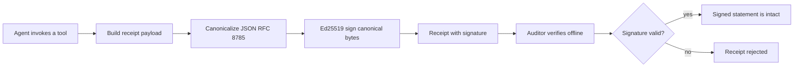
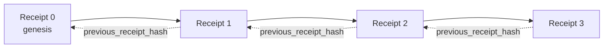

[Sledujte video lekce: Zabezpečení AI agentů pomocí kryptografických potvrzení](https://youtu.be/PLACEHOLDER_VIDEO_ID)

> _(Video lekce a náhledový obrázek budou přidány týmem Microsoftu po sloučení obsahu, aby odpovídaly vzoru lekce 14 / 15.)_

# Zabezpečení AI agentů pomocí kryptografických potvrzení

## Úvod

Tato lekce pokryje:

- Proč jsou auditní stopy pro AI agenty důležité pro dodržování předpisů, ladění a důvěru.
- Co je to kryptografické potvrzení a jak se liší od nepodepsaného záznamu.
- Jak v čistém Pythonu vytvořit podepsané potvrzení o volání nástroje agenta.
- Jak potvrzení ověřit offline a odhalit manipulaci.
- Jak řetězit potvrzení tak, aby odstranění nebo přeskupení jednoho z nich porušilo řetězec.
- Co potvrzení dokazují a co výslovně nedokazují.

## Cíle učení

Po dokončení této lekce budete umět:

- Identifikovat režimy selhání, které motivují kryptografickou původnost agentních akcí.
- Vytvořit Ed25519-podepsané potvrzení nad kanonickým JSON payloadem.
- Nezávisle ověřit potvrzení pomocí pouze veřejného klíče podepisovatele.
- Odhalit manipulaci opětovným ověřením upraveného potvrzení.
- Vytvořit hashově propojenou sekvenci potvrzení a vysvětlit, proč řetězec záleží.
- Rozpoznat hranici mezi tím, co potvrzení dokazují (přiřazení, integrita, pořadí) a co nedokazují (správnost akce, správnost politiky).

## Problém: auditní stopa vašeho agenta

Představte si, že jste nasadili AI agenta pro Contoso Travel. Agent čte požadavky zákazníků, volá API letů, aby našel možnosti, a rezervuje místa jménem zákazníka. Minulé čtvrtletí agent zpracoval 50 000 rezervací.

Dnes přijde auditor. Položí jednoduchou otázku: „Ukažte mi, co váš agent dělal.“

Předáte mu své logy. Auditor je prohlédne a položí složitější otázku: „Jak vím, že tyto logy nebyly upravovány?“

To je problém auditní stopy. Většina dnešních nasazení agentů spoléhá na:

- **Aplikační logy**: zapisované samotným agentem, upravitelné kýmkoli s přístupem k souborovému systému.
- **Cloudové služby logování**: z hlediska platformy odolné vůči manipulaci, ale jen pokud auditor důvěřuje provozovateli platformy.
- **Transakční logy databází**: vhodné pro změny databáze, ale ne pro libovolná volání nástrojů.

Žádná z těchto možností nedokáže audítoru odpovědět bez vyžadování důvěry v někoho (vás, vašeho poskytovatele cloudu, dodavatele databáze). Pro interní použití je tato důvěra často přijatelná. Pro regulované úlohy (finance, zdravotnictví, cokoliv podléhající EU AI Aktu) však ne.

Kryptografická potvrzení zužují tento problém tím, že vytvářejí podepsané prohlášení, které je nezávisle
ověřitelné. Auditor stále potřebuje mimo-pásmový důvod, aby důvěřoval podepisovacímu klíči a
komponentě, která prohlášení vytvořila. Vnořený klíč dokazuje sebe-konzistenci,
nikoli identitu vydavatele nebo umístění prosazení.

## Co je to kryptografické potvrzení?

Potvrzení je JSON objekt, který zaznamenává, co agent provedl, podepsáno digitálním podpisem.



Minimální potvrzení vypadá takto:

```json
{
  "type": "agent.tool_call.v1",
  "agent_id": "contoso-travel-bot",
  "tool_name": "lookup_flights",
  "tool_args_hash": "sha256:a3f9c1...",
  "result_hash": "sha256:7b2e1d...",
  "policy_id": "contoso-travel-policy-v3",
  "timestamp": "2026-04-25T14:30:00Z",
  "sequence": 47,
  "previous_receipt_hash": "sha256:9d4e6a...",
  "signature": {
    "alg": "EdDSA",
    "sig": "c5af83...",
    "public_key": "8f3b2c..."
  }
}
```

Tři vlastnosti vykonávají svou práci:

1. **Podpis**. Potvrzení je podepsáno agentovou bránou pomocí soukromého klíče Ed25519. Kdokoli s odpovídajícím veřejným klíčem může podpis ověřit offline. Strana spoléhající se musí tento klíč připnout nebo získat z důvěryhodného registru mimo potvrzení. Manipulace s kterýmkoli podepsaným polem podpis zneplatní.

2. **Kanonické kódování**. Před podpisem je potvrzení serializováno pomocí JSON Canonicalization Scheme (JCS, RFC 8785). To zajišťuje, že dvě implementace produkující stejné logické potvrzení vytvoří bajtově totožný výstup. Bez kanonizace by různé JSON serializer-y vytvářely různé podpisy pro stejný obsah.

3. **Hashové řetězení**. Pole `previous_receipt_hash` spojuje každé potvrzení s tím předchozím. Odstranění nebo přeskupení potvrzení rozbije předloženou sekvenci. Detekce zkrácení nebo přepsání kontrolovaného podepisovatelem vyžaduje připnutou aktuální hlavu řetězce, nezávisle svědčený kontrolní bod nebo autentizovaný uzavřený závazek populace.

Tyto vlastnosti dohromady poskytují tři záruky:

- **Přiřazení k klíči**: tento klíč podepsal tento obsah. Organizační nebo lidskou identitu je třeba zajistit důvěryhodným vázáním klíče.
- **Integrita**: obsah se od podpisu nezměnil.
- **Pořadí v ověřené sekvenci**: toto potvrzení odkazuje na svého předchůdce.

## Vytvoření potvrzení v Pythonu

K vytvoření potvrzení nepotřebujete speciální knihovnu. Kryptografické primitiva jsou široce dostupná a logika zabere pár desítek řádků Pythonu.

Praktické cvičení v `code_samples/18-signed-receipts.ipynb` vás provede celým procesem. Zdrojově řízený `code_samples/18-signed-receipts.execution-receipt.json` zaznamenává přesný hash notebooku, Python prostředí, počet buněk a kontroly z posledního čistého spuštění, aniž by změnil uložené výstupy lekce. Shrnutí:

```python
import json
import hashlib
import base64
from nacl import signing
from jcs import canonicalize  # RFC 8785 canonical JSON

def b64url_nopad(data: bytes) -> str:
    return base64.urlsafe_b64encode(data).decode("ascii").rstrip("=")

def sha256_canonical(obj) -> str:
    """SHA-256 of a Python object's JCS-canonical JSON form."""
    return f"sha256:{hashlib.sha256(canonicalize(obj)).hexdigest()}"

# Generate or load a signing key (in production, store in a key vault)
signing_key = signing.SigningKey.generate()
verify_key = signing_key.verify_key
TRUSTED_PUBLIC_KEYS = {b64url_nopad(bytes(verify_key))}  # pinned out of band by the verifier

# Build the receipt payload (no signature yet)
tool_args = {"origin": "SYD", "destination": "LAX"}
tool_result = [{"flight": "QF11", "price": 1850, "stops": 0}]

payload = {
    "type": "agent.tool_call.v1",
    "agent_id": "contoso-travel-bot",
    "tool_name": "lookup_flights",
    "tool_args_hash": sha256_canonical(tool_args),
    "result_hash": sha256_canonical(tool_result),
    "policy_id": "contoso-travel-policy-v3",
    "timestamp": "2026-04-25T14:30:00Z",
    "sequence": 0,
    "previous_receipt_hash": None,
}

# Canonicalize and sign the JCS bytes directly. PureEdDSA hashes internally.
canonical_bytes = canonicalize(payload)
signature_bytes = signing_key.sign(canonical_bytes).signature

# Attach a structured signature object.
receipt = {
    **payload,
    "signature": {
        "alg": "EdDSA",
        "sig": b64url_nopad(signature_bytes),
        "public_key": b64url_nopad(bytes(verify_key)),
    },
}
```

To je celý proces podepisování. Cvičení v notebooku vás provedou každým krokem.

## Ověření potvrzení a detekce manipulace

Ověření je opačná operace:

```python
import base64
import hashlib
from nacl import signing
from nacl.exceptions import CryptoError
from jcs import canonicalize

def b64url_decode(s: str) -> bytes:
    # Strict: Python's decoder skips characters outside the alphabet and also
    # accepts padding, the standard +/ alphabet and non-zero spare bits.
    # Re-encoding and comparing accepts only the one unpadded base64url form.
    padding = "=" * ((4 - len(s) % 4) % 4)
    data = base64.urlsafe_b64decode(s + padding)
    if base64.urlsafe_b64encode(data).decode("ascii").rstrip("=") != s:
        raise ValueError("not canonical unpadded base64url")
    return data

def verify_receipt(receipt: dict, trusted_public_key: str) -> bool:
    # trusted_public_key is the issuer's key, obtained from somewhere other
    # than this receipt. Never use receipt["signature"]["public_key"] here:
    # see "What Receipts Prove (and What They Do Not)" below.
    # Fails closed: anything malformed returns False instead of raising.
    if not isinstance(receipt, dict) or not isinstance(trusted_public_key, str):
        return False
    sig_obj = receipt.get("signature")
    if not isinstance(sig_obj, dict) or sig_obj.get("alg") != "EdDSA":
        return False
    sig_b64 = sig_obj.get("sig")
    if not isinstance(sig_b64, str):
        return False

    try:
        # Reconstruct the payload that was actually signed (everything except signature).
        payload = {k: v for k, v in receipt.items() if k != "signature"}
        canonical_bytes = canonicalize(payload)
        verify_key = signing.VerifyKey(b64url_decode(trusted_public_key))
        verify_key.verify(canonical_bytes, b64url_decode(sig_b64))
        return True
    except (CryptoError, TypeError, ValueError, KeyError, OverflowError):
        return False
    except Exception:
        # An undecodable key or signature, or a payload that cannot be
        # canonicalized: fail closed rather than raise.
        return False
```

Tato funkce přijme potvrzení a veřejný klíč vydavatele a vrátí `True`, pokud je podpis platný, a `False` jinak, včetně případů, kdy je vstup poškozený. Žádný síťový požadavek ani ověřovací služba nejsou potřeba: jakmile držíte klíč vydavatele, ověření je zcela lokální a offline. Co to stále vyžaduje, je ten klíč, získaný z něčeho mimo potvrzení samotné.

Abychom viděli detekci manipulace v praxi, notebook provede:

1. Vytvoření platného potvrzení a potvrzení, že se ověří.
2. Úpravu jednoho bajtu v poli `tool_args_hash`.
3. Opětovné ověření a zjištění chyby.
4. Další manipulaci, tentokrát ale přepodepsání klíčem, který útočník vytvořil, a vložení tohoto klíče do potvrzení.

Čtvrtý krok stojí za pozornost. Toto potvrzení je interně konzistentní: jeho podpis je pravý pro jeho obsah a klíč, který obsahuje, takže se ověří proti klíči v něm samotném. Selže pouze tehdy, když se ověřuje proti skutečnému klíči vydavatele. Kroky 2 a 3 odhalí útočníka, který si nedal práci s přepodepsáním; krok 4 odhalí toho, který ano.

To je praktická ukázka, že potvrzení jsou odolná vůči manipulaci: jakákoliv změna podepsaného pole poruší podpis, pokud ověřujete proti klíči, který útočník nesuplyl. Objekt `signature` je mimo podepsaná data, proto musí klíč, proti kterému ověřujete, pocházet odkudsi jinud než z potvrzení samotného.

## Řetězení potvrzení pro více krokové agenty

Jedno podepsané potvrzení chrání jednu akci. Řetězec potvrzení chrání posloupnost.



Každé potvrzení zaznamenává hash toho předchozího. Aby útočník tiše odstranil potvrzení 2, musel by:

- Upravit pole `previous_receipt_hash` v potvrzení 3 (což poruší podpis potvrzení 3), NEBO
- Padělat nový podpis na upraveném potvrzení 3 (vyžaduje soukromý klíč agenta).

Pokud je soukromý klíč uložen v hardwarovém bezpečnostním modulu a ověřovatelé kontrolují každé potvrzení proti veřejnému klíči vydavatele, získanému nezávisle (publikovaný JWK Set nebo připnutá konfigurační hodnota), žádný z těchto útoků není proveditelný bez odhalení. Publikace klíče v každém potvrzení nestačí: útočník může přepodepsat vlastním klíčem a vložit jej místo originálu, jak ukazuje fixture `04_resigned_receipt.json`.

Notebook provede:

1. Vytvoření řetězce tří potvrzení.
2. Ověření, že pole `previous_receipt_hash` každého potvrzení odpovídá skutečnému hashi předchozího potvrzení.
3. Manipulaci s jedním potvrzením uprostřed a zjištění, že řetězec na tomto místě přestává fungovat.

Takto vytváříte auditní stopu, kterou může externí auditor ověřit pomocí svých
připnutých klíčů vydavatele a kontrolních bodů řetězce, bez nutnosti důvěřovat vašemu měnitelnému úložišti logů.

## Co potvrzení dokazují (a co ne)

Toto je nejdůležitější část této lekce. Potvrzení jsou silná, ale jejich síla je omezena.

**Potvrzení dokazují tři věci:**

1. **Přiřazení**: konkrétní klíč podepsal konkrétní payload.
2. **Integritu**: payload se od podpisu nezměnil.
3. **Pořadí v prezentované ověřené sekvenci**: toto potvrzení odkazuje na předchůdce.

**Potvrzení NEdokazují:**

1. **Správnost**: že agent provedl správnou akci. Potvrzení může být podepsáno i pro nesprávnou odpověď stejně čistě jako pro správnou.
2. **Dodržování politiky**: že politika odkazovaná v `policy_id` byla skutečně vyhodnocena, nebo že by tuto akci povolila, pokud by byla ověřena. Potvrzení zaznamenává, co bylo tvrzeno, ne co bylo prosazeno.
3. **Identitu nad rámec klíče**: potvrzení říká „tento klíč podepsal tento obsah.“ Neříká „tento člověk dal povolení.“ Spojení klíče s osobou nebo organizací vyžaduje samostatnou infrastrukturu identity (adresář, registr veřejných klíčů atd.).
4. **Pravdivost vstupů**: pokud agent obdrží zmanipulovaný prompt a na něj reaguje, potvrzení věrně zaznamenává akci. Potvrzení jsou funkčně za ověřením vstupů, nikoli jejich náhradou.
5. **Provedení nebo skutečný efekt**: potvrzení po volání zaznamenává to, co vydavatel tvrdí, že se stalo. Dokazování přijetí nebo sladění s vnějším efektem vyžaduje důkazy od skutečného vykonavatele nebo poskytovatele.
6. **Úplnost**: chybějící potvrzení může znamenat blokování, vynechání, ztrátu nebo nedostatek instrumentace. Absence je důkazem jen v rámci autentizované uzavřené populace.
7. **Důvěryhodný čas**: podepsané časové razítko dokazuje, že podepisovatel měl tuto hodnotu, nikoli že byla správná. Důvěryhodný čas vyžaduje samostatný časový úřad nebo svědčený kontrolní bod.

**Klíč v potvrzení není klíč, kterým ověřujete.** To plyne z bodu 3 a je to jediné místo, kde tato odlišnost musí změnit váš kód, nikoli vaše pochopení. `public_key` v příkladu výše je tam, aby byl příklad soběstačný. Ověřovatel mu nikdy nesmí důvěřovat. Kdokoli může vzít potvrzení, upravit ho, podepsat klíčem, který vygeneroval, a vložit ten klíč; výsledek se ověří perfektně sám proti sobě. To je fixture `04_resigned_receipt.json` v `sample_receipts/`, a proto `verify_receipt` výše bere klíč jako argument místo aby ho četl z potvrzení. Klíč vydavatele získejte nezávisle, z JWK Setu v níže uvedeném Provozním checklistu nebo jiného předem připnutého kotvy, a ověřte proti němu. Podpis ověřený klíčem, který přišel ve stejné obálce, dokazuje jen to, že obálka je soběstačná.

Tato hranice má význam ze dvou důvodů:

- Říká vám, k čemu jsou potvrzení užitečná: činí chování agentů auditovatelné a odolné vůči manipulaci, i napříč organizačními hranicemi.
- Říká vám, jaké další vrstvy stále potřebujete: validaci vstupů (Lekce 6), prosazování politik (stručně níže) a infrastrukturu identity (mimo rozsah této lekce).

Běžnou chybou je předpokládat, že „máme potvrzení“ znamená „jsme řízení.“ Není to tak. Potvrzení jsou základ. Řízení je systém, který stavíte navrch.

## Vázání podpisu schvalujícího na přesnou akci

Bod 3 výše stojí za svou sekci: potvrzení o akci říká „tento klíč podepsal tento obsah,“ nikdy „člověk toto autorizoval.“ Pro rizikové akce (refundace, mazání, převody peněz) může samostatný podpis schvalujícího vázat přesnou akci. Spojení klíče s člověkem a kontrola jeho přítomnosti zůstávají samostatné odpovědnosti.

Následující notebook `code_samples/human-authorization-receipts.ipynb` přidává druhý typ potvrzení, `human.approval.v1`, se stejným tvarem obálky jako potvrzení lekce (typovaný payload podepsaný Ed25519 nad kanonickými JCS bajty, s objektem `signature` mimo podepsaná data). Klíč schvalujícího podepisuje **celou kanonickou akci a její digest**; klíč agenta podepisuje tvrzení nesoucí **stejný digest akce** a `parent_approval_ref`, `receipt_hash` schválení, stejná konvence jako `previous_receipt_hash` v řetězci, který jste vytvořili výše. Jeden `verify_chain` prochází oba artefakty pod **samostatnými připnutými registry klíčů** (schvalující klíče vs agentní klíče), takže kódová cesta je sdílená, ale autority nikdy ne.

Následující vlastnost, vyjádřená pečlivě: *připnutý klíč schvalujícího podepsal právě
tuto akci a klíč agenta později podepsal tvrzení obsahující stejný digest akce.*
To je užitečný důkaz, ale samo o sobě to není důkaz, že akce byla provedena. K
řízení provedení musí být přesné schválení také rezervováno a spotřebováno jednou na
skutečné hranici vykonavatele; neznámé výsledky poskytovatele musí zůstat neznámé, nikoli
slepě opakované. Fixture odmítnutí v notebooku testují vrstvu řetězení potvrzení:

- manipulace, záměnu odpovědného, padělané klíče na kterékoliv straně a nesprávné vstupy;
- **zastaralou autoritu**: podpis, který stále ověřuje, ale odmítnutý kvůli změně verze politiky, odstranění klíče schvalujícího z připnutého registru, nebo vypršení platnosti schválení před časem ověření;
- **náhradu digestu**: platně podepsané potvrzení akce ukazující na *skutečné* schválení, které váže *jinou* kanonickou akci.

Každé selhání odmítá s odlišným důvodem, takže auditor čtoucí odmítnutí pozná, zda autorita zestárla nebo se změnila popsaná akce. Ověření je jen pro čtení a opakovatelné: nespotřebovává schválení ani nevolá poskytovatele. Oddělený vykonavatel potřebuje trvalou, atomickou ochranu opakování a explicitní výsledky úspěch, neúspěch a neurčitý. Potvrzení lidského schválení je vzdělávací kompozice definovaná touto lekcí, nikoli typ potvrzení definovaný `draft-farley-acta-signed-receipts`.

## Odkazy pro produkční použití

Python kód v této lekci je záměrně minimální, abyste mohli přečíst každý řádek a přesně pochopit, co se děje. V produkci máte dvě možnosti:

1. **Stavět přímo na kryptografických primitivách.** 50 řádků, které jste viděli výše, je dostatečných pro mnoho použití. PyNaCl (Ed25519) a balíček `jcs` (kanonický JSON) jsou dobře udržované a auditované knihovny.

2. **Použít produkční knihovnu pro potvrzení.** Několik open-source projektů implementuje stejný vzor s dalšími funkcemi (rotace klíčů, hromadná verifikace, distribuce JWK Set, integrace s policy enginy):
   - Podepisovací pipeline používá konvence JCS a rozsahu podpisu v nezávislém IETF Internet-Draftu ([`draft-farley-acta-signed-receipts`](https://datatracker.ietf.org/doc/draft-farley-acta-signed-receipts/), revize 02). Vzdělávací potvrzení z této lekce se liší od `{payload, signature}` obálky draftu a není prezentováno jako konformní implementace. Draft publikuje sdílenou sadu konformity ([agent-governance-testvectors](https://github.com/ScopeBlind/agent-governance-testvectors)) pro implementace zaměřené na jeho formát přenosu.
   - Microsoft Agent Governance Toolkit sestavuje potvrzení s rozhodnutími založenými na Cedar politice; pro příklad od začátku do konce viz Tutoriál 33 v tomto repozitáři.
   - Balíčky `protect-mcp` (npm) a `@veritasacta/verify` (npm) poskytují Node-based implementaci podepisování potvrzení a offline verifikace, určenou pro zabalení jakéhokoliv MCP serveru s průkazným auditem zahrnujícím proces pro spolupodpis, kdy pozastavená akce vydává potvrzení o schválení vázané na digest akce (podporované WebAuthn v desktopovém procesu), stejný vzor potvrzení o schválení jako výše uvedený sešit s lidským schválením.
   - **[nobulex](https://github.com/arian-gogani/nobulex)** Python SDK (`pip install nobulex`) poskytuje stejný Ed25519 + JCS vzor podepisování v Pythonu s integracemi LangChain a CrewAI, včetně publikovaných testovacích vektorů křížové validace a mapování souladu přispěného přes [OWASP PR #2210](https://github.com/OWASP/CheatSheetSeries/pull/2210).
   - **[EMILIA Protocol](https://github.com/emiliaprotocol/emilia-protocol)** poskytuje doplňkovou vrstvu vynucení přesných akcí: offline-verifikovatelná potvrzení o schválení, přichycený WebAuthn nebo kvórum autority, jednorázová konzumace na hranici vykonavatele a explicitní cesta s neurčitým výsledkem. Jeho framework adaptéry považují potvrzení za nezbytný důkaz místo důkazu, že externí efekt nastal.

Rozhodnutí mezi vlastním řešením a použitím knihovny odpovídá rozhodnutí mezi napsáním vlastní JWT knihovny a použitím otestované: obě jsou rozumné; knihovna šetří čas a snižuje auditní povrch; přístup od základu vás nutí pochopit každé primitivum. Tato lekce učí cestu od základu, abyste měli základ pro obě volby.

## Kontrola znalostí

Otestujte své porozumění před přechodem na praktické cvičení.

**1. Potvrzení je podepsáno soukromým Ed25519 klíčem agenta. Auditor má pouze veřejný klíč. Může auditor potvrzení ověřit offline?**

<details>
<summary>Odpověď</summary>

Ano, kryptografická verifikace vyžaduje pouze veřejný klíč a podepsané bajty. Auditor
však musí nezávisle získat a přichytit přijatý veřejný klíč mimo potvrzení.
Po nastavení této důvěry není potřeba žádný síťový požadavek.
</details>

**2. Útočník změní pole `policy_id` potvrzení, aby tvrdil, že bylo řízeno permisivnější politikou. Podpis byl učiněn nad původním obsahem. Co se stane při verifikaci?**

<details>
<summary>Odpověď</summary>

Verifikace selže. Podpis byl vypočítán nad kanonickými bajty původního obsahu; jakákoliv změna pole obsahu změní tyto bajty, což učiní podpis neplatným. Útočník by potřeboval soukromý klíč k vytvoření nového platného podpisu, což nemá.
</details>

**3. Proč potvrzení obsahuje `tool_args_hash` a `result_hash` místo surových argumentů a výsledku?**

<details>
<summary>Odpověď</summary>

Dva důvody. Za prvé, potvrzení může být archivováno nebo přenášeno v prostředích, kde je únik surového obsahu (osobní údaje, obchodní data) problémem. Hashování udržuje potvrzení malé a obsah soukromý; auditor ověřuje, že hash odpovídá samostatně uložené kopii skutečného obsahu. Za druhé, hashe mají pevnou velikost; potvrzení s hashy má hranici velikosti bez ohledu na velikost vstupů a výstupů.
</details>

**4. Pole `previous_receipt_hash` propojuje každé potvrzení s jeho předchůdcem. Pokud útočník tiše smaže jedno potvrzení ze středu řetězce, co se stane neplatným?**

<details>
<summary>Odpověď</summary>

Každé potvrzení, které přišlo po smazaném. Jejich pole `previous_receipt_hash` už neodpovídají skutečnému řetězci (protože potvrzení, na které odkazovaly, již neexistuje, nebo řetězec nyní ukazuje na jiného předchůdce). Aby útočník skryl smazání, musel by znovu podepsat každé pozdější potvrzení, což vyžaduje soukromý klíč vydavatele. Přepodepsání jiným klíčem selže při ověření vůči klíči vydavatele.
</details>

**5. Potvrzení se ověřilo bez chyby. Dokazuje to, že akce agenta byla správná, rozumná nebo v souladu s politikou?**

<details>
<summary>Odpověď</summary>

Ne. Pod přichyceným klíčem a kontextem řetězce platné potvrzení dokazuje připsání podpisu,
integritu obsahu a vazbu na představeného předchůdce. Nedokazuje však, že
akce byla správná nebo vykonaná, že politika byla vyhodnocena, že časové razítko je
důvěryhodné, nebo že je sada záznamů kompletní. To je nejdůležitější hranice v lekci.
</details>

## Praktické cvičení

Otevřete `code_samples/18-signed-receipts.ipynb` a dokončete všechna čtyři oddělení:

1. **Oddíl 1**: Podepište své první potvrzení a ověřte ho.
2. **Oddíl 2**: Manipulujte s potvrzením a sledujte selhání verifikace.
3. **Oddíl 3**: Vytvořte řetězec tří potvrzení a ověřte integritu řetězce.
4. **Oddíl 4**: Aplikujte vzor na agenta postaveného s Microsoft Agent Framework: zabalte volání nástroje do podepisování potvrzení a poté nezávisle ověřte potvrzení.

**Náročná výzva 1:** rozšiřte schéma potvrzení o další pole dle vlastního výběru (například ID požadavku pro sledování), aktualizujte kanonickou podpisovou logiku tak, aby ho zahrnovala, a potvrďte, že potvrzení stále prochází verifikací. Poté pole po podepsání upravte a potvrďte, že verifikace selže. To vás nutí pochopit, jak každý bajt kanonického kódování přispívá k podpisu.

**Náročnější úkol 2:** Proveďte SHA-256 hash dvou vašich účtenek dohromady (spojte jejich kanonické bajty v deterministickém pořadí) a výsledný digest vložte jako nové pole do třetí účtenky před jejím podepsáním. Ověřte, že všechny tři účtenky stále procházejí zpětnou kontrolou. Právě jste vytvořili jednorázový důkaz zahrnutí: kdokoli s třetí účtenkou může dokázat, že první dvě existovaly v době jejího podpisu, aniž by musel odhalit jejich obsah. Toto je vzor, který používají účtenky s selektivním zveřejněním ve velkém měřítku (Merkleovy závazky, RFC 6962).

## Závěr

Kryptografické účtenky poskytují AI agentům auditní stopu, která je:

- **Nezávisle ověřitelná pod pevnou důvěrou**: strana s přijatými veřejnými klíči a podepsanými bajty může ověřovat bez závislosti na službě.
- **Odolná proti manipulaci**: jakákoli úprava zneplatní podpis.
- **Přenosná**: účtenka je malý JSON soubor; lze ji archivovat, přenášet a ověřovat kdekoli.
- **Soulad se standardy**: postavená na Ed25519 (RFC 8032), JCS (RFC 8785) a SHA-256, všech široce používaných prvcích.

Nejsou náhradou za validaci vstupů, prosazování politik, příjem vykonavatelů,
důkazy o výsledcích, kontrolu úplnosti nebo identitní infrastrukturu. Jsou základem
pro tyto vrstvy. V regulovaných či víceorganizačních pracovních postupech umožňují účtenky nezávisle ověřit konkrétní
tvrzení vydavatele na základě vlastního nastavení důvěry auditora.

Nejdůležitější poznatek: účtenky dokazují, že konkrétní klíč podepsal konkrétní
obsah. Přenesené časové razítko je tvrzení podepisovatele, pokud není samostatně časově ověřeno. Účtenka
nedokazuje, že obsah byl pravdivý, že byla provedena nějaká akce, nebo že je
soubor záznamů kompletní. Rozdíly v těchto bodech si dobře pamatujte.

## Produkční kontrolní seznam

Jakmile budete připraveni postoupit od této lekce k nasazení agentů podepisujících účtenky v reálném prostředí:

- [ ] **Přesuňte podpisový klíč mimo vývojářský počítač.** Použijte Azure Key Vault, AWS KMS nebo hardwarový bezpečnostní modul. Soukromý klíč podepisující vaše účtenky nesmí nikdy být ve zdrojovém kódu ani v prostém textu na aplikačních strojích.
- [ ] **Zaveďte důvěru v ověřovací klíče.** Publikujte klíče přes JWK Set nebo registr a nechte důvěřující strany zaaretovat přijatou identitu vydavatele, sadu klíčů a politiku rotace mimo jednotlivé účtenky. Samotný vložený klíč není důvěryhodným bodem.
- [ ] **Externě zaaretujte řetězec.** Pravidelně zapisujte nejnovější hash hlavy řetězce do transparentního logu (Sigstore Rekor, RFC 3161 autorita časového razítka, nebo druhý interní systém), aby externí strana mohla potvrdit „tento řetězec existoval v tomto čase.“
- [ ] **Ukládejte účtenky neměnně.** Skladování typu append-only blob (Azure Storage s politikou neměnnosti, AWS S3 Object Lock) zabraňuje insiderovi přepisovat historii na úrovni úložiště.
- [ ] **Rozhodněte o době uchování.** Mnohé compliance režimy vyžadují uchování po mnoho let. Plánujte růst počtu účtenek (jedna účtenka má cca 500 bajtů; agent provádějící 10 000 volání denně vyprodukuje cca 1,8 GB ročně).
- [ ] **Zdokumentujte, co účtenky nepokrývají.** Účtenky dokazují přiřazení, integritu a pořadí. Váš provozní návod by měl explicitně vyjmenovat, jaké dodatečné kontroly (validace vstupů, prosazení politik, omezení rychlosti, identitní infrastruktura) fungují vedle účtenek ve vaší správě.

### Máte další otázky týkající se zabezpečení AI agentů?

Připojte se k [Microsoft Foundry Discord](https://aka.ms/ai-agents/discord), setkejte se s dalšími studenty, účastněte se konzultačních hodin a nechte si zodpovědět své otázky o AI agentech.

## Nad rámec této lekce

Tato lekce pokrývá podepisování jedné účtenky a sekvence s hashovým řetězcem. Stejné prvky se dají složit do několika pokročilejších vzorů, s nimiž se můžete setkat, když se vaše správa vyvine:

- **Selektivní zveřejňování.** Když jsou pole účtenky nezávisle závazná (Merkleův strom ve stylu RFC 6962), můžete vyzradit konkrétní pole konkrétním auditorům a dokázat, že ostatní zůstala nezměněna, aniž byste je odhalili. Vhodné, pokud má stejná účtenka splnit jak komplexní audit (který chce úplnost), tak regulace na ochranu dat jako GDPR (které chtějí, aby auditor viděl co nejméně nezbytného).
- **Revokace účtenek.** Pokud je podpisový klíč kompromitován, potřebujete způsob, jak označit všechny účtenky podepsané tímto klíčem jako nedůvěryhodné od určitého času dál. Standardní vzory: krátkodobé podpisové klíče plus publikovaný seznam revokací, nebo transparentní log s položkami revokace.
- **Oboustranné / rozdělené podpisové potvrzení.** Některé implementace dělí podepsaný obsah na poloviny před provedením (`authorization_*`) a po provedení (`result_*`) s nezávislými podpisy, což je užitečné, když rozhodnutí o autorizaci a pozorovaný výsledek jsou vytvářeny různými subjekty nebo v různých časech. Toto tvoří aditivní kompozici nad formátem potvrzení, který se vyučuje v této lekci.
- **Kompozice obsahu.** Potvrzení zapečeťuje libovolné bajty, které vložíte do `result_hash`. Reálné obsahové struktury často obsahují více než jen výsledek jednoho volání nástroje: úvahy před rozhodnutím (predikce modelu, zvažované možnosti, důkazy a jejich úplnost, postoj k riziku, řetězec odpovědnosti, výsledek brány) mohou všechny být součástí obsahu a zapečetěny jediným potvrzením. To udržuje formát potvrzení jednoduchý a zároveň umožňuje vývoj schémat obsahu podle domény.
- **Shoda napříč implementacemi.** Více nezávislých implementací stejného formátu potvrzení (Python, TypeScript, Rust, Go) vzájemně ověřuje své výsledky proti sdíleným testovacím vektorům. Pokud vytváříte vlastní implementaci, validace proti publikovaným vektorům potvrzuje kompatibilitu na úrovni přenosu dat.
- **Migrace pro post-kvantové období.** Ed25519 je dnes široce nasazeno, ale není odolné vůči kvantovým počítačům. Pouhý štítek `alg` není migrací: profil musí definovat kódování klíče ML-DSA, kanonické podepsané bajty, ověřování, politiku závislých stran, odolnost proti degradaci a přechodovou sémantiku. Plánujte a testujte přechod s dvojím podpisem proti sdíleným vektorům před tím, než učiníte tvrzení o kompatibilitě.

## Další zdroje

- <a href="https://datatracker.ietf.org/doc/draft-farley-acta-signed-receipts/" target="_blank">IETF Internet-Draft: Podepsaná potvrzení rozhodnutí pro strojové řízení přístupu</a>
- <a href="https://learn.microsoft.com/azure/ai-studio/responsible-use-of-ai-overview" target="_blank">Přehled odpovědné AI (Azure AI)</a>
- <a href="https://datatracker.ietf.org/doc/html/rfc8032" target="_blank">RFC 8032: Edwardsova křivka Digitální podpisový algoritmus (EdDSA)</a>
- <a href="https://datatracker.ietf.org/doc/html/rfc8785" target="_blank">RFC 8785: Schéma kanonizace JSON (JCS)</a>
- <a href="https://datatracker.ietf.org/doc/html/rfc6962" target="_blank">RFC 6962: Transparentnost certifikátů</a> (Merkleův strom použitý u potvrzení s výběrovým zveřejněním)
- <a href="https://github.com/microsoft/agent-governance-toolkit/blob/main/docs/tutorials/33-offline-verifiable-receipts.md" target="_blank">Microsoft Agent Governance Toolkit, Tutoriál 33: Offline ověřitelná potvrzení rozhodnutí</a>
- <a href="https://github.com/ScopeBlind/agent-governance-testvectors" target="_blank">Testovací vektory shody mezi implementacemi</a> pro formát účtenky použitý v této lekci (Apache-2.0)
- <a href="https://pynacl.readthedocs.io/" target="_blank">Dokumentace PyNaCl</a> (Ed25519 v Pythonu)

## Předchozí lekce

[Vytváření místních AI agentů](../17-creating-local-ai-agents/README.md)

---

<!-- CO-OP TRANSLATOR DISCLAIMER START -->
**Prohlášení o omezení odpovědnosti**:
Tento dokument byl přeložen pomocí AI překladatelské služby [Co-op Translator](https://github.com/Azure/co-op-translator). Přestože usilujeme o co největší přesnost, mějte prosím na paměti, že automatizované překlady mohou obsahovat chyby nebo nepřesnosti. Originální dokument v jeho mateřském jazyce by měl být považován za autoritativní zdroj. Pro kritické informace se doporučuje profesionální lidský překlad. Nejsme odpovědní za jakékoli nedorozumění nebo nesprávné interpretace vzniklé použitím tohoto překladu.
<!-- CO-OP TRANSLATOR DISCLAIMER END -->