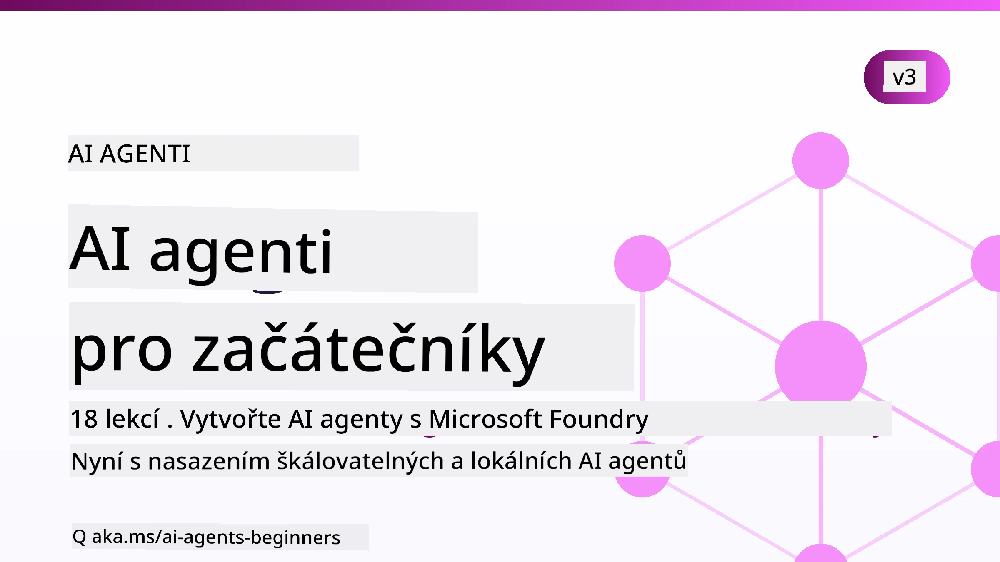

# AI Agent pro začátečníky - Kurz



## Kurz, který vás naučí vše, co potřebujete vědět, abyste mohli začít vytvářet AI Agenty

[](https://github.com/microsoft/ai-agents-for-beginners/blob/master/LICENSE?WT.mc_id=academic-105485-koreyst)
[](https://GitHub.com/microsoft/ai-agents-for-beginners/graphs/contributors/?WT.mc_id=academic-105485-koreyst)
[](https://GitHub.com/microsoft/ai-agents-for-beginners/issues/?WT.mc_id=academic-105485-koreyst)
[](https://GitHub.com/microsoft/ai-agents-for-beginners/pulls/?WT.mc_id=academic-105485-koreyst)
[](http://makeapullrequest.com?WT.mc_id=academic-105485-koreyst)

### 🌐 Podpora vícejazyčnosti

#### Překlady spravované pomocí [Co-op Translator](https://github.com/Azure/co-op-translator)

<!-- CO-OP TRANSLATOR LANGUAGES TABLE START -->
[Arabština](../ar/README.md) | [Bengálština](../bn/README.md) | [Bulharština](../bg/README.md) | [Barmština (Myanmar)](../my/README.md) | [Čínština (zjednodušená)](../zh-CN/README.md) | [Čínština (tradiční, Hongkong)](../zh-HK/README.md) | [Čínština (tradiční, Macau)](../zh-MO/README.md) | [Čínština (tradiční, Tchaj-wan)](../zh-TW/README.md) | [Chorvatština](../hr/README.md) | [Čeština](./README.md) | [Dánština](../da/README.md) | [Nizozemština](../nl/README.md) | [Estonština](../et/README.md) | [Finština](../fi/README.md) | [Francouzština](../fr/README.md) | [Němčina](../de/README.md) | [Řečtina](../el/README.md) | [Hebrejština](../he/README.md) | [Hindština](../hi/README.md) | [Maďarština](../hu/README.md) | [Indonéština](../id/README.md) | [Italština](../it/README.md) | [Japonština](../ja/README.md) | [Kannadština](../kn/README.md) | [Khmerština](../km/README.md) | [Korejština](../ko/README.md) | [Litevština](../lt/README.md) | [Malajština](../ms/README.md) | [Malajalámština](../ml/README.md) | [Manipuri (Meitei Mayek)](../mni/README.md) | [Maráthština](../mr/README.md) | [Nepálština](../ne/README.md) | [Nigerijský pidžin](../pcm/README.md) | [Norština](../no/README.md) | [Perština (Farsi)](../fa/README.md) | [Polština](../pl/README.md) | [Portugalština (Brazílie)](../pt-BR/README.md) | [Portugalština (Portugalsko)](../pt-PT/README.md) | [Paňdžábština (Gurmukhi)](../pa/README.md) | [Rumunština](../ro/README.md) | [Ruština](../ru/README.md) | [Srbština (cyrilice)](../sr/README.md) | [Slovenština](../sk/README.md) | [Slovinština](../sl/README.md) | [Španělština](../es/README.md) | [Svahilština](../sw/README.md) | [Švédština](../sv/README.md) | [Tagalog (filipínština)](../tl/README.md) | [Tamilština](../ta/README.md) | [Telugština](../te/README.md) | [Thajština](../th/README.md) | [Turečtina](../tr/README.md) | [Ukrajinština](../uk/README.md) | [Urdu](../ur/README.md) | [Vietnamština](../vi/README.md)

> **Raději klonovat lokálně?**
>
> Tento repozitář obsahuje překlady do více než 50 jazyků, což výrazně zvětšuje velikost stahování. Pro klonování bez překladů použijte sparse checkout:
>
> **Bash / macOS / Linux:**
> ```bash
> git clone --filter=blob:none --sparse https://github.com/microsoft/ai-agents-for-beginners.git
> cd ai-agents-for-beginners
> git sparse-checkout set --no-cone '/*' '!translations' '!translated_images'
> ```
>
> **CMD (Windows):**
> ```cmd
> git clone --filter=blob:none --sparse https://github.com/microsoft/ai-agents-for-beginners.git
> cd ai-agents-for-beginners
> git sparse-checkout set --no-cone "/*" "!translations" "!translated_images"
> ```
>
> Tím získáte vše potřebné ke zvládnutí kurzu s mnohem rychlejším stažením.
<!-- CO-OP TRANSLATOR LANGUAGES TABLE END -->

**Pro další jazykové možnosti navštivte [podporované jazyky Co-op Translator](https://github.com/Azure/co-op-translator/blob/main/docs/supported-languages.md).**

[](https://GitHub.com/microsoft/ai-agents-for-beginners/watchers/?WT.mc_id=academic-105485-koreyst)
[](https://GitHub.com/microsoft/ai-agents-for-beginners/network/?WT.mc_id=academic-105485-koreyst)
[](https://GitHub.com/microsoft/ai-agents-for-beginners/stargazers/?WT.mc_id=academic-105485-koreyst)

[](https://discord.com/invite/ATgtXmAS5D)


## 🌱 Začínáme

Tento kurz obsahuje lekce, které pokrývají základy vytváření AI Agentů. Každá lekce se věnuje vlastnímu tématu, takže začněte kdekoliv chcete!

Kurz má podporu vícejazyčnosti. Zkontrolujte naše [dostupné jazyky zde](#-multi-language-support).

Pokud je to poprvé, co vytváříte s generativními AI modely, podívejte se na náš kurz [Generative AI For Beginners](https://aka.ms/genai-beginners), který obsahuje 21 lekcí o práci s GenAI.

Nezapomeňte [ohvězdičkovat (🌟) tento repozitář](https://docs.github.com/en/get-started/exploring-projects-on-github/saving-repositories-with-stars?WT.mc_id=academic-105485-koreyst) a [forkovat tento repozitář](https://github.com/microsoft/ai-agents-for-beginners/fork), abyste mohli spouštět kód.

### Potkejte další studenty, získejte odpovědi na své otázky

Pokud se zaseknete nebo budete mít otázky ohledně vytváření AI Agentů, připojte se k našemu specializovanému Discord kanálu na [Microsoft Foundry Discord](https://aka.ms/ai-agents/discord).

### Co potřebujete

Každá lekce v tomto kurzu obsahuje příklady kódu, které najdete ve složce code_samples. Můžete [forknout tento repozitář](https://github.com/microsoft/ai-agents-for-beginners/fork) pro vytvoření vlastní kopie.

Příklady kódu v těchto cvičeních využívají Microsoft Agent Framework s Microsoft Foundry Agent Service V2:

- [Microsoft Foundry](https://aka.ms/ai-agents-beginners/ai-foundry) - vyžaduje Azure účet

Tento kurz používá následující AI Agent frameworky a služby od Microsoftu:

- [Microsoft Agent Framework (MAF)](https://learn.microsoft.com/agent-framework/overview/)
- [Microsoft Foundry Agent Service V2](https://aka.ms/ai-agents-beginners/ai-agent-service)

Některé příklady kódu také podporují alternativní poskytovatele kompatibilní s OpenAI, jako je [MiniMax](https://platform.minimaxi.com/), který nabízí modely s velkým kontextem (až 204 tisíc tokenů). Podrobnosti najdete v [nastavení kurzu](./00-course-setup/README.md).

Pro více informací o spuštění kódu tohoto kurzu přejděte na [nastavení kurzu](./00-course-setup/README.md).

## 🙏 Chcete pomoci?

Máte návrhy nebo jste našli překlepy či chyby v kódu? [Nahlaste problém](https://github.com/microsoft/ai-agents-for-beginners/issues?WT.mc_id=academic-105485-koreyst) nebo [vytvořte pull request](https://github.com/microsoft/ai-agents-for-beginners/pulls?WT.mc_id=academic-105485-koreyst)


## 📂 Každá lekce obsahuje

- Písemnou lekci v README a krátké video
- Příklady kódu v Pythonu využívající Microsoft Agent Framework s Microsoft Foundry
- Odkazy na další zdroje pro prohloubení znalostí


## 🗃️ Lekce

| **Lekce**                                   | **Text & Kód**                                    | **Video**                                                  | **Další učení**                                                                     |
|----------------------------------------------|----------------------------------------------------|------------------------------------------------------------|----------------------------------------------------------------------------------------|
| Úvod do AI Agentů a použití                            | [Odkaz](./01-intro-to-ai-agents/README.md)          | [Video](https://youtu.be/3zgm60bXmQk?si=z8QygFvYQv-9WtO1)  | [Odkaz](https://aka.ms/ai-agents-beginners/collection?WT.mc_id=academic-105485-koreyst) |
| Průzkum AI Agentních frameworků              | [Odkaz](./02-explore-agentic-frameworks/README.md)  | [Video](https://youtu.be/ODwF-EZo_O8?si=Vawth4hzVaHv-u0H)  | [Odkaz](https://aka.ms/ai-agents-beginners/collection?WT.mc_id=academic-105485-koreyst) |
| Pochopení návrhových vzorů AI Agenta     | [Odkaz](./03-agentic-design-patterns/README.md)     | [Video](https://youtu.be/m9lM8qqoOEA?si=BIzHwzstTPL8o9GF)  | [Odkaz](https://aka.ms/ai-agents-beginners/collection?WT.mc_id=academic-105485-koreyst) |
| Návrhový vzor používání nástrojů                      | [Odkaz](./04-tool-use/README.md)                    | [Video](https://youtu.be/vieRiPRx-gI?si=2z6O2Xu2cu_Jz46N)  | [Odkaz](https://aka.ms/ai-agents-beginners/collection?WT.mc_id=academic-105485-koreyst) |
| Agentní RAG                                  | [Odkaz](./05-agentic-rag/README.md)                 | [Video](https://youtu.be/WcjAARvdL7I?si=gKPWsQpKiIlDH9A3)  | [Odkaz](https://aka.ms/ai-agents-beginners/collection?WT.mc_id=academic-105485-koreyst) |
| Budování důvěryhodných AI Agentů               | [Odkaz](./06-building-trustworthy-agents/README.md) | [Video](https://youtu.be/iZKkMEGBCUQ?si=jZjpiMnGFOE9L8OK ) | [Odkaz](https://aka.ms/ai-agents-beginners/collection?WT.mc_id=academic-105485-koreyst) |
| Návrhový vzor plánování                      | [Odkaz](./07-planning-design/README.md)             | [Video](https://youtu.be/kPfJ2BrBCMY?si=6SC_iv_E5-mzucnC)  | [Odkaz](https://aka.ms/ai-agents-beginners/collection?WT.mc_id=academic-105485-koreyst) |
| Návrhový vzor vícero agentů                   | [Odkaz](./08-multi-agent/README.md)                 | [Video](https://youtu.be/V6HpE9hZEx0?si=rMgDhEu7wXo2uo6g)  | [Odkaz](https://aka.ms/ai-agents-beginners/collection?WT.mc_id=academic-105485-koreyst) |
| Návrhový vzor metakognice                 | [Odkaz](./09-metacognition/README.md)               | [Video](https://youtu.be/His9R6gw6Ec?si=8gck6vvdSNCt6OcF)  | [Odkaz](https://aka.ms/ai-agents-beginners/collection?WT.mc_id=academic-105485-koreyst) |
| AI Agenti v provozu                      | [Odkaz](./10-ai-agents-production/README.md)        | [Video](https://youtu.be/l4TP6IyJxmQ?si=31dnhexRo6yLRJDl)  | [Odkaz](https://aka.ms/ai-agents-beginners/collection?WT.mc_id=academic-105485-koreyst) |
| Používání agentních protokolů (MCP, A2A a NLWeb) | [Odkaz](./11-agentic-protocols/README.md)           | [Video](https://youtu.be/X-Dh9R3Opn8)                                 | [Odkaz](https://aka.ms/ai-agents-beginners/collection?WT.mc_id=academic-105485-koreyst) |
| Inženýrství kontextu pro AI Agenty            | [Odkaz](./12-context-engineering/README.md)         | [Video](https://youtu.be/F5zqRV7gEag)                                 | [Odkaz](https://aka.ms/ai-agents-beginners/collection?WT.mc_id=academic-105485-koreyst) |
| Správa agentní paměti                      | [Odkaz](./13-agent-memory/README.md)     |      [Video](https://youtu.be/QrYbHesIxpw?si=vZkVwKrQ4ieCcIPx)                                                      |                                                                                        |
| Průzkum Microsoft Agent Framework                         | [Odkaz](./14-microsoft-agent-framework/README.md)                            |                                                            |                                                                                        |
| Vytváření agentů pro použití počítače (CUA)           | [Odkaz](./15-browser-use/README.md)     |                                                            | [Odkaz](https://docs.browser-use.com/examples/templates/playwright-integration)         |
| Nasazování škálovatelných agentů                    | [Odkaz](./16-deploying-scalable-agents/README.md) |                                                    | [Odkaz](https://learn.microsoft.com/azure/ai-foundry/agents/overview)                   |
| Vytváření lokálních AI Agentů                     | [Odkaz](./17-creating-local-ai-agents/README.md)  |                                                    | [Odkaz](https://learn.microsoft.com/azure/ai-foundry/foundry-local/)                    |
| Zabezpečení AI Agentů                           | [Odkaz](./18-securing-ai-agents/README.md)  |                                                            | [Odkaz](https://aka.ms/ai-agents-beginners/collection?WT.mc_id=academic-105485-koreyst) |

## 🎒 Další kurzy

Náš tým vytváří i jiné kurzy! Podívejte se na:

<!-- CO-OP TRANSLATOR OTHER COURSES START -->
### LangChain
[](https://aka.ms/langchain4j-for-beginners)
[](https://aka.ms/langchainjs-for-beginners?WT.mc_id=m365-94501-dwahlin)
[](https://github.com/microsoft/langchain-for-beginners?WT.mc_id=m365-94501-dwahlin)
---

### Azure / Edge / MCP / Agenti
[](https://github.com/microsoft/AZD-for-beginners?WT.mc_id=academic-105485-koreyst)
[](https://github.com/microsoft/edgeai-for-beginners?WT.mc_id=academic-105485-koreyst)
[](https://github.com/microsoft/mcp-for-beginners?WT.mc_id=academic-105485-koreyst)
[](https://github.com/microsoft/ai-agents-for-beginners?WT.mc_id=academic-105485-koreyst)

---
 
### Série Generativní AI
[](https://github.com/microsoft/generative-ai-for-beginners?WT.mc_id=academic-105485-koreyst)
[-9333EA?style=for-the-badge&labelColor=E5E7EB&color=9333EA)](https://github.com/microsoft/Generative-AI-for-beginners-dotnet?WT.mc_id=academic-105485-koreyst)
[-C084FC?style=for-the-badge&labelColor=E5E7EB&color=C084FC)](https://github.com/microsoft/generative-ai-for-beginners-java?WT.mc_id=academic-105485-koreyst)
[-E879F9?style=for-the-badge&labelColor=E5E7EB&color=E879F9)](https://github.com/microsoft/generative-ai-with-javascript?WT.mc_id=academic-105485-koreyst)

---
 
### Základní učení
[](https://aka.ms/ml-beginners?WT.mc_id=academic-105485-koreyst)
[](https://aka.ms/datascience-beginners?WT.mc_id=academic-105485-koreyst)
[](https://aka.ms/ai-beginners?WT.mc_id=academic-105485-koreyst)
[](https://github.com/microsoft/Security-101?WT.mc_id=academic-96948-sayoung)
[](https://aka.ms/webdev-beginners?WT.mc_id=academic-105485-koreyst)
[](https://aka.ms/iot-beginners?WT.mc_id=academic-105485-koreyst)
[](https://github.com/microsoft/xr-development-for-beginners?WT.mc_id=academic-105485-koreyst)

---
 
### Série Copilot
[](https://aka.ms/GitHubCopilotAI?WT.mc_id=academic-105485-koreyst)
[](https://github.com/microsoft/mastering-github-copilot-for-dotnet-csharp-developers?WT.mc_id=academic-105485-koreyst)
[](https://github.com/microsoft/CopilotAdventures?WT.mc_id=academic-105485-koreyst)
<!-- CO-OP TRANSLATOR OTHER COURSES END -->

## 🌟 Poděkování komunitě

Děkujeme [Shivam Goyal](https://www.linkedin.com/in/shivam2003/) za přispění důležitých ukázek kódu demonstrujících Agentic RAG.

## Přispívání

Tento projekt vítá příspěvky a návrhy. Většina příspěvků vyžaduje souhlas s
licenční smlouvou přispěvatele (CLA), ve které potvrzujete, že máte právo a skutečně
nám udělujete práva k použití vašeho příspěvku. Podrobnosti naleznete na <https://cla.opensource.microsoft.com>.

Po odeslání pull requestu automatický CLA bot určí, zda musíte poskytnout
CLA a vhodně označí PR (např. kontrola stavu, komentář). Stačí postupovat podle pokynů
bota. Toto je potřeba učinit pouze jednou pro všechny repozitáře používající náš CLA.

Tento projekt přijal [Microsoft Open Source Code of Conduct](https://opensource.microsoft.com/codeofconduct/).
Více informací najdete v [Často kladených otázkách k Kodexu chování](https://opensource.microsoft.com/codeofconduct/faq/) nebo
můžete kontaktovat [opencode@microsoft.com](mailto:opencode@microsoft.com) s dalšími otázkami či komentáři.

## Ochranné známky

Tento projekt může obsahovat ochranné známky nebo loga projektů, produktů či služeb. Autorizované používání
ochranných známek nebo log Microsoftu podléhá a musí dodržovat
[Microsoft's Trademark & Brand Guidelines](https://www.microsoft.com/legal/intellectualproperty/trademarks/usage/general).
Použití ochranných známek nebo log Microsoftu v upravených verzích tohoto projektu nesmí způsobit záměnu
nebo naznačovat sponzorství Microsoftem. Jakékoli použití ochranných známek či log třetích stran podléhá pravidlům těchto třetích stran.

## Získání pomoci


Pokud někde tápete nebo máte otázky ohledně tvorby AI aplikací, přidejte se k:

[](https://aka.ms/foundry/discord)

Pokud máte zpětnou vazbu k produktu nebo narazíte na chyby během vývoje, navštivte:

[](https://aka.ms/foundry/forum)

---

<!-- CO-OP TRANSLATOR DISCLAIMER START -->
**Prohlášení o omezení odpovědnosti**:
Tento dokument byl přeložen pomocí AI překladatelské služby [Co-op Translator](https://github.com/Azure/co-op-translator). Přestože usilujeme o co největší přesnost, mějte prosím na paměti, že automatizované překlady mohou obsahovat chyby nebo nepřesnosti. Originální dokument v jeho mateřském jazyce by měl být považován za autoritativní zdroj. Pro kritické informace se doporučuje profesionální lidský překlad. Nejsme odpovědní za jakékoli nedorozumění nebo nesprávné interpretace vzniklé použitím tohoto překladu.
<!-- CO-OP TRANSLATOR DISCLAIMER END -->