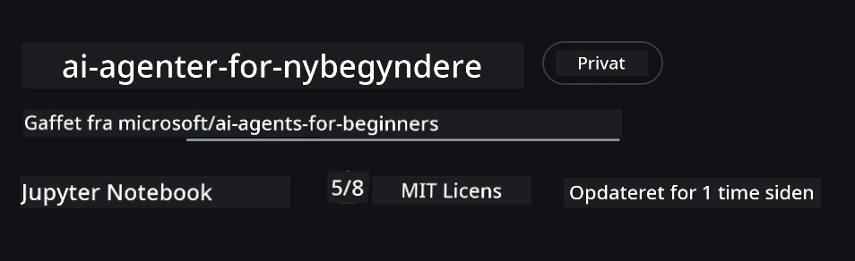
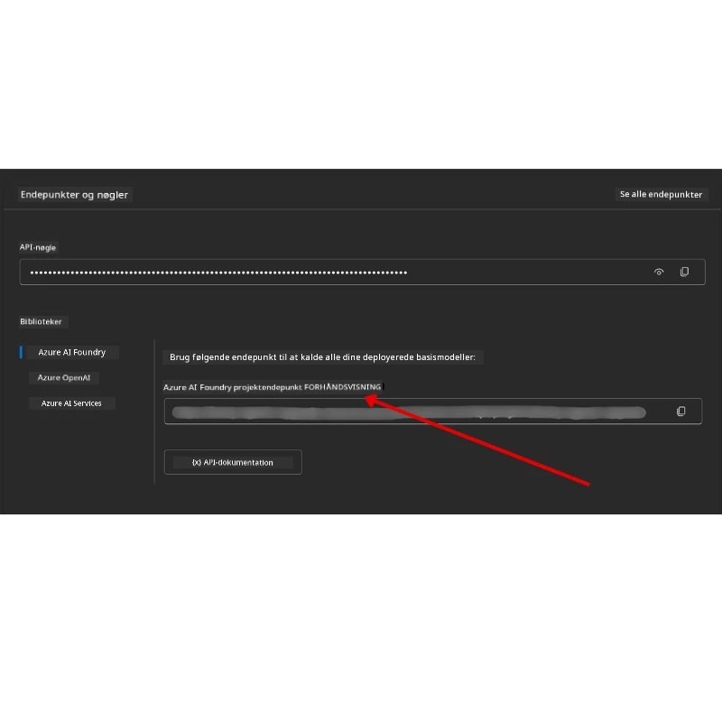

# Opsætning af Kursus

## Introduktion

Denne lektion vil gennemgå, hvordan du kører kodeeksemplerne i dette kursus.

## Deltag med Andre Lærende og Få Hjælp

Før du begynder at klone dit repo, så deltag i [AI Agents For Beginners Discord-kanalen](https://aka.ms/ai-agents/discord) for at få hjælp til opsætningen, stille spørgsmål om kurset, eller for at komme i kontakt med andre lærende.

## Klon eller Fork dette Repo

For at begynde, skal du klone eller fork GitHub-repositoriet. Dette laver din egen version af kursusmaterialet, så du kan køre, teste og justere koden!

Dette kan gøres ved at klikke på linket for at <a href="https://github.com/microsoft/ai-agents-for-beginners/fork" target="_blank">forke repoet</a>

Du burde nu have din egen forkkede version af dette kursus i følgende link:



### Shallow Clone (anbefales til workshop / Codespaces)

  > Det fulde repositorium kan være stort (~3 GB) når du downloader hele historikken og alle filer. Hvis du kun deltager i workshoppen eller kun har brug for nogle få lektion-mapper, downloader en shallow clone (eller en sparse clone) væsentligt mindre.

#### Hurtig shallow clone — minimal historik, alle filer

Erstat `<your-username>` i kommandoerne nedenfor med din fork URL (eller upstream URL hvis du foretrækker det).

For kun at klone den seneste commit-historik (lille download):

```bash
git clone --depth 1 https://github.com/<your-username>/ai-agents-for-beginners.git
```

For at klone en specifik gren:

```bash
git clone --depth 1 --branch <branch-name> https://github.com/<your-username>/ai-agents-for-beginners.git
```

#### Delvis (sparse) clone — minimale blobs + kun valgte mapper

Dette bruger partial clone og sparse-checkout (kræver Git 2.25+ og anbefales at bruge moderne Git med support til partial clone):

```bash
git clone --depth 1 --filter=blob:none --sparse https://github.com/<your-username>/ai-agents-for-beginners.git
```

Gå ind i repo-mappen:

```bash
cd ai-agents-for-beginners
```

Angiv herefter hvilke mapper du ønsker (eksemplet nedenfor viser to mapper):

```bash
git sparse-checkout set 00-course-setup 01-intro-to-ai-agents
```

Efter kloning og verifikation af filerne, hvis du kun behøver filerne og vil frigive plads (ingen git-historik), så slet repository metadata (💀irreversibelt — du mister al Git-funktionalitet):

```bash
# zsh/bash
rm -rf .git
```

```powershell
# PowerShell
Remove-Item -Recurse -Force .git
```

#### Brug af GitHub Codespaces (anbefales for at undgå store lokale downloads)

- Opret en ny Codespace for dette repo via [GitHub UI](https://github.com/codespaces).  

- I terminalen i den nyskabte codespace, kør en af de shallow/sparse clone-kommandoer ovenfor for kun at hente de lektion-mapper, du har brug for i Codespace arbejdsområdet.
- Valgfrit: efter kloning inde i Codespaces, fjern .git for at frigive ekstra plads (se fjernelseskommandoerne ovenfor).
- Bemærk: Hvis du foretrækker at åbne repoet direkte i Codespaces (uden ekstra kloning), vær opmærksom på at Codespaces vil bygge devcontainer-miljøet og kan stadig provisionere mere end du behøver.

#### Tips

- Udskift altid klone-URL med din fork, hvis du vil redigere/committe.
- Hvis du senere får behov for mere historik eller filer, kan du hente dem eller justere sparse-checkouten til at inkludere flere mapper.

## Kørsel af Koden

Dette kursus tilbyder en række Jupyter Notebooks, som du kan køre for at få praktisk erfaring med at bygge AI-agenter.

Kodeeksemplerne bruger **Microsoft Agent Framework (MAF)** med `FoundryChatClient`, som forbinder til **Microsoft Foundry Agent Service V2** (Responses API’en) gennem **Microsoft Foundry**.

Alle Python notebooks er mærket med `*-python-agent-framework.ipynb`.

## Krav

- Python 3.12+
  - **NOTE**: Hvis du ikke har Python3.12 installeret, skal du sikre dig at installere det. Opret derefter dit virtuelle miljø med python3.12 for at sikre de korrekte versioner installeres fra requirements.txt-filen.
  
    >Eksempel

    Opret Python venv-mappe:

    ```bash
    python -m venv venv
    ```

    Aktivér herefter venv-miljøet for:

    ```bash
    # zsh/bash
    source venv/bin/activate
    ```
  
    ```dos
    # Command Prompt for Windows
    venv\Scripts\activate
    ```

- .NET 10+: For eksemplerne der bruger .NET, sørg for at installere [.NET 10 SDK](https://dotnet.microsoft.com/download/dotnet/10.0) eller nyere. Tjek derefter din installerede .NET SDK-version:

    ```bash
    dotnet --list-sdks
    ```

- **Azure CLI** — Nødvendig til autentificering. Installer fra [aka.ms/installazurecli](https://aka.ms/installazurecli).
- **Azure Abonnement** — Til adgang til Microsoft Foundry og Microsoft Foundry Agent Service.
- **Microsoft Foundry Projekt** — Et projekt med en deployeret model (fx `gpt-5-mini`). Se [Trin 1](#trin-1-opret-et-microsoft-foundry-projekt) nedenfor.

Vi har inkluderet en `requirements.txt` fil i roden af dette repository, som indeholder alle nødvendige Python-pakker til at køre kodeeksemplerne.

Du kan installere dem ved at køre følgende kommando i din terminal i rodmappen af repositoriet:

```bash
pip install -r requirements.txt
```

Vi anbefaler at oprette et Python virtuelt miljø for at undgå konflikter og problemer.

## Opsætning af VSCode

Sørg for, at du bruger den rette version af Python i VSCode.


## Opsæt Microsoft Foundry og Microsoft Foundry Agent Service

### Trin 1: Opret et Microsoft Foundry Projekt

Du har brug for et Microsoft Foundry **projekt** med en deployeret model for at køre notebooks. Opret projektet direkte i den nuværende Microsoft Foundry-oplevelse; et hub er ikke påkrævet.

1. Gå til [ai.azure.com](https://ai.azure.com) og log ind med din Azure-konto.
2. Vælg **Create project** og følg anvisningerne til at oprette dit projekt.
3. I projektet deployer du en model (fx `gpt-5-mini`) fra **Models + Endpoints** → **Deploy model**.

### Trin 2: Hent dit projekt-endpoint og model deployment navn

Fra dit projekt i Microsoft Foundry-portalen:

- **Project Endpoint** — Gå til **Overview** siden og kopier endpoint URL’en.



- **Model Deployment Name** — Gå til **Models + Endpoints**, vælg din deployerede model, og noter **Deployment name** (fx `gpt-5-mini`).

### Trin 3: Log ind på Azure med `az login`

De fleste notebooks autentificerer gennem din **Azure CLI login** — ved brug af `AzureCliCredential` eller `DefaultAzureCredential` (begge bruger din `az login` session) fra `azure-identity` pakken — så de kræver ikke API-nøgler. Nogle lektioner og valgfrie integrationer bruger API-nøgler; tjek hver lektions forudsætninger for yderligere miljøvariabler. Dette kræver, at du er logget ind via Azure CLI.

1. **Installer Azure CLI** hvis du ikke allerede har den: [aka.ms/installazurecli](https://aka.ms/installazurecli)

2. **Log ind** ved at køre:

    ```bash
    az login
    ```

    Eller hvis du er i et remote/Codespace miljø uden browser:

    ```bash
    az login --use-device-code
    ```

3. **Vælg dit abonnement** hvis du bliver spurgt — vælg det der indeholder dit Foundry projekt.

4. **Bekræft** at du er logget ind:

    ```bash
    az account show
    ```

> **Hvorfor `az login`?** Notebooks autentificerer med `AzureCliCredential` (eller `DefaultAzureCredential`, som også bruger din Azure CLI login) fra `azure-identity` pakken. Det betyder, at din Azure CLI-session leverer legitimationsoplysningerne — ingen API-nøgler eller hemmeligheder i din `.env` fil. Dette er en [bedste sikkerhedspraksis](https://learn.microsoft.com/azure/developer/ai/keyless-connections).

### Trin 4: Opret din `.env` fil

Kopier eksempel-filen:

```bash
# zsh/bash
cp .env.example .env
```

```powershell
# PowerShell
Copy-Item .env.example .env
```

Åbn `.env` og udfyld disse to værdier:

```env
AZURE_AI_PROJECT_ENDPOINT=https://<your-project>.services.ai.azure.com/api/projects/<your-project-id>
AZURE_AI_MODEL_DEPLOYMENT_NAME=gpt-5-mini
```

| Variabel | Hvor finder du den |
|----------|-----------------|
| `AZURE_AI_PROJECT_ENDPOINT` | Foundry-portalen → dit projekt → **Overview** side |
| `AZURE_AI_MODEL_DEPLOYMENT_NAME` | Foundry-portalen → **Models + Endpoints** → navnet på din deployede model |

Det var det for de fleste lektioner! Notebooks vil autentificere automatisk gennem din `az login` session.

### Trin 5: Installer Python Afhængigheder

```bash
pip install -r requirements.txt
```

Vi anbefaler at køre dette inde i det virtuelle miljø, du oprettede tidligere.

## Valgfri Opsætning: Azure AI Search (Lektion 5 og 16)

Lektion 5 (Agentic RAG) og Lektion 16 notebooks kører ud af boksen med en **in-memory knowledge base** — ingen ekstra Azure-ressourcer nødvendige. Hvis du ønsker at bakke dem op med en rigtig **Azure AI Search** indeks, så bemærk at **Lektion 16 notebook i øjeblikket bruger nøglebaseret autentificering**: den skifter fra in-memory søgning til Azure AI Search kun når **begge** `AZURE_SEARCH_SERVICE_ENDPOINT` **og** `AZURE_SEARCH_API_KEY` er sat, ellers forbliver den på in-memory søgning — så for at køre den mod et reelt indeks skal du også sætte adminnøglen. Nøglefri autentificering med Microsoft Entra ID (RBAC) er den anbefalede tilgang for din egen produktionskode, i overensstemmelse med `az login` flowet brugt i resten af kurset.

RBAC trinnene nedenfor gælder for opsætningsvejledningens prøver og din egen kode. De muliggør ikke nøglefri autentificering i Lektion 16 notebook; Lektion 16 kræver stadig både endpoint og admin-nøgle for at bruge Azure AI Search.

1. **Aktiver rollebaseret adgang** på din søgetjeneste:

    ```bash
    az search service update --name <service-name> --resource-group <resource-group> --auth-options aadOrApiKey
    ```

2. **Tilknyt dig selv de nødvendige roller** (opret/indlæs indeks og forespørg):

    ```bash
    az role assignment create --assignee <your-user-or-principal-id> --role "Search Service Contributor" --scope $(az search service show -g <resource-group> -n <service-name> --query id -o tsv)
    az role assignment create --assignee <your-user-or-principal-id> --role "Search Index Data Contributor" --scope $(az search service show -g <resource-group> -n <service-name> --query id -o tsv)
    ```

3. **Tilføj endpoint** til din `.env` fil:

| Variabel | Hvor finder du den |
|----------|-----------------|
| `AZURE_SEARCH_SERVICE_ENDPOINT` | Azure-portalen → din **Azure AI Search** ressource → **Overview** → URL |
| `AZURE_SEARCH_API_KEY` | Nødvendig (sammen med endpoint) for at aktivere Azure AI Search i Lektion 16 notebook, som bruger nøglebaseret autentificering. Azure-portalen → **Settings** → **Keys** → primær admin-nøgle |

> **Hvorfor nøglefri?** Admin-nøgler giver fuld skriveadgang til din søgetjeneste og kan lække via `.env` filer. Med RBAC bruges din `az login` identitet i stedet — samme nøglefri Entra ID mønster som kursusnotebooks bruger (via `AzureCliCredential` / `DefaultAzureCredential`). Se [Forbind til Azure AI Search med roller](https://learn.microsoft.com/azure/search/search-security-rbac).

Se [Azure AI Search opsætningsguide](./AzureSearch.md) for fulde indeks-oprettelseseksempler i Python og .NET.

## Yderligere Opsætning for Lektioner, der Kalder Azure OpenAI Direkte (Lektion 6 og 8)

Nogle notebooks i lektion 6 og 8 kalder **Azure OpenAI** direkte (ved brug af **Responses API**) i stedet for via et Microsoft Foundry projekt. Disse eksempler brugte tidligere GitHub Models, som er forældet og ikke understøtter Responses API. Tilføj disse variabler til din `.env` fil:

| Variabel | Hvor finder du den |
|----------|-----------------|
| `AZURE_OPENAI_ENDPOINT` | Azure-portalen → din **Azure OpenAI** ressource → **Keys and Endpoint** → Endpoint (fx `https://<your-resource>.openai.azure.com`) |
| `AZURE_OPENAI_DEPLOYMENT` | Navnet på din deployerede model (fx `gpt-5-mini`) der understøtter Responses API |
| `AZURE_OPENAI_API_KEY` | Valgfri — kun hvis du bruger nøglebaseret auth i stedet for `az login` / Entra ID |

> Responses API bruger det stabile `/openai/v1/` endpoint, så ingen `api-version` er nødvendig. Log ind med `az login` for at bruge nøglefri Entra ID autentificering.

## Alternativ Udbyder: MiniMax (OpenAI-kompatibel)

[MiniMax](https://platform.minimaxi.com/) tilbyder store-kontekst modeller (op til 204K tokens) gennem en OpenAI-kompatibel API. Da Microsoft Agent Frameworks `OpenAIChatClient` virker med ethvert OpenAI-kompatibelt endpoint, kan du bruge MiniMax som en plug-in erstatning til lektioner, der bruger `OpenAIChatClient`.

Tilføj disse variabler til din `.env` fil:

| Variabel | Hvor finder du den |
|----------|-----------------|
| `MINIMAX_API_KEY` | [MiniMax Platform](https://platform.minimaxi.com/) → API-nøgler |
| `MINIMAX_BASE_URL` | Brug `https://api.minimax.io/v1` (standardværdi) |
| `MINIMAX_MODEL_ID` | Modelnavn til brug (fx `MiniMax-M3`) |

**Eksempler på modeller**: `MiniMax-M3` (anbefalet), `MiniMax-M2.7`, `MiniMax-M2.7-highspeed` (hurtigere svar). Modelnavne og tilgængelighed kan ændre sig over tid, og adgang til en given model kan afhænge af din konto.

Kodeeksemplerne, der bruger `OpenAIChatClient` (fx Lektion 14 hotel booking workflow), vil automatisk opdage og bruge din MiniMax konfiguration, når `MINIMAX_API_KEY` er sat.

## Alternativ Udbyder: Novita AI (OpenAI-kompatibel)

[Novita AI](https://novita.ai/llm-api) tilbyder en OpenAI-kompatibel API til open-source og frontlinje LLM'er (DeepSeek, Llama, Qwen og flere). Da Microsoft Agent Frameworks `OpenAIChatClient` fungerer med enhver OpenAI-kompatibel endpoint, kan du bruge Novita AI som et drop-in alternativ til Azure OpenAI eller OpenAI.

Tilføj disse variabler til din `.env` fil:

| Variabel | Hvor kan du finde den |
|----------|-----------------|
| `NOVITA_API_KEY` | [Novita AI Dashboard](https://novita.ai/settings/key-management) → API Keys |
| `NOVITA_BASE_URL` | Brug `https://api.novita.ai/openai/v1` (standardværdi) |
| `NOVITA_MODEL_ID` | Modelnavn der skal bruges (f.eks. `moonshotai/kimi-k3`) |

**Eksempelmodeller**: `moonshotai/kimi-k3`, `zai-org/glm-5.2`, `deepseek/deepseek-v4-flash-0731`. Novita AI hoster også mange andre open-source modelfamilier (Llama, Qwen, GLM og flere) — se [Novita AI modelbiblioteket](https://novita.ai/llm-api) for den aktuelle liste over tilgængelige modeller og deres model-ID’er.

De nuværende eksempler bruger ikke automatisk `NOVITA_*` variabler. For at bruge Novita AI skal du eksplicit videregive disse værdier, når du konstruerer `OpenAIChatClient` i det eksempel, du kører.

## Alternativ udbyder: Foundry Local (Kør modeller på enheden)

[Foundry Local](https://foundrylocal.ai) er en letvægts runtime, som downloader, administrerer og leverer sprogmodeller **helt på din egen maskine** gennem en OpenAI-kompatibel API — ingen cloud er nødvendig.

Da Microsoft Agent Frameworks `OpenAIChatClient` fungerer med enhver OpenAI-kompatibel endpoint, er Foundry Local et lokalt drop-in alternativ til Azure OpenAI.

**1. Installer Foundry Local**

```bash
# Windows
winget install Microsoft.FoundryLocal

# macOS
brew install foundrylocal
```

**2. Download og kør en model** (det starter også den lokale service):

```bash
foundry model list          # see available models
foundry model run phi-4-mini
```

**3. Installer Python SDK'en** brugt til at opdage den lokale endpoint:

```bash
pip install foundry-local-sdk
```

**4. Peg Microsoft Agent Framework mod din lokale model:**

```python
from foundry_local import FoundryLocalManager
from agent_framework.openai import OpenAIChatClient

# Downloads (if needed) and serves the model locally, then discovers the endpoint/port.
manager = FoundryLocalManager("phi-4-mini")

chat_client = OpenAIChatClient(
    base_url=manager.endpoint,      # e.g. http://localhost:<port>/v1
    api_key=manager.api_key,        # always "not-required" for Foundry Local
    model_id=manager.get_model_info("phi-4-mini").id,
)

agent = chat_client.as_agent(
    name="LocalAgent",
    instructions="You are a helpful assistant running fully on-device.",
)
```

> **Note:** Foundry Local udstiller en OpenAI-kompatibel **Chat Completions** endpoint. Brug den til lokal udvikling og offline scenarier. For det fulde **Responses API** funktionssæt (stateful samtaler, osv.), brug Azure OpenAI eller et Microsoft Foundry projekt.

## Yderligere opsætning for Lesson 8 (Bing Grounding Workflow)

Den betingede workflow-notebook i lesson 8 bruger **Bing grounding** via Microsoft Foundry. Hvis du planlægger at køre det eksempel, tilføj denne variabel til din `.env` fil:

| Variabel | Hvor kan du finde den |
|----------|-----------------|
| `BING_CONNECTION_ID` | Microsoft Foundry portal → dit projekt → **Management** → **Connected resources** → din Bing-forbindelse → kopier forbindelses-ID |

## Fejlfinding

### SSL-certifikatverificeringsfejl på macOS

Hvis du bruger macOS og støder på en fejl som:

```plaintext
ssl.SSLCertVerificationError: [SSL: CERTIFICATE_VERIFY_FAILED] certificate verify failed: self-signed certificate in certificate chain
```

Dette er et kendt problem med Python på macOS, hvor systemets SSL-certifikater ikke automatisk bliver betroet. Prøv følgende løsninger i rækkefølge:

**Mulighed 1: Kør Pythons Install Certificates-script (anbefalet)**

```bash
# Replace 3.XX with your installed Python version (e.g., 3.12 or 3.13):
/Applications/Python\ 3.XX/Install\ Certificates.command
```

**Mulighed 2: Brug `connection_verify=False` i din notebook (kun for GitHub Models notebooks)**

I Lesson 6-notebooken (`06-building-trustworthy-agents/code_samples/06-system-message-framework.ipynb`) er en udkommenteret løsning allerede inkluderet. Fjern kommenteringen af `connection_verify=False`, når du rammer certifikatfejl:

```python
client = ChatCompletionsClient(
    endpoint=endpoint,
    credential=AzureKeyCredential(token),
    connection_verify=False,  # Disable SSL verification if you encounter certificate errors
)
```

> **⚠️ Advarsel:** Deaktivering af SSL-verificering (`connection_verify=False`) reducerer sikkerheden ved at springe validering af certifikater over. Brug dette kun som en midlertidig løsning i udviklingsmiljøer. Brug det aldrig i produktion.

**Mulighed 3: Installer og brug `truststore`**

```bash
pip install truststore
```

Tilføj derefter følgende øverst i din notebook eller script før netværkskald foretages:

```python
import truststore
truststore.inject_into_ssl()
```

## Sidder du fast et sted?

Hvis du har problemer med at køre denne opsætning, hop ind i vores <a href="https://discord.gg/kzRShWzttr" target="_blank">Azure AI Community Discord</a> eller <a href="https://github.com/microsoft/ai-agents-for-beginners/issues?WT.mc_id=academic-105485-koreyst" target="_blank">opret en issue</a>.

## Næste lektion

Du er nu klar til at køre koden for dette kursus. God fornøjelse med at lære mere om AI-agenternes verden! 

[Introduktion til AI-agenter og agentbrugssager](../01-intro-to-ai-agents/README.md)

---

<!-- CO-OP TRANSLATOR DISCLAIMER START -->
**Ansvarsfraskrivelse**:
Dette dokument er blevet oversat ved hjælp af AI-oversættelsestjenesten [Co-op Translator](https://github.com/Azure/co-op-translator). Selvom vi bestræber os på nøjagtighed, skal du være opmærksom på, at automatiserede oversættelser kan indeholde fejl eller unøjagtigheder. Det originale dokument på dets oprindelige sprog bør betragtes som den autoritative kilde. For kritisk information anbefales professionel menneskelig oversættelse. Vi påtager os intet ansvar for misforståelser eller fejltolkninger, der opstår som følge af brugen af denne oversættelse.
<!-- CO-OP TRANSLATOR DISCLAIMER END -->