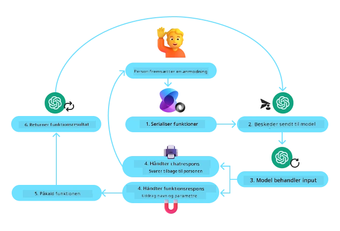
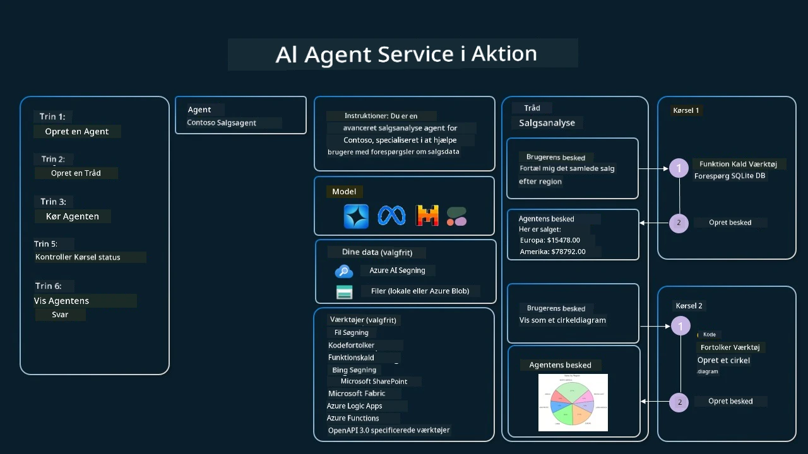

[](https://youtu.be/vieRiPRx-gI?si=cEZ8ApnT6Sus9rhn)

> _(Klik på billedet ovenfor for at se videoen til denne lektion)_

# Designmønster for brug af værktøjer

Værktøjer er interessante, fordi de tillader AI-agenter at have et bredere udvalg af kapaciteter. I stedet for at agenten kun har et begrænset sæt handlinger, den kan udføre, kan agenten ved at tilføje et værktøj nu udføre en lang række handlinger. I dette kapitel vil vi se på designmønsteret for brug af værktøjer, som beskriver, hvordan AI-agenter kan bruge specifikke værktøjer for at nå deres mål.

## Introduktion

I denne lektion søger vi at besvare følgende spørgsmål:

- Hvad er designmønsteret for brug af værktøjer?
- Hvilke anvendelsestilfælde kan det anvendes til?
- Hvilke elementer/byggesten er nødvendige for at implementere designmønsteret?
- Hvilke særlige hensyn skal tages i brugen af designmønsteret for værktøjsbrug for at bygge pålidelige AI-agenter?

## Læringsmål

Efter at have gennemført denne lektion vil du kunne:

- Definere designmønsteret for brug af værktøjer og dets formål.
- Identificere anvendelsestilfælde, hvor designmønsteret for brug af værktøjer er relevant.
- Forstå de centrale elementer, der er nødvendige for at implementere designmønsteret.
- Genkende overvejelser for at sikre pålidelighed i AI-agenter, der bruger dette designmønster.

## Hvad er designmønsteret for brug af værktøjer?

**Designmønsteret for brug af værktøjer** fokuserer på at give LLM'er mulighed for at interagere med eksterne værktøjer for at nå specifikke mål. Værktøjer er kode, der kan eksekveres af en agent for at udføre handlinger. Et værktøj kan være en simpel funktion som en lommeregner eller et API-kald til en tredjepartstjeneste som aktiekursopslag eller vejrudsigt. I sammenhæng med AI-agenter er værktøjer designet til at blive eksekveret af agenter som svar på **funktionskald genereret af modellen**.

## Hvilke anvendelsestilfælde kan det anvendes til?

AI-agenter kan bruge værktøjer til at fuldføre komplekse opgaver, hente oplysninger eller træffe beslutninger. Designmønsteret for værktøjsbrug anvendes ofte i scenarier, der kræver dynamisk interaktion med eksterne systemer såsom databaser, webtjenester eller kodefortolkere. Denne evne er nyttig til en række forskellige anvendelsestilfælde, herunder:

- **Dynamisk informationshentning:** Agenter kan forespørge eksterne API'er eller databaser for at hente opdaterede data (f.eks. forespørgsel i en SQLite-database til dataanalyse, hente aktiekurser eller vejrinformation).
- **Kodekørsel og fortolkning:** Agenter kan køre kode eller scripts for at løse matematiske problemer, generere rapporter eller udføre simuleringer.
- **Automatisering af arbejdsgange:** Automatisering af gentagne eller flertrins arbejdsgange ved at integrere værktøjer som opgaveplanlæggere, emailtjenester eller datapipelines.
- **Kundesupport:** Agenter kan interagere med CRM-systemer, ticketsystemer eller vidensbaser for at løse brugerhenvendelser.
- **Indholdsgenerering og redigering:** Agenter kan bruge værktøjer som grammatikcheckere, tekstopsummerere eller indholdssikkerhedsvurderinger for at assistere med opgaver om indholdsskabelse.

## Hvilke elementer/byggesten er nødvendige for at implementere designmønsteret for brug af værktøjer?

Disse byggesten tillader AI-agenten at udføre en bred vifte af opgaver. Lad os se på de centrale elementer, der er nødvendige for at implementere designmønsteret for brug af værktøjer:

- **Funktions-/værktøjsskemaer:** Detaljerede definitioner af tilgængelige værktøjer, inklusiv funktionsnavn, formål, krævede parametre og forventede output. Disse skemaer gør det muligt for LLM at forstå, hvilke værktøjer der er tilgængelige, og hvordan man opbygger gyldige forespørgsler.

- **Funktionsudførelseslogik:** Styrer, hvordan og hvornår værktøjer kaldes baseret på brugerens hensigt og samtalekontekst. Dette kan inkludere planlægningsmoduler, rutemekanismer eller betingede flows, der dynamisk bestemmer brugen af værktøjer.

- **Beskedhåndteringssystem:** Komponenter, som håndterer samtaleflowet mellem brugerinput, LLM-responser, værktøjskald og værktøjsoutput.

- **Værktøjsintegrationsrammeværk:** Infrastruktur, der forbinder agenten til forskellige værktøjer, uanset om de er simple funktioner eller komplekse eksterne tjenester.

- **Fejlhåndtering & validering:** Mekanismer til at håndtere fejl ved værktøjskørsel, validere parametre og håndtere uventede svar.

- **Tilstandsadministration:** Sporer samtalekontekst, tidligere værktøjsinteraktioner og vedvarende data for at sikre konsistens på tværs af flerstegsinteraktioner.

Lad os nu se nærmere på funktions-/værktøjskald.
 
### Funktions-/Værktøjskald

Funktionskald er den primære måde, vi giver store sprogmodeller (LLM'er) mulighed for at interagere med værktøjer. Du vil ofte se ‘funktion’ og ‘værktøj’ brugt om hverandre, fordi ‘funktioner’ (blokke af genanvendelig kode) er de ‘værktøjer’, som agenter bruger til at udføre opgaver. For at en funktions kode kan blive kaldt, skal en LLM sammenligne brugerens anmodning med funktionsbeskrivelsen. Til dette sendes et skema indeholdende beskrivelser af alle tilgængelige funktioner til LLM'en. LLM'en vælger så den mest passende funktion til opgaven og returnerer dens navn og argumenter. Den valgte funktion bliver kaldt, dens svar sendes tilbage til LLM, der bruger informationen til at svare på brugerens anmodning.

For at udviklere kan implementere funktionskald for agenter, skal du bruge:

1. En LLM-model, der understøtter funktionskald
2. Et skema med funktionsbeskrivelser
3. Koden til hver beskrevne funktion

Lad os bruge eksemplet med at få det aktuelle tidspunkt i en by til at illustrere:

1. **Initialiser en LLM, der understøtter funktionskald:**

    Ikke alle modeller understøtter funktionskald, så det er vigtigt at tjekke, at den LLM, du bruger, gør.     <a href="https://learn.microsoft.com/azure/ai-services/openai/how-to/function-calling" target="_blank">Azure OpenAI</a> understøtter funktionskald. Vi kan starte med at initialisere OpenAI-klienten mod Azure OpenAI **Responses API** (den stabile `/openai/v1/` endpoint — ingen `api_version` nødvendig). 

    ```python
    # Initialize the OpenAI client for Azure OpenAI (Responses API, v1 endpoint)
    client = OpenAI(
        base_url=f"{os.environ['AZURE_OPENAI_ENDPOINT'].rstrip('/')}/openai/v1/",
        api_key=os.environ["AZURE_OPENAI_API_KEY"],
    )
    deployment_name = os.environ["AZURE_OPENAI_DEPLOYMENT"]
    ```

1. **Opret et funktionsskema**:

    Dernæst definerer vi et JSON-skema, der indeholder funktionsnavnet, en beskrivelse af hvad funktionen gør, og navnene og beskrivelserne af funktionsparametrene.
    Vi vil derefter tage dette skema og sende det til klienten, der blev oprettet tidligere, sammen med brugerens anmodning om at finde tidspunktet i San Francisco. Det vigtige at bemærke er, at der returneres et **værktøjskald**, **ikke** det endelige svar på spørgsmålet. Som nævnt tidligere returnerer LLM navnet på den funktion, den valgte til opgaven, og de argumenter, der skal sendes til den.

    ```python
    # Function description for the model to read (Responses API flat tool format)
    tools = [
        {
            "type": "function",
            "name": "get_current_time",
            "description": "Get the current time in a given location",
            "parameters": {
                "type": "object",
                "properties": {
                    "location": {
                        "type": "string",
                        "description": "The city name, e.g. San Francisco",
                    },
                },
                "required": ["location"],
            },
        }
    ]
    ```
   
    ```python
  
    # Initial user message
    messages = [{"role": "user", "content": "What's the current time in San Francisco"}]

    # First API call: Ask the model to use the function
    response = client.responses.create(
        model=deployment_name,
        input=messages,
        tools=tools,
        tool_choice="auto",
        store=False,
    )

    # The Responses API returns tool calls as function_call items in response.output.
    # Append them to the conversation so the model has full context on the next turn.
    messages += response.output

    print("Model's response:")
    print(response.output)
  
    ```

    ```bash
    Model's response:
    [ResponseFunctionToolCall(arguments='{"location":"San Francisco"}', call_id='call_pOsKdUlqvdyttYB67MOj434b', name='get_current_time', type='function_call')]
    ```
  
1. **Funktionskoden, der kræves for at udføre opgaven:**

    Nu hvor LLM'en har valgt, hvilken funktion der skal køres, skal koden, der udfører opgaven, implementeres og eksekveres.
    Vi kan implementere koden for at få det aktuelle tidspunkt i Python. Vi skal også skrive koden, der udtrækker navn og argumenter fra response_message for at få det endelige resultat.

    ```python
      def get_current_time(location):
        """Get the current time for a given location"""
        print(f"get_current_time called with location: {location}")  
        location_lower = location.lower()
        
        for key, timezone in TIMEZONE_DATA.items():
            if key in location_lower:
                print(f"Timezone found for {key}")  
                current_time = datetime.now(ZoneInfo(timezone)).strftime("%I:%M %p")
                return json.dumps({
                    "location": location,
                    "current_time": current_time
                })
      
        print(f"No timezone data found for {location_lower}")  
        return json.dumps({"location": location, "current_time": "unknown"})
    ```

     ```python
    # Handle function calls
    tool_calls = [item for item in response.output if item.type == "function_call"]
    if tool_calls:
        for tool_call in tool_calls:
            if tool_call.name == "get_current_time":

                function_args = json.loads(tool_call.arguments)

                time_response = get_current_time(
                    location=function_args.get("location")
                )

                # Return the tool result as a function_call_output item
                messages.append({
                    "type": "function_call_output",
                    "call_id": tool_call.call_id,
                    "output": time_response,
                })
    else:
        print("No tool calls were made by the model.")

    # Second API call: Get the final response from the model
    final_response = client.responses.create(
        model=deployment_name,
        input=messages,
        tools=tools,
        store=False,
    )

    return final_response.output_text
     ```

     ```bash
      get_current_time called with location: San Francisco
      Timezone found for san francisco
      The current time in San Francisco is 09:24 AM.
     ```

Funktionskald er kernen i de fleste, hvis ikke alle, design for brug af værktøjer, men implementering fra bunden kan til tider være udfordrende.
Som vi lærte i [Lektion 2](../../../02-explore-agentic-frameworks) giver agentiske rammer os færdigbyggede byggesten til at implementere værktøjsbrug.
 
## Eksempler på brug af værktøjer med agentiske rammer

Her er nogle eksempler på, hvordan du kan implementere designmønsteret for brug af værktøjer ved brug af forskellige agentiske rammer:

### Microsoft Agent Framework

<a href="https://learn.microsoft.com/azure/ai-services/agents/overview" target="_blank">Microsoft Agent Framework</a> er en open-source AI-ramme til at bygge AI-agenter. Den forenkler processen med at bruge funktionskald ved at lade dig definere værktøjer som Python-funktioner med `@tool` dekoratøren. Frameworket håndterer kommunikationen frem og tilbage mellem modellen og din kode. Det giver også adgang til færdigbyggede værktøjer som Filsøgning og Kodefortolker gennem `FoundryChatClient`.

Følgende diagram illustrerer processen med funktionskald i Microsoft Agent Framework:



I Microsoft Agent Framework defineres værktøjer som dekorerede funktioner. Vi kan konvertere den tidligere sete `get_current_time` funktion til et værktøj ved at bruge `@tool` dekoratøren. Frameworket vil automatisk serialisere funktionen og dens parametre, og skabe skemaet til at sende til LLM'en.

```python
import os
from agent_framework import tool
from agent_framework.foundry import FoundryChatClient
from azure.identity import AzureCliCredential

@tool(approval_mode="never_require")
def get_current_time(location: str) -> str:
    """Get the current time for a given location"""
    ...

# Create the client
provider = FoundryChatClient(
    project_endpoint=os.environ["AZURE_AI_PROJECT_ENDPOINT"],
    model=os.environ["AZURE_AI_MODEL_DEPLOYMENT_NAME"],
    credential=AzureCliCredential(),
)

# Create an agent and run with the tool
agent = provider.as_agent(name="TimeAgent", instructions="Use available tools to answer questions.", tools=get_current_time)
response = await agent.run("What time is it?")
```

#### Værktøjer fra en MCP-server

Værktøjer behøver ikke at være funktioner i din egen kode. En server, der taler Model Context Protocol (MCP, behandlet i [Lektion 11](../11-agentic-protocols/README.md)), udgiver sine værktøjer sammen med deres skemaer, og frameworket kan indlæse dem på samme måde som det serialiserer en dekoreret funktion. `MCPStreamableHTTPTool` forbinder til en sådan server over HTTP, læser værktøjsskemaerne og tilbyder dem til modellen ved siden af lokale værktøjer.

Eksemplet nedenfor bruger websøgningsserveren hostet af <a href="https://keenable.ai" target="_blank">Keenable</a>. Den er gratis at bruge uden konto eller API-nøgle (forespørgsler er ratebegrænsede per IP), så de eneste legitimationsoplysninger du behøver, er dem for din model. Som med ethvert eksternt værktøj sendes de forespørgsler, modellen skriver, til denne server.

```python
from agent_framework import MCPStreamableHTTPTool

web_search = MCPStreamableHTTPTool(
    name="Keenable web search",
    url="https://api.keenable.ai/mcp",
)

# Connecting loads the server's tool schemas; the agent decides when to call them
async with web_search:
    agent = provider.as_agent(
        name="ResearchAgent",
        instructions="Use available tools to answer questions.",
        tools=[web_search],
    )
    response = await agent.run("What is new in the latest Python release?")
    print(response.text)
```

Serveren udgiver to værktøjer, `search_web_pages` og `fetch_page_content`. Når der skal bruges aktuelle informationer, kalder modellen `search_web_pages`, modtager titler, URL'er og tekstudsnit, og skriver sit svar ud fra disse, samme loop som i `get_current_time` eksemplet ovenfor.
  
### Microsoft Foundry Agent Service

<a href="https://learn.microsoft.com/azure/ai-services/agents/overview" target="_blank">Microsoft Foundry Agent Service</a> er en nyere agentisk ramme, designet til at gøre det muligt for udviklere sikkert at bygge, deployere og skalere AI-agenter i høj kvalitet, og med mulighed for udvidelse, uden at skulle håndtere underliggende compute- og lagringsressourcer. Den er særligt nyttig til erhvervsapplikationer, da den er en fuldt administreret service med sikkerhed på enterprisesniveau.

Sammenlignet med at udvikle direkte med LLM-API'en, giver Microsoft Foundry Agent Service nogle fordele, herunder:

- Automatisk værktøjskald – ingen behov for at parse et værktøjskald, kalde værktøjet og håndtere svaret; alt dette håndteres nu server-side
- Sikkert administrerede data – i stedet for selv at administrere samtalestatus, kan du stole på threads til at lagre alle nødvendige oplysninger
- Værktøjer klar til brug – Værktøjer, som du kan bruge til at interagere med dine datakilder, såsom Bing, Azure AI Search og Azure Functions.

Værktøjerne tilgængelige i Microsoft Foundry Agent Service kan opdeles i to kategorier:

1. Videnværktøjer:
    - <a href="https://learn.microsoft.com/azure/ai-services/agents/how-to/tools/bing-grounding?tabs=python&pivots=overview" target="_blank">Grounding med Bing Search</a>
    - <a href="https://learn.microsoft.com/azure/ai-services/agents/how-to/tools/file-search?tabs=python&pivots=overview" target="_blank">Filsøgning</a>
    - <a href="https://learn.microsoft.com/azure/ai-services/agents/how-to/tools/azure-ai-search?tabs=azurecli%2Cpython&pivots=overview-azure-ai-search" target="_blank">Azure AI Search</a>

2. Handlingsværktøjer:
    - <a href="https://learn.microsoft.com/azure/ai-services/agents/how-to/tools/function-calling?tabs=python&pivots=overview" target="_blank">Funktionskald</a>
    - <a href="https://learn.microsoft.com/azure/ai-services/agents/how-to/tools/code-interpreter?tabs=python&pivots=overview" target="_blank">Kodefortolker</a>
    - <a href="https://learn.microsoft.com/azure/ai-services/agents/how-to/tools/openapi-spec?tabs=python&pivots=overview" target="_blank">OpenAPI-definerede værktøjer</a>
    - <a href="https://learn.microsoft.com/azure/ai-services/agents/how-to/tools/azure-functions?pivots=overview" target="_blank">Azure Functions</a>

Agentservicen tillader os at bruge disse værktøjer sammen som en `toolset`. Den anvender også `threads`, som holder styr på historikken af meddelelser fra en bestemt samtale.

Forestil dig, at du er salgsagent hos et firma kaldet Contoso. Du vil udvikle en samtaleagent, der kan besvare spørgsmål om dine salgsdata.

Følgende billede illustrerer, hvordan du kunne bruge Microsoft Foundry Agent Service til at analysere dine salgsdata:



For at bruge nogen af disse værktøjer med servicen kan vi oprette en klient og definere et værktøj eller værktøjssæt. For at implementere dette praktisk kan vi bruge følgende Python-kode. LLM'en vil kunne kigge på værktøjssættet og afgøre, om den vil bruge brugeroprettet funktion, `fetch_sales_data_using_sqlite_query`, eller den forudbyggede Kodefortolker afhængigt af brugerens anmodning.

```python 
import os
from azure.ai.projects import AIProjectClient
from azure.identity import DefaultAzureCredential
from fetch_sales_data_functions import fetch_sales_data_using_sqlite_query # fetch_sales_data_using_sqlite_query function which can be found in a fetch_sales_data_functions.py file.
from azure.ai.projects.models import ToolSet, FunctionTool, CodeInterpreterTool

project_client = AIProjectClient.from_connection_string(
    credential=DefaultAzureCredential(),
    conn_str=os.environ["PROJECT_CONNECTION_STRING"],
)

# Initialize toolset
toolset = ToolSet()

# Initialize function calling agent with the fetch_sales_data_using_sqlite_query function and adding it to the toolset
fetch_data_function = FunctionTool(fetch_sales_data_using_sqlite_query)
toolset.add(fetch_data_function)

# Initialize Code Interpreter tool and adding it to the toolset. 
code_interpreter = CodeInterpreterTool()toolset.add(code_interpreter)

agent = project_client.agents.create_agent(
    model="gpt-5-mini", name="my-agent", instructions="You are helpful agent", 
    toolset=toolset
)
```

## Hvilke særlige hensyn skal tages ved brug af designmønsteret for brug af værktøjer for at bygge pålidelige AI-agenter?

En almindelig bekymring ved dynamisk SQL genereret af LLM'er er sikkerhed, særligt risikoen for SQL-injektion eller ondsindede handlinger, som at droppe eller manipulere databasen. Selvom disse bekymringer er berettigede, kan de effektivt afhjælpes ved korrekt konfiguration af databaseadgangstilladelser. For de fleste databaser betyder det at konfigurere databasen som read-only. For databasetjenester som PostgreSQL eller Azure SQL bør appen tildeles en read-only (SELECT) rolle.

At køre appen i et sikkert miljø forbedrer yderligere beskyttelsen. I virksomheds-scenarier udtrækkes og transformeres data typisk fra operationelle systemer til en read-only database eller data warehouse med et brugervenligt skema. Denne tilgang sikrer, at data er sikker, optimeret for ydeevne og tilgængelighed, og at appen har begrænset, read-only adgang.

## Eksempelkoder

- Python: [Agent Framework](./code_samples/04-python-agent-framework.ipynb)
- .NET: [Agent Framework](./code_samples/04-dotnet-agent-framework.md)

## Har du flere spørgsmål om designmønsteret for brug af værktøjer?

Deltag i [Microsoft Foundry Discord](https://discord.com/invite/ATgtXmAS5D) for at møde andre lærende, deltage i kontortimer og få svar på dine spørgsmål om AI-agenter.

## Yderligere ressourcer

- <a href="https://microsoft.github.io/build-your-first-agent-with-azure-ai-agent-service-workshop/" target="_blank">Azure AI Agents Service Workshop</a>
- <a href="https://github.com/Azure-Samples/contoso-creative-writer/tree/main/docs/workshop" target="_blank">Contoso Creative Writer Multi-Agent Workshop</a>
- <a href="https://learn.microsoft.com/azure/ai-services/agents/overview" target="_blank">Microsoft Agent Framework Oversigt</a>

## Røgtætning af denne agent (valgfrit)

Efter du har lært at implementere agenter i [Lektion 16](../16-deploying-scalable-agents/README.md), kan du røgtætte denne lektions `TravelToolAgent` (kalder den stadig sine værktøjer og svarer?) med [`tests/lesson-04-smoke-tests.json`](../../../tests/lesson-04-smoke-tests.json). Se [`tests/README.md`](../tests/README.md) for hvordan du kører den.

## Forrige lektion

[Forståelse af agentiske designmønstre](../03-agentic-design-patterns/README.md)

## Næste lektion

[Agentisk RAG](../05-agentic-rag/README.md)

---

<!-- CO-OP TRANSLATOR DISCLAIMER START -->
**Ansvarsfraskrivelse**:
Dette dokument er blevet oversat ved hjælp af AI-oversættelsestjenesten [Co-op Translator](https://github.com/Azure/co-op-translator). Selvom vi bestræber os på nøjagtighed, skal du være opmærksom på, at automatiserede oversættelser kan indeholde fejl eller unøjagtigheder. Det originale dokument på dets oprindelige sprog bør betragtes som den autoritative kilde. For kritisk information anbefales professionel menneskelig oversættelse. Vi påtager os intet ansvar for misforståelser eller fejltolkninger, der opstår som følge af brugen af denne oversættelse.
<!-- CO-OP TRANSLATOR DISCLAIMER END -->