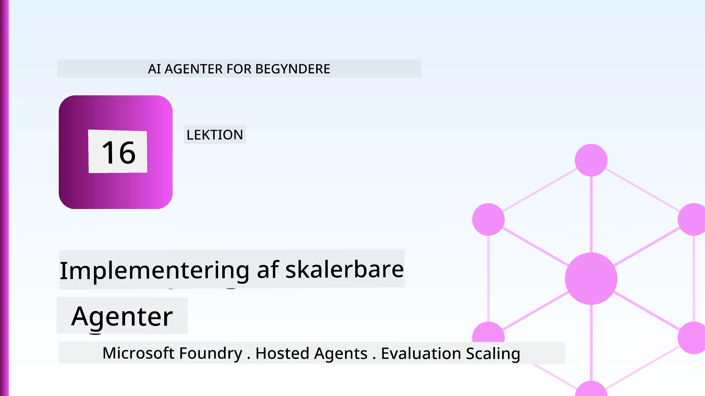
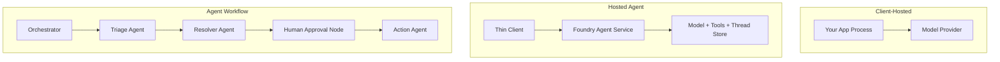
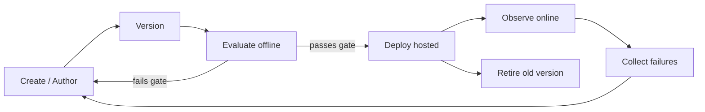
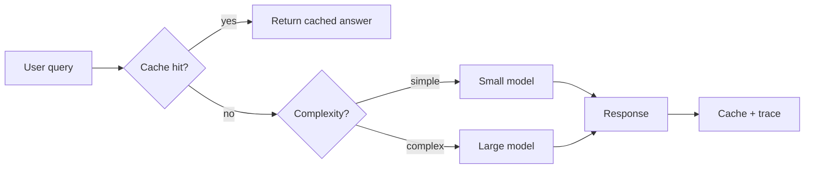
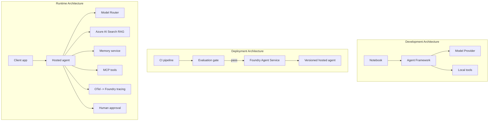

# Udrulning af skalerbare agenter med Microsoft Foundry



Indtil nu i kurset har du bygget agenter, der kører på din bærbare, inde i en notesbog, drevet af `az login` og en håndfuld miljøvariabler. Det er præcis den rigtige måde at lære på. Det er ikke den rigtige måde at køre en agent, som tusindvis af kunder er afhængige af kl. 3 om natten.

Denne lektion handler om kløften mellem "det virker på min maskine" og "det virker pålideligt og overkommeligt i produktion." Vi lukker den kløft ved at bruge **Microsoft Foundry** og **Microsoft Foundry Agent Service**, og vi gør det ved at bygge en rigtig kundesupportagent med værktøjer, hentefunktion, hukommelse, evaluering og overvågning.

## Introduktion

Denne lektion vil dække:

- Forskellen mellem en **prototypeagent** og en **udrullet agent**, og hvorfor overgangen primært handler om alt *omkring* modellen.
- **Udrulningsmønstre** for agenter: klienthostet, servicehostet (Hosted Agents) og workflow-orchestrerede.
- **Agentens livscyklus** på Microsoft Foundry — opret, versionér, udrul, evaluer, observer, træk tilbage.
- **Skaleringsstrategier**: modelrouting, caching, samtidighed og statsløs design.
- **Observerbarhed** med OpenTelemetry og Foundry tracing.
- **Omkostningsoptimering** gennem modelvalg, routing og evalueringsporte.
- **Enterprise-overvejelser**: governance, menneskelig godkendelse og sikker kørsel af MCP-servere i produktion.

## Læringsmål

Efter at have gennemført denne lektion vil du vide hvordan man:

- Vælger det rigtige udrulningsmønster for en given agentbelastning.
- Udruller en agent til Microsoft Foundry Agent Service, så den er versioneret, styret og observerbar.
- Instrumenterer en agent til tracing og kobler en evalueringspipeline, der kører før hver udgivelse.
- Anvender modelrouting og caching for at holde latenstid og omkostninger under kontrol i stor skala.
- Tilføjer en menneskelig godkendelsesport for risikable handlinger og integrerer en MCP-server på en produktion-sikker måde.

## Forudsætninger

Denne lektion antager, at du har gennemført de tidligere lektioner og er fortrolig med:

- At bygge agenter med [Microsoft Agent Framework](../14-microsoft-agent-framework/README.md) (Lektion 14).
- [Brug af værktøjer](../04-tool-use/README.md) (Lektion 4) og [Agentic RAG](../05-agentic-rag/README.md) (Lektion 5).
- [Agenthukommelse](../13-agent-memory/README.md) (Lektion 13) og [Agentic protokoller / MCP](../11-agentic-protocols/README.md) (Lektion 11).
- [Observerbarhed og evaluering](../10-ai-agents-production/README.md) (Lektion 10) — denne lektion bygger direkte videre på den.

Du skal også bruge:

- Et **Azure-abonnement** og et **Microsoft Foundry-projekt** med mindst én udrullet chatmodel.
- **Azure CLI** autentificeret (`az login`).
- Python 3.12+ og pakkene i depotet [`requirements.txt`](../../../requirements.txt).

## Fra prototype til produktion: Hvad ændrer sig egentlig

En prototypeagent og en produktionsagent deler den samme kerneproces — ræsonner, kald værktøjer, svar. Det, der ændrer sig, er alt det, der omgiver denne process. Modellen udgør måske 20% af en produktionsagent; de resterende 80% udgør den operationelle skeletstruktur.

| Bekymring | Prototype | Produktion |
| --- | --- | --- |
| **Hosting** | Kører i din notesbog | Kører som en hosted service, versioneret og rullet ud |
| **Identitet** | Dit `az login` token | Administreret identitet med scoped RBAC |
| **Tilstand** | I hukommelsen, tabes ved genstart | Externaliseret (trådlager, hukommelsestjeneste) |
| **Fejl** | Du ser tracebacks | Genforsøg, fallback, dead-letter, alarmer |
| **Omkostning** | "Det koster nogle få cent" | Sporet per anmodning, routet, cached, budgetteret |
| **Kvalitet** | Du vurderer output visuelt | Evalueret automatisk før hver udgivelse |
| **Tillid** | Du godkender hver handling | Politik + menneske-i-loop for risikable handlinger |

Husk denne tabel. Hvert afsnit nedenfor svarer til en af disse rækker.

## Agentudrulningsmønstre

Der er tre mønstre, du vil bruge, ofte i kombination.

### 1. Klienthostede agenter

Agentobjektet lever inde i *din* applikationsproces. Din kode kalder modeludbyderen direkte; ræsonneringsløkken kører i din service. Det er det, alle tidligere lektioner har gjort.

- **Brug det, når** du har brug for fuld kontrol over løkken, tilpasset middleware, eller du integrerer agenten i en eksisterende backend.
- **Afvejning**: du styrer selv skalering, tilstand og robusthed.

### 2. Hosted agenter (Foundry Agent Service)

Agenten er *registreret som en resurse* i Microsoft Foundry. Foundry hoster ræsonneringsløkken, gemmer tråde, håndhæver indholdssikkerhed og RBAC, og gør agenten synlig i Foundry-portalen. Din app bliver en tynd klient, der opretter tråde og læser svar.

- **Brug det, når** du ønsker holdbarhed, indbygget observerbarhed, governance og mindre operationelt overfladeareal.
- **Afvejning**: mindre lavt niveau kontrol til gengæld for et managed runtime.

### 3. Agent Workflows

Flere agenter (og værktøjer) sammensættes til en graf med eksplicit kontrolflow — sekventielle trin, forgrening, menneskelig godkendelsesnoder og holdbare checkpoints, som kan pause og genoptage. Dette er Microsoft Agent Frameworks **Workflows** kapabilitet anvendt i udrulningsskala.

- **Brug det, når** en enkelt opgave spænder over flere specialiserede agenter eller kræver godkendelse midt i processen.
- **Afvejning**: flere bevægelige dele; kræver orchestration-level observerbarhed.



## Agentens livscyklus på Microsoft Foundry

At udrulle en agent er ikke et engangskald `push`. Det er en løkke, og det ligner meget en software-udgivelsescyklus, fordi det er præcis, hvad det er.



Den centrale ide, fortsat fra [Lektion 10](../10-ai-agents-production/README.md): **offline evaluering er en port, ikke en eftertanke.** En ny agentversion afsendes ikke, medmindre den klarer dine evalueringsgrænser. Online observerbarhed fodrer så reelle fejl tilbage til dit offline testsæt. Det er hele løkken.

## Skaleringsstrategier

Skalering af en agent er forskellig fra skalering af et statsløst web-API, fordi hver anmodning kan udløse flere dyre model- og værktøjskald. Fire teknikker bærer mest af belastningen.

**Statsløs håndtering af forespørgsler.** Gem ingen bruger-specifik tilstand i din proceshukommelse. Gem samtaletråde i Foundrys trådlager eller en hukommelsestjeneste, så enhver instans kan håndtere enhver anmodning. Det er det, der tillader horisontal skalering — tilføj instanser, ingen sticky sessions.

**Modelrouting.** Ikke alle anmodninger behøver den mest kapable (og dyreste) model. Rut simple forespørgsler — intent-klassifikation, korte faktuelle svar — til en lille, hurtig model, og reserver den store model til ægte ræsonnering. Foundrys **Model Router** kan gøre dette for dig, eller du kan implementere en letvægtsklassifikator selv. Du bygger DIY-versionen i labben.

**Response caching.** Mange supporthenvendelser er næsten dubletter ("hvordan nulstiller jeg min adgangskode?"). Cache svar på almindelige spørgsmål og serve dem uden overhovedet at ramme modellen. Selv en moderat cache-hit-rate reducerer mærkbart omkostninger og latenstid.

**Samtidighed og backpressure.** Modeludbydere har grænser for hastighed. Begræns din samtidighed, brug genforsøg med eksponentiel backoff, og fejlhåndt yndefuldt (et køet "vi er på sagen" svar er bedre end en 500-fejl).



## Observerbarhed i produktion

Du kan ikke drive det, du ikke kan se. Som dækket i Lektion 10 udsender Microsoft Agent Framework **OpenTelemetry** traces indbygget — hvert modelkald, værktøjsinvokation og orkestreringstrin bliver et span. I produktion eksporterer du disse spans til Microsoft Foundry (eller enhver OTel-kompatibel backend), så du kan:

- Spore en enkelt kundeklage end-to-end igennem alle model- og værktøjskald.
- Overvåge p50/p95 latenstid og omkostning per anmodning over tid.
- Give alarm om fejlrate-spidser og omkostningsafvigelser før dine brugere (eller din økonomiafdeling) opdager det.

```python
from agent_framework.observability import get_tracer

tracer = get_tracer()

with tracer.start_as_current_span("support_request") as span:
    span.set_attribute("customer.tier", "enterprise")
    span.set_attribute("routed.model", "gpt-5-nano")
    # agent execution is traced automatically inside this span
```

Attributter som `customer.tier` og `routed.model` er det, der gør en væg af traces til besvarelige spørgsmål ("bliver virksomhedskunder for ofte routet til den lille model?").

## Omkostningsoptimering

Omkostninger i produktionsagenter domineres af tokens. Tre håndtag, i rækkefølge efter effekt:

1. **Rigtig størrelse på modellen.** En lille model, der klarer din evalueringsport, er næsten altid billigere end en stor, der også klarer den. Brug evaluering til at *bevise*, at den lille model er god nok frem for som standard at vælge den største ud af forsigtighed.
2. **Routing efter kompleksitet.** Som ovenfor — betal kun store model-priser for anmodninger, der kræver stor modelræsonnering.
3. **Cache aggressivt.** Det billigste modelkald er det, du aldrig laver.

Evalueringsporte og omkostningskontrol er den samme disciplin set fra to vinkler: evaluering fortæller dig *kvalitetsgulvet*, routing og caching holder dig så tæt på gulvets *omkostning* som muligt.

## Enterprise-udrulnings-overvejelser

**Governance.** Hosted Agents arver Foundrys RBAC, indholdssikkerhed og revisionslogning. Giv hver agent en administreret identitet med mindst privilegium — læseadgang til vidensbasen, scoped adgang til ticketing API'en, ikke mere.

**Menneske-i-loop.** Nogle handlinger er for konsekvensrige til at automatisere direkte — udstede refundering, slette en konto, eskalere til et juridisk team. Microsoft Agent Framework understøtter **godkendelses-krævende** værktøjer: agenten foreslår handlingen, eksekveringen pauser, et menneske godkender eller afviser, og workflowen genoptages. Du så primitivet i [Lektion 6](../06-building-trustworthy-agents/README.md); her udruller du det.

**MCP i produktion.** [MCP](../11-agentic-protocols/README.md) lader din agent bruge eksterne værktøjer gennem et standardinterface. I produktion betragtes hver MCP-server som en ikke-tillidværdig grænse: fastlåse serverversion, kør med scoped identitet, valider output, og udsæt aldrig hemmeligheder for den. En MCP-server er en afhængighed, og afhængigheder patches, auditeres og ratebegrænses.



De tre diagrammer — udvikling, udrulning, runtime — er samme agent i tre stadier af dens livscyklus. Labben, der følger, guider dig i at bygge den.

## Hands-on lab: En produktionsklar kundesupportagent

Åbn [`code_samples/16-python-agent-framework.ipynb`](./code_samples/16-python-agent-framework.ipynb) og arbejdet igennem den fra start til slut. Du vil samle en **Contoso kundesupportagent** med alle produktionsmæssige bekymringer indkoblet:

1. **Værktøjskald** — slå ordrestatus op og åbn supportsager.
2. **RAG** — besvar politikspørgsmål fra en vidensbase (Azure AI Search, med en in-memory fallback så notesbogen kører uden en Search-ressource).
3. **Hukommelse** — husk kunden på tværs af samtaleture.
4. **Modelrouting** — en kompleksitetsklassifikator router hver anmodning til en lille eller stor model.
5. **Response caching** — gentagne spørgsmål serveres fra cache.
6. **Menneskelig godkendelse** — refunderinger over en tærskel venter på menneskelig godkendelse.
7. **Evalueringspipeline** — et lille offline testsæt scorer agenten og fungerer som en udgivelsesport.
8. **Observerbarhed** — OpenTelemetry tracing på hver anmodning.

### Gennemgang

Notesbogen er organiseret, så hver produktionsmæssig bekymring er et selvstændigt, kørbart afsnit. Hjertet er routing-plus-caching forespørgselsbehandleren:

```python
async def handle_support_request(query: str, customer_id: str) -> str:
    # 1. Serve from cache when we can.
    cached = response_cache.get(normalize(query))
    if cached:
        return cached

    # 2. Route by complexity to control cost.
    model = "gpt-5-nano" if is_simple(query) else "gpt-5-mini"

    # 3. Run the agent inside a trace span for observability.
    with tracer.start_as_current_span("support_request") as span:
        span.set_attribute("routed.model", model)
        span.set_attribute("customer.id", customer_id)
        response = await support_agent.run(query, model=model)

    # 4. Cache and return.
    response_cache.set(normalize(query), response.text)
    return response.text
```

Evalueringsporten, der vogter en udgivelse, ser sådan her ud:

```python
async def evaluation_gate(agent, test_cases, threshold: float = 0.8) -> bool:
    passed = 0
    for case in test_cases:
        result = await agent.run(case["input"])
        if score_response(result.text, case["expected"]) >= 0.8:
            passed += 1
    pass_rate = passed / len(test_cases)
    print(f"Evaluation pass rate: {pass_rate:.0%} (gate: {threshold:.0%})")
    return pass_rate >= threshold  # only deploy if the gate passes
```

Læs hver linje — notesbogen holder primitivene bevidst små, så intet er skjult bag et framework-kald.

## Validering af en udrullet agent med Smoke Tests

Evalueringsporten ovenfor kører *offline* mod dit agentobjekt. Når agenten er udrullet som en Hosted Agent, har du brug for endnu en, endnu billigere tjek: **besvarer den udrullede endpoint rent faktisk?**

At udrulle "med succes" beviser kun, at kontrolplanet accepterede definitionen — det beviser ikke, at agenten svarer. En manglende afhængighed, forkert modelrouting eller en udløbet forbindelse kan efterlade en grøn udrulning, der ikke returnerer noget. En **smoke-test** fanger det på få sekunder, ved hver udrulning, uden omkostningerne ved en fuld evaluering.

Dette repo leverer en klar-til-brug smoke-test pipeline bygget på [AI Smoke Test](https://github.com/marketplace/actions/ai-smoke-test) GitHub Action:

- **Katalog** — [`tests/lesson-16-smoke-tests.json`](../../../tests/lesson-16-smoke-tests.json) indeholder prompts og påstande for Contoso supportagenten (bundne politiksvar, ordreopslag, holde sig on-topic og multi-turn tråd kontinuitet). Kataloger for andre lektionsagenter ligger ved siden af — se [`tests/README.md`](../tests/README.md).
- **Workflow** — [`.github/workflows/smoke-test.yml`](../../../.github/workflows/smoke-test.yml) logger ind med Azure OIDC og POST'er hver prompt til agentens Responses-endpoint, og fejler jobbet ved enhver påstandsmiss.

```yaml
- name: Smoke-test hosted agent
  uses: JFolberth/ai-smoketest@v1
  with:
    project_endpoint: ${{ inputs.project_endpoint }}
    agent_name: ContosoSupportAgent
    tests_file: tests/lesson-16-smoke-tests.json
```

Kør det fra **Actions**-fanen, når din agent er implementeret, og angiv dit Foundry-projekt-endpoint og agentnavn. Den fødererede identitet skal have rollen **Azure AI User** på Foundry-projektets scope. Tænk på lagene som en pyramide: rygetests (er den tilgængelig og reagerer?) kører ved hver implementering, offline evaluering (er den god nok til at frigive?) kører før promovering, og online evaluering (hvordan klarer den sig ude i felten?) kører kontinuerligt.

## Videnscheck

Test din forståelse, før du går videre til opgaven.

**1. Omtrent hvor stor en del af en produktionsagent er "modellen," og hvad er resten?**

<details>
<summary>Svar</summary>

Modellen udgør en minoritet af systemet — ofte angivet til omkring 20 %. Resten udgøres af den operationelle skelettet: hosting og versionering, identitet og RBAC, eksternaliseret tilstand, fejlbehandling, omkostningssporing, evaluering og menneskelig kontrol i løkken. Overgangen til produktion handler mest om at bygge alt *omkring* ræsonneringssløjfen.
</details>

**2. Hvornår vil du vælge en Hosted Agent frem for en klient-hostet agent?**

<details>
<summary>Svar</summary>

Når du ønsker en administreret runtime med indbygget holdbarhed (tråde der vedvarer og kan genoptages), observerbarhed, indholdssikkerhed og RBAC, og du er villig til at bytte noget lavniveaukontrol af ræsonneringssløjfen for et mindre operationelt overfladeareal. Klient-hostet foretrækkes, når du har brug for fuld kontrol over sløjfen eller integrerer agenten i en eksisterende backend.
</details>

**3. Hvorfor skal en skalerbar agent være statsløs i sin egen proceshukommelse?**

<details>
<summary>Svar</summary>

Så enhver instans kan håndtere enhver anmodning, hvilket muliggør horisontal skalering uden sticky sessions. Per-bruger samtalestatus eksternaliseres til et thread store eller hukommelsestjeneste. Hvis tilstanden levede i proceshukommelse, ville du miste den ved genstart og kunne ikke frit fordele belastningen.
</details>

**4. Hvilket problem løser modelrouting, og hvordan relaterer det til evaluering?**

<details>
<summary>Svar</summary>

Routing sender simple anmodninger til en lille, billig og hurtig model og reserverer den store model til ægte ræsonnering, og styrer både latenstid og omkostninger. Det relaterer til evaluering, fordi evaluering er det, der *beviser* at den lille model er god nok til en klasse af anmodninger — routing uden evaluering er gætteri.
</details>

**5. Hvad er en "evaluationsport," og hvor befinder den sig i livscyklussen?**

<details>
<summary>Svar</summary>

En evaluationsport kører et offline testsæt mod en ny agentversion og blokerer implementeringen, medmindre beståelsesprocenten overstiger en tærskel. Den ligger mellem "version" og "implementering" i livscyklussen, hvilket gør kvalitet til en forudsætning for frigivelse i stedet for noget, man tjekker efter udgivelsen.
</details>

**6. Hvorfor bør en MCP-server behandles som en uværdig grænseflade i produktion?**

<details>
<summary>Svar</summary>

Fordi det er en ekstern afhængighed, som din agent kalder ind i. Du bør fastlåse dens version, køre den med en scoped identitet, validere dens output, rate-begrænse den og aldrig udsætte hemmeligheder for den — samme disciplin som du anvender for enhver tredjepartsafhængighed. Dens output flyder ind i din agents ræsonnering, så uvalideret tillid er en sikkerhedsrisiko.
</details>

**7. Hvilken enkelt ændring har som regel størst indflydelse på produktionsagentens omkostninger, og hvorfor?**

<details>
<summary>Svar</summary>

At vælge korrekt modelstørrelse — bruge den mindste model, der stadig består din evaluationsport. Omkostninger domineres af tokens, og en mindre model, der opfylder kvalitetskriteriet, er næsten altid billigere end en større. Caching og routing reducerer omkostninger yderligere, men valget af den rette basismodel har den største førsteordenseffekt.
</details>

**8. Hvilken rolle spiller span-attributter som `customer.tier` og `routed.model` i observerbarhed?**

<details>
<summary>Svar</summary>

De forvandler rå trace-data til besvarelige business-spørgsmål. Uden attributter har du en mur af spans; med dem kan du spørge "bliver enterprise-kunder for ofte routet til den lille model?" eller "hvilken model håndterer vores langsomste anmodninger?" Attributter er, hvordan du skærer telemetri op efter de dimensioner, der betyder noget for din drift.
</details>

## Opgave

Tag kundesupportagenten fra laboratoriet og styrk den til et specifikt scenarie: **en abonnementsfakturerings-supportagent for en SaaS-virksomhed.**

Din aflevering skal:

1. **Erstat værktøjerne** med faktureringsrelevante: `get_subscription_status`, `get_invoice`, og `issue_credit` (kreditter over 50 kræver menneskelig godkendelse).
2. **Tilføj tre RAG-dokumenter** med virksomhedens refusionspolitik, faktureringscyklus og afbestillingspolitik.
3. **Udvid evalueringssættet** til mindst otte tilfælde, herunder mindst to, som *bør* udløse den menneskelige godkendelsesvej, og bekræft at din evaluationsport korrekt godkender eller afviser.
4. **Tilføj en omkostningsrapport**: efter at have kørt ti blandede forespørgsler gennem agenten, udskriv hvor mange der gik til den lille model, hvor mange til den store model, og hvor mange der blev leveret fra cache.

Skriv et kort afsnit (i en markdown-celle), der forklarer, hvilken model-routing-regel du valgte, og hvordan du vil validere den med reel trafik. Der findes ikke ét korrekt svar — du vurderes på, om produktionshensynene er sammenhængende.

## Resumé

I denne lektion flyttede du en agent fra prototype til produktion med Microsoft Foundry:

- Springet til produktion handler mest om **det operationelle skelet** omkring modellen — hosting, identitet, tilstand, fejlbehandling, omkostninger, kvalitet og tillid.
- Du lærte de tre **implementeringsmønstre** — klient-hostet, Hosted Agents og Agent Workflows — og hvornår hvert passer.
- Du gik livscyklussen for **agenten igennem**, hvor offline **evaluering fungerer som en frigivelsesport** og online observerbarhed sender fejl tilbage til testsættet.
- Du anvendte **skaleringstrategier** — statsløs design, modelrouting, caching og begrænset samtidighed — og koblede dem til **omkostningsoptimering**.
- Du integrerede **enterprise-kontroller**: RBAC, menneskelig godkendelse og produktionssikker MCP-integration.
- Du byggede en **produktionsklar kundesupportagent**, der binder alle disse hensyn sammen i kørbar kode.

Den næste lektion går den modsatte vej: i stedet for at skalere agenter op i skyen, vil du bringe dem *ned* på en enkelt udviklermaskine og køre dem fuldstændig lokalt.

## Yderligere ressourcer

- <a href="https://learn.microsoft.com/azure/ai-foundry/what-is-azure-ai-foundry" target="_blank">Microsoft Foundry dokumentation</a>
- <a href="https://learn.microsoft.com/azure/ai-foundry/agents/overview" target="_blank">Oversigt over Microsoft Foundry Agent Service</a>
- <a href="https://learn.microsoft.com/en-us/agent-framework/overview/?wt.mc_id=youtube_26688_organicsocial_reactor&pivots=programming-language-python" target="_blank">Microsoft Agent Framework</a>
- <a href="https://learn.microsoft.com/en-us/azure/ai-foundry/openai/concepts/model-router" target="_blank">Model Router i Microsoft Foundry</a>
- <a href="https://learn.microsoft.com/azure/search/search-what-is-azure-search" target="_blank">Azure AI Search</a>
- <a href="https://opentelemetry.io/" target="_blank">OpenTelemetry</a>
- <a href="https://github.com/marketplace/actions/ai-smoke-test" target="_blank">AI Smoke Test GitHub Action</a>
- <a href="https://modelcontextprotocol.io/" target="_blank">Model Context Protocol (MCP)</a>

## Forrige lektion

[Building Computer Use Agents (CUA)](../15-browser-use/README.md)

## Næste lektion

[Creating Local AI Agents](../17-creating-local-ai-agents/README.md)

---

<!-- CO-OP TRANSLATOR DISCLAIMER START -->
**Ansvarsfraskrivelse**:
Dette dokument er blevet oversat ved hjælp af AI-oversættelsestjenesten [Co-op Translator](https://github.com/Azure/co-op-translator). Selvom vi bestræber os på nøjagtighed, skal du være opmærksom på, at automatiserede oversættelser kan indeholde fejl eller unøjagtigheder. Det originale dokument på dets oprindelige sprog bør betragtes som den autoritative kilde. For kritisk information anbefales professionel menneskelig oversættelse. Vi påtager os intet ansvar for misforståelser eller fejltolkninger, der opstår som følge af brugen af denne oversættelse.
<!-- CO-OP TRANSLATOR DISCLAIMER END -->