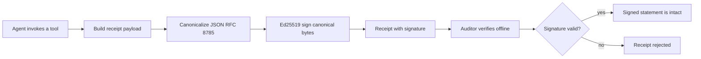
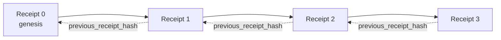

[Se lektionsvideoen: Sikring af AI-agenter med kryptografiske kvitteringer](https://youtu.be/PLACEHOLDER_VIDEO_ID)

> _(Lektionsvideo og miniaturebillede tilføjes af Microsoft-indholdsteamet efter sammensmeltning, der matcher mønsteret for lektion 14 / 15.)_

# Sikring af AI-agenter med kryptografiske kvitteringer

## Introduktion

Denne lektion vil dække:

- Hvorfor revisionsspor for AI-agenter betyder noget for overholdelse, fejlfinding og tillid.
- Hvad en kryptografisk kvittering er, og hvordan den adskiller sig fra en usigneret loglinje.
- Hvordan man producerer en underskrevet kvittering for et agentværktøjskald i almindelig Python.
- Hvordan man verificerer en kvittering offline og opdager manipulation.
- Hvordan man kæder kvitteringer, så fjernelse eller omrokering af en kvittering bryder kæden.
- Hvad kvitteringer beviser, og hvad de eksplicit ikke beviser.

## Læringsmål

Efter at have gennemført denne lektion vil du vide, hvordan du:

- Identificerer de fejlsituationer, der motiverer kryptografisk proveniens for agenthandlinger.
- Producerer en Ed25519-underskrevet kvittering over en kanonisk JSON-payload.
- Verificerer en kvittering uafhængigt ved kun at bruge underskriverens offentlige nøgle.
- Opdager manipulation ved at genkøre verifikation på en modificeret kvittering.
- Bygger en hash-kædet sekvens af kvitteringer og forklarer, hvorfor kæden er vigtig.
- Genkender grænsen mellem hvad kvitteringer beviser (tillæggelse, integritet, rækkefølge) og hvad de ikke gør (korrekthed af handlingen, policyens holdbarhed).

## Problemet: Dit agents revisionsspor

Forestil dig, at du har implementeret en AI-agent for Contoso Travel. Agenten læser kundeforespørgsler, kalder en fly-API for at se muligheder, og booker sæder på kundens vegne. I sidste kvartal behandlede agenten 50.000 bookinger.

I dag ankommer en revisor. De stiller et enkelt spørgsmål: "Vis mig, hvad din agent gjorde."

Du overgiver dine logfiler. Revisoren kigger på dem og stiller det sværere spørgsmål: "Hvordan ved jeg, at disse logs ikke er blevet redigeret?"

Dette er audit-sprogsproblemet. De fleste agent-implementeringer i dag bygger på:

- **Applikationslogs**: skrevet af agenten selv, redigerbare af alle med filsystem-adgang.
- **Cloud-logningstjenester**: manipulation-synlige på platformsniveau men kun hvis revisoren stoler på platformoperatøren.
- **Databasetransaktionslogs**: velegnede til databaseændringer men ikke til vilkårlige værktøjskald.

Ingen af disse kan besvare revisorens spørgsmål uden at kræve, at revisoren stoler på nogen (dig, din cloud-udbyder, din databaseleverandør). Til internt brug er den tillid ofte acceptabel. For regulerede arbejdsopgaver (finans, sundhedsvæsen, alt underlagt EU AI-loven) er det ikke.

Kryptografiske kvitteringer snævrer dette problem ind ved at gøre en underskrevet erklæring uafhængigt
verificerbar. Revisoren behøver stadig en udenfor-bånd årsag til at stole på signeringsnøglen og
komponenten, der producerede erklæringen. En indlejret nøgle beviser selv-konsistens,
ikke udsteder-identitet eller håndhævelsesplacering.

## Hvad er en kryptografisk kvittering?

En kvittering er et JSON-objekt, der registrerer, hvad en agent gjorde, underskrevet med en digital signatur.



En minimal kvittering ser således ud:

```json
{
  "type": "agent.tool_call.v1",
  "agent_id": "contoso-travel-bot",
  "tool_name": "lookup_flights",
  "tool_args_hash": "sha256:a3f9c1...",
  "result_hash": "sha256:7b2e1d...",
  "policy_id": "contoso-travel-policy-v3",
  "timestamp": "2026-04-25T14:30:00Z",
  "sequence": 47,
  "previous_receipt_hash": "sha256:9d4e6a...",
  "signature": {
    "alg": "EdDSA",
    "sig": "c5af83...",
    "public_key": "8f3b2c..."
  }
}
```

Tre egenskaber udfører arbejdet:

1. **Signaturen**. Kvitteringen underskrives af agentens gateway ved brug af en Ed25519-privatnøgle. Enhver med den tilsvarende offentlige nøgle kan verificere signaturen offline. En part, der stoler på nøglen, skal fastlåse den nøgle eller hente den fra et betroet register uden for kvitteringen. Manipulation af et hvilket som helst underskrevet felt ugyldiggør signaturen.

2. **Kanonisk kodning**. Før signering serialiseres kvitteringen ved hjælp af JSON Canonicalization Scheme (JCS, RFC 8785). Dette sikrer, at to implementeringer, der producerer samme logiske kvittering, producerer byte-identisk output. Uden kanonisk kodning ville forskellige JSON-serialisere producere forskellige signaturer for samme indhold.

3. **Hash-dannelse**. `previous_receipt_hash`-feltet kæder hver kvittering til den foregående. At fjerne eller omrokere en kvittering bryder den præsenterede sekvens. Opdagelse af forkortelse eller en omskrivning kontrolleret af underskriveren kræver også en fastlåst aktuel kædehoved, uafhængigt vidne bekræftet checkpoint eller autentificeret lukket population-commitment.

Sammen giver disse egenskaber tre garantier:

- **Tillæg til en nøgle**: denne nøgle underskrev dette indhold. Organisatorisk eller menneskelig identitet kræver en betroet nøglebinding.
- **Integritet**: indholdet har ikke ændret sig siden signering.
- **Rækkefølge inden for den verificerede sekvens**: denne kvittering kæder til den pågældende forgænger.

## Produktion af en kvittering i Python

Du behøver ikke et specielt bibliotek til at producere en kvittering. De kryptografiske primitive er bredt tilgængelige, og logikken er et par dusin linjer Python.

De praktiske øvelser i `code_samples/18-signed-receipts.ipynb` gennemgår hele forløbet. Den kildekontrollerede `code_samples/18-signed-receipts.execution-receipt.json` registrerer den præcise notesbog-hash, Python-miljø, celleantal og tjek fra den seneste rene kørsel uden at ændre lektionens gemte output. Sammenfatningen:

```python
import json
import hashlib
import base64
from nacl import signing
from jcs import canonicalize  # RFC 8785 canonical JSON

def b64url_nopad(data: bytes) -> str:
    return base64.urlsafe_b64encode(data).decode("ascii").rstrip("=")

def sha256_canonical(obj) -> str:
    """SHA-256 of a Python object's JCS-canonical JSON form."""
    return f"sha256:{hashlib.sha256(canonicalize(obj)).hexdigest()}"

# Generate or load a signing key (in production, store in a key vault)
signing_key = signing.SigningKey.generate()
verify_key = signing_key.verify_key
TRUSTED_PUBLIC_KEYS = {b64url_nopad(bytes(verify_key))}  # pinned out of band by the verifier

# Build the receipt payload (no signature yet)
tool_args = {"origin": "SYD", "destination": "LAX"}
tool_result = [{"flight": "QF11", "price": 1850, "stops": 0}]

payload = {
    "type": "agent.tool_call.v1",
    "agent_id": "contoso-travel-bot",
    "tool_name": "lookup_flights",
    "tool_args_hash": sha256_canonical(tool_args),
    "result_hash": sha256_canonical(tool_result),
    "policy_id": "contoso-travel-policy-v3",
    "timestamp": "2026-04-25T14:30:00Z",
    "sequence": 0,
    "previous_receipt_hash": None,
}

# Canonicalize and sign the JCS bytes directly. PureEdDSA hashes internally.
canonical_bytes = canonicalize(payload)
signature_bytes = signing_key.sign(canonical_bytes).signature

# Attach a structured signature object.
receipt = {
    **payload,
    "signature": {
        "alg": "EdDSA",
        "sig": b64url_nopad(signature_bytes),
        "public_key": b64url_nopad(bytes(verify_key)),
    },
}
```

Det er hele signeringspipeline. Øvelserne i notesbogen gennemgår hvert trin.

## Verifikation af en kvittering og opdagelse af manipulation

Verifikation er den inverse operation:

```python
import base64
import hashlib
from nacl import signing
from nacl.exceptions import CryptoError
from jcs import canonicalize

def b64url_decode(s: str) -> bytes:
    # Strict: Python's decoder skips characters outside the alphabet and also
    # accepts padding, the standard +/ alphabet and non-zero spare bits.
    # Re-encoding and comparing accepts only the one unpadded base64url form.
    padding = "=" * ((4 - len(s) % 4) % 4)
    data = base64.urlsafe_b64decode(s + padding)
    if base64.urlsafe_b64encode(data).decode("ascii").rstrip("=") != s:
        raise ValueError("not canonical unpadded base64url")
    return data

def verify_receipt(receipt: dict, trusted_public_key: str) -> bool:
    # trusted_public_key is the issuer's key, obtained from somewhere other
    # than this receipt. Never use receipt["signature"]["public_key"] here:
    # see "What Receipts Prove (and What They Do Not)" below.
    # Fails closed: anything malformed returns False instead of raising.
    if not isinstance(receipt, dict) or not isinstance(trusted_public_key, str):
        return False
    sig_obj = receipt.get("signature")
    if not isinstance(sig_obj, dict) or sig_obj.get("alg") != "EdDSA":
        return False
    sig_b64 = sig_obj.get("sig")
    if not isinstance(sig_b64, str):
        return False

    try:
        # Reconstruct the payload that was actually signed (everything except signature).
        payload = {k: v for k, v in receipt.items() if k != "signature"}
        canonical_bytes = canonicalize(payload)
        verify_key = signing.VerifyKey(b64url_decode(trusted_public_key))
        verify_key.verify(canonical_bytes, b64url_decode(sig_b64))
        return True
    except (CryptoError, TypeError, ValueError, KeyError, OverflowError):
        return False
    except Exception:
        # An undecodable key or signature, or a payload that cannot be
        # canonicalized: fail closed rather than raise.
        return False
```

Denne funktion tager en kvittering og udstederens offentlige nøgle, og returnerer `True` hvis signaturen er gyldig og `False` ellers, inklusive når input er fejlformatet. Intet netværkskald og ingen verifikationstjeneste: når du har udstederens nøgle, er verifikationen helt lokal og offline. Det, den stadig kræver, er den nøgle, som er opnået fra et andet sted end kvitteringen selv.

For at se manipulationsdetektion i praksis gennemgår notesbogen:

1. Produktion af en gyldig kvittering og bekræftelse af, at den verificeres.
2. Ændring af en byte i `tool_args_hash`-feltet.
3. Genkørsel af verifikation og se den fejle.
4. Manipulation igen, men denne gang genunderskrift med en nøgle, som angriberen selv genererede og indlejrede i kvitteringen.

Trin 4 er værd at dvæle ved. Den kvittering er internt konsistent: dens signatur er ægte for dens indhold og for den nøgle, den bærer, så den verificeres mod nøglen indeni. Den fejler kun, når den tjekkes mod udstederens rigtige nøgle. Trin 2 og 3 fanger en angriber, som ikke gendannede signaturen; trin 4 fanger den, der gjorde.

Dette er den praktiske demonstration af, at kvitteringer er manipulation-synlige: enhver ændring i et underskrevet felt bryder signaturen, forudsat at du verificerer mod en nøgle, som angriberen ikke leverede. `signature`-objektet selv er uden for de underskrevne bytes, og det er derfor, nøglen, du verificerer mod, skal komme et andet sted fra end kvitteringen.

## Kædning af kvitteringer for multitrins-agenter

En enkelt underskrevet kvittering beskytter én handling. En kæde af kvitteringer beskytter en sekvens.



Hver kvittering registrerer hashen af den forrige kvittering. For at fjerne kvittering 2 diskret skulle en angriber enten:

- Ændre kvittering 3's `previous_receipt_hash`-felt (bryder kvittering 3's signatur), ELLER
- Forfalske en ny signatur på en modificeret kvittering 3 (kræver agentens private nøgle).

Hvis den private nøgle er i et hardware key vault, og verifierende kontrollerer hver kvittering mod udstederens offentlige nøgle, opnået uafhængigt (et publiceret JWK-sæt eller en fastlåst konfigurationsværdi), er ingen af angrebene mulige uden opdagelse. At offentliggøre nøglen inde i hver kvittering er ikke nok: en angriber kan genunderskrive med deres egen nøgle og i stedet indlejre den, hvilket er fastlagt i `04_resigned_receipt.json`.

Notesbogen gennemgår:

1. Opbygning af en kæde på tre kvitteringer.
2. Verifikation af, at hver kvitterings `previous_receipt_hash` matcher den faktiske hash af den foregående kvittering.
3. Manipulation af en kvittering i midten og se kæden bryde præcis der.

Sådan producerer du et revisionsspor, som en ekstern revisor kan verificere under sine
egne fastlåste udsteder-nøgler og kædecheckpoints uden at stole på din mutable log.

## Hvad kvitteringer beviser (og hvad de ikke gør)

Dette er den vigtigste sektion i denne lektion. Kvitteringer er kraftfulde, men deres magt er begrænset.

**Kvitteringer beviser tre ting:**

1. **Tillæg**: en specifik nøgle underskrev en specifik payload.
2. **Integritet**: payloaden har ikke ændret sig siden signering.
3. **Rækkefølge inden for en præsenteret, verificeret sekvens**: denne kvittering kæder til den forgående.

**Kvitteringer beviser IKKE:**

1. **Korrekthed**: at agentens handling var den rette handling. En kvittering kan underskrives for et forkert svar lige så rent som for et rigtigt svar.
2. **Overholdelse af politik**: at den politik, der refereres til i `policy_id`, faktisk blev evalueret, eller at den ville have tilladt denne handling, hvis kontrolleret. Kvitteringen registrerer, hvad der blev påstået, ikke, hvad der blev håndhævet.
3. **Identitet ud over nøgle**: kvitteringen siger "denne nøgle underskrev dette indhold." Den siger ikke "denne person godkendte dette." At forbinde en nøgle til en person eller organisation kræver separat identitetsinfrastruktur (et register, et offentligt nøgleregister osv.).
4. **Sandfærdighed af input**: hvis agenten modtager en manipuleret prompt og handler på den, registrerer kvitteringen handlingen trofast. Kvitteringer kommer efter inputvalidering, ikke som erstatning for den.
5. **Udførelse eller realverdenseffekt**: en kvittering efter kald registrerer, hvad udstederen hævder skete. At bevise adgang eller forlige en ekstern effekt kræver beviser fra den faktiske udfører eller udbydergrænsen.
6. **Fuldstændighed**: en manglende kvittering kan betyde blokeret, udeladt, tabt eller ikke instrumenteret. Fravær bliver kun bevis inden for en autentificeret lukket population.
7. **Betroet tid**: et underskrevet tidsstempel beviser, at underskriveren havde den værdi, ikke at værdien var korrekt. Betroet tid kræver en separat tidsautoritet eller vidnebekræftet checkpoint.

**Nøglen i kvitteringen er ikke den nøgle, du verificerer med.** Dette følger af punkt 3, og det er det ene sted, hvor skelnen skal ændre din kode i stedet for din forståelse. `public_key` i eksemplet ovenfor er der, så eksemplet er selvstændigt. En verifier må aldrig stole på den. Alle kan tage en kvittering, ændre den, underskrive den med en nøgle, de har genereret, og indlejre den nøgle; resultatet verificeres perfekt mod sig selv. Det er fastlagt i `04_resigned_receipt.json` i `sample_receipts/`, og det er derfor, `verify_receipt` ovenfor tager nøglen som argument i stedet for at læse den ud af kvitteringen. Opnå udstederens nøgle uafhængigt, fra JWK-sættet i Produktionschecklisten nedenfor eller en anden anker, som du fastlagde på forhånd, og verificer mod den. En signatur tjekket med en nøgle, der ankom i samme konvolut, beviser kun, at konvolutten er selvkonsistent.

Denne grænse har betydning af to grunde:

- Den fortæller dig, hvad kvitteringer er nyttige til: at gøre agentadfærd reviderbar og manipulation-synlig, selv på tværs af organisatoriske grænser.
- Den fortæller dig, hvilke yderligere lag du stadig har brug for: inputvalidering (lektion 6), politikhåndhævelse (kort dækket nedenfor), og identitetsinfrastruktur (uden for denne lektions omfang).

En almindelig fejl er at antage, at "vi har kvitteringer" betyder "vi er styret." Det er det ikke. Kvitteringer er en grundsten. Styring er systemet, du bygger ovenpå.

## Binding af en godkenders underskrift til den nøjagtige handling

Punkt 3 ovenfor er værd sin egen sektion: en handlingskvittering siger "denne nøgle underskrev dette indhold," aldrig "et menneske godkendte dette." For højrisikohandlinger (refusioner, sletninger, pengetransfer) kan en separat godkender underskrift binde den nøjagtige handling. At forbinde den nøgle til et menneske og tjekke menneskelig tilstedeværelse forbliver separate ansvar.

Den efterfølgende notesbog `code_samples/human-authorization-receipts.ipynb` tilføjer en anden kvitteringstype, `human.approval.v1`, i samme konvolutform som lektionens kvitteringer (en typed payload underskrevet med Ed25519 over dens kanoniske JCS-bytes, med `signature`-objektet uden for de underskrevne bytes). En godkendernøgle underskriver **hel kanonisk handling og dens digest**; en agentnøgle underskriver en erklæring med **samme handlingsdigest** og en `parent_approval_ref`, `receipt_hash` for godkendelsen, samme konvention som `previous_receipt_hash` i kæden, du byggede ovenfor. Et `verify_chain` går igennem begge artefakter under **separate fastlåste nøgleregistre** (godkender nøgler mod agent nøgler), så kodevejen deles, men myndighederne aldrig gør.

Egenskaben dette køber, nøje formuleret: *den fastlåste godkendernøgle underskrev denne eksakte
handling, og agentnøglen underskrev senere en erklæring, der bar samme handlingsdigest.*
Det er brugbart bevis, men det er ikke alene bevis for, at handlingen blev udført. For at
styre udførelse skal den eksakte godkendelse også reserveres og forbruges én gang ved
den faktiske udførergrænse; ukendte udbyderresultater må forblive ukendte frem for
blindt at blive gentaget. Notesbokens afvisningsfaciliteter tester kvitteringskædelaget:

- manipulation, forvirret stedfortræder, forfalskede nøgler på begge sider, og fejlformat input;
- **forældet myndighed**: en signatur, der stadig verificeres, men alligevel afvises, fordi politikversionen ændrede sig, godkendernøglen blev roteret ud af det fastlåste register, eller godkendelsen udløb før den angivne verifikationstid;
- **digest-udskiftning**: en gyldigt underskrevet handlingskvittering, der peger på en *ægte* godkendelse, som binder en *forskellig* kanonisk handling.

Hver fejl nægtes med en distinkt grund, så en revisor, der læser en afvisning, kan se, om myndighed blev forældet, eller den påståede handling ændrede sig. Verifikation er skrivebeskyttet og gentagelig: den forbruger ikke godkendelsen eller påkalder en udbyder. En separat udfører har brug for holdbar, atomar genafspilningsbeskyttelse og eksplicit succes, fiasko og ubestemte resultater. Menneskelig godkendelseskvittering er en uddannelsesmæssig sammensætning defineret af denne lektion, ikke en kvitteringstype defineret af `draft-farley-acta-signed-receipts`.

## Produktionsreferencer

Python-koden i denne lektion er bevidst minimal, så du kan læse hver linje og forstå præcis, hvad der sker. I produktion har du to muligheder:

1. **Byg direkte på de kryptografiske primitivere.** De 50 linjer, du så ovenfor, er tilstrækkelige til mange brugstilfælde. PyNaCl (Ed25519) og `jcs`-pakken (kanonisk JSON) er velholdte og reviderede biblioteker.

2. **Brug et produktionsmodent kvitteringsbibliotek.** Flere open source-projekter implementerer det samme mønster med yderligere funktioner (nøglerotation, batchverifikation, JWK Set-distribution, integration med policy-motorer):
   - Signerings-pipelinen bruger JCS- og signatur-omfangskonventioner i et uafhængigt IETF Internet-Draft ([`draft-farley-acta-signed-receipts`](https://datatracker.ietf.org/doc/draft-farley-acta-signed-receipts/), revision 02). Denne lektions flade pædagogiske kvittering adskiller sig fra draftets `{payload, signature}`-konvolut og præsenteres ikke som en konform implementering. Draftet offentliggør en fælles konformitetssuite ([agent-governance-testvectors](https://github.com/ScopeBlind/agent-governance-testvectors)) til implementeringer, der retter sig mod dets wire-format.
   - Microsoft Agent Governance Toolkit komponerer kvitteringer med Cedar-baserede politikbeslutninger; se Tutorial 33 i det repo for et end-to-end eksempel.
   - `protect-mcp` (npm) og `@veritasacta/verify` (npm) pakkerne tilbyder en Node-baseret implementering af kvitteringssignering og offline verifikation, designet til at omslutte enhver MCP-server med et manipulationssikkert revisionsspor, inklusive et holdt-til-sambrug flow, hvor en pauset handling udsender en godkendelseskvittering bundet til handlingsdigesten (WebAuthn-understøttet i desktop-flowet), samme godkendelseskvitteringsmønster som det menneskelige autorisationsnotebook ovenfor.
   - **[nobulex](https://github.com/arian-gogani/nobulex)** Python SDK (`pip install nobulex`) leverer samme Ed25519 + JCS signeringsmønster i Python med LangChain- og CrewAI-integrationer, inklusive offentliggjorte krydsvalideringstestvektorer og et compliance-mapping bidraget via [OWASP PR #2210](https://github.com/OWASP/CheatSheetSeries/pull/2210).
   - **[EMILIA Protocol](https://github.com/emiliaprotocol/emilia-protocol)** tilbyder et supplerende lag til håndhævelse af præcis handling: offline-verificerbare godkendelseskvitteringer, fastlåst WebAuthn eller kvorumaftale, engangsforbrug ved eksekutorkanten, og en eksplicit sti med ubestemt udfald. Dets rammeadaptere behandler en kvittering som nødvendig evidens fremfor bevis for, at en ekstern effekt fandt sted.

Beslutningen mellem at rulle sin egen løsning og bruge et bibliotek svarer til valget mellem at skrive sit eget JWT-bibliotek og bruge et testet et: Begge er rimelige; biblioteket sparer tid og reducerer revisionsfladen; fra-skratch-tilgangen tvinger dig til at forstå hver primitive. Denne lektion underviser i fra-skratch-vejen, så du har fundamentet til begge valg.

## Videnstjek

Test din forståelse inden du går videre til praksisøvelsen.

**1. En kvittering signeres med agentens private Ed25519-nøgle. Revisor har kun den offentlige nøgle. Kan revisor verificere kvitteringen offline?**

<details>
<summary>Svar</summary>

Ja, kryptografisk verifikation kræver kun den offentlige nøgle og de signerede bytes. 
Revisor skal stadig uafhængigt indhente og fastlåse den godkendte offentlige nøgle udenom kvitteringen.
Der kræves ikke netværkskald efter denne tillidskonfiguration er etableret.
</details>

**2. En angriber ændrer `policy_id`-feltet i en kvittering for at påstå, at det var styret af en mere lempelig politik. Signaturen var over den oprindelige nyttelast. Hvad sker der under verifikationen?**

<details>
<summary>Svar</summary>

Verifikationen fejler. Signaturen blev udregnet over de kanoniske bytes af den oprindelige nyttelast; ændring af ethvert felt ændrer de bytes, hvilket gør signaturen ugyldig. Angriberen ville skulle have den private nøgle for at producere en ny gyldig signatur, hvilket de ikke har.
</details>

**3. Hvorfor inkluderer kvitteringen en `tool_args_hash` og `result_hash` i stedet for rå argumenter og resultat?**

<details>
<summary>Svar</summary>

To grunde. For det første kan kvitteringen skulle arkiveres eller videregives i miljøer, hvor lækage af råt indhold (PII, forretningsdata) er et problem. Hashing holder kvitteringen lille og indholdet privat; revisor bekræfter, at hashen matcher en separat lagret kopi af det faktiske indhold. For det andet har hashes en fast størrelse; en kvittering med hashes er størrelsesmæssigt afgrænset uanset hvor store input og output var.
</details>

**4. `previous_receipt_hash`-feltet linker hver kvittering til dens forgænger. Hvis en angriber stille sletter en kvittering fra midten af en kæde, hvad bliver ugyldigt?**

<details>
<summary>Svar</summary>

Alle kvitteringer, der kom efter den slettede. Deres `previous_receipt_hash`-felter matcher ikke længere den faktiske kæde (fordi kvitteringen, de refererede til, ikke længere eksisterer, eller kæden peger nu til en anden forgænger). For at skjule sletningen skulle angriberen gen-signere hver efterfølgende kvittering, hvilket kræver udstederens private nøgle. En gen-signering med en anden nøgle fejler ved kontrol mod udstederens nøgle.
</details>

**5. En kvittering verificeres rent. Beviser det, at agentens handling var korrekt, velment eller overholdende politik?**

<details>
<summary>Svar</summary>

Nej. Under en fastlåst nøgle- og kæde-kontekst beviser en gyldig kvittering signaturtilskrivelse,
indholdsintegritet og et link til den præsenterede forgænger. Den beviser IKKE, at
handlingen var korrekt eller udført, at politikken blev evalueret, at tidsstemplet er
pålideligt, eller at optagelses-sættet er komplet. Dette er det vigtigste skel i lektionen.
</details>

## Praksisøvelse

Åbn `code_samples/18-signed-receipts.ipynb` og gennemfør alle fire sektioner:

1. **Sektion 1**: Signer din første kvittering og verificer den.
2. **Sektion 2**: Manipuler kvitteringen og observer at verifikationen fejler.
3. **Sektion 3**: Byg en tre-kvitterings kæde og verificer kædens integritet.
4. **Sektion 4**: Anvend mønsteret på en agent bygget med Microsoft Agent Framework: omslut et værktøjskald i kvitteringssignering, og verificer derefter kvitteringen uafhængigt.

**Strækudfordring 1:** udvid kvitteringsskemaet med et ekstra felt efter eget valg (fx et anmodnings-ID til sporing), opdater den kanoniske signeringslogik til at inkludere det, og bekræft, at kvitteringen stadig kan gennemløbe verifikation. Modifier derefter feltet efter signering og bekræft, at verifikationen fejler. Det tvinger dig til at forstå, hvordan hver byte i den kanoniske kodning bidrager til signaturen.

**Strækudfordring 2:** SHA-256-hash to af dine kvitteringer sammen (kæd deres kanoniske bytes i en deterministisk rækkefølge) og indlejre den resulterende digest som et nyt felt på en tredje kvittering før signering. Verificer at alle tre kvitteringer stadig kan gennemløbe. Du har netop bygget et énstegs inklusionsbevis: enhver med den tredje kvittering kan bevise, at de første to eksisterede på tidspunktet for signeringen, uden at afsløre deres indhold. Dette er mønsteret, som kvitteringer med selektiv afsløring anvender i stor skala (Merkle-forpligtelser, RFC 6962).

## Konklusion

Kryptografiske kvitteringer giver AI-agenter et revisionsspor, som er:

- **Uafhængigt verifierbart under fastlåst tillid**: en part med accepterede offentlige nøgler og signerede bytes kan verificere uden en serviceafhængighed.
- **Manipulationssikkert**: enhver ændring ugyldiggør signaturen.
- **Bærbar**: en kvittering er en lille JSON-fil; den kan arkiveres, transmitteres og verificeres overalt.
- **Standard-tilpasset**: baseret på Ed25519 (RFC 8032), JCS (RFC 8785) og SHA-256, alle bredt udbredte primitivere.

De er ikke en erstatning for input validering, politikhåndhævelse, executor tilladelse,
resultatbevis, komplethedskontroller eller identitetsinfrastruktur. De udgør fundamentet
for disse lag. I regulerede eller multi-organisatoriske workflows gør kvitteringer specifikke
udstederaftaler uafhængigt kontrollerbare under revisorens egen tillidskonfiguration.

Det vigtigste hovedbudskab: kvitteringer beviser, at en bestemt nøgle signerede bestemt
indhold. Et medbragt tidsstempel er en underskrivers påstand, medmindre det særskilt tidsattesteres. En
kvittering beviser ikke, at dens indhold var sandt, at en handling blev udført, eller at
optagelses-sættet er komplet. Hold disse skel skarpt.

## Produktions-tjekliste

Når du er klar til at avancere fra denne lektion til at deployere kvitteringssignerede agenter i et rigtigt miljø:

- [ ] **Flyt signeringsnøglen væk fra udviklerens laptop.** Brug Azure Key Vault, AWS KMS eller et hardware-sikkerhedsmodul. Den private nøgle, der signerer dine kvitteringer, må aldrig ligge i kildekontrol eller i klartekst på applikationsmaskiner.
- [ ] **Etabler verifieringstillid til nøgle.** Offentliggør nøgler via et JWK Set eller register, og lad derefter afhængige parter fastlåse den accepterede udstederidentitet, nøglesæt og rotationspolitik udenom individuelle kvitteringer. En indlejret nøgle alene er ikke en tillidsanker.
- [ ] **Anker kæden eksternt.** Skriv periodisk den seneste kæde-top hash til en transparenslog (Sigstore Rekor, RFC 3161 tidsstempelmyndighed, eller et andet internt system), så en ekstern part kan bekræfte "denne kæde eksisterede på dette tidspunkt."
- [ ] **Gem kvitteringer uændret.** Append-only blob storage (Azure Storage med immutability-politikker, AWS S3 Object Lock) forhindrer en insider i at omskrive historien på lagerniveau.
- [ ] **Beslut om opbevaringspolitik.** Mange compliance-regimer kræver flergangsbevaring over år. Planlæg for kvitteringsvækst (hver kvittering er ~500 bytes; en agent, der laver 10K kald pr. dag, producerer ~1,8 GB årligt).
- [ ] **Dokumentér hvad kvitteringer ikke dækker.** Kvitteringer beviser tilskrivelse, integritet og rækkefølge. Din køreplan bør eksplicit liste hvilke yderligere kontroller (input validering, politikhåndhævelse, rate limiting, identitetsinfrastruktur) der sidder sammen med kvitteringer i din governance-opsætning.

### Har du flere spørgsmål om sikring af AI-agenter?

Deltag i [Microsoft Foundry Discord](https://aka.ms/ai-agents/discord) for at møde andre elever, deltage i åbne kontortimer og få besvaret dine spørgsmål om AI-agenter.

## Udover denne lektion

Denne lektion dækker enkeltkvitteringssignering og hash-kædede sekvenser. De samme primitivere sammensættes i flere mere avancerede mønstre, som du kan støde på efterhånden som din governance-opsætning udvikler sig:

- **Selektiv afsløring.** Når et kvitteringsfelt er individuelt forpligtet (RFC 6962-stil Merkle-træ), kan du afsløre specifikke felter til specifikke revisorer og bevise, at resten ikke er ændret uden at eksponere dem. Brugbart når den samme kvittering skal opfylde både et omfattende audit (der ønsker komplethed) og dataminimeringsregler som GDPR (der ønsker, at revisor kun ser det nødvendige).
- **Tilbagekaldelse af kvitteringer.** Hvis en signeringsnøgle kompromitteres, skal du kunne markere alle kvitteringer underskrevet med den nøgle som utroværdige fra et tidspunkt fremadrettet. Standardmønstre: kortlivede signeringsnøgler plus en offentliggjort tilbagekaldelsesliste, eller en transparenslog med tilbagekaldelsesindgange.
- **Bilaterale / splittede signaturkvitteringer.** Nogle implementeringer deler den signerede nyttelast i for-eksekverings (`authorization_*`) og efter-eksekverings (`result_*`) halvdele med uafhængige signaturer, brugbart når autorisationsbeslutningen og det observerede resultat produceres af forskellige aktører eller på forskellige tidspunkter. Det bygger ovenpå kvitteringsformatet undervist i denne lektion.
- **Payload-sammensætning.** En kvittering forsegler de bytes, du putter i `result_hash`. Reelle nyttelaster er ofte rigere end et enkelt værktøjskalds resultat: for-beslutningsbegrundelse (modelprediktion, overvejede muligheder, evidens og dens komplethed, risikostilling, ansvarskæde, portudfald) kan alle ligge internt i nyttelasten, forseglet af en enkelt kvittering. Det holder kvitteringsformatet minimalt, mens nyttelastskemaer kan udvikle sig domæne-for-domæne.
- **Cross-implementation konformitet.** Flere uafhængige implementeringer af samme kvitteringsformat (Python, TypeScript, Rust, Go) krydsverificerer mod delte testvektorer. Hvis du bygger din egen implementering, bekræfter validering mod offentliggjorte vektorer kompatibilitet.
- **Post-kvante migration.** Ed25519 er bredt deployeret i dag, men ikke kvante-resistent. Et `alg`-label alene er ikke migration: en profil skal definere ML-DSA nøglekodning, kanoniske signerede bytes, verifikation, relying-party-politik, downgrade-resistens og overgangssemantik. Planlæg og test en dual-signatur overgang mod delte vektorer før kompatibilitetskrav stilles.

## Yderligere ressourcer

- <a href="https://datatracker.ietf.org/doc/draft-farley-acta-signed-receipts/" target="_blank">IETF Internet-Draft: Signed Decision Receipts for Machine-to-Machine Access Control</a>
- <a href="https://learn.microsoft.com/azure/ai-studio/responsible-use-of-ai-overview" target="_blank">Responsible AI oversigt (Azure AI)</a>
- <a href="https://datatracker.ietf.org/doc/html/rfc8032" target="_blank">RFC 8032: Edwards-Kurve Digital Signaturalgoritme (EdDSA)</a>
- <a href="https://datatracker.ietf.org/doc/html/rfc8785" target="_blank">RFC 8785: JSON Canonicalization Scheme (JCS)</a>
- <a href="https://datatracker.ietf.org/doc/html/rfc6962" target="_blank">RFC 6962: Certificate Transparency</a> (Merkle-træ konstruktion brugt af selective-disclosure kvitteringer)
- <a href="https://github.com/microsoft/agent-governance-toolkit/blob/main/docs/tutorials/33-offline-verifiable-receipts.md" target="_blank">Microsoft Agent Governance Toolkit, Tutorial 33: Offline-verifiable Decision Receipts</a>
- <a href="https://github.com/ScopeBlind/agent-governance-testvectors" target="_blank">Cross-implementation konformitetstestvektorer</a> for det kvitteringsformat, der bruges i denne lektion (Apache-2.0)
- <a href="https://pynacl.readthedocs.io/" target="_blank">PyNaCl dokumentation</a> (Ed25519 i Python)

## Forrige lektion

[Oprettelse af lokale AI-agenter](../17-creating-local-ai-agents/README.md)

---

<!-- CO-OP TRANSLATOR DISCLAIMER START -->
**Ansvarsfraskrivelse**:
Dette dokument er blevet oversat ved hjælp af AI-oversættelsestjenesten [Co-op Translator](https://github.com/Azure/co-op-translator). Selvom vi bestræber os på nøjagtighed, skal du være opmærksom på, at automatiserede oversættelser kan indeholde fejl eller unøjagtigheder. Det originale dokument på dets oprindelige sprog bør betragtes som den autoritative kilde. For kritisk information anbefales professionel menneskelig oversættelse. Vi påtager os intet ansvar for misforståelser eller fejltolkninger, der opstår som følge af brugen af denne oversættelse.
<!-- CO-OP TRANSLATOR DISCLAIMER END -->