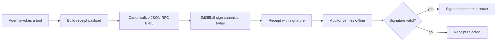
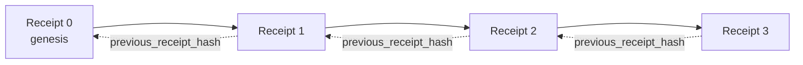

[Se lektionens video: Sikring af AI-agenter med kryptografiske kvitteringer](https://youtu.be/PLACEHOLDER_VIDEO_ID)

> _(Lektionsvideo og miniaturebillede tilføjes af Microsoft-indholdsteamet efter sammensmeltning, i overensstemmelse med mønsteret for lektion 14 / 15.)_

# Sikring af AI-agenter med kryptografiske kvitteringer

## Introduktion

Denne lektion vil dække:

- Hvorfor revisionsspor for AI-agenter er vigtige for overholdelse, fejlfinding og tillid.
- Hvad en kryptografisk kvittering er, og hvordan den adskiller sig fra en usigneret loglinje.
- Hvordan man producerer en underskrevet kvittering for en agents værktøjskald i almindelig Python.
- Hvordan man verificerer en kvittering offline og opdager manipulation.
- Hvordan man kæder kvitteringer, sådan at fjernelse eller omlægning af en enkelt bryder kæden.
- Hvad kvitteringer beviser, og hvad de udtrykkeligt ikke beviser.

## Læringsmål

Efter at have gennemført denne lektion vil du vide, hvordan du:

- Identificerer svigtformer, der motiverer kryptografisk oprindelse for agenthandlinger.
- Producerer en Ed25519-underskrevet kvittering over en kanonisk JSON-payload.
- Verificerer en kvittering uafhængigt ved kun at bruge underskriverens offentlige nøgle.
- Opdager manipulation ved at genkøre verifikationen på en modificeret kvittering.
- Bygger en hash-kædet sekvens af kvitteringer og forklarer, hvorfor kæden er vigtig.
- Genkender grænsen mellem hvad kvitteringer beviser (attribution, integritet, rækkefølge) og hvad de ikke gør (korrekthed af handlingen, gyldigheden af politikken).

## Problemet: Din agents revisionsspor

Forestil dig, at du har implementeret en AI-agent for Contoso Travel. Agenten læser kundebestillinger, kalder en fly-API for at finde muligheder og booker sæder på kundens vegne. Sidste kvartal behandlede agenten 50.000 bookinger.

I dag dukker en revisor op. De stiller et enkelt spørgsmål: "Vis mig, hvad din agent gjorde."

Du overleverer dine logfiler. Revisoren kigger på dem og stiller det sværere spørgsmål: "Hvordan ved jeg, at disse logs ikke er blevet redigeret?"

Dette er problemet med revisionssporet. De fleste agentimplementeringer i dag er afhængige af:

- **Applikationslogs**: skrevet af agenten selv, kan redigeres af alle med adgang til filsystemet.
- **Cloud-loggingtjenester**: manipulationssikrede på platformniveau, men kun hvis revisor stoler på platformoperatøren.
- **Databasetransaktionslogs**: velegnede til databaseændringer, men ikke til vilkårlige værktøjskald.

Ingen af disse kan besvare revisorens spørgsmål uden, at revisoren skal have tillid til nogen (dig, din cloud-udbyder, din databaseleverandør). Til intern brug er den tillid ofte acceptabel. For regulerede arbejdsbyrder (finans, sundhedsvæsen, alt omfattet af EU's AI-forordning) er det ikke.

Kryptografiske kvitteringer afsmalder dette problem ved at gøre en underskrevet erklæring uafhængigt verificerbar. Revisoren har stadig brug for en ekstern årsag til at have tillid til underskriftnøglen og den komponent, der producerede erklæringen. En indlejret nøgle beviser selvkonsistens, ikke udstederidentitet eller håndhævelsesplacering.


## Hvad er en kryptografisk kvittering?

En kvittering er et JSON-objekt, der registrerer, hvad en agent gjorde, underskrevet med en digital signatur.



En minimal kvittering ser sådan ud:

```json
{
  "type": "agent.tool_call.v1",
  "agent_id": "contoso-travel-bot",
  "tool_name": "lookup_flights",
  "tool_args_hash": "sha256:a3f9c1...",
  "result_hash": "sha256:7b2e1d...",
  "policy_id": "contoso-travel-policy-v3",
  "timestamp": "2026-04-25T14:30:00Z",
  "sequence": 47,
  "previous_receipt_hash": "sha256:9d4e6a...",
  "signature": {
    "alg": "EdDSA",
    "sig": "c5af83...",
    "public_key": "8f3b2c..."
  }
}
```

Tre egenskaber udfører arbejdet:

1. **Signaturen**. Kvitteringen er underskrevet af agentens gateway med en Ed25519 privatnøgle. Enhver med den tilsvarende offentlige nøgle kan verificere signaturen offline. En part, der stoler på kvitteringen, skal fastlåse denne nøgle eller opslå den i et betroet register uden for kvitteringen. Manipulation af et underskrevet felt ugyldiggør signaturen.

2. **Kanonisk kodning**. Før underskrift serialiseres kvitteringen ved hjælp af JSON Canonicalization Scheme (JCS, RFC 8785). Det sikrer, at to implementeringer, der producerer samme logiske kvittering, genererer byte-identisk output. Uden kanonisering ville forskellige JSON-serialisatorer producere forskellige signaturer for samme indhold.

3. **Hash-kædning**. Feltet `previous_receipt_hash` forbinder hver kvittering med den foregående. Fjernelse eller omlægning af en kvittering bryder den præsenterede sekvens. Opdagelse af afkortning eller en underskriverstyret omskrivning kræver også et fastlåst aktuelt kædehoved, uafhængigt bevist checkpoint eller autentificeret lukket-populationsforpligtelse.

Samlet giver disse egenskaber tre garantier:

- **Attribution til en nøgle**: denne nøgle underskrev dette indhold. Organisatorisk eller menneskelig identitet kræver en betroet nøglebinding.
- **Integritet**: indholdet har ikke ændret sig siden underskrift.
- **Rækkefølge i den verificerede sekvens**: denne kvittering forbinder til den forgående.

## Produktion af en kvittering i Python

Du behøver ikke et specielt bibliotek for at producere en kvittering. De kryptografiske primitive funktioner er bredt tilgængelige, og logikken er få dusin linjer Python.

De praktiske øvelser i `code_samples/18-signed-receipts.ipynb` gennemgår hele forløbet. Den versionsstyrede `code_samples/18-signed-receipts.execution-receipt.json` registrerer den præcise notebook-hash, Python-miljø, celleantal og tjek fra den seneste rene kørsel uden at ændre lektionens gemte output. Den forkortede version:

```python
import json
import hashlib
import base64
from nacl import signing
from jcs import canonicalize  # RFC 8785 canonical JSON

def b64url_nopad(data: bytes) -> str:
    return base64.urlsafe_b64encode(data).decode("ascii").rstrip("=")

def sha256_canonical(obj) -> str:
    """SHA-256 of a Python object's JCS-canonical JSON form."""
    return f"sha256:{hashlib.sha256(canonicalize(obj)).hexdigest()}"

# Generate or load a signing key (in production, store in a key vault)
signing_key = signing.SigningKey.generate()
verify_key = signing_key.verify_key
TRUSTED_PUBLIC_KEYS = {b64url_nopad(bytes(verify_key))}  # pinned out of band by the verifier

# Build the receipt payload (no signature yet)
tool_args = {"origin": "SYD", "destination": "LAX"}
tool_result = [{"flight": "QF11", "price": 1850, "stops": 0}]

payload = {
    "type": "agent.tool_call.v1",
    "agent_id": "contoso-travel-bot",
    "tool_name": "lookup_flights",
    "tool_args_hash": sha256_canonical(tool_args),
    "result_hash": sha256_canonical(tool_result),
    "policy_id": "contoso-travel-policy-v3",
    "timestamp": "2026-04-25T14:30:00Z",
    "sequence": 0,
    "previous_receipt_hash": None,
}

# Canonicalize and sign the JCS bytes directly. PureEdDSA hashes internally.
canonical_bytes = canonicalize(payload)
signature_bytes = signing_key.sign(canonical_bytes).signature

# Attach a structured signature object.
receipt = {
    **payload,
    "signature": {
        "alg": "EdDSA",
        "sig": b64url_nopad(signature_bytes),
        "public_key": b64url_nopad(bytes(verify_key)),
    },
}
```

Det er hele underskriftsprocessen. Øvelserne i notebooken gennemgår hvert trin.

## Verificering af en kvittering og opdagelse af manipulation

Verificering er den modvendte operation:

```python
import base64
import hashlib
from nacl import signing
from nacl.exceptions import CryptoError
from jcs import canonicalize

def b64url_decode(s: str) -> bytes:
    padding = "=" * ((4 - len(s) % 4) % 4)
    return base64.b64decode(s + padding, altchars=b"-_", validate=True)

def verify_receipt(receipt: dict, trusted_public_keys: set[str]) -> bool:
    # The signature is a structured object: {"alg", "sig", "public_key"}.
    if not isinstance(receipt, dict):
        return False
    sig_obj = receipt.get("signature")
    if not isinstance(sig_obj, dict) or sig_obj.get("alg") != "EdDSA":
        return False
    try:
        # An inline key proves only self-consistency. Trust is configured out of band.
        public_key = sig_obj.get("public_key")
        signature = sig_obj.get("sig")
        if not isinstance(public_key, str) or not isinstance(signature, str):
            return False
        if public_key not in trusted_public_keys:
            return False
        payload = {k: v for k, v in receipt.items() if k != "signature"}
        canonical_bytes = canonicalize(payload)
        verify_key = signing.VerifyKey(b64url_decode(public_key))
        verify_key.verify(canonical_bytes, b64url_decode(signature))
        return True
    except (CryptoError, TypeError, ValueError, KeyError, OverflowError):
        return False
```

Denne funktion tager en kvittering plus den betroede parts fastlåste nøglesæt og returnerer
`True` kun hvis signaturen er gyldig under en accepteret nøgle. Verificering kræver ikke
netværkskald, men tillid til nøgler er stadig en ekstern konfigurationsbeslutning.

For at se manipulation opdages i praksis gennemgår notebooken:

1. Produktion af en gyldig kvittering og bekræftelse af verifikation.
2. Ændring af en byte i `tool_args_hash`-feltet.
3. Genkørsel af verifikation og se, at den fejler.

Dette er den praktiske demonstration af, at kvitteringer er manipulationssikrede: enhver ændring, uanset hvor lille, bryder signaturen.

## Kædning af kvitteringer for multi-trins agenter

En enkelt underskrevet kvittering beskytter en handling. En kæde af kvitteringer beskytter en sekvens.



Hver kvittering registrerer hashen af den forudgående kvittering. For at fjerne kvittering 2 uden at blive opdaget, skal en angriber enten:

- Ændre kvittering 3's `previous_receipt_hash`-felt (bryder kvittering 3's signatur), ELLER
- Forfalske en ny signatur på en modificeret kvittering 3 (kræver agentens private nøgle).

Hvis den private nøgle er beskyttet og en verificerer fastlåser et uafhængigt bevist kædehoved,
kan disse angreb opdages. Det er ikke tilstrækkeligt at offentliggøre nøglen i hver kvittering:
en underskriver eller angriber kan præsentere en anden nøgle, omskrive en suffiks eller
afkorte kæden, medmindre den betroede part har et eksternt tillids- og fuldstændighedsanker.

Notebooken gennemgår:

1. Opbygning af en kæde bestående af tre kvitteringer.
2. Verificere, at hver kvitterings `previous_receipt_hash` matcher den faktiske hash af den foregående kvittering.
3. Manipulere en kvittering midt i kæden og se kæden bryde præcis der.

Sådan producerer du et revisionsspor, som en ekstern revisor kan verificere under sine
egne fastlåste udstedernøgler og kædecheckpoints, uden at skulle stole på din muterbare loglager.

## Hvad kvitteringer beviser (og hvad de ikke gør)

Dette er det vigtigste afsnit i denne lektion. Kvitteringer er kraftfulde, men deres magt er begrænset.

**Kvitteringer beviser tre ting:**

1. **Attribution**: en specifik nøgle underskrev en specifik payload.
2. **Integritet**: payloaden har ikke ændret sig siden underskrift.
3. **Rækkefølge i en præsenteret, verificeret sekvens**: denne kvittering refererer til den forgående.

**Kvitteringer beviser IKKE:**

1. **Korrekthed**: at agentens handling var den rigtige handling. En kvittering kan underskrives for et forkert svar lige så rent som for et rigtigt svar.
2. **Politikoverholdelse**: at den politik, der blev henvist til i `policy_id`, faktisk blev evalueret, eller at den ville have tilladt denne handling, hvis den blev kontrolleret. Kvitteringen registrerer, hvad der blev hævdet, ikke hvad der blev håndhævet.
3. **Identitet ud over nøgle**: kvitteringen siger "denne nøgle underskrev dette indhold." Den siger ikke "denne person godkendte dette." At forbinde en nøgle med en person eller organisation kræver separat identitetsinfrastruktur (et katalog, et offentligt nøgleregister osv.).
4. **Sandfærdighed af input**: hvis agenten modtager en manipuleret prompt og handler på den, registrerer kvitteringen handlingen troværdigt. Kvitteringer er efterfølgende validering af input, ikke en erstatning for det.
5. **Udførelse eller virkelige effekter**: en kvittering efter kald registrerer, hvad dens udsteder hævder skete. Bevis for adgang eller afstemning af ekstern effekt kræver beviser fra den faktiske udfører eller leverandørens grænse.
6. **Fuldstændighed**: en manglende kvittering kan betyde blokeret, udeladt, tabt eller ikke instrumenteret. Fravær bliver kun bevis inden for en autentificeret lukket population.
7. **Betroet tid**: et underskrevet tidsstempel beviser, at underskriveren havde den værdi, ikke at værdien var korrekt. Betroet tid kræver en separat tidsautoritet eller bevist checkpoint.

Denne grænse er vigtig af to grunde:

- Den fortæller dig, hvad kvitteringer er nyttige til: at gøre agentadfærd revisionsbar og manipulationssikker, selv på tværs af organisatoriske grænser.
- Den fortæller dig, hvilke yderligere lag du stadig har brug for: inputvalidering (Lektion 6), politi-håndhævelse (kort berørt nedenfor) og identitetsinfrastruktur (uden for denne lektions ramme).

En almindelig fejl er at antage, at "vi har kvitteringer" betyder "vi er styret." Det gør det ikke. Kvitteringer er et fundament. Styring er systemet, du bygger ovenpå.

## Binding af en godkendelsessignatur til den nøjagtige handling

Punkt 3 ovenfor fortjener sit eget afsnit: en handlingskvittering siger "denne nøgle underskrev dette indhold," aldrig "et menneske godkendte dette." For højrisikohandlinger (refusioner, sletninger, overførsler) kan en separat godkendersignatur binde den nøjagtige handling. At forbinde den nøgle til et menneske og kontrollere menneskelig tilstedeværelse er stadig separate ansvar.

Den efterfølgende notebook `code_samples/human-authorization-receipts.ipynb` tilføjer en anden type kvittering, `human.approval.v1`, i samme kuvertform som lektionens kvitteringer (en typet payload underskrevet med Ed25519 over dens kanoniske JCS-bytes, med `signature`-objektet uden for de underskrevne bytes). En godkendernøgle underskriver den **fulde kanoniske handling og dens digest**; en agentnøgle underskriver en påstand med **samme handlingsdigest** og en `parent_approval_ref`, `receipt_hash` godkendelsen, samme konvention som `previous_receipt_hash` i kæden du byggede ovenfor. Én `verify_chain` gennemgår begge artefakter under **separate fastlåste nøgleregistre** (godkendernøgler vs agentnøgler), så kodevejen deles men myndighederne aldrig gør.

Egenskaben, som dette sikrer, formuleret omhyggeligt: *den fastlåste godkendernøgle underskrev denne præcise
handling, og agentnøglen underskrev senere en erklæring med samme handlingsdigest.*
Det er nyttigt bevis, men det er ikke i sig selv bevis for, at handlingen blev udført. For at
kontrollere udførelsen skal den nøjagtige godkendelse også reserveres og forbruges én gang på
den faktiske udførelsesgrænse; ukendte udbyderresultater skal forblive ukendte fremfor
blindt at blive forsøgt igen. Notebookens afvisningsfunktioner tester kvitteringskædelaget:

- manipulation, forvirret stedfortræder, forfalskede nøgler på begge sider samt forkert input;
- **forældet autoritet**: en signatur der stadig verificeres, nægtet alligevel fordi politiversionen skiftede, godkendernøglen blev roteret ud af det fastlåste register, eller godkendelsen udløb før den angivne verifikationstid;
- **digest-substitution**: en gyldigt underskrevet handlingskvittering, der peger på en *ægte* godkendelse, som binder en *anden* kanonisk handling.

Hver fejl afvises med en særskilt grund, så en revisor, der læser en afvisning, kan afgøre om autoriteten er forældet eller den hævdede handling ændret. Verificering er skrivebeskyttet og gentagelig: den forbruger ikke godkendelsen eller kalder en udbyder. En separat udfører har brug for holdbar, atomar genspilbeskyttelse og eksplicit succes-, fejloplysninger og uafklarede resultater. Den menneskelige godkendelseskvittering er en pædagogisk sammensætning defineret af denne lektion, ikke en kvitteringstype defineret af `draft-farley-acta-signed-receipts`.

## Produktionsreferencer

Python-koden i denne lektion er bevidst minimal, så du kan læse hver linje og forstå præcis, hvad der sker. I produktion har du to muligheder:

1. **Byg direkte på de kryptografiske primitive funktioner.** De 50 linjer, du så ovenfor, er tilstrækkelige til mange anvendelsestilfælde. PyNaCl (Ed25519) og `jcs`-pakken (kanonisk JSON) er velvedligeholdte og reviderede biblioteker.

2. **Brug et produktionsklar kvitteringsbibliotek.** Flere open source-projekter implementerer samme mønster med yderligere funktioner (nøglerotation, batchverifikation, JWK Set-distribution, integration med politiske motorer):
   - Underskriftsprocessen bruger JCS og signaturscope-konventioner i et uafhængigt IETF Internet-Draft ([`draft-farley-acta-signed-receipts`](https://datatracker.ietf.org/doc/draft-farley-acta-signed-receipts/), revision 02). Denne lektions flade pædagogiske kvittering adskiller sig fra udkastets `{payload, signature}`-kuvert og præsenteres ikke som en konform implementering. Udkastet offentliggør en fælles konformitetstestpakke ([agent-governance-testvectors](https://github.com/ScopeBlind/agent-governance-testvectors)) for implementeringer, der sigter mod dets wireformatsformat.
   - Microsoft Agent Governance Toolkit komponerer kvitteringer med Cedar-baserede beslutninger; se Tutorial 33 i det depot for et end-to-end eksempel.
   - `protect-mcp` (npm) og `@veritasacta/verify` (npm) pakkerne tilbyder en Node-baseret implementering af kvitteringssignering og offline verifikation, beregnet til at omslutte enhver MCP-server med et manipulationssikkert revisionsspor, inklusive et afventet samunderskriftsflow, hvor en pauset handling udsender en godkendelseskvittering bundet til handlingsdigestet (WebAuthn-understøttet i desktop-flowet), det samme godkendelseskvitteringsmønster som den menneskelige autorisationsnotebook ovenfor.
   - Den **[nobulex](https://github.com/arian-gogani/nobulex)** Python SDK (`pip install nobulex`) leverer det samme Ed25519 + JCS signeringsmønster i Python med LangChain og CrewAI integrationer, inklusive publicerede krydsvaliderings testvektorer og en overholdelseskortlægning bidraget via [OWASP PR #2210](https://github.com/OWASP/CheatSheetSeries/pull/2210).
   - **[EMILIA Protocol](https://github.com/emiliaprotocol/emilia-protocol)** leverer et supplerende lag til håndhævelse af præcis handling: offline-verificerbare godkendelsesmodtagelser, fastlåst WebAuthn eller kvorum autoritet, engangsforbrug ved eksekutorkanten og en eksplicit sti for uafklaret udfald. Dens rammeadaptere behandler en modtagelse som nødvendigt bevis snarere end bevis på, at en ekstern effekt fandt sted.

Beslutningen mellem at udvikle eget og bruge et bibliotek tilsvarer valget mellem at skrive dit eget JWT-bibliotek og bruge et testet: begge er rimelige; biblioteket sparer tid og reducerer revisionsfladen; fra-skratch-tilgangen tvinger dig til at forstå hver primitiv. Denne lektion lærer fra-skratch-tilgangen, så du har grundlaget for begge valg.

## Videnskontrol

Test din forståelse før du går videre til praksisøvelsen.

**1. En modtagelse er underskrevet med agentens private Ed25519-nøgle. Revisoren har kun den offentlige nøgle. Kan revisor verificere modtagelsen offline?**

<details>
<summary>Svar</summary>

Ja, kryptografisk verifikation kræver kun den offentlige nøgle og de underskrevne bytes. 
Revisoren skal stadig uafhængigt opnå og fastlåse den accepterede offentlige nøgle uden for modtagelsen.
Der kræves ikke netværkskald efter denne tillidskonfiguration er etableret.
</details>

**2. En angriber ændrer `policy_id` feltet i en modtagelse for at hævde, at den var underlagt en mere tilladende politik. Signaturen var over den originale payload. Hvad sker der under verifikationen?**

<details>
<summary>Svar</summary>

Verifikationen mislykkes. Signaturen blev beregnet over de kanoniske bytes af den originale payload; ændring af et hvilket som helst felt ændrer disse bytes, hvilket gør signaturen ugyldig. Angriberen ville have brug for den private nøgle til at lave en ny gyldig signatur, hvilket de ikke har.
</details>

**3. Hvorfor inkluderer modtagelsen en `tool_args_hash` og `result_hash` i stedet for de rå argumenter og resultat?**

<details>
<summary>Svar</summary>

To grunde. Først kan modtagelsen have brug for at blive arkiveret eller overført i miljøer, hvor lækage af råt indhold (PII, forretningsdata) er et problem. Hashing holder modtagelsen lille og indholdet privat; revisoren verificerer, at hashen matcher en separat opbevaret kopi af det faktiske indhold. For det andet har hashes en fast størrelse; en modtagelse med hashes er begrænset i størrelse uanset hvor store input og output var.
</details>

**4. `previous_receipt_hash` feltet forbinder hver modtagelse med sin forgænger. Hvis en angriber stille og roligt sletter en modtagelse midt i en kæde, hvad bliver ugyldigt?**

<details>
<summary>Svar</summary>

Den næste præsenterede modtagelse linker ikke længere til sin forventede forgænger, så verifikationen
af den fremlagte sekvens fejler fra hullet og fremad. Hvis signatøren kontrollerer den private
nøgle, kan den omskrive eller forkorte en suffiks. At opdage det kræver en fastlåst aktuel hoved,
ekstern checkpoint eller autentificeret befolkningsforpligtelse.
</details>

**5. En modtagelse verificeres rent. Beviser det, at agentens handling var korrekt, vellykket eller i overensstemmelse med politikken?**

<details>
<summary>Svar</summary>

Nej. Under en fastlåst nøgle og kædekontekst beviser en gyldig modtagelse signaturtilskrivning,
indholds integritet og et link til den fremlagte forgænger. Den BEVISER IKKE at
handlingen var korrekt eller udført, at politikken blev evalueret, at tidsstemplet er
pålideligt, eller at datasættet er fuldstændigt. Dette er den vigtigste grænse i lektionen.
</details>

## Praksisøvelse

Åbn `code_samples/18-signed-receipts.ipynb` og udfyld alle fire sektioner:

1. **Sektion 1**: Underskriv din første modtagelse og verificer den.
2. **Sektion 2**: Manipulér modtagelsen og observer verifikationsfejl.
3. **Sektion 3**: Byg en tre-modtagelses kæde og verificer kædens integritet.
4. **Sektion 4**: Anvend mønsteret på en agent bygget med Microsoft Agent Framework: pak et værktøjsopkald ind i modtagelses-signering, og verificer derefter modtagelsen uafhængigt.

**Udvidelsesudfordring 1:** udvid modtagelsesskemaet med et ekstra felt efter eget valg (for eksempel et forespørgsels-ID til sporing), opdatér den kanoniske signeringslogik til at inkludere det, og bekræft at modtagelsen stadig kan rundsendes gennem verifikation. Ændr derefter feltet efter signeringen og bekræft at verifikationen fejler. Dette tvinger dig til at forstå, hvordan hver byte af den kanoniske kodning bidrager til signaturen.

**Udvidelsesudfordring 2:** SHA-256-hash to af dine modtagelser sammen (kæd deres kanoniske bytes i en deterministisk rækkefølge) og indlejre den resulterende digest som et nyt felt på en tredje modtagelse før signering. Verificer, at alle tre modtagelser stadig kan rundsendes. Du har netop bygget et en-trins inklusionsbevis: enhver, der har den tredje modtagelse, kan bevise, at de første to eksisterede på tidspunktet for signeringen uden at skulle afsløre deres indhold. Dette er mønsteret, som selektive afsløringsmodtagelser bruger i stor skala (Merkle-forpligtelser, RFC 6962).

## Konklusion

Kryptografiske modtagelser giver AI-agenter et revisionsspor, der er:

- **Uafhængigt verificerbart under fastlåst tillid**: en part med accepterede offentlige nøgler og underskrevne bytes kan verificere uden tjenesteafhængighed.
- **Manipulationssikkert**: enhver ændring ugyldiggør signaturen.
- **Transportabelt**: en modtagelse er en lille JSON-fil; den kan arkiveres, overføres og verificeres hvor som helst.
- **Standard-aligneret**: bygget på Ed25519 (RFC 8032), JCS (RFC 8785) og SHA-256, alle bredt udbredte primitiv.

De er ikke en erstatning for inputvalidering, håndhævelse af politik, eksekutorpåtegning,
resultatbevis, fuldstændighedskontrol eller identitetsinfrastruktur. De er et fundament
for disse lag. I regulerede eller multi-organisations arbejdsgange gør modtagelser specifikke
udstederaftaler uafhængigt kontrollerbare under revisorens egen tillidskonfiguration.

Det vigtigste takeaway: modtagelser beviser, at en bestemt nøgle har underskrevet bestemt
indhold. Et medbragt tidsstempel er en underskrivers påstand, medmindre den er tidsattesteret separat. En
modtagelse beviser ikke, at dens indhold var sandt, at en handling blev udført, eller at
datasættet er komplet. Hold disse distinktioner stramt.

## Produktionscheckliste

Når du er klar til at gå videre fra denne lektion til at implementere modtagelses-underskrevne agenter i et reelt miljø:

- [ ] **Flyt signeringsnøglen væk fra udviklerens laptop.** Brug Azure Key Vault, AWS KMS eller en hardware-sikkerhedsmodul. Den private nøgle som underskriver dine modtagelser må aldrig gemmes i versionskontrol eller i klartekst på applikationsmaskiner.
- [ ] **Etabler verifieringsnøgle tillid.** Publicer nøgler via et JWK-set eller register, og lad derefter afhængige parter fastlåse den accepterede udsteders identitet, nøglesæt og rotationspolitik uden for individuelle modtagelser. En indlejret nøgle alene er ikke et tillidsanker.
- [ ] **Fastlås kæden eksternt.** Skriv periodisk den seneste kædehoved-hash til en gennemsigtighedslog (Sigstore Rekor, RFC 3161 tidsstempel autoritet, eller et andet internt system), så en ekstern part kan bekræfte "denne kæde eksisterede på dette tidspunkt."
- [ ] **Opbevar modtagelser uforanderligt.** Append-only blob storage (Azure Storage med uforanderlighedspolitikker, AWS S3 Object Lock) forhindrer indsidere i at omskrive historik på lagringslaget.
- [ ] **Beslut om opbevaring.** Mange overholdelsesregimer kræver flers års opbevaring. Planlæg til vækst i modtagelser (hver modtagelse er ~500 bytes; en agent der laver 10K kald pr. dag producerer ~1.8 GB pr. år).
- [ ] **Dokumentér hvad modtagelser ikke dækker.** Modtagelser beviser tilskrivning, integritet og rækkefølge. Din kørebog bør eksplicit liste, hvilke yderligere kontroller (inputvalidering, politikhåndhævelse, begrænsning af ringhastighed, identitetsinfrastruktur) der ligger sammen med modtagelser i din governance-tilgang.

### Har du flere spørgsmål om sikring af AI-agenter?

Deltag i [Microsoft Foundry Discord](https://aka.ms/ai-agents/discord) for at mødes med andre lærende, deltage i kontortid og få svar på dine spørgsmål om AI-agenter.

## Ud over denne lektion

Denne lektion dækker enkelt-modtagelses signering og hash-kædede sekvenser. De samme primitiv sammensætter flere mere avancerede mønstre, du kan støde på, efterhånden som din governance-tilgang modnes:

- **Selektiv afsløring.** Når en modtagelses felter er uafhængigt forpligtet (RFC 6962-stil Merkle-træ), kan du afsløre specifikke felter til specifikke revisorer og bevise, at resten er uændret uden at eksponere dem. Nyttigt når den samme modtagelse skal opfylde både en omfattende revision (som ønsker fuldstændighed) og dataminimeringsregler som GDPR (som ønsker, at revisor ser så lidt som nødvendigt).
- **Modtagelses tilbagekaldelse.** Hvis en signeringsnøgle kompromitteres, har du brug for en måde at markere alle modtagelser underskrevet af den nøgle som utroværdige fremadrettet fra et tidspunkt. Standardmønstre: kortlivede signeringsnøgler plus en offentliggjort tilbagekaldelsesliste, eller en gennemsigtighedslog med tilbagekaldelsesposter.
- **Bilaterale / split-signatur modtagelser.** Nogle implementeringer opdeler den signerede payload i forud-udførelses (`authorization_*`) og efter-udførelses (`result_*`) halvdele med uafhængige signaturer, nyttigt når autorisationsbeslutningen og det observerede resultat produceres af forskellige aktører eller på forskellige tidspunkter. Dette lægges additivt oven på modtagelsesformatet, der undervises i denne lektion.
- **Payload composition.** En modtagelse forsegler præcis de bytes, du lægger i `result_hash`. Virkelighedens payloads er ofte rigere end et enkelt værktøjsopkalds resultat: forud-beslutnings ræsonnement (modelprædiction, overvejede muligheder, bevismateriale og dets fuldstændighed, risikoposition, ansvarskæde, gate-udfald) kan alle leve inde i payloaden, forseglet af en enkelt modtagelse. Dette holder modtagelsesformatet minimalt samtidig med at tillade payload-skjemaer at udvikle sig domæne-for-domæne.
- **Krydsimplementerings overensstemmelse.** Flere uafhængige implementeringer af det samme modtagelsesformat (Python, TypeScript, Rust, Go) krydsverificerer mod fælles testvektorer. Hvis du bygger din egen implementering, bekræfter validering mod publicerede vektorer ledningskompatibilitet.
- **Post-kvante migration.** Ed25519 er bredt udbredt i dag, men er ikke kvante-resistent. En `alg` label alene er ikke migration: en profil skal definere ML-DSA nøglekodning, kanoniske underskrevne bytes, verifikation, policy for den pågældende part, nedsænkning modstand og overgangssemantik. Planlæg og test en dual-signatur overgang mod delte vektorer før du fremsætter kompatibilitetskrav.

## Yderligere ressourcer

- <a href="https://datatracker.ietf.org/doc/draft-farley-acta-signed-receipts/" target="_blank">IETF Internet-Draft: Signed Decision Receipts for Machine-to-Machine Access Control</a>
- <a href="https://learn.microsoft.com/azure/ai-studio/responsible-use-of-ai-overview" target="_blank">Responsible AI oversigt (Azure AI)</a>
- <a href="https://datatracker.ietf.org/doc/html/rfc8032" target="_blank">RFC 8032: Edwards-Curve Digital Signature Algorithm (EdDSA)</a>
- <a href="https://datatracker.ietf.org/doc/html/rfc8785" target="_blank">RFC 8785: JSON Canonicalization Scheme (JCS)</a>
- <a href="https://datatracker.ietf.org/doc/html/rfc6962" target="_blank">RFC 6962: Certificate Transparency</a> (Merkle-træ konstruktion brugt af selektive-afsløringsmodtagelser)
- <a href="https://github.com/microsoft/agent-governance-toolkit/blob/main/docs/tutorials/33-offline-verifiable-receipts.md" target="_blank">Microsoft Agent Governance Toolkit, Tutorial 33: Offline-Verifiable Decision Receipts</a>
- <a href="https://github.com/ScopeBlind/agent-governance-testvectors" target="_blank">Cross-implementation overensstemmelsestestvektorer</a> for det modtagelsesformat brugt i denne lektion (Apache-2.0)
- <a href="https://pynacl.readthedocs.io/" target="_blank">PyNaCl dokumentation</a> (Ed25519 i Python)

## Forrige lektion

[Oprettelse af lokale AI-agenter](../17-creating-local-ai-agents/README.md)

---

<!-- CO-OP TRANSLATOR DISCLAIMER START -->
**Ansvarsfraskrivelse**:
Dette dokument er blevet oversat ved hjælp af AI-oversættelsestjenesten [Co-op Translator](https://github.com/Azure/co-op-translator). Selvom vi bestræber os på nøjagtighed, skal du være opmærksom på, at automatiserede oversættelser kan indeholde fejl eller unøjagtigheder. Det originale dokument på dets oprindelige sprog bør betragtes som den autoritative kilde. For kritisk information anbefales professionel menneskelig oversættelse. Vi påtager os intet ansvar for misforståelser eller fejltolkninger, der opstår som følge af brugen af denne oversættelse.
<!-- CO-OP TRANSLATOR DISCLAIMER END -->