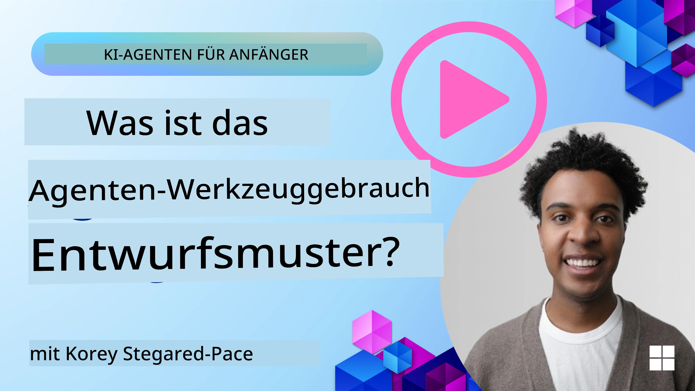
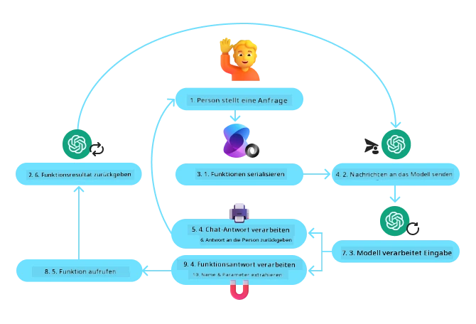
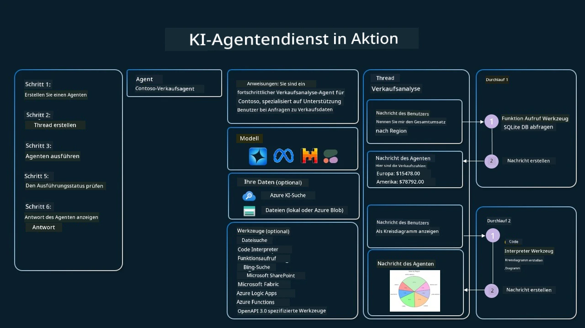

[](https://youtu.be/vieRiPRx-gI?si=cEZ8ApnT6Sus9rhn)

> _(Klicken Sie auf das obige Bild, um das Video zu dieser Lektion anzusehen)_

# Designmuster für Werkzeugnutzung

Werkzeuge sind interessant, weil sie KI-Agenten eine breitere Palette von Fähigkeiten ermöglichen. Anstatt dass der Agent nur eine begrenzte Anzahl von Aktionen ausführen kann, kann er durch Hinzufügen eines Werkzeugs nun eine Vielzahl von Aktionen durchführen. In diesem Kapitel betrachten wir das Designmuster für Werkzeugnutzung, das beschreibt, wie KI-Agenten bestimmte Werkzeuge nutzen können, um ihre Ziele zu erreichen.

## Einführung

In dieser Lektion möchten wir die folgenden Fragen beantworten:

- Was ist das Designmuster für Werkzeugnutzung?
- Für welche Anwendungsfälle kann es eingesetzt werden?
- Welche Elemente/Bausteine werden benötigt, um das Designmuster zu implementieren?
- Welche besonderen Überlegungen gibt es beim Einsatz des Designmusters für Werkzeugnutzung zum Aufbau vertrauenswürdiger KI-Agenten?

## Lernziele

Nach Abschluss dieser Lektion werden Sie in der Lage sein:

- Das Designmuster für Werkzeugnutzung und seinen Zweck zu definieren.
- Anwendungsfälle zu identifizieren, bei denen das Designmuster anwendbar ist.
- Die Schlüsselaspekte zu verstehen, die zur Implementierung des Designmusters erforderlich sind.
- Überlegungen zu erkennen, die zur Sicherstellung der Vertrauenswürdigkeit von KI-Agenten mit diesem Designmuster beachtet werden müssen.

## Was ist das Designmuster für Werkzeugnutzung?

Das **Designmuster für Werkzeugnutzung** konzentriert sich darauf, LLMs die Fähigkeit zu geben, mit externen Werkzeugen zu interagieren, um spezifische Ziele zu erreichen. Werkzeuge sind Code, der von einem Agenten ausgeführt werden kann, um Aktionen durchzuführen. Ein Werkzeug kann eine einfache Funktion wie ein Taschenrechner sein oder ein API-Aufruf zu einem Drittanbieterdienst, wie zum Beispiel eine Abfrage des Aktienkurses oder einer Wettervorhersage. Im Kontext von KI-Agenten sind Werkzeuge so konzipiert, dass sie als Antwort auf **modellgenerierte Funktionsaufrufe** ausgeführt werden.

## Für welche Anwendungsfälle kann es eingesetzt werden?

KI-Agenten können Werkzeuge nutzen, um komplexe Aufgaben zu erledigen, Informationen abzurufen oder Entscheidungen zu treffen. Das Designmuster für Werkzeugnutzung wird häufig in Szenarien verwendet, die eine dynamische Interaktion mit externen Systemen erfordern, wie Datenbanken, Webdienste oder Code-Interpreter. Diese Fähigkeit ist für verschiedene Anwendungsfälle nützlich, darunter:

- **Dynamische Informationsbeschaffung:** Agenten können externe APIs oder Datenbanken abfragen, um aktuelle Daten zu erhalten (z.B. Abfragen einer SQLite-Datenbank für Datenanalysen, Abrufen von Aktienkursen oder Wetterinformationen).
- **Code-Ausführung und Interpretation:** Agenten können Code oder Skripte ausführen, um mathematische Probleme zu lösen, Berichte zu erzeugen oder Simulationen durchzuführen.
- **Workflow-Automatisierung:** Automatisierung von sich wiederholenden oder mehrstufigen Arbeitsabläufen durch die Integration von Werkzeugen wie Aufgabenplanern, E-Mail-Diensten oder Datenpipelines.
- **Kundensupport:** Agenten können mit CRM-Systemen, Ticketplattformen oder Wissensdatenbanken interagieren, um Nutzeranfragen zu lösen.
- **Inhaltserstellung und -bearbeitung:** Agenten können Werkzeuge wie Grammatikprüfer, Textzusammenfasser oder Content-Sicherheitsprüfer nutzen, um bei der Inhaltserstellung zu unterstützen.

## Welche Elemente/Bausteine werden benötigt, um das Designmuster für Werkzeugnutzung zu implementieren?

Diese Bausteine ermöglichen dem KI-Agenten eine breite Palette von Aufgaben auszuführen. Betrachten wir die zentralen Elemente, die zur Implementierung des Designmusters für Werkzeugnutzung nötig sind:

- **Funktions-/Werkzeugschemata**: Detaillierte Definitionen verfügbarer Werkzeuge, einschließlich Funktionsname, Zweck, erforderliche Parameter und erwartete Ausgaben. Diese Schemata ermöglichen es dem LLM zu verstehen, welche Werkzeuge verfügbar sind und wie gültige Anfragen konstruiert werden.

- **Logik zur Funktionausführung**: Bestimmt, wie und wann Werkzeuge basierend auf der Nutzerabsicht und dem Gesprächskontext aufgerufen werden. Dies kann Planungsmodule, Routing-Mechanismen oder bedingte Abläufe umfassen, die die Werkzeugnutzung dynamisch steuern.

- **Nachrichtenverwaltungssystem**: Komponenten, die den Gesprächsfluss zwischen Nutzereingaben, LLM-Antworten, Werkzeugaufrufen und Werkzeugausgaben steuern.

- **Werkzeugintegrationsframework**: Infrastruktur, die den Agenten mit verschiedenen Werkzeugen verbindet, sei es einfache Funktionen oder komplexe externe Dienste.

- **Fehlerbehandlung & Validierung**: Mechanismen zur Handhabung von Fehlern bei der Werkzeugausführung, Validierung von Parametern und Umgang mit unerwarteten Antworten.

- **Zustandsverwaltung**: Verfolgt den Gesprächskontext, vorherige Werkzeuginteraktionen und persistente Daten, um Konsistenz über mehrstufige Interaktionen hinweg zu gewährleisten.

Im Folgenden betrachten wir den Funktions-/Werkzeugaufruf im Detail.
 
### Funktions-/Werkzeugaufruf

Funktionsaufrufe sind der Hauptweg, wie wir Large Language Models (LLMs) ermöglichen, mit Werkzeugen zu interagieren. Oft sieht man 'Funktion' und 'Werkzeug' synonym verwendet, weil 'Funktionen' (wiederverwendbare Codeblöcke) die 'Werkzeuge' sind, die Agenten zur Erledigung von Aufgaben verwenden. Damit der Code einer Funktion aufgerufen werden kann, muss das LLM die Nutzeranfrage mit der Funktionsbeschreibung abgleichen. Dazu wird ein Schema mit den Beschreibungen aller verfügbaren Funktionen an das LLM gesendet. Das LLM wählt daraufhin die am besten geeignete Funktion für die Aufgabe aus und liefert deren Namen und Argumente zurück. Die ausgewählte Funktion wird ausgeführt, deren Antwort an das LLM zurückgesendet, das die Informationen nutzt, um auf die Nutzeranfrage zu antworten.

Damit Entwickler Funktionsaufrufe für Agenten implementieren können, benötigen Sie:

1. Ein LLM-Modell, das Funktionsaufrufe unterstützt
2. Ein Schema mit Funktionsbeschreibungen
3. Den Code für jede beschriebene Funktion

Nutzen wir das Beispiel, um die aktuelle Uhrzeit in einer Stadt zu erhalten:

1. **Initialisieren Sie ein LLM, das Funktionsaufrufe unterstützt:**

    Nicht alle Modelle unterstützen Funktionsaufrufe, daher ist es wichtig zu prüfen, ob Ihr LLM dies tut.     <a href="https://learn.microsoft.com/azure/ai-services/openai/how-to/function-calling" target="_blank">Azure OpenAI</a> unterstützt Funktionsaufrufe. Wir können damit beginnen, den OpenAI-Client gegen die Azure OpenAI **Responses API** zu starten (den stabilen `/openai/v1/` Endpunkt — kein `api_version` benötigt). 

    ```python
    # Initialize the OpenAI client for Azure OpenAI (Responses API, v1 endpoint)
    client = OpenAI(
        base_url=f"{os.environ['AZURE_OPENAI_ENDPOINT'].rstrip('/')}/openai/v1/",
        api_key=os.environ["AZURE_OPENAI_API_KEY"],
    )
    deployment_name = os.environ["AZURE_OPENAI_DEPLOYMENT"]
    ```

1. **Erstellen Sie ein Funktionsschema**:

    Als nächstes definieren wir ein JSON-Schema, das den Funktionsnamen, eine Beschreibung dessen, was die Funktion tut, sowie Namen und Beschreibungen der Funktionsparameter enthält.
    Wir werden dieses Schema zusammen mit der Nutzeranfrage zur Uhrzeit in San Francisco an den zuvor erstellten Client übergeben. Wichtig zu beachten ist, dass ein **Werkzeugaufruf**, nicht die endgültige Antwort auf die Frage, zurückgegeben wird. Wie zuvor erwähnt, liefert das LLM den Namen der für die Aufgabe ausgewählten Funktion und die an sie übergebenen Argumente.

    ```python
    # Function description for the model to read (Responses API flat tool format)
    tools = [
        {
            "type": "function",
            "name": "get_current_time",
            "description": "Get the current time in a given location",
            "parameters": {
                "type": "object",
                "properties": {
                    "location": {
                        "type": "string",
                        "description": "The city name, e.g. San Francisco",
                    },
                },
                "required": ["location"],
            },
        }
    ]
    ```
   
    ```python
  
    # Initial user message
    messages = [{"role": "user", "content": "What's the current time in San Francisco"}]

    # First API call: Ask the model to use the function
    response = client.responses.create(
        model=deployment_name,
        input=messages,
        tools=tools,
        tool_choice="auto",
        store=False,
    )

    # The Responses API returns tool calls as function_call items in response.output.
    # Append them to the conversation so the model has full context on the next turn.
    messages += response.output

    print("Model's response:")
    print(response.output)
  
    ```

    ```bash
    Model's response:
    [ResponseFunctionToolCall(arguments='{"location":"San Francisco"}', call_id='call_pOsKdUlqvdyttYB67MOj434b', name='get_current_time', type='function_call')]
    ```
  
1. **Der Code der Funktion, der die Aufgabe ausführt:**

    Nachdem das LLM entschieden hat, welche Funktion ausgeführt werden muss, ist der Code zu implementieren und auszuführen, der die Aufgabe erledigt.
    Wir können den Code in Python schreiben, um die aktuelle Zeit zu erhalten. Außerdem müssen wir den Code schreiben, der den Funktionsnamen und die Argumente aus der Antwortnachricht extrahiert, um das endgültige Ergebnis zu erhalten.

    ```python
      def get_current_time(location):
        """Get the current time for a given location"""
        print(f"get_current_time called with location: {location}")  
        location_lower = location.lower()
        
        for key, timezone in TIMEZONE_DATA.items():
            if key in location_lower:
                print(f"Timezone found for {key}")  
                current_time = datetime.now(ZoneInfo(timezone)).strftime("%I:%M %p")
                return json.dumps({
                    "location": location,
                    "current_time": current_time
                })
      
        print(f"No timezone data found for {location_lower}")  
        return json.dumps({"location": location, "current_time": "unknown"})
    ```

     ```python
    # Handle function calls
    tool_calls = [item for item in response.output if item.type == "function_call"]
    if tool_calls:
        for tool_call in tool_calls:
            if tool_call.name == "get_current_time":

                function_args = json.loads(tool_call.arguments)

                time_response = get_current_time(
                    location=function_args.get("location")
                )

                # Return the tool result as a function_call_output item
                messages.append({
                    "type": "function_call_output",
                    "call_id": tool_call.call_id,
                    "output": time_response,
                })
    else:
        print("No tool calls were made by the model.")

    # Second API call: Get the final response from the model
    final_response = client.responses.create(
        model=deployment_name,
        input=messages,
        tools=tools,
        store=False,
    )

    return final_response.output_text
     ```

     ```bash
      get_current_time called with location: San Francisco
      Timezone found for san francisco
      The current time in San Francisco is 09:24 AM.
     ```

Funktionsaufrufe sind das Herzstück der meisten, wenn nicht aller, Designs für Werkzeugnutzung bei Agenten, ihre Implementierung kann jedoch manchmal herausfordernd sein.
Wie wir in [Lektion 2](../../../02-explore-agentic-frameworks) gelernt haben, bieten agentische Frameworks vorgefertigte Bausteine zur Implementierung von Werkzeugnutzung.
 
## Beispiele für Werkzeugnutzung mit agentischen Frameworks

Hier einige Beispiele, wie Sie das Designmuster für Werkzeugnutzung mit verschiedenen agentischen Frameworks umsetzen können:

### Microsoft Agent Framework

<a href="https://learn.microsoft.com/azure/ai-services/agents/overview" target="_blank">Microsoft Agent Framework</a> ist ein Open-Source-KI-Framework zum Aufbau von KI-Agenten. Es vereinfacht die Nutzung von Funktionsaufrufen, indem es Ihnen erlaubt, Werkzeuge als Python-Funktionen mit dem `@tool` Dekorator zu definieren. Das Framework übernimmt die Kommunikation zwischen dem Modell und Ihrem Code. Es stellt auch vorgefertigte Werkzeuge wie die Dateisuche und den Code Interpreter über `FoundryChatClient` bereit.

Das folgende Diagramm zeigt den Prozess der Funktionsaufrufe mit dem Microsoft Agent Framework:



Im Microsoft Agent Framework werden Werkzeuge als dekorierte Funktionen definiert. Wir können die zuvor gezeigte `get_current_time` Funktion in ein Werkzeug umwandeln, indem wir den `@tool` Dekorator verwenden. Das Framework serialisiert die Funktion und ihre Parameter automatisch und erstellt das Schema, das an das LLM gesendet wird.

```python
import os
from agent_framework import tool
from agent_framework.foundry import FoundryChatClient
from azure.identity import AzureCliCredential

@tool(approval_mode="never_require")
def get_current_time(location: str) -> str:
    """Get the current time for a given location"""
    ...

# Create the client
provider = FoundryChatClient(
    project_endpoint=os.environ["AZURE_AI_PROJECT_ENDPOINT"],
    model=os.environ["AZURE_AI_MODEL_DEPLOYMENT_NAME"],
    credential=AzureCliCredential(),
)

# Create an agent and run with the tool
agent = provider.as_agent(name="TimeAgent", instructions="Use available tools to answer questions.", tools=get_current_time)
response = await agent.run("What time is it?")
```

#### Werkzeuge von einem MCP-Server

Werkzeuge müssen keine Funktionen in Ihrem eigenen Code sein. Ein Server, der das Model Context Protocol (MCP, behandelt in [Lektion 11](../11-agentic-protocols/README.md)) spricht, veröffentlicht seine Werkzeuge zusammen mit deren Schemata, und das Framework kann diese laden, als ob es eine dekorierte Funktion serialisiert. `MCPStreamableHTTPTool` verbindet sich über HTTP mit einem solchen Server, liest die Werkzeugschemata und bietet sie dem Modell neben lokalen Werkzeugen an.

Das folgende Beispiel nutzt den Websuche-Server von <a href="https://keenable.ai" target="_blank">Keenable</a>. Er ist kostenlos nutzbar ohne Konto oder API-Schlüssel (Anfragen werden pro IP limitiert), sodass Sie nur die Zugangsdaten für Ihr Modell benötigen. Wie bei jedem externen Werkzeug werden die vom Modell geschriebenen Anfragen an diesen Server gesendet.

```python
from agent_framework import MCPStreamableHTTPTool

web_search = MCPStreamableHTTPTool(
    name="Keenable web search",
    url="https://api.keenable.ai/mcp",
)

# Connecting loads the server's tool schemas; the agent decides when to call them
async with web_search:
    agent = provider.as_agent(
        name="ResearchAgent",
        instructions="Use available tools to answer questions.",
        tools=[web_search],
    )
    response = await agent.run("What is new in the latest Python release?")
    print(response.text)
```

Der Server veröffentlicht zwei Werkzeuge, `search_web_pages` und `fetch_page_content`. Wenn aktuelle Informationen benötigt werden, ruft das Modell `search_web_pages` auf, erhält Titel, URLs und Textausschnitte zurück und schreibt seine Antwort daraus, ähnlich der Schleife im `get_current_time` Beispiel oben.
  
### Microsoft Foundry Agent Service

<a href="https://learn.microsoft.com/azure/ai-services/agents/overview" target="_blank">Microsoft Foundry Agent Service</a> ist ein neueres agentisches Framework, das Entwicklern ermöglicht, sicher und erweiterbar hochwertige KI-Agenten zu bauen, bereitzustellen und zu skalieren, ohne die zugrunde liegenden Rechen- und Speicherressourcen verwalten zu müssen. Es ist besonders für Unternehmensanwendungen nützlich, da es ein vollständig verwalteter Service mit Sicherheitsstandards auf Unternehmensebene ist.

Im Vergleich zur direkten Entwicklung mit der LLM-API bietet der Microsoft Foundry Agent Service einige Vorteile, einschließlich:

- Automatische Werkzeugaufrufe – es ist nicht mehr nötig, Werkzeugaufrufe zu parsen, das Werkzeug auszuführen und die Antworten zu handhaben; dies geschieht alles serverseitig
- Sicher verwaltete Daten – anstelle der Verwaltung des eigenen Gesprächszustands können Threads verwendet werden, um alle benötigten Informationen zu speichern
- Fertige Werkzeuge – Werkzeuge zur Interaktion mit Ihren Datenquellen, wie Bing, Azure AI Search und Azure Functions.

Die im Microsoft Foundry Agent Service verfügbaren Werkzeuge lassen sich in zwei Kategorien einteilen:

1. Wissenswerkzeuge:
    - <a href="https://learn.microsoft.com/azure/ai-services/agents/how-to/tools/bing-grounding?tabs=python&pivots=overview" target="_blank">Grundlagen mit Bing Search</a>
    - <a href="https://learn.microsoft.com/azure/ai-services/agents/how-to/tools/file-search?tabs=python&pivots=overview" target="_blank">Dateisuche</a>
    - <a href="https://learn.microsoft.com/azure/ai-services/agents/how-to/tools/azure-ai-search?tabs=azurecli%2Cpython&pivots=overview-azure-ai-search" target="_blank">Azure AI Search</a>

2. Aktion-Werkzeuge:
    - <a href="https://learn.microsoft.com/azure/ai-services/agents/how-to/tools/function-calling?tabs=python&pivots=overview" target="_blank">Funktionsaufrufe</a>
    - <a href="https://learn.microsoft.com/azure/ai-services/agents/how-to/tools/code-interpreter?tabs=python&pivots=overview" target="_blank">Code Interpreter</a>
    - <a href="https://learn.microsoft.com/azure/ai-services/agents/how-to/tools/openapi-spec?tabs=python&pivots=overview" target="_blank">OpenAPI-definierte Werkzeuge</a>
    - <a href="https://learn.microsoft.com/azure/ai-services/agents/how-to/tools/azure-functions?pivots=overview" target="_blank">Azure Functions</a>

Der Agent Service ermöglicht uns, diese Werkzeuge zusammen als `toolset` zu verwenden. Er nutzt auch `threads`, welche den Nachrichtenverlauf eines bestimmten Gesprächs verfolgen.

Stellen Sie sich vor, Sie sind Vertriebsmitarbeiter bei einer Firma namens Contoso. Sie möchten einen Gesprächsagenten entwickeln, der Fragen zu Ihren Vertriebsdaten beantworten kann.

Das folgende Bild zeigt, wie Sie Microsoft Foundry Agent Service zur Analyse Ihrer Vertriebsdaten nutzen könnten:



Um eines dieser Werkzeuge mit dem Service zu nutzen, können wir einen Client erstellen und ein Werkzeug oder Werkzeugset definieren. Für die praktische Umsetzung können wir den folgenden Python-Code verwenden. Das LLM kann dann das Werkzeugset analysieren und je nach Nutzeranfrage entscheiden, ob die benutzerdefinierte Funktion `fetch_sales_data_using_sqlite_query` oder der vorgefertigte Code Interpreter verwendet wird.

```python 
import os
from azure.ai.projects import AIProjectClient
from azure.identity import DefaultAzureCredential
from fetch_sales_data_functions import fetch_sales_data_using_sqlite_query # fetch_sales_data_using_sqlite_query function which can be found in a fetch_sales_data_functions.py file.
from azure.ai.projects.models import ToolSet, FunctionTool, CodeInterpreterTool

project_client = AIProjectClient.from_connection_string(
    credential=DefaultAzureCredential(),
    conn_str=os.environ["PROJECT_CONNECTION_STRING"],
)

# Initialize toolset
toolset = ToolSet()

# Initialize function calling agent with the fetch_sales_data_using_sqlite_query function and adding it to the toolset
fetch_data_function = FunctionTool(fetch_sales_data_using_sqlite_query)
toolset.add(fetch_data_function)

# Initialize Code Interpreter tool and adding it to the toolset. 
code_interpreter = CodeInterpreterTool()toolset.add(code_interpreter)

agent = project_client.agents.create_agent(
    model="gpt-5-mini", name="my-agent", instructions="You are helpful agent", 
    toolset=toolset
)
```

## Welche besonderen Überlegungen gibt es beim Einsatz des Designmusters für Werkzeugnutzung zum Aufbau vertrauenswürdiger KI-Agenten?

Ein häufiges Anliegen bei von LLMs dynamisch generiertem SQL ist die Sicherheit, insbesondere das Risiko von SQL-Injektionen oder böswilligen Aktionen wie das Löschen oder Manipulieren der Datenbank. Obwohl diese Bedenken berechtigt sind, können sie durch richtig konfigurierte Datenbankzugriffsrechte effektiv gemindert werden. Für die meisten Datenbanken bedeutet dies, die Datenbank als schreibgeschützt zu konfigurieren. Für Datenbankdienste wie PostgreSQL oder Azure SQL sollte die App eine schreibgeschützte (SELECT) Rolle zugewiesen bekommen.

Die Ausführung der App in einer sicheren Umgebung erhöht den Schutz zusätzlich. In Unternehmensszenarien werden Daten typischerweise aus operativen Systemen extrahiert und in eine schreibgeschützte Datenbank oder ein Data Warehouse mit einem benutzerfreundlichen Schema transformiert. Dieser Ansatz stellt sicher, dass die Daten sicher sind, für Leistung und Zugänglichkeit optimiert sind und dass die App eingeschränkten, schreibgeschützten Zugriff hat.

## Beispielcodes

- Python: [Agent Framework](./code_samples/04-python-agent-framework.ipynb)
- .NET: [Agent Framework](./code_samples/04-dotnet-agent-framework.md)

## Haben Sie weitere Fragen zum Designmuster für Werkzeugnutzung?

Treten Sie dem [Microsoft Foundry Discord](https://discord.com/invite/ATgtXmAS5D) bei, um andere Lernende zu treffen, an Sprechstunden teilzunehmen und Ihre Fragen zu KI-Agenten beantwortet zu bekommen.

## Zusätzliche Ressourcen

- <a href="https://microsoft.github.io/build-your-first-agent-with-azure-ai-agent-service-workshop/" target="_blank">Azure AI Agents Service Workshop</a>
- <a href="https://github.com/Azure-Samples/contoso-creative-writer/tree/main/docs/workshop" target="_blank">Contoso Kreativautor Multi-Agenten-Workshop</a>
- <a href="https://learn.microsoft.com/azure/ai-services/agents/overview" target="_blank">Überblick über das Microsoft Agent Framework</a>

## Smoke-Test dieses Agenten (Optional)

Nachdem Sie gelernt haben, Agenten in [Lektion 16](../16-deploying-scalable-agents/README.md) bereitzustellen, können Sie den `TravelToolAgent` dieser Lektion mit [`tests/lesson-04-smoke-tests.json`](../../../tests/lesson-04-smoke-tests.json) smoke-testen (ruft er seine Tools noch auf und antwortet er?). Siehe [`tests/README.md`](../tests/README.md) für die Ausführung.

## Vorherige Lektion

[Verstehen agentischer Designmuster](../03-agentic-design-patterns/README.md)

## Nächste Lektion

[Agentic RAG](../05-agentic-rag/README.md)

---

<!-- CO-OP TRANSLATOR DISCLAIMER START -->
**Haftungsausschluss**:
Dieses Dokument wurde mit dem KI-Übersetzungsdienst [Co-op Translator](https://github.com/Azure/co-op-translator) übersetzt. Obwohl wir uns um Genauigkeit bemühen, beachten Sie bitte, dass automatisierte Übersetzungen Fehler oder Ungenauigkeiten enthalten können. Das Originaldokument in seiner Ursprungssprache gilt als maßgebliche Quelle. Bei kritischen Informationen wird eine professionelle menschliche Übersetzung empfohlen. Wir übernehmen keine Haftung für Missverständnisse oder Fehlinterpretationen, die aus der Verwendung dieser Übersetzung entstehen.
<!-- CO-OP TRANSLATOR DISCLAIMER END -->