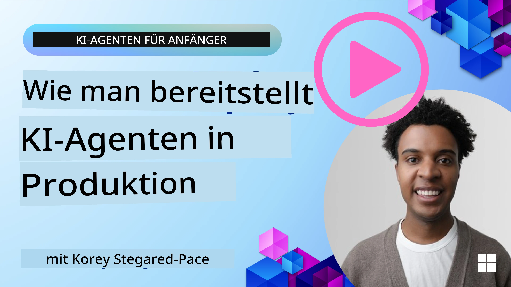

# KI-Agenten im Einsatz: Beobachtbarkeit & Evaluation

[](https://youtu.be/l4TP6IyJxmQ?si=reGOyeqjxFevyDq9)

Während KI-Agenten vom experimentellen Prototyp zu praxisnahen Anwendungen übergehen, wird es wichtig, ihr Verhalten zu verstehen, ihre Leistung zu überwachen und ihre Ergebnisse systematisch zu bewerten.

## Lernziele

Nach Abschluss dieser Lektion wissen Sie, wie Sie/Verstehen Sie:
- Kernkonzepte der Beobachtbarkeit und Evaluation von Agenten
- Techniken zur Verbesserung der Leistung, Kosten und Effektivität von Agenten
- Was und wie Sie Ihre KI-Agenten systematisch bewerten
- Wie Sie Kosten bei der Bereitstellung von KI-Agenten in der Produktion kontrollieren
- Wie Sie Agenten, die mit dem Microsoft Agent Framework erstellt wurden, instrumentieren

Das Ziel ist es, Ihnen das Wissen zu vermitteln, um Ihre „Black-Box“-Agenten in transparente, verwaltbare und zuverlässige Systeme zu verwandeln.

_**Hinweis:** Es ist wichtig, sichere und vertrauenswürdige KI-Agenten bereitzustellen. Sehen Sie sich auch die Lektion [Vertrauenswürdige KI-Agenten entwickeln](../06-building-trustworthy-agents/README.md) an._

## Traces und Spans

Beobachtbarkeitstools wie [Langfuse](https://langfuse.com/) oder [Microsoft Foundry](https://learn.microsoft.com/en-us/azure/ai-foundry/what-is-azure-ai-foundry) stellen Agentenläufe meist als Traces und Spans dar.

- **Trace** repräsentiert eine vollständige Agentenaufgabe von Anfang bis Ende (z. B. das Bearbeiten einer Benutzeranfrage).
- **Spans** sind einzelne Schritte innerhalb des Traces (z. B. das Aufrufen eines Sprachmodells oder das Abrufen von Daten).


<!-- Image URL retained for illustration purposes -->

Ohne Beobachtbarkeit kann sich ein KI-Agent wie eine „Black Box“ anfühlen – sein innerer Zustand und seine Argumentation sind undurchsichtig, was es schwierig macht, Probleme zu diagnostizieren oder die Leistung zu optimieren. Mit Beobachtbarkeit werden Agenten zu „Glasboxen“, die Transparenz bieten, welche für den Aufbau von Vertrauen und die Sicherstellung des ordnungsgemäßen Betriebs unerlässlich ist.

## Warum Beobachtbarkeit in Produktionsumgebungen wichtig ist

Die Umstellung von KI-Agenten auf Produktionsumgebungen bringt neue Herausforderungen und Anforderungen mit sich. Beobachtbarkeit ist kein „Nice-to-have“ mehr, sondern eine kritische Fähigkeit:

*   **Debugging und Ursachenanalyse:** Wenn ein Agent fehlschlägt oder ein unerwartetes Ergebnis liefert, liefern Beobachtbarkeitstools die Traces, die benötigt werden, um die Fehlerquelle zu lokalisieren. Dies ist besonders wichtig bei komplexen Agenten, die mehrere LLM-Aufrufe, Werkzeuginteraktionen und bedingte Logik enthalten können.
*   **Latenz- und Kostenmanagement:** KI-Agenten nutzen häufig LLMs und andere externe APIs, die pro Token oder pro Aufruf abgerechnet werden. Beobachtbarkeit ermöglicht die präzise Verfolgung dieser Aufrufe, was hilft, zu langsame oder zu teure Operationen zu identifizieren. So können Teams Prompts optimieren, effizientere Modelle auswählen oder Workflows umgestalten, um Betriebskosten zu steuern und eine gute Nutzererfahrung zu gewährleisten.
*   **Vertrauen, Sicherheit und Compliance:** In vielen Anwendungen ist es wichtig sicherzustellen, dass Agenten sicher und ethisch handeln. Beobachtbarkeit bietet eine Audit-Trail aller Agentenaktionen und Entscheidungen. Dies kann verwendet werden, um Probleme wie Prompt-Injektionen, die Erzeugung schädlicher Inhalte oder die unsachgemäße Handhabung personenbezogener Daten (PII) zu erkennen und zu mindern. Zum Beispiel können Sie Traces überprüfen, um zu verstehen, warum ein Agent eine bestimmte Antwort gegeben oder ein bestimmtes Werkzeug verwendet hat.
*   **Kontinuierliche Verbesserungszyklen:** Beobachtbarkeitsdaten bilden die Grundlage eines iterativen Entwicklungsprozesses. Durch die Überwachung der Agentenleistung in der realen Welt können Teams Verbesserungsbereiche identifizieren, Daten für das Fein-Tuning von Modellen sammeln und die Wirkung von Änderungen validieren. Dies schafft einen Feedback-Loop, bei dem Produktionsdaten aus der Online-Evaluation Offline-Experimente und -Verfeinerungen informieren, was zu einer stetig besseren Agentenleistung führt.

## Wichtige Metriken zur Nachverfolgung

Um Verhalten des Agenten zu überwachen und zu verstehen, sollten verschiedene Metriken und Signale erfasst werden. Während die spezifischen Kennzahlen je nach Zweck des Agenten variieren können, sind einige universell wichtig.

Hier sind einige der am häufigsten von Beobachtbarkeitstools überwachten Metriken:

**Latenz:** Wie schnell antwortet der Agent? Lange Wartezeiten beeinträchtigen die Benutzererfahrung negativ. Man sollte die Latenz für Aufgaben und einzelne Schritte durch das Tracing von Agentenläufen messen. Zum Beispiel könnte ein Agent, der für alle Modellaufrufe 20 Sekunden benötigt, durch die Verwendung eines schnelleren Modells oder parallele Modellaufrufe beschleunigt werden.

**Kosten:** Wie hoch sind die Kosten pro Agentenlauf? KI-Agenten benutzen LLM-Aufrufe, die pro Token oder über externe APIs abgerechnet werden. Häufige Werkzeugnutzung oder mehrere Prompts können die Kosten schnell erhöhen. Zum Beispiel muss man bei einem Agenten, der ein LLM fünfmal für eine marginale Qualitätsverbesserung aufruft, beurteilen, ob die Kosten gerechtfertigt sind oder ob die Anzahl der Aufrufe reduziert oder ein günstigeres Modell verwendet werden kann. Echtzeit-Überwachung hilft auch dabei, unerwartete Spitzen (z. B. Bugs, die zu exzessiven API-Schleifen führen) zu erkennen.

**Anfragefehler:** Wie viele Anfragen an den Agenten sind fehlgeschlagen? Dies kann API-Fehler oder fehlgeschlagene Werkzeugaufrufe einschließen. Um den Agenten in der Produktion robuster dagegen zu machen, kann man dann Fallbacks oder Wiederholungsversuche einrichten. Z. B. wenn LLM-Anbieter A ausfällt, wechselt man als Backup zu LLM-Anbieter B.

**Benutzerfeedback:** Direkte Nutzerbewertungen erbringen wertvolle Einblicke. Dies kann explizite Bewertungen (👍Gefällt mir/👎Gefällt mir nicht, ⭐1-5 Sterne) oder textuelle Kommentare umfassen. Konsistent negatives Feedback sollte Alarm schlagen, da dies ein Zeichen dafür ist, dass der Agent nicht wie erwartet funktioniert.

**Implizites Benutzerfeedback:** Nutzerverhalten liefert auch ohne explizite Bewertungen indirektes Feedback. Dazu gehören sofortige Umformulierungen von Fragen, wiederholte Anfragen oder das Klicken eines Wiederholungsbuttons. Z. B. wenn Sie sehen, dass Nutzer dieselbe Frage wiederholt stellen, ist dies ein Hinweis darauf, dass der Agent nicht wie erwartet funktioniert.

**Genauigkeit:** Wie häufig liefert der Agent korrekte oder erwünschte Ausgaben? Definitionen von Genauigkeit variieren (z. B. korrekte Problemlösung, Informationsabrufgenauigkeit, Nutzerzufriedenheit). Der erste Schritt ist zu definieren, wie Erfolg für Ihren Agenten aussieht. Sie können Genauigkeit über automatische Prüfungen, Bewertungsergebnisse oder Markierungen zum Abschluss von Aufgaben verfolgen. Zum Beispiel Traces als „erfolgreich“ oder „fehlgeschlagen“ markieren.

**Automatisierte Bewertungsmetriken:** Sie können auch automatisierte Bewertungen einrichten. Beispielsweise kann ein LLM die Ausgabe des Agenten bewerten, z. B. ob sie hilfreich, genau oder nicht ist. Es gibt auch mehrere Open-Source-Bibliotheken, die helfen, verschiedene Aspekte des Agenten zu bewerten. Z. B. [RAGAS](https://docs.ragas.io/) für RAG-Agenten oder [LLM Guard](https://github.com/protectai/llm-guard), um schädliche Sprache oder Prompt-Injektionen zu erkennen.

In der Praxis bietet eine Kombination dieser Metriken die beste Übersicht über den Gesundheitszustand eines KI-Agenten. Im [Beispielnotebook](./code_samples/10-expense_claim-demo.ipynb) dieses Kapitels zeigen wir Ihnen, wie diese Metriken in realen Beispielen aussehen, aber zuerst lernen wir, wie ein typischer Evaluations-Workflow aussieht.

## Instrumentieren Sie Ihren Agenten

Um Tracing-Daten zu sammeln, müssen Sie Ihren Code instrumentieren. Das Ziel ist es, den Agentencode so zu instrumentieren, dass Traces und Metriken erzeugt werden, die von einer Beobachtbarkeitsplattform erfasst, verarbeitet und visualisiert werden können.

**OpenTelemetry (OTel):** [OpenTelemetry](https://opentelemetry.io/) hat sich als Industriestandard für LLM-Beobachtbarkeit etabliert. Es bietet eine Reihe von APIs, SDKs und Tools zur Erzeugung, Sammlung und zum Export von Telemetriedaten.

Es gibt viele Instrumentierungsbibliotheken, die bestehende Agentenframeworks umhüllen und das Exportieren von OpenTelemetry-Spans zu einem Beobachtbarkeitstool erleichtern. Microsoft Agent Framework integriert OpenTelemetry nativ. Nachfolgend ein Beispiel zur Instrumentierung eines MAF-Agenten:

```python
from agent_framework.observability import get_tracer, get_meter

tracer = get_tracer()
meter = get_meter()

with tracer.start_as_current_span("agent_run"):
    # Agent execution is traced automatically
    pass
```

Das [Beispielnotebook](./code_samples/10-expense_claim-demo.ipynb) in diesem Kapitel zeigt, wie Sie Ihren MAF-Agenten instrumentieren.

**Manuelle Span-Erstellung:** Während Instrumentierungsbibliotheken eine gute Basis liefern, gibt es oft Fälle, in denen detailliertere oder kundenspezifische Informationen benötigt werden. Sie können Spans manuell erstellen, um benutzerdefinierte Anwendungslogik hinzuzufügen. Wichtiger noch, sie können automatisch oder manuell erstellte Spans mit benutzerdefinierten Attributen (auch Tags oder Metadaten genannt) anreichern. Diese Attribute können geschäftsspezifische Daten, Zwischenberechnungen oder jeden Kontext enthalten, der für Debugging oder Analyse nützlich sein könnte, wie `user_id`, `session_id` oder `model_version`.

Beispiel für manuelles Erstellen von Traces und Spans mit dem [Langfuse Python SDK](https://langfuse.com/docs/sdk/python/sdk-v3):

```python
from langfuse import get_client
 
langfuse = get_client()
 
span = langfuse.start_span(name="my-span")
 
span.end()
```

## Agentenbewertung

Beobachtbarkeit liefert uns Metriken, aber Evaluation ist der Prozess der Analyse dieser Daten (und der Durchführung von Tests), um zu bestimmen, wie gut ein KI-Agent arbeitet und wie man ihn verbessern kann. Mit anderen Worten: Sobald Sie diese Traces und Metriken haben, wie nutzen Sie sie, um den Agenten zu bewerten und Entscheidungen zu treffen?

Regelmäßige Evaluation ist wichtig, weil KI-Agenten oft nicht deterministisch sind und sich durch Updates oder sich änderndes Modellverhalten weiterentwickeln – ohne Evaluation würden Sie nicht wissen, ob Ihr „intelligenter Agent“ tatsächlich seine Arbeit gut macht oder sich verschlechtert hat.

Es gibt zwei Kategorien von Bewertungen für KI-Agenten: **Online-Evaluation** und **Offline-Evaluation**. Beide sind wertvoll und ergänzen sich gegenseitig. Normalerweise beginnen wir mit der Offline-Evaluation, da dies der minimale notwendige Schritt vor der Bereitstellung eines Agenten ist.

### Offline-Evaluation


Dies umfasst die Bewertung des Agenten in einer kontrollierten Umgebung, typischerweise mit Testdatensätzen und nicht mit Live-Benutzeranfragen. Sie verwenden kuratierte Datensätze, bei denen Sie wissen, was die erwartete Ausgabe oder das korrekte Verhalten ist, und führen Ihren Agenten darauf aus.

Zum Beispiel, wenn Sie einen Agenten für Textaufgaben in Mathematik gebaut haben, verfügen Sie vielleicht über einen [Testdatensatz](https://huggingface.co/datasets/openai/gsm8k) mit 100 Aufgaben und bekannten Antworten. Die Offline-Evaluation wird oft während der Entwicklung durchgeführt (und kann Teil von CI/CD-Pipelines sein), um Verbesserungen zu prüfen oder Regressionen zu verhindern. Der Vorteil ist, dass sie **wiederholbar ist und klare Genauigkeitsmetriken liefert, da Sie eine Ground-Truth haben**. Sie können auch Benutzeranfragen simulieren und die Antworten des Agenten mit idealen Antworten vergleichen oder automatisierte Metriken wie oben beschrieben verwenden.

Die größte Herausforderung bei der Offline-Evaluation ist die Sicherstellung, dass Ihr Testdatensatz umfassend und relevant bleibt – der Agent kann auf einem festen Testsatz gut abschneiden, aber in der Produktion sehr andere Anfragen erhalten. Daher sollten Sie Testsätze regelmäßig mit neuen Randfällen und Beispielen aktualisieren, die reale Szenarien widerspiegeln. Eine Mischung aus kleinen „Smoke-Test“-Fällen und größeren Bewertungssätzen ist hilfreich: Kleine Sets für schnelle Prüfungen und größere für umfassendere Leistungsmetriken.

### Online-Evaluation


Dies bezieht sich auf die Bewertung des Agenten in einer Live-Umgebung, also während der tatsächlichen Nutzung in der Produktion. Die Online-Evaluation umfasst die Überwachung der Agentenleistung bei echten Benutzerinteraktionen und die kontinuierliche Analyse der Ergebnisse.

Zum Beispiel können Sie Erfolgsquoten, Nutzerzufriedenheitswerte oder andere Metriken im Live-Traffic verfolgen. Der Vorteil der Online-Evaluation ist, dass sie **Unvorhergesehenes aufdeckt, das im Laborsetting nicht sichtbar wäre** – Sie können Modellverschiebungen über die Zeit beobachten (wenn die Effektivität des Agenten mit sich ändernden Eingabemustern abnimmt) und unerwartete Anfragen oder Situationen erfassen, die in Ihren Testdaten nicht vorkamen. Sie liefert ein realistisches Bild davon, wie sich der Agent „in freier Wildbahn“ verhält.

Online-Evaluation beinhaltet oft das Sammeln von implizitem und explizitem Benutzerfeedback, wie bereits besprochen, und möglicherweise auch das Durchführen von Shadow-Tests oder A/B-Tests (bei denen eine neue Agentenversion parallel zur alten läuft, um sie zu vergleichen). Die Herausforderung besteht darin, für Live-Interaktionen verlässliche Labels oder Bewertungen zu erhalten – hier verlassen Sie sich oft auf Nutzerfeedback oder nachgelagerte Metriken (etwa ob der Nutzer das Ergebnis angeklickt hat).

### Kombination der beiden

Online- und Offline-Evaluation schließen sich nicht aus; sie ergänzen sich hervorragend. Erkenntnisse aus der Online-Überwachung (z. B. neue Nutzeranfragentypen, bei denen der Agent schlecht abschneidet) können verwendet werden, um Offline-Testdatensätze zu erweitern und zu verbessern. Umgekehrt können Agenten, die in Offline-Tests gut abschneiden, dann mit größerer Zuversicht online bereitgestellt und überwacht werden.

Viele Teams etablieren tatsächlich einen Zyklus:

_offline evaluieren -> bereitstellen -> online überwachen -> neue Fehlerfälle sammeln -> zum offline-Datensatz hinzufügen -> Agenten verfeinern -> wiederholen_.

## Häufige Probleme

Beim Einsatz von KI-Agenten in der Produktion können verschiedene Herausforderungen auftreten. Hier sind einige häufige Probleme und mögliche Lösungen:

| **Problem**    | **Mögliche Lösung**   |
| ------------- | ------------------ |
| KI-Agent erfüllt Aufgaben nicht konsistent | - Verfeinern Sie den Prompt, der an den KI-Agenten gegeben wird; seien Sie klar in den Zielen.<br>- Ermitteln Sie, ob das Aufteilen der Aufgaben in Teilaufgaben und deren Bearbeitung durch mehrere Agenten helfen kann. |
| KI-Agent gerät in Endlosschleifen | - Stellen Sie klare Abbruchkriterien sicher, damit der Agent weiß, wann er den Prozess stoppen soll.<br>- Für komplexe Aufgaben, die logisches Denken und Planung erfordern, verwenden Sie ein größeres Modell, das auf Denkaufgaben spezialisiert ist. |
| Werkzeugaufrufe des KI-Agenten funktionieren nicht gut | - Testen und validieren Sie die Ausgabe des Werkzeugs außerhalb des Agentensystems.<br>- Verfeinern Sie die definierten Parameter, Prompts und Benennungen der Werkzeuge. |
| Multi-Agenten-System arbeitet nicht konsistent | - Verfeinern Sie die Prompts an jeden Agenten, um sicherzustellen, dass sie spezifisch und unterscheidbar sind.<br>- Bauen Sie ein hierarchisches System mit einem „Routing“- oder Steuerungsagenten, der bestimmt, welcher Agent der richtige ist. |

Viele dieser Probleme lassen sich durch Beobachtbarkeit effektiver erkennen. Die zuvor besprochenen Traces und Metriken helfen dabei, genau zu lokalisieren, wo im Agentenablauf Probleme auftreten, was Debugging und Optimierung deutlich effizienter macht.

## Kostenmanagement

Hier sind einige Strategien, um die Kosten des Einsatzes von KI-Agenten in der Produktion zu steuern:

**Verwendung kleinerer Modelle:** Kleine Sprachmodelle (SLMs) können bei bestimmten agentischen Anwendungsfällen gut abschneiden und die Kosten erheblich senken. Wie bereits erwähnt, ist der Aufbau eines Evaluationssystems, um die Leistung im Vergleich zu größeren Modellen zu bestimmen und zu vergleichen, der beste Weg, um zu verstehen, wie gut ein SLM für Ihren Anwendungsfall geeignet ist. Ziehen Sie in Erwägung, SLMs für einfachere Aufgaben wie Intent-Klassifizierung oder Parameterextraktion zu verwenden und größere Modelle für komplexe Schlussfolgerungen vorzubehalten.

**Verwendung eines Router-Modells:** Eine ähnliche Strategie besteht darin, eine Vielfalt von Modellen und Größen einzusetzen. Sie können ein LLM/SLM oder eine serverlose Funktion verwenden, um Anfragen basierend auf der Komplexität an die am besten geeigneten Modelle weiterzuleiten. Dies hilft ebenfalls, Kosten zu reduzieren und gleichzeitig die Leistung bei den richtigen Aufgaben sicherzustellen. Zum Beispiel einfache Anfragen an kleinere, schnellere Modelle weiterleiten und teure große Modelle nur für komplexe Schlussfolgerungsaufgaben nutzen.

**Zwischenspeicherung von Antworten:** Das Identifizieren häufiger Anfragen und Aufgaben und das Bereitstellen der Antworten, bevor sie durch Ihr agentisches System laufen, ist eine gute Methode, um die Anzahl ähnlicher Anfragen zu verringern. Sie können sogar einen Ablauf implementieren, der mithilfe einfacher KI-Modelle erkennt, wie ähnlich eine Anfrage Ihren zwischengespeicherten Anfragen ist. Diese Strategie kann die Kosten für häufig gestellte Fragen oder gängige Workflows erheblich reduzieren.

## Sehen wir uns an, wie das in der Praxis funktioniert

Im [Beispielnotebook dieses Abschnitts](./code_samples/10-expense_claim-demo.ipynb) sehen wir Beispiele, wie wir Observability-Tools nutzen können, um unseren Agenten zu überwachen und zu evaluieren.


### Haben Sie weitere Fragen zu KI-Agenten im Einsatz?

Treten Sie dem [Microsoft Foundry Discord](https://discord.com/invite/ATgtXmAS5D) bei, um andere Lernende zu treffen, an Sprechstunden teilzunehmen und Ihre Fragen zu KI-Agenten beantwortet zu bekommen.

## Vorherige Lektion

[Metakognition-Designmuster](../09-metacognition/README.md)

## Nächste Lektion

[Agentische Protokolle](../11-agentic-protocols/README.md)

---

<!-- CO-OP TRANSLATOR DISCLAIMER START -->
**Haftungsausschluss**:
Dieses Dokument wurde mit dem KI-Übersetzungsdienst [Co-op Translator](https://github.com/Azure/co-op-translator) übersetzt. Obwohl wir uns um Genauigkeit bemühen, beachten Sie bitte, dass automatisierte Übersetzungen Fehler oder Ungenauigkeiten enthalten können. Das Originaldokument in seiner Ursprungssprache gilt als maßgebliche Quelle. Bei kritischen Informationen wird eine professionelle menschliche Übersetzung empfohlen. Wir übernehmen keine Haftung für Missverständnisse oder Fehlinterpretationen, die aus der Verwendung dieser Übersetzung entstehen.
<!-- CO-OP TRANSLATOR DISCLAIMER END -->