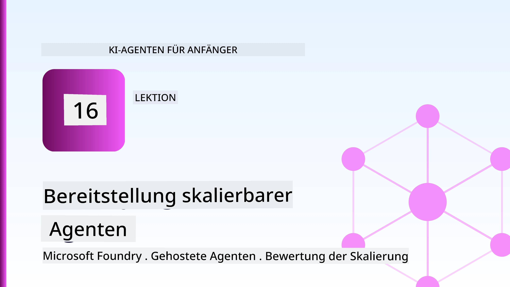
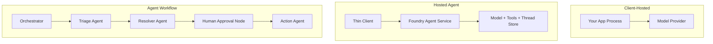
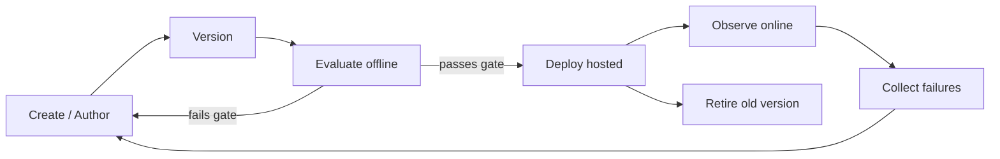
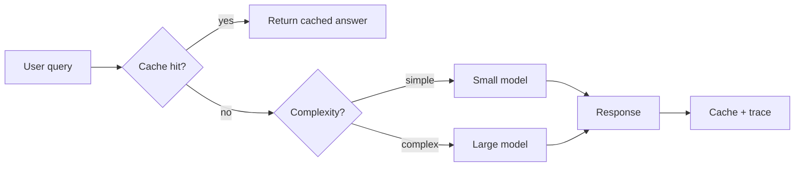
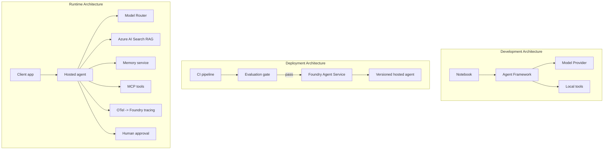

# Bereitstellung skalierbarer Agenten mit Microsoft Foundry



Bis zu diesem Punkt des Kurses haben Sie Agenten erstellt, die auf Ihrem Laptop laufen, innerhalb eines Notebooks, gesteuert von `az login` und einigen Umgebungsvariablen. Das ist genau der richtige Weg zum Lernen. Es ist jedoch nicht der richtige Weg, einen Agenten zu betreiben, auf den Tausende von Kunden um 3 Uhr morgens angewiesen sind.

Diese Lektion behandelt die Kluft zwischen "es funktioniert auf meinem Rechner" und "es funktioniert zuverlässig und kostengünstig im Produktionseinsatz." Wir schließen diese Lücke mithilfe von **Microsoft Foundry** und dem **Microsoft Foundry Agent Service**, indem wir einen echten Kundenservice-Agenten bauen, der Werkzeuge, Abruf, Speicher, Bewertung und Überwachung integriert.

## Einführung

Diese Lektion behandelt:

- Den Unterschied zwischen einem **Prototyp-Agenten** und einem **bereitgestellten Agenten** und warum der Übergang hauptsächlich alles *außerhalb* des Modells betrifft.
- **Bereitstellungsmuster** für Agenten: client-gehostet, service-gehostet (Hosted Agents) und workflow-orientiert.
- Den **Agenten-Lebenszyklus** auf Microsoft Foundry – erstellen, versionieren, bereitstellen, bewerten, beobachten, außer Dienst stellen.
- **Skalierungsstrategien**: Modell-Routing, Caching, Parallelität und zustandslose Gestaltung.
- **Beobachtbarkeit** mit OpenTelemetry und Foundry-Tracing.
- **Kostenoptimierung** durch Modellauswahl, Routing und Bewertungsschranken.
- **Unternehmensüberlegungen**: Governance, menschliche Genehmigung und sicheres Betreiben von MCP-Servern in der Produktion.

## Lernziele

Nach Abschluss dieser Lektion wissen Sie, wie Sie:

- Das passende Bereitstellungsmuster für eine gegebene Agenten-Workload auswählen.
- Einen Agenten in Microsoft Foundry Agent Service bereitstellen, sodass er versioniert, geregelt und beobachtbar ist.
- Einen Agenten für das Tracing instrumentieren und eine Bewertungspipeline verknüpfen, die vor jeder Veröffentlichung läuft.
- Modell-Routing und Caching anwenden, um Latenz und Kosten bei Skalierung unter Kontrolle zu halten.
- Ein menschliches Genehmigungstor für risikoreiche Aktionen hinzufügen und einen MCP-Server produktionstauglich integrieren.

## Voraussetzungen

Diese Lektion setzt voraus, dass Sie die vorherigen Lektionen abgeschlossen haben und vertraut sind mit:

- Agenten mit dem [Microsoft Agent Framework](../14-microsoft-agent-framework/README.md) bauen (Lektion 14).
- [Werkzeugbenutzung](../04-tool-use/README.md) (Lektion 4) und [Agentic RAG](../05-agentic-rag/README.md) (Lektion 5).
- [Agenten-Speicher](../13-agent-memory/README.md) (Lektion 13) und [Agentic Protokolle / MCP](../11-agentic-protocols/README.md) (Lektion 11).
- [Beobachtbarkeit und Bewertung](../10-ai-agents-production/README.md) (Lektion 10) — diese Lektion baut direkt darauf auf.

Sie benötigen auch:

- Ein **Azure-Abonnement** und ein **Microsoft Foundry-Projekt** mit mindestens einem bereitgestellten Chat-Modell.
- Die **Azure CLI** authentifiziert (`az login`).
- Python 3.12+ und die Pakete im Repository [`requirements.txt`](../../../requirements.txt).

## Vom Prototyp zur Produktion: Was sich tatsächlich ändert

Ein Prototyp-Agent und ein Produktionsagent teilen dieselbe Kernschleife – überlegen, Werkzeuge aufrufen, antworten. Was sich ändert, ist alles, was diese Schleife umgibt. Das Modell macht vielleicht 20 % eines Produktionsagenten aus; die anderen 80 % sind das operationelle Gerüst.

| Aspekt | Prototyp | Produktion |
| --- | --- | --- |
| **Hosting** | Läuft in Ihrem Notebook | Läuft als gehosteter Service, versioniert und ausgerollt |
| **Identität** | Ihr `az login`-Token | Verwaltete Identität mit eingeschränktem RBAC |
| **Status** | Im Speicher, geht bei Neustart verloren | Ausgelagert (Thread-Speicher, Speicher-Service) |
| **Fehler** | Sie sehen den Rückverfolgungs-Stack | Wiederholungen, Fallbacks, Dead-Letter, Alarme |
| **Kosten** | "Es sind ein paar Cent" | Pro Anfrage erfasst, geroutet, zwischengespeichert, budgetiert |
| **Qualität** | Sie prüfen die Ausgabe manuell | Wird vor jeder Veröffentlichung automatisch bewertet |
| **Vertrauen** | Sie genehmigen jede Aktion | Richtlinien + Mensch-in-der-Schleife für risikoreiche Aktionen |

Behalten Sie diese Tabelle im Kopf. Jeder nachfolgende Abschnitt ordnet sich einer dieser Zeilen zu.

## Bereitstellungsmuster für Agenten

Es gibt drei Muster, die Sie oft in Kombination verwenden.

### 1. Client-gehostete Agenten

Das Agentenobjekt lebt im Prozess *Ihrer* Anwendung. Ihr Code ruft den Modellanbieter direkt auf; die Denkschleife läuft in Ihrem Service. Das ist, was jede vorherige Lektion gemacht hat.

- **Nutzen Sie es, wenn** Sie volle Kontrolle über die Schleife benötigen, kundenspezifische Middleware verwenden oder den Agenten in ein bestehendes Backend integrieren.
- **Trade-off**: Sie sind selbst verantwortlich für Skalierung, Status und Ausfallsicherheit.

### 2. Gehostete Agenten (Foundry Agent Service)

Der Agent ist *als Ressource* in Microsoft Foundry registriert. Foundry hostet die Denkschleife, speichert Threads, erzwingt Inhalts-Sicherheit und RBAC und macht den Agenten im Foundry-Portal sichtbar. Ihre App wird zum schlanken Client, der Threads anlegt und Antworten liest.

- **Nutzen Sie es, wenn** Sie Haltbarkeit, integrierte Beobachtbarkeit, Governance und eine geringere operative Oberfläche wünschen.
- **Trade-off**: Weniger Low-Level-Kontrolle zugunsten einer verwalteten Laufzeitumgebung.

### 3. Agenten-Workflows

Mehrere Agenten (und Werkzeuge) werden zu einem Graph mit explizitem Kontrollfluss zusammengesetzt – sequentielle Schritte, Verzweigungen, menschliche Genehmigungsknoten und dauerhafte Checkpoints, die pausieren und fortsetzen können. Dies ist die Microsoft Agent Framework **Workflows**-Funktionalität im Maßstab der Bereitstellung.

- **Nutzen Sie es, wenn** eine einzelne Aufgabe mehrere spezialisierte Agenten umfasst oder eine Genehmigungsstufe mittendrin benötigt.
- **Trade-off**: Mehr bewegliche Teile; benötigt Beobachtbarkeit auf Orchestrierungsebene.



## Der Agenten-Lebenszyklus auf Microsoft Foundry

Einen Agenten bereitzustellen ist kein einmaliger `push`. Es ist eine Schleife, die einem Software-Release-Zyklus sehr ähnelt, weil sie genau das ist.



Die zentrale Idee, übernommen aus [Lektion 10](../10-ai-agents-production/README.md): **Offline-Bewertung ist ein Gate, kein Nachgedanke.** Eine neue Agentenversion wird nicht veröffentlicht, wenn sie Ihre Bewertungsschwellen nicht besteht. Online-Beobachtbarkeit speist reale Fehler dann wieder in Ihr Offline-Testset zurück. Das ist die ganze Schleife.

## Skalierungsstrategien

Die Skalierung eines Agenten unterscheidet sich von der Skalierung einer zustandslosen Web-API, da jede Anfrage mehrere anspruchsvolle Modell- und Werkzeugaufrufe auslösen kann. Vier Techniken tragen die Hauptlast.

**Zustandslose Anfrageverarbeitung.** Speichern Sie keinen benutzerspezifischen Status im Prozessspeicher. Persistieren Sie Konversations-Threads im Foundry Thread Store oder einem Speicherdienst, sodass jede Instanz jede Anfrage bearbeiten kann. Das ermöglicht horizontale Skalierung – Instanzen hinzufügen, keine Sticky Sessions.

**Modell-Routing.** Nicht jede Anfrage erfordert Ihr leistungsfähigstes (und teuerstes) Modell. Leiten Sie einfache Anfragen – Intent-Klassifikation, kurze faktische Antworten – an ein kleines, schnelles Modell weiter und reservieren Sie das große Modell für richtige Denkarbeit. Foundrys **Model Router** kann dies für Sie übernehmen, oder Sie implementieren einen leichten Klassifikator selbst. Die DIY-Version bauen Sie im Labor.

**Antwort-Caching.** Viele Support-Anfragen ähneln sich stark ("Wie setze ich mein Passwort zurück?"). Speichern Sie Antworten auf häufige Fragen im Cache und liefern Sie sie, ohne das Modell zu beanspruchen. Selbst eine moderate Cache-Trefferquote reduziert Kosten und Latenz spürbar.

**Parallelität und Rückstau.** Modellanbieter haben Ratenbegrenzungen. Begrenzen Sie Ihre Parallelität, verwenden Sie erneute Versuche mit exponentiellem Backoff und scheitern Sie elegant (eine wartende „Wir kümmern uns darum“-Antwort ist besser als ein 500-Fehler).



## Beobachtbarkeit in der Produktion

Sie können nur das betreiben, was Sie sehen. Wie in Lektion 10 behandelt, gibt das Microsoft Agent Framework **OpenTelemetry**-Traces nativ aus – jeder Modellaufruf, Werkzeugaufruf und Orchestrierungsschritt wird zu einem Span. In der Produktion exportieren Sie diese Spans zu Microsoft Foundry (oder einem beliebigen OTel-kompatiblen Backend), damit Sie:

- Eine einzelne Kundenbeschwerde Ende-zu-Ende über alle Modell- und Werkzeugaufrufe verfolgen.
- p50/p95 Latenz und Kosten pro Anfrage über die Zeit beobachten.
- Fehlerquotenspitzen und Kostenanomalien melden, bevor Ihre Benutzer (oder Ihr Finanzteam) sie bemerken.

```python
from agent_framework.observability import get_tracer

tracer = get_tracer()

with tracer.start_as_current_span("support_request") as span:
    span.set_attribute("customer.tier", "enterprise")
    span.set_attribute("routed.model", "gpt-5-nano")
    # agent execution is traced automatically inside this span
```

Attribute wie `customer.tier` und `routed.model` verwandeln eine Flut von Traces in beantwortbare Fragen („Werden Unternehmenskunden zu oft an das kleine Modell geleitet?“).

## Kostenoptimierung

Kosten bei Produktionsagenten werden von Tokens dominiert. Drei Hebel, nach Wirkung geordnet:

1. **Modell passend dimensionieren.** Ein kleines Modell, das Ihr Bewertungsgate besteht, ist fast immer günstiger als ein großes, das ebenfalls besteht. Nutzen Sie Bewertungen, um zu *beweisen*, dass das kleine Modell ausreicht, statt aus Vorsicht standardmäßig das größte Modell zu nehmen.
2. **Routen nach Komplexität.** Wie oben – zahlen Sie Preise für das große Modell nur bei Anfragen, die große Modelllogik brauchen.
3. **Aggressiv cachen.** Der günstigste Modellaufruf ist der, den Sie nie tätigen.

Bewertungstore und Kostenkontrolle sind dieselbe Disziplin aus zwei Blickwinkeln: Bewertung sagt Ihnen den *Qualitätsboden*, Routing und Caching halten die *Kosten* so nah wie möglich an diesem Boden.

## Unternehmensbezogene Bereitstellungsüberlegungen

**Governance.** Hosted Agents erben Foundrys RBAC, Inhalts-Sicherheit und Audit-Logging. Geben Sie jedem Agenten eine verwaltete Identität mit minimalen Rechten – nur lesender Zugriff auf die Wissensdatenbank, eingeschränkter Zugriff auf die Ticket-API, nicht mehr.

**Mensch in der Schleife.** Manche Aktionen sind zu folgenreich, um sie vollständig zu automatisieren – Rückerstattung ausstellen, Konto löschen, an die Rechtsabteilung eskalieren. Das Microsoft Agent Framework unterstützt **genehmigungspflichtige** Werkzeuge: Der Agent schlägt die Aktion vor, die Ausführung pausiert, ein Mensch genehmigt oder lehnt ab, und der Workflow wird fortgesetzt. Diese Primitive haben Sie in [Lektion 6](../06-building-trustworthy-agents/README.md) gesehen; hier stellen Sie sie bereit.

**MCP in der Produktion.** [MCP](../11-agentic-protocols/README.md) ermöglicht es Ihrem Agenten, externe Werkzeuge über eine Standard-Schnittstelle zu verwenden. Behandeln Sie jeden MCP-Server in der Produktion als nicht vertrauenswürdige Grenze: fixieren Sie die Serverversion, betreiben Sie ihn mit einer eingeschränkten Identität, validieren Sie seine Ausgaben und geben Sie ihm niemals geheime Informationen preis. Ein MCP-Server ist eine Abhängigkeit, die gepatcht, geprüft und ratenbegrenzt wird.



Diese drei Diagramme – Entwicklung, Bereitstellung, Laufzeit – zeigen denselben Agenten in drei Phasen seines Lebens. Das folgende Labor führt Sie durch den Bau.

## Praxislabor: Ein produktionsbereiter Kundendienst-Agent

Öffnen Sie [`code_samples/16-python-agent-framework.ipynb`](./code_samples/16-python-agent-framework.ipynb) und arbeiten Sie es von Anfang bis Ende durch. Sie stellen einen **Contoso-Kundendienst-Agenten** zusammen, der alle Produktionsanforderungen integriert:

1. **Werkzeugaufrufe** – Bestellstatus abfragen und Support-Tickets öffnen.
2. **RAG** – beantwortet Richtlinienfragen aus einer Wissensdatenbank (Azure AI Search, mit in-memory Fallback, sodass das Notebook ohne Search-Ressource läuft).
3. **Speicher** – merkt sich den Kunden über mehrere Gesprächsrunden hinweg.
4. **Modell-Routing** – Ein Komplexitätsklassifikator leitet jede Anfrage an ein kleines oder großes Modell.
5. **Antwort-Caching** – wiederholte Fragen werden aus dem Cache bedient.
6. **Menschliche Genehmigung** – Rückerstattungen über einem Schwellenwert pausieren für menschliche Freigabe.
7. **Bewertungspipeline** – ein kleiner Offline-Testsatz bewertet den Agenten und fungiert als Freigabesperre.
8. **Beobachtbarkeit** – OpenTelemetry-Tracing für jede Anfrage.

### Durchgang

Das Notebook ist so aufgebaut, dass jede Produktionsanforderung ein in sich geschlossenes, ausführbares Segment ist. Das Herzstück ist der Routing-plus-Caching-Anfrage-Handler:

```python
async def handle_support_request(query: str, customer_id: str) -> str:
    # 1. Serve from cache when we can.
    cached = response_cache.get(normalize(query))
    if cached:
        return cached

    # 2. Route by complexity to control cost.
    model = "gpt-5-nano" if is_simple(query) else "gpt-5-mini"

    # 3. Run the agent inside a trace span for observability.
    with tracer.start_as_current_span("support_request") as span:
        span.set_attribute("routed.model", model)
        span.set_attribute("customer.id", customer_id)
        response = await support_agent.run(query, model=model)

    # 4. Cache and return.
    response_cache.set(normalize(query), response.text)
    return response.text
```

Das Bewertungsgate, das eine Veröffentlichung schützt, sieht so aus:

```python
async def evaluation_gate(agent, test_cases, threshold: float = 0.8) -> bool:
    passed = 0
    for case in test_cases:
        result = await agent.run(case["input"])
        if score_response(result.text, case["expected"]) >= 0.8:
            passed += 1
    pass_rate = passed / len(test_cases)
    print(f"Evaluation pass rate: {pass_rate:.0%} (gate: {threshold:.0%})")
    return pass_rate >= threshold  # only deploy if the gate passes
```

Lesen Sie jede Zeile – das Notebook hält die Primitiven bewusst klein, damit nichts hinter einem Framework-Aufruf verborgen bleibt.

## Validierung eines bereitgestellten Agenten mit Smoke Tests

Das obige Bewertungsgate läuft *offline* gegen Ihr Agentenobjekt. Sobald der Agent als Hosted Agent bereitgestellt ist, benötigen Sie noch einen günstigeren Check: **Antwortet der bereitgestellte Endpunkt tatsächlich?**

Eine „erfolgreiche“ Bereitstellung beweist nur, dass die Steuerungsebene die Definition akzeptiert hat – nicht, dass der Agent antwortet. Eine fehlende Abhängigkeit, fehlerhaftes Modell-Routing oder eine abgelaufene Verbindung können zu einem grünen Deployment führen, das nichts zurückgibt. Ein **Smoke-Test** erkennt das innerhalb von Sekunden bei jeder Bereitstellung, ohne die Kosten eines vollständigen Bewertungslaufs.

Dieses Repository enthält eine einsatzbereite Smoke-Test-Pipeline, die auf der [AI Smoke Test](https://github.com/marketplace/actions/ai-smoke-test) GitHub Action basiert:

- **Katalog** — [`tests/lesson-16-smoke-tests.json`](../../../tests/lesson-16-smoke-tests.json) enthält Prompts und Assertions für den Contoso-Support-Agenten (fundierte Richtlinienantworten, eine Bestellabfrage, Themenfokussierung und mehrstufige Thread-Kohärenz). Kataloge für Agenten anderer Lektionen liegen daneben – siehe [`tests/README.md`](../tests/README.md).
- **Workflow** — [`.github/workflows/smoke-test.yml`](../../../.github/workflows/smoke-test.yml) meldet sich mit Azure OIDC an und postet jede Eingabe an den Responses-Endpunkt des Agenten, wobei der Job bei einer fehlgeschlagenen Assertion fehlschlägt.

```yaml
- name: Smoke-test hosted agent
  uses: JFolberth/ai-smoketest@v1
  with:
    project_endpoint: ${{ inputs.project_endpoint }}
    agent_name: ContosoSupportAgent
    tests_file: tests/lesson-16-smoke-tests.json
```

Führen Sie es über die **Aktionen**-Registerkarte aus, sobald Ihr Agent bereitgestellt ist, und geben Sie dabei Ihren Foundry-Projektendpunkt und den Agentennamen an. Die föderierte Identität benötigt die Rolle **Azure AI User** im Foundry-Projektrahmen. Stellen Sie sich die Schichten als eine Pyramide vor: Smoke-Tests (erreichbar und antwortet?) laufen bei jeder Bereitstellung, Offline-Bewertung (gut genug zum Versand?) laufen vor der Freigabe und Online-Bewertung (wie schlägt er sich in der Praxis?) laufen kontinuierlich.

## Wissensüberprüfung

Testen Sie Ihr Verständnis, bevor Sie mit der Aufgabe fortfahren.

**1. Wie viel Prozent eines Produktionsagenten ist ungefähr "das Modell" und was ist der Rest?**

<details>
<summary>Antwort</summary>

Das Modell ist eine Minderheit des Systems – oft etwa 20%. Der Rest ist das operative Skelett: Hosting und Versionierung, Identität und RBAC, ausgelagerter Zustand, Fehlerbehandlung, Kostenverfolgung, Bewertung und menschliche Kontrollmechanismen. Der Wechsel in die Produktion dreht sich hauptsächlich darum, alles um die Denk-Schleife *herum* zu bauen.
</details>

**2. Wann würden Sie einen Hosted Agent einem client-gehosteten Agent vorziehen?**

<details>
<summary>Antwort</summary>

Wenn Sie eine verwaltete Laufzeit mit eingebauter Haltbarkeit (Threads, die bestehen bleiben und fortgesetzt werden können), Beobachtbarkeit, Inhaltssicherheit und RBAC möchten und bereit sind, etwas niedrigstufige Kontrolle der Denk-Schleife für weniger operative Komplexität einzutauschen. Client-gehostet ist vorzuziehen, wenn Sie die volle Kontrolle über die Schleife benötigen oder den Agenten in ein bestehendes Backend einbetten.
</details>

**3. Warum muss ein skalierbarer Agent zustandslos im eigenen Prozessspeicher sein?**

<details>
<summary>Antwort</summary>

Damit jede Instanz jede Anforderung bearbeiten kann, was horizontale Skalierung ohne Sticky Sessions ermöglicht. Der pro Benutzer vorhandene Gesprächszustand ist ausgelagert in einen Thread-Speicher oder Speicherdienst. Wenn der Zustand im Prozessspeicher leben würde, wäre er nach einem Neustart verloren und die Lastverteilung wäre nicht frei möglich.
</details>

**4. Welches Problem löst das Modell-Routing, und wie steht es im Zusammenhang mit der Bewertung?**

<details>
<summary>Antwort</summary>

Routing schickt einfache Anfragen zu einem kleinen, günstigen, schnellen Modell und reserviert das große Modell für echtes Denken und steuert so Latenz und Kosten. Es steht in Zusammenhang mit der Bewertung, weil Bewertung *beweist*, dass das kleine Modell für eine Klasse von Anfragen gut genug ist – Routing ohne Bewertung ist geraten.
</details>

**5. Was ist ein "Bewertungs-Gate" und wo sitzt es im Lebenszyklus?**

<details>
<summary>Antwort</summary>

Ein Bewertungs-Gate führt einen Offline-Testsatz gegen eine neue Agentenversion aus und blockiert die Bereitstellung, sofern die Bestehensrate einen Schwellenwert nicht überschreitet. Es sitzt zwischen "Version" und "Bereitstellung" im Lebenszyklus und macht Qualität zur Voraussetzung für die Freigabe statt zu etwas, das man nach dem Versand überprüft.
</details>

**6. Warum sollte ein MCP-Server in der Produktion als unsichere Grenze behandelt werden?**

<details>
<summary>Antwort</summary>

Weil er eine externe Abhängigkeit ist, in die Ihr Agent aufruft. Sie sollten die Version festlegen, ihn mit einer eingeschränkten Identität ausführen, seine Ausgaben validieren, die Rate begrenzen und niemals Geheimnisse offenlegen – dieselbe Disziplin, die Sie bei jeder Drittanbieterabhängigkeit anwenden. Seine Ausgaben fließen in die Denkprozesse Ihres Agenten ein, daher ist unüberprüftes Vertrauen ein Sicherheitsrisiko.
</details>

**7. Welche einzelne Änderung hat normalerweise den größten Einfluss auf die Kosten eines Produktionsagenten und warum?**

<details>
<summary>Antwort</summary>

Das richtige Dimensionieren des Modells – Verwendung des kleinsten Modells, das noch das Bewertungs-Gate besteht. Die Kosten werden von Tokens dominiert, und ein kleineres Modell, das die Qualitätsanforderung erfüllt, ist fast immer günstiger als ein größeres. Caching und Routing reduzieren die Kosten zusätzlich, aber die Wahl des richtigen Basismodells hat den größten direkten Effekt.
</details>

**8. Welche Rolle spielen Span-Attribute wie `customer.tier` und `routed.model` bei der Beobachtbarkeit?**

<details>
<summary>Antwort</summary>

Sie verwandeln rohe Traces in beantwortbare Geschäftsfragen. Ohne Attribute hat man eine Wand von Spans; mit ihnen kann man fragen: "Werden Unternehmenskunden zu oft zum kleinen Modell weitergeleitet?" oder "Welches Modell bearbeitet unsere langsamsten Anfragen?" Attribute sind der Weg, Telemetrie nach für den Betrieb relevanten Dimensionen zu schichten.
</details>

## Aufgabe

Nehmen Sie den Kundensupport-Agenten aus dem Labor und härten Sie ihn für ein spezielles Szenario ab: **ein Aboabrechnungs-Support-Agent für ein SaaS-Unternehmen.**

Ihre Einreichung sollte:

1. **Ersetzen Sie die Werkzeuge** durch abrechnungsrelevante: `get_subscription_status`, `get_invoice` und `issue_credit` (Guthaben über 50 $ erfordern menschliche Genehmigung).
2. **Fügen Sie drei RAG-Dokumente** hinzu, die die Rückerstattungsrichtlinie, den Abrechnungszyklus und die Kündigungsrichtlinie des Unternehmens abdecken.
3. **Erweitern Sie den Bewertungsumfang** auf mindestens acht Fälle, darunter mindestens zwei, die *den menschlichen Genehmigungspfad* auslösen sollten, und bestätigen Sie, dass Ihr Bewertungs-Gate korrekt besteht oder fehlschlägt.
4. **Fügen Sie einen Kostenbericht hinzu**: Nach Durchführung von zehn gemischten Anfragen über den Agenten, drucken Sie aus, wie viele an das kleine Modell, wie viele an das große Modell und wie viele aus dem Cache bedient wurden.

Schreiben Sie einen kurzen Absatz (in einer Markdown-Zelle), der erklärt, welche Modell-Routing-Regel Sie gewählt haben und wie Sie diese mit realem Datenverkehr validieren würden. Es gibt keine einzige richtige Antwort – bewertet wird, ob Sie die Produktionsaspekte kohärent verknüpft haben.

## Zusammenfassung

In dieser Lektion haben Sie einen Agenten mit Microsoft Foundry vom Prototyp zur Produktion gebracht:

- Der Sprung in die Produktion betrifft hauptsächlich das **operative Skelett** um das Modell herum – Hosting, Identität, Zustand, Fehlerbehandlung, Kosten, Qualität und Vertrauen.
- Sie haben die drei **Bereitstellungsmuster** kennengelernt – client-gehostet, Hosted Agents und Agent-Workflows – und wann welches passt.
- Sie sind den **Agenten-Lebenszyklus** durchlaufen, bei dem die Offline-**Bewertung als Freigabe-Gate** agiert und Online-Beobachtbarkeit Fehler zurück in den Testsatz speist.
- Sie haben **Skalierungsstrategien** angewandt – zustandsloses Design, Modell-Routing, Caching und begrenzte Gleichzeitigkeit – und diese mit **Kostenoptimierung** verbunden.
- Sie haben **Enterprise Controls** eingebunden: RBAC, Mensch-im-Loop-Genehmigung und produktionstaugliche MCP-Integration.
- Sie haben einen **produktreife Kundensupport-Agenten** gebaut, der all diese Aspekte in ausführbarem Code zusammenführt.

Die nächste Lektion macht die Gegenrichtung: Statt Agenten für die Cloud zu skalieren, führen Sie sie *herunter* auf eine einzelne Entwickler-Maschine und betreiben sie vollständig lokal.

## Zusätzliche Ressourcen

- <a href="https://learn.microsoft.com/azure/ai-foundry/what-is-azure-ai-foundry" target="_blank">Microsoft Foundry Dokumentation</a>
- <a href="https://learn.microsoft.com/azure/ai-foundry/agents/overview" target="_blank">Überblick Microsoft Foundry Agent Service</a>
- <a href="https://learn.microsoft.com/en-us/agent-framework/overview/?wt.mc_id=youtube_26688_organicsocial_reactor&pivots=programming-language-python" target="_blank">Microsoft Agent Framework</a>
- <a href="https://learn.microsoft.com/en-us/azure/ai-foundry/openai/concepts/model-router" target="_blank">Model Router in Microsoft Foundry</a>
- <a href="https://learn.microsoft.com/azure/search/search-what-is-azure-search" target="_blank">Azure AI Search</a>
- <a href="https://opentelemetry.io/" target="_blank">OpenTelemetry</a>
- <a href="https://github.com/marketplace/actions/ai-smoke-test" target="_blank">AI Smoke Test GitHub Action</a>
- <a href="https://modelcontextprotocol.io/" target="_blank">Model Context Protocol (MCP)</a>

## Vorherige Lektion

[Computer Use Agents (CUA) erstellen](../15-browser-use/README.md)

## Nächste Lektion

[Lokale KI-Agenten erstellen](../17-creating-local-ai-agents/README.md)

---

<!-- CO-OP TRANSLATOR DISCLAIMER START -->
**Haftungsausschluss**:
Dieses Dokument wurde mit dem KI-Übersetzungsdienst [Co-op Translator](https://github.com/Azure/co-op-translator) übersetzt. Obwohl wir uns um Genauigkeit bemühen, beachten Sie bitte, dass automatisierte Übersetzungen Fehler oder Ungenauigkeiten enthalten können. Das Originaldokument in seiner Ursprungssprache gilt als maßgebliche Quelle. Bei kritischen Informationen wird eine professionelle menschliche Übersetzung empfohlen. Wir übernehmen keine Haftung für Missverständnisse oder Fehlinterpretationen, die aus der Verwendung dieser Übersetzung entstehen.
<!-- CO-OP TRANSLATOR DISCLAIMER END -->