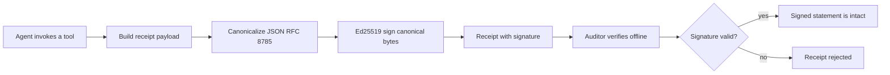
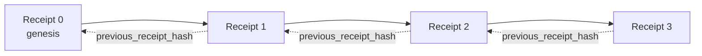

[Sehen Sie sich das Lektionenvideo an: Absicherung von KI-Agenten mit kryptografischen Belegen](https://youtu.be/PLACEHOLDER_VIDEO_ID)

> _(Lektionenvideo und Thumbnail werden vom Microsoft-Content-Team nach dem Merge hinzugefügt, passend zum Muster der Lektion 14 / 15.)_

# Absicherung von KI-Agenten mit kryptografischen Belegen

## Einführung

Diese Lektion behandelt:

- Warum Prüfprotokolle für KI-Agenten wichtig für Compliance, Debugging und Vertrauen sind.
- Was ein kryptografischer Beleg ist und wie er sich von einer ununterschriebenen Protokollzeile unterscheidet.
- Wie man in einfachem Python einen unterschriebenen Beleg für einen Werkzeugaufruf eines Agenten erstellt.
- Wie man einen Beleg offline verifiziert und Manipulationen erkennt.
- Wie man Belege verkettet, sodass das Entfernen oder Umordnen eines Belegs die Kette bricht.
- Was Belege beweisen und was sie ausdrücklich nicht beweisen.

## Lernziele

Nach Abschluss dieser Lektion wissen Sie, wie Sie:

- Fehlerarten identifizieren, die eine kryptografische Herkunftsnachweisführung für Agentenaktionen motivieren.
- Einen Ed25519-signierten Beleg über eine kanonische JSON-Nutzlast erzeugen.
- Einen Beleg unabhängig nur mit dem öffentlichen Schlüssel des Unterzeichners verifizieren.
- Manipulation erkennen, indem die Verifikation für einen modifizierten Beleg erneut durchgeführt wird.
- Eine hash-verkettete Belegsequenz erstellen und erklären, warum die Kette wichtig ist.
- Die Grenze erkennen zwischen dem, was Belege beweisen (Zuschreibung, Integrität, Reihenfolge) und dem, was sie nicht beweisen (Richtigkeit der Aktion, Verlässlichkeit der Richtlinie).

## Das Problem: Prüfprotokoll Ihres Agenten

Stellen Sie sich vor, Sie haben einen KI-Agenten für Contoso Travel im Einsatz. Der Agent liest Kundenanfragen, ruft eine Flug-API auf, um Optionen zu suchen, und bucht Plätze im Auftrag des Kunden. Im letzten Quartal hat der Agent 50.000 Buchungen verarbeitet.

Heute kommt ein Prüfer. Er stellt eine einfache Frage: "Zeigen Sie mir, was Ihr Agent getan hat."

Sie übergeben Ihre Protokolldateien. Der Prüfer schaut sie an und stellt die schwierigere Frage: "Woher weiß ich, dass diese Protokolle nicht bearbeitet wurden?"

Das ist das Prüfprotokollproblem. Die meisten Agenteneinsätze heute verlassen sich auf:

- **Anwendungsprotokolle**: vom Agenten selbst geschrieben, von jedem mit Dateisystemzugang änderbar.
- **Cloud-Logging-Dienste**: manipulationssicher auf Plattformebene, aber nur wenn der Prüfer dem Plattformbetreiber vertraut.
- **Datenbank-Transaktionsprotokolle**: gut geeignet für Datenbankänderungen, aber nicht für beliebige Werkzeugaufrufe.

Keines davon kann die Frage des Prüfers beantworten, ohne dass der Prüfer jemanden (Sie, Ihren Cloud-Anbieter, Ihren Datenbankanbieter) vertrauen muss. Für den internen Gebrauch ist dieses Vertrauen oft akzeptabel. Für regulierte Arbeitslasten (Finanzen, Gesundheitswesen, alles unter dem EU-KI-Gesetz) ist es das nicht.

Kryptografische Belege begrenzen dieses Problem, indem sie eine unterschriebene Aussage unabhängig
verifizierbar machen. Der Prüfer braucht dennoch einen out-of-band Grund, dem Signaturschlüssel und
der Komponente, die die Aussage erzeugte, zu vertrauen. Ein eingebetteter Schlüssel beweist Selbstkonsistenz,
nicht die Identität des Ausstellers oder die Stelle der Durchsetzung.

## Was ist ein kryptografischer Beleg?

Ein Beleg ist ein JSON-Objekt, das aufzeichnet, was ein Agent getan hat, und mit einer digitalen Signatur versehen ist.



Ein minimaler Beleg sieht so aus:

```json
{
  "type": "agent.tool_call.v1",
  "agent_id": "contoso-travel-bot",
  "tool_name": "lookup_flights",
  "tool_args_hash": "sha256:a3f9c1...",
  "result_hash": "sha256:7b2e1d...",
  "policy_id": "contoso-travel-policy-v3",
  "timestamp": "2026-04-25T14:30:00Z",
  "sequence": 47,
  "previous_receipt_hash": "sha256:9d4e6a...",
  "signature": {
    "alg": "EdDSA",
    "sig": "c5af83...",
    "public_key": "8f3b2c..."
  }
}
```

Drei Eigenschaften sind entscheidend:

1. **Die Signatur**. Der Beleg wird vom Gateway des Agenten mit einem Ed25519-Privatschlüssel signiert. Jeder mit dem zugehörigen öffentlichen Schlüssel kann die Signatur offline verifizieren. Eine vertrauende Partei muss diesen Schlüssel festlegen oder aus einem vertrauenswürdigen Register außerhalb des Belegs auflösen. Eine Manipulation an einem signierten Feld macht die Signatur ungültig.

2. **Kanonische Codierung**. Vor dem Signieren wird der Beleg mit dem JSON Canonicalization Scheme (JCS, RFC 8785) serialisiert. Das stellt sicher, dass zwei Implementierungen, die denselben logischen Beleg erzeugen, byte-identische Ausgaben produzieren. Ohne Kanonisierung würden verschiedene JSON-Serializer für denselben Inhalt unterschiedliche Signaturen erzeugen.

3. **Hash-Verkettung**. Das `previous_receipt_hash`-Feld verknüpft jeden Beleg mit dem vorherigen. Das Entfernen oder Umordnen eines Belegs bricht die gezeigte Sequenz. Das Erkennen von Abschneidungen oder einer vom Unterzeichner gesteuerten Änderung erfordert außerdem einen fixierten aktuellen Kettenkopf, unabhängig bezeugten Checkpoint oder eine authentifizierte Commit-Komponente einer geschlossenen Population.

Zusammen gewährleisten diese Eigenschaften drei Garantien:

- **Zuschreibung zu einem Schlüssel**: dieser Schlüssel hat diesen Inhalt signiert. Organisationale oder menschliche Identität benötigt eine vertrauenswürdige Schlüsselbindung.
- **Integrität**: der Inhalt wurde seit der Signatur nicht verändert.
- **Reihenfolge innerhalb der verifizierten Sequenz**: dieser Beleg verlinkt auf seinen Vorgänger.

## Einen Beleg in Python erstellen

Sie benötigen keine spezielle Bibliothek, um einen Beleg zu erstellen. Die kryptografischen Primitive sind weit verbreitet und die Logik umfasst nur ein paar Dutzend Zeilen Python.

Die praktischen Übungen in `code_samples/18-signed-receipts.ipynb` führen durch den gesamten Ablauf. Das quellkontrollierte `code_samples/18-signed-receipts.execution-receipt.json` zeichnet den exakten Notebook-Hash, die Python-Umgebung, Anzahl der Zellen und Checks aus der letzten sauberen Ausführung auf, ohne die gespeicherten Ausgaben der Lektion zu verändern. Die Zusammenfassung:

```python
import json
import hashlib
import base64
from nacl import signing
from jcs import canonicalize  # RFC 8785 canonical JSON

def b64url_nopad(data: bytes) -> str:
    return base64.urlsafe_b64encode(data).decode("ascii").rstrip("=")

def sha256_canonical(obj) -> str:
    """SHA-256 of a Python object's JCS-canonical JSON form."""
    return f"sha256:{hashlib.sha256(canonicalize(obj)).hexdigest()}"

# Generate or load a signing key (in production, store in a key vault)
signing_key = signing.SigningKey.generate()
verify_key = signing_key.verify_key
TRUSTED_PUBLIC_KEYS = {b64url_nopad(bytes(verify_key))}  # pinned out of band by the verifier

# Build the receipt payload (no signature yet)
tool_args = {"origin": "SYD", "destination": "LAX"}
tool_result = [{"flight": "QF11", "price": 1850, "stops": 0}]

payload = {
    "type": "agent.tool_call.v1",
    "agent_id": "contoso-travel-bot",
    "tool_name": "lookup_flights",
    "tool_args_hash": sha256_canonical(tool_args),
    "result_hash": sha256_canonical(tool_result),
    "policy_id": "contoso-travel-policy-v3",
    "timestamp": "2026-04-25T14:30:00Z",
    "sequence": 0,
    "previous_receipt_hash": None,
}

# Canonicalize and sign the JCS bytes directly. PureEdDSA hashes internally.
canonical_bytes = canonicalize(payload)
signature_bytes = signing_key.sign(canonical_bytes).signature

# Attach a structured signature object.
receipt = {
    **payload,
    "signature": {
        "alg": "EdDSA",
        "sig": b64url_nopad(signature_bytes),
        "public_key": b64url_nopad(bytes(verify_key)),
    },
}
```

Das ist die gesamte Signier-Pipeline. Die Übungen im Notebook erläutern jeden Schritt.

## Einen Beleg verifizieren und Manipulation erkennen

Die Verifikation ist der gegenteilige Vorgang:

```python
import base64
import hashlib
from nacl import signing
from nacl.exceptions import CryptoError
from jcs import canonicalize

def b64url_decode(s: str) -> bytes:
    # Strict: Python's decoder skips characters outside the alphabet and also
    # accepts padding, the standard +/ alphabet and non-zero spare bits.
    # Re-encoding and comparing accepts only the one unpadded base64url form.
    padding = "=" * ((4 - len(s) % 4) % 4)
    data = base64.urlsafe_b64decode(s + padding)
    if base64.urlsafe_b64encode(data).decode("ascii").rstrip("=") != s:
        raise ValueError("not canonical unpadded base64url")
    return data

def verify_receipt(receipt: dict, trusted_public_key: str) -> bool:
    # trusted_public_key is the issuer's key, obtained from somewhere other
    # than this receipt. Never use receipt["signature"]["public_key"] here:
    # see "What Receipts Prove (and What They Do Not)" below.
    # Fails closed: anything malformed returns False instead of raising.
    if not isinstance(receipt, dict) or not isinstance(trusted_public_key, str):
        return False
    sig_obj = receipt.get("signature")
    if not isinstance(sig_obj, dict) or sig_obj.get("alg") != "EdDSA":
        return False
    sig_b64 = sig_obj.get("sig")
    if not isinstance(sig_b64, str):
        return False

    try:
        # Reconstruct the payload that was actually signed (everything except signature).
        payload = {k: v for k, v in receipt.items() if k != "signature"}
        canonical_bytes = canonicalize(payload)
        verify_key = signing.VerifyKey(b64url_decode(trusted_public_key))
        verify_key.verify(canonical_bytes, b64url_decode(sig_b64))
        return True
    except (CryptoError, TypeError, ValueError, KeyError, OverflowError):
        return False
    except Exception:
        # An undecodable key or signature, or a payload that cannot be
        # canonicalized: fail closed rather than raise.
        return False
```

Diese Funktion erhält einen Beleg und den öffentlichen Schlüssel des Ausstellers und gibt `True` zurück, wenn die Signatur gültig ist, und `False` sonst – auch wenn die Eingabe fehlerhaft ist. Kein Netzwerkaufruf und kein Verifizierungsdienst: Sobald Sie den Schlüssel des Ausstellers besitzen, ist die Verifikation vollständig lokal und offline. Was sie dennoch benötigt, ist dieser Schlüssel, der von außerhalb des Belegs kommen muss.

Um die Manipulationserkennung in Aktion zu sehen, geht das Notebook durch:

1. Einen gültigen Beleg erzeugen und bestätigen, dass er verifiziert.
2. Ein Byte des `tool_args_hash`-Felds verändern.
3. Die Verifikation erneut durchführen und sehen, wie sie fehlschlägt.
4. Nochmals manipulieren, aber diesmal mit einem Schlüssel, den der Angreifer erzeugt hat, neu signieren und diesen Schlüssel im Beleg einbetten.

Schritt 4 ist der, bei dem man verweilen sollte. Dieser Beleg ist intern konsistent: seine Signatur ist echt für seinen Inhalt und für den Schlüssel, den er trägt, und verifiziert sich gegen den Schlüssel darin. Er schlägt nur fehl, wenn er mit dem echten Schlüssel des Ausstellers geprüft wird. Schritte 2 und 3 fangen einen Angreifer ab, der sich nicht die Mühe gemacht hat, neu zu signieren; Schritt 4 erwischt den, der es getan hat.

Dies ist der praktische Beweis, dass Belege manipulationssicher sind: Jede Änderung an einem signierten Feld bricht die Signatur, vorausgesetzt Sie verifizieren mit einem Schlüssel, den der Angreifer nicht bereitgestellt hat. Das `signature`-Objekt selbst liegt außerhalb der signierten Bytes, deshalb muss der Schlüssel, mit dem Sie verifizieren, von woanders als aus dem Beleg kommen.

## Belege für mehrstufige Agenten verketten

Ein einzelner signierter Beleg schützt eine Aktion. Eine Kette von Belegen schützt eine Sequenz.



Jeder Beleg zeichnet den Hash des vorherigen Belegs auf. Um den Beleg 2 unbemerkt zu entfernen, müsste ein Angreifer entweder:

- Das `previous_receipt_hash`-Feld von Beleg 3 ändern (was die Signatur von Beleg 3 bricht), ODER
- Eine neue Signatur auf einen modifizierten Beleg 3 fälschen (was den Privatschlüssel des Agenten erfordert).

Befindet sich der Privatschlüssel in einem Hardware-Schlüsseltresor und überprüfen Prüfer jeden Beleg mit dem öffentlichen Schlüssel des Ausstellers, der unabhängig bezogen wird (ein veröffentlichtes JWK-Set oder ein festgelegter Konfigurationswert), ist keiner der Angriffe ohne Erkennung praktikabel. Das Veröffentlichen des Schlüssels in jedem Beleg reicht nicht aus: Ein Angreifer kann mit eigenem Schlüssel neu signieren und diesen stattdessen einbetten, was Fixture `04_resigned_receipt.json` ist.

Das Notebook behandelt:

1. Aufbau einer Kette aus drei Belegen.
2. Überprüfung, dass das `previous_receipt_hash` jedes Belegs mit dem tatsächlichen Hash des vorherigen Belegs übereinstimmt.
3. Eine Manipulation in der Mitte der Kette und das Erkennen eines Abbruchs genau an dieser Stelle.

So erzeugen Sie ein Prüfprotokoll, das ein externer Prüfer mit seinen
eigenen festgelegten Aussteller-Schlüsseln und Ketten-Checkpoints prüfen kann, ohne Ihrem veränderbaren Protokollspeicher vertrauen zu müssen.

## Was Belege beweisen (und was nicht)

Dies ist der wichtigste Abschnitt der Lektion. Belege sind mächtig, aber ihre Macht ist begrenzt.

**Belege beweisen drei Dinge:**

1. **Zuschreibung**: Ein bestimmter Schlüssel hat eine bestimmte Nutzlast signiert.
2. **Integrität**: Die Nutzlast wurde seit der Signatur nicht verändert.
3. **Reihenfolge in einer präsentierten, verifizierten Sequenz**: Dieser Beleg verknüpft auf den Vorgänger.

**Belege beweisen NICHT:**

1. **Richtigkeit**: Dass die Aktion des Agenten die richtige war. Ein Beleg kann genauso für eine falsche Antwort unterschrieben werden wie für eine richtige.
2. **Einhaltung der Richtlinie**: Dass die in `policy_id` referenzierte Richtlinie tatsächlich bewertet wurde oder dass sie diese Aktion erlaubt hätte, wenn geprüft. Der Beleg zeichnet auf, was behauptet wurde, nicht was durchgesetzt wurde.
3. **Identität über den Schlüssel hinaus**: Der Beleg sagt "Dieser Schlüssel hat diesen Inhalt signiert." Er sagt nicht "Dieser Mensch hat das autorisiert." Die Verbindung eines Schlüssels mit einer Person oder Organisation erfordert separate Identitätsinfrastruktur (ein Verzeichnis, ein öffentlicher Schlüssel-Registry, etc.).
4. **Wahrhaftigkeit der Eingaben**: Wenn der Agent eine manipulierte Eingabe erhält und darauf handelt, zeichnet der Beleg die Aktion getreu auf. Belege sind nachgelagert zur Eingabevalidierung, kein Ersatz dafür.
5. **Ausführung oder reale Wirkung**: Ein nachgelagerter Beleg zeichnet auf, was sein Aussteller behauptet habe, dass passiert ist. Den Eintritt oder einen externen Effekt zu beweisen, erfordert Nachweise vom tatsächlichen Ausführenden oder Anbieter.
6. **Vollständigkeit**: Ein fehlender Beleg kann blockiert, ausgelassen, verloren oder nicht instrumentiert bedeuten. Abwesenheit wird nur innerhalb einer authentifizierten geschlossenen Population zum Beweis.
7. **Vertrauenswürdige Zeit**: Ein signierter Zeitstempel beweist, dass der Unterzeichner diesen Wert verwendet hat, nicht dass der Wert korrekt war. Vertrauenswürdige Zeit erfordert eine separate Zeitinstanz oder einen bezeugten Checkpoint.

**Der Schlüssel im Beleg ist nicht der Schlüssel, mit dem Sie verifizieren.** Das folgt aus Punkt 3, und es ist die eine Stelle, an der sich der Unterschied in Ihrem Code und nicht nur im Verständnis widerspiegeln muss. Der `public_key` im obigen Beispiel ist da, damit das Beispiel eigenständig ist. Ein Prüfer darf ihm niemals vertrauen. Jeder kann einen Beleg nehmen, ihn verändern, mit einem selbst erzeugten Schlüssel neu signieren und diesen Schlüssel einbetten; das Ergebnis verifiziert perfekt gegen sich selbst. Das ist Fixture `04_resigned_receipt.json` in `sample_receipts/`, und deshalb nimmt `verify_receipt` oben den Schlüssel als Argument an, anstatt ihn aus dem Beleg auszulesen. Besorgen Sie sich den Schlüssel des Ausstellers unabhängig, aus dem JWK-Set in der Produktions-Checkliste unten oder einem anderen zuvor gesetzten Anker, und verifizieren Sie damit. Eine mit einem im gleichen Umschlag erhaltenen Schlüssel geprüfte Signatur beweist nur, dass der Umschlag selbst konsistent ist.

Diese Grenze ist aus zwei Gründen wichtig:

- Sie sagt Ihnen, wofür Belege nützlich sind: Verhalten von Agenten prüfbar und manipulationssicher machen, selbst über Organisationsgrenzen hinweg.
- Sie sagt Ihnen, welche zusätzlichen Schichten Sie noch brauchen: Eingabevalidierung (Lektion 6), Richtliniendurchsetzung (unten kurz behandelt) und Identitätsinfrastruktur (nicht Teil dieser Lektion).

Ein häufiger Fehler ist anzunehmen, "wir haben Belege" bedeutet "wir sind reguliert." Tut es nicht. Belege sind eine Grundlage. Regulierung ist das System, das Sie darüber aufbauen.

## Eine Genehmigersignatur an die exakte Aktion binden

Punkt 3 oben verdient einen eigenen Abschnitt: Ein Aktionsbeleg sagt "dieser Schlüssel hat diesen Inhalt signiert", niemals "ein Mensch hat das genehmigt." Für risikoreiche Aktionen (Rückerstattungen, Löschungen, Überweisungen) kann eine separate Genehmigersignatur die exakte Aktion binden. Die Verbindung dieses Schlüssels mit einem Menschen und das Prüfen der Anwesenheit bleiben getrennte Aufgaben.

Das Folge-Notebook `code_samples/human-authorization-receipts.ipynb` fügt eine zweite Belegart hinzu, `human.approval.v1`, in derselben Umschlagsform wie die Belege dieser Lektion (ein typisiertes Payload, mit Ed25519 über seine kanonischen JCS-Bytes signiert, mit dem `signature`-Objekt außerhalb der signierten Bytes). Ein Genehmigerschlüssel signiert die **vollständige kanonische Aktion und deren Digest**; ein Agentenschlüssel signiert eine Aussage, die den **gleichen Aktionsdigest** und ein `parent_approval_ref`, den `receipt_hash` der Genehmigung, trägt – dieselbe Konvention wie `previous_receipt_hash` in der Kette, die Sie oben gebaut haben. Ein `verify_chain` prüft beide Artefakte unter **separaten festgelegten Schlüsselregistern** (Genehmigerschlüssel vs. Agentenschlüssel), sodass der Codepfad geteilt wird, aber die Behörden nie.

Die Eigenschaft, die das bewirkt, sorgfältig formuliert: *Der festgelegte Genehmigerschlüssel hat diese exakte
Aktion signiert, und der Agentenschlüssel hat später eine Aussage mit demselben Aktionsdigest unterschrieben.*
Das ist nützlich als Beweis, aber nicht für sich allein ein Beweis, dass die Aktion ausgeführt wurde. Um
die Ausführung zu steuern, muss die exakte Genehmigung auch reserviert und einmal an der
tatsächlichen Ausführungsgrenze verbraucht werden; unbekannte Anbieter-Ergebnisse müssen unbekannt bleiben, anstatt
blind erneut versucht zu werden. Die im Notebook enthaltenen Weigerungs-Fixtures testen die Belegketten-Schicht:

- Manipulationen, verwirrte Stellvertreter, gefälschte Schlüssel auf beiden Seiten und fehlerhafte Eingaben;
- **veraltete Autorität**: eine Signatur, die zwar noch überprüfbar ist, aber trotzdem abgelehnt wird, weil die Richtlinienversion geändert wurde, der Genehmigungsschlüssel aus dem festgelegten Register entfernt wurde oder die Genehmigung vor der angegebenen Prüfzeit abgelaufen ist;
- **Digest-Ersetzung**: eine gültig signierte Aktionsbestätigung, die auf eine *echte* Genehmigung verweist, welche eine *andere* kanonische Aktion bindet.

Jeder Fehler lehnt mit einem unterschiedlichen Grund ab, sodass ein Prüfer anhand einer Ablehnung erkennen kann, ob die Autorität veraltet ist oder die angegebene Aktion geändert wurde. Die Prüfung ist nur lesend und wiederholbar: sie verbraucht die Genehmigung nicht und ruft keinen Anbieter auf. Ein separater Ausführer benötigt dauerhaften, atomaren Schutz vor Wiederholungen sowie eindeutige Erfolgs-, Fehler- und unbestimmte Ergebnisse. Die Genehmigungsbestätigung durch den Menschen ist eine zur Bildung dienende Komposition, die durch diese Lektion definiert wird, kein von `draft-farley-acta-signed-receipts` definierter Bestätigungstyp.

## Produktionsreferenzen

Der Python-Code in dieser Lektion ist absichtlich minimal gehalten, damit Sie jede Zeile lesen und genau verstehen können, was passiert. In der Produktion haben Sie zwei Möglichkeiten:

1. **Direkt auf den kryptografischen Primitiven aufbauen.** Die 50 Zeilen, die Sie oben gesehen haben, reichen für viele Anwendungsfälle aus. PyNaCl (Ed25519) und das `jcs`-Paket (kanonisches JSON) sind gut gepflegte und geprüfte Bibliotheken.

2. **Eine Produktions-Receipt-Bibliothek verwenden.** Mehrere Open-Source-Projekte implementieren dasselbe Muster mit zusätzlichen Funktionen (Schlüsselrotation, Batch-Verifizierung, JWK-Set-Verteilung, Integration mit Policy-Engines):
   - Die Signierungspipeline verwendet die JCS- und Signaturrichtlinienkonventionen in einem unabhängigen IETF Internet-Draft ([`draft-farley-acta-signed-receipts`](https://datatracker.ietf.org/doc/draft-farley-acta-signed-receipts/), Revision 02). Die flache, didaktische Quittung dieser Lektion unterscheidet sich vom `{payload, signature}`-Envelope des Drafts und wird nicht als konforme Implementierung präsentiert. Der Draft veröffentlicht eine gemeinsame Konformitätssuite ([agent-governance-testvectors](https://github.com/ScopeBlind/agent-governance-testvectors)) für Implementierungen, die auf sein Wire-Format abzielen.
   - Das Microsoft Agent Governance Toolkit komponiert Quittungen mit Cedar-basierten Policy-Entscheidungen; siehe Tutorial 33 in diesem Repository für ein durchgehendes Beispiel.
   - Die Pakete `protect-mcp` (npm) und `@veritasacta/verify` (npm) bieten eine Node-basierte Implementierung von Receipt-Signierung und Offline-Verifizierung, gedacht zum Einbetten eines MCP-Servers mit manipulationssicherem Audit-Trail, einschließlich eines gehaltenen Co-Sign-Flow, bei dem eine pausierte Aktion eine Genehmigungsquittung ausgibt, die an den Aktions-Digest gebunden ist (WebAuthn-gestützt im Desktop-Flow), dasselbe Genehmigungsquittungs-Muster wie im oben genannten Human-Authorization-Notebook.
   - Das **[nobulex](https://github.com/arian-gogani/nobulex)** Python SDK (`pip install nobulex`) bietet in Python denselben Ed25519 + JCS-Signaturansatz mit LangChain- und CrewAI-Integrationen, inklusive veröffentlichter Cross-Validierungs-Testvektoren und einer Compliance-Mapping-Beitrag über [OWASP PR #2210](https://github.com/OWASP/CheatSheetSeries/pull/2210).
   - **[EMILIA Protocol](https://github.com/emiliaprotocol/emilia-protocol)** stellt eine ergänzende exakte Handlungsausführungsschicht bereit: offline-verifizierbare Genehmigungsquittungen, angepinnte WebAuthn- oder Quorum-Behörde, einmaliger Verbrauch an der Executor-Grenze und einen expliziten unbestimmten Ergebnis-Pfad. Seine Framework-Adapter behandeln eine Quittung als notwendigen Beweis statt als Nachweis, dass ein externer Effekt eingetreten ist.

Die Entscheidung zwischen Eigenentwicklung und Bibliotheksnutzung ähnelt der Entscheidung, eine eigene JWT-Bibliothek zu schreiben oder eine getestete zu verwenden: Beide sind sinnvoll; die Bibliothek spart Zeit und verringert die Prüfoberfläche; der Eigenbau zwingt Sie, jedes Primitive zu verstehen. Diese Lektion lehrt den Eigenbau-Weg, damit Sie die Grundlage für beide Möglichkeiten haben.

## Wissensabfrage

Testen Sie Ihr Verständnis, bevor Sie zur Übung übergehen.

**1. Eine Quittung wird mit dem privaten Ed25519-Schlüssel des Agenten signiert. Der Prüfer hat nur den öffentlichen Schlüssel. Kann der Prüfer die Quittung offline prüfen?**

<details>
<summary>Antwort</summary>

Ja, die kryptografische Verifikation benötigt nur den öffentlichen Schlüssel und die signierten Bytes. Der
Prüfer muss den akzeptierten öffentlichen Schlüssel jedoch unabhängig von der Quittung beziehen und bestätigen.
Danach ist kein Netzwerkanruf notwendig.
</details>

**2. Ein Angreifer manipuliert das `policy_id`-Feld einer Quittung, um zu behaupten, sie sei durch eine permissivere Richtlinie geregelt worden. Die Signatur bezog sich auf die Originaldaten. Was passiert bei der Verifizierung?**

<details>
<summary>Antwort</summary>

Die Verifikation schlägt fehl. Die Signatur wurde über die kanonischen Bytes der Originaldaten berechnet; jede Änderung an einem Datenfeld ändert diese Bytes und macht die Signatur ungültig. Der Angreifer bräuchte den privaten Schlüssel, um eine neue gültige Signatur zu erzeugen, den er nicht besitzt.
</details>

**3. Warum enthält die Quittung einen `tool_args_hash` und `result_hash` anstelle der rohen Argumente und des Ergebnisses?**

<details>
<summary>Antwort</summary>

Zwei Gründe. Erstens muss die Quittung möglicherweise archiviert oder übertragen werden in Umgebungen, in denen das Offenlegen der Rohinhalte (personenbezogene Daten, Geschäftsdaten) problematisch ist. Durch das Hashen bleibt die Quittung klein und der Inhalt privat; der Prüfer verifiziert, dass der Hash mit einer separat gespeicherten Kopie des tatsächlichen Inhalts übereinstimmt. Zweitens haben Hashes eine feste Größe; eine Quittung mit Hashes ist hinsichtlich der Größe begrenzt, egal wie groß die Ein- und Ausgaben waren.
</details>

**4. Das `previous_receipt_hash`-Feld verknüpft jede Quittung mit ihrem Vorgänger. Wenn ein Angreifer eine Quittung mittendrin in einer Kette stillschweigend löscht, was wird ungültig?**

<details>
<summary>Antwort</summary>

Alle Quittungen, die nach der gelöschten kamen. Ihre `previous_receipt_hash`-Felder passen nicht mehr zur tatsächlichen Kette (weil die referenzierte Quittung nicht mehr existiert oder die Kette nun auf einen anderen Vorgänger zeigt). Um die Löschung zu verbergen, müsste der Angreifer jede spätere Quittung neu signieren, was den privaten Schlüssel des Herausgebers erfordert. Eine Neusignierung mit einem anderen Schlüssel schlägt bei der Prüfung gegen den Herausgeberschlüssel fehl.
</details>

**5. Eine Quittung verifiziert sauber. Beweist das, dass die Aktion des Agenten korrekt, sinnvoll oder richtlinienkonform war?**

<details>
<summary>Antwort</summary>

Nein. Unter einem festgelegten Schlüssel- und Kettenkontext beweist eine gültige Quittung die Signaturzuordnung,
Inhaltsintegrität und eine Verknüpfung zum präsentierten Vorgänger. Sie beweist NICHT, dass die
Aktion korrekt oder ausgeführt wurde, dass die Richtlinie ausgewertet wurde, dass der Zeitstempel
vertrauenswürdig ist oder dass der Datensatz vollständig ist. Dies ist die wichtigste Grenze in der Lektion.
</details>

## Übungsaufgabe

Öffnen Sie `code_samples/18-signed-receipts.ipynb` und bearbeiten Sie alle vier Abschnitte:

1. **Abschnitt 1**: Signieren Sie Ihre erste Quittung und verifizieren Sie sie.
2. **Abschnitt 2**: Manipulieren Sie die Quittung und beobachten Sie, wie die Verifikation fehlschlägt.
3. **Abschnitt 3**: Bauen Sie eine Kette aus drei Quittungen und verifizieren Sie die Kettenintegrität.
4. **Abschnitt 4**: Wenden Sie das Muster auf einen Agenten an, der mit dem Microsoft Agent Framework gebaut wurde: Umhüllen Sie einen Tool-Aufruf mit einer Quittungs-Signierung und verifizieren Sie die Quittung dann unabhängig.

**Stretch Challenge 1:** Erweitern Sie das Quittungs-Schema um ein zusätzliches eigenes Feld (zum Beispiel eine Request-ID zur Nachverfolgung), aktualisieren Sie die kanonische Signierlogik, um es einzuschließen, und bestätigen Sie, dass die Quittung weiterhin die Verifikation besteht. Verändern Sie danach das Feld und bestätigen Sie, dass die Verifikation fehlschlägt. Dies zwingt Sie zu verstehen, wie jedes Byte der kanonischen Kodierung zur Signatur beiträgt.

**Stretch Challenge 2:** Hashen Sie zwei Ihrer Quittungen zusammen (verkettete ihre kanonischen Bytes in einer deterministischen Reihenfolge) und betten Sie den resultierenden Digest als neues Feld in einer dritten Quittung vor deren Signierung ein. Verifizieren Sie, dass alle drei Quittungen weiterhin verifizierbar sind. Sie haben gerade einen einstufigen Einschlussnachweis gebaut: Jeder, der die dritte Quittung besitzt, kann beweisen, dass die ersten beiden zum Signierzeitpunkt existierten, ohne deren Inhalte offenlegen zu müssen. Dies ist das Muster, das selektive Offenlegungs-Quittungen in großem Maßstab nutzen (Merkle-Commitments, RFC 6962).

## Fazit

Kryptografische Quittungen geben KI-Agenten eine Audit-Spur, die:

- **Unabhängig verifizierbar unter festgelegtem Vertrauen**: eine Partei mit akzeptierten öffentlichen Schlüsseln und signierten Bytes kann ohne Dienstabhängigkeit verifizieren.
- **Manipulationssicher**: jede Änderung macht die Signatur ungültig.
- **Portabel**: eine Quittung ist eine kleine JSON-Datei; sie kann archiviert, übertragen und überall verifiziert werden.
- **Standardskonform**: basiert auf Ed25519 (RFC 8032), JCS (RFC 8785) und SHA-256, alles weit verbreitete Primitiven.

Sie ersetzen nicht Eingabevalidierung, Policy-Durchsetzung, Executor-Zulassung,
Ergebnisbeweise, Vollständigkeitskontrollen oder Identitätsinfrastruktur. Sie sind die Grundlage
für diese Schichten. In regulierten oder mehrorganisatorischen Workflows machen Quittungen spezifische
Aussagen des Ausstellers unabhängig prüfbar unter der eigenen Vertrauenskonfiguration des Prüfers.

Die wichtigste Erkenntnis: Quittungen beweisen, dass ein bestimmter Schlüssel bestimmte
Inhalte signiert hat. Ein mitgeführter Zeitstempel ist eine Signiererbehauptung, es sei denn,
er wird separat zeitlich attestiert. Eine Quittung beweist nicht, dass ihr Inhalt wahr war,
dass eine Aktion ausgeführt wurde oder dass der Datensatz vollständig ist. Halten Sie diese Unterscheidungen streng.

## Produktions-Checkliste

Wenn Sie bereit sind, von dieser Lektion zur Produktion von receipt-signierten Agenten in einer realen Umgebung überzugehen:

- [ ] **Verschieben Sie den Signierschlüssel vom Entwickler-Laptop.** Verwenden Sie Azure Key Vault, AWS KMS oder ein Hardware-Sicherheitsmodul. Der private Schlüssel, der Ihre Quittungen signiert, darf niemals in Versionsverwaltung oder im Klartext auf Anwendungsmaschinen liegen.
- [ ] **Etablieren Sie das Vertrauen in den Verifikatorschlüssel.** Veröffentlichen Sie Schlüssel über ein JWK Set oder Register, lassen Sie dann die abhängigen Parteien die akzeptierte Herausgeberidentität, Schlüsselmenge und Rotationspolitik außerhalb der einzelnen Quittungen festnageln. Ein eingebetteter Schlüssel allein ist kein Vertrauensanker.
- [ ] **Verankern Sie die Kette extern.** Schreiben Sie periodisch den Hash der neuesten Kettenkopie in ein Transparenzlog (Sigstore Rekor, RFC 3161 Zeitstempeldienst oder ein zweites internes System), so dass eine externe Partei bestätigen kann: "Diese Kette existierte zu diesem Zeitpunkt."
- [ ] **Speichern Sie Quittungen unveränderlich.** Ein Append-Only Blob-Speicher (Azure Storage mit Unveränderbarkeitsrichtlinien, AWS S3 Object Lock) verhindert, dass ein Insider die Historie auf der Speicherebene neu schreibt.
- [ ] **Entscheiden Sie über Aufbewahrung.** Viele Compliance-Richtlinien verlangen mehrjährige Aufbewahrung. Planen Sie das Quittungswachstum (jede Quittung ist ca. 500 Bytes; ein Agent mit 10.000 Aufrufen pro Tag erzeugt ca. 1,8 GB pro Jahr).
- [ ] **Dokumentieren Sie, was Quittungen nicht abdecken.** Quittungen beweisen Attribution, Integrität und Reihenfolge. Ihr Runbook sollte explizit aufführen, welche zusätzlichen Kontrollen (Eingabevalidierung, Policy-Durchsetzung, Ratenbegrenzung, Identitätsinfrastruktur) neben den Quittungen Ihre Governance-Rolle ergänzen.

### Haben Sie weitere Fragen zur Sicherung von KI-Agenten?

Treten Sie dem [Microsoft Foundry Discord](https://aka.ms/ai-agents/discord) bei, um andere Lernende zu treffen, an Sprechstunden teilzunehmen und Ihre Fragen zu KI-Agenten beantwortet zu bekommen.

## Über diese Lektion hinaus

Diese Lektion behandelt einzelne Quittungssignierungen und Hash-verkettete Sequenzen. Dieselben Primitiven setzen sich zu mehreren fortgeschrittenen Mustern zusammen, die Sie möglicherweise kennenlernen, wenn Ihre Governance-Haltung reift:

- **Selektive Offenlegung.** Wenn die Felder einer Quittung unabhängig festgelegt sind (RFC 6962-artiger Merkle-Baum), können Sie einzelne Felder bestimmten Prüfern offenbaren und beweisen, dass die übrigen unverändert sind, ohne diese offenzulegen. Nützlich, wenn dieselbe Quittung sowohl eine umfassende Prüfung (die Vollständigkeit will) als auch datenschutzrechtliche Minimierungsanforderungen wie GDPR erfüllen muss (wobei der Prüfer so wenig wie möglich sehen soll).
- **Quittungswiderruf.** Wenn ein Signaturschlüssel kompromittiert wird, brauchen Sie eine Möglichkeit, alle von diesem Schlüssel signierten Quittungen ab einem Zeitpunkt als nicht vertrauenswürdig zu markieren. Standardmuster: kurzlebige Signaturschlüssel plus veröffentlichte Widerrufslisten oder ein Transparenzlog mit Widerrufs-Einträgen.
- **Bilaterale / geteilte Signaturquittungen.** Manche Implementierungen teilen die signierte Nutzlast in Vor-Ausführungs-(`authorization_*`) und Nach-Ausführungs-(`result_*`) Hälften mit unabhängigen Signaturen auf, nützlich, wenn die Autorisierungsentscheidung und das beobachtete Ergebnis von verschiedenen Akteuren oder zu unterschiedlichen Zeiten erzeugt werden. Das baut additiv auf dem in dieser Lektion gelehrten Quittungsformat auf.
- **Nutzlastkomposition.** Eine Quittung versiegelt genau die Bytes, die Sie in `result_hash` setzen. Realwelt-Nutzlasten sind oft reichhaltiger als nur das Ergebnis eines einzigen Tool-Aufrufs: Vorentscheidungs-Überlegungen (Modellprognose, betrachtete Optionen, Beweise und deren Vollständigkeit, Risiko-Einschätzung, Verantwortlichkeitskette, Ergebnis des Zugriffstors) können alle in der Nutzlast leben, versiegelt durch eine einzelne Quittung. Das hält das Quittungsformat minimal, während die Nutzlast-Schemata domainübergreifend wachsen können.
- **Konformität über Implementierungen hinweg.** Mehrere unabhängige Implementierungen desselben Quittungsformats (Python, TypeScript, Rust, Go) verifizieren sich mit gemeinsamen Test-Vektoren gegenseitig. Wenn Sie Ihre eigene Implementierung bauen, überprüft die Validierung anhand veröffentlichter Vektoren die Draht-Kompatibilität.
- **Post-quanten Migration.** Ed25519 ist heute weit verbreitet, aber nicht quantensicher. Ein `alg`-Label allein ist keine Migration: Ein Profil muss ML-DSA-Schlüsselcodierung, kanonische Signaturbytes, Verifikation, Richtlinien für abzeichnende Parteien, Abwärtskompatibilitäts-Schutz und Übergangssemantik definieren. Planen und testen Sie einen Dual-Signatur-Übergang mit gemeinsamen Vektoren, bevor Sie Kompatibilitätsbehauptungen aufstellen.

## Zusätzliche Ressourcen

- <a href="https://datatracker.ietf.org/doc/draft-farley-acta-signed-receipts/" target="_blank">IETF Internet-Draft: Signed Decision Receipts for Machine-to-Machine Access Control</a>
- <a href="https://learn.microsoft.com/azure/ai-studio/responsible-use-of-ai-overview" target="_blank">Überblick Verantwortliche KI (Azure AI)</a>
- <a href="https://datatracker.ietf.org/doc/html/rfc8032" target="_blank">RFC 8032: Edwards-Curve Digital Signature Algorithm (EdDSA)</a>
- <a href="https://datatracker.ietf.org/doc/html/rfc8785" target="_blank">RFC 8785: JSON Canonicalization Scheme (JCS)</a>
- <a href="https://datatracker.ietf.org/doc/html/rfc6962" target="_blank">RFC 6962: Certificate Transparency</a> (Merkle-Baum-Konstruktion verwendet bei selektiven Offenlegungs-Quittungen)
- <a href="https://github.com/microsoft/agent-governance-toolkit/blob/main/docs/tutorials/33-offline-verifiable-receipts.md" target="_blank">Microsoft Agent Governance Toolkit, Tutorial 33: Offline-verifizierbare Entscheidungsquittungen</a>
- <a href="https://github.com/ScopeBlind/agent-governance-testvectors" target="_blank">Implementierungsübergreifende Konformitätstest-Vektoren</a> für das in dieser Lektion verwendete Empfangsformat (Apache-2.0)
- <a href="https://pynacl.readthedocs.io/" target="_blank">PyNaCl-Dokumentation</a> (Ed25519 in Python)

## Vorherige Lektion

[Erstellen lokaler KI-Agenten](../17-creating-local-ai-agents/README.md)

---

<!-- CO-OP TRANSLATOR DISCLAIMER START -->
**Haftungsausschluss**:
Dieses Dokument wurde mit dem KI-Übersetzungsdienst [Co-op Translator](https://github.com/Azure/co-op-translator) übersetzt. Obwohl wir uns um Genauigkeit bemühen, beachten Sie bitte, dass automatisierte Übersetzungen Fehler oder Ungenauigkeiten enthalten können. Das Originaldokument in seiner Ursprungssprache gilt als maßgebliche Quelle. Bei kritischen Informationen wird eine professionelle menschliche Übersetzung empfohlen. Wir übernehmen keine Haftung für Missverständnisse oder Fehlinterpretationen, die aus der Verwendung dieser Übersetzung entstehen.
<!-- CO-OP TRANSLATOR DISCLAIMER END -->