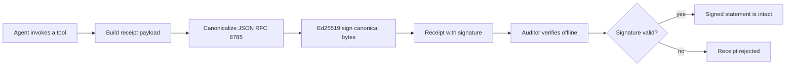
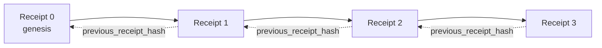

[Sehen Sie sich das Lektionenvideo an: Sicherung von KI-Agenten mit kryptographischen Quittungen](https://youtu.be/PLACEHOLDER_VIDEO_ID)

> _(Lektionenvideo und Miniaturansicht werden nach dem Zusammenführen vom Microsoft-Inhaltsteam hinzugefügt, entsprechend dem Muster der Lektionen 14 / 15.)_

# Sicherung von KI-Agenten mit kryptographischen Quittungen

## Einführung

Diese Lektion behandelt:

- Warum Prüfprotokolle für KI-Agenten für Compliance, Debugging und Vertrauen wichtig sind.
- Was eine kryptographische Quittung ist und wie sie sich von einer nicht signierten Protokollzeile unterscheidet.
- Wie man in einfachem Python eine signierte Quittung für einen Toolaufruf eines Agenten erzeugt.
- Wie man eine Quittung offline überprüft und Manipulationen erkennt.
- Wie man Quittungen verketten kann, sodass das Entfernen oder Umordnen einer Quittung die Kette unterbricht.
- Was Quittungen beweisen und was sie explizit nicht beweisen.

## Lernziele

Nach Abschluss dieser Lektion wissen Sie, wie Sie:

- die Fehlerfälle identifizieren, die eine kryptographische Herkunft für Agentenaktionen motivieren.
- eine Ed25519-signierte Quittung über eine kanonische JSON-Nutzlast erzeugen.
- eine Quittung unabhängig nur mit dem öffentlichen Schlüssel des Signierenden verifizieren.
- Manipulationen erkennen, indem Sie die Verifizierung einer veränderten Quittung erneut durchführen.
- eine hash-verkettete Folge von Quittungen aufbauen und erklären, warum die Kette wichtig ist.
- die Grenze erkennen zwischen dem, was Quittungen beweisen (Zurechnung, Integrität, Reihenfolge) und dem, was sie nicht beweisen (Richtigkeit der Aktion, Gültigkeit der Richtlinie).

## Das Problem: Das Prüfprotokoll Ihres Agenten

Stellen Sie sich vor, Sie haben einen KI-Agenten für Contoso Travel eingesetzt. Der Agent liest Kundenanfragen, ruft eine Flug-API auf, um Optionen zu suchen, und bucht Plätze im Namen des Kunden. Im letzten Quartal hat der Agent 50.000 Buchungen verarbeitet.

Heute kommt ein Prüfer. Er stellt eine einfache Frage: „Zeigen Sie mir, was Ihr Agent getan hat.“

Sie übergeben Ihre Protokolldateien. Der Prüfer sieht sie sich an und stellt die schwierigere Frage: „Wie weiß ich, dass diese Protokolle nicht bearbeitet wurden?“

Dies ist das Prüfprotokoll-Problem. Die meisten Agenteneinsätze verlassen sich heute auf:

- **Anwendungsprotokolle**: vom Agenten selbst geschrieben, von jedem mit Dateisystemzugriff editierbar.
- **Cloud-Protokollierungsdienste**: manipulationssicher auf Plattformebene, aber nur wenn der Prüfer dem Plattformbetreiber vertraut.
- **Datenbank-Transaktionsprotokolle**: gut geeignet für Datenbankänderungen, aber nicht für beliebige Toolaufrufe.

Keine dieser Optionen kann die Frage des Prüfers beantworten, ohne dass der Prüfer jemandem vertrauen muss (Ihnen, Ihrem Cloud-Anbieter, Ihrem Datenbankanbieter). Für den internen Gebrauch ist dieses Vertrauen oft akzeptabel. Für regulierte Arbeitslasten (Finanzen, Gesundheitswesen, alles, was dem EU-KI-Gesetz unterliegt) ist es das nicht.

Kryptographische Quittungen grenzen dieses Problem ein, indem sie eine signierte Aussage unabhängig
verifizierbar machen. Der Prüfer benötigt dennoch einen außerhalb der Bandbreite liegenden Grund, dem Signaturschlüssel und
der Komponente, die die Aussage erzeugt hat, zu vertrauen. Ein eingebetteter Schlüssel beweist Selbstkonsistenz,
nicht die Identität des Ausstellers oder die Position der Durchsetzung.

## Was ist eine kryptographische Quittung?

Eine Quittung ist ein JSON-Objekt, das aufzeichnet, was ein Agent getan hat, und mit einer digitalen Signatur versehen ist.



Eine minimale Quittung sieht so aus:

```json
{
  "type": "agent.tool_call.v1",
  "agent_id": "contoso-travel-bot",
  "tool_name": "lookup_flights",
  "tool_args_hash": "sha256:a3f9c1...",
  "result_hash": "sha256:7b2e1d...",
  "policy_id": "contoso-travel-policy-v3",
  "timestamp": "2026-04-25T14:30:00Z",
  "sequence": 47,
  "previous_receipt_hash": "sha256:9d4e6a...",
  "signature": {
    "alg": "EdDSA",
    "sig": "c5af83...",
    "public_key": "8f3b2c..."
  }
}
```

Drei Eigenschaften sind dafür verantwortlich:

1. **Die Signatur**. Die Quittung wird vom Gateway des Agenten mit einem Ed25519-Privatschlüssel signiert. Jeder mit dem dazugehörigen öffentlichen Schlüssel kann die Signatur offline verifizieren. Eine vertrauliche Partei muss diesen Schlüssel pinnen oder ihn aus einem vertrauenswürdigen Verzeichnis außerhalb der Quittung auflösen. Eine Manipulation an einem signierten Feld macht die Signatur ungültig.

2. **Kanonische Codierung**. Vor der Signatur wird die Quittung mit dem JSON Canonicalization Scheme (JCS, RFC 8785) serialisiert. Das stellt sicher, dass zwei Implementierungen, die dieselbe logische Quittung erzeugen, identische Bytes als Ausgabe produzieren. Ohne Kanonisierung würden verschiedene JSON-Serializer für denselben Inhalt unterschiedliche Signaturen erzeugen.

3. **Hash-Verkettung**. Das `previous_receipt_hash`-Feld verbindet jede Quittung mit der vorherigen. Das Entfernen oder Umordnen einer Quittung unterbricht die präsentierte Folge. Das Erkennen von Abschneidungen oder eines vom Signierer kontrollierten Umschreibens erfordert auch einen gepinnten aktuellen Kettenkopf, einen unabhängig beobachteten Kontrollpunkt oder ein authentifiziertes Commitment mit geschlossenem Mitgliederkreis.

Zusammen bieten diese Eigenschaften drei Garantien:

- **Zurechnung zu einem Schlüssel**: Dieser Schlüssel hat diesen Inhalt signiert. Organisations- oder Personenidentität erfordert eine vertrauenswürdige Schlüsselbindung.
- **Integrität**: Der Inhalt wurde seit der Signatur nicht verändert.
- **Reihenfolge in der verifizierten Folge**: Diese Quittung verweist auf den Vorgänger.

## Erzeugen einer Quittung in Python

Sie benötigen keine spezielle Bibliothek, um eine Quittung zu erzeugen. Die kryptographischen Bausteine sind weit verbreitet, und die Logik umfasst nur einige Dutzend Zeilen Python.

Die praxisorientierten Übungen in `code_samples/18-signed-receipts.ipynb` führen durch den gesamten Ablauf. Das quellengesteuerte `code_samples/18-signed-receipts.execution-receipt.json` zeichnet den exakten Hash des Notebooks, die Python-Umgebung, die Anzahl der Zellen und die Prüfungen der letzten sauberen Ausführung auf, ohne die gespeicherten Ausgaben der Lektion zu verändern. Die Zusammenfassung lautet:

```python
import json
import hashlib
import base64
from nacl import signing
from jcs import canonicalize  # RFC 8785 canonical JSON

def b64url_nopad(data: bytes) -> str:
    return base64.urlsafe_b64encode(data).decode("ascii").rstrip("=")

def sha256_canonical(obj) -> str:
    """SHA-256 of a Python object's JCS-canonical JSON form."""
    return f"sha256:{hashlib.sha256(canonicalize(obj)).hexdigest()}"

# Generate or load a signing key (in production, store in a key vault)
signing_key = signing.SigningKey.generate()
verify_key = signing_key.verify_key
TRUSTED_PUBLIC_KEYS = {b64url_nopad(bytes(verify_key))}  # pinned out of band by the verifier

# Build the receipt payload (no signature yet)
tool_args = {"origin": "SYD", "destination": "LAX"}
tool_result = [{"flight": "QF11", "price": 1850, "stops": 0}]

payload = {
    "type": "agent.tool_call.v1",
    "agent_id": "contoso-travel-bot",
    "tool_name": "lookup_flights",
    "tool_args_hash": sha256_canonical(tool_args),
    "result_hash": sha256_canonical(tool_result),
    "policy_id": "contoso-travel-policy-v3",
    "timestamp": "2026-04-25T14:30:00Z",
    "sequence": 0,
    "previous_receipt_hash": None,
}

# Canonicalize and sign the JCS bytes directly. PureEdDSA hashes internally.
canonical_bytes = canonicalize(payload)
signature_bytes = signing_key.sign(canonical_bytes).signature

# Attach a structured signature object.
receipt = {
    **payload,
    "signature": {
        "alg": "EdDSA",
        "sig": b64url_nopad(signature_bytes),
        "public_key": b64url_nopad(bytes(verify_key)),
    },
}
```

Das ist die gesamte Signaturpipeline. Die Übungen im Notebook erläutern jeden Schritt.

## Verifizieren einer Quittung und Erkennen von Manipulationen

Die Verifikation ist die Umkehroperation:

```python
import base64
import hashlib
from nacl import signing
from nacl.exceptions import CryptoError
from jcs import canonicalize

def b64url_decode(s: str) -> bytes:
    padding = "=" * ((4 - len(s) % 4) % 4)
    return base64.b64decode(s + padding, altchars=b"-_", validate=True)

def verify_receipt(receipt: dict, trusted_public_keys: set[str]) -> bool:
    # The signature is a structured object: {"alg", "sig", "public_key"}.
    if not isinstance(receipt, dict):
        return False
    sig_obj = receipt.get("signature")
    if not isinstance(sig_obj, dict) or sig_obj.get("alg") != "EdDSA":
        return False
    try:
        # An inline key proves only self-consistency. Trust is configured out of band.
        public_key = sig_obj.get("public_key")
        signature = sig_obj.get("sig")
        if not isinstance(public_key, str) or not isinstance(signature, str):
            return False
        if public_key not in trusted_public_keys:
            return False
        payload = {k: v for k, v in receipt.items() if k != "signature"}
        canonical_bytes = canonicalize(payload)
        verify_key = signing.VerifyKey(b64url_decode(public_key))
        verify_key.verify(canonical_bytes, b64url_decode(signature))
        return True
    except (CryptoError, TypeError, ValueError, KeyError, OverflowError):
        return False
```

Diese Funktion nimmt eine Quittung plus das gepinnte Schlüsselsatz der vertrauenden Partei und gibt
`True` nur zurück, wenn die Signatur unter einem akzeptierten Schlüssel gültig ist. Die Verifikation benötigt keinen
Netzwerkaufruf, aber das Schlüsselvertrauen ist weiterhin eine externe Konfigurationsentscheidung.

Um die Manipulationserkennung in Aktion zu sehen, führt das Notebook Sie durch:

1. Erzeugen einer gültigen Quittung und Bestätigung, dass sie verifiziert wird.
2. Veränderung eines Bytes im `tool_args_hash`-Feld.
3. Erneutes Ausführen der Verifikation und Beobachtung des Scheiterns.

Das ist der praktische Beweis dafür, dass Quittungen manipulationssicher sind: Jede Veränderung, egal wie klein, bricht die Signatur.

## Verketten von Quittungen für mehrstufige Agenten

Eine einzelne signierte Quittung schützt eine Aktion. Eine Kette von Quittungen schützt eine Abfolge.



Jede Quittung zeichnet den Hash der vorherigen Quittung auf. Um Quittung 2 unbemerkt zu entfernen, müsste ein Angreifer entweder:

- das `previous_receipt_hash`-Feld von Quittung 3 ändern (bricht die Signatur von Quittung 3), ODER
- eine neue Signatur auf einer veränderten Quittung 3 fälschen (erfordert den Privatschlüssel des Agenten).

Wenn der Privatschlüssel geschützt ist und ein Prüfer einen unabhängig beobachteten Kettenkopf pinnt,
sind diese Angriffe erkennbar. Das Veröffentlichen des Schlüssels in jeder Quittung reicht nicht aus:
ein Signierer oder Angreifer kann einen anderen Schlüssel präsentieren, einen Suffix umschreiben oder
die Kette abschneiden, sofern die vertrauende Partei keinen externen Vertrauens- und Vollständigkeitsanker besitzt.

Das Notebook führt Sie durch:

1. Aufbau einer Kette aus drei Quittungen.
2. Verifikation, dass das `previous_receipt_hash` jeder Quittung mit dem tatsächlichen Hash der vorherigen Quittung übereinstimmt.
3. Manipulation einer Quittung in der Mitte und Beobachtung, wie die Kette genau an dieser Stelle bricht.

So erstellen Sie ein Prüfprotokoll, das ein externer Prüfer unter
eigene angeheftete Aussteller-Schlüssel und Ketten-Checkpoints, ohne Ihrem veränderbaren Protokollspeicher zu vertrauen.

## Was Belege beweisen (und was nicht)

Dies ist der wichtigste Abschnitt dieser Lektion. Belege sind mächtig, aber ihre Macht ist begrenzt.

**Belege beweisen drei Dinge:**

1. **Zuschreibung**: ein bestimmter Schlüssel hat eine bestimmte Nutzlast signiert.
2. **Integrität**: die Nutzlast hat sich seit der Signierung nicht verändert.
3. **Reihenfolge innerhalb einer präsentierten, verifizierten Sequenz**: dieser Beleg verweist auf den Vorgänger.

**Belege beweisen NICHT:**

1. **Korrektheit**: dass die Handlung des Agenten die richtige war. Ein Beleg kann für eine falsche Antwort ebenso sauber signiert werden wie für eine richtige.
2. **Politikkonformität**: dass die in `policy_id` referenzierte Richtlinie tatsächlich ausgewertet wurde oder dass sie diese Aktion erlaubt hätte, wenn geprüft. Der Beleg zeichnet das auf, was behauptet wurde, nicht, was durchgesetzt wurde.
3. **Identität über den Schlüssel hinaus**: der Beleg sagt „dieser Schlüssel hat diesen Inhalt signiert.“ Er sagt nicht „dieser Mensch hat autorisiert.“ Die Verbindung eines Schlüssels zu einer Person oder Organisation erfordert separate Identitätsinfrastruktur (ein Verzeichnis, ein öffentlicher Schlüssel-Registry, usw.).
4. **Wahrhaftigkeit der Eingaben**: wenn der Agent eine manipulierte Eingabe erhält und darauf reagiert, zeichnet der Beleg die Aktion getreu auf. Belege liegen nach der Eingabevalidierung und sind kein Ersatz dafür.
5. **Ausführung oder reale Wirkung**: ein Post-Call-Beleg dokumentiert, was sein Aussteller behauptet, dass geschehen ist. Den Nachweis der Zulassung oder die Abstimmung eines externen Effekts erfordert Beweise von der tatsächlichen Ausführung oder der Anbietergrenze.
6. **Vollständigkeit**: ein fehlender Beleg kann blockiert, ausgelassen, verloren oder nicht instrumentiert sein. Abwesenheit wird nur innerhalb einer authentifizierten geschlossenen Population zum Beweis.
7. **Vertrauenswürdige Zeit**: ein signierter Zeitstempel beweist, dass der Signierer diesen Wert getragen hat, nicht dass der Wert korrekt war. Vertrauenswürdige Zeit benötigt eine separate Zeitinstanz oder einen beobachteten Checkpoint.

Diese Grenze ist aus zwei Gründen wichtig:

- Sie erklärt, wofür Belege nützlich sind: das Verhalten von Agenten prüfbar und manipulationssicher zu machen, selbst über organisatorische Grenzen hinweg.
- Sie erklärt, welche zusätzlichen Schichten Sie noch benötigen: Eingabevalidierung (Lektion 6), Durchsetzung von Richtlinien (unten kurz behandelt) und Identitätsinfrastruktur (nicht Teil dieser Lektion).

Ein häufiger Fehler ist die Annahme, dass „wir haben Belege“ bedeutet „wir sind regiert.“ Das ist nicht so. Belege sind eine Grundlage. Governance ist das System, das Sie darauf aufbauen.

## Eine Genehmigersignatur an die exakte Aktion binden

Punkt 3 oben verdient einen eigenen Abschnitt: ein Handlungsbeleg sagt „dieser Schlüssel hat diesen Inhalt signiert“, nie „ein Mensch hat autorisiert“. Für risikoreiche Handlungen (Rückerstattungen, Löschungen, Überweisungen) kann eine separate Genehmigersignatur die exakte Aktion binden. Die Verbindung dieses Schlüssels zu einem Menschen und die Überprüfung der menschlichen Anwesenheit bleiben separate Verantwortlichkeiten.

Das anschließende Notebook `code_samples/human-authorization-receipts.ipynb` fügt eine zweite Art von Beleg hinzu, `human.approval.v1`, in derselben Umschlagform wie die Belege dieser Lektion (eine getypte Nutzlast, die von Ed25519 über deren kanonische JCS-Bytes signiert ist, mit dem `signature`-Objekt außerhalb der signierten Bytes). Ein Genehmigerschlüssel signiert die **vollständige kanonische Aktion und ihre Prüfsumme**; ein Agentschlüssel signiert eine Behauptung mit der **gleichen Aktionsprüfungssumme** und einen `parent_approval_ref`, die `receipt_hash` der Genehmigung, nach dem gleichen Muster wie `previous_receipt_hash` in der Kette, die Sie oben erstellt haben. Ein `verify_chain` verarbeitet beide Artefakte unter **getrennten angehefteten Schlüsselregistern** (Genehmigerschlüssel vs. Agentschlüssel), sodass der Codepfad geteilt, aber die Autoritäten nie vermischt werden.

Die Eigenschaft, die dies sichert, sorgfältig formuliert: *der angeheftete Genehmigerschlüssel hat diese exakte
Aktion signiert, und der Agentschlüssel hat später eine Aussage mit derselben Aktionsprüfungssumme signiert.*
Das ist nützlicher Nachweis, aber allein kein Beweis dafür, dass die Aktion ausgeführt wurde. Um die
Ausführung zu kontrollieren, muss die exakte Genehmigung auch am
tatsächlichen Ausführungsgrenzpunkt reserviert und einmal verbraucht werden; unbekannte Anbietergebnisse müssen unbekannt bleiben und dürfen
nicht blind erneut versucht werden. Die Verweigerungsfälle im Notebook prüfen die Belegkettenebene:

- Manipulation, verwechslungsartige Vertretung, gefälschte Schlüssel auf beiden Seiten und fehlerhafte Eingaben;
- **veraltete Behörde**: eine Signatur, die noch verifiziert, aber trotzdem verweigert wird, weil die Richtlinienversion sich änderte, der Genehmigerschlüssel aus dem angehefteten Register rotiert wurde oder die Genehmigung vor der angegebenen Verifikationszeit abgelaufen ist;
- **Prüfsummenersetzung**: ein gültigerweise signierter Aktionsbeleg, der auf eine *echte* Genehmigung verweist, die an eine *andere* kanonische Aktion bindet.

Jeder Fehler wird mit einem eigenen Grund abgelehnt, sodass ein Prüfer beim Lesen einer Verweigerung erkennen kann, ob die Behörde veraltet war oder sich die behauptete Aktion geändert hat. Die Verifikation ist schreibgeschützt und wiederholbar: sie verbraucht die Genehmigung nicht und ruft keinen Anbieter auf. Ein separater Ausführer benötigt dauerhaften, atomaren Wiedergabeschutz und explizite Erfolge, Fehler und unbestimmte Ergebnisse. Der menschliche Genehmigungsbeleg ist eine durch diese Lektion definierte Bildungskomposition, keine von `draft-farley-acta-signed-receipts` definierte Belegart.

## Produktionsreferenzen

Der Python-Code in dieser Lektion ist absichtlich minimal gehalten, damit Sie jede Zeile lesen und genau verstehen können, was passiert. In der Produktion haben Sie zwei Optionen:

1. **Direkt auf den kryptografischen Primitiven aufbauen.** Die 50 Zeilen, die Sie oben gesehen haben, reichen für viele Anwendungsfälle. PyNaCl (Ed25519) und das `jcs`-Paket (kanonisches JSON) sind gut gepflegte und geprüfte Bibliotheken.

2. **Eine Produktions-Bibliothek für Belege verwenden.** Mehrere Open-Source-Projekte implementieren dasselbe Muster mit zusätzlichen Features (Schlüsselrotation, Batch-Verifikation, JWK-Set-Verteilung, Integration mit Richtlinien-Engines):
   - Die Signierpipeline nutzt die JCS- und Signaturbereichskonventionen in einem unabhängigen IETF-Internet-Draft ([`draft-farley-acta-signed-receipts`](https://datatracker.ietf.org/doc/draft-farley-acta-signed-receipts/), Revision 02). Der flache Bildungsbeleg dieser Lektion unterscheidet sich vom `{payload, signature}`-Umschlag des Drafts und wird nicht als konforme Implementierung präsentiert. Der Draft veröffentlicht eine gemeinsame Konformitätssuite ([agent-governance-testvectors](https://github.com/ScopeBlind/agent-governance-testvectors)) für Implementierungen, die sein Wire-Format ansteuern.
   - Das Microsoft Agent Governance Toolkit kombiniert Belege mit Cedar-basierten Richtlinienentscheidungen; siehe Tutorial 33 in diesem Repository für ein End-to-End-Beispiel.
   - Die Pakete `protect-mcp` (npm) und `@veritasacta/verify` (npm) bieten eine Node-basierte Implementierung der Belegsignierung und Offline-Verifikation, gedacht zur Umhüllung beliebiger MCP-Server mit einem manipulationssicheren Audit-Trail, einschließlich eines gehaltenen Co-Sign-Flows, in dem eine pausierte Aktion einen Genehmigungsbeleg ausgibt, der an die Aktionsprüfungssumme gebunden ist (WebAuthn-gestützt im Desktop-Flow), dasselbe Genehmigungsbelegmuster wie das menschliche Autorisierungsnotebook oben.
   - Das **[nobulex](https://github.com/arian-gogani/nobulex)** Python SDK (`pip install nobulex`) bietet dasselbe Ed25519 + JCS-Signaturmuster in Python mit LangChain und CrewAI-Integrationen, einschließlich veröffentlichter Cross-Validierungs-Testvektoren und einer Compliance-Zuordnung, die über [OWASP PR #2210](https://github.com/OWASP/CheatSheetSeries/pull/2210) beigetragen wurde.
   - **[EMILIA Protocol](https://github.com/emiliaprotocol/emilia-protocol)** bietet eine ergänzende Erzwingungsschicht für exakte Aktionen: offline-verifizierbare Genehmigungsbelege, festgezapfte WebAuthn- oder Quorum-Behördert, einmalige Verwendung an der Ausführungsgrenze und einen expliziten Pfad für unbestimmte Ergebnisse. Seine Framework-Adapter behandeln einen Beleg als notwendige Evidenz und nicht als Beweis, dass eine externe Wirkung eingetreten ist.

Die Entscheidung zwischen Eigenentwicklung und Verwendung einer Bibliothek entspricht der Entscheidung zwischen dem Schreiben einer eigenen JWT-Bibliothek und der Nutzung einer geprüften: Beide sind vernünftig; die Bibliothek spart Zeit und reduziert die Prüfoberfläche; der von Grund auf neue Ansatz zwingt dazu, jedes Primitive zu verstehen. Diese Lektion lehrt den von Grund auf neuen Weg, so dass Sie die Grundlage für beide Optionen haben.

## Wissenstest

Überprüfen Sie Ihr Verständnis, bevor Sie zur Praxisübung übergehen.

**1. Ein Beleg wird mit dem privaten Ed25519-Schlüssel des Agenten signiert. Der Prüfer hat nur den öffentlichen Schlüssel. Kann der Prüfer den Beleg offline verifizieren?**

<details>
<summary>Antwort</summary>

Ja, kryptografische Verifikation erfordert nur den öffentlichen Schlüssel und die signierten Bytes. Der
Prüfer muss den akzeptierten öffentlichen Schlüssel dennoch unabhängig vom Beleg abrufen und festlegen.
Nach dieser Vertrauenskonfiguration ist kein Netzwerkaufruf mehr erforderlich.
</details>

**2. Ein Angreifer verändert das Feld `policy_id` eines Belegs, um zu behaupten, er sei durch eine permissivere Richtlinie geregelt worden. Die Signatur bezog sich auf die ursprüngliche Nutzlast. Was passiert bei der Verifikation?**

<details>
<summary>Antwort</summary>

Die Verifikation schlägt fehl. Die Signatur wurde über die kanonischen Bytes der ursprünglichen Nutzlast berechnet; eine Änderung eines Feldes ändert diese Bytes, was die Signatur ungültig macht. Der Angreifer müsste den privaten Schlüssel besitzen, um eine neue gültige Signatur zu erstellen, was er nicht hat.
</details>

**3. Warum enthält der Beleg ein `tool_args_hash` und `result_hash` anstelle der rohen Argumente und des Ergebnisses?**

<details>
<summary>Antwort</summary>

Zwei Gründe. Erstens muss der Beleg möglicherweise archiviert oder in Umgebungen übertragen werden, in denen das Offenlegen des rohen Inhalts (personenbezogene Daten, Geschäftsdaten) ein Problem darstellt. Das Hashing hält den Beleg klein und den Inhalt privat; der Prüfer verifiziert, dass der Hash einer separat gespeicherten Kopie des tatsächlichen Inhalts entspricht. Zweitens haben Hashes eine feste Größe; ein Beleg mit Hashes hat eine beschränkte Größe, unabhängig davon, wie groß die Eingaben und Ausgaben waren.
</details>

**4. Das Feld `previous_receipt_hash` verknüpft jeden Beleg mit seinem Vorgänger. Wenn ein Angreifer einen Beleg aus der Mitte einer Kette stillschweigend löscht, was wird ungültig?**

<details>
<summary>Antwort</summary>

Der nächst präsentierte Beleg verweist nicht mehr auf seinen erwarteten Vorgänger, daher
schlägt die Verifikation der präsentierten Sequenz ab der Lücke fehl. Wenn der Unterzeichner den privaten
Schlüssel kontrolliert, kann er einen Suffix umschreiben oder kürzen. Das Erkennen davon erfordert einen festgelegten aktuellen Head,
einen externen Kontrollpunkt oder einen authentifizierten Populations-Verpflichtungsspeicher.
</details>

**5. Ein Beleg verifiziert sauber. Beweist das, dass die Aktion des Agenten korrekt, sinnvoll oder regelkonform war?**

<details>
<summary>Antwort</summary>

Nein. Unter einem festgelegten Schlüssel und Kettenkontext beweist ein gültiger Beleg Signaturzuordnung,
Inhaltsintegrität und eine Verknüpfung mit dem präsentierten Vorgänger. Er beweist NICHT, dass die
Aktion korrekt oder ausgeführt wurde, dass die Richtlinie ausgewertet wurde, dass der Zeitstempel
vertrauenswürdig ist oder dass der Datensatz vollständig ist. Dies ist die wichtigste Grenze in der Lektion.
</details>

## Praxisübung

Öffnen Sie `code_samples/18-signed-receipts.ipynb` und vervollständigen Sie alle vier Abschnitte:

1. **Abschnitt 1**: Signieren Sie Ihren ersten Beleg und verifizieren Sie ihn.
2. **Abschnitt 2**: Manipulieren Sie den Beleg und beobachten Sie das Verifikationsscheitern.
3. **Abschnitt 3**: Bauen Sie eine Kette aus drei Belegen und verifizieren Sie die Kettenintegrität.
4. **Abschnitt 4**: Wenden Sie das Muster auf einen mit dem Microsoft Agent Framework gebauten Agenten an: Umhüllen Sie einen Tool-Aufruf mit Beleg-Signierung, dann verifizieren Sie den Beleg unabhängig.

**Stretch-Aufgabe 1:** Erweitern Sie das Belegschema um ein zusätzliches eigenes Feld (z.B. eine Anfrage-ID zur Nachverfolgung), aktualisieren Sie die kanonische Signaturlogik, um es einzuschließen, und bestätigen Sie, dass der Beleg weiterhin durch die Verifikation roundtript. Ändern Sie anschließend das Feld nach dem Signieren und bestätigen Sie, dass die Verifikation fehlschlägt. Das zwingt Sie zu verstehen, wie jedes Byte der kanonischen Codierung zur Signatur beiträgt.

**Stretch-Aufgabe 2:** Hashen Sie zwei Ihrer Belege mit SHA-256 zusammen (verkettete kanonische Bytes in deterministischer Reihenfolge) und betten Sie den resultierenden Digest als neues Feld in einen dritten Beleg ein, bevor Sie ihn signieren. Verifizieren Sie, dass alle drei Belege weiterhin roundtrippen. Sie haben gerade einen einstufigen Einschlussnachweis gebaut: Jeder, der den dritten Beleg hält, kann beweisen, dass die ersten beiden zum Zeitpunkt der Signatur existierten, ohne deren Inhalt offenlegen zu müssen. Dies ist das Muster, das Selektiv-Offenlegungs-Belege in großem Maßstab verwenden (Merkle-Verpflichtungen, RFC 6962).

## Fazit

Kryptografische Belege geben KI-Agenten eine Prüfspur, die:

- **Unabhängig verifizierbar unter festgelegtem Vertrauen**: Eine Partei mit akzeptierten öffentlichen Schlüsseln und signierten Bytes kann ohne Dienstabhängigkeit verifizieren.
- **Manipulationserkennbar**: Jede Änderung macht die Signatur ungültig.
- **Portabel**: Ein Beleg ist eine kleine JSON-Datei; sie kann archiviert, übertragen und überall verifiziert werden.
- **Standards-konform**: Basierend auf Ed25519 (RFC 8032), JCS (RFC 8785) und SHA-256, alles weit verbreitete Primitive.

Sie sind kein Ersatz für Eingabevalidierung, Richtlinien-Erzwingung, Executor-Zulassung,
Ergebnisbeweise, Vollständigkeitskontrollen oder Identitätsinfrastruktur. Sie sind eine Grundlage
für diese Schichten. In regulierten oder multi-organisationellen Workflows machen Belege bestimmte
Ausstellererklärungen unabhängig überprüfbar unter der eigenen Vertrauenskonfiguration des Prüfers.

Die wichtigste Erkenntnis: Belege beweisen, dass ein bestimmter Schlüssel einen bestimmten
Inhalt signiert hat. Ein enthaltener Zeitstempel ist eine Assertion des Unterzeichners, sofern nicht separat zeitbelegt. Ein
Beleg beweist nicht, dass sein Inhalt wahr war, dass eine Aktion ausgeführt wurde oder dass der
Datensatz vollständig ist. Halten Sie diese Unterscheidungen strikt ein.

## Produktions-Checkliste

Wenn Sie bereit sind, von dieser Lektion zur Bereitstellung von belegsignierten Agenten in einer realen Umgebung überzugehen:

- [ ] **Bewegen Sie den Signaturschlüssel vom Entwickler-Laptop weg.** Verwenden Sie Azure Key Vault, AWS KMS oder ein Hardware-Sicherheitsmodul. Der private Schlüssel, mit dem Ihre Belege signiert werden, darf niemals im Quellcode oder unverschlüsselt auf Anwendungssystemen liegen.
- [ ] **Stellen Sie Vertrauen in Verifikationsschlüssel her.** Veröffentlichen Sie Schlüssel über ein JWK Set oder Registry, und lassen Sie beteiligte Parteien die akzeptierte Ausstelleridentität, den Schlüsselsatz und Rotationsrichtlinien außerhalb einzelner Belege festlegen. Ein Inline-Schlüssel allein ist kein Vertrauensanker.
- [ ] **Verankern Sie die Kette extern.** Schreiben Sie periodisch den Hash des neuesten Ketten-Kopfes in ein Transparenzprotokoll (Sigstore Rekor, RFC 3161 Zeitstempelbehörde oder ein zweites internes System), damit eine externe Partei bestätigen kann, dass "diese Kette zu diesem Zeitpunkt existierte."
- [ ] **Speichern Sie Belege unveränderlich.** Append-Only Blob Storage (Azure Storage mit Unveränderlichkeitsrichtlinien, AWS S3 Object Lock) verhindert, dass ein Insider die Historie auf der Speicherebene umschreibt.
- [ ] **Entscheiden Sie über Aufbewahrung.** Viele Compliance-Regime verlangen mehrjährige Aufbewahrung. Planen Sie das Belegwachstum (jeder Beleg ist ca. 500 Bytes; ein Agent mit 10.000 Aufrufen pro Tag erzeugt ca. 1,8 GB pro Jahr).
- [ ] **Dokumentieren Sie, was Belege nicht abdecken.** Belege beweisen Attribution, Integrität und Reihenfolge. Ihr Runbook sollte explizit auflisten, welche zusätzlichen Kontrollen (Eingabevalidierung, Richtlinien-Erzwingung, Begrenzung der Rate, Identitätsinfrastruktur) neben Belegen in Ihrer Governance-Strategie vorhanden sind.

### Haben Sie weitere Fragen zur Sicherung von KI-Agenten?

Treten Sie dem [Microsoft Foundry Discord](https://aka.ms/ai-agents/discord) bei, um andere Lernende zu treffen, an Sprechstunden teilzunehmen und Ihre Fragen zu KI-Agenten beantwortet zu bekommen.

## Über diese Lektion hinaus

Diese Lektion behandelt Einzelbeleg-Signierung und hash-verkettete Sequenzen. Dieselben Primitiven ergeben mehrere fortgeschrittene Muster, denen Sie begegnen könnten, wenn Ihre Governance-Reife steigt:

- **Selektive Offenlegung.** Wenn die Felder eines Belegs unabhängig verpflichtet sind (RFC 6962-artiger Merkle-Baum), können Sie bestimmte Felder spezifischen Prüfern offenlegen und beweisen, dass die anderen unverändert sind, ohne diese preiszugeben. Nützlich, wenn derselbe Beleg sowohl eine umfassende Prüfung (die Vollständigkeit will) als auch Datenschutzvorschriften wie DSGVO (die wollen, dass der Prüfer so wenig wie möglich sieht) erfüllen muss.
- **Belegwiderruf.** Wenn ein Signaturschlüssel kompromittiert wird, brauchen Sie eine Methode, um alle mit diesem Schlüssel signierten Belege ab einem Zeitpunkt als nicht vertrauenswürdig zu kennzeichnen. Standardmuster: kurzlebige Signaturschlüssel plus veröffentlichte Widerrufsliste oder ein Transparenzprotokoll mit Widerrufseinträgen.
- **Beidseitig / geteilte Signatur-Belege.** Einige Implementierungen teilen die signierte Last in vor-Ausführung (`authorization_*`) und nach-Ausführung (`result_*`) Hälften mit unabhängigen Signaturen, nützlich wenn die Autorisierungsentscheidung und das beobachtete Ergebnis von verschiedenen Akteuren oder zu verschiedenen Zeiten erzeugt werden. Das baut additiv auf das in dieser Lektion gelehrte Belegformat auf.
- **Nutzlastzusammensetzung.** Ein Beleg versiegelt die Bytes, die Sie in `result_hash` legen. Echtwelt-Nutzlasten sind oft reichhaltiger als ein einfaches Tool-Aufrufergebnis: Vorentscheidende Begründungen (Modellvorhersage, berücksichtigte Optionen, Beweise und deren Vollständigkeit, Risiko-Postur, Verantwortlichkeitskette, Tor-Ausgang) können alle innerhalb der Nutzlast leben, versiegelt durch einen einzigen Beleg. Das hält das Belegformat minimal, während Nutzlastschemas sich domänenspezifisch weiterentwickeln können.
- **Cross-Implementation-Kompatibilität.** Mehrere unabhängige Implementierungen desselben Belegformats (Python, TypeScript, Rust, Go) verifizieren sich gegenseitig gegen gemeinsame Testvektoren. Wenn Sie eine eigene Implementierung bauen, bestätigt die Validierung gegen veröffentlichte Vektoren die Kompatibilität über die Leitung.
- **Migration auf Post-Quantum.** Ed25519 ist heute weit verbreitet, aber nicht quantensicher. Ein `alg`-Label allein ist keine Migration: Ein Profil muss ML-DSA-Schlüsselcodierung, kanonische signierte Bytes, Verifikation, Richtlinien für abhängige Parteien, Downgrade-Schutz und Übergangssemantik definieren. Planen und testen Sie eine doppelsignaturige Übergangsphase gegen gemeinsame Vektoren, bevor Sie Kompatibilitätsaussagen machen.

## Zusätzliche Ressourcen

- <a href="https://datatracker.ietf.org/doc/draft-farley-acta-signed-receipts/" target="_blank">IETF Internet-Draft: Signierte Entscheidungsbelege für Machine-to-Machine Access Control</a>
- <a href="https://learn.microsoft.com/azure/ai-studio/responsible-use-of-ai-overview" target="_blank">Overview Responsible AI (Azure AI)</a>
- <a href="https://datatracker.ietf.org/doc/html/rfc8032" target="_blank">RFC 8032: Edwards-Curve Digital Signature Algorithm (EdDSA)</a>
- <a href="https://datatracker.ietf.org/doc/html/rfc8785" target="_blank">RFC 8785: JSON-Kanonisierungsschema (JCS)</a>
- <a href="https://datatracker.ietf.org/doc/html/rfc6962" target="_blank">RFC 6962: Zertifikatstransparenz</a> (Merkle-Baum-Konstruktion verwendet von Selektiv-Offenlegungs-Belegen)
- <a href="https://github.com/microsoft/agent-governance-toolkit/blob/main/docs/tutorials/33-offline-verifiable-receipts.md" target="_blank">Microsoft Agent Governance Toolkit, Tutorial 33: Offline-Verifizierbare Entscheidungsbelege</a>
- <a href="https://github.com/ScopeBlind/agent-governance-testvectors" target="_blank">Cross-Implementation-Kompatibilitätstestvektoren</a> für das in dieser Lektion verwendete Belegformat (Apache-2.0)
- <a href="https://pynacl.readthedocs.io/" target="_blank">PyNaCl-Dokumentation</a> (Ed25519 in Python)

## Vorherige Lektion

[Lokale KI-Agenten erstellen](../17-creating-local-ai-agents/README.md)

---

<!-- CO-OP TRANSLATOR DISCLAIMER START -->
**Haftungsausschluss**:
Dieses Dokument wurde mit dem KI-Übersetzungsdienst [Co-op Translator](https://github.com/Azure/co-op-translator) übersetzt. Obwohl wir uns um Genauigkeit bemühen, beachten Sie bitte, dass automatisierte Übersetzungen Fehler oder Ungenauigkeiten enthalten können. Das Originaldokument in seiner Ursprungssprache gilt als maßgebliche Quelle. Bei kritischen Informationen wird eine professionelle menschliche Übersetzung empfohlen. Wir übernehmen keine Haftung für Missverständnisse oder Fehlinterpretationen, die aus der Verwendung dieser Übersetzung entstehen.
<!-- CO-OP TRANSLATOR DISCLAIMER END -->