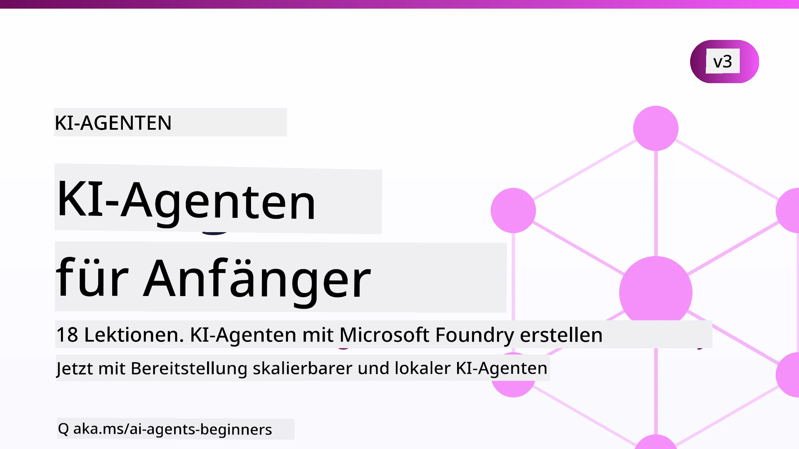

# KI-Agenten für Einsteiger – Ein Kurs



## Ein Kurs, der alles vermittelt, was Sie wissen müssen, um mit dem Aufbau von KI-Agenten zu beginnen

[](https://github.com/microsoft/ai-agents-for-beginners/blob/master/LICENSE?WT.mc_id=academic-105485-koreyst)
[](https://GitHub.com/microsoft/ai-agents-for-beginners/graphs/contributors/?WT.mc_id=academic-105485-koreyst)
[](https://GitHub.com/microsoft/ai-agents-for-beginners/issues/?WT.mc_id=academic-105485-koreyst)
[](https://GitHub.com/microsoft/ai-agents-for-beginners/pulls/?WT.mc_id=academic-105485-koreyst)
[](http://makeapullrequest.com?WT.mc_id=academic-105485-koreyst)

### 🌐 Mehrsprachige Unterstützung

#### Übersetzungen werden mit [Co-op Translator](https://github.com/Azure/co-op-translator) gepflegt

<!-- CO-OP TRANSLATOR LANGUAGES TABLE START -->
[Arabisch](../ar/README.md) | [Bengalisch](../bn/README.md) | [Bulgarisch](../bg/README.md) | [Burmesisch (Myanmar)](../my/README.md) | [Chinesisch (vereinfacht)](../zh-CN/README.md) | [Chinesisch (traditionell, Hongkong)](../zh-HK/README.md) | [Chinesisch (traditionell, Macau)](../zh-MO/README.md) | [Chinesisch (traditionell, Taiwan)](../zh-TW/README.md) | [Kroatisch](../hr/README.md) | [Tschechisch](../cs/README.md) | [Dänisch](../da/README.md) | [Niederländisch](../nl/README.md) | [Estnisch](../et/README.md) | [Finnisch](../fi/README.md) | [Französisch](../fr/README.md) | [Deutsch](./README.md) | [Griechisch](../el/README.md) | [Hebräisch](../he/README.md) | [Hindi](../hi/README.md) | [Ungarisch](../hu/README.md) | [Indonesisch](../id/README.md) | [Italienisch](../it/README.md) | [Japanisch](../ja/README.md) | [Kannada](../kn/README.md) | [Khmer](../km/README.md) | [Koreanisch](../ko/README.md) | [Litauisch](../lt/README.md) | [Malaiisch](../ms/README.md) | [Malayalam](../ml/README.md) | [Manipuri (Meitei Mayek)](../mni/README.md) | [Marathi](../mr/README.md) | [Nepalesisch](../ne/README.md) | [Nigerianisches Pidgin](../pcm/README.md) | [Norwegisch](../no/README.md) | [Persisch (Farsi)](../fa/README.md) | [Polnisch](../pl/README.md) | [Portugiesisch (Brasilien)](../pt-BR/README.md) | [Portugiesisch (Portugal)](../pt-PT/README.md) | [Panjabi (Gurmukhi)](../pa/README.md) | [Rumänisch](../ro/README.md) | [Russisch](../ru/README.md) | [Serbisch (Kyrillisch)](../sr/README.md) | [Slowakisch](../sk/README.md) | [Slowenisch](../sl/README.md) | [Spanisch](../es/README.md) | [Suaheli](../sw/README.md) | [Schwedisch](../sv/README.md) | [Tagalog (Filipino)](../tl/README.md) | [Tamil](../ta/README.md) | [Telugu](../te/README.md) | [Thailändisch](../th/README.md) | [Türkisch](../tr/README.md) | [Ukrainisch](../uk/README.md) | [Urdu](../ur/README.md) | [Vietnamesisch](../vi/README.md)

> **Möchten Sie lieber lokal klonen?**
>
> Dieses Repository enthält Übersetzungen in über 50 Sprachen, was die Download-Größe erheblich erhöht. Um ohne Übersetzungen zu klonen, verwenden Sie Sparse Checkout:
>
> **Bash / macOS / Linux:**
> ```bash
> git clone --filter=blob:none --sparse https://github.com/microsoft/ai-agents-for-beginners.git
> cd ai-agents-for-beginners
> git sparse-checkout set --no-cone '/*' '!translations' '!translated_images'
> ```
>
> **CMD (Windows):**
> ```cmd
> git clone --filter=blob:none --sparse https://github.com/microsoft/ai-agents-for-beginners.git
> cd ai-agents-for-beginners
> git sparse-checkout set --no-cone "/*" "!translations" "!translated_images"
> ```
>
> So erhalten Sie alles, was Sie für den Kurs benötigen, mit einem viel schnelleren Download.
<!-- CO-OP TRANSLATOR LANGUAGES TABLE END -->

**Für weitere Sprachoptionen siehe [Unterstützte Sprachen von Co-op Translator](https://github.com/Azure/co-op-translator/blob/main/docs/supported-languages.md).**

[](https://GitHub.com/microsoft/ai-agents-for-beginners/watchers/?WT.mc_id=academic-105485-koreyst)
[](https://GitHub.com/microsoft/ai-agents-for-beginners/network/?WT.mc_id=academic-105485-koreyst)
[](https://GitHub.com/microsoft/ai-agents-for-beginners/stargazers/?WT.mc_id=academic-105485-koreyst)

[](https://discord.com/invite/ATgtXmAS5D)


## 🌱 Erste Schritte

Dieser Kurs umfasst Lektionen, die die Grundlagen des Aufbaus von KI-Agenten erklären. Jede Lektion behandelt ein eigenes Thema, Sie können also dort beginnen, wo Sie möchten!

Für diesen Kurs gibt es mehrsprachige Unterstützung. Besuchen Sie unsere [verfügbaren Sprachen hier](#-multi-language-support).

Wenn dies Ihr erstes Mal ist, dass Sie mit generativen KI-Modellen arbeiten, sehen Sie sich unseren Kurs [Generative KI für Einsteiger](https://aka.ms/genai-beginners) an, der 21 Lektionen zum Aufbau mit GenAI enthält.

Vergessen Sie nicht, [dieses Repository zu bewerten (🌟)](https://docs.github.com/en/get-started/exploring-projects-on-github/saving-repositories-with-stars?WT.mc_id=academic-105485-koreyst) und [es zu forkieren](https://github.com/microsoft/ai-agents-for-beginners/fork), um den Code auszuführen.

### Lernen Sie andere Lernende kennen, erhalten Sie Antworten auf Ihre Fragen

Wenn Sie stecken bleiben oder Fragen zum Aufbau von KI-Agenten haben, treten Sie unserem speziellen Discord-Kanal im [Microsoft Foundry Discord](https://aka.ms/ai-agents/discord) bei.

### Was Sie benötigen

Jede Lektion dieses Kurses enthält Codebeispiele, die im Ordner code_samples zu finden sind. Sie können [dieses Repository forken](https://github.com/microsoft/ai-agents-for-beginners/fork), um Ihre eigene Kopie zu erstellen.

Die Codebeispiele in diesen Übungen verwenden Microsoft Agent Framework mit Microsoft Foundry Agent Service V2:

- [Microsoft Foundry](https://aka.ms/ai-agents-beginners/ai-foundry) – Azure-Konto erforderlich

Dieser Kurs verwendet die folgenden KI-Agent-Frameworks und -Dienste von Microsoft:

- [Microsoft Agent Framework (MAF)](https://learn.microsoft.com/agent-framework/overview/)
- [Microsoft Foundry Agent Service V2](https://aka.ms/ai-agents-beginners/ai-agent-service)

Einige Codebeispiele unterstützen auch alternative OpenAI-kompatible Anbieter wie [MiniMax](https://platform.minimaxi.com/), der Modelle mit großem Kontextumfang (bis zu 204K Tokens) anbietet. Siehe [Kurs-Setup](./00-course-setup/README.md) für Konfigurationsdetails.

Für weitere Informationen zum Ausführen des Codes für diesen Kurs, gehen Sie zum [Kurs-Setup](./00-course-setup/README.md).

## 🙏 Möchten Sie helfen?

Haben Sie Vorschläge oder Fehler bei Rechtschreibung oder Code gefunden? [Erstellen Sie ein Issue](https://github.com/microsoft/ai-agents-for-beginners/issues?WT.mc_id=academic-105485-koreyst) oder [einen Pull Request](https://github.com/microsoft/ai-agents-for-beginners/pulls?WT.mc_id=academic-105485-koreyst)


## 📂 Jede Lektion umfasst

- Eine schriftliche Lektion im README und ein kurzes Video
- Python-Codebeispiele, die Microsoft Agent Framework mit Microsoft Foundry verwenden
- Links zu zusätzlichen Ressourcen, um Ihr Lernen fortzusetzen


## 🗃️ Lektionen

| **Lektion**                                    | **Text & Code**                                    | **Video**                                                  | **Zusätzliches Lernen**                                                                |
|----------------------------------------------|----------------------------------------------------|------------------------------------------------------------|----------------------------------------------------------------------------------------|
| Einführung in KI-Agenten und Agent-Anwendungsfälle | [Link](./01-intro-to-ai-agents/README.md)           | [Video](https://youtu.be/3zgm60bXmQk?si=z8QygFvYQv-9WtO1)  | [Link](https://aka.ms/ai-agents-beginners/collection?WT.mc_id=academic-105485-koreyst)  |
| Erkundung KI-Agenten-Frameworks               | [Link](./02-explore-agentic-frameworks/README.md)   | [Video](https://youtu.be/ODwF-EZo_O8?si=Vawth4hzVaHv-u0H)  | [Link](https://aka.ms/ai-agents-beginners/collection?WT.mc_id=academic-105485-koreyst)  |
| Verstehen von KI-Agenten-Designmustern       | [Link](./03-agentic-design-patterns/README.md)       | [Video](https://youtu.be/m9lM8qqoOEA?si=BIzHwzstTPL8o9GF)  | [Link](https://aka.ms/ai-agents-beginners/collection?WT.mc_id=academic-105485-koreyst)  |
| Tool Use Design Pattern                        | [Link](./04-tool-use/README.md)                     | [Video](https://youtu.be/vieRiPRx-gI?si=2z6O2Xu2cu_Jz46N)  | [Link](https://aka.ms/ai-agents-beginners/collection?WT.mc_id=academic-105485-koreyst) |
| Agentic RAG                                    | [Link](./05-agentic-rag/README.md)                  | [Video](https://youtu.be/WcjAARvdL7I?si=gKPWsQpKiIlDH9A3)  | [Link](https://aka.ms/ai-agents-beginners/collection?WT.mc_id=academic-105485-koreyst) |
| Vertrauenswürdige KI-Agenten bauen              | [Link](./06-building-trustworthy-agents/README.md)  | [Video](https://youtu.be/iZKkMEGBCUQ?si=jZjpiMnGFOE9L8OK ) | [Link](https://aka.ms/ai-agents-beginners/collection?WT.mc_id=academic-105485-koreyst)  |
| Planungs-Designmuster                          | [Link](./07-planning-design/README.md)               | [Video](https://youtu.be/kPfJ2BrBCMY?si=6SC_iv_E5-mzucnC)  | [Link](https://aka.ms/ai-agents-beginners/collection?WT.mc_id=academic-105485-koreyst)  |
| Multi-Agenten-Designmuster                     | [Link](./08-multi-agent/README.md)                  | [Video](https://youtu.be/V6HpE9hZEx0?si=rMgDhEu7wXo2uo6g)  | [Link](https://aka.ms/ai-agents-beginners/collection?WT.mc_id=academic-105485-koreyst)  |
| Metakognitions-Designmuster                    | [Link](./09-metacognition/README.md)                | [Video](https://youtu.be/His9R6gw6Ec?si=8gck6vvdSNCt6OcF)  | [Link](https://aka.ms/ai-agents-beginners/collection?WT.mc_id=academic-105485-koreyst)  |
| KI-Agenten in der Produktion                   | [Link](./10-ai-agents-production/README.md)         | [Video](https://youtu.be/l4TP6IyJxmQ?si=31dnhexRo6yLRJDl)  | [Link](https://aka.ms/ai-agents-beginners/collection?WT.mc_id=academic-105485-koreyst)  |
| Verwendung Agentischer Protokolle (MCP, A2A und NLWeb) | [Link](./11-agentic-protocols/README.md)            | [Video](https://youtu.be/X-Dh9R3Opn8)                               | [Link](https://aka.ms/ai-agents-beginners/collection?WT.mc_id=academic-105485-koreyst)  |
| Kontext Engineering für KI-Agenten              | [Link](./12-context-engineering/README.md)          | [Video](https://youtu.be/F5zqRV7gEag)                               | [Link](https://aka.ms/ai-agents-beginners/collection?WT.mc_id=academic-105485-koreyst)  |
| Verwaltung agentischer Erinnerung              | [Link](./13-agent-memory/README.md)      |      [Video](https://youtu.be/QrYbHesIxpw?si=vZkVwKrQ4ieCcIPx)                                                      |                                                                                        |
| Erkundung des Microsoft Agent Frameworks                     | [Link](./14-microsoft-agent-framework/README.md)                              |                                                            |                                                                                        |
| Aufbau von Computer Use Agents (CUA)            | [Link](./15-browser-use/README.md)      |                                                            | [Link](https://docs.browser-use.com/examples/templates/playwright-integration)          |
| Bereitstellung skalierbarer Agenten             | [Link](./16-deploying-scalable-agents/README.md)  |                                                    | [Link](https://learn.microsoft.com/azure/ai-foundry/agents/overview)                    |
| Erstellung lokaler KI-Agenten                    | [Link](./17-creating-local-ai-agents/README.md)   |                                                    | [Link](https://learn.microsoft.com/azure/ai-foundry/foundry-local/)                     |
| Sicherung von KI-Agenten                         | [Link](./18-securing-ai-agents/README.md)   |                                                            | [Link](https://aka.ms/ai-agents-beginners/collection?WT.mc_id=academic-105485-koreyst)  |

## 🎒 Weitere Kurse

Unser Team erstellt weitere Kurse! Schauen Sie sich an:

<!-- CO-OP TRANSLATOR OTHER COURSES START -->
### LangChain
[](https://aka.ms/langchain4j-for-beginners)
[](https://aka.ms/langchainjs-for-beginners?WT.mc_id=m365-94501-dwahlin)
[](https://github.com/microsoft/langchain-for-beginners?WT.mc_id=m365-94501-dwahlin)
---

### Azure / Edge / MCP / Agenten
[](https://github.com/microsoft/AZD-for-beginners?WT.mc_id=academic-105485-koreyst)
[](https://github.com/microsoft/edgeai-for-beginners?WT.mc_id=academic-105485-koreyst)
[](https://github.com/microsoft/mcp-for-beginners?WT.mc_id=academic-105485-koreyst)
[](https://github.com/microsoft/ai-agents-for-beginners?WT.mc_id=academic-105485-koreyst)

---
 
### Generative KI-Serie
[](https://github.com/microsoft/generative-ai-for-beginners?WT.mc_id=academic-105485-koreyst)
[-9333EA?style=for-the-badge&labelColor=E5E7EB&color=9333EA)](https://github.com/microsoft/Generative-AI-for-beginners-dotnet?WT.mc_id=academic-105485-koreyst)
[-C084FC?style=for-the-badge&labelColor=E5E7EB&color=C084FC)](https://github.com/microsoft/generative-ai-for-beginners-java?WT.mc_id=academic-105485-koreyst)
[-E879F9?style=for-the-badge&labelColor=E5E7EB&color=E879F9)](https://github.com/microsoft/generative-ai-with-javascript?WT.mc_id=academic-105485-koreyst)

---
 
### Kernlerninhalt
[](https://aka.ms/ml-beginners?WT.mc_id=academic-105485-koreyst)
[](https://aka.ms/datascience-beginners?WT.mc_id=academic-105485-koreyst)
[](https://aka.ms/ai-beginners?WT.mc_id=academic-105485-koreyst)
[](https://github.com/microsoft/Security-101?WT.mc_id=academic-96948-sayoung)
[](https://aka.ms/webdev-beginners?WT.mc_id=academic-105485-koreyst)
[](https://aka.ms/iot-beginners?WT.mc_id=academic-105485-koreyst)
[](https://github.com/microsoft/xr-development-for-beginners?WT.mc_id=academic-105485-koreyst)

---
 
### Copilot-Serie
[](https://aka.ms/GitHubCopilotAI?WT.mc_id=academic-105485-koreyst)
[](https://github.com/microsoft/mastering-github-copilot-for-dotnet-csharp-developers?WT.mc_id=academic-105485-koreyst)
[](https://github.com/microsoft/CopilotAdventures?WT.mc_id=academic-105485-koreyst)
<!-- CO-OP TRANSLATOR OTHER COURSES END -->

## 🌟 Dank der Community

Danke an [Shivam Goyal](https://www.linkedin.com/in/shivam2003/) für die Bereitstellung wichtiger Codebeispiele, die Agentic RAG demonstrieren. 

## Mitwirken

Dieses Projekt freut sich über Beiträge und Vorschläge. Die meisten Beiträge erfordern, dass Sie einer
Contributor License Agreement (CLA) zustimmen, die erklärt, dass Sie das Recht haben und tatsächlich 
uns die Rechte zur Nutzung Ihres Beitrags einräumen. Für Details besuchen Sie <https://cla.opensource.microsoft.com>.

Wenn Sie eine Pull-Anfrage einreichen, wird ein CLA-Bot automatisch feststellen, ob Sie eine CLA
bereitstellen müssen und die PR entsprechend kennzeichnen (z. B. Statusüberprüfung, Kommentar). Folgen Sie einfach den 
Anweisungen des Bots. Dies müssen Sie nur einmal für alle Repos mit unserer CLA tun.

Dieses Projekt hat den [Microsoft Open Source Code of Conduct](https://opensource.microsoft.com/codeofconduct/) angenommen.
Weitere Informationen finden Sie in den [Code of Conduct FAQ](https://opensource.microsoft.com/codeofconduct/faq/) oder
kontaktieren Sie [opencode@microsoft.com](mailto:opencode@microsoft.com) bei weiteren Fragen oder Anmerkungen.

## Markenrechte

Dieses Projekt kann Marken oder Logos von Projekten, Produkten oder Dienstleistungen enthalten. Die autorisierte Nutzung von Microsoft
Marken oder Logos unterliegt und muss den
[Microsofts Richtlinien zu Marken und Markenbildung](https://www.microsoft.com/legal/intellectualproperty/trademarks/usage/general) folgen.
Die Nutzung von Microsoft-Marken oder -Logos in modifizierten Versionen dieses Projekts darf keine Verwirrung stiften oder eine Microsoft-Sponsoring implizieren.
Die Nutzung von Marken oder Logos Dritter unterliegt den Richtlinien dieser Dritten.

## Hilfe erhalten


Wenn Sie nicht weiterkommen oder Fragen zum Erstellen von KI-Anwendungen haben, treten Sie bei:

[](https://aka.ms/foundry/discord)

Wenn Sie Produktfeedback oder Fehler beim Erstellen melden möchten, besuchen Sie:

[](https://aka.ms/foundry/forum)

---

<!-- CO-OP TRANSLATOR DISCLAIMER START -->
**Haftungsausschluss**:
Dieses Dokument wurde mit dem KI-Übersetzungsdienst [Co-op Translator](https://github.com/Azure/co-op-translator) übersetzt. Obwohl wir uns um Genauigkeit bemühen, beachten Sie bitte, dass automatisierte Übersetzungen Fehler oder Ungenauigkeiten enthalten können. Das Originaldokument in seiner Ursprungssprache gilt als maßgebliche Quelle. Bei kritischen Informationen wird eine professionelle menschliche Übersetzung empfohlen. Wir übernehmen keine Haftung für Missverständnisse oder Fehlinterpretationen, die aus der Verwendung dieser Übersetzung entstehen.
<!-- CO-OP TRANSLATOR DISCLAIMER END -->