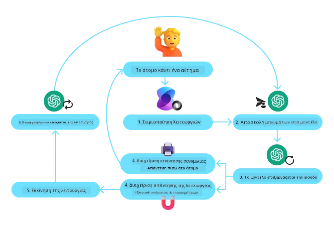
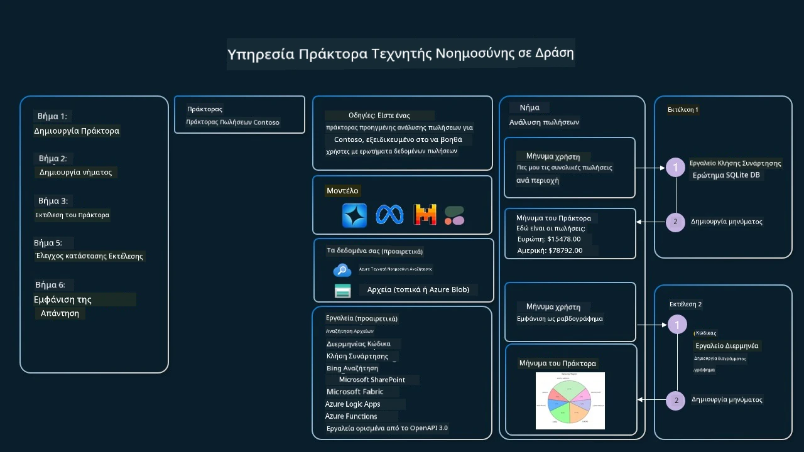

[](https://youtu.be/vieRiPRx-gI?si=cEZ8ApnT6Sus9rhn)

> _(Κάντε κλικ στην παραπάνω εικόνα για να δείτε το βίντεο αυτού του μαθήματος)_

# Πρότυπο Σχεδιασμού Χρήσης Εργαλείων

Τα εργαλεία είναι ενδιαφέροντα επειδή επιτρέπουν στους πράκτορες τεχνητής νοημοσύνης να έχουν ένα ευρύτερο φάσμα δυνατοτήτων. Αντί ο πράκτορας να έχει ένα περιορισμένο σύνολο ενεργειών που μπορεί να εκτελέσει, προσθέτοντας ένα εργαλείο, ο πράκτορας μπορεί πλέον να εκτελεί ένα μεγάλο εύρος ενεργειών. Σε αυτό το κεφάλαιο, θα εξετάσουμε το Πρότυπο Σχεδιασμού Χρήσης Εργαλείων, που περιγράφει πώς οι πράκτορες ΤΝ μπορούν να χρησιμοποιούν συγκεκριμένα εργαλεία για να επιτύχουν τους στόχους τους.

## Εισαγωγή

Σε αυτό το μάθημα, θα προσπαθήσουμε να απαντήσουμε στα εξής ερωτήματα:

- Τι είναι το πρότυπο σχεδιασμού χρήσης εργαλείων;
- Σε ποιες περιπτώσεις χρήσης μπορεί να εφαρμοστεί;
- Ποια είναι τα στοιχεία/δομικά μπλοκ που χρειάζονται για την υλοποίηση του προτύπου σχεδιασμού;
- Ποιες είναι οι ειδικές προφυλάξεις για τη χρήση του Προτύπου Σχεδιασμού Χρήσης Εργαλείων για την κατασκευή αξιόπιστων πρακτόρων ΤΝ;

## Στόχοι Μάθησης

Μετά την ολοκλήρωση αυτού του μαθήματος, θα μπορείτε να:

- Ορίσετε το Πρότυπο Σχεδιασμού Χρήσης Εργαλείων και το σκοπό του.
- Αναγνωρίσετε περιπτώσεις χρήσης όπου το Πρότυπο Σχεδιασμού Χρήσης Εργαλείων είναι εφαρμόσιμο.
- Κατανοήσετε τα βασικά στοιχεία που απαιτούνται για την υλοποίηση του προτύπου σχεδιασμού.
- Αναγνωρίσετε προφυλάξεις για την εξασφάλιση αξιοπιστίας σε πράκτορες ΤΝ που χρησιμοποιούν αυτό το πρότυπο σχεδιασμού.

## Τι είναι το Πρότυπο Σχεδιασμού Χρήσης Εργαλείων;

Το **Πρότυπο Σχεδιασμού Χρήσης Εργαλείων** εστιάζει στο να δώσει στα Μεγάλα Γλωσσικά Μοντέλα (LLMs) τη δυνατότητα να αλληλεπιδρούν με εξωτερικά εργαλεία για να επιτύχουν συγκεκριμένους στόχους. Τα εργαλεία είναι κώδικας που μπορεί να εκτελεστεί από έναν πράκτορα για να πραγματοποιήσει ενέργειες. Ένα εργαλείο μπορεί να είναι μια απλή συνάρτηση όπως μια αριθμομηχανή, ή μια κλήση API σε μια υπηρεσία τρίτου μέρους όπως η αναζήτηση τιμών μετοχών ή η πρόβλεψη καιρού. Στο πλαίσιο των πρακτόρων ΤΝ, τα εργαλεία σχεδιάζονται ώστε να εκτελούνται από πράκτορες ως απόκριση σε **κλήσεις συναρτήσεων που παράγονται από το μοντέλο**.

## Σε ποιες περιπτώσεις χρήσης μπορεί να εφαρμοστεί;

Οι Πράκτορες ΤΝ μπορούν να αξιοποιήσουν εργαλεία για να ολοκληρώσουν πολύπλοκες εργασίες, να ανακτήσουν πληροφορίες ή να λάβουν αποφάσεις. Το πρότυπο χρήσης εργαλείων χρησιμοποιείται συχνά σε σενάρια που απαιτούν δυναμική αλληλεπίδραση με εξωτερικά συστήματα, όπως βάσεις δεδομένων, διαδικτυακές υπηρεσίες ή διερμηνείς κώδικα. Αυτή η ικανότητα είναι χρήσιμη για πολλές διαφορετικές περιπτώσεις χρήσης, όπως:

- **Δυναμική Ανάκτηση Πληροφορίας:** Οι πράκτορες μπορούν να κάνουν ερωτήματα σε εξωτερικά APIs ή βάσεις δεδομένων για να αντλήσουν ενημερωμένα δεδομένα (π.χ., ερώτημα σε βάση SQLite για ανάλυση δεδομένων, άντληση τιμών μετοχών ή πληροφοριών καιρού).
- **Εκτέλεση και Ερμηνεία Κώδικα:** Οι πράκτορες μπορούν να εκτελέσουν κώδικα ή scripts για να λύσουν μαθηματικά προβλήματα, να δημιουργήσουν αναφορές ή να κάνουν προσομοιώσεις.
- **Αυτοματοποίηση Ροής Εργασίας:** Αυτοματοποιώντας επαναλαμβανόμενες ή πολύ-βήμα ροές εργασίας ενσωματώνοντας εργαλεία όπως χρονοπρογράμματα εργασιών, υπηρεσίες email ή pipelines δεδομένων.
- **Υποστήριξη Πελατών:** Οι πράκτορες μπορούν να αλληλεπιδρούν με συστήματα CRM, πλατφόρμες ticketing ή βάσεις γνώσης για την επίλυση ερωτημάτων χρηστών.
- **Δημιουργία και Επεξεργασία Περιεχομένου:** Οι πράκτορες μπορούν να αξιοποιήσουν εργαλεία όπως ελεγκτές γραμματικής, συνοψιστές κειμένου ή αξιολογητές ασφάλειας περιεχομένου για να βοηθήσουν με εργασίες δημιουργίας περιεχομένου.

## Ποια είναι τα στοιχεία/δομικά μπλοκ που χρειάζονται για την υλοποίηση του προτύπου χρήσης εργαλείων;

Αυτά τα δομικά μπλοκ επιτρέπουν στον πράκτορα ΤΝ να εκτελεί ένα ευρύ φάσμα εργασιών. Ας δούμε τα βασικά στοιχεία που απαιτούνται για την υλοποίηση του Προτύπου Σχεδιασμού Χρήσης Εργαλείων:

- **Σχήματα Συναρτήσεων/Εργαλείων**: Λεπτομερείς ορισμοί των διαθέσιμων εργαλείων, περιλαμβάνοντας το όνομα της συνάρτησης, το σκοπό, τις απαιτούμενες παραμέτρους και τις αναμενόμενες εξόδους. Αυτά τα σχήματα επιτρέπουν στο LLM να κατανοεί ποια εργαλεία είναι διαθέσιμα και πώς να κατασκευάσει έγκυρα αιτήματα.

- **Λογική Εκτέλεσης Συναρτήσεων**: Καθορίζει πώς και πότε καλούνται τα εργαλεία βάσει της πρόθεσης του χρήστη και του συμφραζομένου της συνομιλίας. Αυτό μπορεί να περιλαμβάνει μονάδες προγραμματιστή, μηχανισμούς δρομολόγησης ή ροές με συνθήκες που καθορίζουν τη δυναμική χρήση των εργαλείων.

- **Σύστημα Διαχείρισης Μηνυμάτων**: Συστατικά που διαχειρίζονται τη ροή της συνομιλίας μεταξύ εισόδων χρήστη, απαντήσεων LLM, κλήσεων εργαλείων και αποτελεσμάτων εργαλείων.

- **Πλαίσιο Ενσωμάτωσης Εργαλείων**: Υποδομή που συνδέει τον πράκτορα με διάφορα εργαλεία, είτε πρόκειται για απλές συναρτήσεις είτε για σύνθετες εξωτερικές υπηρεσίες.

- **Διαχείριση Σφαλμάτων & Επικύρωση**: Μηχανισμοί για την αντιμετώπιση αποτυχιών στην εκτέλεση εργαλείων, την επικύρωση παραμέτρων και τη διαχείριση αναπάντεχων αποκρίσεων.

- **Διαχείριση Κατάστασης**: Παρακολουθεί το συμφραζόμενο της συνομιλίας, προηγούμενες αλληλεπιδράσεις με εργαλεία και επίμονα δεδομένα για να εξασφαλίσει συνέπεια σε πολύ-στιγμιαίες αλληλεπιδράσεις.

Στη συνέχεια, ας δούμε την Κλήση Συνάρτησης/Εργαλείου με περισσότερες λεπτομέρειες.
 
### Κλήση Συνάρτησης/Εργαλείου

Η κλήση συνάρτησης είναι ο κύριος τρόπος με τον οποίο επιτρέπουμε στα Μεγάλα Γλωσσικά Μοντέλα (LLMs) να αλληλεπιδρούν με εργαλεία. Συχνά θα δείτε τους όρους «Συνάρτηση» και «Εργαλείο» να χρησιμοποιούνται εναλλακτικά επειδή οι «συναρτήσεις» (μπλοκ επαναχρησιμοποιήσιμου κώδικα) είναι τα «εργαλεία» που οι πράκτορες χρησιμοποιούν για να εκτελέσουν εργασίες. Για να κληθεί ο κώδικας μιας συνάρτησης, το LLM πρέπει να συγκρίνει το αίτημα του χρήστη με την περιγραφή της συνάρτησης. Για αυτό, αποστέλλεται στο LLM ένα σχήμα που περιλαμβάνει τις περιγραφές όλων των διαθέσιμων συναρτήσεων. Το LLM επιλέγει την πιο κατάλληλη συνάρτηση για την εργασία και επιστρέφει το όνομα και τα επιχειρήματά της. Η επιλεγμένη συνάρτηση καλείται, η απόκρισή της επιστρέφεται στο LLM, το οποίο χρησιμοποιεί τις πληροφορίες για να απαντήσει στο αίτημα του χρήστη.

Για να υλοποιήσουν οι προγραμματιστές την κλήση συνάρτησης για πράκτορες, θα χρειαστείτε:

1. Ένα LLM που υποστηρίζει κλήση συνάρτησης
2. Ένα σχήμα που περιλαμβάνει περιγραφές συναρτήσεων
3. Τον κώδικα για κάθε περιγραφόμενη συνάρτηση

Ας χρησιμοποιήσουμε το παράδειγμα της απόκτησης της τρέχουσας ώρας σε μια πόλη για να το δείξουμε:

1. **Αρχικοποίηση ενός LLM που υποστηρίζει κλήση συνάρτησης:**

    Όχι όλα τα μοντέλα υποστηρίζουν κλήση συνάρτησης, οπότε είναι σημαντικό να ελέγξετε ότι το LLM που χρησιμοποιείτε το υποστηρίζει.     <a href="https://learn.microsoft.com/azure/ai-services/openai/how-to/function-calling" target="_blank">Το Azure OpenAI</a> υποστηρίζει κλήση συνάρτησης. Μπορούμε να ξεκινήσουμε δημιουργώντας τον πελάτη OpenAI για το Azure OpenAI **Responses API** (το σταθερό `/openai/v1/` σημείο τερματισμού — δεν απαιτείται `api_version`). 

    ```python
    # Initialize the OpenAI client for Azure OpenAI (Responses API, v1 endpoint)
    client = OpenAI(
        base_url=f"{os.environ['AZURE_OPENAI_ENDPOINT'].rstrip('/')}/openai/v1/",
        api_key=os.environ["AZURE_OPENAI_API_KEY"],
    )
    deployment_name = os.environ["AZURE_OPENAI_DEPLOYMENT"]
    ```

1. **Δημιουργία Σχήματος Συνάρτησης**:

    Στη συνέχεια θα ορίσουμε ένα JSON σχήμα που περιλαμβάνει το όνομα της συνάρτησης, την περιγραφή του τι κάνει η συνάρτηση και τα ονόματα και περιγραφές των παραμέτρων της.
    Θα περάσουμε επίσης αυτό το σχήμα στον πελάτη που δημιουργήσαμε προηγουμένως, μαζί με το αίτημα του χρήστη να βρει την ώρα στο Σαν Φρανσίσκο. Το σημαντικό είναι να σημειωθεί ότι αυτό που επιστρέφεται είναι μια **κλήση εργαλείου**, **όχι** η τελική απάντηση στην ερώτηση. Όπως αναφέρθηκε νωρίτερα, το LLM επιστρέφει το όνομα της συνάρτησης που επέλεξε για την εργασία και τα επιχειρήματα που θα περάσουν σε αυτή.

    ```python
    # Function description for the model to read (Responses API flat tool format)
    tools = [
        {
            "type": "function",
            "name": "get_current_time",
            "description": "Get the current time in a given location",
            "parameters": {
                "type": "object",
                "properties": {
                    "location": {
                        "type": "string",
                        "description": "The city name, e.g. San Francisco",
                    },
                },
                "required": ["location"],
            },
        }
    ]
    ```
   
    ```python
  
    # Initial user message
    messages = [{"role": "user", "content": "What's the current time in San Francisco"}]

    # First API call: Ask the model to use the function
    response = client.responses.create(
        model=deployment_name,
        input=messages,
        tools=tools,
        tool_choice="auto",
        store=False,
    )

    # The Responses API returns tool calls as function_call items in response.output.
    # Append them to the conversation so the model has full context on the next turn.
    messages += response.output

    print("Model's response:")
    print(response.output)
  
    ```

    ```bash
    Model's response:
    [ResponseFunctionToolCall(arguments='{"location":"San Francisco"}', call_id='call_pOsKdUlqvdyttYB67MOj434b', name='get_current_time', type='function_call')]
    ```
  
1. **Ο κώδικας της συνάρτησης που απαιτείται για την εκτέλεση της εργασίας:**

    Τώρα που το LLM έχει επιλέξει ποια συνάρτηση πρέπει να εκτελεστεί, ο κώδικας που εκτελεί την εργασία πρέπει να υλοποιηθεί και να εκτελεστεί.
    Μπορούμε να υλοποιήσουμε τον κώδικα για να πάρουμε την τρέχουσα ώρα σε Python. Θα χρειαστεί επίσης να γράψουμε τον κώδικα για την εξαγωγή του ονόματος και των επιχειρημάτων από το response_message για να πάρουμε το τελικό αποτέλεσμα.

    ```python
      def get_current_time(location):
        """Get the current time for a given location"""
        print(f"get_current_time called with location: {location}")  
        location_lower = location.lower()
        
        for key, timezone in TIMEZONE_DATA.items():
            if key in location_lower:
                print(f"Timezone found for {key}")  
                current_time = datetime.now(ZoneInfo(timezone)).strftime("%I:%M %p")
                return json.dumps({
                    "location": location,
                    "current_time": current_time
                })
      
        print(f"No timezone data found for {location_lower}")  
        return json.dumps({"location": location, "current_time": "unknown"})
    ```

     ```python
    # Handle function calls
    tool_calls = [item for item in response.output if item.type == "function_call"]
    if tool_calls:
        for tool_call in tool_calls:
            if tool_call.name == "get_current_time":

                function_args = json.loads(tool_call.arguments)

                time_response = get_current_time(
                    location=function_args.get("location")
                )

                # Return the tool result as a function_call_output item
                messages.append({
                    "type": "function_call_output",
                    "call_id": tool_call.call_id,
                    "output": time_response,
                })
    else:
        print("No tool calls were made by the model.")

    # Second API call: Get the final response from the model
    final_response = client.responses.create(
        model=deployment_name,
        input=messages,
        tools=tools,
        store=False,
    )

    return final_response.output_text
     ```

     ```bash
      get_current_time called with location: San Francisco
      Timezone found for san francisco
      The current time in San Francisco is 09:24 AM.
     ```

Η Κλήση Συνάρτησης είναι στο επίκεντρο των περισσότερων, αν όχι όλων, σχεδίων χρήσης εργαλείων πρακτόρων, όμως η υλοποίησή της από το μηδέν μπορεί μερικές φορές να είναι πολύπλοκη.
Όπως μάθαμε στο [Μάθημα 2](../../../02-explore-agentic-frameworks), τα agentic frameworks μας παρέχουν προκαθορισμένα δομικά μπλοκ για την υλοποίηση της χρήσης εργαλείων.
 
## Παραδείγματα Χρήσης Εργαλείων με Agentic Frameworks

Εδώ είναι μερικά παραδείγματα για το πώς μπορείτε να υλοποιήσετε το Πρότυπο Σχεδιασμού Χρήσης Εργαλείων χρησιμοποιώντας διαφορετικά agentic frameworks:

### Microsoft Agent Framework

<a href="https://learn.microsoft.com/azure/ai-services/agents/overview" target="_blank">Το Microsoft Agent Framework</a> είναι ένα ανοιχτού κώδικα πλαίσιο ΤΝ για τη δημιουργία πρακτόρων ΤΝ. Απλοποιεί τη διαδικασία κλήσης συναρτήσεων επιτρέποντάς σας να ορίζετε εργαλεία ως συναρτήσεις Python με το διακοσμητή `@tool`. Το πλαίσιο χειρίζεται την διπλής κατεύθυνσης επικοινωνία μεταξύ του μοντέλου και του κώδικα σας. Παρέχει επίσης πρόσβαση σε προ-κατασκευασμένα εργαλεία όπως Αναζήτηση Αρχείων και Κώδικα Διερμηνέα μέσω `FoundryChatClient`.

Το παρακάτω διάγραμμα απεικονίζει τη διαδικασία κλήσης συνάρτησης με το Microsoft Agent Framework:



Στο Microsoft Agent Framework, τα εργαλεία ορίζονται ως διακοσμημένες συναρτήσεις. Μπορούμε να μετατρέψουμε τη συνάρτηση `get_current_time` που είδαμε νωρίτερα σε εργαλείο χρησιμοποιώντας το διακοσμητή `@tool`. Το πλαίσιο θα σειριοποιήσει αυτόματα τη συνάρτηση και τις παραμέτρους της, δημιουργώντας το σχήμα που θα σταλεί στο LLM.

```python
import os
from agent_framework import tool
from agent_framework.foundry import FoundryChatClient
from azure.identity import AzureCliCredential

@tool(approval_mode="never_require")
def get_current_time(location: str) -> str:
    """Get the current time for a given location"""
    ...

# Create the client
provider = FoundryChatClient(
    project_endpoint=os.environ["AZURE_AI_PROJECT_ENDPOINT"],
    model=os.environ["AZURE_AI_MODEL_DEPLOYMENT_NAME"],
    credential=AzureCliCredential(),
)

# Create an agent and run with the tool
agent = provider.as_agent(name="TimeAgent", instructions="Use available tools to answer questions.", tools=get_current_time)
response = await agent.run("What time is it?")
```

#### Εργαλεία από διακομιστή MCP

Τα εργαλεία δεν χρειάζεται να είναι συναρτήσεις στον δικό σας κώδικα. Ένας διακομιστής που μιλά το Πρωτόκολλο Συμφραζομένου Μοντέλου (MCP, καλυμμένο στο [Μάθημα 11](../11-agentic-protocols/README.md)) δημοσιεύει τα εργαλεία του μαζί με τα σχήματά τους, και το πλαίσιο μπορεί να τα φορτώσει όπως σειριοποιεί μια διακοσμημένη συνάρτηση. Το `MCPStreamableHTTPTool` συνδέεται με τέτοιο διακομιστή μέσω HTTP, διαβάζει τα σχήματα εργαλείων και τα προσφέρει στο μοντέλο δίπλα σε οποιαδήποτε τοπικά εργαλεία.

Το παράδειγμα παρακάτω χρησιμοποιεί τον διακομιστή αναζήτησης ιστού που φιλοξενείται από <a href="https://keenable.ai" target="_blank">την Keenable</a>. Ελεύθερος στη χρήση χωρίς λογαριασμό ή κλειδί API (οι αιτήσεις περιορίζονται ανά IP), οπότε τα μόνα διαπιστευτήρια που χρειάζεστε είναι αυτά του μοντέλου σας. Όπως με κάθε απομακρυσμένο εργαλείο, τα ερωτήματα που γράφει το μοντέλο στέλνονται σε αυτόν τον διακομιστή.

```python
from agent_framework import MCPStreamableHTTPTool

web_search = MCPStreamableHTTPTool(
    name="Keenable web search",
    url="https://api.keenable.ai/mcp",
)

# Connecting loads the server's tool schemas; the agent decides when to call them
async with web_search:
    agent = provider.as_agent(
        name="ResearchAgent",
        instructions="Use available tools to answer questions.",
        tools=[web_search],
    )
    response = await agent.run("What is new in the latest Python release?")
    print(response.text)
```

Ο διακομιστής δημοσιεύει δύο εργαλεία, `search_web_pages` και `fetch_page_content`. Όταν μια ερώτηση χρειάζεται τρέχουσες πληροφορίες, το μοντέλο καλεί `search_web_pages`, λαμβάνει τίτλους, URLs και αποσπάσματα κειμένου, και γράφει την απάντησή του από αυτά, στον ίδιο κύκλο όπως στο παραπάνω παράδειγμα `get_current_time`.
  
### Microsoft Foundry Agent Service

<a href="https://learn.microsoft.com/azure/ai-services/agents/overview" target="_blank">Η Υπηρεσία Πρακτόρων Microsoft Foundry</a> είναι ένα νεότερο agentic framework σχεδιασμένο να δίνει τη δυνατότητα στους προγραμματιστές να κατασκευάζουν, αναπτύσσουν και κλιμακώνουν με ασφάλεια υψηλής ποιότητας και επεκτάσιμους πράκτορες ΤΝ χωρίς να χρειάζεται να διαχειρίζονται τους υποκείμενους πόρους υπολογισμού και αποθήκευσης. Είναι ιδιαίτερα χρήσιμο για επιχειρηματικές εφαρμογές, καθώς είναι μια πλήρως διαχειριζόμενη υπηρεσία με ασφάλεια επιπέδου επιχείρησης.

Σε σύγκριση με την ανάπτυξη απευθείας με το API LLM, η Υπηρεσία Πρακτόρων Microsoft Foundry παρέχει κάποια πλεονεκτήματα, όπως:

- Αυτόματη κλήση εργαλείων – δεν χρειάζεται να αναλύσετε μια κλήση εργαλείου, να καλέσετε το εργαλείο και να χειριστείτε την απόκριση· όλα αυτά γίνονται πλέον πλευρά διακομιστή
- Ασφαλής διαχείριση δεδομένων – αντί να διαχειρίζεστε εσείς την κατάστασή συνομιλίας, μπορείτε να βασιστείτε σε threads για να αποθηκεύσετε όλες τις πληροφορίες που χρειάζεστε
- Έτοιμα εργαλεία – Εργαλεία που μπορείτε να χρησιμοποιήσετε για να αλληλεπιδράσετε με τις πηγές δεδομένων σας, όπως Bing, Azure AI Search και Azure Functions.

Τα εργαλεία που είναι διαθέσιμα στην Υπηρεσία Πρακτόρων Microsoft Foundry μπορούν να χωριστούν σε δύο κατηγορίες:

1. Εργαλεία Γνώσης:
    - <a href="https://learn.microsoft.com/azure/ai-services/agents/how-to/tools/bing-grounding?tabs=python&pivots=overview" target="_blank">Βάση με Bing Αναζήτηση</a>
    - <a href="https://learn.microsoft.com/azure/ai-services/agents/how-to/tools/file-search?tabs=python&pivots=overview" target="_blank">Αναζήτηση Αρχείων</a>
    - <a href="https://learn.microsoft.com/azure/ai-services/agents/how-to/tools/azure-ai-search?tabs=azurecli%2Cpython&pivots=overview-azure-ai-search" target="_blank">Azure AI Search</a>

2. Εργαλεία Δράσης:
    - <a href="https://learn.microsoft.com/azure/ai-services/agents/how-to/tools/function-calling?tabs=python&pivots=overview" target="_blank">Κλήση Συνάρτησης</a>
    - <a href="https://learn.microsoft.com/azure/ai-services/agents/how-to/tools/code-interpreter?tabs=python&pivots=overview" target="_blank">Κώδικας Διερμηνέα</a>
    - <a href="https://learn.microsoft.com/azure/ai-services/agents/how-to/tools/openapi-spec?tabs=python&pivots=overview" target="_blank">Ορισμένα εργαλεία OpenAPI</a>
    - <a href="https://learn.microsoft.com/azure/ai-services/agents/how-to/tools/azure-functions?pivots=overview" target="_blank">Azure Functions</a>

Η Υπηρεσία Πρακτόρων μας επιτρέπει να χρησιμοποιούμε αυτά τα εργαλεία μαζί ως `toolset`. Χρησιμοποιεί επίσης `threads` που παρακολουθούν το ιστορικό μηνυμάτων μιας συγκεκριμένης συνομιλίας.

Φανταστείτε ότι είστε ένας πωλητής σε μια εταιρεία που ονομάζεται Contoso. Θέλετε να αναπτύξετε έναν συνομιλητικό πράκτορα που μπορεί να απαντά σε ερωτήσεις σχετικά με τα δεδομένα πωλήσεών σας.

Η παρακάτω εικόνα απεικονίζει πώς θα μπορούσατε να χρησιμοποιήσετε την Υπηρεσία Πρακτόρων Microsoft Foundry για την ανάλυση των δεδομένων πωλήσεών σας:



Για να χρησιμοποιήσουμε οποιοδήποτε από αυτά τα εργαλεία με την υπηρεσία, μπορούμε να δημιουργήσουμε έναν πελάτη και να ορίσουμε ένα εργαλείο ή σετ εργαλείων. Για να το υλοποιήσουμε πρακτικά, μπορούμε να χρησιμοποιήσουμε τον ακόλουθο κώδικα Python. Το LLM θα μπορεί να εξετάσει το σετ εργαλείων και να αποφασίσει αν θα χρησιμοποιήσει τη συνάρτηση που δημιούργησε ο χρήστης, `fetch_sales_data_using_sqlite_query`, ή τον προ-κατασκευασμένο Κώδικα Διερμηνέα, ανάλογα με το αίτημα του χρήστη.

```python 
import os
from azure.ai.projects import AIProjectClient
from azure.identity import DefaultAzureCredential
from fetch_sales_data_functions import fetch_sales_data_using_sqlite_query # fetch_sales_data_using_sqlite_query function which can be found in a fetch_sales_data_functions.py file.
from azure.ai.projects.models import ToolSet, FunctionTool, CodeInterpreterTool

project_client = AIProjectClient.from_connection_string(
    credential=DefaultAzureCredential(),
    conn_str=os.environ["PROJECT_CONNECTION_STRING"],
)

# Initialize toolset
toolset = ToolSet()

# Initialize function calling agent with the fetch_sales_data_using_sqlite_query function and adding it to the toolset
fetch_data_function = FunctionTool(fetch_sales_data_using_sqlite_query)
toolset.add(fetch_data_function)

# Initialize Code Interpreter tool and adding it to the toolset. 
code_interpreter = CodeInterpreterTool()toolset.add(code_interpreter)

agent = project_client.agents.create_agent(
    model="gpt-5-mini", name="my-agent", instructions="You are helpful agent", 
    toolset=toolset
)
```

## Ποιες είναι οι ειδικές προφυλάξεις για τη χρήση του Προτύπου Σχεδιασμού Χρήσης Εργαλείων για την κατασκευή αξιόπιστων πρακτόρων ΤΝ;

Ένα συνηθισμένο ζήτημα με το SQL που δημιουργείται δυναμικά από LLMs είναι η ασφάλεια, ιδιαίτερα ο κίνδυνος SQL injection ή κακόβουλων ενεργειών, όπως η διαγραφή ή η αλλοίωση της βάσης δεδομένων. Παρόλο που αυτές οι ανησυχίες είναι έγκυρες, μπορούν να μετριαστούν αποτελεσματικά με τη σωστή ρύθμιση των δικαιωμάτων πρόσβασης στη βάση δεδομένων. Για τις περισσότερες βάσεις δεδομένων, αυτό περιλαμβάνει τη διαμόρφωση της βάσης ως μόνο για ανάγνωση. Για υπηρεσίες βάσης δεδομένων όπως PostgreSQL ή Azure SQL, η εφαρμογή θα πρέπει να έχει ρόλο μόνο ανάγνωσης (SELECT).

Η εκτέλεση της εφαρμογής σε ασφαλές περιβάλλον ενισχύει περαιτέρω την προστασία. Σε επιχειρηματικά σενάρια, τα δεδομένα συνήθως εξάγονται και μετασχηματίζονται από λειτουργικά συστήματα σε μια βάση δεδομένων μόνο για ανάγνωση ή αποθήκη δεδομένων με ένα φιλικό προς τον χρήστη σχήμα. Αυτή η προσέγγιση διασφαλίζει ότι τα δεδομένα είναι ασφαλή, βελτιστοποιημένα για απόδοση και προσβασιμότητα, και ότι η εφαρμογή έχει περιορισμένη, μόνο για ανάγνωση πρόσβαση.

## Παραδείγματα Κώδικα

- Python: [Agent Framework](./code_samples/04-python-agent-framework.ipynb)
- .NET: [Agent Framework](./code_samples/04-dotnet-agent-framework.md)

## Έχετε Περισσότερες Ερωτήσεις σχετικά με τα Πρότυπα Σχεδιασμού Χρήσης Εργαλείων;

Συμμετάσχετε στο [Microsoft Foundry Discord](https://discord.com/invite/ATgtXmAS5D) για να συναντηθείτε με άλλους εκπαιδευόμενους, να παρακολουθήσετε ώρες γραφείου και να απαντήσετε στις ερωτήσεις σας για τους Πράκτορες ΤΝ.

## Πρόσθετοι Πόροι

- <a href="https://microsoft.github.io/build-your-first-agent-with-azure-ai-agent-service-workshop/" target="_blank">Εργαστήριο Υπηρεσίας Πρακτόρων Azure AI</a>
- <a href="https://github.com/Azure-Samples/contoso-creative-writer/tree/main/docs/workshop" target="_blank">Εργαστήριο Πολυ-Πράκτορα Contoso Creative Writer</a>
- <a href="https://learn.microsoft.com/azure/ai-services/agents/overview" target="_blank">Επισκόπηση Microsoft Agent Framework</a>

## Έλεγχος Καπνού αυτού του Πράκτορα (Προαιρετικό)

Αφού μάθετε πώς να αναπτύσσετε πράκτορες στο [Μάθημα 16](../16-deploying-scalable-agents/README.md), μπορείτε να κάνετε smoke-test τον `TravelToolAgent` αυτού του μαθήματος (καλεί ακόμα τα εργαλεία του και απαντάει;) με το [`tests/lesson-04-smoke-tests.json`](../../../tests/lesson-04-smoke-tests.json). Δείτε το [`tests/README.md`](../tests/README.md) για το πώς να το εκτελέσετε.

## Προηγούμενο Μάθημα

[Κατανόηση Προτύπων Σχεδίασης Πρακτόρων](../03-agentic-design-patterns/README.md)

## Επόμενο Μάθημα

[Agentic RAG](../05-agentic-rag/README.md)

---

<!-- CO-OP TRANSLATOR DISCLAIMER START -->
**Αποποίηση ευθυνών**:
Αυτό το έγγραφο έχει μεταφραστεί χρησιμοποιώντας την υπηρεσία μετάφρασης με τεχνητή νοημοσύνη [Co-op Translator](https://github.com/Azure/co-op-translator). Ενώ επιδιώκουμε την ακρίβεια, παρακαλούμε να έχετε υπόψη ότι οι αυτοματοποιημένες μεταφράσεις ενδέχεται να περιέχουν λάθη ή ανακρίβειες. Το πρωτότυπο έγγραφο στη μητρική του γλώσσα πρέπει να θεωρείται η αυθεντική πηγή. Για κρίσιμες πληροφορίες, συνιστάται επαγγελματική ανθρώπινη μετάφραση. Δεν φέρουμε ευθύνη για τυχόν παρεξηγήσεις ή λανθασμένες ερμηνείες που προκύπτουν από τη χρήση αυτής της μετάφρασης.
<!-- CO-OP TRANSLATOR DISCLAIMER END -->