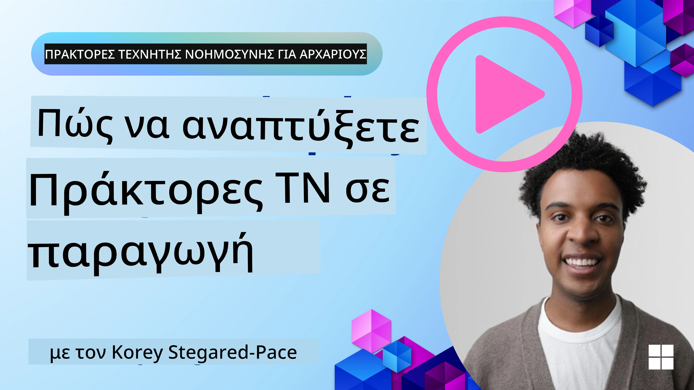

# Πράκτορες Τεχνητής Νοημοσύνης σε Παραγωγή: Παρατηρησιμότητα & Αξιολόγηση

[](https://youtu.be/l4TP6IyJxmQ?si=reGOyeqjxFevyDq9)

Καθώς οι πράκτορες τεχνητής νοημοσύνης μεταβαίνουν από πειραματικά πρωτότυπα σε εφαρμογές πραγματικού κόσμου, η ικανότητα κατανόησης της συμπεριφοράς τους, παρακολούθησης της απόδοσής τους και συστηματικής αξιολόγησης των αποτελεσμάτων τους γίνεται σημαντική.

## Στόχοι Μάθησης

Μετά την ολοκλήρωση αυτού του μαθήματος, θα γνωρίζετε/κατανοείτε:
- Θεμελιώδεις έννοιες της παρατηρησιμότητας και της αξιολόγησης πρακτόρων
- Τεχνικές για τη βελτίωση της απόδοσης, των κόστους και της αποτελεσματικότητας των πρακτόρων
- Τι και πώς να αξιολογείτε τους πράκτορές σας συστηματικά
- Πώς να ελέγχετε τα κόστη κατά την ανάπτυξη πρακτόρων τεχνητής νοημοσύνης σε παραγωγή
- Πώς να εφοδιάζετε με μέσα παρακολούθησης πράκτορες κατασκευασμένους με Microsoft Agent Framework

Στόχος είναι να σας εξοπλίσουμε με τις γνώσεις για να μετατρέψετε τους πράκτορές σας «μαύρα κουτιά» σε διαφανή, διαχειρίσιμα και αξιόπιστα συστήματα.

_**Σημείωση:** Είναι σημαντικό να αναπτυχθούν Πράκτορες ΤΝ που είναι ασφαλείς και αξιόπιστοι. Δείτε επίσης το μάθημα [Δημιουργία Αξιόπιστων Πρακτόρων ΤΝ](../06-building-trustworthy-agents/README.md)._

## Ιχνηλασίες και Τμήματα

Εργαλεία παρατηρησιμότητας όπως το [Langfuse](https://langfuse.com/) ή το [Microsoft Foundry](https://learn.microsoft.com/en-us/azure/ai-foundry/what-is-azure-ai-foundry) συνήθως αναπαριστούν τα τρέξιμα πρακτόρων ως ιχνηλασίες και τμήματα.

- **Ιχνηλασία** αναπαριστά ένα ολοκληρωμένο έργο πράκτορα από την αρχή έως το τέλος (όπως η διαχείριση ερωτήματος χρήστη).
- **Τμήματα** είναι μεμονωμένα βήματα μέσα στην ιχνηλασία (όπως η κλήση ενός μοντέλου γλώσσας ή η ανάκτηση δεδομένων).


<!-- Image URL retained for illustration purposes -->

Χωρίς παρατηρησιμότητα, ένας πράκτορας ΤΝ μπορεί να μοιάζει σαν «μαύρο κουτί» - η εσωτερική κατάσταση και η λογική είναι αδιαφανείς, καθιστώντας δύσκολη τη διάγνωση προβλημάτων ή τη βελτιστοποίηση της απόδοσης. Με την παρατηρησιμότητα, οι πράκτορες μετατρέπονται σε «γυάλινα κουτιά», προσφέροντας διαφάνεια που είναι ζωτικής σημασίας για την οικοδόμηση εμπιστοσύνης και την εξασφάλιση ότι λειτουργούν όπως πρέπει.

## Γιατί η Παρατηρησιμότητα Έχει Σημασία σε Περιβάλλοντα Παραγωγής

Η μετάβαση των πρακτόρων ΤΝ σε περιβάλλοντα παραγωγής εισάγει ένα νέο σύνολο προκλήσεων και απαιτήσεων. Η παρατηρησιμότητα δεν είναι πλέον «ωραίο να υπάρχει» αλλά μια κρίσιμη ικανότητα:

*   **Ανίχνευση σφαλμάτων και Ανάλυση Αιτίου Ρίζας**: Όταν ένας πράκτορας αποτυγχάνει ή παράγει απρόσμενο αποτέλεσμα, τα εργαλεία παρατηρησιμότητας παρέχουν τις ιχνηλασίες που χρειάζονται για να εντοπιστεί η πηγή του σφάλματος. Αυτό είναι ιδιαίτερα σημαντικό σε πολύπλοκους πράκτορες που μπορεί να περιλαμβάνουν πολλαπλές κλήσεις LLM, αλληλεπιδράσεις εργαλείων και λογική υπό όρους.
*   **Διαχείριση Καθυστέρησης και Κόστους**: Οι πράκτορες ΤΝ συχνά βασίζονται σε LLM και άλλες εξωτερικές APIs που χρεώνονται ανά token ή κλήση. Η παρατηρησιμότητα επιτρέπει τον ακριβή εντοπισμό αυτών των κλήσεων, βοηθώντας στον εντοπισμό λειτουργιών που είναι υπερβολικά αργές ή δαπανηρές. Αυτό επιτρέπει στις ομάδες να βελτιστοποιούν τις εντολές, να επιλέγουν πιο αποδοτικά μοντέλα ή να ανασχεδιάζουν ροές εργασίας για τη διαχείριση του λειτουργικού κόστους και την εξασφάλιση καλής εμπειρίας χρήστη.
*   **Εμπιστοσύνη, Ασφάλεια και Συμμόρφωση**: Σε πολλές εφαρμογές, είναι σημαντικό να διασφαλίζεται ότι οι πράκτορες συμπεριφέρονται με ασφάλεια και ηθική. Η παρατηρησιμότητα παρέχει ένα ίχνος ελέγχου των ενεργειών και αποφάσεων του πράκτορα. Αυτό μπορεί να χρησιμοποιηθεί για να εντοπίσει και να αντιμετωπίσει ζητήματα όπως έγχυση εντολών (prompt injection), παραγωγή επιβλαβούς περιεχομένου ή κακή διαχείριση προσωπικών δεδομένων (PII). Για παράδειγμα, μπορείτε να αναθεωρήσετε ιχνηλασίες για να καταλάβετε γιατί ένας πράκτορας παρείχε μια συγκεκριμένη απάντηση ή χρησιμοποίησε ένα συγκεκριμένο εργαλείο.
*   **Διαρκείς Βρόχοι Βελτίωσης**: Τα δεδομένα παρατηρησιμότητας είναι η βάση μιας επαναληπτικής διαδικασίας ανάπτυξης. Με την παρακολούθηση της απόδοσης των πρακτόρων στον πραγματικό κόσμο, οι ομάδες μπορούν να εντοπίσουν περιοχές για βελτίωση, να συλλέξουν δεδομένα για βελτιστοποίηση μοντέλων και να επικυρώσουν τον αντίκτυπο των αλλαγών. Αυτό δημιουργεί έναν βρόχο ανατροφοδότησης όπου τα συμπεράσματα από την παραγωγή κατά την online αξιολόγηση ενημερώνουν τις offline πειραματισμούς και βελτιώσεις, οδηγώντας σε σταδιακά καλύτερη απόδοση του πράκτορα.

## Κύρια Μετρικά για Παρακολούθηση

Για να παρακολουθείτε και να κατανοείτε τη συμπεριφορά του πράκτορα, πρέπει να παρακολουθείτε μια σειρά μετρικών και σημάτων. Παρόλο που οι συγκεκριμένες μετρικές μπορεί να διαφέρουν ανάλογα με τον σκοπό του πράκτορα, κάποιες είναι παγκοσμίως σημαντικές.

Ακολουθούν μερικές από τις πιο κοινές μετρικές που παρακολουθούν τα εργαλεία παρατηρησιμότητας:

**Καθυστέρηση:** Πόσο γρήγορα ανταποκρίνεται ο πράκτορας; Οι μεγάλες χρόνοι αναμονής επηρεάζουν αρνητικά την εμπειρία χρήστη. Πρέπει να μετράτε την καθυστέρηση για τα έργα και τα μεμονωμένα βήματα με την ιχνηλάτηση των τρεξιμάτων του πράκτορα. Για παράδειγμα, ένας πράκτορας που χρειάζεται 20 δευτερόλεπτα για όλες τις κλήσεις μοντέλου μπορεί να επιταχυνθεί χρησιμοποιώντας ένα πιο γρήγορο μοντέλο ή εκτελώντας κλήσεις μοντέλου παράλληλα.

**Κόστη:** Ποιο είναι το κόστος ανά τρέξιμο πράκτορα; Οι πράκτορες ΤΝ βασίζονται σε κλήσεις LLM που χρεώνονται ανά token ή εξωτερικές APIs. Η συχνή χρήση εργαλείων ή πολλαπλές εντολές μπορεί να αυξήσουν τα κόστη γρήγορα. Για παράδειγμα, αν ένας πράκτορας καλεί ένα LLM πέντε φορές για οριακή βελτίωση ποιότητας, πρέπει να αξιολογήσετε αν το κόστος δικαιολογείται ή αν μπορείτε να μειώσετε τις κλήσεις ή να χρησιμοποιήσετε ένα φθηνότερο μοντέλο. Η παρακολούθηση σε πραγματικό χρόνο μπορεί επίσης να βοηθήσει στον εντοπισμό απροσδόκητων κορυφών (π.χ. σφάλματα που προκαλούν υπερβολικές βρόχους API).

**Σφάλματα Αιτήσεων:** Πόσες αιτήσεις απέτυχε ο πράκτορας; Αυτό μπορεί να περιλαμβάνει σφάλματα API ή αποτυχημένες κλήσεις εργαλείων. Για να κάνετε τον πράκτορά σας πιο ανθεκτικό σε αυτά σε παραγωγή, μπορείτε να ρυθμίσετε εναλλακτικές ή επαναλήψεις. π.χ. αν ο πάροχος LLM A είναι εκτός λειτουργίας, μεταβαίνετε στον πάροχο LLM B ως εφεδρεία.

**Ανατροφοδότηση Χρηστών:** Η εφαρμογή άμεσων αξιολογήσεων χρηστών παρέχει πολύτιμες πληροφορίες. Αυτό μπορεί να περιλαμβάνει ρητές βαθμολογίες (👍θετική/👎αρνητική, ⭐1-5 αστέρια) ή κειμενικά σχόλια. Η συνεπής αρνητική ανατροφοδότηση πρέπει να σας ειδοποιεί καθώς είναι σημάδι ότι ο πράκτορας δεν λειτουργεί όπως αναμένεται.

**Έμμεση Ανατροφοδότηση Χρηστών:** Οι συμπεριφορές των χρηστών παρέχουν έμμεση ανατροφοδότηση ακόμη και χωρίς ρητές βαθμολογίες. Αυτό μπορεί να περιλαμβάνει άμεση αναδιατύπωση ερωτήσεων, επαναλαμβανόμενα ερωτήματα ή κλικ σε κουμπί επανάληψης. π.χ. αν βλέπετε ότι οι χρήστες ρωτούν επανειλημμένα την ίδια ερώτηση, αυτό είναι σημάδι ότι ο πράκτορας δεν λειτουργεί όπως αναμένεται.

**Ακρίβεια:** Πόσο συχνά ο πράκτορας παράγει σωστά ή επιθυμητά αποτελέσματα; Οι ορισμοί ακρίβειας διαφέρουν (π.χ. σωστή επίλυση προβλημάτων, ακρίβεια ανάκτησης πληροφοριών, ικανοποίηση χρήστη). Το πρώτο βήμα είναι να ορίσετε τι σημαίνει επιτυχία για τον πράκτορά σας. Μπορείτε να παρακολουθείτε την ακρίβεια μέσω αυτόματων ελέγχων, βαθμολογιών αξιολόγησης ή ετικετών ολοκλήρωσης εργασιών. Για παράδειγμα, επισημαίνοντας ιχνηλασίες ως «επιτυχείς» ή «αποτυχημένες».

**Αυτοματοποιημένα Μετρικά Αξιολόγησης:** Μπορείτε επίσης να ρυθμίσετε αυτοματοποιημένες αξιολογήσεις. Για παράδειγμα, μπορείτε να χρησιμοποιήσετε ένα LLM για να βαθμολογήσετε το αποτέλεσμα του πράκτορα π.χ. αν είναι χρήσιμο, ακριβές ή όχι. Υπάρχουν επίσης πολλές βιβλιοθήκες ανοιχτού κώδικα που βοηθούν στη βαθμολόγηση διαφορετικών πτυχών του πράκτορα. π.χ. [RAGAS](https://docs.ragas.io/) για πράκτορες RAG ή [LLM Guard](https://github.com/protectai/llm-guard) για την ανίχνευση επιβλαβούς γλώσσας ή έγχυσης εντολών.

Στην πράξη, ένας συνδυασμός αυτών των μετρικών δίνει την καλύτερη κάλυψη της υγείας ενός πράκτορα ΤΝ. Στο [παράδειγμα σημειωματάριου](./code_samples/10-expense_claim-demo.ipynb) αυτής της ενότητας, θα σας δείξουμε πώς εμφανίζονται αυτές οι μετρικές σε πραγματικά παραδείγματα, αλλά πρώτα θα μάθουμε πώς μοιάζει μια τυπική ροή εργασίας αξιολόγησης.

## Εξοπλίστε τον Πράκτορά σας με Μέσα Παρακολούθησης

Για να συλλέξετε δεδομένα ιχνηλάτησης, πρέπει να εφοδιάσετε τον κώδικά σας με μέσα παρακολούθησης. Ο στόχος είναι να εφοδιάσετε τον κώδικα του πράκτορα για να εκπέμπει ιχνηλασίες και μετρικές που μπορούν να καταγραφούν, να επεξεργαστούν και να απεικονιστούν από μια πλατφόρμα παρατηρησιμότητας.

**OpenTelemetry (OTel):** Το [OpenTelemetry](https://opentelemetry.io/) έχει αναδειχθεί ως πρότυπο βιομηχανίας για την παρατηρησιμότητα LLM. Παρέχει ένα σύνολο API, SDK και εργαλείων για τη δημιουργία, συλλογή και εξαγωγή δεδομένων τηλεμετρίας.

Υπάρχουν πολλές βιβλιοθήκες μέσων παρακολούθησης που τυλίγουν υπάρχοντα πλαίσια πρακτόρων και καθιστούν εύκολη την εξαγωγή τμημάτων OpenTelemetry σε εργαλείο παρατηρησιμότητας. Το Microsoft Agent Framework ενσωματώνει το OpenTelemetry εγγενώς. Παρακάτω είναι ένα παράδειγμα για την εξοπλισμό ενός πράκτορα MAF:

```python
from agent_framework.observability import get_tracer, get_meter

tracer = get_tracer()
meter = get_meter()

with tracer.start_as_current_span("agent_run"):
    # Agent execution is traced automatically
    pass
```

Το [παράδειγμα σημειωματάριου](./code_samples/10-expense_claim-demo.ipynb) σε αυτήν την ενότητα θα δείξει πώς να εφοδιάσετε τον πράκτορά σας MAF.

**Χειροκίνητη Δημιουργία Τμημάτων:** Ενώ οι βιβλιοθήκες μέσων παρέχουν μια καλή βάση, υπάρχουν συχνά περιπτώσεις όπου απαιτούνται πιο λεπτομερείς ή εξατομικευμένες πληροφορίες. Μπορείτε να δημιουργήσετε χειροκίνητα τμήματα για να προσθέσετε προσαρμοσμένη επιχειρησιακή λογική. Το πιο σημαντικό, μπορούν να εμπλουτίσουν αυτόματα ή χειροκίνητα τα δημιουργημένα τμήματα με προσαρμοσμένα χαρακτηριστικά (γνωστά και ως tags ή μεταδεδομένα). Αυτά τα χαρακτηριστικά μπορεί να περιλαμβάνουν δεδομένα σχετιζόμενα με την επιχείρηση, ενδιάμεσους υπολογισμούς ή οποιοδήποτε πλαίσιο που μπορεί να είναι χρήσιμο για αποσφαλμάτωση ή ανάλυση, όπως `user_id`, `session_id`, ή `model_version`.

Παράδειγμα χειροκίνητης δημιουργίας ιχνηλασιών και τμημάτων με το [Langfuse Python SDK](https://langfuse.com/docs/sdk/python/sdk-v3):

```python
from langfuse import get_client
 
langfuse = get_client()
 
span = langfuse.start_span(name="my-span")
 
span.end()
```

## Αξιολόγηση Πράκτορα

Η παρατηρησιμότητα μας δίνει μετρικές, αλλά η αξιολόγηση είναι η διαδικασία ανάλυσης αυτών των δεδομένων (και εκτέλεσης δοκιμών) για να προσδιοριστεί πόσο καλά αποδίδει ένας πράκτορας ΤΝ και πώς μπορεί να βελτιωθεί. Με άλλα λόγια, μόλις έχετε αυτές τις ιχνηλασίες και μετρικές, πώς τις χρησιμοποιείτε για να κρίνετε τον πράκτορα και να πάρετε αποφάσεις;

Η κανονική αξιολόγηση είναι σημαντική επειδή οι πράκτορες ΤΝ συχνά δεν είναι ντετερμινιστικοί και μπορούν να εξελιχθούν (μέσω ενημερώσεων ή μετατόπισης συμπεριφοράς μοντέλου) – χωρίς αξιολόγηση, δεν θα ξέρετε αν ο «έξυπνος πράκτορας» σας κάνει καλά τη δουλειά του ή αν έχει υποστεί υποβάθμιση.

Υπάρχουν δύο κατηγορίες αξιολογήσεων για πράκτορες ΤΝ: **online αξιολόγηση** και **offline αξιολόγηση**. Και οι δύο είναι πολύτιμες και συμπληρώνουν η μία την άλλη. Συνήθως ξεκινούμε με την offline αξιολόγηση, καθώς αυτή είναι το ελάχιστο αναγκαίο βήμα πριν την ανάπτυξη οποιουδήποτε πράκτορα.

### Offline Αξιολόγηση


Αυτό περιλαμβάνει την αξιολόγηση του πράκτορα σε ελεγχόμενο περιβάλλον, συνήθως χρησιμοποιώντας σύνολα δοκιμαστικών δεδομένων, όχι ζωντανά αιτήματα χρήστη. Χρησιμοποιείτε επιλεγμένα σύνολα δεδομένων όπου γνωρίζετε ποιο είναι το αναμενόμενο αποτέλεσμα ή η σωστή συμπεριφορά, και μετά τρέχετε τον πράκτορά σας σε αυτά.

Για παράδειγμα, αν έχετε δημιουργήσει έναν πράκτορα επίλυσης μαθηματικών προβλημάτων, μπορεί να έχετε ένα [σύνολο δοκιμών](https://huggingface.co/datasets/openai/gsm8k) με 100 προβλήματα και γνωστές απαντήσεις. Η offline αξιολόγηση γίνεται συνήθως κατά την ανάπτυξη (και μπορεί να είναι μέρος των CI/CD pipelines) για να ελέγξετε βελτιώσεις ή να προστατευτείτε από υποβάθμιση. Το πλεονέκτημα είναι ότι είναι **επαναληπτική και μπορείτε να πάρετε σαφή μετρικά ακρίβειας αφού έχετε την αλήθεια εδάφους**. Μπορείτε επίσης να προσομοιώσετε ερωτήματα χρηστών και να μετρήσετε τις απαντήσεις του πράκτορα σε ιδανικές απαντήσεις ή να χρησιμοποιήσετε αυτοματοποιημένες μετρικές όπως περιγράφτηκε παραπάνω.

Η βασική πρόκληση στην offline αξιολόγηση είναι να διασφαλίσετε ότι το σύνολο δοκιμών είναι συνολικό και παραμένει σχετικό – ο πράκτορας μπορεί να αποδίδει καλά σε ένα σταθερό σύνολο δοκιμών αλλά να συναντά πολύ διαφορετικά ερωτήματα σε παραγωγή. Επομένως, πρέπει να κρατάτε τα σύνολα δοκιμών ενημερωμένα με νέες ακραίες περιπτώσεις και παραδείγματα που αντικατοπτρίζουν σενάρια πραγματικού κόσμου. Ένας συνδυασμός μικρών «δοκιμών καπνού» και μεγαλύτερων συνόλων αξιολόγησης είναι χρήσιμος: μικρά σύνολα για γρήγορους ελέγχους και μεγαλύτερα για ευρύτερες μετρικές απόδοσης.

### Online Αξιολόγηση


Αυτό αναφέρεται στην αξιολόγηση του πράκτορα σε ζωντανό, πραγματικό περιβάλλον, δηλαδή κατά τη διάρκεια της πραγματικής χρήσης σε παραγωγή. Η online αξιολόγηση περιλαμβάνει την παρακολούθηση της απόδοσης του πράκτορα σε πραγματικές αλληλεπιδράσεις χρηστών και τη συνεχή ανάλυση των αποτελεσμάτων.

Για παράδειγμα, μπορεί να παρακολουθείτε ποσοστά επιτυχίας, βαθμολογίες ικανοποίησης χρηστών ή άλλες μετρικές σε ζωντανή κίνηση. Το πλεονέκτημα της online αξιολόγησης είναι ότι **συλλαμβάνει πράγματα που μπορεί να μη φανταζόσασταν σε περιβάλλον εργαστηρίου** – μπορείτε να παρατηρήσετε μετατόπιση μοντέλου με την πάροδο του χρόνου (αν η αποτελεσματικότητα του πράκτορα μειώνεται καθώς αλλάζουν τα πρότυπα εισόδου) και να εντοπίσετε απροσδόκητα ερωτήματα ή καταστάσεις που δεν υπήρχαν στο δοκιμαστικό σας σύνολο. Παρέχει μια αληθινή εικόνα του πώς συμπεριφέρεται ο πράκτορας «στο άγριο».

Η online αξιολόγηση συχνά περιλαμβάνει συλλογή έμμεσων και ρητών σχολίων χρηστών, όπως συζητήθηκε, και ενδεχομένως εκτέλεση shadow tests ή A/B tests (όπου μια νέα έκδοση του πράκτορα τρέχει παράλληλα για σύγκριση με την παλιά). Η πρόκληση είναι ότι μπορεί να είναι δύσκολο να ληφθούν αξιόπιστες ετικέτες ή σκορ για ζωντανές αλληλεπιδράσεις – ίσως βασίζεστε σε σχόλια χρηστών ή μετρικές ακολουθίας (όπως αν ο χρήστης κλικαρε το αποτέλεσμα).

### Συνδυασμός των δύο

Η online και η offline αξιολόγηση δεν αλληλοαποκλείονται· είναι πολύ συμπληρωματικές. Τα ευρήματα από την online παρακολούθηση (π.χ., νέοι τύποι αιτημάτων χρηστών όπου ο πράκτορας αποδίδει κακά) μπορούν να χρησιμοποιηθούν για να εμπλουτίσουν και να βελτιώσουν τα offline σύνολα δοκιμών. Αντίστοιχα, πράκτορες που αποδίδουν καλά στα offline τεστ μπορούν στη συνέχεια να αναπτυχθούν με μεγαλύτερη σιγουριά και να παρακολουθούνται online.

Στην πραγματικότητα, πολλές ομάδες υιοθετούν έναν βρόχο:

_αξιολόγηση offline -> ανάπτυξη -> παρακολούθηση online -> συλλογή νέων περιπτώσεων αποτυχίας -> προσθήκη στο offline σύνολο -> βελτίωση πράκτορα -> επανάληψη_.

## Συνηθισμένα Προβλήματα

Καθώς αναπτύσσετε πράκτορες ΤΝ σε παραγωγή, μπορεί να αντιμετωπίσετε διάφορες προκλήσεις. Εδώ είναι μερικά συνηθισμένα ζητήματα και οι πιθανές λύσεις τους:

| **Ζήτημα**    | **Πιθανή Λύση**   |
| ------------- | ------------------ |
| Ο πράκτορας ΤΝ δεν εκτελεί τις εργασίες με συνέπεια | - Βελτιστοποιήστε τις εντολές προς τον πράκτορα· να είστε σαφείς στους στόχους.<br>- Εντοπίστε πού μπορεί να βοηθήσει ο διαχωρισμός εργασιών σε επιμέρους εργασίες που ανατίθενται σε πολλούς πράκτορες. |
| Ο πράκτορας ΤΝ μπαίνει σε συνεχείς βρόχους | - Διασφαλίστε ότι έχετε σαφείς όρους και προϋποθέσεις τερματισμού ώστε ο πράκτορας να γνωρίζει πότε να σταματήσει τη διαδικασία.<br>- Για πολύπλοκες εργασίες που απαιτούν συλλογισμό και σχεδιασμό, χρησιμοποιήστε ένα μεγαλύτερο μοντέλο που είναι ειδικευμένο σε εργασίες συλλογισμού. |
| Οι κλήσεις εργαλείων από τον πράκτορα δεν αποδίδουν καλά | - Ελέγξτε και επικυρώστε την έξοδο του εργαλείου εκτός του συστήματος πράκτορα.<br>- Βελτιστοποιήστε τα ορισμένα παραμέτρους, τις εντολές και την ονομασία των εργαλείων.  |
| Το σύστημα με πολλούς πράκτορες δεν αποδίδει με συνέπεια | - Βελτιστοποιήστε τις εντολές προς κάθε πράκτορα για να διασφαλίσετε ότι είναι συγκεκριμένες και διακριτές μεταξύ τους.<br>- Δημιουργήστε ένα ιεραρχικό σύστημα χρησιμοποιώντας έναν πράκτορα "δρομολόγησης" ή ελεγκτή για να καθορίσετε ποιος πράκτορας είναι ο σωστός. |

Πολλά από αυτά τα ζητήματα μπορούν να εντοπιστούν πιο αποτελεσματικά με την παρουσία παρατηρησιμότητας. Οι ιχνηλασίες και οι μετρικές που συζητήσαμε νωρίτερα βοηθούν να εντοπίσουμε ακριβώς που στη ροή εργασίας του πράκτορα προκύπτουν προβλήματα, καθιστώντας τον αποσφαλματισμό και τη βελτιστοποίηση πολύ πιο αποδοτικά.

## Διαχείριση Κόστους

Εδώ είναι μερικές στρατηγικές για τη διαχείριση των κόστους ανάπτυξης πρακτόρων ΤΝ σε παραγωγή:

**Χρήση Μικρότερων Μοντέλων:** Τα Μικρά Γλωσσικά Μοντέλα (SLMs) μπορούν να αποδώσουν καλά σε ορισμένες περιπτώσεις χρήσης με πράκτορες και θα μειώσουν σημαντικά τα κόστη. Όπως αναφέρθηκε νωρίτερα, η δημιουργία ενός συστήματος αξιολόγησης για τον προσδιορισμό και τη σύγκριση της απόδοσης σε σχέση με μεγαλύτερα μοντέλα είναι ο καλύτερος τρόπος για να κατανοήσετε πόσο καλά θα αποδώσει ένα SLM στην περίπτωσή σας. Σκεφτείτε να χρησιμοποιήσετε SLMs για απλούστερες εργασίες όπως ταξινόμηση προθέσεων ή εξαγωγή παραμέτρων, ενώ διατηρείτε τα μεγαλύτερα μοντέλα για πολύπλοκη λογική.

**Χρήση Μοντέλου Δρομολόγησης:** Μια παρόμοια στρατηγική είναι η χρήση ποικιλίας μοντέλων και μεγεθών. Μπορείτε να χρησιμοποιήσετε ένα LLM/SLM ή μια χωρίς διακομιστή λειτουργία για να δρομολογήσετε τις αιτήσεις βάσει της πολυπλοκότητας στα πιο κατάλληλα μοντέλα. Αυτό θα βοηθήσει επίσης στη μείωση των εξόδων εξασφαλίζοντας ταυτόχρονα την απόδοση στις κατάλληλες εργασίες. Για παράδειγμα, δρομολογήστε απλές ερωτήσεις σε μικρότερα, πιο γρήγορα μοντέλα και χρησιμοποιήστε τα ακριβά μεγάλα μοντέλα μόνο για πολύπλοκες λογικές εργασίες.

**Αποθήκευση Απαντήσεων (Caching):** Η αναγνώριση κοινών αιτήσεων και εργασιών και η παροχή των απαντήσεων πριν περάσουν από το σύστημά σας με πράκτορα είναι ένας καλός τρόπος για να μειώσετε τον όγκο παρόμοιων αιτήσεων. Μπορείτε ακόμη και να υλοποιήσετε μια ροή για να προσδιορίσετε πόσο παρόμοια είναι μια αίτηση με τις αποθηκευμένες αιτήσεις χρησιμοποιώντας πιο βασικά μοντέλα AI. Αυτή η στρατηγική μπορεί να μειώσει σημαντικά τα κόστη για συχνές ερωτήσεις ή κοινές ροές εργασιών.

## Ας δούμε πώς λειτουργεί αυτό στην πράξη

Στο [παράδειγμα σημειωματάριου αυτής της ενότητας](./code_samples/10-expense_claim-demo.ipynb), θα δούμε παραδείγματα για το πώς μπορούμε να χρησιμοποιήσουμε εργαλεία παρατηρησιμότητας για να παρακολουθήσουμε και να αξιολογήσουμε τον πράκτορά μας.


### Έχετε Περισσότερες Ερωτήσεις για τους Πράκτορες Τεχνητής Νοημοσύνης στην Παραγωγή;

Εγγραφείτε στο [Microsoft Foundry Discord](https://discord.com/invite/ATgtXmAS5D) για να γνωρίσετε άλλους μαθητευόμενους, να παρακολουθήσετε ώρες γραφείου και να λύσετε τις απορίες σας για τους Πράκτορες Τεχνητής Νοημοσύνης.

## Προηγούμενο Μάθημα

[Πρότυπο Σχεδιασμού Μεταγνώσης](../09-metacognition/README.md)

## Επόμενο Μάθημα

[Πρωτόκολλα Πράκτορα](../11-agentic-protocols/README.md)

---

<!-- CO-OP TRANSLATOR DISCLAIMER START -->
**Αποποίηση ευθυνών**:
Αυτό το έγγραφο έχει μεταφραστεί χρησιμοποιώντας την υπηρεσία μετάφρασης με τεχνητή νοημοσύνη [Co-op Translator](https://github.com/Azure/co-op-translator). Ενώ επιδιώκουμε την ακρίβεια, παρακαλούμε να έχετε υπόψη ότι οι αυτοματοποιημένες μεταφράσεις ενδέχεται να περιέχουν λάθη ή ανακρίβειες. Το πρωτότυπο έγγραφο στη μητρική του γλώσσα πρέπει να θεωρείται η αυθεντική πηγή. Για κρίσιμες πληροφορίες, συνιστάται επαγγελματική ανθρώπινη μετάφραση. Δεν φέρουμε ευθύνη για τυχόν παρεξηγήσεις ή λανθασμένες ερμηνείες που προκύπτουν από τη χρήση αυτής της μετάφρασης.
<!-- CO-OP TRANSLATOR DISCLAIMER END -->