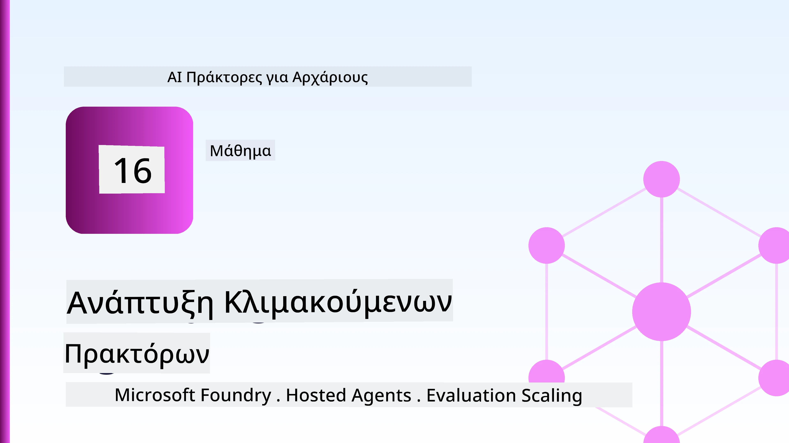
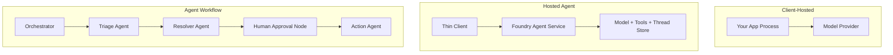
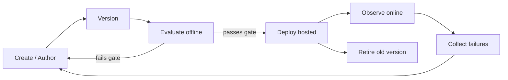
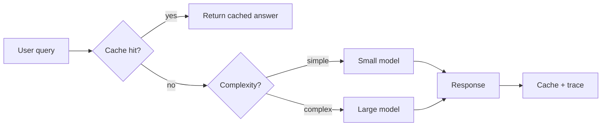
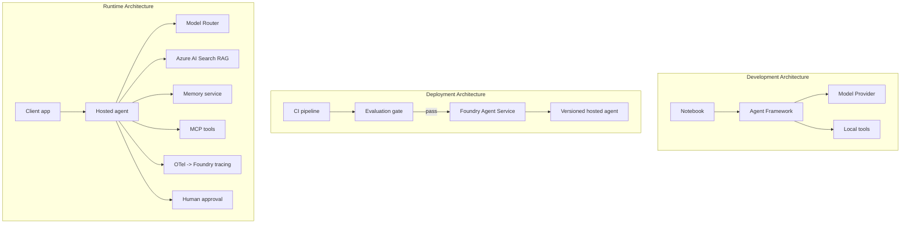

# Ανάπτυξη Κλιμακούμενων Πρακτόρων με το Microsoft Foundry



Μέχρι αυτό το σημείο στο μάθημα έχετε δημιουργήσει πράκτορες που τρέχουν στο φορητό σας υπολογιστή, μέσα σε ένα σημειωματάριο, κινούνται από `az login` και μερικές μεταβλητές περιβάλλοντος. Αυτή είναι ακριβώς η σωστή μέθοδος για να μάθετε. Δεν είναι όμως ο σωστός τρόπος για να τρέξετε έναν πράκτορα στον οποίο εξαρτώνται χιλιάδες πελάτες, στις 3 το πρωί.

Αυτό το μάθημα αφορά το χάσμα μεταξύ του "δουλεύει στον υπολογιστή μου" και του "δουλεύει αξιόπιστα και οικονομικά στην παραγωγή." Κλείνουμε αυτό το χάσμα χρησιμοποιώντας το **Microsoft Foundry** και την **Υπηρεσία Πρακτόρων Microsoft Foundry**, και το κάνουμε χτίζοντας έναν πραγματικό πράκτορα υποστήριξης πελατών που διαθέτει εργαλεία, ανάκτηση, μνήμη, αξιολόγηση και παρακολούθηση.

## Εισαγωγή

Αυτό το μάθημα θα καλύψει:

- Τη διαφορά μεταξύ **πρωτότυπου πράκτορα** και **αναπτυγμένου πράκτορα**, και γιατί η μετάβαση αφορά κυρίως τα πάντα *γύρω* από το μοντέλο.
- **Πρότυπα ανάπτυξης** για πράκτορες: φιλοξενία από πελάτη, φιλοξενία σε υπηρεσία (Hosted Agents), και ροές εργασίας με ορχήστρωση.
- Τον **κύκλο ζωής πράκτορα** στο Microsoft Foundry — δημιουργία, έκδοση, ανάπτυξη, αξιολόγηση, παρακολούθηση, απόσυρση.
- **Στρατηγικές κλιμάκωσης**: δρομολόγηση μοντέλου, caching, ταυτόχρονη επεξεργασία, και σχεδίαση χωρίς κατάσταση.
- **Παρατηρησιμότητα** με OpenTelemetry και Foundry tracing.
- **Βελτιστοποίηση κόστους** μέσω επιλογής μοντέλου, δρομολόγησης και πυλών αξιολόγησης.
- **Επιχειρησιακές εξετάσεις**: διακυβέρνηση, ανθρώπινη έγκριση, και ασφαλής λειτουργία διακομιστών MCP στην παραγωγή.

## Στόχοι Μάθησης

Μετά την ολοκλήρωση αυτού του μαθήματος, θα ξέρετε πώς να:

- Επιλέγετε το κατάλληλο πρότυπο ανάπτυξης για ένα δεδομένο φορτίο πράκτορα.
- Αναπτύσσετε έναν πράκτορα στην Υπηρεσία Πρακτόρων Microsoft Foundry ώστε να έχει εκδόσεις, διακυβέρνηση και να παρατηρείται.
- Εξοπλίζετε έναν πράκτορα με εργαλεία παρακολούθησης και συνδέετε ένα pipeline αξιολόγησης που τρέχει πριν από κάθε έκδοση.
- Εφαρμόζετε δρομολόγηση μοντέλου και caching για να κρατάτε τη λανθάνουσα κατάσταση και το κόστος υπό έλεγχο σε κλίμακα.
- Προσθέτετε μια πύλη ανθρώπινης έγκρισης για ενέργειες υψηλού κινδύνου και ενσωματώνετε έναν διακομιστή MCP με ασφαλή τρόπο στην παραγωγή.

## Προαπαιτούμενα

Αυτό το μάθημα υποθέτει ότι έχετε ολοκληρώσει τα προηγούμενα μαθήματα και είστε άνετοι με:

- Τη δημιουργία πρακτόρων με το [Microsoft Agent Framework](../14-microsoft-agent-framework/README.md) (Μάθημα 14).
- [Χρήση εργαλείων](../04-tool-use/README.md) (Μάθημα 4) και [Agentic RAG](../05-agentic-rag/README.md) (Μάθημα 5).
- [Μνήμη Πρακτόρα](../13-agent-memory/README.md) (Μάθημα 13) και [Πρωτόκολλα Πρακτόρα / MCP](../11-agentic-protocols/README.md) (Μάθημα 11).
- [Παρατηρησιμότητα και Αξιολόγηση](../10-ai-agents-production/README.md) (Μάθημα 10) — αυτό το μάθημα χτίζει απευθείας πάνω του.

Θα χρειαστείτε επίσης:

- Συνδρομή **Azure** και ένα **project Microsoft Foundry** με τουλάχιστον ένα αναπτυγμένο μοντέλο συνομιλίας.
- Το **Azure CLI** συνδεδεμένο (`az login`).
- Python 3.12+ και τα πακέτα στο αποθετήριο [`requirements.txt`](../../../requirements.txt).

## Από Πρωτότυπο σε Παραγωγή: Τι αλλάζει πραγματικά

Ένας πρωτότυπος πράκτορας και ένας παραγόμενος πράκτορας μοιράζονται τον ίδιο βασικό βρόχο — σκέψη, κλήση εργαλείων, απόκριση. Αυτό που αλλάζει είναι τα πάντα γύρω από αυτόν τον βρόχο. Το μοντέλο είναι ίσως το 20% ενός πράκτορα στην παραγωγή· το υπόλοιπο 80% είναι το λειτουργικό σκελετικό.

| Ανάγκη | Πρωτότυπο | Παραγωγή |
| --- | --- | --- |
| **Φιλοξενία** | Τρέχει στο σημειωματάριό σας | Τρέχει ως φιλοξενούμενη υπηρεσία, έχει εκδόσεις και κυκλοφορεί |
| **Ταυτότητα** | Το `az login` token σας | Διαχειριζόμενη ταυτότητα με scoped RBAC |
| **Κατάσταση** | Στη μνήμη, χάνεται σε επανεκκίνηση | Εξωτερικοποιημένη (κατάστημα νημάτων, υπηρεσία μνήμης) |
| **Σφάλμα** | Βλέπετε το traceback | Επαναπειραματισμοί, fallback, dead-letter, ειδοποιήσεις |
| **Κόστος** | "Είναι λίγα σεντ" | Παρακολουθείται ανά αίτημα, δρομολογείται, cache, προϋπολογίζεται |
| **Ποιότητα** | Κοιτάτε το αποτέλεσμα | Αξιολογείται αυτόματα πριν από κάθε έκδοση |
| **Εμπιστοσύνη** | Εγκρίνετε κάθε ενέργεια | Πολιτική + άνθρωπος στον βρόχο για επικίνδυνες ενέργειες |

Κρατήστε τον πίνακα αυτόν στο μυαλό σας. Κάθε ενότητα παρακάτω αντιστοιχεί σε μία από αυτές τις γραμμές.

## Πρότυπα Ανάπτυξης Πρακτόρων

Υπάρχουν τρία πρότυπα που θα χρησιμοποιήσετε, συχνά σε συνδυασμό.

### 1. Πράκτορες με Φιλοξενία Πελάτη

Το αντικείμενο πράκτορα ζει μέσα στη δική *σας* διεργασία εφαρμογής. Ο κώδικάς σας καλεί απευθείας τον πάροχο μοντέλου· ο βρόχος λογικής τρέχει στην υπηρεσία σας. Αυτό είναι που έκανε κάθε προηγούμενο μάθημα.

- **Χρησιμοποιήστε το όταν** χρειάζεστε πλήρη έλεγχο του βρόχου, προσαρμοσμένο middleware, ή ενσωματώνετε τον πράκτορα σε υπάρχον backend.
- **Ανταλλαγή**: εσείς αναλαμβάνετε την κλιμάκωση, κατάσταση και ανθεκτικότητα.

### 2. Φιλοξενούμενοι Πράκτορες (Foundry Agent Service)

Ο πράκτορας *καταχωρείται ως πόρος* στο Microsoft Foundry. Το Foundry φιλοξενεί τον βρόχο λογικής, αποθηκεύει νημάτια, επιβάλει ασφάλεια περιεχομένου και RBAC, και καθιστά ορατό τον πράκτορα στην πύλη Foundry. Η εφαρμογή σας γίνεται ένας «λεπτός» πελάτης που δημιουργεί νημάτια και διαβάζει απαντήσεις.

- **Χρησιμοποιήστε το όταν** θέλετε ανθεκτικότητα, ενσωματωμένη παρατηρησιμότητα, διακυβέρνηση, και μικρότερο επιχειρησιακό φόρτο.
- **Ανταλλαγή**: λιγότερος χαμηλού επιπέδου έλεγχος έναντι μιας διαχειριζόμενης περιόδου εκτέλεσης.

### 3. Ροές Εργασίας Πρακτόρων

Πολλοί πράκτορες (και εργαλεία) συντίθενται σε γράφο με ρητή ροή ελέγχου — ακολουθιακά βήματα, διακλαδώσεις, κόμβοι ανθρώπινης έγκρισης, και ανθεκτικά σημεία που μπορούν να παύσουν και να συνεχίσουν. Αυτή είναι η δυνατότητα **Workflows** του Microsoft Agent Framework εφαρμοσμένη σε κλίμακα ανάπτυξης.

- **Χρησιμοποιήστε το όταν** μια εργασία εκτείνεται σε αρκετούς εξειδικευμένους πράκτορες ή χρειάζεται βήμα έγκρισης στο μέσον.
- **Ανταλλαγή**: περισσότερα κινούμενα μέρη· απαιτεί παρατηρησιμότητα σε επίπεδο ορχήστρωσης.



## Κύκλος Ζωής του Πράκτορα στο Microsoft Foundry

Η ανάπτυξη ενός πράκτορα δεν είναι μία μοναδική `push`. Είναι ένας βρόχος, και μοιάζει πολύ με κύκλο κυκλοφορίας λογισμικού γιατί ακριβώς αυτό είναι.



Η βασική ιδέα, που μεταφέρθηκε από το [Μάθημα 10](../10-ai-agents-production/README.md): **η αξιολόγηση εκτός σύνδεσης είναι μια πύλη, όχι μια μετά σκέψη.** Μια νέα έκδοση πράκτορα δεν κυκλοφορεί αν δεν περάσει τα κατώφλια αξιολόγησής σας. Η παρατηρησιμότητα online στη συνέχεια τροφοδοτεί τις αποτυχίες σε πραγματικό κόσμο πίσω στο offline σετ δοκιμών σας. Αυτός είναι ο πλήρης βρόχος.

## Στρατηγικές Κλιμάκωσης

Η κλιμάκωση ενός πράκτορα διαφέρει από την κλιμάκωση ενός web API χωρίς κατάσταση, γιατί κάθε αίτημα μπορεί να ενεργοποιήσει πολλούς ακριβούς κλήσεις μοντέλου και εργαλείων. Τέσσερις τεχνικές φέρουν το μεγαλύτερο βάρος.

**Χειρισμός αιτημάτων χωρίς κατάσταση.** Μην κρατάτε καμία κατάσταση ανά χρήστη στη μνήμη της διεργασίας σας. Διατηρήστε τις συνομιλιακές αλυσίδες στο κατάστημα νημάτων του Foundry ή σε μια υπηρεσία μνήμης ώστε οποιοδήποτε παράδειγμα να μπορεί να χειριστεί οποιοδήποτε αίτημα. Αυτό επιτρέπει την οριζόντια κλιμάκωση — προσθέστε παραδείγματα, χωρίς εξαρτήσεις από συνεδρίες.

**Δρομολόγηση μοντέλου.** Δεν χρειάζεται κάθε αίτημα το πιο ικανό (και ακριβό) μοντέλο σας. Δρομολογήστε απλά αιτήματα — ταξινόμηση προθέσεως, σύντομες πραγματολογικές απαντήσεις — σε ένα μικρό, γρήγορο μοντέλο και κρατήστε το μεγάλο μοντέλο για πραγματική σκέψη. Ο **Model Router** του Foundry μπορεί να το κάνει για εσάς, ή μπορείτε να υλοποιήσετε εσείς έναν ελαφρύ ταξινομητή. Θα φτιάξετε την έκδοση DIY στο εργαστήριο.

**Caching απαντήσεων.** Πολλές ερωτήσεις υποστήριξης είναι σχεδόν διπλότυπες ("πώς επαναφέρω τον κωδικό μου;"). Κάντε cache τις απαντήσεις σε κοινές ερωτήσεις και σερβίρετε τις χωρίς να απευθύνεστε καν στο μοντέλο. Ακόμα και ένα μέτριο ποσοστό cache μειώνει σημαντικά κόστος και λανθάνουσα καθυστέρηση.

**Συναγωνισμός και αντίστροφη πίεση.** Οι πάροχοι μοντέλου έχουν όρια ρυθμού. Περιορίστε τη συναγωνιστική σας ικανότητα, χρησιμοποιήστε επαναλαμβανόμενες προσπάθειες με εκθετική ανάπαυλα και αποτύχετε ομαλά (μια πρωτοκολλημένη απόκριση "ασχολούμαστε" είναι καλύτερη από ένα σφάλμα 500).



## Παρατηρησιμότητα στην Παραγωγή

Δεν μπορείτε να λειτουργήσετε κάτι που δεν βλέπετε. Όπως καλύφθηκε στο Μάθημα 10, το Microsoft Agent Framework εκπέμπει **OpenTelemetry** ίχνη εγγενώς — κάθε κλήση μοντέλου, ενεργοποίηση εργαλείου και βήμα ορχήστρωσης γίνεται ένα span. Στην παραγωγή εξάγετε αυτά τα spans στο Microsoft Foundry (ή σε οποιοδήποτε backend συμβατό με OTel) ώστε να μπορείτε:

- Να παρακολουθείτε μια μοναδική προβολή πελάτη από άκρο σε άκρο σε κάθε κλήση μοντέλου και εργαλείου.
- Να παρακολουθείτε τη λανθάνουσα κατάσταση p50/p95 και κόστος ανά αίτημα με το χρόνο.
- Να λαμβάνετε ειδοποιήσεις για αιχμές σφαλμάτων και ανωμαλίες κόστους πριν το παρατηρήσουν οι χρήστες σας (ή η οικονομική ομάδα σας).

```python
from agent_framework.observability import get_tracer

tracer = get_tracer()

with tracer.start_as_current_span("support_request") as span:
    span.set_attribute("customer.tier", "enterprise")
    span.set_attribute("routed.model", "gpt-5-nano")
    # agent execution is traced automatically inside this span
```

Χαρακτηριστικά όπως `customer.tier` και `routed.model` είναι αυτά που μετατρέπουν έναν τοίχο ιχνών σε απαντήσιμες ερωτήσεις ("οι εταιρικοί πελάτες δρομολογούνται πολύ συχνά στο μικρό μοντέλο;").

## Βελτιστοποίηση Κόστους

Το κόστος στους πράκτορες παραγωγής κυριαρχείται από tokens. Τρεις μοχλοί, με σειρά επιδράσεων:

1. **Επιλέξτε το σωστό μέγεθος μοντέλου.** Ένα μικρό μοντέλο που περνάει την πύλη αξιολόγησης είναι σχεδόν πάντα φθηνότερο από ένα μεγάλο που περνάει επίσης. Χρησιμοποιήστε την αξιολόγηση για να *αποδείξετε* ότι το μικρό μοντέλο είναι αρκετά καλό αντί να επιλέγετε από προεπιλογή το μεγαλύτερο από επιφύλαξη.
2. **Δρομολόγηση ανά πολυπλοκότητα.** Όπως παραπάνω — πληρώνετε τιμές μεγάλου μοντέλου μόνο για αιτήματα που χρειάζονται σκέψη μεγάλου μοντέλου.
3. **Cache με επιθετικότητα.** Η φθηνότερη κλήση μοντέλου είναι αυτή που δεν κάνετε ποτέ.

Οι πύλες αξιολόγησης και ο έλεγχος κόστους είναι η ίδια πειθαρχία που βλέπεται από δύο οπτικές: η αξιολόγηση σας λέει το *ελάχιστο ποιοτικό επίπεδο*, η δρομολόγηση και το caching σας κρατούν όσο το δυνατόν πιο κοντά στο *κόστος* αυτού του επιπέδου.

## Επιχειρησιακές Εξετάσεις Ανάπτυξης

**Διακυβέρνηση.** Οι Φιλοξενούμενοι Πράκτορες κληρονομούν το RBAC, την ασφάλεια περιεχομένου και την καταγραφή ελέγχου του Foundry. Δώστε σε κάθε πράκτορα μια διαχειριζόμενη ταυτότητα με τα λιγότερα προνόμια που χρειάζεται — πρόσβαση μόνο ανάγνωσης στις βάσεις γνώσης, scoped πρόσβαση στο API εισιτηρίων, τίποτα παραπάνω.

**Άνθρωπος-στο-βρόχο.** Ορισμένες ενέργειες είναι πολύ κρίσιμες για να αυτοματοποιηθούν πλήρως — έκδοση επιστροφής χρημάτων, διαγραφή λογαριασμού, κλιμάκωση σε νομική ομάδα. Το Microsoft Agent Framework υποστηρίζει εργαλεία με **απαίτηση έγκρισης**: ο πράκτορας προτείνει την ενέργεια, η εκτέλεση παγώνει, ένας άνθρωπος εγκρίνει ή απορρίπτει, και η ροή εργασίας συνεχίζεται. Είδατε τον πρωτόγονο μηχανισμό στο [Μάθημα 6](../06-building-trustworthy-agents/README.md); εδώ τον αναπτύσσετε.

**MCP στην παραγωγή.** Το [MCP](../11-agentic-protocols/README.md) σας επιτρέπει να καταναλώνετε εξωτερικά εργαλεία μέσω τυπικού interface. Στην παραγωγή, αντιμετωπίζετε κάθε διακομιστή MCP ως μη αξιόπιστο όριο: καρφιτσώστε την έκδοση διακομιστή, τρέξτε τον με scoped ταυτότητα, επαληθεύστε τις εξόδους του, και μην αποκαλύπτετε ποτέ μυστικά σε αυτόν. Ένας διακομιστής MCP είναι εξάρτηση, και οι εξαρτήσεις επιδιορθώνονται, ελέγχονται και περιορίζονται σε ρυθμό.



Αυτά τα τρία διαγράμματα — ανάπτυξη, ανάπτυξη, χρόνος εκτέλεσης — είναι ο ίδιος πράκτορας σε τρία στάδια ζωής. Το εργαστήριο που ακολουθεί σας καθοδηγεί στην κατασκευή του.

## Εργαστήριο: Πράκτορας Υποστήριξης Πελατών Έτοιμος για Παραγωγή

Ανοίξτε το [`code_samples/16-python-agent-framework.ipynb`](./code_samples/16-python-agent-framework.ipynb) και δουλέψτε το από την αρχή ως το τέλος. Θα συναρμολογήσετε έναν **πράκτορα υποστήριξης πελατών Contoso** με κάθε επιχειρησιακή ανησυχία ενσωματωμένη:

1. **Κλήση εργαλείων** — έλεγχος κατάστασης παραγγελίας και άνοιγμα εισιτηρίων υποστήριξης.
2. **RAG** — απάντηση σε πολιτικές ερωτήσεις από μια βάση γνώσεων (Azure AI Search, με in-memory fallback ώστε το σημειωματάριο να τρέχει χωρίς πόρο Search).
3. **Μνήμη** — θυμάται τον πελάτη μέσα στις στροφές της συνομιλίας.
4. **Δρομολόγηση μοντέλου** — ένας ταξινομητής πολυπλοκότητας δρομολογεί κάθε αίτημα σε μικρό ή μεγάλο μοντέλο.
5. **Caching απαντήσεων** — επαναλαμβανόμενες ερωτήσεις σερβίρονται από την cache.
6. **Ανθρώπινη έγκριση** — επιστροφές χρημάτων πάνω από όριο παγώνουν για ανθρώπινη υπογραφή.
7. **Pipeline αξιολόγησης** — ένα μικρό offline σετ δοκιμών βαθμολογεί τον πράκτορα και λειτουργεί ως πύλη έκδοσης.
8. **Παρατηρησιμότητα** — OpenTelemetry tracing γύρω από κάθε αίτημα.

### Περιήγηση

Το σημειωματάριο είναι οργανωμένο έτσι ώστε κάθε παραγωγική ανησυχία να είναι μια αυτοτελής, εκτελέσιμη ενότητα. Η καρδιά του είναι ο χειριστής αιτημάτων που συνδυάζει δρομολόγηση και caching:

```python
async def handle_support_request(query: str, customer_id: str) -> str:
    # 1. Serve from cache when we can.
    cached = response_cache.get(normalize(query))
    if cached:
        return cached

    # 2. Route by complexity to control cost.
    model = "gpt-5-nano" if is_simple(query) else "gpt-5-mini"

    # 3. Run the agent inside a trace span for observability.
    with tracer.start_as_current_span("support_request") as span:
        span.set_attribute("routed.model", model)
        span.set_attribute("customer.id", customer_id)
        response = await support_agent.run(query, model=model)

    # 4. Cache and return.
    response_cache.set(normalize(query), response.text)
    return response.text
```

Η πύλη αξιολόγησης που προστατεύει μια έκδοση μοιάζει έτσι:

```python
async def evaluation_gate(agent, test_cases, threshold: float = 0.8) -> bool:
    passed = 0
    for case in test_cases:
        result = await agent.run(case["input"])
        if score_response(result.text, case["expected"]) >= 0.8:
            passed += 1
    pass_rate = passed / len(test_cases)
    print(f"Evaluation pass rate: {pass_rate:.0%} (gate: {threshold:.0%})")
    return pass_rate >= threshold  # only deploy if the gate passes
```

Διαβάστε κάθε γραμμή — το σημειωματάριο κρατά τις βασικές συναρτήσεις σκόπιμα μικρές ώστε να μη κρύβεται τίποτα πίσω από την κλήση πλαισίου.

## Επικύρωση Αναπτυγμένου Πράκτορα με Smoke Tests

Η ανωτέρω πύλη αξιολόγησης τρέχει *εκτός σύνδεσης* με το αντικείμενο πράκτορα σας. Μόλις ο πράκτορας αναπτυχθεί ως Hosted Agent, χρειάζεστε έναν ακόμη, πιο φθηνό έλεγχο: **αν το αναπτυγμένο endpoint απαντά πραγματικά;**

Η "επιτυχής" ανάπτυξη αποδεικνύει μόνο ότι το control plane αποδέχθηκε τον ορισμό — δεν αποδεικνύει ότι ο πράκτορας απαντά. Μια χαμένη εξάρτηση, μια κακή δρομολόγηση μοντέλου, ή μια ληγμένη σύνδεση μπορεί να αφήσουν μια πράσινη ανάπτυξη που δεν επιστρέφει τίποτα. Το **smoke test** το πιάνει αυτό σε δευτερόλεπτα, σε κάθε ανάπτυξη, χωρίς το κόστος μιας πλήρους αξιολόγησης.

Αυτό το αποθετήριο αποστέλλει ένα έτοιμο προς χρήση pipeline για smoke tests βασισμένο στο [AI Smoke Test](https://github.com/marketplace/actions/ai-smoke-test) GitHub Action:

- **Κατάλογος** — το [`tests/lesson-16-smoke-tests.json`](../../../tests/lesson-16-smoke-tests.json) περιέχει prompts και assertions για τον πράκτορα υποστήριξης Contoso (απαντήσεις πολιτικής βασισμένες σε πηγές, αναζήτηση παραγγελίας, παραμονή στο θέμα, και συνέχιση νήματος πολλαπλών στροφών). Κατάλογοι για τους πράκτορες άλλων μαθημάτων υπάρχουν παράλληλα — δείτε το [`tests/README.md`](../tests/README.md).
- **Ροή εργασίας** — το [`.github/workflows/smoke-test.yml`](../../../.github/workflows/smoke-test.yml) κάνει login με Azure OIDC και POST το κάθε prompt στο endpoint Απαντήσεων του πράκτορα, αποτυγχάνοντας την εργασία σε οποιαδήποτε αποτυχία assertion.

```yaml
- name: Smoke-test hosted agent
  uses: JFolberth/ai-smoketest@v1
  with:
    project_endpoint: ${{ inputs.project_endpoint }}
    agent_name: ContosoSupportAgent
    tests_file: tests/lesson-16-smoke-tests.json
```

Εκτελέστε το από την καρτέλα **Ενέργειες** μόλις αναπτυχθεί ο πράκτοράς σας, παρέχοντας το τέλος έργου Foundry και το όνομα του πράκτορα. Η ομοσπονδιακή ταυτότητα χρειάζεται το ρόλο **Azure AI User** στο πεδίο έργου Foundry. Σκεφτείτε τις στρώσεις ως πυραμίδα: οι δοκιμές καπνού (πρόσβαση και ανταπόκριση;) εκτελούνται σε κάθε ανάπτυξη, η offline αξιολόγηση (αρκετά καλή για αποστολή;) πριν από την προώθηση, και η online αξιολόγηση (πώς αποδίδει στο πεδίο;) εκτελείται συνεχώς.

## Έλεγχος Γνώσεων

Ελέγξτε την κατανόησή σας πριν προχωρήσετε στην ανάθεση.

**1. Περίπου πόσο μεγάλο κομμάτι ενός παραγωγικού πράκτορα είναι "το μοντέλο" και τι είναι το υπόλοιπο;**

<details>
<summary>Απάντηση</summary>

Το μοντέλο αποτελεί μειονότητα του συστήματος — συχνά αναφέρεται περίπου στο 20%. Το υπόλοιπο είναι ο λειτουργικός σκελετός: φιλοξενία και εκδόσεις, ταυτότητα και RBAC, εξωτερικοποιημένη κατάσταση, χειρισμός αποτυχιών, παρακολούθηση κόστους, αξιολόγηση και έλεγχοι με ανθρώπινη παρέμβαση. Η μετάβαση στην παραγωγή αφορά κυρίως την κατασκευή όλων *γύρω* από τον βρόχο λογιστικής.
</details>

**2. Πότε θα επιλέγατε έναν φιλοξενούμενο Πράκτορα έναντι ενός πρακτορα που φιλοξενείται από τον πελάτη;**

<details>
<summary>Απάντηση</summary>

Όταν θέλετε ένα διαχειριζόμενο runtime με ενσωματωμένη ανθεκτικότητα (νημάτια που διαρκούν και μπορούν να συνεχιστούν), παρατηρησιμότητα, ασφάλεια περιεχομένου και RBAC, και είστε διατεθειμένοι να ανταλλάξετε κάποιο χαμηλού επιπέδου έλεγχο του βρόχου λογιστικής για λιγότερη λειτουργική επιφάνεια. Ο πράκτορας που φιλοξενείται από τον πελάτη προτιμάται όταν χρειάζεστε πλήρη έλεγχο του βρόχου ή όταν ενσωματώνετε τον πράκτορα σε υπάρχον backend.
</details>

**3. Γιατί ένας κλιμακούμενος πράκτορας πρέπει να είναι χωρίς κατάσταση στη μνήμη της ίδιας της διαδικασίας;**

<details>
<summary>Απάντηση</summary>

Έτσι οποιοδήποτε παράδειγμα μπορεί να χειριστεί οποιοδήποτε αίτημα, που επιτρέπει οριζόντια κλιμάκωση χωρίς σταθερές συνεδρίες. Η κατάσταση συνομιλίας ανά χρήστη εξωτερικεύεται σε αποθήκη νημάτων ή υπηρεσία μνήμης. Αν η κατάσταση ζούσε στη μνήμη της διαδικασίας, θα την χάνατε σε επανεκκίνηση και δεν θα μπορούσατε να κατανείμετε το φορτίο ελεύθερα.
</details>

**4. Ποιο πρόβλημα λύνει η δρομολόγηση μοντέλου και πώς σχετίζεται με την αξιολόγηση;**

<details>
<summary>Απάντηση</summary>

Η δρομολόγηση στέλνει απλά αιτήματα σε ένα μικρό, φτηνό, γρήγορο μοντέλο και διατηρεί το μεγάλο μοντέλο για αυθεντική λογιστική, ελέγχοντας τόσο την υστέρηση όσο και το κόστος. Σχετίζεται με την αξιολόγηση γιατί η αξιολόγηση είναι που *αποδεικνύει* ότι το μικρό μοντέλο είναι αρκετά καλό για μια κατηγορία αιτημάτων — η δρομολόγηση χωρίς αξιολόγηση είναι εικασία.
</details>

**5. Τι είναι μια "πύλη αξιολόγησης" και πού τοποθετείται στον κύκλο ζωής;**

<details>
<summary>Απάντηση</summary>

Μια πύλη αξιολόγησης εκτελεί ένα offline σύνολο δοκιμών σε μια νέα έκδοση πράκτορα και μπλοκάρει την ανάπτυξη εκτός αν το ποσοστό επιτυχίας ξεπεράσει ένα όριο. Τοποθετείται μεταξύ "έκδοση" και "ανάπτυξη" στον κύκλο ζωής, καθιστώντας την ποιότητα προϋπόθεση για την κυκλοφορία αντί για κάτι που ελέγχεται μετά την αποστολή.
</details>

**6. Γιατί ένας διακομιστής MCP πρέπει να αντιμετωπίζεται ως μη αξιόπιστο όριο στην παραγωγή;**

<details>
<summary>Απάντηση</summary>

Επειδή είναι μια εξωτερική εξάρτηση στην οποία καλεί ο πράκτοράς σας. Πρέπει να καρφιτσώσετε την έκδοσή του, να τον εκτελείτε με περιορισμένη ταυτότητα, να επικυρώνετε τις εξόδους του, να του εφαρμόζετε περιορισμό ρυθμού και να μην αποκαλύπτετε ποτέ μυστικά — την ίδια πειθαρχία που εφαρμόζετε σε κάθε τρίτη εξάρτηση. Οι έξοδοι του ρέουν στο συλλογιστικό κομμάτι του πράκτορα, οπότε η μη επικυρωμένη εμπιστοσύνη είναι κίνδυνος ασφαλείας.
</details>

**7. Ποια μεμονωμένη αλλαγή συνήθως έχει τη μεγαλύτερη επίδραση στο κόστος παραγωγικού πράκτορα, και γιατί;**

<details>
<summary>Απάντηση</summary>

Η σωστή επιλογή μεγέθους του μοντέλου — η χρήση του μικρότερου μοντέλου που περνάει την πύλη αξιολόγησής σας. Το κόστος κυριαρχείται από tokens, και ένα μικρότερο μοντέλο που πληροί το πρότυπο ποιότητας είναι σχεδόν πάντα φθηνότερο από ένα μεγαλύτερο. Η προσωρινή αποθήκευση και η δρομολόγηση μειώνουν περαιτέρω το κόστος, αλλά η επιλογή του σωστού βασικού μοντέλου έχει το μεγαλύτερο πρωταρχικό αποτέλεσμα.
</details>

**8. Τι ρόλο παίζουν τα χαρακτηριστικά span όπως `customer.tier` και `routed.model` στην παρατηρησιμότητα;**

<details>
<summary>Απάντηση</summary>

Μετατρέπουν τα ακατέργαστα ίχνη σε απαντήσιμες επιχειρηματικές ερωτήσεις. Χωρίς χαρακτηριστικά έχετε έναν τοίχο από spans· με αυτά μπορείτε να ρωτήσετε "κατευθύνονται πολύ συχνά οι επιχειρηματικοί πελάτες στο μικρό μοντέλο;" ή "ποιο μοντέλο χειρίζεται τα πιο αργά αιτήματά μας;" Τα χαρακτηριστικά είναι ο τρόπος που χωρίζετε την τηλεμετρία κατά τις διαστάσεις που έχουν σημασία για τη λειτουργία σας.
</details>

## Ανάθεση

Πάρτε τον πράκτορα υποστήριξης πελατών από το εργαστήριο και ενισχύστε τον για ένα συγκεκριμένο σενάριο: **έναν πράκτορα υποστήριξης χρεώσεων συνδρομής για μια εταιρεία SaaS.**

Η υποβολή σας πρέπει να:

1. **Αντικαταστήσετε τα εργαλεία** με σχετικά με χρέωση: `get_subscription_status`, `get_invoice`, και `issue_credit` (πιστώσεις πάνω από 50$ απαιτούν ανθρώπινη έγκριση).
2. **Προσθέσετε τρία έγγραφα RAG** που καλύπτουν την πολιτική επιστροφής χρημάτων, τον κύκλο χρέωσης και την πολιτική ακύρωσης της εταιρείας.
3. **Επεκτείνετε το σύνολο αξιολόγησης** σε τουλάχιστον οκτώ περιπτώσεις, περιλαμβάνοντας τουλάχιστον δύο που *θα* ενεργοποιήσουν τη διαδρομή ανθρώπινης έγκρισης, και επιβεβαιώστε ότι η πύλη αξιολόγησής σας περνά ή αποτυγχάνει σωστά.
4. **Προσθέστε μία αναφορά κόστους**: μετά την εκτέλεση δέκα μεικτών ερωτημάτων μέσω του πράκτορα, εκτυπώστε πόσα πήγαν στο μικρό μοντέλο, πόσα στο μεγάλο μοντέλο και πόσα εξυπηρετήθηκαν από την προσωρινή αποθήκη.

Γράψτε μια σύντομη παράγραφο (σε κελί markdown) εξηγώντας ποιον κανόνα δρομολόγησης μοντέλου επιλέξατε και πώς θα τον επικυρώνατε με πραγματική κίνηση. Δεν υπάρχει μια σωστή απάντηση — αξιολογείστε στο αν οι ανησυχίες παραγωγής συνδέονται συνεκτικά.

## Σύνοψη

Σε αυτό το μάθημα μετακινήσατε έναν πράκτορα από το πρωτότυπο στην παραγωγή με το Microsoft Foundry:

- Η μετάβαση στην παραγωγή αφορά κυρίως τον **λειτουργικό σκελετό** γύρω από το μοντέλο — φιλοξενία, ταυτότητα, κατάσταση, χειρισμό αποτυχιών, κόστος, ποιότητα και εμπιστοσύνη.
- Μάθατε τα τρία **σχέδια ανάπτυξης** — φιλοξενία από πελάτη, φιλοξενούμενοι Πράκτορες και Ροές Εργασιών Πρακτόρων — και πότε ταιριάζει το καθένα.
- Διασχίσατε τον **κύκλο ζωής πράκτορα**, όπου η offline **αξιολόγηση λειτουργεί ως πύλη κυκλοφορίας** και η online παρατηρησιμότητα τροφοδοτεί αποτυχίες πίσω στο σύνολο δοκιμών.
- Εφαρμόσατε **στρατηγικές κλιμάκωσης** — σχεδιασμός χωρίς κατάσταση, δρομολόγηση μοντέλου, προσωρινή αποθήκευση και περιορισμένη ταυτόχρονη λειτουργία — και τις συνδέσατε με **βελτιστοποίηση κόστους**.
- Ενσωματώσατε **επιχειρηματικούς ελέγχους**: RBAC, ανθρώπινη έγκριση στην ροή, και ασφαλή ενσωμάτωση MCP στην παραγωγή.
- Δημιουργήσατε έναν **παράγοντα υποστήριξης πελατών έτοιμο για παραγωγή** που συνδέει καθένα από αυτά τα ζητήματα σε εκτελέσιμο κώδικα.

Το επόμενο μάθημα ακολουθεί την αντίθετη πορεία: αντί να κλιμακώνετε πράκτορες προς το cloud, θα τους κατεβάσετε *σε* ένα μόνο μηχάνημα προγραμματιστή και θα τους τρέξετε εντελώς τοπικά.

## Επιπρόσθετοι Πόροι

- <a href="https://learn.microsoft.com/azure/ai-foundry/what-is-azure-ai-foundry" target="_blank">Τεκμηρίωση Microsoft Foundry</a>
- <a href="https://learn.microsoft.com/azure/ai-foundry/agents/overview" target="_blank">Επισκόπηση Υπηρεσίας Πράκτορα Microsoft Foundry</a>
- <a href="https://learn.microsoft.com/en-us/agent-framework/overview/?wt.mc_id=youtube_26688_organicsocial_reactor&pivots=programming-language-python" target="_blank">Πλαίσιο Πρακτόρων Microsoft</a>
- <a href="https://learn.microsoft.com/en-us/azure/ai-foundry/openai/concepts/model-router" target="_blank">Δρομολογητής Μοντέλων στο Microsoft Foundry</a>
- <a href="https://learn.microsoft.com/azure/search/search-what-is-azure-search" target="_blank">Azure AI Search</a>
- <a href="https://opentelemetry.io/" target="_blank">OpenTelemetry</a>
- <a href="https://github.com/marketplace/actions/ai-smoke-test" target="_blank">GitHub Action για AI Smoke Test</a>
- <a href="https://modelcontextprotocol.io/" target="_blank">Πρωτόκολλο Πλαισίου Μοντέλου (MCP)</a>

## Προηγούμενο Μάθημα

[Κατασκευή Πρακτόρων Χρήσης Υπολογιστή (CUA)](../15-browser-use/README.md)

## Επόμενο Μάθημα

[Δημιουργία Τοπικών AI Πρακτόρων](../17-creating-local-ai-agents/README.md)

---

<!-- CO-OP TRANSLATOR DISCLAIMER START -->
**Αποποίηση ευθυνών**:
Αυτό το έγγραφο έχει μεταφραστεί χρησιμοποιώντας την υπηρεσία μετάφρασης με τεχνητή νοημοσύνη [Co-op Translator](https://github.com/Azure/co-op-translator). Ενώ επιδιώκουμε την ακρίβεια, παρακαλούμε να έχετε υπόψη ότι οι αυτοματοποιημένες μεταφράσεις ενδέχεται να περιέχουν λάθη ή ανακρίβειες. Το πρωτότυπο έγγραφο στη μητρική του γλώσσα πρέπει να θεωρείται η αυθεντική πηγή. Για κρίσιμες πληροφορίες, συνιστάται επαγγελματική ανθρώπινη μετάφραση. Δεν φέρουμε ευθύνη για τυχόν παρεξηγήσεις ή λανθασμένες ερμηνείες που προκύπτουν από τη χρήση αυτής της μετάφρασης.
<!-- CO-OP TRANSLATOR DISCLAIMER END -->