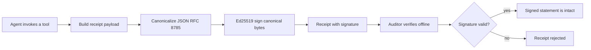
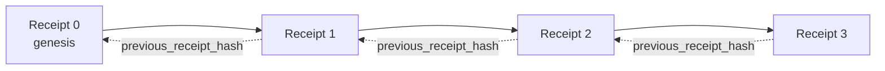

[Παρακολουθήστε το βίντεο μαθήματος: Ασφάλεια Πρακτόρων AI με Κρυπτογραφικές Αποδείξεις](https://youtu.be/PLACEHOLDER_VIDEO_ID)

> _(Το βίντεο μαθήματος και το μικρογραφία θα προστεθούν από την ομάδα περιεχομένου της Microsoft μετά τη συγχώνευση, ταιριάζοντας με το μοτίβο των μαθημάτων 14 / 15.)_

# Ασφάλεια Πρακτόρων AI με Κρυπτογραφικές Αποδείξεις

## Εισαγωγή

Αυτό το μάθημα θα καλύψει:

- Γιατί οι ίχνη ελέγχου για τους πράκτορες AI είναι σημαντικά για τη συμμόρφωση, τον εντοπισμό σφαλμάτων και την εμπιστοσύνη.
- Τι είναι μια κρυπτογραφική απόδειξη και πώς διαφέρει από μια μη υπογεγραμμένη γραμμή καταγραφής.
- Πώς να παράγετε μια υπογεγραμμένη απόδειξη για μια κλήση εργαλείου πράκτορα με απλό Python.
- Πώς να επαληθεύσετε μια απόδειξη εκτός σύνδεσης και να εντοπίσετε παραποίηση.
- Πώς να συνδέσετε αποδείξεις έτσι ώστε η αφαίρεση ή η αλλαγή σειράς μιας να σπάει την αλυσίδα.
- Τι αποδεικνύουν οι αποδείξεις και τι ρητά δεν αποδεικνύουν.

## Στόχοι Μάθησης

Μετά την ολοκλήρωση αυτού του μαθήματος, θα γνωρίζετε πώς να:

- Αναγνωρίζετε τις περιπτώσεις αποτυχίας που υποκινούν την κρυπτογραφική προέλευση για τις ενέργειες των πρακτόρων.
- Παράγετε μια υπογεγραμμένη Ed25519 απόδειξη πάνω σε ένα κανονικό JSON φορτίο.
- Επαληθεύετε μια απόδειξη ανεξάρτητα χρησιμοποιώντας μόνο το δημόσιο κλειδί του υπογράφοντα.
- Εντοπίζετε παραποίηση επανεκτελώντας την επαλήθευση σε μια τροποποιημένη απόδειξη.
- Δημιουργείτε μια αλληλουχία αποδείξεων με αλυσίδα κατακερματισμού και εξηγείτε γιατί η αλυσίδα έχει σημασία.
- Αναγνωρίζετε το όριο μεταξύ του τι αποδεικνύουν οι αποδείξεις (αναφορά, ακεραιότητα, σειρά) και τι δεν αποδεικνύουν (ορθότητα της ενέργειας, ορθότητα της πολιτικής).

## Το Πρόβλημα: Το Ιχνος Ελέγχου του Πράκτορά σας

Φανταστείτε ότι έχετε αναπτύξει έναν πράκτορα AI για την Contoso Travel. Ο πράκτορας διαβάζει αιτήματα πελατών, καλεί ένα API πτήσεων για να αναζητήσει επιλογές και κλείνει θέσεις εκ μέρους του πελάτη. Το τελευταίο τρίμηνο, ο πράκτορας επεξεργάστηκε 50.000 κρατήσεις.

Σήμερα εμφανίζεται ένας ελεγκτής. Κάνει μια απλή ερώτηση: "Δείξτε μου τι έκανε ο πράκτοράς σας."

Παραδίδετε τα αρχεία καταγραφής σας. Ο ελεγκτής τα κοιτάζει και κάνει την πιο δύσκολη ερώτηση: "Πώς ξέρω ότι αυτά τα αρχεία δεν έχουν επεξεργαστεί;"

Αυτό είναι το πρόβλημα του ιχνού ελέγχου. Οι περισσότερες αναπτύξεις πρακτόρων σήμερα βασίζονται σε:

- **Αρχεία καταγραφής εφαρμογών**: γραμμένα από τον ίδιο τον πράκτορα, επεξεργάσιμα από οποιονδήποτε έχει πρόσβαση στο σύστημα αρχείων.
- **Υπηρεσίες καταγραφής στο cloud**: αποδεικτικά παραποίησης στο επίπεδο πλατφόρμας, αλλά μόνο αν ο ελεγκτής εμπιστεύεται τον διαχειριστή της πλατφόρμας.
- **Αρχεία συναλλαγών βάσεων δεδομένων**: κατάλληλα για αλλαγές βάσεων δεδομένων αλλά όχι για αυθαίρετες κλήσεις εργαλείων.

Κανένα από αυτά δεν μπορεί να απαντήσει στην ερώτηση του ελεγκτή χωρίς να απαιτεί την εμπιστοσύνη σε κάποιον (εσάς, τον πάροχο cloud, τον προμηθευτή της βάσης δεδομένων). Για εσωτερική χρήση, αυτή η εμπιστοσύνη είναι συχνά αποδεκτή. Για ρυθμιζόμενα φορτία εργασίας (χρηματοοικονομικά, υγειονομική περίθαλψη, οτιδήποτε υπόκειται στον Κανονισμό AI της ΕΕ), δεν είναι.

Οι κρυπτογραφικές αποδείξεις περιορίζουν αυτό το πρόβλημα κάνοντας μια υπογεγραμμένη δήλωση που μπορεί να επαληθευτεί ανεξάρτητα.
Ο ελεγκτής εξακολουθεί να χρειάζεται έναν εκτός ζώνης λόγο για να εμπιστευτεί το κλειδί υπογραφής και
το συστατικό που παρήγαγε τη δήλωση. Ένα ενσωματωμένο κλειδί αποδεικνύει την εσωτερική συνέπεια,
όχι την ταυτότητα του εκδότη ή την τοποθέτηση της επιβολής.

## Τι είναι μια Κρυπτογραφική Απόδειξη;

Μια απόδειξη είναι ένα αντικείμενο JSON που καταγράφει τι έκανε ένας πράκτορας, υπογεγραμμένο με μια ψηφιακή υπογραφή.



Μια ελάχιστη απόδειξη μοιάζει με αυτήν:

```json
{
  "type": "agent.tool_call.v1",
  "agent_id": "contoso-travel-bot",
  "tool_name": "lookup_flights",
  "tool_args_hash": "sha256:a3f9c1...",
  "result_hash": "sha256:7b2e1d...",
  "policy_id": "contoso-travel-policy-v3",
  "timestamp": "2026-04-25T14:30:00Z",
  "sequence": 47,
  "previous_receipt_hash": "sha256:9d4e6a...",
  "signature": {
    "alg": "EdDSA",
    "sig": "c5af83...",
    "public_key": "8f3b2c..."
  }
}
```

Τρία χαρακτηριστικά κάνουν την δουλειά:

1. **Η υπογραφή**. Η απόδειξη υπογράφεται από την πύλη του πράκτορα χρησιμοποιώντας ένα ιδιωτικό κλειδί Ed25519. Κάποιος με το αντίστοιχο δημόσιο κλειδί μπορεί να επαληθεύσει την υπογραφή εκτός σύνδεσης. Ένας εμπιστευόμενος πρέπει να σταθεροποιήσει (pin) αυτό το κλειδί ή να το αντλήσει από ένα αξιόπιστο μητρώο εκτός της απόδειξης. Η παραποίηση οποιουδήποτε υπογεγραμμένου πεδίου ακυρώνει την υπογραφή.

2. **Κανoνική κωδικοποίηση**. Πριν από την υπογραφή, η απόδειξη σειριοποιείται χρησιμοποιώντας το Σχέδιο Κανoνικοποίησης JSON (JCS, RFC 8785). Αυτό διασφαλίζει ότι δύο υλοποιήσεις που παράγουν την ίδια λογική απόδειξη παράγουν byte-ταυτόσημη έξοδο. Χωρίς κανoνικοποίηση, διαφορετικοί σειριοποιητές JSON θα παρήγαγαν διαφορετικές υπογραφές για το ίδιο περιεχόμενο.

3. **Αλυσίδα κατακερματισμών**. Το πεδίο `previous_receipt_hash` συνδέει κάθε απόδειξη με την προηγούμενη. Η αφαίρεση ή η αλλαγή σειράς μιας απόδειξης σπάει την παρούσα σειρά. Η ανίχνευση περικοπής ή επανεγγραφής υπό τον έλεγχο του υπογράφοντα απαιτεί επίσης σταθεροποιημένο τρέχον κεφάλι αλυσίδας, ανεξάρτητο μάρτυρα στο checkpoint ή αυθεντικοποιημένη δέσμευση κλειστού πληθυσμού.

Μαζί αυτά τα χαρακτηριστικά παρέχουν τρεις εγγυήσεις:

- **Αναφορά σε κλειδί**: αυτό το κλειδί υπέγραψε αυτό το περιεχόμενο. Η ταυτότητα οργανισμού ή ανθρώπου απαιτεί αξιόπιστο δέσιμο κλειδιού.
- **Ακεραιότητα**: το περιεχόμενο δεν έχει αλλάξει από την υπογραφή.
- **Σειρά εντός της επαληθευμένης αλληλουχίας**: αυτή η απόδειξη συνδέεται με τον προκατόχο της.

## Δημιουργία Απόδειξης σε Python

Δεν χρειάζεστε βιβλιοθήκη ειδική για να παράγετε μια απόδειξη. Οι κρυπτογραφικές πραμιτικές είναι ευρέως διαθέσιμες και η λογική είναι λίγες δεκάδες γραμμές Python.

Οι πρακτικές ασκήσεις στο `code_samples/18-signed-receipts.ipynb` περιγράφουν τη διαδικασία πλήρως. Το ελεγχόμενο από πηγαίο κώδικα `code_samples/18-signed-receipts.execution-receipt.json` καταγράφει το ακριβές hash του notebook, το περιβάλλον Python, τον αριθμό κελιών και τους ελέγχους από την τελευταία καθαρή εκτέλεση χωρίς να αλλάζει τις αποθηκευμένες εξόδους του μαθήματος. Μια συνοπτική έκδοση:

```python
import json
import hashlib
import base64
from nacl import signing
from jcs import canonicalize  # RFC 8785 canonical JSON

def b64url_nopad(data: bytes) -> str:
    return base64.urlsafe_b64encode(data).decode("ascii").rstrip("=")

def sha256_canonical(obj) -> str:
    """SHA-256 of a Python object's JCS-canonical JSON form."""
    return f"sha256:{hashlib.sha256(canonicalize(obj)).hexdigest()}"

# Generate or load a signing key (in production, store in a key vault)
signing_key = signing.SigningKey.generate()
verify_key = signing_key.verify_key
TRUSTED_PUBLIC_KEYS = {b64url_nopad(bytes(verify_key))}  # pinned out of band by the verifier

# Build the receipt payload (no signature yet)
tool_args = {"origin": "SYD", "destination": "LAX"}
tool_result = [{"flight": "QF11", "price": 1850, "stops": 0}]

payload = {
    "type": "agent.tool_call.v1",
    "agent_id": "contoso-travel-bot",
    "tool_name": "lookup_flights",
    "tool_args_hash": sha256_canonical(tool_args),
    "result_hash": sha256_canonical(tool_result),
    "policy_id": "contoso-travel-policy-v3",
    "timestamp": "2026-04-25T14:30:00Z",
    "sequence": 0,
    "previous_receipt_hash": None,
}

# Canonicalize and sign the JCS bytes directly. PureEdDSA hashes internally.
canonical_bytes = canonicalize(payload)
signature_bytes = signing_key.sign(canonical_bytes).signature

# Attach a structured signature object.
receipt = {
    **payload,
    "signature": {
        "alg": "EdDSA",
        "sig": b64url_nopad(signature_bytes),
        "public_key": b64url_nopad(bytes(verify_key)),
    },
}
```

Αυτή είναι όλη η αλυσίδα υπογραφής. Οι ασκήσεις στο notebook περιγράφουν κάθε βήμα.

## Επαλήθευση Απόδειξης και Ανίχνευση Παραποίησης

Η επαλήθευση είναι η αντίστροφη ενέργεια:

```python
import base64
import hashlib
from nacl import signing
from nacl.exceptions import CryptoError
from jcs import canonicalize

def b64url_decode(s: str) -> bytes:
    # Strict: Python's decoder skips characters outside the alphabet and also
    # accepts padding, the standard +/ alphabet and non-zero spare bits.
    # Re-encoding and comparing accepts only the one unpadded base64url form.
    padding = "=" * ((4 - len(s) % 4) % 4)
    data = base64.urlsafe_b64decode(s + padding)
    if base64.urlsafe_b64encode(data).decode("ascii").rstrip("=") != s:
        raise ValueError("not canonical unpadded base64url")
    return data

def verify_receipt(receipt: dict, trusted_public_key: str) -> bool:
    # trusted_public_key is the issuer's key, obtained from somewhere other
    # than this receipt. Never use receipt["signature"]["public_key"] here:
    # see "What Receipts Prove (and What They Do Not)" below.
    # Fails closed: anything malformed returns False instead of raising.
    if not isinstance(receipt, dict) or not isinstance(trusted_public_key, str):
        return False
    sig_obj = receipt.get("signature")
    if not isinstance(sig_obj, dict) or sig_obj.get("alg") != "EdDSA":
        return False
    sig_b64 = sig_obj.get("sig")
    if not isinstance(sig_b64, str):
        return False

    try:
        # Reconstruct the payload that was actually signed (everything except signature).
        payload = {k: v for k, v in receipt.items() if k != "signature"}
        canonical_bytes = canonicalize(payload)
        verify_key = signing.VerifyKey(b64url_decode(trusted_public_key))
        verify_key.verify(canonical_bytes, b64url_decode(sig_b64))
        return True
    except (CryptoError, TypeError, ValueError, KeyError, OverflowError):
        return False
    except Exception:
        # An undecodable key or signature, or a payload that cannot be
        # canonicalized: fail closed rather than raise.
        return False
```

Αυτή η συνάρτηση παίρνει μια απόδειξη και το δημόσιο κλειδί του εκδότη, και επιστρέφει `True` εάν η υπογραφή είναι έγκυρη και `False` διαφορετικά, συμπεριλαμβανομένου όταν η είσοδος είναι κακόμορφη. Καμία κλήση δικτύου και καμία υπηρεσία επαλήθευσης: μόλις έχετε το κλειδί του εκδότη, η επαλήθευση είναι αποκλειστικά τοπική και εκτός σύνδεσης. Αυτό που εξακολουθεί να απαιτεί είναι εκείνο το κλειδί, που πρέπει να αντληθεί από κάπου εκτός της απόδειξης.

Για να δείτε σε δράση την ανίχνευση παραποίησης, το notebook περιγράφει:

1. Την παραγωγή έγκυρης απόδειξης και την επιβεβαίωση της επιτυχίας επαλήθευσης.
2. Την τροποποίηση ενός byte του πεδίου `tool_args_hash`.
3. Την επανεκτέλεση της επαλήθευσης και την αποτυχία.
4. Την εκ νέου παραποίηση, αλλά αυτή τη φορά με επανυπογραφή με ένα κλειδί που δημιούργησε ο επιτιθέμενος και την ενσωμάτωση αυτού του κλειδιού στην απόδειξη.

Το βήμα 4 είναι αυτό που αξίζει περισσότερη προσοχή. Αυτή η απόδειξη είναι εσωτερικά συνεπής: η υπογραφή της είναι γνήσια για τα περιεχόμενά της και για το κλειδί που φέρει, οπότε επαληθεύεται με το κλειδί που περιέχει. Αποτυγχάνει μόνο όταν ελέγχεται με το πραγματικό κλειδί του εκδότη. Τα βήματα 2 και 3 πιάνουν έναν επιτιθέμενο που δεν ενδιαφέρθηκε να υπογράψει ξανά· το βήμα 4 πιάνει αυτόν που το έκανε.

Αυτή είναι η πρακτική απόδειξη ότι οι αποδείξεις δείχνουν παραποίηση: οποιαδήποτε αλλαγή σε υπογεγραμμένο πεδίο σπάει την υπογραφή, εφόσον επαληθεύετε με κλειδί που δεν παρείχε ο επιτιθέμενος. Το αντικείμενο `signature` είναι εκτός των υπογεγραμμένων byte, γι' αυτό το κλειδί που επαληθεύετε πρέπει να προέρχεται από κάπου εκτός της απόδειξης.

## Αλυσίδωση Αποδείξεων για Πράκτορες Πολλαπλών Βημάτων

Μια μεμονωμένη υπογεγραμμένη απόδειξη προστατεύει μια ενέργεια. Μια αλυσίδα αποδείξεων προστατεύει μια αλληλουχία.



Κάθε απόδειξη καταγράφει το hash της απόδειξης που την προηγείται. Για να αφαιρεθεί αθόρυβα η απόδειξη 2, ένας επιτιθέμενος θα έπρεπε είτε:

- Να τροποποιήσει το πεδίο `previous_receipt_hash` της απόδειξης 3 (οπότε σπάει η υπογραφή της απόδειξης 3), ή
- Να πλαστογραφήσει μια νέα υπογραφή για μια τροποποιημένη απόδειξη 3 (απαιτείται το ιδιωτικό κλειδί του πράκτορα).

Εάν το ιδιωτικό κλειδί βρίσκεται σε μια θήκη κλειδιών υλικού και οι επαληθευτές ελέγχουν κάθε απόδειξη με το δημόσιο κλειδί του εκδότη, που αντλείται ανεξάρτητα (δημοσιευμένο JWK Set ή σταθεροποιημένη ρύθμιση), καμία από τις επιθέσεις δεν είναι εφικτή χωρίς ανίχνευση. Η δημοσίευση του κλειδιού μέσα σε κάθε απόδειξη δεν αρκεί: ένας επιτιθέμενος μπορεί να επανυπογράψει με το δικό του κλειδί και να το ενσωματώσει, που είναι το σενάριο `04_resigned_receipt.json`.

Το notebook περιγράφει:

1. Τη δημιουργία αλυσίδας τριών αποδείξεων.
2. Την επαλήθευση ότι το `previous_receipt_hash` κάθε απόδειξης ταιριάζει με το πραγματικό hash της προηγούμενης απόδειξης.
3. Την παραποίηση μιας απόδειξης στη μέση και την παρακολούθηση της διάρρηξης της αλυσίδας ακριβώς σε αυτό το σημείο.

Με αυτόν τον τρόπο παράγετε ένα ιχνος ελέγχου που ένας εξωτερικός ελεγκτής μπορεί να επαληθεύσει κάτω από
τα δικά του σταθεροποιημένα κλειδιά εκδότη και σημεία ελέγχου αλυσίδας, χωρίς να εμπιστεύεται το μεταβαλλόμενο κατάστημα καταγραφής σας.

## Τι Αποδεικνύουν οι Αποδείξεις (και Τι Δεν Αποδεικνύουν)

Αυτή είναι η πιο σημαντική ενότητα αυτού του μαθήματος. Οι αποδείξεις είναι ισχυρές αλλά η ισχύς τους περιορίζεται.

**Οι αποδείξεις αποδεικνύουν τρία πράγματα:**

1. **Αναφορά**: ένα συγκεκριμένο κλειδί υπέγραψε ένα συγκεκριμένο φορτίο.
2. **Ακεραιότητα**: το φορτίο δεν έχει αλλάξει από την υπογραφή.
3. **Σειρά εντός μιας παρουσιασμένης, επαληθευμένης ακολουθίας**: αυτή η απόδειξη συνδέεται με τον προκατόχο της.

**Οι αποδείξεις ΔΕΝ αποδεικνύουν:**

1. **Ορθότητα**: ότι η ενέργεια του πράκτορα ήταν η σωστή ενέργεια. Μια απόδειξη μπορεί να υπογραφεί για μια λανθασμένη απάντηση το ίδιο καθαρά όσο και για μια σωστή απάντηση.
2. **Συμμόρφωση με πολιτική**: ότι η πολιτική που αναφέρεται στο `policy_id` αξιολογήθηκε πραγματικά, ή ότι θα είχε επιτρέψει αυτή την ενέργεια αν ελεγχόταν. Η απόδειξη καταγράφει τι ισχυρίστηκε, όχι τι επιβλήθηκε.
3. **Ταυτότητα πέρα από το κλειδί**: η απόδειξη λέει "αυτό το κλειδί υπέγραψε αυτό το περιεχόμενο." Δεν λέει "αυτός ο άνθρωπος εξουσιοδότησε αυτό." Η σύνδεση ενός κλειδιού με ένα άτομο ή οργανισμό απαιτεί ξεχωριστή υποδομή ταυτότητας (κατάλογος, μητρώο δημόσιων κλειδιών κ.λπ.).
4. **Αληθοφάνεια των εισροών**: αν ο πράκτορας λαμβάνει ένα διαχειρισμένο prompt και δρα με βάση αυτό, η απόδειξη καταγράφει πιστά την ενέργεια. Οι αποδείξεις είναι εγγενές κομμάτι της επικύρωσης εισροών, όχι υποκατάστατο αυτής.
5. **Εκτέλεση ή πραγματική επίδραση**: μια απόδειξη μετά την κλήση καταγράφει αυτό που υποστηρίζει ο εκδότης ότι συνέβη. Αποδεικτικά στοιχεία εισόδου ή συμφιλίωσης εξωτερικών επιδράσεων απαιτούν απόδειξη από τον πραγματικό εκτελεστή ή το όριο παρόχου.
6. **Πληρότητα**: μια απόδειξη που λείπει μπορεί να σημαίνει μπλοκαρισμένο, παραληφθέν, χαμένο ή μη οργανομένο. Η απουσία γίνεται απόδειξη μόνο εντός ενός αυθεντικοποιημένου κλειστού πληθυσμού.
7. **Αξιόπιστος χρόνος**: μια υπογεγραμμένη χρονική σήμανση αποδεικνύει ότι ο υπογράφων κατείχε εκείνη την τιμή, όχι ότι η τιμή ήταν σωστή. Αξιόπιστος χρόνος απαιτεί ξεχωριστή αρχή χρόνου ή μάρτυρα checkpoint.

**Το κλειδί στην απόδειξη δεν είναι το κλειδί με το οποίο επαληθεύετε.** Αυτό προκύπτει από το σημείο 3, και είναι το μοναδικό σημείο όπου η διάκριση πρέπει να αλλάξει τον κώδικά σας και όχι την κατανόησή σας. Το `public_key` στο παράδειγμα παραπάνω υπάρχει ώστε το παράδειγμα να είναι αυτόνομο. Ένας επαληθευτής δεν πρέπει ποτέ να το εμπιστευτεί. Οποιοσδήποτε μπορεί να πάρει μια απόδειξη, να την αλλάξει, να την υπογράψει με κλειδί που δημιούργησε ο ίδιος, και να ενσωματώσει αυτό το κλειδί· το αποτέλεσμα επαληθεύεται τέλεια από μόνο του. Αυτό είναι το σενάριο `04_resigned_receipt.json` στο `sample_receipts/`, και γι' αυτό το `verify_receipt` παραπάνω παίρνει το κλειδί ως παράμετρο αντί να το διαβάζει από την απόδειξη. Αποκτήστε το κλειδί του εκδότη ανεξάρτητα, από το JWK Set στον Παραγωγικό Κατάλογο παρακάτω ή από άλλη σταθεροποιημένη άγκυρα, και επαληθεύστε με αυτό. Μια υπογραφή που ελέγχεται με κλειδί που έφτασε στο ίδιο φάκελο αποδεικνύει μόνο ότι ο φάκελος είναι εσωτερικά συνεπής.

Αυτό το όριο έχει σημασία για δύο λόγους:

- Σας λέει για τι είναι χρήσιμες οι αποδείξεις: καθιστούν τη συμπεριφορά του πράκτορα ελεγχόμενη και ανιχνεύσιμη παραποιήσεις, ακόμη και δια οργανωτικά όρια.
- Σας λέει ποια επιπλέον στρώματα χρειάζεστε ακόμα: επικύρωση εισροών (Μάθημα 6), επιβολή πολιτικής (καλυμμένο σύντομα παρακάτω), και υποδομή ταυτότητας (εκτός εμβέλειας αυτού του μαθήματος).

Ένα κοινό λάθος είναι να υποθέσετε ότι "έχουμε αποδείξεις" σημαίνει "είμαστε ελεγχόμενοι." Δεν σημαίνει. Οι αποδείξεις είναι ένα θεμέλιο. Η διακυβέρνηση είναι το σύστημα που χτίζετε από πάνω.

## Δέσμευση της Υπογραφής ενός Εγκριτή στην Ακριβή Ενέργεια

Το σημείο 3 παραπάνω αξίζει δική του ενότητα: μια απόδειξη ενέργειας λέει "αυτό το κλειδί υπέγραψε αυτό το περιεχόμενο," ποτέ "ένας άνθρωπος εξουσιοδότησε αυτό." Για ενέργειες υψηλού κινδύνου (επιστροφές χρημάτων, διαγραφές, μεταφορές χρημάτων), μια ξεχωριστή υπογραφή εγκριτή μπορεί να δέσει την ακριβή ενέργεια. Η σύνδεση εκείνου του κλειδιού με έναν άνθρωπο και ο έλεγχος της ανθρώπινης παρουσίας παραμένουν ξεχωριστές ευθύνες.

Το επόμενο notebook `code_samples/human-authorization-receipts.ipynb` προσθέτει έναν δεύτερο τύπο απόδειξης, `human.approval.v1`, στην ίδια φόρμα φακέλου με τις αποδείξεις του μαθήματος (ένα τυποποιημένο φορτίο υπογεγραμμένο με Ed25519 πάνω στα κανονικά byte JCS, με το αντικείμενο `signature` εκτός των υπογεγραμμένων byte). Ένα κλειδί εγκριτή υπογράφει **την πλήρη κανονική ενέργεια και το συμπύκνωμά της**· ένα κλειδί πράκτορα υπογράφει μια δήλωση που φέρει το **ίδιο συμπύκνωμα ενέργειας** και ένα `parent_approval_ref`, το `receipt_hash` της έγκρισης, την ίδια σύμβαση με το `previous_receipt_hash` στην αλυσίδα που χτίσατε παραπάνω. Ένα `verify_chain` περπατά και τα δύο τεκμήρια κάτω από **ξεχωριστά σταθεροποιημένα μητρώα κλειδιών** (κλειδιά εγκριτών έναντι κλειδιών πρακτόρων), έτσι η διαδρομή κώδικα είναι κοινή αλλά οι αρχές ποτέ.

Το χαρακτηριστικό που αγοράζετε, προσεκτικά διατυπωμένο: *το σταθεροποιημένο κλειδί εγκριτή υπέγραψε αυτή ακριβώς
την ενέργεια, και το κλειδί πράκτορα αργότερα υπέγραψε μια δήλωση που φέρει το ίδιο συμπύκνωμα ενέργειας.*
Αυτό είναι χρήσιμο αποδεικτικό στοιχείο, αλλά από μόνο του δεν αποδεικνύει ότι η ενέργεια εκτελέστηκε. Για
τον έλεγχο της εκτέλεσης, η ακριβής έγκριση πρέπει επίσης να κρατηθεί και να καταναλωθεί μία φορά στο
πραγματικό όριο εκτελεστή· τα άγνωστα αποτελέσματα παρόχου πρέπει να παραμείνουν άγνωστα παρά να
επιχειρηθούν τυφλά εκ νέου. Τα αρνητικά σενάρια του notebook τεστάρουν το στρώμα αλυσίδας αποδείξεων:

- παραποίηση, σύγχυση πληρεξούσιου, πλαστογραφημένα κλειδιά από οποιαδήποτε πλευρά, και κακομορφές εισροές;
- **παρωχημένη αρχή**: μια υπογραφή που ακόμα επαληθεύεται, απορρίπτεται ούτως ή άλλως επειδή η έκδοση πολιτικής άλλαξε, το κλειδί εγκριτή έφυγε από το σταθεροποιημένο μητρώο ή η έγκριση έληξε πριν από την ώρα επαλήθευσης που δόθηκε;
- **αντικατάσταση συμπυκνώματος**: μια έγκυρη υπογεγραμμένη απόδειξη ενέργειας που δείχνει σε μια *πραγματική* έγκριση που δένει μια *διαφορετική* κανονική ενέργεια.

Κάθε αποτυχία απορρίπτει με ξεχωριστό λόγο, έτσι ένας ελεγκτής που διαβάζει μια απόρριψη μπορεί να πει αν η αρχή έπαυσε να ισχύει ή αν η αξιούμενη ενέργεια άλλαξε. Η επαλήθευση είναι μόνο για ανάγνωση και επαναλαμβανόμενη: δεν καταναλώνει την έγκριση ούτε καλεί πάροχο. Ένας ξεχωριστός εκτελεστής χρειάζεται ανθεκτική, ατομική προστασία επανεκτέλεσης και σαφή αποτελέσματα επιτυχίας, αποτυχίας και ασαφή. Η απόδειξη έγκρισης ανθρώπου είναι εκπαιδευτική σύνθεση ορισμένη από αυτό το μάθημα, όχι τύπος απόδειξης ορισμένος από `draft-farley-acta-signed-receipts`.

## Παραπομπές Παραγωγής

Ο κώδικας Python σε αυτό το μάθημα είναι σκόπιμα ελάχιστος ώστε να μπορείτε να διαβάζετε κάθε γραμμή και να κατανοείτε ακριβώς τι συμβαίνει. Σε παραγωγή, έχετε δύο επιλογές:

1. **Οικοδομήστε άμεσα πάνω στις κρυπτογραφικές αρχές.** Οι 50 γραμμές που είδατε παραπάνω είναι επαρκείς για πολλές περιπτώσεις χρήσης. Οι βιβλιοθήκες PyNaCl (Ed25519) και το `jcs` πακέτο (canonical JSON) είναι καλά συντηρημένες και ελεγμένες.

2. **Χρησιμοποιήστε μια βιβλιοθήκη παραλαβής παραγωγής.** Πολλά έργα ανοιχτού κώδικα υλοποιούν το ίδιο πρότυπο με πρόσθετες λειτουργίες (περιστροφή κλειδιών, επαλήθευση παρτίδας, διανομή JWK Set, ενσωμάτωση με μηχανές πολιτικών):
   - Η διαδικασία υπογραφής χρησιμοποιεί τα πρότυπα JCS και signature-scope σε ένα ανεξάρτητο IETF Internet-Draft ([`draft-farley-acta-signed-receipts`](https://datatracker.ietf.org/doc/draft-farley-acta-signed-receipts/), έκδοση 02). Η απλή εκπαιδευτική παραλαβή αυτής της ενότητας διαφέρει από το `{payload, signature}` φάκελο του προσχεδίου και δεν παρουσιάζεται ως συμμορφωμένη υλοποίηση. Το προσχέδιο δημοσιεύει ένα κοινό σύνολο συμμόρφωσης ([agent-governance-testvectors](https://github.com/ScopeBlind/agent-governance-testvectors)) για υλοποιήσεις που στοχεύουν στο σύστημα καλωδίου του.
   - Το Microsoft Agent Governance Toolkit συνθέτει παραλαβές με αποφάσεις πολιτικής βασισμένες σε Cedar· δείτε το Tutorial 33 σε αυτό το αποθετήριο για ένα παράδειγμα από άκρο σε άκρο.
   - Τα `protect-mcp` (npm) και `@veritasacta/verify` (npm) πακέτα παρέχουν μια υλοποίηση παραλαβής υπογραφής και επαλήθευσης εκτός σύνδεσης βασισμένη σε Node, προοριζόμενη για τη συσκευασία οποιουδήποτε διακομιστή MCP με διακριτό ίχνος ελέγχου αποτροπής αλλοίωσης, συμπεριλαμβανομένης της ροής κράτησης για συνυπογραφή όπου μια παύση εκπομπής ενεργειών εκπέμπει αποδεικτικό έγκρισης συνδεδεμένο με το digest της ενέργειας (υποστηριζόμενο από WebAuthn στη ροή επιτραπέζιου), το ίδιο μοτίβο αποδεικτικού έγκρισης όπως το σημειωματάριο ανθρωπο-εξουσιοδότησης παραπάνω.
   - Το **[nobulex](https://github.com/arian-gogani/nobulex)** Python SDK (`pip install nobulex`) παρέχει το ίδιο μοτίβο υπογραφής Ed25519 + JCS σε Python με ενσωματώσεις LangChain και CrewAI, συμπεριλαμβανομένων δημοσιευμένων διανυσμάτων δοκιμών διασταυρούμενης επικύρωσης και ενός χάρτη συμμόρφωσης συμβολής μέσω του [OWASP PR #2210](https://github.com/OWASP/CheatSheetSeries/pull/2210).
   - Το **[Πρωτόκολλο EMILIA](https://github.com/emiliaprotocol/emilia-protocol)** παρέχει ένα συμπληρωματικό επίπεδο αυστηρής εφαρμογής ακριβούς δράσης: αποδείξεις έγκρισης επαληθεύσιμες εκτός σύνδεσης, καρφιτσωμένη εξουσιοδότηση WebAuthn ή ομοφωνίας, κατανάλωση μίας χρήσης στα όρια του εκτελεστή και μια ρητή διαδρομή ασαφούς αποτελέσματος. Οι προσαρμογείς πλαισίου του αντιμετωπίζουν μια απόδειξη ως απαραίτητη απόδειξη και όχι ως τεκμήριο ότι συνέβη εξωτερικό αποτέλεσμα.

Η απόφαση μεταξύ της δημιουργίας δικής σας λύσης και της χρήσης μιας βιβλιοθήκης αντανακλά την απόφαση μεταξύ της γραφής της δικής σας βιβλιοθήκης JWT και της χρήσης μιας δοκιμασμένης: και οι δύο είναι λογικές· η βιβλιοθήκη εξοικονομεί χρόνο και μειώνει την επιφάνεια ελέγχου· η προσέγγιση από το μηδέν σας αναγκάζει να κατανοήσετε κάθε πρωτογενές στοιχείο. Αυτό το μάθημα διδάσκει την πορεία από το μηδέν ώστε να έχετε τα θεμέλια για οποιαδήποτε επιλογή.

## Έλεγχος Γνώσης

Δοκιμάστε την κατανόησή σας πριν προχωρήσετε στην πρακτική άσκηση.

**1. Μια απόδειξη υπογράφεται με το ιδιωτικό κλειδί Ed25519 του πράκτορα. Ο ελεγκτής διαθέτει μόνο το δημόσιο κλειδί. Μπορεί ο ελεγκτής να επαληθεύσει την απόδειξη εκτός σύνδεσης;**

<details>
<summary>Απάντηση</summary>

Ναι, η κρυπτογραφική επαλήθευση απαιτεί μόνο το δημόσιο κλειδί και τα υπογεγραμμένα bytes. Ο
ελεγκτής πρέπει ακόμα να αποκτήσει και να καρφιτσώσει το αποδεκτό δημόσιο κλειδί ανεξάρτητα από την απόδειξη.
Δεν απαιτείται κλήση δικτύου μετά την εγκαθίδρυση αυτής της ρύθμισης εμπιστοσύνης.
</details>

**2. Ένας επιτιθέμενος τροποποιεί το πεδίο `policy_id` μιας απόδειξης για να υποστηρίξει ότι αυτή διέπεται από μια πιο επιεική πολιτική. Η υπογραφή αφορούσε το αρχικό φορτίο. Τι συμβαίνει κατά την επαλήθευση;**

<details>
<summary>Απάντηση</summary>

Η επαλήθευση αποτυγχάνει. Η υπογραφή υπολογίστηκε πάνω στα κανονικοποιημένα bytes του αρχικού φορτίου· η τροποποίηση οποιουδήποτε πεδίου του φορτίου αλλάζει αυτά τα bytes, καθιστώντας την υπογραφή άκυρη. Ο επιτιθέμενος θα χρειαζόταν το ιδιωτικό κλειδί για να παράγει μια νέα έγκυρη υπογραφή, το οποίο δεν διαθέτει.
</details>

**3. Γιατί το απόκομμα περιλαμβάνει `tool_args_hash` και `result_hash` αντί για τα ακατέργαστα επιχειρήματα και το αποτέλεσμα;**

<details>
<summary>Απάντηση</summary>

Δύο λόγοι. Πρώτον, το απόκομμα μπορεί να χρειαστεί να αρχειοθετηθεί ή να μεταδοθεί σε περιβάλλοντα όπου η διαρροή του ακατέργαστου περιεχομένου (PII, επιχειρηματικά δεδομένα) αποτελεί πρόβλημα. Το κατακερματισμό διατηρεί το απόκομμα μικρό και το περιεχόμενο ιδιωτικό· ο ελεγκτής επαληθεύει ότι το hash ταιριάζει με ένα ξεχωριστά αποθηκευμένο αντίγραφο του πραγματικού περιεχομένου. Δεύτερον, τα hashes έχουν σταθερό μέγεθος· ένα απόκομμα με hashes έχει περιορισμένο μέγεθος ανεξάρτητα από το πόσο μεγάλα ήταν τα εισαγωγικά και τα εξαγωγικά δεδομένα.
</details>

**4. Το πεδίο `previous_receipt_hash` συνδέει κάθε απόκομμα με τον προκάτοχό του. Εάν ένας επιτιθέμενος διαγράψει αθόρυβα ένα απόκομμα από τη μέση μιας αλυσίδας, τι καθίσταται μη έγκυρο;**

<details>
<summary>Απάντηση</summary>

Κάθε απόκομμα που ακολούθησε μετά το διαγραμμένο. Τα πεδία `previous_receipt_hash` τους δεν ταιριάζουν πλέον με την πραγματική αλυσίδα (γιατί το απόκομμα που αναφερόταν δεν υπάρχει πια, ή η αλυσίδα δείχνει τώρα σε διαφορετικό προκάτοχο). Για να κρύψει τη διαγραφή, ο επιτιθέμενος θα έπρεπε να υπογράψει ξανά κάθε επόμενο απόκομμα, που απαιτεί το ιδιωτικό κλειδί του εκδότη. Μια επανυπογραφή με οποιοδήποτε άλλο κλειδί αποτυγχάνει όταν ελεγχθεί με το κλειδί του εκδότη.
</details>

**5. Ένα απόκομμα επαληθεύεται καθαρά. Αυτό αποδεικνύει ότι η ενέργεια του πράκτορα ήταν σωστή, ορθή ή σύμφωνη με την πολιτική;**

<details>
<summary>Απάντηση</summary>

Όχι. Υπό ένα προσδιάθετο κλειδί και πλαίσιο αλυσίδας, ένα έγκυρο απόκομμα αποδεικνύει την απόδοση της υπογραφής,
την ακεραιότητα του περιεχομένου και μια σύνδεση με τον παρουσιαζόμενο προκάτοχο. ΔΕΝ αποδεικνύει ότι η
ενέργεια ήταν σωστή ή εκτελέστηκε, ότι η πολιτική αξιολογήθηκε, ότι η χρονοσήμανση είναι
αξιόπιστη ή ότι το σύνολο των αρχείων είναι πλήρες. Αυτό είναι το πιο σημαντικό όριο στο μάθημα.
</details>

## Άσκηση Πρακτικής

Ανοίξτε `code_samples/18-signed-receipts.ipynb` και ολοκληρώστε και τις τέσσερις ενότητες:

1. **Ενότητα 1**: Υπογράψτε το πρώτο σας απόκομμα και επαληθεύστε το.
2. **Ενότητα 2**: Παραποιήστε το απόκομμα και παρατηρήστε την αποτυχία επαλήθευσης.
3. **Ενότητα 3**: Δημιουργήστε μια αλυσίδα τριών αποκομμάτων και επαληθεύστε την ακεραιότητα της αλυσίδας.
4. **Ενότητα 4**: Εφαρμόστε το πρότυπο σε έναν πράκτορα κατασκευασμένο με το Microsoft Agent Framework: τυλίξτε μια κλήση εργαλείου σε υπογραφή αποκομμάτων και στη συνέχεια επαληθεύστε το απόκομμα ανεξάρτητα.

**Πρόκληση επιπλέον 1:** επεκτείνετε το σχήμα αποκομμάτων με ένα πρόσθετο πεδίο της επιλογής σας (για παράδειγμα, ένα αναγνωριστικό αιτήματος για παρακολούθηση), ενημερώστε τη λογική υπογραφής κανονικοποίησης για να το συμπεριλάβει και επιβεβαιώστε ότι το απόκομμα εξακολουθεί να περνάει μέσα από την επαλήθευση. Στη συνέχεια τροποποιήστε το πεδίο μετά την υπογραφή και επιβεβαιώστε ότι η επαλήθευση αποτυγχάνει. Αυτό σας αναγκάζει να κατανοήσετε πώς κάθε byte της κανονικής κωδικοποίησης συμβάλλει στην υπογραφή.

**Πρόκληση stretch 2:** Δημιουργήστε SHA-256 hash για δύο από τις αποδείξεις σας μαζί (συνδέστε τα κανονικά bytes τους με έναν καθορισμένο τρόπο) και ενσωματώστε το προκύπτον digest ως νέο πεδίο σε μια τρίτη απόδειξη πριν την υπογράψετε. Επιβεβαιώστε ότι και οι τρεις αποδείξεις εξακολουθούν να «γυρίζουν πίσω». Μόλις δημιουργήσατε μια απόδειξη ένταξης ενός βήματος: οποιοσδήποτε κατέχει την τρίτη απόδειξη μπορεί να αποδείξει ότι οι δύο πρώτες υπήρχαν τη στιγμή που υπογράφηκε, χωρίς να χρειάζεται να αποκαλύψει τα περιεχόμενά τους. Αυτό είναι το μοτίβο που χρησιμοποιούν οι αποδείξεις επιλεκτικής αποκάλυψης σε κλίμακα (δεσμεύσεις Merkle, RFC 6962).

## Συμπέρασμα

Οι κρυπτογραφικές αποδείξεις παρέχουν σε πράκτορες AI ένα αποτύπωμα ελέγχου που είναι:

- **Ανεξάρτητα επαληθεύσιμο υπό σταθερή εμπιστοσύνη**: ένα μέρος με αποδεκτά δημόσια κλειδιά και υπογεγραμμένα bytes μπορεί να επαληθεύσει χωρίς εξάρτηση υπηρεσίας.
- **Να αποκαλύπτουν παραποιήσεις**: οποιαδήποτε τροποποίηση ακυρώνει την υπογραφή.
- **Φορητό**: μια απόδειξη είναι ένα μικρό αρχείο JSON· μπορεί να αρχειοθετηθεί, να μεταδοθεί και να επαληθευτεί οπουδήποτε.
- **Συμβατό με πρότυπα**: χτισμένη πάνω σε Ed25519 (RFC 8032), JCS (RFC 8785), και SHA-256, όλα ευρέως αναπτυγμένες πρωτογενείς λειτουργίες.

Δεν αποτελούν υποκατάστατο του ελέγχου εισόδου, εφαρμογής πολιτικής, εισδοχής εκτελεστή,
αποδείξεων αποτελέσματος, ελέγχων πληρότητας ή υποδομής ταυτότητας. Αποτελούν βάση
για εκείνα τα επίπεδα. Σε ελεγχόμενα ή πολύ-οργανωσιακά ροές εργασίας, οι αποδείξεις κάνουν συγκεκριμένες
δηλώσεις εκδότη ανεξάρτητα ελέγξιμες υπό τη δική του διαμόρφωση εμπιστοσύνης του ελεγκτή.

Το πιο σημαντικό που πρέπει να κρατήσετε: οι αποδείξεις αποδεικνύουν ότι ένα συγκεκριμένο κλειδί υπέγραψε συγκεκριμένο
περιεχόμενο. Μια χρονική σήμανση που φέρουν αποτελεί δήλωση υπογράφοντα αν δεν επιβεβαιωθεί ξεχωριστά χρονικά. Μια
απόδειξη δεν αποδεικνύει ότι το περιεχόμενό της ήταν αληθινό, ότι εκτελέστηκε μια ενέργεια ή ότι το
σύνολο εγγραφών είναι πλήρες. Κρατήστε αυτές τις διακρίσεις αυστηρά.

## Λίστα Ελέγχου Παραγωγής

Όταν είστε έτοιμοι να περάσετε από αυτό το μάθημα στην υλοποίηση πρακτόρων με υπογεγραμμένες αποδείξεις σε πραγματικό περιβάλλον:

- [ ] **Μεταφέρετε το κλειδί υπογραφής εκτός φορητού υπολογιστή του προγραμματιστή.** Χρησιμοποιήστε Azure Key Vault, AWS KMS ή μια μονάδα υλικού ασφαλείας. Το ιδιωτικό κλειδί που υπογράφει τις αποδείξεις σας δεν πρέπει ποτέ να ζει σε έλεγχο πηγαίου κώδικα ή σε απλό κείμενο σε μηχανές εφαρμογής.
- [ ] **Εγκαταστήστε την εμπιστοσύνη για τα κλειδιά επαλήθευσης.** Δημοσιεύστε κλειδιά μέσω ενός JWK Set ή μητρώου, και έπειτα αφήστε τα εμπιστευόμενα μέρη να «καρφιτσώσουν» την αποδεκτή ταυτότητα εκδότη, το σύνολο κλειδιών και την πολιτική περιστροφής έξω από τις μεμονωμένες αποδείξεις. Ένα ενσωματωμένο κλειδί μόνο του δεν αποτελεί άγκυρα εμπιστοσύνης.
- [ ] **Αγκυρώστε την αλυσίδα εξωτερικά.** Περιοδικά καταγράψτε το hash του τελευταίου σημείου της αλυσίδας σε ένα log διαφάνειας (Sigstore Rekor, RFC 3161 timestamp authority, ή ένα δεύτερο εσωτερικό σύστημα) ώστε ένα εξωτερικό μέρος να μπορεί να επιβεβαιώσει "ότι αυτή η αλυσίδα υπήρχε αυτή τη στιγμή."
- [ ] **Αποθηκεύστε τις αποδείξεις αμετάβλητα.** Η αποθήκευση τύπου append-only blob (Azure Storage με πολιτικές αμεταβλητότητας, AWS S3 Object Lock) εμποδίζει κάποιον εσωτερικό να ξαναγράψει την ιστορία στo επίπεδο αποθήκευσης.
- [ ] **Αποφασίστε για τη διατήρηση.** Πολλόι κανονισμοί συμμόρφωσης απαιτούν πολυετή διατήρηση. Σχεδιάστε για αύξηση αποδείξεων (κάθε απόδειξη είναι ~500 bytes· ένας πράκτορας που κάνει 10K κλήσεις ανά ημέρα παράγει ~1.8 GB ανά έτος).
- [ ] **Τεκμηριώστε τι δεν καλύπτουν οι αποδείξεις.** Οι αποδείξεις αποδεικνύουν απονομή, ακεραιότητα και κατάταξη. Ο οδηγός λειτουργίας σας θα πρέπει να αναφέρει ρητά ποιοι επιπλέον έλεγχοι (έλεγχος εισόδου, επιβολή πολιτικής, περιορισμός ρυθμού, υποδομή ταυτότητας) συνοδεύουν τις αποδείξεις στη διοικητική σας πολιτική.

### Έχετε Περισσότερες Ερωτήσεις για την Ασφάλεια των Πρακτόρων AI;

Εγγραφείτε στο [Microsoft Foundry Discord](https://aka.ms/ai-agents/discord) για να συναντήσετε άλλους μαθητευόμενους, να παρακολουθήσετε ώρες γραφείου και να λάβετε απαντήσεις στις ερωτήσεις σας σχετικά με τους AI Agents.

## Πέρα από αυτό το μάθημα

Αυτό το μάθημα καλύπτει την υπογραφή μεμονωμένης απόδειξης και αλληλουχίες με αλυσιδωτές συναρτήσεις κατακερματισμού. Τα ίδια πρωτότυπα συνθέτουν αρκετά πιο προχωρημένα μοτίβα που μπορεί να συναντήσετε καθώς ωριμάζει η στάση σας όσον αφορά τη διακυβέρνηση:

- **Επιλεκτική αποκάλυψη.** Όταν τα πεδία μιας απόδειξης δεσμεύονται ξεχωριστά (δέντρο Merkle τύπου RFC 6962), μπορείτε να αποκαλύψετε συγκεκριμένα πεδία σε συγκεκριμένους ελεγκτές και να αποδείξετε ότι τα υπόλοιπα δεν έχουν αλλάξει χωρίς να τα εκθέσετε. Χρήσιμο όταν η ίδια απόδειξη πρέπει να ικανοποιεί τόσο μια πλήρη επιθεώρηση (που απαιτεί πληρότητα) όσο και κανονισμούς ελαχιστοποίησης δεδομένων όπως ο GDPR (που θέλουν ο ελεγκτής να βλέπει όσο το δυνατόν λιγότερα).
- **Ακύρωση αποδείξεων.** Εάν διακυβευτεί ένα κλειδί υπογραφής, χρειάζεστε έναν τρόπο να επισημάνετε όλες τις αποδείξεις που έχουν υπογραφεί με αυτό το κλειδί ως μη αξιόπιστες από μία συγκεκριμένη χρονική στιγμή και μετά. Τυπικά μοτίβα: βραχυχρόνια κλειδιά υπογραφής μαζί με μια δημοσιευμένη λίστα ακύρωσης ή ένα αρχείο διαφάνειας με εγγραφές ακύρωσης.
- **Αποδείξεις με αμφίπλευρη / χωριστή υπογραφή.** Κάποιες υλοποιήσεις χωρίζουν το υπογεγραμμένο φορτίο σε προ-εκτέλεσης (`authorization_*`) και μετά-εκτέλεσης (`result_*`) μισά με ανεξάρτητες υπογραφές, χρήσιμο όταν η απόφαση εξουσιοδότησης και το παρατηρούμενο αποτέλεσμα παράγονται από διαφορετικούς φορείς ή σε διαφορετικούς χρόνους. Αυτό προστίθεται συνθετικά πάνω στη μορφή απόδειξης που διδάχθηκε σε αυτό το μάθημα.
- **Σύνθεση φορτίου.** Μια απόδειξη σφραγίζει όσα bytes βάζετε στο `result_hash`. Τα πραγματικά φορτία συχνά είναι πιο πλούσια από το αποτέλεσμα μιας μόνο κλήσης εργαλείου: η λογική πριν την απόφαση (πρόβλεψη μοντέλου, εξεταζόμενες επιλογές, αποδείξεις και η πληρότητά τους, στάση κινδύνου, αλυσίδα υπευθυνότητας, αποτέλεσμα πυλών) μπορούν όλα να περιέχονται μέσα στο φορτίο, σφραγισμένα από μια ενιαία απόδειξη. Αυτό κρατά τη μορφή της απόδειξης ελάχιστη, ενώ επιτρέπει να εξελίσσονται τα σχήματα φορτίου ανά πεδίο.
- **Διασφάλιση διασυστημικής συμβατότητας.** Πολλές ανεξάρτητες υλοποιήσεις της ίδιας μορφής απόδειξης (Python, TypeScript, Rust, Go) διασταυρώνουν την εγκυρότητα με κοινά διανύσματα δοκιμών. Αν δημιουργήσετε τη δική σας υλοποίηση, ο έλεγχος με δημοσιευμένα διανύσματα επιβεβαιώνει τη συμβατότητα σε επίπεδο επικοινωνίας.
- **Μετάβαση μετά την κβαντική εποχή.** Το Ed25519 χρησιμοποιείται ευρέως σήμερα αλλά δεν είναι ανθεκτικό στην κβαντική υπολογιστική. Μια ετικέτα `alg` από μόνη της δεν αποτελεί μετάβαση: ένα προφίλ πρέπει να ορίζει την κωδικοποίηση κλειδιών ML-DSA, τα κανoνικά υπογεγραμμένα bytes, την επαλήθευση, την πολιτική του εμπιστευόμενου μέρους, την αντοχή σε υποβάθμιση και τη σημασιολογία μετάβασης. Σχεδιάστε και δοκιμάστε μια διπλή υπογραφή μετάβασης με κοινά διανύσματα πριν από οποιαδήποτε αξίωση συμβατότητας.

## Πρόσθετοι Πόροι

- <a href="https://datatracker.ietf.org/doc/draft-farley-acta-signed-receipts/" target="_blank">IETF Internet-Draft: Signed Decision Receipts for Machine-to-Machine Access Control</a>
- <a href="https://learn.microsoft.com/azure/ai-studio/responsible-use-of-ai-overview" target="_blank">Επισκόπηση Υπεύθυνης Τεχνητής Νοημοσύνης (Azure AI)</a>
- <a href="https://datatracker.ietf.org/doc/html/rfc8032" target="_blank">RFC 8032: Αλγόριθμος Ψηφιακής Υπογραφής Καμπύλης Edwards (EdDSA)</a>
- <a href="https://datatracker.ietf.org/doc/html/rfc8785" target="_blank">RFC 8785: Σχέδιο Κανονικοποίησης JSON (JCS)</a>
- <a href="https://datatracker.ietf.org/doc/html/rfc6962" target="_blank">RFC 6962: Διαφάνεια Πιστοποιητικών</a> (Κατασκευή δέντρου Merkle που χρησιμοποιείται από αποδείξεις επιλεκτικής αποκάλυψης)
- <a href="https://github.com/microsoft/agent-governance-toolkit/blob/main/docs/tutorials/33-offline-verifiable-receipts.md" target="_blank">Microsoft Agent Governance Toolkit, Εκμάθηση 33: Αποδείξεις Αποφάσεων που Επαληθεύονται Εκτός Σύνδεσης</a>
- <a href="https://github.com/ScopeBlind/agent-governance-testvectors" target="_blank">Διανύσματα δοκιμών συμμόρφωσης μεταξύ υλοποιήσεων</a> για τη μορφή απόδειξης που χρησιμοποιείται σε αυτό το μάθημα (Apache-2.0)
- <a href="https://pynacl.readthedocs.io/" target="_blank">Τεκμηρίωση PyNaCl</a> (Ed25519 σε Python)

## Προηγούμενο Μάθημα

[Δημιουργώντας Τοπικούς Πράκτορες Τεχνητής Νοημοσύνης](../17-creating-local-ai-agents/README.md)

---

<!-- CO-OP TRANSLATOR DISCLAIMER START -->
**Αποποίηση ευθυνών**:
Αυτό το έγγραφο έχει μεταφραστεί χρησιμοποιώντας την υπηρεσία μετάφρασης με τεχνητή νοημοσύνη [Co-op Translator](https://github.com/Azure/co-op-translator). Ενώ επιδιώκουμε την ακρίβεια, παρακαλούμε να έχετε υπόψη ότι οι αυτοματοποιημένες μεταφράσεις ενδέχεται να περιέχουν λάθη ή ανακρίβειες. Το πρωτότυπο έγγραφο στη μητρική του γλώσσα πρέπει να θεωρείται η αυθεντική πηγή. Για κρίσιμες πληροφορίες, συνιστάται επαγγελματική ανθρώπινη μετάφραση. Δεν φέρουμε ευθύνη για τυχόν παρεξηγήσεις ή λανθασμένες ερμηνείες που προκύπτουν από τη χρήση αυτής της μετάφρασης.
<!-- CO-OP TRANSLATOR DISCLAIMER END -->