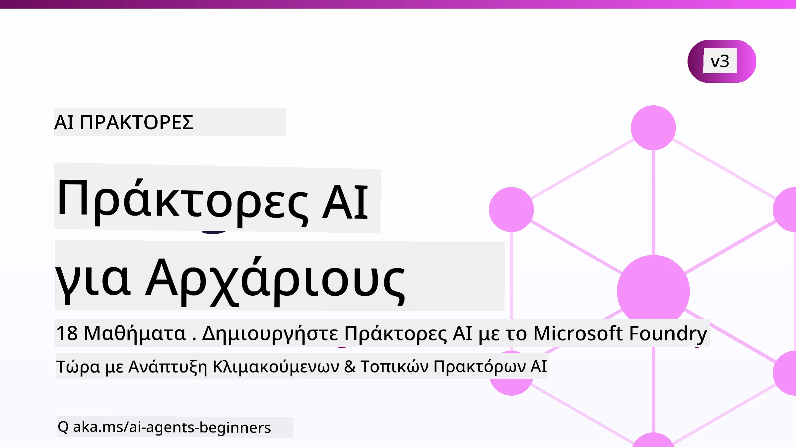

# Πράκτορες Τεχνητής Νοημοσύνης για Αρχάριους - Ένα Μάθημα



## Ένα μάθημα που διδάσκει όσα πρέπει να γνωρίζετε για να ξεκινήσετε να δημιουργείτε Πράκτορες Τεχνητής Νοημοσύνης

[](https://github.com/microsoft/ai-agents-for-beginners/blob/master/LICENSE?WT.mc_id=academic-105485-koreyst)
[](https://GitHub.com/microsoft/ai-agents-for-beginners/graphs/contributors/?WT.mc_id=academic-105485-koreyst)
[](https://GitHub.com/microsoft/ai-agents-for-beginners/issues/?WT.mc_id=academic-105485-koreyst)
[](https://GitHub.com/microsoft/ai-agents-for-beginners/pulls/?WT.mc_id=academic-105485-koreyst)
[](http://makeapullrequest.com?WT.mc_id=academic-105485-koreyst)

### 🌐 Υποστήριξη Πολλών Γλωσσών

#### Μεταφράσεις διατηρούνται με το [Co-op Translator](https://github.com/Azure/co-op-translator)

<!-- CO-OP TRANSLATOR LANGUAGES TABLE START -->
[Αραβικά](../ar/README.md) | [Μπενγκάλι](../bn/README.md) | [Βουλγαρικά](../bg/README.md) | [Βιρμανικά (Μιανμάρ)](../my/README.md) | [Κινέζικα (Απλοποιημένα)](../zh-CN/README.md) | [Κινέζικα (Παραδοσιακά, Χονγκ Κονγκ)](../zh-HK/README.md) | [Κινέζικα (Παραδοσιακά, Μακάο)](../zh-MO/README.md) | [Κινέζικα (Παραδοσιακά, Ταϊβάν)](../zh-TW/README.md) | [Κροατικά](../hr/README.md) | [Τσέχικα](../cs/README.md) | [Δανικά](../da/README.md) | [Ολλανδικά](../nl/README.md) | [Εσθονικά](../et/README.md) | [Φινλανδικά](../fi/README.md) | [Γαλλικά](../fr/README.md) | [Γερμανικά](../de/README.md) | [Ελληνικά](./README.md) | [Εβραϊκά](../he/README.md) | [Χίντι](../hi/README.md) | [Ουγγρικά](../hu/README.md) | [Ινδονησιακά](../id/README.md) | [Ιταλικά](../it/README.md) | [Ιαπωνικά](../ja/README.md) | [Καννάδα](../kn/README.md) | [Χμερ](../km/README.md) | [Κορεατικά](../ko/README.md) | [Λιθουανικά](../lt/README.md) | [Μαλαισιανά](../ms/README.md) | [Μαλαγιαλάμ](../ml/README.md) | [Μαράθι](../mr/README.md) | [Νεπάλι](../ne/README.md) | [Νιγηριανή Πίτζιν](../pcm/README.md) | [Νορβηγικά](../no/README.md) | [Περσικά (Φαρσί)](../fa/README.md) | [Πολωνικά](../pl/README.md) | [Πορτογαλικά (Βραζιλία)](../pt-BR/README.md) | [Πορτογαλικά (Πορτογαλία)](../pt-PT/README.md) | [Πουντζάμπι (Γκουρμούκι)](../pa/README.md) | [Ρουμανικά](../ro/README.md) | [Ρωσικά](../ru/README.md) | [Σερβικά (Κυριλλικά)](../sr/README.md) | [Σλοβακικά](../sk/README.md) | [Σλοβενικά](../sl/README.md) | [Ισπανικά](../es/README.md) | [Σουαχίλι](../sw/README.md) | [Σουηδικά](../sv/README.md) | [Ταγκαλόγκ (Φιλιππινέζικα)](../tl/README.md) | [Ταμίλ](../ta/README.md) | [Τελούγκου](../te/README.md) | [Ταϊλανδέζικα](../th/README.md) | [Τουρκικά](../tr/README.md) | [Ουκρανικά](../uk/README.md) | [Ουρντού](../ur/README.md) | [Βιετναμέζικα](../vi/README.md)

> **Προτιμάτε να κάνετε κλωνοποίηση τοπικά;**
>
> Αυτό το αποθετήριο περιλαμβάνει περισσότερες από 50 γλωσσικές μεταφράσεις, που αυξάνουν σημαντικά το μέγεθος λήψης. Για να κλωνοποιήσετε χωρίς μεταφράσεις, χρησιμοποιήστε το sparse checkout:
>
> **Bash / macOS / Linux:**
> ```bash
> git clone --filter=blob:none --sparse https://github.com/microsoft/ai-agents-for-beginners.git
> cd ai-agents-for-beginners
> git sparse-checkout set --no-cone '/*' '!translations' '!translated_images'
> ```
>
> **CMD (Windows):**
> ```cmd
> git clone --filter=blob:none --sparse https://github.com/microsoft/ai-agents-for-beginners.git
> cd ai-agents-for-beginners
> git sparse-checkout set --no-cone "/*" "!translations" "!translated_images"
> ```
>
> Αυτό σας δίνει όλα όσα χρειάζεστε για να ολοκληρώσετε το μάθημα με πολύ πιο γρήγορη λήψη.
<!-- CO-OP TRANSLATOR LANGUAGES TABLE END -->

**Για επιπλέον επιλογές γλωσσών, δείτε τις [υποστηριζόμενες γλώσσες του Co-op Translator](https://github.com/Azure/co-op-translator/blob/main/docs/supported-languages.md).**

[](https://GitHub.com/microsoft/ai-agents-for-beginners/watchers/?WT.mc_id=academic-105485-koreyst)
[](https://GitHub.com/microsoft/ai-agents-for-beginners/network/?WT.mc_id=academic-105485-koreyst)
[](https://GitHub.com/microsoft/ai-agents-for-beginners/stargazers/?WT.mc_id=academic-105485-koreyst)

[](https://discord.com/invite/ATgtXmAS5D)


## 🌱 Ξεκινώντας

Αυτό το μάθημα περιλαμβάνει μαθήματα που καλύπτουν τα βασικά για τη δημιουργία Πρακτόρων Τεχνητής Νοημοσύνης. Κάθε μάθημα καλύπτει ένα συγκεκριμένο θέμα, οπότε ξεκινήστε από όπου θέλετε!

Υπάρχει υποστήριξη πολλών γλωσσών για αυτό το μάθημα. Πηγαίνετε στις [διαθέσιμες γλώσσες εδώ](#-multi-language-support). 

Αν είναι η πρώτη σας φορά που δημιουργείτε με μοντέλα Γενετικής Τεχνητής Νοημοσύνης, δείτε το μάθημα μας [Γενετική ΤΝ για Αρχάριους](https://aka.ms/genai-beginners), που περιλαμβάνει 21 μαθήματα για δημιουργία με GenAI.

Μην ξεχάσετε να [βαθμολογήσετε με αστέρι (🌟) αυτό το repo](https://docs.github.com/en/get-started/exploring-projects-on-github/saving-repositories-with-stars?WT.mc_id=academic-105485-koreyst) και να [κάνετε fork αυτό το repo](https://github.com/microsoft/ai-agents-for-beginners/fork) για να τρέξετε τον κώδικα.

### Γνωρίστε Άλλους Μαθητές, Λάβετε Απαντήσεις στις Ερωτήσεις σας

Αν κολλήσετε ή έχετε ερωτήσεις για τη δημιουργία Πρακτόρων ΤΝ, συμμετάσχετε στο ειδικό κανάλι Discord μας στο [Microsoft Foundry Discord](https://aka.ms/ai-agents/discord).

### Τι Χρειάζεστε 

Κάθε μάθημα σε αυτό το μάθημα περιλαμβάνει παραδείγματα κώδικα, που βρίσκονται στον φάκελο code_samples. Μπορείτε να [κάνετε fork αυτό το repo](https://github.com/microsoft/ai-agents-for-beginners/fork) για να δημιουργήσετε το δικό σας αντίγραφο.  

Τα παραδείγματα κώδικα σε αυτές τις ασκήσεις χρησιμοποιούν το Microsoft Agent Framework με το Microsoft Foundry Agent Service V2:

- [Microsoft Foundry](https://aka.ms/ai-agents-beginners/ai-foundry) - Απαιτείται Λογαριασμός Azure

Αυτό το μάθημα χρησιμοποιεί τα ακόλουθα πλαίσια και υπηρεσίες Πρακτόρων ΤΝ από τη Microsoft:

- [Microsoft Agent Framework (MAF)](https://learn.microsoft.com/agent-framework/overview/)
- [Microsoft Foundry Agent Service V2](https://aka.ms/ai-agents-beginners/ai-agent-service)

Ορισμένα παραδείγματα κώδικα υποστηρίζουν επίσης εναλλακτικούς παρόχους συμβατούς με OpenAI όπως ο [MiniMax](https://platform.minimaxi.com/), που προσφέρει μεγάλα μοντέλα πλαισίου (έως 204K tokens). Δείτε το [Course Setup](./00-course-setup/README.md) για λεπτομέρειες διαμόρφωσης.

Για περισσότερες πληροφορίες σχετικά με την εκτέλεση του κώδικα αυτού του μαθήματος, δείτε το [Course Setup](./00-course-setup/README.md).

## 🙏 Θέλετε να βοηθήσετε;

Έχετε προτάσεις ή βρήκατε ορθογραφικά ή σφάλματα κώδικα; [Αναφέρετε ένα θέμα](https://github.com/microsoft/ai-agents-for-beginners/issues?WT.mc_id=academic-105485-koreyst) ή [Δημιουργήστε ένα αίτημα έλξης](https://github.com/microsoft/ai-agents-for-beginners/pulls?WT.mc_id=academic-105485-koreyst)


## 📂 Κάθε μάθημα περιλαμβάνει

- Ένα γραπτό μάθημα που βρίσκεται στο README και ένα σύντομο βίντεο
- Παραδείγματα κώδικα Python που χρησιμοποιούν το Microsoft Agent Framework με το Microsoft Foundry
- Συνδέσμους για πρόσθετους πόρους για να συνεχίσετε την εκμάθησή σας


## 🗃️ Μαθήματα

| **Μάθημα**                                 | **Κείμενο & Κώδικας**                              | **Βίντεο**                                                | **Επιπλέον Μάθηση**                                                                   |
|--------------------------------------------|----------------------------------------------------|----------------------------------------------------------|----------------------------------------------------------------------------------------|
| Εισαγωγή στους Πράκτορες ΤΝ και Περιπτώσεις Χρήσης Πρακτόρων | [Σύνδεσμος](./01-intro-to-ai-agents/README.md)          | [Βίντεο](https://youtu.be/3zgm60bXmQk?si=z8QygFvYQv-9WtO1)  | [Σύνδεσμος](https://aka.ms/ai-agents-beginners/collection?WT.mc_id=academic-105485-koreyst) |
| Εξερεύνηση των Πλαισίων Πράκτορα ΤΝ          | [Σύνδεσμος](./02-explore-agentic-frameworks/README.md)  | [Βίντεο](https://youtu.be/ODwF-EZo_O8?si=Vawth4hzVaHv-u0H)  | [Σύνδεσμος](https://aka.ms/ai-agents-beginners/collection?WT.mc_id=academic-105485-koreyst) |
| Κατανόηση των Σχεδιαστικών Προτύπων Πρακτόρα ΤΝ  | [Σύνδεσμος](./03-agentic-design-patterns/README.md)     | [Βίντεο](https://youtu.be/m9lM8qqoOEA?si=BIzHwzstTPL8o9GF)  | [Σύνδεσμος](https://aka.ms/ai-agents-beginners/collection?WT.mc_id=academic-105485-koreyst) |
| Σχέδιο Χρήσης Εργαλείου                   | [Σύνδεσμος](./04-tool-use/README.md)                 | [Βίντεο](https://youtu.be/vieRiPRx-gI?si=2z6O2Xu2cu_Jz46N)  | [Σύνδεσμος](https://aka.ms/ai-agents-beginners/collection?WT.mc_id=academic-105485-koreyst) |
| Agentic RAG                                | [Σύνδεσμος](./05-agentic-rag/README.md)                 | [Βίντεο](https://youtu.be/WcjAARvdL7I?si=gKPWsQpKiIlDH9A3)  | [Σύνδεσμος](https://aka.ms/ai-agents-beginners/collection?WT.mc_id=academic-105485-koreyst) |
| Δημιουργία Αξιόπιστων Πρακτόρων ΤΝ           | [Σύνδεσμος](./06-building-trustworthy-agents/README.md) | [Βίντεο](https://youtu.be/iZKkMEGBCUQ?si=jZjpiMnGFOE9L8OK ) | [Σύνδεσμος](https://aka.ms/ai-agents-beginners/collection?WT.mc_id=academic-105485-koreyst) |
| Σχέδιο Προγραμματισμού                      | [Σύνδεσμος](./07-planning-design/README.md)             | [Βίντεο](https://youtu.be/kPfJ2BrBCMY?si=6SC_iv_E5-mzucnC)  | [Σύνδεσμος](https://aka.ms/ai-agents-beginners/collection?WT.mc_id=academic-105485-koreyst) |
| Σχέδιο Πολυ-Πρακτόρων                       | [Σύνδεσμος](./08-multi-agent/README.md)                 | [Βίντεο](https://youtu.be/V6HpE9hZEx0?si=rMgDhEu7wXo2uo6g)  | [Σύνδεσμος](https://aka.ms/ai-agents-beginners/collection?WT.mc_id=academic-105485-koreyst) |
| Σχέδιο Μεταγνωστικής Σκέψης                 | [Σύνδεσμος](./09-metacognition/README.md)               | [Βίντεο](https://youtu.be/His9R6gw6Ec?si=8gck6vvdSNCt6OcF)  | [Σύνδεσμος](https://aka.ms/ai-agents-beginners/collection?WT.mc_id=academic-105485-koreyst) |
| Πράκτορες ΤΝ στην Παραγωγή                  | [Σύνδεσμος](./10-ai-agents-production/README.md)        | [Βίντεο](https://youtu.be/l4TP6IyJxmQ?si=31dnhexRo6yLRJDl)  | [Σύνδεσμος](https://aka.ms/ai-agents-beginners/collection?WT.mc_id=academic-105485-koreyst) |
| Χρήση Πρακτορικών Πρωτοκόλλων (MCP, A2A και NLWeb) | [Σύνδεσμος](./11-agentic-protocols/README.md)           | [Βίντεο](https://youtu.be/X-Dh9R3Opn8)                                 | [Σύνδεσμος](https://aka.ms/ai-agents-beginners/collection?WT.mc_id=academic-105485-koreyst) |
| Μηχανική Πλαισίου για Πράκτορες ΤΝ          | [Σύνδεσμος](./12-context-engineering/README.md)         | [Βίντεο](https://youtu.be/F5zqRV7gEag)                                 | [Σύνδεσμος](https://aka.ms/ai-agents-beginners/collection?WT.mc_id=academic-105485-koreyst) |
| Διαχείριση Μνήμης Πρακτόρων                 | [Σύνδεσμος](./13-agent-memory/README.md)     |      [Βίντεο](https://youtu.be/QrYbHesIxpw?si=vZkVwKrQ4ieCcIPx)                                                      |                                                                                        |
| Εξερεύνηση Microsoft Agent Framework                         | [Σύνδεσμος](./14-microsoft-agent-framework/README.md)                            |                                                            |                                                                                        |
| Δημιουργία Πρακτόρων Χρήσης Υπολογιστών (CUA)           | [Σύνδεσμος](./15-browser-use/README.md)     |                                                            | [Σύνδεσμος](https://docs.browser-use.com/examples/templates/playwright-integration)         |
| Ανάπτυξη Κλιμακούμενων Πρακτόρων                  | [Σύνδεσμος](./16-deploying-scalable-agents/README.md) |                                                    | [Σύνδεσμος](https://learn.microsoft.com/azure/ai-foundry/agents/overview)                   |
| Δημιουργία Τοπικών Πρακτόρων ΤΝ                  | [Σύνδεσμος](./17-creating-local-ai-agents/README.md)  |                                                    | [Σύνδεσμος](https://learn.microsoft.com/azure/ai-foundry/foundry-local/)                    |
| Ασφάλεια Πρακτόρων ΤΝ                           | [Σύνδεσμος](./18-securing-ai-agents/README.md)  |                                                            | [Σύνδεσμος](https://aka.ms/ai-agents-beginners/collection?WT.mc_id=academic-105485-koreyst) |

## 🎒 Άλλα Μαθήματα

Η ομάδα μας παράγει και άλλα μαθήματα! Δείτε:

<!-- CO-OP TRANSLATOR OTHER COURSES START -->
### LangChain
[](https://aka.ms/langchain4j-for-beginners)
[](https://aka.ms/langchainjs-for-beginners?WT.mc_id=m365-94501-dwahlin)
[](https://github.com/microsoft/langchain-for-beginners?WT.mc_id=m365-94501-dwahlin)
---

### Azure / Edge / MCP / Πράκτορες
[](https://github.com/microsoft/AZD-for-beginners?WT.mc_id=academic-105485-koreyst)
[](https://github.com/microsoft/edgeai-for-beginners?WT.mc_id=academic-105485-koreyst)
[](https://github.com/microsoft/mcp-for-beginners?WT.mc_id=academic-105485-koreyst)
[](https://github.com/microsoft/ai-agents-for-beginners?WT.mc_id=academic-105485-koreyst)

---
 
### Σειρά Γενετικής ΤΝ
[](https://github.com/microsoft/generative-ai-for-beginners?WT.mc_id=academic-105485-koreyst)
[-9333EA?style=for-the-badge&labelColor=E5E7EB&color=9333EA)](https://github.com/microsoft/Generative-AI-for-beginners-dotnet?WT.mc_id=academic-105485-koreyst)
[-C084FC?style=for-the-badge&labelColor=E5E7EB&color=C084FC)](https://github.com/microsoft/generative-ai-for-beginners-java?WT.mc_id=academic-105485-koreyst)
[-E879F9?style=for-the-badge&labelColor=E5E7EB&color=E879F9)](https://github.com/microsoft/generative-ai-with-javascript?WT.mc_id=academic-105485-koreyst)

---
 
### Βασική Μάθηση
[](https://aka.ms/ml-beginners?WT.mc_id=academic-105485-koreyst)
[](https://aka.ms/datascience-beginners?WT.mc_id=academic-105485-koreyst)
[](https://aka.ms/ai-beginners?WT.mc_id=academic-105485-koreyst)
[](https://github.com/microsoft/Security-101?WT.mc_id=academic-96948-sayoung)
[](https://aka.ms/webdev-beginners?WT.mc_id=academic-105485-koreyst)
[](https://aka.ms/iot-beginners?WT.mc_id=academic-105485-koreyst)
[](https://github.com/microsoft/xr-development-for-beginners?WT.mc_id=academic-105485-koreyst)

---
 
### Σειρά Copilot
[](https://aka.ms/GitHubCopilotAI?WT.mc_id=academic-105485-koreyst)
[](https://github.com/microsoft/mastering-github-copilot-for-dotnet-csharp-developers?WT.mc_id=academic-105485-koreyst)
[](https://github.com/microsoft/CopilotAdventures?WT.mc_id=academic-105485-koreyst)
<!-- CO-OP TRANSLATOR OTHER COURSES END -->

## 🌟 Ευχαριστίες Κοινότητας

Ευχαριστούμε τον [Shivam Goyal](https://www.linkedin.com/in/shivam2003/) για τη συνεισφορά σημαντικών δειγμάτων κώδικα που παρουσιάζουν το Agentic RAG.

## Συνεισφορά

Το έργο αυτό καλωσορίζει συνεισφορές και προτάσεις. Η πλειονότητα των συνεισφορών απαιτεί να συμφωνήσετε με μια
Συμφωνία Άδειας Συνεισφοράς (CLA) που δηλώνει ότι έχετε το δικαίωμα και πράγματι παραχωρείτε σε εμάς
τα δικαιώματα για τη χρήση της συνεισφοράς σας. Για λεπτομέρειες, επισκεφθείτε <https://cla.opensource.microsoft.com>.

Όταν υποβάλλετε αίτημα pull, ένα bot CLA θα καθορίσει αυτόματα αν χρειάζεται να παράσχετε
CLA και θα διακοσμήσει το PR ανάλογα (π.χ. έλεγχος κατάστασης, σχόλιο). Απλώς ακολουθήστε τις οδηγίες
που παρέχει το bot. Θα χρειαστεί να το κάνετε μόνο μια φορά σε όλα τα αποθετήρια που χρησιμοποιούν το CLA μας.

Το έργο έχει υιοθετήσει τον [Κώδικα Δεοντολογίας Ανοιχτού Κώδικα της Microsoft](https://opensource.microsoft.com/codeofconduct/).
Για περισσότερες πληροφορίες δείτε τις [Συχνές Ερωτήσεις για τον Κώδικα Δεοντολογίας](https://opensource.microsoft.com/codeofconduct/faq/) ή
επικοινωνήστε με [opencode@microsoft.com](mailto:opencode@microsoft.com) για επιπλέον ερωτήσεις ή σχόλια.

## Εμπορικά Σήματα

Αυτό το έργο μπορεί να περιέχει εμπορικά σήματα ή λογότυπα για έργα, προϊόντα ή υπηρεσίες. Η εξουσιοδοτημένη χρήση των εμπορικών σημάτων ή λογοτύπων της Microsoft
υπόκειται και πρέπει να ακολουθεί τις
[Οδηγίες Εμπορικών Σημάτων & Εταιρικής Ταυτότητας της Microsoft](https://www.microsoft.com/legal/intellectualproperty/trademarks/usage/general).
Η χρήση των εμπορικών σημάτων ή λογοτύπων της Microsoft σε τροποποιημένες εκδόσεις αυτού του έργου δεν πρέπει να προκαλεί σύγχυση ή να υπονοεί χορηγία από τη Microsoft.
Οποιαδήποτε χρήση εμπορικών σημάτων ή λογοτύπων τρίτων υπόκειται στις πολιτικές των ίδιων των τρίτων.

## Λήψη Βοήθειας


Αν αντιμετωπίσετε πρόβλημα ή έχετε απορίες σχετικά με την κατασκευή εφαρμογών AI, συμμετάσχετε στο:

[](https://aka.ms/foundry/discord)

Αν έχετε σχόλια για το προϊόν ή λάθη κατά την κατασκευή, επισκεφθείτε:

[](https://aka.ms/foundry/forum)

---

<!-- CO-OP TRANSLATOR DISCLAIMER START -->
**Αποποίηση ευθυνών**:
Αυτό το έγγραφο έχει μεταφραστεί χρησιμοποιώντας την υπηρεσία μετάφρασης με τεχνητή νοημοσύνη [Co-op Translator](https://github.com/Azure/co-op-translator). Ενώ επιδιώκουμε την ακρίβεια, παρακαλούμε να έχετε υπόψη ότι οι αυτοματοποιημένες μεταφράσεις ενδέχεται να περιέχουν λάθη ή ανακρίβειες. Το πρωτότυπο έγγραφο στη μητρική του γλώσσα πρέπει να θεωρείται η αυθεντική πηγή. Για κρίσιμες πληροφορίες, συνιστάται επαγγελματική ανθρώπινη μετάφραση. Δεν φέρουμε ευθύνη για τυχόν παρεξηγήσεις ή λανθασμένες ερμηνείες που προκύπτουν από τη χρήση αυτής της μετάφρασης.
<!-- CO-OP TRANSLATOR DISCLAIMER END -->