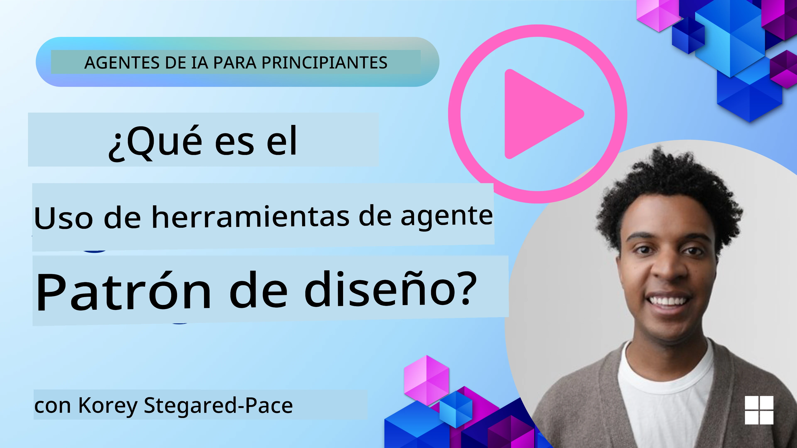
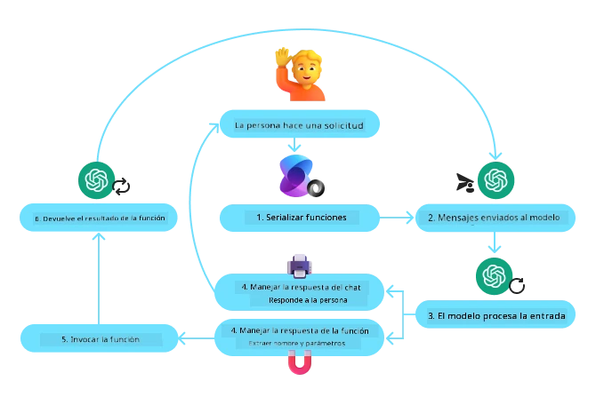
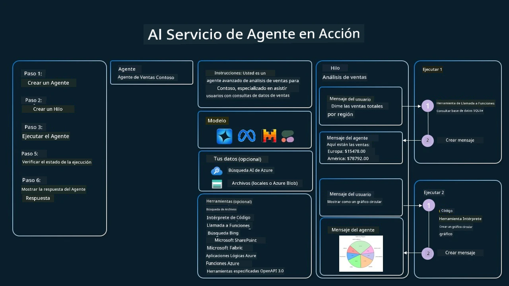

[](https://youtu.be/vieRiPRx-gI?si=cEZ8ApnT6Sus9rhn)

> _(Haz clic en la imagen de arriba para ver el video de esta lección)_

# Patrón de diseño de uso de herramientas

Las herramientas son interesantes porque permiten que los agentes de IA tengan un rango más amplio de capacidades. En lugar de que el agente tenga un conjunto limitado de acciones que puede realizar, al agregar una herramienta, el agente ahora puede realizar una amplia gama de acciones. En este capítulo, veremos el Patrón de diseño de uso de herramientas, que describe cómo los agentes de IA pueden usar herramientas específicas para lograr sus objetivos.

## Introducción

En esta lección, buscamos responder las siguientes preguntas:

- ¿Qué es el patrón de diseño de uso de herramientas?
- ¿Cuáles son los casos de uso a los que se puede aplicar?
- ¿Cuáles son los elementos/bloques de construcción necesarios para implementar el patrón de diseño?
- ¿Cuáles son las consideraciones especiales para usar el Patrón de diseño de uso de herramientas para construir agentes de IA confiables?

## Objetivos de aprendizaje

Después de completar esta lección, podrás:

- Definir el Patrón de diseño de uso de herramientas y su propósito.
- Identificar casos de uso donde el Patrón de diseño de uso de herramientas es aplicable.
- Comprender los elementos clave necesarios para implementar el patrón de diseño.
- Reconocer consideraciones para asegurar la confiabilidad en agentes de IA que usan este patrón de diseño.

## ¿Qué es el Patrón de diseño de uso de herramientas?

El **Patrón de diseño de uso de herramientas** se enfoca en proporcionar a los LLMs la capacidad de interactuar con herramientas externas para alcanzar objetivos específicos. Las herramientas son código que puede ser ejecutado por un agente para realizar acciones. Una herramienta puede ser una función simple como una calculadora, o una llamada a una API de un servicio de terceros como consulta de precios de acciones o pronóstico del tiempo. En el contexto de los agentes de IA, las herramientas están diseñadas para ser ejecutadas por agentes en respuesta a **llamadas a funciones generadas por el modelo**.

## ¿Cuáles son los casos de uso a los que se puede aplicar?

Los agentes de IA pueden aprovechar herramientas para completar tareas complejas, recuperar información o tomar decisiones. El patrón de diseño de uso de herramientas se usa frecuentemente en escenarios que requieren interacción dinámica con sistemas externos, como bases de datos, servicios web o intérpretes de código. Esta capacidad es útil para varios casos de uso, incluyendo:

- **Recuperación dinámica de información:** Los agentes pueden consultar APIs externas o bases de datos para obtener datos actualizados (por ejemplo, consultar una base de datos SQLite para análisis de datos, obtener precios de acciones o información del clima).
- **Ejecución e interpretación de código:** Los agentes pueden ejecutar código o scripts para resolver problemas matemáticos, generar reportes o realizar simulaciones.
- **Automatización de flujos de trabajo:** Automatizar flujos de trabajo repetitivos o de múltiples pasos integrando herramientas como programadores de tareas, servicios de correo electrónico o canalizaciones de datos.
- **Soporte al cliente:** Los agentes pueden interactuar con sistemas CRM, plataformas de tickets o bases de conocimiento para resolver consultas de usuarios.
- **Generación y edición de contenido:** Los agentes pueden usar herramientas como correctores gramaticales, resúmenes de texto o evaluadores de seguridad de contenido para asistir en tareas de creación de contenido.

## ¿Cuáles son los elementos/bloques de construcción necesarios para implementar el patrón de diseño de uso de herramientas?

Estos bloques de construcción permiten que el agente de IA realice una amplia variedad de tareas. Veamos los elementos clave necesarios para implementar el Patrón de diseño de uso de herramientas:

- **Esquemas de funciones/herramientas**: Definiciones detalladas de las herramientas disponibles, incluyendo el nombre de la función, propósito, parámetros requeridos y salidas esperadas. Estos esquemas permiten que el LLM entienda qué herramientas están disponibles y cómo construir solicitudes válidas.

- **Lógica de ejecución de funciones**: Gobernar cómo y cuándo se invocan las herramientas basado en la intención del usuario y el contexto de la conversación. Esto puede incluir módulos planificadores, mecanismos de enrutamiento o flujos condicionales que determinan el uso dinámico de herramientas.

- **Sistema de manejo de mensajes**: Componentes que gestionan el flujo conversacional entre las entradas del usuario, respuestas del LLM, llamadas a herramientas y salidas de herramientas.

- **Marco de integración de herramientas**: Infraestructura que conecta al agente con varias herramientas, ya sean funciones simples o servicios externos complejos.

- **Manejo de errores y validación**: Mecanismos para manejar fallos en la ejecución de herramientas, validar parámetros y gestionar respuestas inesperadas.

- **Gestión del estado**: Rastrea el contexto de la conversación, interacciones anteriores con herramientas y datos persistentes para asegurar consistencia en interacciones de múltiples turnos.

Ahora, veamos con más detalle la llamada a funciones/herramientas.
 
### Llamada a funciones/herramientas

La llamada a funciones es la principal forma en que habilitamos a los Modelos de Lenguaje Grandes (LLMs) para interactuar con herramientas. A menudo verás que 'Función' y 'Herramienta' se usan indistintamente porque las 'funciones' (bloques de código reutilizable) son las 'herramientas' que los agentes usan para llevar a cabo tareas. Para que se invoque el código de una función, un LLM debe comparar la solicitud del usuario contra la descripción de las funciones. Para esto, se envía al LLM un esquema que contiene las descripciones de todas las funciones disponibles. Luego, el LLM selecciona la función más adecuada para la tarea y devuelve su nombre y argumentos. La función seleccionada se invoca, su respuesta se envía de vuelta al LLM, que usa la información para responder a la solicitud del usuario.

Para que los desarrolladores implementen la llamada a funciones para agentes, necesitarán:

1. Un modelo LLM que soporte llamada a funciones
2. Un esquema que contenga descripciones de funciones
3. El código para cada función descrita

Usemos el ejemplo de obtener la hora actual en una ciudad para ilustrar:

1. **Inicializar un LLM que soporte llamada a funciones:**

    No todos los modelos soportan llamada a funciones, por lo que es importante verificar que el LLM que usas lo haga. <a href="https://learn.microsoft.com/azure/ai-services/openai/how-to/function-calling" target="_blank">Azure OpenAI</a> soporta llamada a funciones. Podemos comenzar iniciando el cliente de OpenAI contra la **API de respuestas** de Azure OpenAI (el endpoint estable `/openai/v1/` — no se necesita `api_version`).

    ```python
    # Inicializar el cliente de OpenAI para Azure OpenAI (API de Respuestas, endpoint v1)
    client = OpenAI(
        base_url=f"{os.environ['AZURE_OPENAI_ENDPOINT'].rstrip('/')}/openai/v1/",
        api_key=os.environ["AZURE_OPENAI_API_KEY"],
    )
    deployment_name = os.environ["AZURE_OPENAI_DEPLOYMENT"]
    ```

1. **Crear un esquema de función**:

    A continuación definiremos un esquema JSON que contiene el nombre de la función, descripción de lo que hace la función, y los nombres y descripciones de sus parámetros.
    Luego tomaremos este esquema y lo pasaremos al cliente creado anteriormente, junto con la solicitud del usuario para encontrar la hora en San Francisco. Lo importante de notar es que lo que se devuelve es una **llamada a herramienta**, **no** la respuesta final a la pregunta. Como se mencionó antes, el LLM devuelve el nombre de la función seleccionada para la tarea y los argumentos que se le pasarán.

    ```python
    # Descripción de la función para que el modelo lea (formato de herramienta plana de API de respuestas)
    tools = [
        {
            "type": "function",
            "name": "get_current_time",
            "description": "Get the current time in a given location",
            "parameters": {
                "type": "object",
                "properties": {
                    "location": {
                        "type": "string",
                        "description": "The city name, e.g. San Francisco",
                    },
                },
                "required": ["location"],
            },
        }
    ]
    ```
   
    ```python
  
    # Mensaje inicial del usuario
    messages = [{"role": "user", "content": "What's the current time in San Francisco"}]

    # Primera llamada a la API: pedir al modelo que use la función
    response = client.responses.create(
        model=deployment_name,
        input=messages,
        tools=tools,
        tool_choice="auto",
        store=False,
    )

    # La API de Respuestas devuelve llamadas a herramientas como elementos function_call en response.output.
    # Agrégalas a la conversación para que el modelo tenga el contexto completo en el siguiente turno.
    messages += response.output

    print("Model's response:")
    print(response.output)
  
    ```

    ```bash
    Model's response:
    [ResponseFunctionToolCall(arguments='{"location":"San Francisco"}', call_id='call_pOsKdUlqvdyttYB67MOj434b', name='get_current_time', type='function_call')]
    ```
  
1. **El código de la función requerido para realizar la tarea:**

    Ahora que el LLM ha elegido qué función debe ejecutarse, el código que realiza la tarea debe implementarse y ejecutarse.
    Podemos implementar el código para obtener la hora actual en Python. También necesitaremos escribir el código para extraer el nombre y los argumentos desde la response_message para obtener el resultado final.

    ```python
      def get_current_time(location):
        """Get the current time for a given location"""
        print(f"get_current_time called with location: {location}")  
        location_lower = location.lower()
        
        for key, timezone in TIMEZONE_DATA.items():
            if key in location_lower:
                print(f"Timezone found for {key}")  
                current_time = datetime.now(ZoneInfo(timezone)).strftime("%I:%M %p")
                return json.dumps({
                    "location": location,
                    "current_time": current_time
                })
      
        print(f"No timezone data found for {location_lower}")  
        return json.dumps({"location": location, "current_time": "unknown"})
    ```

     ```python
    # Manejar llamadas a funciones
    tool_calls = [item for item in response.output if item.type == "function_call"]
    if tool_calls:
        for tool_call in tool_calls:
            if tool_call.name == "get_current_time":

                function_args = json.loads(tool_call.arguments)

                time_response = get_current_time(
                    location=function_args.get("location")
                )

                # Devolver el resultado de la herramienta como un elemento function_call_output
                messages.append({
                    "type": "function_call_output",
                    "call_id": tool_call.call_id,
                    "output": time_response,
                })
    else:
        print("No tool calls were made by the model.")

    # Segunda llamada a la API: Obtener la respuesta final del modelo
    final_response = client.responses.create(
        model=deployment_name,
        input=messages,
        tools=tools,
        store=False,
    )

    return final_response.output_text
     ```

     ```bash
      get_current_time called with location: San Francisco
      Timezone found for san francisco
      The current time in San Francisco is 09:24 AM.
     ```

La llamada a funciones está en el centro de la mayoría, si no de todo el diseño de uso de herramientas en agentes, sin embargo implementarla desde cero puede ser a veces desafiante.
Como aprendimos en [Lección 2](../../../02-explore-agentic-frameworks), los marcos agenticos nos proveen bloques de construcción preconstruidos para implementar el uso de herramientas.
 
## Ejemplos de uso de herramientas con marcos agenticos

Aquí hay algunos ejemplos de cómo puedes implementar el Patrón de diseño de uso de herramientas usando diferentes marcos agenticos:

### Microsoft Agent Framework

<a href="https://learn.microsoft.com/azure/ai-services/agents/overview" target="_blank">Microsoft Agent Framework</a> es un marco de IA de código abierto para construir agentes de IA. Simplifica el proceso de llamar funciones permitiendo que definas herramientas como funciones Python con el decorador `@tool`. El marco maneja la comunicación de ida y vuelta entre el modelo y tu código. También proporciona acceso a herramientas preconstruidas como búsqueda de archivos e intérprete de código a través de `FoundryChatClient`.

El siguiente diagrama ilustra el proceso de llamada a funciones con Microsoft Agent Framework:



En Microsoft Agent Framework, las herramientas se definen como funciones decoradas. Podemos convertir la función `get_current_time` que vimos antes en una herramienta usando el decorador `@tool`. El marco serializará automáticamente la función y sus parámetros, creando el esquema para enviar al LLM.

```python
import os
from agent_framework import tool
from agent_framework.foundry import FoundryChatClient
from azure.identity import AzureCliCredential

@tool(approval_mode="never_require")
def get_current_time(location: str) -> str:
    """Get the current time for a given location"""
    ...

# Crear el cliente
provider = FoundryChatClient(
    project_endpoint=os.environ["AZURE_AI_PROJECT_ENDPOINT"],
    model=os.environ["AZURE_AI_MODEL_DEPLOYMENT_NAME"],
    credential=AzureCliCredential(),
)

# Crear un agente y ejecutar con la herramienta
agent = provider.as_agent(name="TimeAgent", instructions="Use available tools to answer questions.", tools=get_current_time)
response = await agent.run("What time is it?")
```

#### Herramientas desde un servidor MCP

Las herramientas no tienen que ser funciones en tu propio código. Un servidor que habla el Protocolo de Contexto de Modelos (MCP, cubierto en [Lección 11](../11-agentic-protocols/README.md)) publica sus herramientas junto con sus esquemas, y el marco puede cargarlas igual que serializa una función decorada. `MCPStreamableHTTPTool` se conecta a un servidor así vía HTTP, lee los esquemas de herramientas y las ofrece al modelo junto con cualquier herramienta local.

El ejemplo a continuación usa el servidor de búsqueda web alojado por <a href="https://keenable.ai" target="_blank">Keenable</a>. Es gratis de usar sin cuenta o clave API (las solicitudes tienen límite por IP), así que las únicas credenciales necesarias son las de tu modelo. Como con cualquier herramienta remota, las consultas que escribe el modelo se envían a ese servidor.

```python
from agent_framework import MCPStreamableHTTPTool

web_search = MCPStreamableHTTPTool(
    name="Keenable web search",
    url="https://api.keenable.ai/mcp",
)

# Conectar carga los esquemas de herramientas del servidor; el agente decide cuándo llamarlos
async with web_search:
    agent = provider.as_agent(
        name="ResearchAgent",
        instructions="Use available tools to answer questions.",
        tools=[web_search],
    )
    response = await agent.run("What is new in the latest Python release?")
    print(response.text)
```

El servidor publica dos herramientas, `search_web_pages` y `fetch_page_content`. Cuando se necesita información actual, el modelo llama a `search_web_pages`, recibe títulos, URLs y fragmentos de texto, y escribe su respuesta a partir de ellos, el mismo ciclo que en el ejemplo de `get_current_time` anterior.
  
### Microsoft Foundry Agent Service

<a href="https://learn.microsoft.com/azure/ai-services/agents/overview" target="_blank">Microsoft Foundry Agent Service</a> es un marco agentico más reciente que está diseñado para empoderar a desarrolladores a construir, implementar y escalar agentes de IA de alta calidad y extensibles de forma segura sin necesidad de gestionar los recursos de cómputo y almacenamiento subyacentes. Es especialmente útil para aplicaciones empresariales ya que es un servicio totalmente gestionado con seguridad de grado empresarial.

Comparado con desarrollar directamente con la API LLM, Microsoft Foundry Agent Service ofrece algunas ventajas, incluyendo:

- Llamada automática a herramientas – no es necesario analizar la llamada a una herramienta, invocar la herramienta y manejar la respuesta; todo esto ahora se hace en el servidor
- Datos gestionados de forma segura – en lugar de manejar tu propio estado de conversación, puedes confiar en hilos para almacenar toda la información que necesitas
- Herramientas listas para usar – Herramientas que puedes usar para interactuar con tus fuentes de datos, como Bing, Azure AI Search y Azure Functions.

Las herramientas disponibles en Microsoft Foundry Agent Service se pueden dividir en dos categorías:

1. Herramientas de conocimiento:
    - <a href="https://learn.microsoft.com/azure/ai-services/agents/how-to/tools/bing-grounding?tabs=python&pivots=overview" target="_blank">Fundamentación con Bing Search</a>
    - <a href="https://learn.microsoft.com/azure/ai-services/agents/how-to/tools/file-search?tabs=python&pivots=overview" target="_blank">Búsqueda de archivos</a>
    - <a href="https://learn.microsoft.com/azure/ai-services/agents/how-to/tools/azure-ai-search?tabs=azurecli%2Cpython&pivots=overview-azure-ai-search" target="_blank">Azure AI Search</a>

2. Herramientas de acción:
    - <a href="https://learn.microsoft.com/azure/ai-services/agents/how-to/tools/function-calling?tabs=python&pivots=overview" target="_blank">Llamada a funciones</a>
    - <a href="https://learn.microsoft.com/azure/ai-services/agents/how-to/tools/code-interpreter?tabs=python&pivots=overview" target="_blank">Intérprete de código</a>
    - <a href="https://learn.microsoft.com/azure/ai-services/agents/how-to/tools/openapi-spec?tabs=python&pivots=overview" target="_blank">Herramientas definidas con OpenAPI</a>
    - <a href="https://learn.microsoft.com/azure/ai-services/agents/how-to/tools/azure-functions?pivots=overview" target="_blank">Azure Functions</a>

El Agent Service nos permite usar estas herramientas juntas como un `conjunto de herramientas (toolset)`. También utiliza `hilos` que mantienen el historial de mensajes de una conversación particular.

Imagina que eres un agente de ventas en una empresa llamada Contoso. Quieres desarrollar un agente conversacional que pueda responder preguntas sobre tus datos de ventas.

La siguiente imagen ilustra cómo podrías usar Microsoft Foundry Agent Service para analizar tus datos de ventas:



Para usar cualquiera de estas herramientas con el servicio podemos crear un cliente y definir una herramienta o conjunto de herramientas. Para implementar esto prácticamente podemos usar el siguiente código Python. El LLM podrá mirar el conjunto de herramientas y decidir si usar la función creada por el usuario, `fetch_sales_data_using_sqlite_query`, o el Intérprete de Código preconstruido dependiendo de la solicitud del usuario.

```python 
import os
from azure.ai.projects import AIProjectClient
from azure.identity import DefaultAzureCredential
from fetch_sales_data_functions import fetch_sales_data_using_sqlite_query # función fetch_sales_data_using_sqlite_query que se puede encontrar en un archivo fetch_sales_data_functions.py.
from azure.ai.projects.models import ToolSet, FunctionTool, CodeInterpreterTool

project_client = AIProjectClient.from_connection_string(
    credential=DefaultAzureCredential(),
    conn_str=os.environ["PROJECT_CONNECTION_STRING"],
)

# Inicializar conjunto de herramientas
toolset = ToolSet()

# Inicializar agente de llamada de función con la función fetch_sales_data_using_sqlite_query y agregarlo al conjunto de herramientas
fetch_data_function = FunctionTool(fetch_sales_data_using_sqlite_query)
toolset.add(fetch_data_function)

# Inicializar herramienta de intérprete de código y agregarla al conjunto de herramientas.
code_interpreter = CodeInterpreterTool()toolset.add(code_interpreter)

agent = project_client.agents.create_agent(
    model="gpt-5-mini", name="my-agent", instructions="You are helpful agent", 
    toolset=toolset
)
```

## ¿Cuáles son las consideraciones especiales para usar el Patrón de diseño de uso de herramientas para construir agentes de IA confiables?

Una preocupación común con SQL generado dinámicamente por LLMs es la seguridad, particularmente el riesgo de inyección SQL o acciones maliciosas, como eliminar o manipular la base de datos. Aunque estas preocupaciones son válidas, se pueden mitigar efectivamente configurando correctamente los permisos de acceso a la base de datos. Para la mayoría de las bases de datos esto implica configurar la base de datos como de solo lectura. Para servicios de bases de datos como PostgreSQL o Azure SQL, la aplicación debe asignarse un rol de solo lectura (SELECT).

Ejecutar la aplicación en un entorno seguro mejora aún más la protección. En escenarios empresariales, los datos normalmente se extraen y transforman desde sistemas operativos hacia una base de datos o almacén de datos de solo lectura con un esquema amigable para el usuario. Este enfoque asegura que los datos sean seguros, optimizados para rendimiento y accesibilidad, y que la aplicación tenga acceso restringido y solo lectura.

## Códigos de ejemplo

- Python: [Agent Framework](./code_samples/04-python-agent-framework.ipynb)
- .NET: [Agent Framework](./code_samples/04-dotnet-agent-framework.md)

## ¿Tienes más preguntas sobre los patrones de diseño de uso de herramientas?

Únete al [Microsoft Foundry Discord](https://discord.com/invite/ATgtXmAS5D) para encontrarte con otros aprendices, asistir a horas de oficina y obtener respuestas a tus preguntas sobre agentes de IA.

## Recursos adicionales

- <a href="https://microsoft.github.io/build-your-first-agent-with-azure-ai-agent-service-workshop/" target="_blank">Taller de Azure AI Agents Service</a>
- <a href="https://github.com/Azure-Samples/contoso-creative-writer/tree/main/docs/workshop" target="_blank">Taller Multagente de Contoso Creative Writer</a>
- <a href="https://learn.microsoft.com/azure/ai-services/agents/overview" target="_blank">Resumen del Marco de Agentes de Microsoft</a>

## Prueba Rápida de Este Agente (Opcional)

Después de aprender a implementar agentes en la [Lección 16](../16-deploying-scalable-agents/README.md), puedes hacer una prueba rápida del `TravelToolAgent` de esta lección (¿todavía llama a sus herramientas y responde?) con [`tests/lesson-04-smoke-tests.json`](../../../tests/lesson-04-smoke-tests.json). Consulta [`tests/README.md`](../tests/README.md) para saber cómo ejecutarlo.

## Lección Anterior

[Comprendiendo los Patrones de Diseño Agentico](../03-agentic-design-patterns/README.md)

## Próxima Lección

[Agentic RAG](../05-agentic-rag/README.md)

---

<!-- CO-OP TRANSLATOR DISCLAIMER START -->
**Descargo de responsabilidad**:
Este documento ha sido traducido utilizando el servicio de traducción automática [Co-op Translator](https://github.com/Azure/co-op-translator). Aunque nos esforzamos por la precisión, tenga en cuenta que las traducciones automatizadas pueden contener errores o inexactitudes. El documento original en su idioma nativo debe considerarse la fuente autorizada. Para información crítica, se recomienda una traducción profesional humana. No somos responsables de cualquier malentendido o interpretación errónea que surja del uso de esta traducción.
<!-- CO-OP TRANSLATOR DISCLAIMER END -->