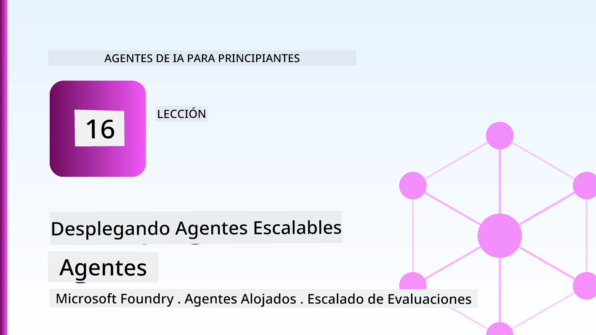
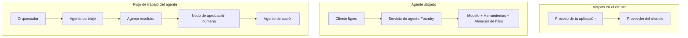
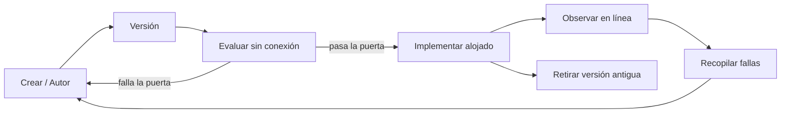
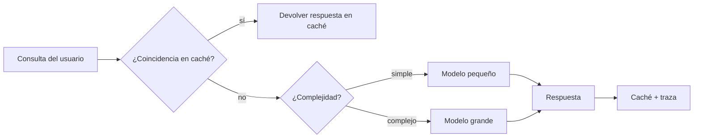
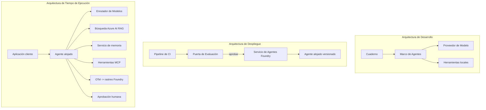

# Implementación de Agentes Escalables con Microsoft Foundry



Hasta este punto en el curso has construido agentes que se ejecutan en tu portátil, dentro de un notebook, impulsados por `az login` y un puñado de variables de entorno. Esa es exactamente la manera correcta de aprender. No es la forma adecuada de ejecutar un agente del que miles de clientes dependen a las 3 a.m.

Esta lección trata sobre la brecha entre "funciona en mi máquina" y "funciona, de forma fiable y asequible, en producción". Cerramos esa brecha usando **Microsoft Foundry** y el **Microsoft Foundry Agent Service**, y lo hacemos construyendo un agente real de soporte al cliente que tiene herramientas, recuperación, memoria, evaluación y monitoreo.

## Introducción

Esta lección cubrirá:

- La diferencia entre un **agente prototipo** y un **agente desplegado**, y por qué la transición se trata principalmente de todo lo que está *alrededor* del modelo.
- **Patrones de implementación** para agentes: hospedados en cliente, hospedados como servicio (Hosted Agents), y orquestados mediante flujos de trabajo.
- El **ciclo de vida del agente** en Microsoft Foundry — crear, versionar, implementar, evaluar, observar, retirar.
- **Estrategias de escalabilidad**: enrutamiento de modelos, almacenamiento en caché, concurrencia y diseño sin estado.
- **Observabilidad** con OpenTelemetry y trazabilidad en Foundry.
- **Optimización de costos** mediante selección de modelo, enrutamiento y puertas de evaluación.
- **Consideraciones empresariales**: gobernanza, aprobación humana y ejecución segura de servidores MCP en producción.

## Objetivos de Aprendizaje

Después de completar esta lección, sabrás cómo:

- Elegir el patrón de implementación adecuado para una carga de trabajo dada de un agente.
- Implementar un agente en el Microsoft Foundry Agent Service para que esté versionado, gobernado y observable.
- Instrumentar un agente para trazabilidad y conectar una canalización de evaluación que se ejecuta antes de cada lanzamiento.
- Aplicar enrutamiento y almacenamiento en caché de modelos para mantener la latencia y el costo bajo control a escala.
- Añadir una puerta de aprobación humana para acciones de alto riesgo e integrar un servidor MCP de manera segura en producción.

## Requisitos Previos

Esta lección asume que has completado las lecciones anteriores y que estás cómodo con:

- Construcción de agentes con el [Microsoft Agent Framework](../14-microsoft-agent-framework/README.md) (Lección 14).
- [Uso de Herramientas](../04-tool-use/README.md) (Lección 4) y [Agentic RAG](../05-agentic-rag/README.md) (Lección 5).
- [Memoria del Agente](../13-agent-memory/README.md) (Lección 13) y [Protocolos Agentic / MCP](../11-agentic-protocols/README.md) (Lección 11).
- [Observabilidad y Evaluación](../10-ai-agents-production/README.md) (Lección 10) — esta lección se basa directamente en ella.

También necesitarás:

- Una **suscripción de Azure** y un **proyecto de Microsoft Foundry** con al menos un modelo de chat desplegado.
- La **CLI de Azure** autenticada (`az login`).
- Python 3.12+ y los paquetes en el repositorio [`requirements.txt`](../../../requirements.txt).

## De Prototipo a Producción: Qué Cambia Realmente

Un agente prototipo y un agente de producción comparten el mismo ciclo principal — razonar, llamar herramientas, responder. Lo que cambia es todo lo que está alrededor de ese ciclo. El modelo representa quizás el 20 % de un agente en producción; el otro 80 % es el esqueleto operacional.

| Preocupación | Prototipo | Producción |
| --- | --- | --- |
| **Hospedaje** | Se ejecuta en tu notebook | Se ejecuta como un servicio alojado, versionado y desplegado progresivamente |
| **Identidad** | Tu token de `az login` | Identidad gestionada con RBAC con alcance |
| **Estado** | En memoria, perdido al reiniciar | Externalizado (almacén de hilos, servicio de memoria) |
| **Fallos** | Ves el traceback | Reintentos, soluciones alternativas, buzón de mensajes fallidos, alertas |
| **Costo** | "Son unos cuantos centavos" | Rastreado por solicitud, enrutado, almacenado en caché, presupuestado |
| **Calidad** | Evalúas visualmente la salida | Evaluado automáticamente antes de cada lanzamiento |
| **Confianza** | Apruebas cada acción | Política + humano en el bucle para acciones riesgosas |

Ten esta tabla en mente. Cada sección a continuación corresponde a una de estas filas.

## Patrones de Despliegue de Agentes

Hay tres patrones que usarás, a menudo en combinación.

### 1. Agentes Hospedados en el Cliente

El objeto agente vive dentro del proceso de *tu* aplicación. Tu código llama directamente al proveedor del modelo; el ciclo de razonamiento se ejecuta en tu servicio. Esto es lo que se ha hecho en todas las lecciones anteriores.

- **Úsalo cuando** necesites control total sobre el ciclo, middleware personalizado, o estés integrando el agente dentro de un backend existente.
- **Contras**: tú gestionas la escalabilidad, el estado y la resiliencia.

### 2. Agentes Hospedados (Foundry Agent Service)

El agente está *registrado como un recurso* en Microsoft Foundry. Foundry hospeda el ciclo de razonamiento, almacena hilos, hace cumplir la seguridad de contenido y RBAC, y hace visible el agente en el portal de Foundry. Tu aplicación se convierte en un cliente ligero que crea hilos y lee respuestas.

- **Úsalo cuando** quieras durabilidad, observabilidad integrada, gobernanza y menos superficie operativa.
- **Contras**: menos control a bajo nivel a cambio de un runtime gestionado.

### 3. Flujos de Trabajo de Agentes

Varios agentes (y herramientas) se componen en un grafo con control explícito de flujo — pasos secuenciales, ramificaciones, nodos de aprobación humana y puntos de control duraderos que pueden pausar y reanudar. Esta es la capacidad de **Workflows** del Microsoft Agent Framework aplicada a escala de implementación.

- **Úsalo cuando** una sola tarea abarca varios agentes especializados o requiere un paso de aprobación en medio.
- **Contras**: más partes en movimiento; necesita observabilidad a nivel de orquestación.



## Ciclo de Vida del Agente en Microsoft Foundry

Implementar un agente no es un `push` de una sola vez. Es un ciclo, y se parece mucho a un ciclo de lanzamiento de software porque eso es exactamente lo que es.



La idea clave, tomada de [Lección 10](../10-ai-agents-production/README.md): **la evaluación fuera de línea es una puerta, no un detalle menor.** Una nueva versión del agente no se lanza a menos que supere tus umbrales de evaluación. La observabilidad en línea alimenta luego los fallos reales de producción hacia tu conjunto de pruebas fuera de línea. Ese es todo el ciclo.

## Estrategias de Escalabilidad

Escalar un agente es diferente de escalar una API web sin estado, debido a que cada solicitud puede desencadenar múltiples llamadas costosas a modelos y herramientas. Cuatro técnicas soportan la mayor parte de la carga.

**Manejo de solicitudes sin estado.** No mantengas estado por usuario en la memoria de tu proceso. Persiste los hilos de conversación en el almacén de hilos de Foundry o en un servicio de memoria para que cualquier instancia pueda manejar cualquier solicitud. Esto permite escalar horizontalmente — agregar instancias, sin sesiones pegajosas.

**Enrutamiento de modelo.** No todas las solicitudes necesitan tu modelo más capaz (y más caro). Enruta solicitudes simples — clasificación de intención, respuestas factuales cortas — a un modelo pequeño y rápido, y reserva el modelo grande para razonamiento genuino. El **Model Router** de Foundry puede hacer esto por ti, o puedes implementar un clasificador ligero tú mismo. Construirás la versión DIY en el laboratorio.

**Almacenamiento en caché de respuestas.** Muchas consultas de soporte son casi duplicados ("¿cómo restablezco mi contraseña?"). Almacena en caché respuestas a preguntas comunes y sírvelas sin consultar el modelo. Incluso una tasa modesta de aciertos en caché reduce significativamente costo y latencia.

**Concurrencia y retropresión.** Los proveedores de modelos tienen límites de tasa. Limita tu concurrencia, usa reintentos con retroceso exponencial y falla de forma elegante (una respuesta en cola de "estamos en ello" supera un error 500).



## Observabilidad en Producción

No puedes operar lo que no puedes ver. Como se cubrió en la Lección 10, el Microsoft Agent Framework emite trazas **OpenTelemetry** nativamente — cada llamada al modelo, invocación de herramienta y paso de orquestación se convierte en un span. En producción exportas esos spans a Microsoft Foundry (o cualquier backend compatible con OTel) para que puedas:

- Rastrear una única queja de cliente de extremo a extremo a través de cada llamada a modelo y herramienta.
- Monitorear la latencia p50/p95 y el costo por solicitud a lo largo del tiempo.
- Alertar sobre picos de tasa de errores y anomalías de costo antes de que tus usuarios (o tu equipo financiero) lo noten.

```python
from agent_framework.observability import get_tracer

tracer = get_tracer()

with tracer.start_as_current_span("support_request") as span:
    span.set_attribute("customer.tier", "enterprise")
    span.set_attribute("routed.model", "gpt-5-nano")
    # la ejecución del agente se traza automáticamente dentro de este span
```

Atributos como `customer.tier` y `routed.model` son los que convierten una pared de trazas en preguntas respondibles ("¿se están enroutando los clientes empresariales al modelo pequeño con demasiada frecuencia?").

## Optimización de Costos

El costo en agentes de producción está dominado por los tokens. Tres palancas, en orden de impacto:

1. **Tamaño correcto del modelo.** Un modelo pequeño que pase tu puerta de evaluación casi siempre es más barato que uno grande que también pase. Usa la evaluación para *demostrar* que el modelo pequeño es suficientemente bueno en lugar de elegir por defecto el modelo más grande por precaución.
2. **Enrutamiento por complejidad.** Como se mencionó antes — paga precio de modelo grande solo para solicitudes que necesitan razonamiento complejo.
3. **Cachea agresivamente.** La llamada a modelo más barata es la que nunca haces.

Las puertas de evaluación y el control de costos son la misma disciplina vista desde dos ángulos: la evaluación te dice el *piso de calidad*, el enrutamiento y almacenamiento en caché te mantienen lo más cerca posible al *costo* de ese piso.

## Consideraciones Empresariales para el Despliegue

**Gobernanza.** Los Agentes Hospedados heredan RBAC, seguridad de contenido y registro de auditoría de Foundry. Da a cada agente una identidad gestionada con el menor privilegio necesario — acceso solo lectura a la base de conocimiento, acceso con alcance a la API de tickets, nada más.

**Humano en el bucle.** Algunas acciones son demasiado importantes para automatizarse completamente — emitir un reembolso, eliminar una cuenta, escalar a un equipo legal. El Microsoft Agent Framework soporta herramientas que requieren **aprobación**: el agente propone la acción, la ejecución se detiene, un humano aprueba o rechaza, y el flujo de trabajo se reanuda. Viste el primitivo en [Lección 6](../06-building-trustworthy-agents/README.md); aquí lo implementas.

**MCP en producción.** [MCP](../11-agentic-protocols/README.md) permite que tu agente consuma herramientas externas mediante una interfaz estándar. En producción, trata cada servidor MCP como un límite no confiable: fija la versión del servidor, ejecútalo con una identidad con alcance, valida sus salidas y nunca le expongas secretos. Un servidor MCP es una dependencia, y las dependencias se parchean, auditán y limitan en tasa.



Esos tres diagramas — desarrollo, implementación, tiempo de ejecución — muestran el mismo agente en tres etapas de su vida. El laboratorio que sigue te guía para construirlo.

## Laboratorio Práctico: Un Agente de Soporte al Cliente Listo para Producción

Abre [`code_samples/16-python-agent-framework.ipynb`](./code_samples/16-python-agent-framework.ipynb) y sigue todo el proceso. Armarás un **agente de soporte al cliente Contoso** con todas las preocupaciones de producción conectadas:

1. **Llamada a herramientas** — consulta el estado de pedidos y abre tickets de soporte.
2. **RAG** — responde preguntas de política desde una base de conocimiento (Azure AI Search, con una reserva en memoria para que el notebook funcione sin un recurso Search).
3. **Memoria** — recuerda al cliente a través de varias interacciones.
4. **Enrutamiento de modelo** — un clasificador de complejidad enruta cada solicitud a un modelo pequeño o grande.
5. **Almacenamiento en caché de respuestas** — las preguntas repetidas se sirven desde caché.
6. **Aprobación humana** — los reembolsos por encima de un umbral esperan aprobación humana.
7. **Pipeline de evaluación** — un conjunto pequeño de pruebas offline puntúa al agente y actúa como puerta de lanzamiento.
8. **Observabilidad** — trazas OpenTelemetry alrededor de cada solicitud.

### Recorrido

El notebook está organizado de modo que cada preocupación de producción sea una sección autónoma y ejecutable. El núcleo es el manejador de solicitudes con enrutamiento y almacenamiento en caché:

```python
async def handle_support_request(query: str, customer_id: str) -> str:
    # 1. Servir desde la caché cuando podamos.
    cached = response_cache.get(normalize(query))
    if cached:
        return cached

    # 2. Enrutar según la complejidad para controlar el costo.
    model = "gpt-5-nano" if is_simple(query) else "gpt-5-mini"

    # 3. Ejecutar el agente dentro de un span de traza para observabilidad.
    with tracer.start_as_current_span("support_request") as span:
        span.set_attribute("routed.model", model)
        span.set_attribute("customer.id", customer_id)
        response = await support_agent.run(query, model=model)

    # 4. Cachear y devolver.
    response_cache.set(normalize(query), response.text)
    return response.text
```

La puerta de evaluación que protege un lanzamiento se ve así:

```python
async def evaluation_gate(agent, test_cases, threshold: float = 0.8) -> bool:
    passed = 0
    for case in test_cases:
        result = await agent.run(case["input"])
        if score_response(result.text, case["expected"]) >= 0.8:
            passed += 1
    pass_rate = passed / len(test_cases)
    print(f"Evaluation pass rate: {pass_rate:.0%} (gate: {threshold:.0%})")
    return pass_rate >= threshold  # desplegar solo si la puerta pasa
```

Lee cada línea — el notebook mantiene los primitivos deliberadamente pequeños para que nada quede oculto tras una llamada a framework.

## Validando un Agente Desplegado con Pruebas Básicas

La puerta de evaluación anterior se ejecuta *offline* contra tu objeto agente. Una vez que el agente está implementado como Hosted Agent, necesitas una verificación adicional, aún más económica: **¿realmente responde el punto final desplegado?**

Implementar "con éxito" solo prueba que el plano de control aceptó la definición — no prueba que el agente responda. Una dependencia faltante, un enrutamiento incorrecto del modelo o una conexión expirada pueden dejar un despliegue con luz verde que no devuelve nada. Una **prueba básica (smoke test)** detecta eso en segundos, en cada despliegue, sin el costo de una evaluación completa.

Este repositorio incluye una canalización de prueba básica lista para usar construida sobre la Acción GitHub [AI Smoke Test](https://github.com/marketplace/actions/ai-smoke-test):

- **Catálogo** — [`tests/lesson-16-smoke-tests.json`](../../../tests/lesson-16-smoke-tests.json) contiene prompts y afirmaciones para el agente de soporte Contoso (respuestas basadas en política, consulta de pedidos, mantenerse en tema y continuidad en hilos multi-turno). Catálogos para agentes de otras lecciones viven junto a este — ver [`tests/README.md`](../tests/README.md).
- **Flujo de trabajo** — [`.github/workflows/smoke-test.yml`](../../../.github/workflows/smoke-test.yml) inicia sesión con Azure OIDC y envía cada prompt al endpoint Responses del agente, fallando el trabajo ante cualquier afirmación no cumplida.

```yaml
- name: Smoke-test hosted agent
  uses: JFolberth/ai-smoketest@v1
  with:
    project_endpoint: ${{ inputs.project_endpoint }}
    agent_name: ContosoSupportAgent
    tests_file: tests/lesson-16-smoke-tests.json
```

Ejecútalo desde la pestaña **Actions** una vez que tu agente esté desplegado, suministrando el endpoint de tu proyecto Foundry y el nombre del agente. La identidad federada necesita el rol **Azure AI User** en el ámbito del proyecto Foundry. Piensa en las capas como una pirámide: las pruebas de humo (¿alcanzable y responde?) se ejecutan en cada despliegue, la evaluación sin conexión (¿suficiente para enviar?) se ejecuta antes de la promoción, y la evaluación en línea (¿cómo está funcionando en el campo?) se ejecuta continuamente.

## Verificación de conocimientos

Pon a prueba tu comprensión antes de continuar con la tarea.

**1. Aproximadamente, ¿qué porcentaje de un agente en producción es "el modelo" y qué es el resto?**

<details>
<summary>Respuesta</summary>

El modelo es una minoría del sistema — a menudo se cita que alrededor del 20%. El resto es el esqueleto operativo: hosting y versionado, identidad y RBAC, estado externalizado, manejo de fallos, control de costos, evaluación y controles con intervención humana. Pasar a producción es principalmente construir todo *alrededor* del ciclo de razonamiento.
</details>

**2. ¿Cuándo elegirías un Agente Hospedado en lugar de un agente alojado en el cliente?**

<details>
<summary>Respuesta</summary>

Cuando quieres un entorno de ejecución gestionado con durabilidad integrada (hilos que persisten y pueden reanudarse), observabilidad, seguridad de contenido y RBAC, y estás dispuesto a sacrificar un poco de control a bajo nivel del ciclo de razonamiento por una menor superficie operativa. El alojado en cliente es preferible cuando necesitas control total sobre el ciclo o integras el agente en un backend existente.
</details>

**3. ¿Por qué un agente escalable debe ser sin estado en la memoria de su propio proceso?**

<details>
<summary>Respuesta</summary>

Para que cualquier instancia pueda manejar cualquier solicitud, lo que permite la escalabilidad horizontal sin sesiones pegajosas. El estado de la conversación por usuario se externaliza a un almacén de hilos o servicio de memoria. Si el estado viviera en la memoria del proceso, se perdería al reiniciar y no se podría distribuir la carga libremente.
</details>

**4. ¿Qué problema resuelve el enrutamiento del modelo, y cómo se relaciona con la evaluación?**

<details>
<summary>Respuesta</summary>

El enrutamiento envía solicitudes simples a un modelo pequeño, barato y rápido y reserva el modelo grande para razonamientos genuinos, controlando tanto la latencia como el costo. Se relaciona con la evaluación porque esta es lo que *demuestra* que el modelo pequeño es suficientemente bueno para una clase de solicitudes — enrutamiento sin evaluación es una suposición.
</details>

**5. ¿Qué es una "puerta de evaluación" y dónde se sitúa en el ciclo de vida?**

<details>
<summary>Respuesta</summary>

Una puerta de evaluación ejecuta un conjunto de pruebas sin conexión contra una nueva versión del agente y bloquea el despliegue a menos que la tasa de aprobación supere un umbral. Se sitúa entre "versión" y "despliegue" en el ciclo de vida, haciendo de la calidad una precondición para la liberación en lugar de algo que revisas después de lanzar.
</details>

**6. ¿Por qué un servidor MCP debe tratarse como un límite no confiable en producción?**

<details>
<summary>Respuesta</summary>

Porque es una dependencia externa a la que tu agente llama. Debes fijar su versión, ejecutarlo con una identidad con alcance limitado, validar sus salidas, limitar su tasa y nunca exponerle secretos — la misma disciplina que aplicas a cualquier dependencia de terceros. Sus salidas fluyen hacia el razonamiento de tu agente, por lo que confiar sin validación es un riesgo de seguridad.
</details>

**7. ¿Qué cambio único suele tener el mayor impacto en el costo de un agente en producción, y por qué?**

<details>
<summary>Respuesta</summary>

Ajustar el tamaño del modelo — usar el modelo más pequeño que aún pase tu puerta de evaluación. El costo está dominado por los tokens, y un modelo más pequeño que cumple la barrera de calidad casi siempre es más barato que uno más grande. El almacenamiento en caché y el enrutamiento reducen aún más el costo, pero elegir el modelo base correcto tiene el mayor efecto de primer orden.
</details>

**8. ¿Qué papel juegan los atributos de span como `customer.tier` y `routed.model` en la observabilidad?**

<details>
<summary>Respuesta</summary>

Transforman las trazas sin procesar en preguntas empresariales que se pueden responder. Sin atributos tienes un muro de spans; con ellos puedes preguntar "¿los clientes empresariales están siendo enrutados al modelo pequeño con demasiada frecuencia?" o "¿qué modelo maneja nuestras solicitudes más lentas?" Los atributos son cómo segmentas la telemetría por las dimensiones importantes para tu operación.
</details>

## Tarea

Toma el agente de atención al cliente del laboratorio y refuérzalo para un escenario específico: **un agente de soporte de facturación de suscripciones para una empresa SaaS.**

Tu entrega debe:

1. **Reemplazar las herramientas** con las relevantes para facturación: `get_subscription_status`, `get_invoice` y `issue_credit` (los créditos mayores a $50 requieren aprobación humana).
2. **Agregar tres documentos RAG** que cubran la política de reembolsos, ciclo de facturación y política de cancelación de la empresa.
3. **Extender el conjunto de evaluación** a al menos ocho casos, incluyendo al menos dos que *deberían* activar la ruta de aprobación humana, y confirmar que tu puerta de evaluación pasa o falla correctamente.
4. **Agregar un informe de costos**: tras ejecutar diez consultas mixtas a través del agente, imprimir cuántas fueron al modelo pequeño, cuántas al modelo grande y cuántas se sirvieron desde caché.

Escribe un párrafo breve (en una celda markdown) explicando qué regla de enrutamiento de modelos elegiste y cómo la validarías con tráfico real. No hay una única respuesta correcta — serás evaluado sobre si las preocupaciones de producción están conectadas de manera coherente.

## Resumen

En esta lección moviste un agente de prototipo a producción con Microsoft Foundry:

- El salto a producción es principalmente sobre el **esqueleto operativo** alrededor del modelo — hosting, identidad, estado, manejo de fallos, costo, calidad y confianza.
- Aprendiste los tres **patrones de despliegue** — alojado en cliente, agentes hospedados y flujos de trabajo de agentes — y cuándo corresponde cada uno.
- Recorriste el **ciclo de vida del agente**, donde la **evaluación sin conexión actúa como puerta de liberación** y la observabilidad en línea retroalimenta fallos al conjunto de pruebas.
- Aplicaste **estrategias de escalado** — diseño sin estado, enrutamiento de modelos, caché y concurrencia acotada — y las vinculaste a la **optimización de costos**.
- Integraste **controles empresariales**: RBAC, aprobación humana y integración segura en producción con MCP.
- Construiste un **agente de soporte al cliente listo para producción** que une todas estas preocupaciones en código ejecutable.

La siguiente lección toma el camino opuesto: en lugar de escalar agentes hacia la nube, los bajarás a una sola máquina de desarrollo para ejecutarlos completamente localmente.

## Recursos adicionales

- <a href="https://learn.microsoft.com/azure/ai-foundry/what-is-azure-ai-foundry" target="_blank">Documentación de Microsoft Foundry</a>
- <a href="https://learn.microsoft.com/azure/ai-foundry/agents/overview" target="_blank">Resumen del Servicio de Agentes de Microsoft Foundry</a>
- <a href="https://learn.microsoft.com/en-us/agent-framework/overview/?wt.mc_id=youtube_26688_organicsocial_reactor&pivots=programming-language-python" target="_blank">Marco de Agentes Microsoft</a>
- <a href="https://learn.microsoft.com/en-us/azure/ai-foundry/openai/concepts/model-router" target="_blank">Enrutador de Modelos en Microsoft Foundry</a>
- <a href="https://learn.microsoft.com/azure/search/search-what-is-azure-search" target="_blank">Azure AI Search</a>
- <a href="https://opentelemetry.io/" target="_blank">OpenTelemetry</a>
- <a href="https://github.com/marketplace/actions/ai-smoke-test" target="_blank">GitHub Action de Prueba de Humo de IA</a>
- <a href="https://modelcontextprotocol.io/" target="_blank">Protocolo de Contexto de Modelos (MCP)</a>

## Lección anterior

[Construcción de Agentes de Uso de Computadora (CUA)](../15-browser-use/README.md)

## Próxima lección

[Creando Agentes AI Locales](../17-creating-local-ai-agents/README.md)

---

<!-- CO-OP TRANSLATOR DISCLAIMER START -->
**Descargo de responsabilidad**:
Este documento ha sido traducido utilizando el servicio de traducción automática [Co-op Translator](https://github.com/Azure/co-op-translator). Aunque nos esforzamos por la precisión, tenga en cuenta que las traducciones automatizadas pueden contener errores o inexactitudes. El documento original en su idioma nativo debe considerarse la fuente autorizada. Para información crítica, se recomienda una traducción profesional humana. No somos responsables de cualquier malentendido o interpretación errónea que surja del uso de esta traducción.
<!-- CO-OP TRANSLATOR DISCLAIMER END -->