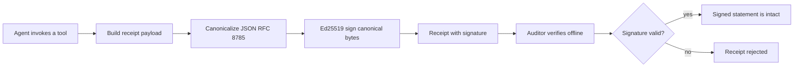
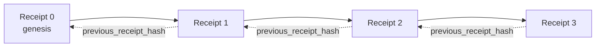

[Ver el video de la lección: Asegurando Agentes de IA con Recibos Criptográficos](https://youtu.be/PLACEHOLDER_VIDEO_ID)

> _(Video de la lección y miniatura serán añadidos por el equipo de contenido de Microsoft después de la fusión, siguiendo el patrón de las lecciones 14 / 15.)_

# Asegurando Agentes de IA con Recibos Criptográficos

## Introducción

Esta lección cubrirá:

- Por qué los registros de auditoría para agentes de IA son importantes para el cumplimiento, la depuración y la confianza.
- Qué es un recibo criptográfico y cómo se diferencia de una línea de registro sin firmar.
- Cómo producir un recibo firmado para la llamada de una herramienta de un agente en Python plano.
- Cómo verificar un recibo sin conexión y detectar manipulaciones.
- Cómo encadenar recibos para que eliminar o reordenar uno rompa la cadena.
- Qué prueban los recibos y qué explícitamente no prueban.

## Objetivos de Aprendizaje

Después de completar esta lección, sabrás cómo:

- Identificar los modos de falla que motivan la procedencia criptográfica para las acciones del agente.
- Producir un recibo firmado con Ed25519 sobre una carga útil JSON canónica.
- Verificar un recibo de forma independiente usando solo la clave pública del firmante.
- Detectar manipulaciones al volver a ejecutar la verificación sobre un recibo modificado.
- Construir una secuencia de recibos encadenados por hash y explicar por qué la cadena es importante.
- Reconocer el límite entre lo que los recibos prueban (atribución, integridad, orden) y lo que no prueban (corrección de la acción, solidez de la política).

## El Problema: El Registro de Auditoría de Tu Agente

Imagina que has desplegado un agente de IA para Contoso Travel. El agente lee solicitudes de clientes, llama a una API de vuelos para buscar opciones y reserva asientos en nombre del cliente. El último trimestre, el agente procesó 50,000 reservas.

Hoy llega un auditor. Hace una pregunta simple: "Muéstrame lo que hizo tu agente."

Entregas tus archivos de registro. El auditor los revisa y hace la pregunta más difícil: "¿Cómo sé que estos registros no fueron editados?"

Este es el problema del registro de auditoría. La mayoría de los despliegues de agentes hoy en día dependen de:

- **Registros de aplicaciones**: escritos por el mismo agente, editables por cualquiera con acceso al sistema de archivos.
- **Servicios de registro en la nube**: evidentes en cuanto a manipulaciones a nivel de plataforma, pero solo si el auditor confía en el operador de la plataforma.
- **Registros de transacciones de base de datos**: adecuados para cambios en bases de datos pero no para llamadas arbitrarias a herramientas.

Ninguno de estos puede responder a la pregunta del auditor sin requerir que el auditor confíe en alguien (tú, tu proveedor de nube, tu proveedor de base de datos). Para uso interno, esa confianza suele ser aceptable. Para cargas reguladas (finanzas, salud, cualquier cosa sujeta a la Ley de IA de la UE), no lo es.

Los recibos criptográficos reducen este problema haciendo que una declaración firmada sea verificable de forma independiente.
El auditor aún necesita una razón externa para confiar en la clave de firma y
en el componente que produjo la declaración. Una clave embebida prueba la auto-consistencia,
no la identidad del emisor ni la ubicación de la aplicación.

## ¿Qué es un Recibo Criptográfico?

Un recibo es un objeto JSON que registra lo que hizo un agente, firmado con una firma digital.



Un recibo mínimo se ve así:

```json
{
  "type": "agent.tool_call.v1",
  "agent_id": "contoso-travel-bot",
  "tool_name": "lookup_flights",
  "tool_args_hash": "sha256:a3f9c1...",
  "result_hash": "sha256:7b2e1d...",
  "policy_id": "contoso-travel-policy-v3",
  "timestamp": "2026-04-25T14:30:00Z",
  "sequence": 47,
  "previous_receipt_hash": "sha256:9d4e6a...",
  "signature": {
    "alg": "EdDSA",
    "sig": "c5af83...",
    "public_key": "8f3b2c..."
  }
}
```

Tres propiedades están haciendo el trabajo:

1. **La firma**. El recibo está firmado por la puerta de enlace del agente usando una clave privada Ed25519. Cualquiera con la clave pública correspondiente puede verificar la firma sin conexión. La parte que confía debe fijar esa clave o resolverla desde un registro confiable fuera del recibo. Manipular cualquier campo firmado invalida la firma.

2. **Codificación canónica**. Antes de firmar, el recibo se serializa usando el Esquema de Canonicalización JSON (JCS, RFC 8785). Esto asegura que dos implementaciones que produzcan el mismo recibo lógico generen una salida idéntica byte a byte. Sin la canonicalización, diferentes serializadores JSON producirían diferentes firmas para el mismo contenido.

3. **Encadenamiento por hash**. El campo `previous_receipt_hash` enlaza cada recibo con el anterior. Eliminar o reordenar un recibo rompe la secuencia presentada. Detectar truncamiento o una reescritura controlada por el firmante también requiere una cabeza de cadena actual fijada, un punto de control testigo independiente, o un compromiso autenticado de población cerrada.

Juntas, estas propiedades proporcionan tres garantías:

- **Atribución a una clave**: esta clave firmó este contenido. La identidad organizacional o humana requiere un vínculo de clave confiable.
- **Integridad**: el contenido no ha cambiado desde la firma.
- **Orden dentro de la secuencia verificada**: este recibo enlaza con ese predecesor.

## Produciendo un Recibo en Python

No necesitas una biblioteca especial para producir un recibo. Las primitivas criptográficas están ampliamente disponibles y la lógica son unas pocas docenas de líneas en Python.

Los ejercicios prácticos en `code_samples/18-signed-receipts.ipynb` recorren el flujo completo. El `code_samples/18-signed-receipts.execution-receipt.json` controlado por código fuente registra el hash exacto del cuaderno, el entorno Python, el número de celdas y las comprobaciones de la última ejecución limpia sin cambiar las salidas guardadas de la lección. La versión resumen:

```python
import json
import hashlib
import base64
from nacl import signing
from jcs import canonicalize  # RFC 8785 canonical JSON

def b64url_nopad(data: bytes) -> str:
    return base64.urlsafe_b64encode(data).decode("ascii").rstrip("=")

def sha256_canonical(obj) -> str:
    """SHA-256 of a Python object's JCS-canonical JSON form."""
    return f"sha256:{hashlib.sha256(canonicalize(obj)).hexdigest()}"

# Generate or load a signing key (in production, store in a key vault)
signing_key = signing.SigningKey.generate()
verify_key = signing_key.verify_key
TRUSTED_PUBLIC_KEYS = {b64url_nopad(bytes(verify_key))}  # pinned out of band by the verifier

# Build the receipt payload (no signature yet)
tool_args = {"origin": "SYD", "destination": "LAX"}
tool_result = [{"flight": "QF11", "price": 1850, "stops": 0}]

payload = {
    "type": "agent.tool_call.v1",
    "agent_id": "contoso-travel-bot",
    "tool_name": "lookup_flights",
    "tool_args_hash": sha256_canonical(tool_args),
    "result_hash": sha256_canonical(tool_result),
    "policy_id": "contoso-travel-policy-v3",
    "timestamp": "2026-04-25T14:30:00Z",
    "sequence": 0,
    "previous_receipt_hash": None,
}

# Canonicalize and sign the JCS bytes directly. PureEdDSA hashes internally.
canonical_bytes = canonicalize(payload)
signature_bytes = signing_key.sign(canonical_bytes).signature

# Attach a structured signature object.
receipt = {
    **payload,
    "signature": {
        "alg": "EdDSA",
        "sig": b64url_nopad(signature_bytes),
        "public_key": b64url_nopad(bytes(verify_key)),
    },
}
```

Ese es todo el pipeline de firma. Los ejercicios en el cuaderno recorren cada paso.

## Verificando un Recibo y Detectando Manipulación

La verificación es la operación inversa:

```python
import base64
import hashlib
from nacl import signing
from nacl.exceptions import CryptoError
from jcs import canonicalize

def b64url_decode(s: str) -> bytes:
    # Strict: Python's decoder skips characters outside the alphabet and also
    # accepts padding, the standard +/ alphabet and non-zero spare bits.
    # Re-encoding and comparing accepts only the one unpadded base64url form.
    padding = "=" * ((4 - len(s) % 4) % 4)
    data = base64.urlsafe_b64decode(s + padding)
    if base64.urlsafe_b64encode(data).decode("ascii").rstrip("=") != s:
        raise ValueError("not canonical unpadded base64url")
    return data

def verify_receipt(receipt: dict, trusted_public_key: str) -> bool:
    # trusted_public_key is the issuer's key, obtained from somewhere other
    # than this receipt. Never use receipt["signature"]["public_key"] here:
    # see "What Receipts Prove (and What They Do Not)" below.
    # Fails closed: anything malformed returns False instead of raising.
    if not isinstance(receipt, dict) or not isinstance(trusted_public_key, str):
        return False
    sig_obj = receipt.get("signature")
    if not isinstance(sig_obj, dict) or sig_obj.get("alg") != "EdDSA":
        return False
    sig_b64 = sig_obj.get("sig")
    if not isinstance(sig_b64, str):
        return False

    try:
        # Reconstruct the payload that was actually signed (everything except signature).
        payload = {k: v for k, v in receipt.items() if k != "signature"}
        canonical_bytes = canonicalize(payload)
        verify_key = signing.VerifyKey(b64url_decode(trusted_public_key))
        verify_key.verify(canonical_bytes, b64url_decode(sig_b64))
        return True
    except (CryptoError, TypeError, ValueError, KeyError, OverflowError):
        return False
    except Exception:
        # An undecodable key or signature, or a payload that cannot be
        # canonicalized: fail closed rather than raise.
        return False
```

Esta función toma un recibo y la clave pública del emisor, y devuelve `True` si la firma es válida y `False` de lo contrario, incluso cuando la entrada está malformada. Sin llamadas a la red ni servicios de verificación: una vez que tienes la clave del emisor, la verificación es completamente local y sin conexión. Lo que sí requiere es esa clave, obtenida de alguna fuente fuera del recibo mismo.

Para ver la detección de manipulaciones en acción, el cuaderno recorre:

1. Producción de un recibo válido y confirmación de que verifica.
2. Modificación de un byte del campo `tool_args_hash`.
3. Re-ejecución de la verificación y constatar que falla.
4. Manipulación de nuevo, pero esta vez re-firmando con una clave generada por el atacante e insertando esa clave en el recibo.

El paso 4 es el que vale la pena considerar. Ese recibo es internamente consistente: su firma es genuina para su contenido y para la clave que lleva, por lo que verifica contra la clave dentro de él. Sólo falla cuando se verifica contra la clave real del emisor. Los pasos 2 y 3 detectan a un atacante que no se molestó en re-firmar; el paso 4 detecta al que sí lo hizo.

Esta es la demostración práctica de que los recibos son evidentes en cuanto a manipulaciones: cualquier cambio a un campo firmado rompe la firma, siempre que verifiques contra una clave que el atacante no suministró. El objeto `signature` está fuera de los bytes firmados, por eso la clave con la que verificas debe provenir de algún otro lugar fuera del recibo.

## Encadenando Recibos para Agentes de Múltiples Pasos

Un solo recibo firmado protege una acción. Una cadena de recibos protege una secuencia.



Cada recibo registra el hash del recibo anterior. Para eliminar silenciosamente el recibo 2, un atacante necesitaría:

- Modificar el campo `previous_receipt_hash` del recibo 3 (rompe la firma del recibo 3), O
- Forjar una nueva firma en una versión modificada del recibo 3 (requiere la clave privada del agente).

Si la clave privada está en un almacén de claves hardware y los verificadores comprueban cada recibo contra la clave pública del emisor, obtenida de forma independiente (un conjunto JWK publicado o un valor de configuración fijado), ninguno de los ataques es viable sin ser detectado. Publicar la clave dentro de cada recibo no es suficiente: un atacante puede re-firmar con su propia clave e incrustarla en su lugar, que es la fixture `04_resigned_receipt.json`.

El cuaderno recorre:

1. Construir una cadena de tres recibos.
2. Verificar que el `previous_receipt_hash` de cada recibo coincide con el hash real del recibo anterior.
3. Manipular un recibo en el medio y ver que la cadena se rompe justo en ese punto.

Así es como produces un registro de auditoría que un auditor externo puede verificar bajo sus propias claves de emisor fijadas y puntos de control de cadena, sin confiar en tu registro mutable.


## Qué Prueban los Recibos (y Qué No)

Esta es la sección más importante de esta lección. Los recibos son poderosos pero su poder tiene límites.

**Los recibos prueban tres cosas:**

1. **Atribución**: una clave específica firmó una carga útil específica.
2. **Integridad**: la carga útil no ha cambiado desde la firma.
3. **Orden dentro de una secuencia presentada y verificada**: este recibo enlaza con ese predecesor.

**Los recibos NO prueban:**

1. **Corrección**: que la acción del agente fue la acción correcta. Un recibo puede firmarse para una respuesta errónea con la misma limpieza que para una correcta.
2. **Cumplimiento de la política**: que la política referenciada en `policy_id` fue realmente evaluada, o que habría permitido esta acción si se verificara. El recibo registra lo que se afirmó, no lo que se aplicó.
3. **Identidad más allá de la clave**: el recibo dice "esta clave firmó este contenido." No dice "este humano autorizó esto." Conectar una clave a una persona u organización requiere infraestructura de identidad separada (un directorio, un registro público de claves, etc.).
4. **Veracidad de las entradas**: si el agente recibe un aviso manipulado y actúa en consecuencia, el recibo registra la acción fielmente. Los recibos están después de la validación de entrada, no son un sustituto de ella.
5. **Ejecución o efecto en el mundo real**: un recibo posterior a la llamada registra lo que su emisor afirma que pasó. Probar admisión o reconciliar un efecto externo requiere evidencia del ejecutor o proveedor real.
6. **Completitud**: la ausencia de un recibo puede significar bloqueado, omitido, perdido o no instrumentado. La ausencia sólo se vuelve evidencia dentro de una población cerrada autenticada.
7. **Tiempo confiable**: una marca de tiempo firmada prueba que el firmante tuvo ese valor, no que el valor fuera correcto. El tiempo confiable necesita una autoridad de tiempo separada o un punto de control testigo.

**La clave en el recibo no es la clave con la que verificas.** Esto se sigue del punto 3, y es el único lugar donde la distinción debe cambiar tu código y no solo tu entendimiento. El `public_key` en el ejemplo arriba está ahí para que el ejemplo sea autónomo. Un verificador nunca debe confiar en él. Cualquiera puede tomar un recibo, alterarlo, firmarlo con una clave que generó, e incrustar esa clave; el resultado verifica perfectamente contra sí mismo. Eso es fixture `04_resigned_receipt.json` en `sample_receipts/`, y es por eso que `verify_receipt` arriba toma la clave como argumento en lugar de leerla del recibo. Obtén la clave del emisor de forma independiente, del conjunto JWK en la Lista de Producción abajo o de otro ancla que hayas fijado de antemano, y verifica contra esa. Una firma comprobada con una clave que llegó en el mismo sobre sólo prueba que el sobre es autoconsistente.

Este límite importa por dos razones:

- Te dice para qué son útiles los recibos: hacer que el comportamiento del agente sea auditable y evidente en cuanto a manipulaciones, incluso a través de fronteras organizacionales.
- Te dice qué capas adicionales aún necesitas: validación de entrada (Lección 6), aplicación de políticas (cubierto brevemente abajo), e infraestructura de identidad (fuera del alcance de esta lección).

Un error común es asumir que "tenemos recibos" significa "estamos gobernados". No es así. Los recibos son una base. La gobernanza es el sistema que construyes encima.

## Vinculando la Firma de un Aprobador a la Acción Exacta

El punto 3 arriba merece su propia sección: un recibo de acción dice "esta clave firmó este contenido," nunca "un humano autorizó esto." Para acciones de alto riesgo (reembolsos, eliminaciones, transferencias bancarias), una firma aprobadora separada puede vincular la acción exacta. Conectar esa clave a un humano y verificar su presencia siguen siendo responsabilidades separadas.

El cuaderno siguiente `code_samples/human-authorization-receipts.ipynb` añade un segundo tipo de recibo, `human.approval.v1`, en la misma forma de sobre que los recibos de la lección (una carga útil tipada firmada por Ed25519 sobre sus bytes JCS canónicos, con el objeto `signature` fuera de los bytes firmados). Una clave aprobadora firma la **acción canónica completa y su resumen**; una clave del agente firma una afirmación que lleva el **mismo resumen de acción** y un `parent_approval_ref`, el `receipt_hash` de la aprobación, la misma convención que `previous_receipt_hash` en la cadena que construiste arriba. Un `verify_chain` recorre ambos artefactos bajo **registros de claves fijados separados** (claves aprobadoras vs claves de agentes), así que la ruta del código es compartida, pero las autoridades nunca lo son.

La propiedad que esto aporta, dicho cuidadosamente: *la clave aprobadora fijada firmó esta acción exacta,
y la clave del agente después firmó una declaración que lleva el mismo resumen de acción.*
Eso es evidencia útil, pero no es por sí solo prueba de que la acción fue ejecutada. Para
controlar la ejecución, la aprobación exacta también debe reservarse y consumirse una vez en el
límite del ejecutor real; los resultados del proveedor desconocido deben permanecer desconocidos en lugar de ser
repetidos a ciegas. Las fixtures de rechazo del cuaderno prueban la capa de cadena de recibos:

- manipulación, confusión de intermediarios, claves falsificadas en cualquiera de los lados, e input malformado;
- **autoridad obsoleta**: una firma que aún verifica, rechazada de todos modos porque la versión de la política cambió, la clave aprobadora fue rotada fuera del registro fijado, o la aprobación expiró antes del tiempo de verificación suministrado;
- **sustitución de resumen**: un recibo de acción válido firmado que apunta a una *aprobación real* que vincula una *acción canónica diferente*.

Cada fallo rechaza con una razón distinta, así que un auditor leyendo un rechazo puede saber si la autoridad se volvió obsoleta o si la acción reclamada cambió. La verificación es solo lectura y repetible: no consume la aprobación ni invoca un proveedor. Un ejecutor separado necesita protección duradera y atómica contra la repetición y resultados explícitos de éxito, fallo e indeterminación. El recibo de aprobación humana es una composición educativa definida por esta lección, no un tipo de recibo definido por `draft-farley-acta-signed-receipts`.

## Referencias para Producción

El código Python en esta lección es intencionalmente mínimo para que puedas leer cada línea y entender exactamente qué está sucediendo. En producción, tienes dos opciones:

1. **Construir directamente sobre las primitivas criptográficas.** Las 50 líneas que viste arriba son suficientes para muchos casos de uso. PyNaCl (Ed25519) y el paquete `jcs` (JSON canónico) son bibliotecas bien mantenidas y auditadas.

2. **Usar una biblioteca de recibos en producción.** Varios proyectos de código abierto implementan el mismo patrón con características adicionales (rotación de claves, verificación por lotes, distribución de conjuntos JWK, integración con motores de políticas):
   - La cadena de firma usa las convenciones JCS y ámbito de firma en un borrador independiente de IETF Internet-Draft ([`draft-farley-acta-signed-receipts`](https://datatracker.ietf.org/doc/draft-farley-acta-signed-receipts/), revisión 02). El recibo educativo plano de esta lección difiere del sobre `{payload, signature}` del borrador y no se presenta como una implementación conforme. El borrador publica un conjunto compartido de pruebas de conformidad ([agent-governance-testvectors](https://github.com/ScopeBlind/agent-governance-testvectors)) para implementaciones que apuntan a su formato wire.
   - El Microsoft Agent Governance Toolkit compone recibos con decisiones políticas basadas en Cedar; consulta el Tutorial 33 en ese repositorio para un ejemplo de extremo a extremo.
   - Los paquetes `protect-mcp` (npm) y `@veritasacta/verify` (npm) proporcionan una implementación basada en Node para la firma de recibos y verificación offline, diseñada para envolver cualquier servidor MCP con una auditoría a prueba de manipulaciones, incluyendo un flujo de retención para co-firma en el que una acción pausada emite un recibo de aprobación vinculado al digest de la acción (respaldado por WebAuthn en el flujo de escritorio), el mismo patrón de recibo de aprobación que el cuaderno de autorización humana anteriormente mencionado.
   - El **[nobulex](https://github.com/arian-gogani/nobulex)** SDK de Python (`pip install nobulex`) proporciona el mismo patrón de firma Ed25519 + JCS en Python con integraciones de LangChain y CrewAI, incluyendo vectores de prueba de validación cruzada publicados y un mapeo de cumplimiento aportado vía [OWASP PR #2210](https://github.com/OWASP/CheatSheetSeries/pull/2210).
   - **[Protocolo EMILIA](https://github.com/emiliaprotocol/emilia-protocol)** proporciona una capa complementaria de aplicación de acción exacta: recibos de aprobación verificables offline, autoridad pinneada de WebAuthn o quórum, consumo único en el límite del ejecutor y una ruta explícita de resultado indeterminado. Sus adaptadores de marco tratan un recibo como evidencia necesaria en lugar de prueba de que ocurrió un efecto externo.

La decisión entre crear el propio y usar una biblioteca refleja la decisión entre escribir tu propia biblioteca JWT y usar una probada: ambas son razonables; la biblioteca ahorra tiempo y reduce la superficie de auditoría; el enfoque desde cero te obliga a entender cada primitivo. Esta lección enseña el camino desde cero para que tengas la base para cualquier elección.

## Verificación de Conocimientos

Pon a prueba tu comprensión antes de pasar al ejercicio práctico.

**1. Un recibo está firmado con la clave privada Ed25519 del agente. El auditor solo tiene la clave pública. ¿Puede el auditor verificar el recibo offline?**

<details>
<summary>Respuesta</summary>

Sí, la verificación criptográfica solo requiere la clave pública y los bytes firmados. El
auditor aún debe obtener y fijar la clave pública aceptada independientemente del recibo.
No se requiere ninguna llamada de red después de que esa configuración de confianza esté establecida.
</details>

**2. Un atacante modifica el campo `policy_id` de un recibo para afirmar que estuvo regido por una política más permisiva. La firma fue sobre la carga original. ¿Qué sucede durante la verificación?**

<details>
<summary>Respuesta</summary>

La verificación falla. La firma se calculó sobre los bytes canónicos de la carga original; modificar cualquier campo de la carga cambia esos bytes, haciendo que la firma sea inválida. El atacante necesitaría la clave privada para producir una firma válida nueva, la cual no posee.
</details>

**3. ¿Por qué el recibo incluye un `tool_args_hash` y `result_hash` en lugar de los argumentos y resultados sin procesar?**

<details>
<summary>Respuesta</summary>

Dos razones. Primero, el recibo puede necesitar archivarse o transmitirse en ambientes donde filtrar el contenido sin procesar (PII, datos empresariales) es un problema. El hash mantiene el recibo pequeño y el contenido privado; el auditor verifica que el hash coincida con una copia almacenada por separado del contenido real. Segundo, los hashes tienen tamaño fijo; un recibo con hashes tiene un tamaño limitado sin importar qué tan grandes hayan sido las entradas y salidas.
</details>

**4. El campo `previous_receipt_hash` vincula cada recibo con su predecesor. Si un atacante elimina silenciosamente un recibo en medio de una cadena, ¿qué se vuelve inválido?**

<details>
<summary>Respuesta</summary>

Cada recibo posterior al eliminado. Sus campos `previous_receipt_hash` ya no coinciden con la cadena real (porque el recibo al que referenciaban ya no existe, o la cadena ahora apunta a un predecesor diferente). Para ocultar la eliminación, el atacante tendría que volver a firmar cada recibo posterior, lo que requiere la clave privada del emisor. Una refirma con cualquier otra clave falla cuando se verifica contra la clave del emisor.
</details>

**5. Un recibo verifica sin errores. ¿Prueba eso que la acción del agente fue correcta, adecuada o conforme a la política?**

<details>
<summary>Respuesta</summary>

No. Bajo una clave fijada y contexto de cadena, un recibo válido prueba atribución de firma,
integridad de contenido y un vínculo con el predecesor presentado. NO prueba que la
acción fue correcta o se ejecutó, que la política fue evaluada, que la marca temporal es
confiable, o que el conjunto de registros está completo. Este es el límite más importante en la lección.
</details>

## Ejercicio Práctico

Abre `code_samples/18-signed-receipts.ipynb` y completa las cuatro secciones:

1. **Sección 1**: Firma tu primer recibo y verifícalo.
2. **Sección 2**: Alterar el recibo y observar que falle la verificación.
3. **Sección 3**: Construir una cadena de tres recibos y verificar la integridad de la cadena.
4. **Sección 4**: Aplicar el patrón a un agente construido con Microsoft Agent Framework: envolver una llamada a herramienta en la firma de recibos, luego verificar el recibo independientemente.

**Desafío adicional 1:** extiende el esquema de recibo con un campo adicional de tu elección (por ejemplo, un ID de solicitud para trazabilidad), actualiza la lógica canónica de firma para incluirlo, y confirma que el recibo todavía pasa la verificación sin errores. Luego modifica el campo después de la firma y confirma que la verificación falla. Esto te obliga a comprender cómo cada byte de la codificación canónica contribuye a la firma.

**Desafío avanzado 2:** Aplica SHA-256 a dos de tus recibos juntos (concatena sus bytes canónicos en un orden determinista) e inserta el resumen resultante como un nuevo campo en un tercer recibo antes de firmarlo. Verifica que los tres recibos aún puedan ser validados. Acabas de construir una prueba de inclusión en un solo paso: cualquiera que tenga el tercer recibo puede demostrar que los dos primeros existían en el momento en que fue firmado, sin necesidad de revelar su contenido. Este es el patrón que usan los recibos de divulgación selectiva a gran escala (compromisos Merkle, RFC 6962).

## Conclusión

Los recibos criptográficos proporcionan a los agentes de IA un rastro de auditoría que es:

- **Verificable independientemente bajo confianza fijada**: una parte con claves públicas aceptadas y bytes firmados puede verificar sin dependencia de un servicio.
- **Evidente frente a manipulaciones**: cualquier modificación invalida la firma.
- **Portátil**: un recibo es un archivo JSON pequeño; puede archivarse, transmitirse y verificarse en cualquier lugar.
- **Alineado con estándares**: construido sobre Ed25519 (RFC 8032), JCS (RFC 8785) y SHA-256, todos primitivas ampliamente implementadas.

No son un sustituto para la validación de entradas, la aplicación de políticas, la admisión del ejecutor,
la evidencia de resultados, los controles de exhaustividad o la infraestructura de identidad. Son una base
para esas capas. En flujos regulados o multi-organización, los recibos hacen que las declaraciones específicas
del emisor sean verificables independientemente bajo la configuración de confianza del auditor.

La idea más importante: los recibos prueban que una clave particular firmó contenido particular. Una
marca temporal incluida es una afirmación del firmante a menos que se haya atestiguado temporalmente por separado. Un
recibo no prueba que su contenido fuera verdadero, que una acción se ejecutó, o que el
conjunto de registros esté completo. Mantén esas distinciones claras.

## Lista de verificación para producción

Cuando estés listo para avanzar desde esta lección y desplegar agentes firmados con recibos en un entorno real:

- [ ] **Mueve la clave de firma fuera de la laptop del desarrollador.** Usa Azure Key Vault, AWS KMS o un módulo de seguridad hardware. La clave privada que firma tus recibos nunca debe vivir en control de código fuente ni en texto plano en máquinas de aplicación.
- [ ] **Establece la confianza en la clave verificadora.** Publica las claves mediante un Conjunto JWK o registro, luego haz que las partes dependientes fijen la identidad del emisor aceptada, el conjunto de claves y la política de rotación fuera de los recibos individuales. Una clave inline sola no es un ancla de confianza.
- [ ] **Ancla la cadena externamente.** Periódicamente escribe el último hash de la cabeza de la cadena en un registro de transparencia (Sigstore Rekor, autoridad de marca temporal RFC 3161 o un segundo sistema interno) para que una parte externa pueda confirmar "esta cadena existió en este momento."
- [ ] **Almacena los recibos de forma inmutable.** El almacenamiento de blobs solo para añadir (Azure Storage con políticas de inmutabilidad, AWS S3 Object Lock) impide que un interno reescriba la historia a nivel de almacenamiento.
- [ ] **Decide sobre la retención.** Muchos regímenes de cumplimiento requieren retención por varios años. Planea para el crecimiento de recibos (cada recibo es ~500 bytes; un agente haciendo 10.000 llamadas por día produce ~1.8 GB por año).
- [ ] **Documenta lo que los recibos no cubren.** Los recibos prueban atribución, integridad y orden. Tu manual operativo debe listar explícitamente qué controles adicionales (validación de entrada, aplicación de políticas, limitación de tasa, infraestructura de identidad) complementan a los recibos en tu postura de gobernanza.

### ¿Tienes más preguntas sobre asegurar agentes de IA?

Únete al [Microsoft Foundry Discord](https://aka.ms/ai-agents/discord) para encontrarte con otros aprendices, asistir a horas de oficina y obtener respuestas a tus preguntas sobre agentes de IA.

## Más allá de esta lección

Esta lección cubre la firma de recibos individuales y secuencias encadenadas por hashes. Las mismas primitivas componen varios patrones más avanzados que puedes encontrar a medida que madura tu postura de gobernanza:

- **Divulgación selectiva.** Cuando los campos de un recibo están comprometidos de forma independiente (árbol Merkle estilo RFC 6962), puedes revelar campos específicos a auditores específicos y probar que los demás no han cambiado sin exponerlos. Útil cuando un mismo recibo debe satisfacer tanto una auditoría completa (que quiere exhaustividad) como regulaciones de minimización de datos como GDPR (que quieren que el auditor vea lo menos posible).
- **Revocación de recibos.** Si una clave de firma se compromete, necesitas una manera de marcar todos los recibos firmados por esa clave como no confiables desde un punto en el tiempo en adelante. Patrones estándar: claves de firma de corta duración más una lista de revocación publicada, o un registro de transparencia con entradas de revocación.
- **Recibos con firma bilateral / dividida.** Algunas implementaciones dividen la carga útil firmada en mitades pre-ejecución (`authorization_*`) y post-ejecución (`result_*`) con firmas independientes, útil cuando la decisión de autorización y el resultado observado son producidos por actores diferentes o en tiempos diferentes. Esto se compone aditivamente sobre el formato de recibo enseñado en esta lección.
- **Composición de carga útil.** Un recibo sella cualquier byte que pongas en `result_hash`. Las cargas útiles del mundo real suelen ser más ricas que un solo resultado de llamada a una herramienta: el razonamiento previo a la decisión (predicción del modelo, opciones consideradas, evidencia y su exhaustividad, postura de riesgo, cadena de responsabilidad, resultado de la puerta) pueden residir dentro de la carga útil, sellados por un solo recibo. Esto mantiene el formato del recibo mínimo mientras permite que los esquemas de carga útil evolucionen dominio a dominio.
- **Conformidad entre implementaciones.** Múltiples implementaciones independientes del mismo formato de recibo (Python, TypeScript, Rust, Go) verifican entre sí con vectores de prueba compartidos. Si construyes tu propia implementación, validar contra vectores publicados confirma compatibilidad de protocolo.
- **Migración post-cuántica.** Ed25519 se usa ampliamente hoy, pero no es resistente a la computación cuántica. Una simple etiqueta `alg` no es migración: un perfil debe definir la codificación de clave ML-DSA, bytes canónicos firmados, verificación, política del partícipe confiable, resistencia a degradación y semánticas de transición. Planifica y prueba una transición de firma dual contra vectores compartidos antes de hacer afirmaciones de compatibilidad.

## Recursos adicionales

- <a href="https://datatracker.ietf.org/doc/draft-farley-acta-signed-receipts/" target="_blank">Borrador IETF: Recibos de Decisión Firmados para Control de Acceso Máquina a Máquina</a>
- <a href="https://learn.microsoft.com/azure/ai-studio/responsible-use-of-ai-overview" target="_blank">Resumen de IA Responsable (Azure AI)</a>
- <a href="https://datatracker.ietf.org/doc/html/rfc8032" target="_blank">RFC 8032: Algoritmo de Firma Digital Edwards-Curve (EdDSA)</a>
- <a href="https://datatracker.ietf.org/doc/html/rfc8785" target="_blank">RFC 8785: Esquema de Canonicalización JSON (JCS)</a>
- <a href="https://datatracker.ietf.org/doc/html/rfc6962" target="_blank">RFC 6962: Transparencia de Certificados</a> (construcción de árbol Merkle usada por recibos de divulgación selectiva)
- <a href="https://github.com/microsoft/agent-governance-toolkit/blob/main/docs/tutorials/33-offline-verifiable-receipts.md" target="_blank">Kit de Herramientas de Gobernanza de Agentes de Microsoft, Tutorial 33: Recibos de Decisión Verificables Offline</a>
- <a href="https://github.com/ScopeBlind/agent-governance-testvectors" target="_blank">Vectores de prueba de conformidad entre implementaciones</a> para el formato de recibo usado en esta lección (Apache-2.0)
- <a href="https://pynacl.readthedocs.io/" target="_blank">Documentación de PyNaCl</a> (Ed25519 en Python)

## Lección Anterior

[Creación de agentes de IA locales](../17-creating-local-ai-agents/README.md)

---

<!-- CO-OP TRANSLATOR DISCLAIMER START -->
**Descargo de responsabilidad**:
Este documento ha sido traducido utilizando el servicio de traducción automática [Co-op Translator](https://github.com/Azure/co-op-translator). Aunque nos esforzamos por la precisión, tenga en cuenta que las traducciones automatizadas pueden contener errores o inexactitudes. El documento original en su idioma nativo debe considerarse la fuente autorizada. Para información crítica, se recomienda una traducción profesional humana. No somos responsables de cualquier malentendido o interpretación errónea que surja del uso de esta traducción.
<!-- CO-OP TRANSLATOR DISCLAIMER END -->