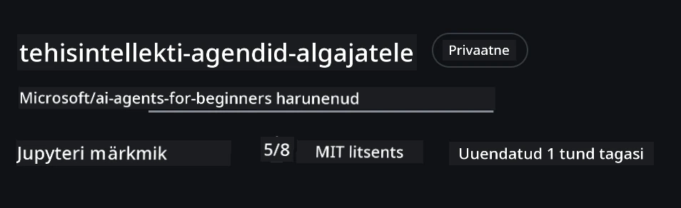
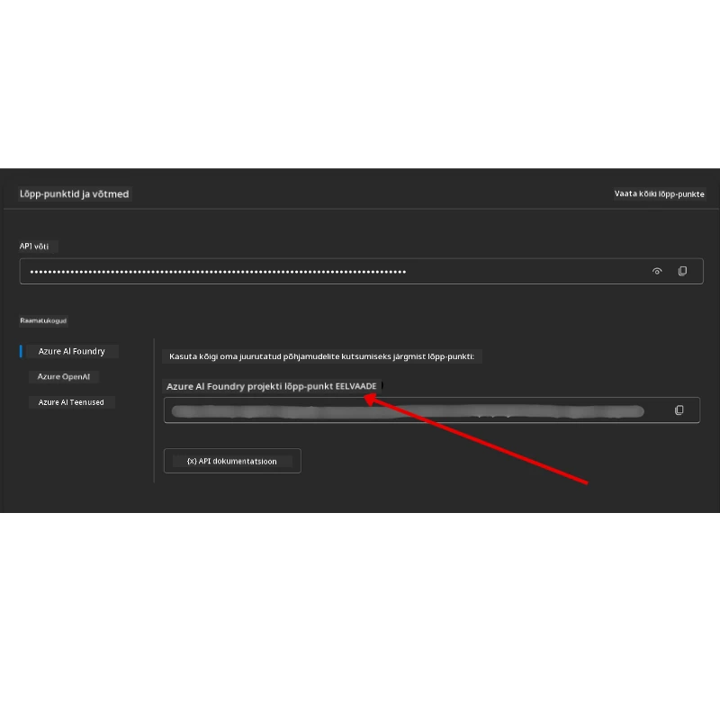

# Kursuse seadistamine

## Sissejuhatus

See õppetund käsitleb, kuidas käivitada selle kursuse koodi näited.

## Liitu teiste õppijatega ja saa abi

Enne oma repo kloonimist liitu [AI Agents For Beginners Discord kanaliga](https://aka.ms/ai-agents/discord), et saada abi seadistamisel, esitada kursuse kohta küsimusi või suhelda teiste õppijatega.

## Klooni või Forki see Repo

Alustamiseks palun klooni või loo fork GitHubi repositooriumist. See loob sulle kursusmaterjalist omaenda versiooni, mida saad käivitada, testida ja kohandada!

Seda saab teha, klõpsates lingil <a href="https://github.com/microsoft/ai-agents-for-beginners/fork" target="_blank">forki repo</a>

Nüüd peaks sul olema oma forkitud versioon sellest kursusest järgmisel lingil:



### Madala sügavusega kloon (soovitatav töötoa / Codespaces jaoks)

  >Täielik repositoorium võib olla suur (~3 GB), kui laadid alla kogu ajaloo ja kõik failid. Kui osaled ainult töökojas või vajad ainult mõnda õppetunni kausta, laadib madala sügavusega kloon (või hõre kloon) palju vähem alla.

#### Kiire madala sügavusega kloon — minimaalne ajalugu, kõik failid

Asenda allpool käskudes `<your-username>` oma fork'i URL-iga (või upstream URL-iga, kui eelistad).

Klooni ainult uusim commit'i ajalugu (väike allalaadimine):

```bash
git clone --depth 1 https://github.com/<your-username>/ai-agents-for-beginners.git
```

Klooni konkreetne haru:

```bash
git clone --depth 1 --branch <branch-name> https://github.com/<your-username>/ai-agents-for-beginners.git
```

#### Osaline (hõre) kloon — minimaalsed failid + ainult valitud kaustad

Kasutab osalist kloonimist ja sparse-checkout'i (nõuab Git 2.25+ ning soovitatav on kaasaegne Git osalise kloonimise toetusega):

```bash
git clone --depth 1 --filter=blob:none --sparse https://github.com/<your-username>/ai-agents-for-beginners.git
```

Liigu repositooriumi kausta:

```bash
cd ai-agents-for-beginners
```

Seejärel määra, milliseid kaustu soovid (näites kaks kausta):

```bash
git sparse-checkout set 00-course-setup 01-intro-to-ai-agents
```

Pärast kloonimist ja failide kontrollimist, kui vajad ainult faile ja soovid ruumi vabastada (ilma git-ajaloota), palun kustuta repositooriumi metadata (💀tagasipöördumatu — kaotad kogu Git funktsionaalsuse):

```bash
# zsh/bash
rm -rf .git
```

```powershell
# PowerShell
Remove-Item -Recurse -Force .git
```

#### GitHub Codespaces'i kasutamine (soovitatav, et vältida suuri lokaalseid allalaadimisi)

- Loo see repo jaoks uus Codespace [GitHub kasutajaliidese kaudu](https://github.com/codespaces).  

- Uue loodud codespace'i terminalis käivita üks eelpool mainitud madala/hõreda klooni käskudest, et tuua Codespace'i tööruumi ainult vajalikud õppetunni kaustad.
- Valikuline: pärast kloonimist Codespaces sees eemalda .git, et vabastada lisaruumi (vt ülal olevad eemaldamiskäsklused).
- Märkus: Kui eelistad avada repo otse Codespaces (ilma eraldi kloonita), siis arvesta, et Codespaces loob arenduskonteineri keskkonna ning võib siiski koondada rohkem, kui vajad.

#### Näpunäited

- Asenda alati klooni URL oma fork'i URL-iga, kui soovid muuta/kinnitusi teha.
- Kui vajad hiljem rohkem ajalugu või faile, saad need alla tõmmata või kohandada sparse-checkout'i, et lisada täiendavaid kaustu.

## Koodi käivitamine

See kursus pakub mitut Jupyter Notebooki, mida saad kasutada AI agentide praktiliseks õppimiseks.

Koodi näited kasutavad **Microsoft Agent Frameworki (MAF)** koos `FoundryChatClient`, mis ühendub **Microsoft Foundry Agent Service V2** (Response API) kaudu **Microsoft Foundry’st**.

Kõik Python notebookid on märgistatud `*-python-agent-framework.ipynb`.

## Nõuded

- Python 3.12+
  - **MÄRKUS**: Kui sul ei ole Python3.12 installitud, palun paigalda see. Seejärel loo oma virtuaalõhkkond python3.12-ga, et tagada nõutud versioonide paigaldamine requirements.txt failist.
  
    >Näide

    Loo Python virtuaalõhkkonna kataloog:

    ```bash
    python -m venv venv
    ```

    Seejärel aktiveeri virtuaalõhkkond järgnevate jaoks:

    ```bash
    # zsh/bash
    source venv/bin/activate
    ```
  
    ```dos
    # Command Prompt for Windows
    venv\Scripts\activate
    ```

- .NET 10+: Näidiskoodide jaoks, mis kasutavad .NET, veendu, et oled installinud [.NET 10 SDK](https://dotnet.microsoft.com/download/dotnet/10.0) või uuema. Kontrolli installitud .NET SDK versiooni:

    ```bash
    dotnet --list-sdks
    ```

- **Azure CLI** — Nõutav autentimiseks. Paigalda aadressilt [aka.ms/installazurecli](https://aka.ms/installazurecli).
- **Azure tellimus** — Microsoft Foundry ja Microsoft Foundry Agent Service juurdepääsuks.
- **Microsoft Foundry projekt** — Projekt koos juurutatud mudeliga (nt `gpt-5-mini`). Vaata allpool olevaid [sammu 1](#step-1-create-a-microsoft-foundry-project).

Oleme lisanud selle repositooriumi juurkausta `requirements.txt` faili, mis sisaldab kõiki vajalikke Python pakette koodi näidete käivitamiseks.

Saad need paigaldada, käivitades oma terminalis repositooriumi juurkaustas järgmise käsu:

```bash
pip install -r requirements.txt
```

Soovitame luua Python virtuaalõhkkonna, et vältida konflikte ja probleeme.

## VSCode seadistamine

Veendu, et VSCode kasutab õiget Python versiooni.


## Microsoft Foundry ja Microsoft Foundry Agent Service seadistamine

### Samm 1: Loo Microsoft Foundry projekt

Selleks, et neid notebooke käivitada, vajad Microsoft Foundry **projekti** koos juurutatud mudeliga. Loo projekt otse Microsoft Foundry keskkonnas; hubi ei ole vaja.

1. Mine aadressile [ai.azure.com](https://ai.azure.com) ja logi sisse oma Azure kontoga.
2. Vali **Create project** ja järgi juhiseid oma projekti loomiseks.
3. Projektis juuruta mudel (nt `gpt-5-mini`) menüüs **Models + Endpoints** → **Deploy model**.

### Samm 2: Leia oma projekti lõpp-punkt ja mudeli juurutamise nimi

Oma projektist Microsoft Foundry portaali kaudu:

- **Project Endpoint** — Mine lehele **Overview** ja kopeeri lõpp-punkti URL.



- **Model Deployment Name** — Mine **Models + Endpoints** ja vali oma juurutatud mudel, ning märgi üles **Deployment name** (nt `gpt-5-mini`).

### Samm 3: Logi sisse Azure'i käsurealiidese kaudu `az login`

Enamik notebooke autentib läbi sinu **Azure CLI sisselogimise** — kasutades `AzureCliCredential` või `DefaultAzureCredential` (mõlemad kasutavad sinu `az login` sessiooni) paketist `azure-identity` — seega ei ole vaja API võtmeid. Mõned õppetunnid ja valikulised integratsioonid kasutavad API võtmeid; kontrolli iga õppetunni eeltingimusi võimalike täiendavate keskkonnamuutujate osas. Selleks on vaja olla Azure CLI kaudu sisse loginud.

1. **Paigalda Azure CLI**, kui sa pole seda veel teinud: [aka.ms/installazurecli](https://aka.ms/installazurecli)

2. **Logi sisse** käsuga:

    ```bash
    az login
    ```

    Või kui oled kaug- või Codespace keskkonnas ilma brauserita:

    ```bash
    az login --use-device-code
    ```

3. **Vali tellimus**, kui küsitakse — vali see, kus paikneb sinu Foundry projekt.

4. **Kontrolli**, et oled sisse logitud:

    ```bash
    az account show
    ```

> **Miks `az login`?** Notebookid autentivad kasutades `AzureCliCredential` (või `DefaultAzureCredential`, mis samuti kasutab sinu Azure CLI sisselogimist) paketist `azure-identity`. See tähendab, et sinu Azure CLI sessioon annab mandaadid — sinu `.env` faili ei pea panema API võtmeid ega salasõnu. See on [turvalisuse parim tava](https://learn.microsoft.com/azure/developer/ai/keyless-connections).

### Samm 4: Loo oma `.env` fail

Kopeeri näidisfail:

```bash
# zsh/bash
cp .env.example .env
```

```powershell
# PowerShell
Copy-Item .env.example .env
```

Ava `.env` ja täida need kaks väärtust:

```env
AZURE_AI_PROJECT_ENDPOINT=https://<your-project>.services.ai.azure.com/api/projects/<your-project-id>
AZURE_AI_MODEL_DEPLOYMENT_NAME=gpt-5-mini
```

| Muutuja | Kus leida |
|----------|-----------------|
| `AZURE_AI_PROJECT_ENDPOINT` | Foundry portaali → sinu projekt → **Overview** leht |
| `AZURE_AI_MODEL_DEPLOYMENT_NAME` | Foundry portaali → **Models + Endpoints** → sinu juurutatud mudeli nimi |

Enamiku õppetundide jaoks ongi kõik! Notebookid autentivad automaatselt läbi sinu `az login` sessiooni.

### Samm 5: Paigalda Python sõltuvused

```bash
pip install -r requirements.txt
```

Soovitame käivitada selle virtuaalõhkkonnas, mille varem lõid.

## Valikuline seadistus: Azure AI otsing (õppetunnid 5 ja 16)

Õppetunnid 5 (Agentic RAG) ja 16 töötavad kohe välja karbist koos **mälu-põhise teadmistebaasiga** — lisaks Azure ressursse pole vaja. Kui soovite neid varustada päris **Azure AI Search** indeksiga, pange tähele, et **Õppetunni 16 märkmik kasutab praegu võtmel põhinevat autentimist**: see lülitub mälus otsingult Azure AI Searchile ainult siis, kui on määratud **nii** `AZURE_SEARCH_SERVICE_ENDPOINT` **kui** `AZURE_SEARCH_API_KEY`, muidu jääb mälus otsingule — seega päris indeksi vastu töötamiseks tuleb määrata ka administraatori võti. Võtmeta autentimine Microsoft Entra ID-ga (RBAC) on soovitatav lähenemine teie enda tootmiskoodi jaoks, mis on kooskõlas kogu kursuses mujal kasutatava `az login` protsessiga.

Alljärgnevad RBAC sammud kehtivad seadistamisjuhendi näidistele ja teie enda koodile. Need ei võimalda võtmeta autentimist Õppetunni 16 märkmikus; Õppetunni 16 jaoks on Azure AI Search kasutamiseks endiselt vajalikud nii lõpp-punkt kui administraatori võti.

1. **Lülitage sisse rollipõhine juurdepääs** oma otsinguteenusel:

    ```bash
    az search service update --name <service-name> --resource-group <resource-group> --auth-options aadOrApiKey
    ```

2. **Määrake endale vajalikud rollid** (indekseid loomine/laadimine ja päringute tegemine):

    ```bash
    az role assignment create --assignee <your-user-or-principal-id> --role "Search Service Contributor" --scope $(az search service show -g <resource-group> -n <service-name> --query id -o tsv)
    az role assignment create --assignee <your-user-or-principal-id> --role "Search Index Data Contributor" --scope $(az search service show -g <resource-group> -n <service-name> --query id -o tsv)
    ```

3. **Lisage lõpp-punkt** oma `.env` faili:

| Muutuja | Kus leida |
|----------|-----------------|
| `AZURE_SEARCH_SERVICE_ENDPOINT` | Azure portaal → teie **Azure AI Search** ressurss → **Ülevaade** → URL |
| `AZURE_SEARCH_API_KEY` | Nõutud (lõpp-punktiga koos), et lubada Azure AI Search Õppetunni 16 märkmikus, mis kasutab võtmel põhinevat autentimist. Azure portaal → **Seaded** → **Võtmed** → peamine administraatori võti |

> **Miks võtmeta?** Administraatori võtmed annavad täieliku kirjutamisõiguse teie otsinguteenusele ja võivad lekkida kaudu `.env` failid. RBAC kasutamisel kasutatakse teie `az login` identiteeti — sama võtmeta Entra ID mustrit, mida kursuse märkmikud kasutavad (kõrgemal tasemel kaudu `AzureCliCredential` / `DefaultAzureCredential`). Vaadake [Ühendamine Azure AI Searchiga rollide abil](https://learn.microsoft.com/azure/search/search-security-rbac).

Täielike indeksi loomise näidete jaoks Pythonis ja .NETis vt [Azure AI Search seadistamisjuhendit](./AzureSearch.md).

## Täiendav seadistus õppetundidele, mis kutsuvad Azure OpenAI otse (õppetunnid 6 ja 8)

Mõned õppetunni 6 ja 8 märkmikud kutsuvad **Azure OpenAI** otse (kasutades **Responses API-d**) ilma Microsoft Foundry projekti vahenduseta. Need näited kasutasid varem GitHubi mudeleid, mis on aegunud ja ei toeta Responses API-d. Lisage need muutujad oma `.env` faili:

| Muutuja | Kus leida |
|----------|-----------------|
| `AZURE_OPENAI_ENDPOINT` | Azure portaal → teie **Azure OpenAI** ressurss → **Võtmed ja lõpp-punkt** → Lõpp-punkt (nt `https://<your-resource>.openai.azure.com`) |
| `AZURE_OPENAI_DEPLOYMENT` | Teie juurutatud mudeli nimi (nt `gpt-5-mini`), mis toetab Responses API-d |
| `AZURE_OPENAI_API_KEY` | Valikuline — ainult juhul, kui kasutate võtme-põhist autentimist asemel `az login` / Entra ID-d |

> Responses API kasutab stabiilset `/openai/v1/` lõpp-punkti, seega pole `api-version` vajalik. Logige sisse `az login` abil, et kasutada võtmeta Entra ID autentimist.

## Alternatiivne pakkuja: MiniMax (OpenAI-ga ühilduv)

[MiniMax](https://platform.minimaxi.com/) pakub suure kontekstiga mudeleid (kuni 204K tokenit) OpenAI-ga ühilduva API kaudu. Kuna Microsoft Agent Framework'i `OpenAIChatClient` töötab mis tahes OpenAI-ga ühilduva lõpp-punktiga, saab MiniMaxi kasutada õppetundides, mis kasutavad `OpenAIChatClient`, kui sisuliseks alternatiiviks.

Lisage need muutujad oma `.env` faili:

| Muutuja | Kus leida |
|----------|-----------------|
| `MINIMAX_API_KEY` | [MiniMax Platform](https://platform.minimaxi.com/) → API võtmed |
| `MINIMAX_BASE_URL` | Kasutage `https://api.minimax.io/v1` (vaikimisi väärtus) |
| `MINIMAX_MODEL_ID` | Mudeli nimi, mida kasutada (nt `MiniMax-M3`) |

**Näidismudelid**: `MiniMax-M3` (soovitatav), `MiniMax-M2.7`, `MiniMax-M2.7-highspeed` (kiiremad vastused). Mudelitenimed ja kättesaadavus võivad ajas muutuda ning konkreetse mudeli kasutamine võib sõltuda teie kontost.

Koodinäited, mis kasutavad `OpenAIChatClient` (nt Õppetund 14 hotelli broneerimise töövoog), tuvastavad ja kasutavad automaatselt teie MiniMaxi konfiguratsiooni, kui on määratud `MINIMAX_API_KEY`.

## Alternatiivne pakkuja: Novita AI (OpenAI-ga ühilduv)

[Novita AI](https://novita.ai/llm-api) pakub OpenAI-ga ühilduvat API-d avatud lähtekoodiga ja pioneerilikeks LLM-ideks (DeepSeek, Llama, Qwen ja teised). Kuna Microsoft Agent Framework'i `OpenAIChatClient` töötab mis tahes OpenAI-ga ühilduva otsapunktiga, saate Novita AI-d kasutada Azure OpenAI või OpenAI asemel.

Lisage need muutujad oma `.env` faili:

| Muutuja | Kus seda leida |
|----------|-----------------|
| `NOVITA_API_KEY` | [Novita AI juhtpaneel](https://novita.ai/settings/key-management) → API võtmed |
| `NOVITA_BASE_URL` | Kasutage `https://api.novita.ai/openai/v1` (vaikimisi väärtus) |
| `NOVITA_MODEL_ID` | Kasutatava mudeli nimi (nt `moonshotai/kimi-k3`) |

**Näidismudelid**: `moonshotai/kimi-k3`, `zai-org/glm-5.2`, `deepseek/deepseek-v4-flash-0731`. Novita AI majutab ka palju teisi avatud lähtekoodiga mudeliperekondi (Llama, Qwen, GLM ja teised) — vaadake [Novita AI mudelite raamatukogu](https://novita.ai/llm-api), et näha praegust saadaval olevate mudelite ja nende mudeli-ID-de nimekirja.

Praegused näited ei kasuta automaatselt `NOVITA_*` muutujaid. Novita AI kasutamiseks edastage need väärtused otseselt sobitamisel `OpenAIChatClient` näites, mida käitate.

## Alternatiivne pakkuja: Foundry Local (mudeleid käitab seade endas)

[Foundry Local](https://foundrylocal.ai) on kergekaaluline käitusaeg, mis laadib alla, haldab ja pakub keelemudeleid **täielikult teie enda masinas** OpenAI-ga ühilduva API kaudu — pilve pole vaja.

Kuna Microsoft Agent Framework'i `OpenAIChatClient` töötab mis tahes OpenAI-ga ühilduva otsapunktiga, on Foundry Local mugav lokaalne alternatiiv Azure OpenAI-ile.

**1. Installige Foundry Local**

```bash
# Windows
winget install Microsoft.FoundryLocal

# macOS
brew install foundrylocal
```

**2. Laadige alla ja käivitage mudel** (see alustab ka kohaliku teenuse):

```bash
foundry model list          # see available models
foundry model run phi-4-mini
```

**3. Installige Python SDK**, mida kasutatakse kohaliku otsapunkti avastamiseks:

```bash
pip install foundry-local-sdk
```

**4. Suunake Microsoft Agent Framework oma kohaliku mudeli poole:**

```python
from foundry_local import FoundryLocalManager
from agent_framework.openai import OpenAIChatClient

# Downloads (if needed) and serves the model locally, then discovers the endpoint/port.
manager = FoundryLocalManager("phi-4-mini")

chat_client = OpenAIChatClient(
    base_url=manager.endpoint,      # e.g. http://localhost:<port>/v1
    api_key=manager.api_key,        # always "not-required" for Foundry Local
    model_id=manager.get_model_info("phi-4-mini").id,
)

agent = chat_client.as_agent(
    name="LocalAgent",
    instructions="You are a helpful assistant running fully on-device.",
)
```

> **Märkus:** Foundry Local pakub OpenAI-ga ühilduvat **Chat Completions** otsapunkti. Kasutage seda kohaliku arenduse ja võrguühenduseta olukordade jaoks. Täieliku **Vastuste API** funktsionaalsuse (nt staatuslikud vestlused) jaoks kasutage Azure OpenAI või Microsoft Foundry projekti.

## Täiendav seadistamine õppetükile 8 (Bing'i maandamise töövoog)

Tingimuslik töövoogude märkmik õppetükis 8 kasutab **Bing'i maandamist** Microsoft Foundry kaudu. Kui plaanite seda näidet käivitada, lisage see muutuja oma `.env` faili:

| Muutuja | Kus seda leida |
|----------|-----------------|
| `BING_CONNECTION_ID` | Microsoft Foundry portaali → teie projekt → **Halduse** → **Ühendatud ressursid** → teie Bing'i ühendus → kopeerige ühenduse ID |

## Tõrkeotsing

### SSL sertifikaadi valideerimise vead macOS-il

Kui olete macOS-il ja kohtate sellist viga nagu:

```plaintext
ssl.SSLCertVerificationError: [SSL: CERTIFICATE_VERIFY_FAILED] certificate verify failed: self-signed certificate in certificate chain
```

See on teadaolev probleem Pythoniga macOS-il, kus süsteemi SSL-sertifikaate ei usaldata automaatselt. Proovige järgmisi lahendusi järjest:

**Variant 1: Käivitage Pythoni Install Certificates skript (soovitatav)**

```bash
# Replace 3.XX with your installed Python version (e.g., 3.12 or 3.13):
/Applications/Python\ 3.XX/Install\ Certificates.command
```

**Variant 2: Kasutage `connection_verify=False` oma märkmikus (ainult GitHub Models märkmikud)**

Õppetüki 6 märkmikus (`06-building-trustworthy-agents/code_samples/06-system-message-framework.ipynb`) on kommenteeritud lahendus juba olemas. Eemaldage kommentaar `connection_verify=False`, kui ilmnevad sertifikaadivead:

```python
client = ChatCompletionsClient(
    endpoint=endpoint,
    credential=AzureKeyCredential(token),
    connection_verify=False,  # Disable SSL verification if you encounter certificate errors
)
```

> **⚠️ Hoiduge:** SSL kontrolli keelamine (`connection_verify=False`) vähendab turvalisust, jättes vahele sertifikaadi valideerimise. Kasutage seda ainult ajutise lahendusena arenduskeskkondades. Ärge kasutage seda tootmises.

**Variant 3: Installige ja kasutage `truststore`**

```bash
pip install truststore
```

Seejärel lisage oma märkmiku või skripti algusesse enne mingeid võrgukõnesid järgnev:

```python
import truststore
truststore.inject_into_ssl()
```

## Jääte kuidagi hätta?

Kui teil on selle seadistusega probleeme, liituge meie <a href="https://discord.gg/kzRShWzttr" target="_blank">Azure AI kogukonna Discordi</a> või <a href="https://github.com/microsoft/ai-agents-for-beginners/issues?WT.mc_id=academic-105485-koreyst" target="_blank">loodage probleem</a>.

## Järgmine õppetükk

Olete nüüd valmis jooksutama selle kursuse koodi. Head AI-agendite maailma uurimist!

[Sissejuhatus AI agentidesse ja agentide kasutusjuhtumitesse](../01-intro-to-ai-agents/README.md)

---

<!-- CO-OP TRANSLATOR DISCLAIMER START -->
**Lahtiütlus**:
See dokument on tõlgitud kasutades AI tõlketeenust [Co-op Translator](https://github.com/Azure/co-op-translator). Kuigi me püüdleme täpsuse poole, palun pange tähele, et automatiseeritud tõlgetes võib esineda vigu või ebatäpsusi. Originaaldokument selle emakeeles tuleks pidada autoriteetseks allikaks. Olulise teabe puhul soovitatakse kasutada professionaalset inimtõlget. Me ei vastuta selle tõlkega seotud eksimustest või valesti mõistmistest.
<!-- CO-OP TRANSLATOR DISCLAIMER END -->