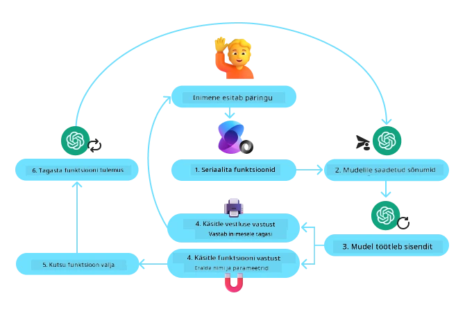
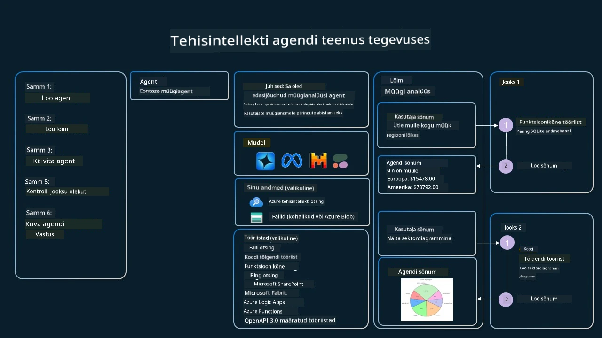

[](https://youtu.be/vieRiPRx-gI?si=cEZ8ApnT6Sus9rhn)

> _(Klõpsake ülaloleval pildil, et vaadata selle tunni videot)_

# Tööriistade kasutamise disainimuster

Tööriistad on huvitavad, sest need võimaldavad tehisintellekti agentidel omada palju laiemat võimekust. Selle asemel, et agent saaks teha ainult piiratud hulga toiminguid, võimaldab tööriista lisamine agendil nüüd teha mitmesuguseid toiminguid. Selles peatükis vaatleme tööriistade kasutamise disainimustrit, mis kirjeldab, kuidas tehisintellekti agendid saavad kasutada spetsiifilisi tööriistu oma eesmärkide saavutamiseks.

## Sissejuhatus

Selles õppetükis püüame vastata järgmistele küsimustele:

- Mis on tööriistade kasutamise disainimuster?
- Millistes kasutusjuhtumites seda saab rakendada?
- Millised on elemendid/ehted, mida disainimustri rakendamiseks on vaja?
- Millised on erikohad, mida arvestada tööriistade kasutamise disainimustri abil usaldusväärsete tehisintellekti agentide loomisel?

## Õpieesmärgid

Selle õppetüki lõpetamisel oskate:

- Määratleda tööriistade kasutamise disainimuster ja selle eesmärk.
- Tuvastada kasutusjuhtumeid, kus tööriistade kasutamise disainimuster on rakendatav.
- Mõista peamisi elemente, mida disainimustri rakendamiseks on vaja.
- Teadvustada kaalutlusi, mis tagavad usaldusväärsuse tehisintellekti agentide puhul, kes kasutavad seda disainimustrit.

## Mis on tööriistade kasutamise disainimuster?

**Tööriistade kasutamise disainimuster** keskendub sellele, et anda suurtele keelemudelitele (LLM) võime suhelda väliste tööriistadega, et saavutada spetsiifilisi eesmärke. Tööriistad on koodiplokid, mida agent saab kasutada toimingute tegemiseks. Tööriist võib olla lihtne funktsioon näiteks kalkulaatorina või API kutsena kolmanda osapoole teenusele, nagu aktsiahindade päring või ilmaprognoos. Tehisintellekti agentide kontekstis on tööriistad disainitud agentide poolt käivitatavateks vastusteks **mudeli genereeritud funktsiooni kutsetele**.

## Millistes kasutusjuhtumites seda saab rakendada?

Tehisintellekti agendid saavad kasutada tööriistu keerukate ülesannete täitmiseks, info otsimiseks või otsuste tegemiseks. Tööriistade kasutamise disainimustrit kasutatakse sageli olukordades, kus on vaja dünaamilist suhtlust väliste süsteemidega, nagu andmebaasid, veebiteenused või koodi tõlgendajad. See võimekus on kasulik mitmesugustes kasutusjuhtumites, sealhulgas:

- **Dünaamiline info päring:** Agendid saavad saata päringuid välistele API-dele või andmebaasidele, et saada ajakohast teavet (nt SQLite andmebaasist andmeanalüüsiks, aktsiahindade või ilmainfo pärimine).
- **Koodi käivitamine ja tõlgendamine:** Agendid saavad käivitada koodi või skripte matemaatiliste probleemide lahendamiseks, aruannete koostamiseks või simulatsioonide tegemiseks.
- **Töövoogude automatiseerimine:** Korduvate või mitmeastmeliste töövoogude automatiseerimine, integreerides tööriistu nagu ülesannete planeerijad, meiliteenused või andmepumbad.
- **Klienditugi:** Agendid saavad suhelda kliendisuhete haldamise (CRM) süsteemide, piletisüsteemide või teadmistebaasidega kasutajapäringute lahendamiseks.
- **Sisuloome ja -toimetamine:** Agendid saavad kasutada tööriistu nagu grammatikakontroll, tekstisummariseerijad või sisuturvalisuse hindajad, et toetada sisutöötlusega seotud ülesandeid.

## Milliseid elemente/ehted on tööriistade kasutamise disainimustri rakendamiseks vaja?

Need ehituskivid võimaldavad tehisintellekti agentidel täita laia valikut ülesandeid. Vaatame põhikomponente, mida on vaja tööriistade kasutamise disainimustri rakendamiseks:

- **Funktsioonide/tööriistade skeemid**: Täpsemad definitsioonid olemasolevatest tööriistadest, mis hõlmavad funktsiooni nime, eesmärki, vajalikke parameetreid ja oodatavaid väljundeid. Need skeemid võimaldavad LLM-il mõista, millised tööriistad on saadaval ja kuidas koostada kehtivaid päringuid.

- **Funktsioonide käivitamise loogika**: Määratleb, kuidas ja millal tööriistu kutsutakse kasutaja kavatsuse ja vestluse konteksti põhjal. See võib hõlmata planeerijamooduleid, marsruutimismehhanisme või tingimuslikke vooge, mis dünaamiliselt määravad tööriista kasutamise.

- **Sõnumite käsitlemise süsteem**: Komponendid, mis haldavad vestlusprotsessi kasutajasisendite, LLM vastuste, tööriistakutsete ja tööriistaväljundite vahel.

- **Tööriistade integreerimise raamistik**: Infrastruktuur, mis ühendab agendi erinevate tööriistadega, olgu need siis lihtsad funktsioonid või keerukad välised teenused.

- **Vigade käsitlemine ja valideerimine**: Mehhanismid tööriistade käivitamise tõrgete haldamiseks, parameetrite valideerimiseks ja ootamatute vastuste korralduseks.

- **Seisu haldamine**: Jälgib vestluse konteksti, varasemaid tööriista interaktsioone ja püsivaid andmeid, et tagada järjepidevus mitmevestluselistes operatsioonides.

Järgmises osas vaatame üksikasjalikumalt funktsioonide/tööriistade kutsumist.
 
### Funktsioonide/Tööriistade kutsumine

Funktsioonide kutsumine on peamine viis, kuidas võimaldame suurtele keelemudelitele (LLM) suhelda tööriistadega. Sageli kasutatakse sõnu „funktsioon“ ja „tööriist“ vaheldumisi, sest „funktsioonid“ (taaskasutatavad koodiplokid) on tööriistad, mida agendid kasutavad ülesannete täitmiseks. Selleks, et funktsiooni kood saaks käivitada, peab LLM võrdlema kasutaja päringut funktsiooni kirjeldusega. Selleks saadetakse LLM-ile skeem, mis sisaldab kõigi olemasolevate funktsioonide kirjeldusi. Seejärel valib LLM ülesande jaoks kõige sobivama funktsiooni, tagastades selle nime ja argumendid. Valitud funktsioon kutsutakse käivitamiseks, selle vastus saadetakse tagasi LLM-ile, mis kasutab seda teavet kasutaja päringule vastamiseks.

Arendajate jaoks, kes soovivad funktsioonide kutsumist agentidele rakendada, on vaja:

1. LLM mudel, mis toetab funktsioonide kutsumist
2. Skeem, mis sisaldab funktsioonide kirjeldusi
3. Iga kirjeldatud funktsiooni kood

Järgnevalt illustreerime, kuidas saada jooksva linna kellaaega:

1. **Algatada funktsioonide kutsumist toetav LLM:**

    Kõik mudelid ei toeta funktsioonide kutsumist, seega on oluline kontrollida, kas kasutatav LLM seda võimaldab.     <a href="https://learn.microsoft.com/azure/ai-services/openai/how-to/function-calling" target="_blank">Azure OpenAI</a> toetab funktsioonide kutsumist. Võime alustada, luues OpenAI kliendi Azure OpenAI **Responses API** vastu (stabiilne `/openai/v1/` lõpp-punkt - puudub vajadus `api_version`).

    ```python
    # Initialize the OpenAI client for Azure OpenAI (Responses API, v1 endpoint)
    client = OpenAI(
        base_url=f"{os.environ['AZURE_OPENAI_ENDPOINT'].rstrip('/')}/openai/v1/",
        api_key=os.environ["AZURE_OPENAI_API_KEY"],
    )
    deployment_name = os.environ["AZURE_OPENAI_DEPLOYMENT"]
    ```

1. **Loo funktsiooni skeem**:

    Järgmisena määratleme JSON skeemi, mis sisaldab funktsiooni nime, kirjelduse, mida funktsioon teeb, ning funktsiooni parameetrite nimesid ja kirjeldusi.
    See skeem edastatakse eelnevalt loodud kliendile koos kasutaja päringuga, kus otsitakse San Francisco kellaaega. Oluline on märkida, et tagastatud on **tööriistakutse**, mitte küsimuse lõplik vastus. Nagu juba mainitud, tagastab LLM ülesande jaoks valitud funktsiooni nime ja argumendid.

    ```python
    # Function description for the model to read (Responses API flat tool format)
    tools = [
        {
            "type": "function",
            "name": "get_current_time",
            "description": "Get the current time in a given location",
            "parameters": {
                "type": "object",
                "properties": {
                    "location": {
                        "type": "string",
                        "description": "The city name, e.g. San Francisco",
                    },
                },
                "required": ["location"],
            },
        }
    ]
    ```
   
    ```python
  
    # Initial user message
    messages = [{"role": "user", "content": "What's the current time in San Francisco"}]

    # First API call: Ask the model to use the function
    response = client.responses.create(
        model=deployment_name,
        input=messages,
        tools=tools,
        tool_choice="auto",
        store=False,
    )

    # The Responses API returns tool calls as function_call items in response.output.
    # Append them to the conversation so the model has full context on the next turn.
    messages += response.output

    print("Model's response:")
    print(response.output)
  
    ```

    ```bash
    Model's response:
    [ResponseFunctionToolCall(arguments='{"location":"San Francisco"}', call_id='call_pOsKdUlqvdyttYB67MOj434b', name='get_current_time', type='function_call')]
    ```
  
1. **Funktsiooni kood, mis teostab ülesande:**

    Kui LLM on valinud, millist funktsiooni käivitada, tuleb ülesande täitmiseks vajalik kood rakendada ja käivitada.
    Saame rakendada koodi, mis tagastab jooksva aja Pythonis. Samuti peame kirjutama koodi, mis eraldab vastuse sõnumist nime ja argumendid lõpliku tulemuse saamiseks.

    ```python
      def get_current_time(location):
        """Get the current time for a given location"""
        print(f"get_current_time called with location: {location}")  
        location_lower = location.lower()
        
        for key, timezone in TIMEZONE_DATA.items():
            if key in location_lower:
                print(f"Timezone found for {key}")  
                current_time = datetime.now(ZoneInfo(timezone)).strftime("%I:%M %p")
                return json.dumps({
                    "location": location,
                    "current_time": current_time
                })
      
        print(f"No timezone data found for {location_lower}")  
        return json.dumps({"location": location, "current_time": "unknown"})
    ```

     ```python
    # Handle function calls
    tool_calls = [item for item in response.output if item.type == "function_call"]
    if tool_calls:
        for tool_call in tool_calls:
            if tool_call.name == "get_current_time":

                function_args = json.loads(tool_call.arguments)

                time_response = get_current_time(
                    location=function_args.get("location")
                )

                # Return the tool result as a function_call_output item
                messages.append({
                    "type": "function_call_output",
                    "call_id": tool_call.call_id,
                    "output": time_response,
                })
    else:
        print("No tool calls were made by the model.")

    # Second API call: Get the final response from the model
    final_response = client.responses.create(
        model=deployment_name,
        input=messages,
        tools=tools,
        store=False,
    )

    return final_response.output_text
     ```

     ```bash
      get_current_time called with location: San Francisco
      Timezone found for san francisco
      The current time in San Francisco is 09:24 AM.
     ```

Funktsioonide kutsumine on enamikus, kui mitte kõigis agendi tööriistade kasutamise disainides põhielement, kuid sellelt algusest rakendamine võib mõnikord olla keeruline.
Nagu õppisime [Õppetükis 2](../../../02-explore-agentic-frameworks), pakuvad agent-suunalised raamistikud eelvalmis ehituskivid tööriistade kasutamise teostamiseks.
 
## Tööriistade kasutamise näited agent-raamistikega

Siin on mõned näited, kuidas tööriistade kasutamise disainimustrit saab rakendada erinevate agent-raamistike abil:

### Microsoft Agent Framework

<a href="https://learn.microsoft.com/azure/ai-services/agents/overview" target="_blank">Microsoft Agent Framework</a> on avatud lähtekoodiga tehisintellekti raamistik tehisintellekti agentide ehitamiseks. See lihtsustab funktsioonikutsumise protsessi, võimaldades määratleda tööriistu Python funktsioonidena koos `@tool` dekoratsiooniga. Raamistik haldab mudeli ja teie koodi vahelist suhtlust. Samuti pakub juurdepääsu eelvalmis tööriistadele nagu File Search ja Code Interpreter `FoundryChatClient` kaudu.

Järgmine diagramm illustreerib funktsioonide kutsumise protsessi Microsoft Agent Frameworkis:



Microsoft Agent Frameworkis määratletakse tööriistad dekoreeritud funktsioonidena. Saame muuta eelnevalt näidatud `get_current_time` funktsiooni tööriistaks, kasutades `@tool` dekoratsiooni. Raamistik serialiseerib automaatselt funktsiooni ja selle parameetrid, luues skeemi, mis saadetakse LLM-ile.

```python
import os
from agent_framework import tool
from agent_framework.foundry import FoundryChatClient
from azure.identity import AzureCliCredential

@tool(approval_mode="never_require")
def get_current_time(location: str) -> str:
    """Get the current time for a given location"""
    ...

# Create the client
provider = FoundryChatClient(
    project_endpoint=os.environ["AZURE_AI_PROJECT_ENDPOINT"],
    model=os.environ["AZURE_AI_MODEL_DEPLOYMENT_NAME"],
    credential=AzureCliCredential(),
)

# Create an agent and run with the tool
agent = provider.as_agent(name="TimeAgent", instructions="Use available tools to answer questions.", tools=get_current_time)
response = await agent.run("What time is it?")
```

#### Tööriistad MCP serverist

Tööriistad ei pea olema teie enda koodis funktsioonid. Server, mis suhtleb Mudeli Konteksti Protokolli (MCP, käsitletud [Õppetükis 11](../11-agentic-protocols/README.md)) kaudu, avaldab oma tööriistad koos skeemidega ning raamistik saab need laadida sama moodi nagu serialiseerib dekoreeritud funktsiooni. `MCPStreamableHTTPTool` ühendub HTTP kaudu sellise serveriga, loeb tööriistade skeemid ja pakub need mudelile koos kohalike tööriistadega.

Järgmine näide kasutab veebipäringu serverit, mida majutab <a href="https://keenable.ai" target="_blank">Keenable</a>. Selle kasutamine on tasuta, ilma kontota või API võtmeta (päringute arv on IP-aadressi kohta piiratud), seega ainsad volitused teie mudelile on vajalikud. Nagu iga kaug-tööriista puhul, saadab mudel sellele serverile kirjutatud päringud.

```python
from agent_framework import MCPStreamableHTTPTool

web_search = MCPStreamableHTTPTool(
    name="Keenable web search",
    url="https://api.keenable.ai/mcp",
)

# Connecting loads the server's tool schemas; the agent decides when to call them
async with web_search:
    agent = provider.as_agent(
        name="ResearchAgent",
        instructions="Use available tools to answer questions.",
        tools=[web_search],
    )
    response = await agent.run("What is new in the latest Python release?")
    print(response.text)
```

Server avaldab kaks tööriista, `search_web_pages` ja `fetch_page_content`. Kui küsimus vajab ajakohast teavet, kutsub mudel funktsiooni `search_web_pages`, saab tagasi pealkirjad, URL-id ja tekstikatked ning kirjutab vastuse nende põhjal, sama tsükkel nagu eespool toodud `get_current_time` näites.
  
### Microsoft Foundry Agent Service

<a href="https://learn.microsoft.com/azure/ai-services/agents/overview" target="_blank">Microsoft Foundry Agent Service</a> on uuem agent-suunaline raamistik, mis võimaldab arendajatel turvaliselt ehitada, kasutada ja skaleerida kõrgekvaliteedilisi ja laiendatavaid tehisintellekti agente ilma alusinfrastruktuuri juhtimiseta. See on eriti kasulik ettevõtlusrakenduste jaoks, kuna on täielikult hallatav teenus ettevõtte tasemel turvalisusega.

Võrreldes otsese LLM API arendamisega pakub Microsoft Foundry Agent Service järgmisi eeliseid:

- Automaatne tööriistakutsumine – pole vaja tööriistakutset eraldi parsida, tööriist kutsuda ega vastust käsitleda; kõik see toimub nüüd serveripoolselt
- Turvaliselt hallatud andmed – kasutaja asemel haldate vestlusseansse, mis salvestab kogu vajaliku info
- Vaikimisi olemasolevad tööriistad – tööriistad, mida saab kasutada andmeallikatega suhtlemiseks, nagu Bing, Azure AI Search ja Azure Functions.

Microsoft Foundry Agent Service tööriistad jagunevad kaheks kategooriaks:

1. Teadmiste tööriistad:
    - <a href="https://learn.microsoft.com/azure/ai-services/agents/how-to/tools/bing-grounding?tabs=python&pivots=overview" target="_blank">Sidumine Bing Searchiga</a>
    - <a href="https://learn.microsoft.com/azure/ai-services/agents/how-to/tools/file-search?tabs=python&pivots=overview" target="_blank">Failiotsing</a>
    - <a href="https://learn.microsoft.com/azure/ai-services/agents/how-to/tools/azure-ai-search?tabs=azurecli%2Cpython&pivots=overview-azure-ai-search" target="_blank">Azure AI Search</a>

2. Tegevustööriistad:
    - <a href="https://learn.microsoft.com/azure/ai-services/agents/how-to/tools/function-calling?tabs=python&pivots=overview" target="_blank">Funktsioonide kutsumine</a>
    - <a href="https://learn.microsoft.com/azure/ai-services/agents/how-to/tools/code-interpreter?tabs=python&pivots=overview" target="_blank">Koodi tõlgendaja</a>
    - <a href="https://learn.microsoft.com/azure/ai-services/agents/how-to/tools/openapi-spec?tabs=python&pivots=overview" target="_blank">OpenAPI määratletud tööriistad</a>
    - <a href="https://learn.microsoft.com/azure/ai-services/agents/how-to/tools/azure-functions?pivots=overview" target="_blank">Azure Functions</a>

Agent Service võimaldab meil kasutada neid tööriistu koos kui `toolset`. Samuti kasutab see `threads`, mis jälgivad sõnumiteajaloo konkreetse vestluse kohta.

Kujutlege, et olete müügiesindaja ettevõttes nimega Contoso. Soovite arendada vestlusagenti, kes suudab vastata küsimustele teie müügiandmete kohta.

Järgmine pilt näitab, kuidas saate Microsoft Foundry Agent Service abil oma müügiandmeid analüüsida:



Nende tööriistade kasutamiseks teenusega võime luua kliendi ja määratleda tööriista või tööriistakomplekti. Praktikas saame kasutada järgmist Pythoni koodi. LLM suudab vaadata tööriistakomplekti ja otsustada, kas kasutada kasutaja loodud funktsiooni, `fetch_sales_data_using_sqlite_query`, või eelnevalt ehitatud Koodi tõlgendajat, sõltuvalt kasutaja päringust.

```python 
import os
from azure.ai.projects import AIProjectClient
from azure.identity import DefaultAzureCredential
from fetch_sales_data_functions import fetch_sales_data_using_sqlite_query # fetch_sales_data_using_sqlite_query function which can be found in a fetch_sales_data_functions.py file.
from azure.ai.projects.models import ToolSet, FunctionTool, CodeInterpreterTool

project_client = AIProjectClient.from_connection_string(
    credential=DefaultAzureCredential(),
    conn_str=os.environ["PROJECT_CONNECTION_STRING"],
)

# Initialize toolset
toolset = ToolSet()

# Initialize function calling agent with the fetch_sales_data_using_sqlite_query function and adding it to the toolset
fetch_data_function = FunctionTool(fetch_sales_data_using_sqlite_query)
toolset.add(fetch_data_function)

# Initialize Code Interpreter tool and adding it to the toolset. 
code_interpreter = CodeInterpreterTool()toolset.add(code_interpreter)

agent = project_client.agents.create_agent(
    model="gpt-5-mini", name="my-agent", instructions="You are helpful agent", 
    toolset=toolset
)
```

## Millised on erikohad tööriistade kasutamise disainimustri abil usaldusväärsete tehisintellekti agentide ehitamisel?

Üks levinud mure LLM-i kaudu dünaamiliselt genereeritud SQL-i puhul on turvalisus, eriti SQL süstimise või pahatahtlike toimingute oht, nagu andmebaasi kustutamine või rikkumine. Kuigi need mured on õigustatud, saab neid tõhusalt leevendada, konfigureerides andmebaasi ligipääsu õigusi korrektselt. Enamiku andmebaaside puhul tähendab see andmebaasi seadistamist lugemiseks. PostgreSQL või Azure SQL teenuste puhul tuleks rakendusele määrata lugemisõigusega (SELECT) roll.

Rakenduse jooksutamine turvalises keskkonnas suurendab kaitset. Ettevõtte stsenaariumites ekstrakteeritakse ja muundatakse andmed tavapärasest süsteemist lugemiseks mõeldud andmebaasi või andmelattu kasutajasõbraliku skeemiga. See lähenemine tagab andmete turvalisuse, jõudluse ja ligipääsetavuse optimeerimise ning rakenduse ligipääsu on piiratud lugemisõigusega.

## Näidiskoodid

- Python: [Agent Framework](./code_samples/04-python-agent-framework.ipynb)
- .NET: [Agent Framework](./code_samples/04-dotnet-agent-framework.md)

## Kas teil on veel küsimusi tööriistade kasutamise disainimustri kohta?

Liituge [Microsoft Foundry Discordiga](https://discord.com/invite/ATgtXmAS5D), et kohtuda teiste õppijatega, osaleda konsultatsioonitundides ja saada vastused oma AI agentide küsimustele.

## Täiendavad ressursid

- <a href="https://microsoft.github.io/build-your-first-agent-with-azure-ai-agent-service-workshop/" target="_blank">Azure AI Agentide teenuse töötuba</a>
- <a href="https://github.com/Azure-Samples/contoso-creative-writer/tree/main/docs/workshop" target="_blank">Contoso loova kirjaniku mitmeagendi töötoa</a>
- <a href="https://learn.microsoft.com/azure/ai-services/agents/overview" target="_blank">Microsoft Agent Framework ülevaade</a>

## Selle agendi suitsutestimine (valikuline)

Pärast seda, kui õpid agentide juurutamist [Õppetund 16-s](../16-deploying-scalable-agents/README.md), saad suitsutestida selle õppetunni `TravelToolAgent` (kas see kutsub endiselt oma tööriistu ja vastab?) kasutades [`tests/lesson-04-smoke-tests.json`](../../../tests/lesson-04-smoke-tests.json). Vaata, kuidas seda käivitada, juhendis [`tests/README.md`](../tests/README.md).

## Eelmine õppetund

[Agentuursete disainimustrite mõistmine](../03-agentic-design-patterns/README.md)

## Järgmine õppetund

[Agentuurne RAG](../05-agentic-rag/README.md)

---

<!-- CO-OP TRANSLATOR DISCLAIMER START -->
**Lahtiütlus**:
See dokument on tõlgitud kasutades AI tõlketeenust [Co-op Translator](https://github.com/Azure/co-op-translator). Kuigi me püüdleme täpsuse poole, palun pange tähele, et automatiseeritud tõlgetes võib esineda vigu või ebatäpsusi. Originaaldokument selle emakeeles tuleks pidada autoriteetseks allikaks. Olulise teabe puhul soovitatakse kasutada professionaalset inimtõlget. Me ei vastuta selle tõlkega seotud eksimustest või valesti mõistmistest.
<!-- CO-OP TRANSLATOR DISCLAIMER END -->