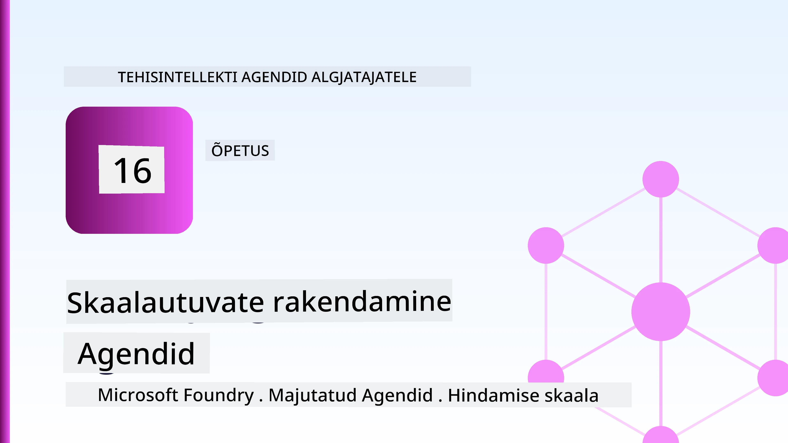
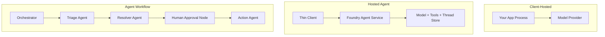
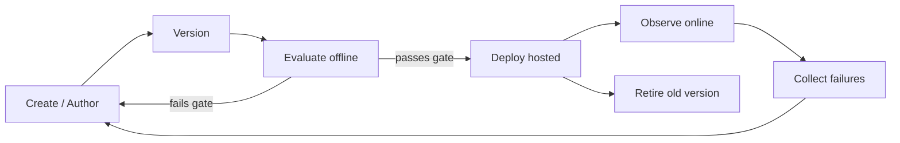
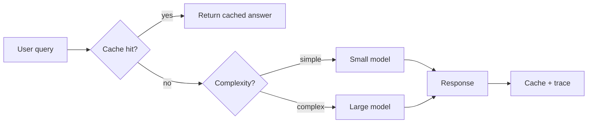
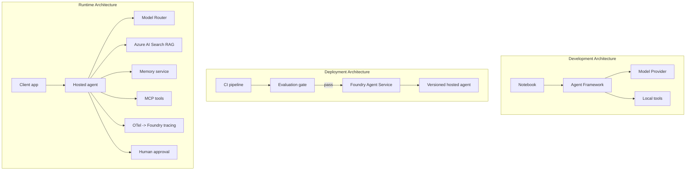

# Skaleeritavate Agendide Juurutamine Microsoft Foundry'ga



Selle kursuse senises osas olete loonud agende, mis töötavad teie sülearvutis, märkmiku sees, juhituna `az login` ja mõne keskkonnamuutujaga. See ongi õige viis õppimiseks. See pole aga õige viis agendi käivitamiseks, kellele tuhanded kliendid sõltuvad kell 3 öösel.

See õppetund käsitleb lõhet "see töötab minu seadmes" ja "see töötab usaldusväärselt ja taskukohaselt tootmises" vahel. Me täidame selle lõhe, kasutades **Microsoft Foundry't** ja **Microsoft Foundry Agent Service'it**, ehitades päris klienditoe agendi, millel on tööriistad, andmete tagasitõmme, mälu, hindamine ja jälgimine.

## Sissejuhatus

Selles õppetükis käsitletakse:

- Erinevust **prototüübi agendi** ja **juurutatud agendi** vahel ning miks see üleminek puudutab peamiselt kõike *mudeli ümber*.
- Agendide **juurutusmustreid**: kliendi poolt majutatavad, teenuse poolt majutatavad (Majutatud Agendid) ja töövoogude korraldatud.
- **Agendi elutsüklit** Microsoft Foundry's — loomine, versioonimine, juurutamine, hindamine, jälgimine, pensionile jäämine.
- **Skaleerimisstrateegiaid**: mudeli marsruutimine, vahemällu salvestamine, samaaegsus ja olekuvaba disain.
- **Jälgitavust** OpenTelemetry ja Foundry jälgimise abil.
- **Kulu optimeerimist** mudeli valiku, marsruutimise ja hindamislüüside kaudu.
- **Ettevõtte kaalutlusi**: valitsemine, inimlik heakskiit ja MCP serverite turvaline käitamine tootmises.

## Õpieesmärgid

Pärast selle õppetüki läbimist oskad:

- Valida õige juurutusmustri antud agendi töökoormuse jaoks.
- Juurutada agendi Microsoft Foundry Agent Service’i nii, et see oleks versioonitud, valitsenud ja jälgitav.
- Instrumenteerida agent jälgimiseks ja seadistada hindamisvoog, mis töötab enne iga versiooni väljaandmist.
- Rakendada mudeli marsruutimist ja vahemällu salvestamist, et hoida latentsus ja kulu skaleerudes kontrolli all.
- Lisada inimheakskiidu lüli kõrgema riski tegevuste jaoks ja integreerida MCP server turvaliselt tootmisesse.

## Eeldused

Selle õppetüki läbimiseks eeldame, et oled lõpetanud varasemad õppetükid ja oled mugav:

- Agentide ehitamisega [Microsoft Agent Framework](../14-microsoft-agent-framework/README.md) (Õppetükk 14).
- [Tööriistade kasutamise](../04-tool-use/README.md) (Õppetükk 4) ja [Agentic RAG](../05-agentic-rag/README.md) (Õppetükk 5).
- [Agendi mälu](../13-agent-memory/README.md) (Õppetükk 13) ja [Agentic protokollid / MCP](../11-agentic-protocols/README.md) (Õppetükk 11).
- [Jälgitavus ja hindamine](../10-ai-agents-production/README.md) (Õppetükk 10) — sellest õppetükist laiendad edasi.

Sul on vaja ka:

- **Azure tellimust** ja **Microsoft Foundry projekti** vähemalt ühe juurutatud vestlusmudeliga.
- Autenditud **Azure CLI** (`az login`).
- Python 3.12+ ja teegid hoidlas [`requirements.txt`](../../../requirements.txt).

## Prototüübist tootmisesse: Mis tegelikult muutub

Prototüübi agent ja tootmises olev agent jagavad sama põhitsüklit — põhjendamine, tööriistade kutsumine, reageerimine. Muutub kõik tsükli ümber pakkunud. Mudel moodustab tootmises olevast agendist umbes 20%, ülejäänud 80% on operatsiooniline luustik.

| Murekoht | Prototüüp | Tootmine |
| --- | --- | --- |
| **Majutamine** | Töötab sinu märkmikus | Töötab majutatuna servis, versioonitud ja juurutatud |
| **Identiteet** | Sinu `az login` token | Juhtimisega identiteet ulatusega RBAC |
| **Olek** | Mälu sees, kaob taaskäivitamisel | Eksternaliseeritud (kõnemoodulite hoidla, mälu teenus) |
| **Rikke korral** | Näed veateadet | Uuesti proovimised, varuvariandid, surnud-kirja kast, hoiatused |
| **Kulu** | „See on paar senti“ | Jälgitud päringu lõikes, marsruutitud, vahemällu salvestatud, eelarvestatud |
| **Kvaliteet** | Silmadega kontrollitud väljundit | Hinnatud automaatselt enne iga versiooni |
| **Usaldus** | Kinnitad iga toimingu | Poliitika + inimheakskiit riskantsete toimingute jaoks |

Pea seda tabelit meeles. Iga alljärgnev lõik vastab ühele selle tabeli reale.

## Agendi Juurutusmustrid

Kasutatakse kolme mustrit, sageli kombineeritult.

### 1. Kliendi poolt majutatavad agendid

Agendi objekt elab *sinu* rakenduse protsessis. Sinu kood kutsub mudelipakkujat otse; põhjendus-tsükkel töötab sinu teenuses. Seda on tehtud kõigis eelmistes õppetükkides.

- **Kasuta seda, kui** vajad täielikku kontrolli tsükli üle, kohandatud vahendit või integreerid agendi olemasolevasse taustsüsteemi.
- **Komproiss**: vastutad ise skaleerimise, oleku ja vastupidavuse eest.

### 2. Majutatud Agendid (Foundry Agent Service)

Agent registreeritakse *ressursina* Microsoft Foundry's. Foundry majutab põhjendus-tsükli, talletab kõnemoodulid, tagab sisuturvalisuse ja RBAC, ning kuvab agendi Foundry portaalis. Sinu rakendus muutub õhukeseks kliendiks, mis loob kõnemooduleid ja loeb vastuseid.

- **Kasuta seda, kui** soovid vastupidavust, sisseehitatud jälgitavust, juhtimist ja väiksemat operatsioonipinna suurust.
- **Komproiss**: väiksem madala taseme kontroll vastutasuks hallatud käitamise eest.

### 3. Agendi töövood

Mitmed agendid (ja tööriistad) pannakse kokku graafiks selgete juhtimisvoogudega — järjestikused sammud, harunemised, inimheakskiidu sõlmed ja vastupidavad kontrollpunktid, mis võivad pausile minna ja jätkata. See on Microsoft Agent Frameworki **Workflows** võimekus juurutamise mahtudel.

- **Kasuta seda, kui** üks ülesanne hõlmab mitu spetsialiseeritud agenti või vajab keskel heakskiitu.
- **Komproiss**: rohkem liikuvaid osi; vajab korralduslikku jälgitavust.



## Agendi elutsükkel Microsoft Foundry's

Agendi juurutamine ei ole üksikisiku `push`. See on tsükkel ja näeb välja nagu tarkvara väljaandmise tsükkel, sest just nii see ongi.



Peamine idee, mis on pärit [Õppetükist 10](../10-ai-agents-production/README.md): **võrguväline hindamine on värav, mitte järelmõte.** Uus agendi versioon ei ilmu välja enne, kui see ületab hindamiskünnised. Võrgujälgitavus toob riigipõhised rikked tagasi võrguvälisesse testikomplekti. See ongi kogu tsükkel.

## Skaleerimisstrateegiad

Agendi skaleerimine erineb olekuvaba veebirakenduse API skaleerimisest, sest iga päring võib vallandada mitu kulukat mudeli ja tööriista kõnet. Neli tehnikat kannavad suurema osa koormusest.

**Olekuvaba päringu haldamine.** Ära hoia üksikkasutaja olekut oma protsessi mälus. Säilita jutulood Foundry jutuloomeruumis või mälu teenuses, et iga eksemplar suudaks päringut töödelda. See võimaldab horisontaalset skaleerimist — lisa eksemplare, pole kleepuvaid sessioone.

**Mudeli marsruutimine.** Kõik päringud ei vaja sinu kõige võimekamat (ja kõige kallimat) mudelit. Suuna lihtsad päringud — kavatsuse klassifikatsioon, lühikesed faktipõhised vastused — väikesele ja kiirele mudelile ning hoia suur mudel autentseks põhjenduseks. Foundry **Model Router** saab seda sinu eest teha või saad ise kergekaalulise klassifikaatori ehitada. Laboris ehitad iseversiooni.

**Vastuse vahemälu.** Paljud tugipäringud on peaaegu koopiad ("kuidas ma parooli lähtestan?"). Säilita tavalistele küsimustele vastused vahemällu ja vasta neile ilma mudelit kõnetamata. Isegi mõõdukas vahemälu osakaal vähendab oluliselt kulu ja latentsust.

**Samaaegsus ja tagasisurve.** Mudelipakkujatel on kiiruspiirangud. Piira oma samaaegsust, kasuta kordamise katseid eksponentsiaalse taandarenguga ja ebaõnnestumisel käitu graatsiliselt (järjekorda pandud "me töötame selle kallal" vastus on parem kui 500 veateade).



## Jälgitavus tootmises

Sa ei saa juhtida seda, mida sa ei näe. Nagu käsitleti Õppetükis 10, Microsoft Agent Framework eraldab loomulikult **OpenTelemetry** jälgi — iga mudeli kõne, tööriista kutsumine ja korralduse samm muutuvad vahemikuks. Tootmises ekspordid need vahemikud Microsoft Foundry'sse (või mis tahes OTel-toetatud taustsüsteemi), et:

- Jälgida ühe kliendikaebuse algusest lõpuni kõiki mudeli ja tööriista kõnesid.
- Vaadata p50/p95 latentsust ja kulu päringu kohta aja jooksul.
- Hoiatada veamäära tõusude ja kulu anomaaliate üle enne, kui kasutajad (või finantsmeeskond) märkavad.

```python
from agent_framework.observability import get_tracer

tracer = get_tracer()

with tracer.start_as_current_span("support_request") as span:
    span.set_attribute("customer.tier", "enterprise")
    span.set_attribute("routed.model", "gpt-5-nano")
    # agent execution is traced automatically inside this span
```

Atribuudid nagu `customer.tier` ja `routed.model` muudavad jälgede vooga seina vastatavateks küsimusteks ("kas ettevõtte kliendid juhitakse liiga tihti väikesele mudelile?").

## Kulu optimeerimine

Tootmisagentide kulusid domineerivad tokenid. Kolm hooba, järjestatud mõju järgi:

1. **Sobita mudel suurusega.** Väike mudel, mis läbib sinu hindamisvärava, on peaaegu alati odavam kui suur, mis samuti läbib. Kasuta hindamist tõestamaks, et väike mudel on piisav, mitte et jätta vaikimisi suurim mudel ettevaatuseks.
2. **Marsruudi järgi keerukus.** Nagu eelnevalt — maksa suuri hindu vaid päringute eest, mis vajavad suurt mudelit.
3. **Vahemälu agressiivselt.** Odavaim mudelik kõne on see, mida sa kunagi ei tee.

Hindamisväravad ja kulu kontroll on sama distsipliin kahe nurga alt: hindamine ütleb sulle *kvaliteedi põranda*, marsruutimine ja vahemällu salvestamine hoiavad sind võimalikult lähedal põranda *kulule*.

## Ettevõtte juurutus kaalutlused

**Valitsemine.** Majutatud Agendid pärivad Foundry RBACi, sisuturvalisuse ja auditeerimislogi. Iga agendile anna hallatav identiteet vähima hädavajaliku õigusega — vaid lugemisõigus teadmistebaasile, piiritletud juurdepääs piletihaldus API-le, mitte midagi rohkem.

**Inimene ahelas.** Mõned toimingud on liiga olulised, et neid täielikult automatiseerida — raha tagastamine, konto kustutamine, eskaleerimine juriidilisse meeskonda. Microsoft Agent Framework toetab **heakskiitu nõudvaid** tööriistu: agent teeb ettepaneku, täitmine peatub, inimene kinnitab või lükkab tagasi ja töövoog jätkub. Sa nägid primitiivi [Õppetükis 6](../06-building-trustworthy-agents/README.md); siin juurutad seda.

**MCP tootmises.** [MCP](../11-agentic-protocols/README.md) võimaldab agentidel tarbida väliseid tööriistu standardse liidese kaudu. Tootmises käsitle iga MCP serverit usaldamatuna: lukusta serveri versioon, käita hallatud identiteediga, valideeri väljundeid ja ära kunagi jaga sellega saladusi. MCP server on sõltuvus, neid uuendatakse, audi-teeritakse ja kiiruspiiratakse.



Need kolm skeemi — arendus, juurutamine, tööaeg — näitavad sama agendi elu kolme etappi. Järgmine labor juhendab sind selle ehitamisel.

## Praktiline labor: tootmiskõlbulik klienditoe agent

Ava [`code_samples/16-python-agent-framework.ipynb`](./code_samples/16-python-agent-framework.ipynb) ja lahenda see lõpuni. Koostad **Contoso klienditoe agendi**, millel on iga tootmisküsimus läbi ühendatud:

1. **Tööriistade kutsumine** — tellimuse staatuse päring ja tugipiletite avamine.
2. **RAG** — vastuste andmine reeglite kohta teadmistebaasist (Azure AI Search, in-memory varuvariandiga, nii et märkmik töötab ilma Search ressurssita).
3. **Mälu** — mäleta klienti vestluse käigus.
4. **Mudeli marsruutimine** — keerukuse klassifikaator suunab iga päringu väikese või suure mudeli poole.
5. **Vastuse vahemälustamine** — korduvad küsimused võetakse vastuseks vahemälust.
6. **Inimkinnituse lisamine** — tagastused üle piiri ootavad inimese allkirja.
7. **Hindamisvoog** — väike võrguväline testikomplekt hindab agenti ja toimib väljaandmise väravana.
8. **Jälgitavus** — OpenTelemetry jälgimine iga päringu ümber.

### Läbivaatamine

Märkmik on organiseeritud nii, et iga tootmisküsimus on iseseisev, jooksutatav lõik. Selle südameks on marsruutimise ja vahemällu salvestamise päringuhaldur:

```python
async def handle_support_request(query: str, customer_id: str) -> str:
    # 1. Serve from cache when we can.
    cached = response_cache.get(normalize(query))
    if cached:
        return cached

    # 2. Route by complexity to control cost.
    model = "gpt-5-nano" if is_simple(query) else "gpt-5-mini"

    # 3. Run the agent inside a trace span for observability.
    with tracer.start_as_current_span("support_request") as span:
        span.set_attribute("routed.model", model)
        span.set_attribute("customer.id", customer_id)
        response = await support_agent.run(query, model=model)

    # 4. Cache and return.
    response_cache.set(normalize(query), response.text)
    return response.text
```

Hindamisvärav, mis valvab väljaandmist, näeb välja selline:

```python
async def evaluation_gate(agent, test_cases, threshold: float = 0.8) -> bool:
    passed = 0
    for case in test_cases:
        result = await agent.run(case["input"])
        if score_response(result.text, case["expected"]) >= 0.8:
            passed += 1
    pass_rate = passed / len(test_cases)
    print(f"Evaluation pass rate: {pass_rate:.0%} (gate: {threshold:.0%})")
    return pass_rate >= threshold  # only deploy if the gate passes
```

Loe iga rida — märkmik hoiab primitiivid teadlikult väikesed, et midagi pole raamistikukutse taga peidus.

## Juurutatud agendi valideerimine suitsutestidega

Eeltoodud hindamisvärav töötab *võrguväliselt* sinu telefoni objekti vastu. Kui agent on juurutatud Majutatud Agendina, vajad veel üht odavamat kontrolli: **kas juurutatud lõpp-punkt vastab üldse?**

"Õnnestunud" juurutus tõestab vaid, et juhtimistasand aktsepteeris määratluse — see ei tõesta, et agent vastab. Puuduv sõltuvus, vale mudeli marsruutimine või aegunud ühendus võivad jätta rohelise juurutuse, mis ei vasta midagi. **Suitsutest** tabab selle sekunditega, iga juurutuse ajal, täisväärtusliku hindamise kuluta.

See hoidla sisaldab kasutusvalmis suitsutesti torujuhtme, mis põhineb [AI Smoke Test](https://github.com/marketplace/actions/ai-smoke-test) GitHub tegevusel:

- **Kataloog** — [`tests/lesson-16-smoke-tests.json`](../../../tests/lesson-16-smoke-tests.json) sisaldab Contoso tugiedendi promte ja kinnitusi (põhineb reeglitel, tellimuse päring, teemas püsimine ja mitme kõne jätkusuutlikkus). Muude õppetükkide agendi kataloogid asuvad kõrval — vt [`tests/README.md`](../tests/README.md).
- **Töövoog** — [`.github/workflows/smoke-test.yml`](../../../.github/workflows/smoke-test.yml) logib sisse Azure OIDC-ga ja POSTitab iga prompti agendi Responses lõpp-punkti, ebaõnnestub igal kinnituse veal.

```yaml
- name: Smoke-test hosted agent
  uses: JFolberth/ai-smoketest@v1
  with:
    project_endpoint: ${{ inputs.project_endpoint }}
    agent_name: ContosoSupportAgent
    tests_file: tests/lesson-16-smoke-tests.json
```

Käivitage see vahekaardilt **Actions** pärast teie agendi juurutamist, sisestades oma Foundry projekti lõpp-punkti ja agendi nime. Liigendatud identiteedil peab olema Foundry projekti ulatuses roll **Azure AI User**. Mõelge kihtidele nagu pyramidile: suitsutestid (kas on jõutav ja vastab?) käivad iga juurutuse ajal, võrguühenduseta hindamine (kas piisavalt hea saatmiseks?) käib enne edendamist ja võrguhindamine (kuidas see töös läheb?) käib pidevalt.

## Teadmiste kontroll

Testi oma arusaamist enne ülesandega jätkamist.

**1. Kui suur osa tootmisagendist on ligikaudu "mudel" ja mis on ülejäänu?**

<details>
<summary>Vastus</summary>

Mudel on süsteemi vähemus — sageli loetakse selleks umbes 20%. Ülejäänud on operatsiooniline luustik: majutamine ja versioonihaldus, identiteet ja RBAC, väline seisundi haldus, vigade käsitlus, kulude jälgimine, hindamine ja inimesega seotud kontrollid. Tootmisse liikumine on peamiselt seotud kõigi nende ehitamisega *mõtlemistsükli ümber*.
</details>

**2. Millal valiksite majutatud agendi kliendi majutatud agendi asemel?**

<details>
<summary>Vastus</summary>

Kui soovite hallatavat täitmisaega koos sisseehitatud vastupidavusega (lõimed, mis püsivad ja saavad jätkuda), jälgitavust, sisuturvalisust ja RBAC-i ning olete nõus mõne laveerimisjuhtimise kontrolli vastuoperatsioonipinna vähendamist vastu vahetama. Kliendi majutatud on eelistatum, kui vajate täielikku kontrolli tsükli üle või manustate agenti olemasolevasse tagapoolesse.
</details>

**3. Miks peab skaleeritav agent olema oma protsessimälus olekusaatmatu?**

<details>
<summary>Vastus</summary>

Nii saab ükskõik milline eksemplar käidelda ükskõik millist päringut, mis võimaldab horisontaalset skaleerimist ilma kleepuvate seanssideta. Kasutajapõhine vestluse seisund on väljastatud lõimede andmebaasi või mäluteenusele. Kui seisund elaks protsessimälus, kaotaksite selle taaskäivitamisel ning koormust ei saaks vabalt jaotada.
</details>

**4. Millist probleemi lahendab mudeli marsruutimine ja kuidas see hindamisega seostub?**

<details>
<summary>Vastus</summary>

Marsruutimine saadab lihtsamad päringud väikesele, odavale ja kiirele mudelile ning hoiab suure mudeli tõelise mõtlemise jaoks, kontrollides nii latentsust kui ka kulu. See on seotud hindamisega, sest hindamine on see, mis *tõestab*, et väiksem mudel on piisavalt hea mingi päringute klassi jaoks — marsruutimine ilma hindamiseta on vaid oletamine.
</details>

**5. Mis on "hindamisvärav" ja kus see elutsüklis paikneb?**

<details>
<summary>Vastus</summary>

Hindamisvärav käitab võrguühenduseta testikomplekti uue agendi versiooni vastu ja blokeerib juurutamise, kui edusulg ei ületa lävendit. See asub elutsüklis "versiooni" ja "juurutamise" vahel, muutes kvaliteedi vabastuse eeltingimuseks, mitte millekski, mida kontrollitakse pärast saatmist.
</details>

**6. Miks tuleks MCP serverit tootmises käsitleda usaldamatuna piirinahana?**

<details>
<summary>Vastus</summary>

Sest see on väline sõltuvus, kuhu teie agent kutsub. Peaksite lukustama selle versiooni, jooksutama selle piiratud identiteediga, valideerima selle väljundeid, määrama kiirusepiirangu ja mitte kunagi paljastama selle ees saladusi — sama distsipliin, mida rakendate mis tahes kolmanda osapoole sõltuvuse puhul. Selle väljundid voolavad agendi mõtlemisse, nii et valideerimata usaldus on turvarisk.
</details>

**7. Milline üksik muudatus avaldab tavaliselt suurimat mõju tootmisagendi kulule ja miks?**

<details>
<summary>Vastus</summary>

Mudeli õige suuruse valimine — kasutades väikseimat mudelit, mis ikka läbib teie hindamisvärava. Kulud on domineeritavad tokenite poolt, ja väiksem mudel, mis vastab kvaliteedinõuetele, on peaaegu alati odavam kui suurem. Vahemällu salvestamine ja marsruutimine vähendavad kulu veelgi, kuid õigeks baasmudeliks valimine avaldab suurimat esmatasandi mõju.
</details>

**8. Millist rolli mängivad monumendi atribuute nagu `customer.tier` ja `routed.model` jälgitavuses?**

<details>
<summary>Vastus</summary>

Need muudavad toormõõdistused vastatavateks äripäringuteks. Ilma atribuutideta on teil monumendisein; atribuutidega saate küsida "kas ettevõtte kliendid suunatakse liiga tihti väikesele mudelile?" või "milline mudel tegeleb meie aeglasteimate päringutega?" Atribuudid on viis, kuidas te telemeetria lõikate nende dimensioonide kaupa, mis on teie operatsiooni jaoks olulised.
</details>

## Ülesanne

Võtke laborist klienditoe agent ja tugevdage seda konkreetseks stsenaariumiks: **tellimuste arvelduse toe agent SaaS ettevõttele.**

Teie esitus peaks sisaldama:

1. **Asendage tööriistad** arveldusega seotud tööriistadega: `get_subscription_status`, `get_invoice` ja `issue_credit` (üle 50 dollari krediidi eest on vaja inimluba).
2. **Lisage kolm RAG-dokumenti**, mis käsitlevad ettevõtte tagasimaksepoliitikat, arveldustsüklit ja tühistamispoliitikat.
3. **Laiendage hindamiskomplekti** vähemalt kaheksale juhtumile, sh vähemalt kahele, mis *peaksid* alustama inimloa rada, ja kinnitage, et teie hindamisvärav õigesti läbib või lükkab tagasi.
4. **Lisage üks kuluaruanne**: pärast kümne erineva päringu läbimist agendi kaudu prindige, mitu neist läks väikesele mudelile, mitu suurele mudelile ja mitu teenindati vahemälu kaudu.

Kirjutage lühike lõik (markdown lahtris), selgitades, millise mudelarvestuse reegli valisite ja kuidas te seda reaalliiklusega valideeriksite. Õiget vastust ei ole — teid hinnatakse selle järgi, kas tootmise aspektid on loogiliselt kokku seotud.

## Kokkuvõte

Selles õppetükis viisite agendi prototüübist tootmisse kasutades Microsoft Foundryt:

- Üleminek tootmisse on peamiselt seotud **operatsioonilise luustikuga** mudeli ümber — majutamine, identiteet, seisund, vigade haldus, kulu, kvaliteet ja usaldus.
- Õppisite kolme **juurutusmustrit** — kliendi majutatud, majutatud agentid ja agentide töövood — ning millal kumbki sobib.
- Läbisite **agendi elutsükli**, kus võrguühenduseta **hindamine toimib vabastuse väravana** ja võrguhindamine toob vead testikomplekti.
- Kasutasite **skalaarimisstrateegiaid** — olekusaatmatus disainis, mudelarvestus, vahemällu salvestamine ja piiritletud paralleelsus — ning ühendasite need **kulu optimeerimisega**.
- Ühendsite sisse **ettevõtte kontrollid**: RBAC, inimese kaasamise heakskiidu ja tootmise jaoks ohutu MCP integratsiooni.
- Ehitasite **tootmiseks valmis klienditoe agendi**, mis seob kõik need aspektid käivitatavas koodis.

Järgmine õppetükk võtab vastupidise tee: selle asemel, et agentide skaleerimine pilve, toote need *alla* ühe arendajamasina peale ja käivitate nad täielikult lokaalselt.

## Lisamaterjalid

- <a href="https://learn.microsoft.com/azure/ai-foundry/what-is-azure-ai-foundry" target="_blank">Microsoft Foundry dokumentatsioon</a>
- <a href="https://learn.microsoft.com/azure/ai-foundry/agents/overview" target="_blank">Microsoft Foundry Agendi Teenuse ülevaade</a>
- <a href="https://learn.microsoft.com/en-us/agent-framework/overview/?wt.mc_id=youtube_26688_organicsocial_reactor&pivots=programming-language-python" target="_blank">Microsoft Agent Raamistik</a>
- <a href="https://learn.microsoft.com/en-us/azure/ai-foundry/openai/concepts/model-router" target="_blank">Mudeli Marsruutija Microsoft Foundrys</a>
- <a href="https://learn.microsoft.com/azure/search/search-what-is-azure-search" target="_blank">Azure AI otsing</a>
- <a href="https://opentelemetry.io/" target="_blank">OpenTelemetry</a>
- <a href="https://github.com/marketplace/actions/ai-smoke-test" target="_blank">AI suitsutesti GitHub Action</a>
- <a href="https://modelcontextprotocol.io/" target="_blank">Mudeli Konteksti Protokoll (MCP)</a>

## Eelmine õppetükk

[Arvutikasutuse Agendid (CUA) loomine](../15-browser-use/README.md)

## Järgmine õppetükk

[Lokaalsete AI Agentide loomine](../17-creating-local-ai-agents/README.md)

---

<!-- CO-OP TRANSLATOR DISCLAIMER START -->
**Lahtiütlus**:
See dokument on tõlgitud kasutades AI tõlketeenust [Co-op Translator](https://github.com/Azure/co-op-translator). Kuigi me püüdleme täpsuse poole, palun pange tähele, et automatiseeritud tõlgetes võib esineda vigu või ebatäpsusi. Originaaldokument selle emakeeles tuleks pidada autoriteetseks allikaks. Olulise teabe puhul soovitatakse kasutada professionaalset inimtõlget. Me ei vastuta selle tõlkega seotud eksimustest või valesti mõistmistest.
<!-- CO-OP TRANSLATOR DISCLAIMER END -->