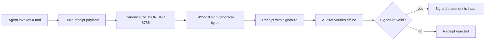
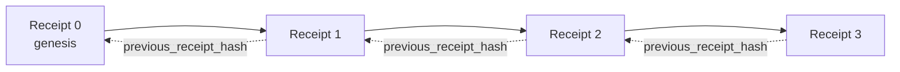

[Vaadake õppetunni videot: AI agentide turvamine krüptograafiliste kviitungitega](https://youtu.be/PLACEHOLDER_VIDEO_ID)

> _(Õppetunni video ja pisipilt lisatakse pärast ülevõtmist Microsofti sisutiimi poolt, vastavalt õppetunni 14 / 15 mustrile.)_

# AI agentide turvamine krüptograafiliste kviitungitega

## Sissejuhatus

See õppetund käsitleb järgmist:

- Miks on AI agentide auditijäljed olulised vastavuse, silumise ja usalduse jaoks.
- Mis on krüptograafiline kviitung ja kuidas see erineb allkirjastamata logireast.
- Kuidas luua allkirjastatud kviitung agenti tööriista kutsumiseks tavalise Pythoniga.
- Kuidas kontrollida kviitungit võrguühenduseta ja tuvastada näpistamist.
- Kuidas ühendada kviitungid ahelaks, nii et ühe eemaldamine või ümberjärjestamine katkestab ahela.
- Mida kviitungid tõendavad ja mida nad otseselt ei tõenda.

## Õppeeesmärgid

Pärast selle õppetunni läbimist oskad sa:

- Tuvastada ebaõnnestumise viisid, mis motiveerivad krüptograafilist päritolu agenttegevustele.
- Luua Ed25519 allkirjastatud kviitung kanonilise JSON andmepaketi kohta.
- Kontrollida kviitungit iseseisvalt ainult allkirjastaja avaliku võtmega.
- Tuvastada näpistamist, käivitades kinnitusprotsessi muudetud kviitungil uuesti.
- Luua räsi-ahelaga seotud järjestus kviitungitest ja selgitada, miks ahel on oluline.
- Eraldada, mida kviitungid tõendavad (omistamine, terviklikkus, järjestus) ja mida nad ei tõenda (tegevuse õigsus, poliitika kõvadus).

## Probleem: Sinu Agendi Auditijälg

Kujuta ette, et oled paigaldanud AI agendi Contoso Travel jaoks. Agent loeb kliendipäringud, kutsub lendude API-d, et otsida valikuid, ja broneerib istmed kliendi eest. Eelmise kvartali jooksul töötles agent 50 000 broneeringut.

Täna tuleb audiitor. Ta esitab lihtsa küsimuse: "Näita mulle, mida sinu agent tegi."

Sa annad üle logifailid. Audiitor vaatab neid ja esitab keerulisema küsimuse: "Kuidas ma tean, et neid logisid ei ole muudetud?"

See on auditijälje probleem. Enamik agentide paigaldusi tänapäeval tugineb:

- **Rakenduse logidele**: mida agent ise kirjutab, neid saab muuta igaüks, kellel on failisüsteemi juurdepääs.
- **Pilve logimisteenustele**: platvormi tasemel näpistamist tuvastavad, kuid ainult siis, kui audiitor usaldab platvormi opereerijat.
- **Andmebaasi tehingulogidele**: sobivad andmebaasi muudatuste jaoks, kuid mitte suvaliste tööriistakutsete jaoks.

Ükski neist ei suuda audiitori küsimusele vastata ilma, et audiitor peaks kedagi usaldama (sind, sinu pilveteenuse pakkujat, andmebaasi tarnijat). Sisemisel kasutusel on see usaldus sageli aktsepteeritav. Reguleeritud töökoormuste puhul (rahandus, tervishoid, mis tahes EL AI aktile alluv) see ei ole vastuvõetav.

Krüptograafilised kviitungid piiravad seda probleemi, muutes allkirjastatud avalduse iseseisvalt
kontrollitavaks. Audiitor vajab siiski väljaspool kanalit põhjust allkirjavõtit ja avalduse
koostanud komponenti usaldada. Sisseehitatud võti tõendab enesekonsistentsust,
mitte väljastaja identiteeti ega täitmise asetust.

## Mis on krüptograafiline kviitung?

Kviitung on JSON-objekt, mis registreerib, mida agent tegi, allkirjastatud digiallkirjaga.



Minimaalne kviitung näeb välja järgmiselt:

```json
{
  "type": "agent.tool_call.v1",
  "agent_id": "contoso-travel-bot",
  "tool_name": "lookup_flights",
  "tool_args_hash": "sha256:a3f9c1...",
  "result_hash": "sha256:7b2e1d...",
  "policy_id": "contoso-travel-policy-v3",
  "timestamp": "2026-04-25T14:30:00Z",
  "sequence": 47,
  "previous_receipt_hash": "sha256:9d4e6a...",
  "signature": {
    "alg": "EdDSA",
    "sig": "c5af83...",
    "public_key": "8f3b2c..."
  }
}
```

Kolm omadust täidavad tööd:

1. **Allkiri**. Kviitung on allkirjastatud agendi värava poolt Ed25519 privaatvõtmega. Kõik, kellel on vastav avalik võti, saavad võrguühenduseta allkirja kontrollida. Usaldav osapool peab selle võtme kas lukustama või hankima usaldusväärsest registrist väljaspool kviitungit. Ühegi allkirjastatud välja näpistamine teeb allkirja kehtetuks.

2. **Kanoneeritud kodeerimine**. Enne allkirjastamist serialiseeritakse kviitung JSON Kanoniseerimise skeemi (JCS, RFC 8785) abil. See tagab, et kaks sama loogilise kviitungi tootjat annavad täpselt sama bait-mahu väljundi. Ilma kanoniseerimiseta annaksid erinevad JSON serialiseerijad sama sisu kohta erinevaid allkirju.

3. **Räsi-ahel**. `previous_receipt_hash` väli seob iga kviitungi eelmise omaga. Kviitungi eemaldamine või ümberjärjestamine katkestab esitatud järjestuse. Lõpetamise või allkirjastaja kontrollitava ümberkirjutuse tuvastamiseks on vaja ka lukustatud kehtivat ahela algust, iseseisvalt tunnistatud kontrollpunkti või autentset suletud populatsiooni kohustust.

Koos pakuvad need omadused kolm garantiid:

- **Omistamine võtmele**: see võti allkirjastas selle sisu. Organisatsiooniline või inimidentiteet nõuab usaldusväärset võtme sidumist.
- **Terviklikkus**: sisu ei ole allkirjastamisest alates muutunud.
- **Järjestus kontrollitud järjestuses**: see kviitung viitab sellele eelkäijale.

## Kviitungi tootmine Pythonis

Kviitungi tootmiseks ei ole vaja erilist raamatukogu. Krüptograafilised primitiivid on laialdaselt kättesaadavad ning loogika on vaid mõnekümne rea pikkune Python.

Praktilised harjutused `code_samples/18-signed-receipts.ipynb` juhendavad kogu protsessi samm-sammult. Versioonikontrollitud `code_samples/18-signed-receipts.execution-receipt.json` salvestab täpse märkmehashi, Python keskkonna, lahtrite arvu ja viimase puhta täitmise kontrollid ilma õppetunni salvestatud väljundeid muutmata. Kokkuvõtte versioon:

```python
import json
import hashlib
import base64
from nacl import signing
from jcs import canonicalize  # RFC 8785 canonical JSON

def b64url_nopad(data: bytes) -> str:
    return base64.urlsafe_b64encode(data).decode("ascii").rstrip("=")

def sha256_canonical(obj) -> str:
    """SHA-256 of a Python object's JCS-canonical JSON form."""
    return f"sha256:{hashlib.sha256(canonicalize(obj)).hexdigest()}"

# Generate or load a signing key (in production, store in a key vault)
signing_key = signing.SigningKey.generate()
verify_key = signing_key.verify_key
TRUSTED_PUBLIC_KEYS = {b64url_nopad(bytes(verify_key))}  # pinned out of band by the verifier

# Build the receipt payload (no signature yet)
tool_args = {"origin": "SYD", "destination": "LAX"}
tool_result = [{"flight": "QF11", "price": 1850, "stops": 0}]

payload = {
    "type": "agent.tool_call.v1",
    "agent_id": "contoso-travel-bot",
    "tool_name": "lookup_flights",
    "tool_args_hash": sha256_canonical(tool_args),
    "result_hash": sha256_canonical(tool_result),
    "policy_id": "contoso-travel-policy-v3",
    "timestamp": "2026-04-25T14:30:00Z",
    "sequence": 0,
    "previous_receipt_hash": None,
}

# Canonicalize and sign the JCS bytes directly. PureEdDSA hashes internally.
canonical_bytes = canonicalize(payload)
signature_bytes = signing_key.sign(canonical_bytes).signature

# Attach a structured signature object.
receipt = {
    **payload,
    "signature": {
        "alg": "EdDSA",
        "sig": b64url_nopad(signature_bytes),
        "public_key": b64url_nopad(bytes(verify_key)),
    },
}
```

See on kogu allkirjastamise torujuhe. Märkmes olevad harjutused juhendavad iga sammu.

## Kviitungi kontrollimine ja näpistamise tuvastamine

Kontrollimine on pöörduv toiming:

```python
import base64
import hashlib
from nacl import signing
from nacl.exceptions import CryptoError
from jcs import canonicalize

def b64url_decode(s: str) -> bytes:
    padding = "=" * ((4 - len(s) % 4) % 4)
    return base64.b64decode(s + padding, altchars=b"-_", validate=True)

def verify_receipt(receipt: dict, trusted_public_keys: set[str]) -> bool:
    # The signature is a structured object: {"alg", "sig", "public_key"}.
    if not isinstance(receipt, dict):
        return False
    sig_obj = receipt.get("signature")
    if not isinstance(sig_obj, dict) or sig_obj.get("alg") != "EdDSA":
        return False
    try:
        # An inline key proves only self-consistency. Trust is configured out of band.
        public_key = sig_obj.get("public_key")
        signature = sig_obj.get("sig")
        if not isinstance(public_key, str) or not isinstance(signature, str):
            return False
        if public_key not in trusted_public_keys:
            return False
        payload = {k: v for k, v in receipt.items() if k != "signature"}
        canonical_bytes = canonicalize(payload)
        verify_key = signing.VerifyKey(b64url_decode(public_key))
        verify_key.verify(canonical_bytes, b64url_decode(signature))
        return True
    except (CryptoError, TypeError, ValueError, KeyError, OverflowError):
        return False
```

See funktsioon võtab vastu kviitungi ja usaldusosapoole lukustatud võtmekogu ning tagastab
`True` ainult juhul, kui allkiri on kehtiv aktsepteeritud võtme all. Kontrollimine ei vaja
võrguühendust, kuid võtme usaldamine on siiski väline konfiguratsiooniline otsus.

Näpistamise tuvastuse praktiseks demonstreerimiseks juhendab märkme treening:

1. Kehtiva kviitungi tootmist ja kinnitamist, et see tõesti kontrollitakse.
2. Ühe baidi muutmist `tool_args_hash` väljal.
3. Kontrollimise uuesti käivitamist ja selle ebaõnnestumist.

See on praktiline näide, et kviitungid on näpistamisekindlad: iga muudatus, olgu see nii väike tahes, katkestab allkirja.

## Kviitungite aheldamine mitme sammuga agentide jaoks

Üksik allkirjastatud kviitung kaitseb ühte tegevust. Kviitungite ahel kaitseb järjestust.



Iga kviitung salvestab põhimõtteliselt eelmise kviitungi räsi. Kviitungi 2 salaja eemaldamiseks peaks ründaja kas:

- Muutma kviitungi 3 `previous_receipt_hash` välja (rikub kviitungi 3 allkirja), VÕI
- Võltsima uut allkirja muudetud kviitungile 3 (nõuab agendi privaatvõtit).

Kui privaatvõti on kaitstud ja kontrollija lukustab iseseisvalt tunnistatud kehtiva ahela alguse,
saab neid rünnakuid tuvastada. Võtme avaldamine iga kviitungi sees ei piisa:
allkirjastaja või ründaja võib esitada teise võtme, ümber kirjutada järelliite või
lühendada ahelat, kui usaldav osapool ei oma välist usalduse ja terviklikkuse alust.

Märkmes juhendatakse:

1. Kolme kviitungi ahela loomist.
2. Kontrollimist, et iga kviitungi `previous_receipt_hash` vastab tegeliku eelmise kviitungi räsidele.
3. Ühe keskel oleva kviitungi näpistamist ja aru saamist, kuidas ahel katkes täpselt seal.

See on viis, kuidas toodad auditijälje, mida välisaudiitor saab kinnitada oma usalduse all.
oma kinnitatud emiteerija võtmed ja ketta vahekokkuvõtted, ilma et usaldaksite oma muutuvat logipoodi.

## Mida kviitungid tõendavad (ja mida mitte)

See on selle õppetunni kõige olulisem osa. Kviitungid on võimsad, kuid nende jõud on piiratud.

**Kviitungid tõendavad kolme asja:**

1. **Määratlus**: konkreetne võti allkirjastas konkreetse koormuse.
2. **Terviklikkus**: koormus ei ole allkirjastamisest alates muutunud.
3. **Tähtsus esitatud, kinnitatud järjestuses**: see kviitung seob selle eelkäijaga.

**Kviitungid EI tõenda:**

1. **Õigsus**: et agendi tegevus oli õige tegevus. Kviitungit saab allkirjastada ka vale vastuse puhul sama korrektselt kui õige puhul.
2. **Poliitika järgimine**: et poliitikat, millele viidatakse `policy_id`, tegelikult hinnati või et see oleks seda tegevust lubanud, kui seda kontrollida. Kviitung salvestab, mida väideti, mitte mida jõustati.
3. **Identiteet väljaspool võtit**: kviitung ütleb "see võti allkirjastas selle sisu." See ei ütle "see inimene andis loa." Võtme sidumine inimesega või organisatsiooniga nõuab eraldi identiteedi infrastruktuuri (kataloog, avaliku võtme registri jms).
4. **Sisendite tõepärasus**: kui agent saab manipuleeritud sisendi ja tegutseb selle põhjal, kajastab kviitung tegevust truult. Kviitungid on sisendite valideerimise järelprotsess, mitte selle asendaja.
5. **Täideviimine või tegelik mõju reaalses maailmas**: järeltõlke kviitung registreerib, mida selle emiteerija väidab juhtunud olevat. Vastuvõtu tõendamine või välise mõju kokkuleppimine nõuab tõendeid tegelikult täideviijalt või teenuse pakkuja piirilt.
6. **Terviklikkus**: puuduv kviitung võib tähendada blokeeritud, jäetud välja, kadunud või mitte instrmenteeritud. Puudumine saab tõendiks ainult autentitud sulges populatsioonis.
7. **Usaldusväärne aeg**: allkirjastatud ajatempli tõestab, et allkirjastaja kandis seda väärtust, mitte et väärtus oli õige. Usaldusväärne aeg vajab eraldi aja autoriteeti või tunnistatud vahekokkuvõtet.

See piir loeb kahes mõttes:

- See ütleb teile, milleks kviitungid kasulikud on: muuta agendi käitumine auditeeritavaks ja muutmiskindlaks isegi organisatsioonipiiride vahel.
- See ütleb teile, milliseid lisakihtide teil veel vaja on: sisendite valideerimist (õppetund 6), poliitika rakendamist (allpool lühidalt) ja identiteedi infrastruktuuri (selle õppetunni raamideväliselt).

Üks levinud viga on eeldada, et „meil on kviitungid“ tähendab „meid juhitakse.“ See ei ole nii. Kviitungid on alus. Juhtimine on süsteem, mille ehitate selle pinnale.

## Heakskiitja allkirja sidumine täpse tegevusega

Ülaltoodud punkt 3 väärib omaette peatükki: tegevuse kviitung ütleb "see võti allkirjastas selle sisu," mitte kunagi "inimene andis loa." Kõrge riskiga tegevuste puhul (tagasimaksed, kustutamised, ülekanded) võib eraldi heakskiitja allkiri siduda täpse tegevusega. Selle võtme sidumine inimesega ja inimeste kohaloleku kontrollimine jäävad eriks kohustusteks.

Järgmine märkmik `code_samples/human-authorization-receipts.ipynb` lisab teise tšeki tüübi, `human.approval.v1`, samas ümbrise kujunduses nagu tunni tšekid (tüübitud koormus, mille Ed25519 allkirjastab selle kanoniliste JCS baitide üle, kus `signature` objekt asub allkirjastatud baitidest väljaspool). Heakskiitja võti allkirjastab **täieliku kanonilise toimingu ja selle räsi**; agendi võti allkirjastab väite, mis kannab **sama toimingu räsi** ja `parent_approval_ref`, heakskiidu `receipt_hash`, sama tava mis `previous_receipt_hash` ahelas, mille olukorda eespool ehitasite. Üks `verify_chain` käib läbi mõlemad esemed **eraldi kinnitatud võtme registrite all** (heakskiitja võtmed vs agendi võtmed), nii et koodi tee on jagatud, kuid volitused ei ole kunagi.

See omadus, mille see võimaldab, on hoolikalt sõnastatud: *kinnitatud heakskiitja võti allkirjastas täpselt selle
toimingu ja agendi võti allkirjastas hiljem avalduse, mis kandev sama toimingu räsi.*
See on kasulik tõendus, kuid iseenesest ei ole see tõenduseks, et toiming viidi ellu. Juhtimise jaoks peab täpne heakskiit olema ka reserveeritud ja tarbitud üks kord tegeliku täitja piiril; tundmatud pakkuja tulemused peavad jääma tundmatuks, mitte neid pimedalt uuesti proovima. Märkmiku keeldumise fikseerimised testivad tšeki-ahela kihti:

- manipuleerimine, segadusseajamine, võltsitud võtmed mõlemal pool ja vigane sisend;
- **välja aegunud volitus**: allkiri, mis siiski kehtib, keelduti ikkagi kuna poliitika versioon nihkus, heakskiitja võti eemaldati kinnitatud registrist või heakskiidu aegumistähtaeg jäi pakutud kontrollaja ette;


- **aegunud volitus**: allkiri, mis tuvastab endiselt õigesti, kuid lükati siiski tagasi, kuna poliitika versioon liikus, kinnitaja võti eemaldati fikseeritud registrist või kinnituse aeg lõppes enne esitatud kontrollimise aega;
- **kontrollsumma asendus**: kehtivalt allkirjastatud toimingu kviitung, mis osutab *päris* kinnitusele, mis seob *erinevat* kanonilist toimingut.

Iga tõrge keelatakse eraldi põhjusega, nii et auditeerija, kes keeldumist loeb, saab aru, kas volitus aegus või väidetud tegevus muutus. Kinnitamine on ainult lugemiseks ja korduvalt teostatav: see ei tarbi heakskiitu ega kutsu esile pakkujat. Eraldi täitjal on vaja vastupidavat, aatomilist kordusblokeerimist ning selget edu, ebaõnnestumise ja ebamääraste tulemuste märkimist. Inimkinnitusega kviitung on selle õppetüki määratletud hariduslik kooste, mitte `draft-farley-acta-signed-receipts` määratletud kviitungitüüp.

## Tootmisviited

Selle õppetüki Pythoni kood on meelega minimaalne, et saaksite iga rea lugeda ja täpselt aru saada, mis toimub. Tootmises on teil kaks valikut:

1. **Ehitage otse krüptograafiliste primitiivide peale.** Ülaltoodu 50 rida on paljude kasutusjuhtumite jaoks piisav. PyNaCl (Ed25519) ja `jcs` pakett (kanoniline JSON) on hästi hooldatud ja auditeeritud teegid.

2. **Kasutage tootmiskviitungite teeki.** Mitmed avatud lähtekoodiga projektid rakendavad sama mustrit täiendavate funktsioonidega (võtme pööramine, hulgikinnitus, JWK komplekti levitamine, integratsioon poliitikamootoritega):
   - Allkirjastamise torujuhtme kasutab JCS ja allkirja ulatuse konventsioone iseseisvas IETF Internet-Draft'is ([`draft-farley-acta-signed-receipts`](https://datatracker.ietf.org/doc/draft-farley-acta-signed-receipts/), versioon 02). Selle õppetüki lihtne hariduslik kviitung erineb draft'i `{payload, signature}` ümbrikult ega ole esitatud kooskõlastuva rakendusena. Draft avaldab ühise vastavussarja ([agent-governance-testvectors](https://github.com/ScopeBlind/agent-governance-testvectors)) rakendustele, mis sihivad selle traadi formaati.
   - Microsoft Agent Governance Toolkit koostab kviitungeid Cedar-põhiste poliitikotsustega; vaadake selle hoidla õppetükki 33 lõpp-lõpuni näite jaoks.
   - Paketid `protect-mcp` (npm) ja `@veritasacta/verify` (npm) pakuvad Node-põhist implementatsiooni kviitungi allkirjastamiseks ja võrguühenduseta kontrollimiseks, mis on mõeldud igale MCP-serverile kehtetu muutumise tõestusega auditeerimistrajektoori lisamiseks, sealhulgas kaas-autentimise jaoks hoidmisvoog, kus pausile pandud tegevus väljastab tegevuse digesti külge seotud kinnituskviitungi (lauaarvuti voos WebAuthn-il baseeruv), sama kinnituskviitungi muster nagu inimese-autentimise märkmikus eespool.
   - **[nobulex](https://github.com/arian-gogani/nobulex)** Python SDK (`pip install nobulex`) pakub sama Ed25519 + JCS allkirjastamismustrit Pythonis koos LangChaini ja CrewAI integratsioonidega, sealhulgas avaldatud ristvalideerimise testivektorite ja vastavuskaardistusega, mille on panustanud [OWASP PR #2210](https://github.com/OWASP/CheatSheetSeries/pull/2210).
   - **[EMILIA Protocol](https://github.com/emiliaprotocol/emilia-protocol)** pakub täiendavat täpse toimingute täitmise kihti: võrguühenduseta kontrollitavad kinnitused, kinnitatud WebAuthn või kvoorumi volitus, ühekordne tarbimine täitja piiril ja ekspressiivne määramatus väljundirada. Selle raamistikuga adapterid käsitlevad kviitungeid kui vajalikku tõendusmaterjali, mitte kinnitust, et väline efekt toimus.

Otsus oma lahenduse kirjutamise ja raamatukogu kasutamise vahel on sarnane otsusega kirjutada oma JWT raamatukogu või kasutada testitud raamatukogu: mõlemad on mõttekad; raamatukogu säästab aega ja vähendab auditi ulatust; nullist alustamine sunnib mõistma iga primitiivi. See õppetund õpetab nullist alustamist, nii et sul oleks alus mõlemaks valikuks.

## Teadmiste kontroll

Testi oma mõistmist enne harjutuse juurde liikumist.

**1. Kviitung on allkirjastatud agendi privaatvõtmega Ed25519. Audiitoril on ainult avalik võti. Kas audiitor saab kviitungi võrguühenduseta kinnitada?**

<details>
<summary>Vastus</summary>

Jah, krüptograafiliseks kinnituseks on vaja ainult avalikku võtit ja allkirjastatud baite. 
Audiitor peab siiski sõltumatult saama ja kinnitama aktsepteeritud avaliku võtme. 
Pärast selle usalduskonfiguratsiooni kehtestamist ei ole vajalikud võrgukutsed.
</details>

**2. Ründaja muudab kviitungi `policy_id` välja, väites, et see allub leebemale poliitikale. Allkiri oli algse koormuse üle. Mis juhtub tõestamise käigus?**

<details>
<summary>Vastus</summary>

Tõestamine ebaõnnestub. Allkiri arvutati originaalse koormuse kanooniliste baitide üle; mis tahes välja muutmine muudab neid baite, mis teeb allkirja kehtetuks. Ründajal oleks vaja privaatvõtit, et toota uus kehtiv allkiri, mida tal pole.
</details>

**3. Miks sisaldab kviitung `tool_args_hash` ja `result_hash`, mitte toorargumente ja tulemust?**

<details>
<summary>Vastus</summary>

Kaks põhjust. Esiteks võib kviitungit vaja olla arhiveerida või edastada keskkondades, kus tooraine avalikustamine (PII, äridata) on probleemiks. Räsi hoiab kviitungi väikese ja sisu privaatse; audiitor kontrollib, et räsi vastab eraldi hoitavale tegeliku sisu koopiale. Teiseks on räside suurus fikseeritud; kviitung räsidega on suuruselt piiritletud olenemata sisendite ja väljundite suurusest.
</details>

**4. `previous_receipt_hash` väli seob iga kviitungi eelkäijaga. Kui ründaja kustutab vaikides ühe kviitungi ketist, mis muutub kehtetuks?**

<details>
<summary>Vastus</summary>

Järgmine esitatud kviitung ei seostu enam oodatud eelkäijaga, seega ebaõnnestub selle esitatud järjestuse tõestamine tühiku lõpust alates. Kui allkirjastaja kontrollib privaatvõtit, saab ta ümber kirjutada või lõigata lõppu. Selle tuvastamiseks on vaja fikseeritud praegust otsa, välist lõpp-punkti või autentitud populatsiooni pühendumust.


</details>

**5. Kviitung tõestab kenasti. Kas see tõestab, et agendi tegevus oli korrektne, õige või poliitikaga kooskõlas?**

<details>
<summary>Vastus</summary>

Ei. Fikseeritud võtme ja keti kontekstis tõendab kehtiv kviitung allkirja atribuutikat, sisu terviklikkust ja linki esitatud eelkäijale. See EI tõesta, et tegevus oli õige või täidetud, et poliitikat hinnati, et ajatemplit usaldati või et kirjetekomplekt on täielik. See on selle õppetunni kõige olulisem piir.


</details>

## Praktiline ülesanne

Ava `code_samples/18-signed-receipts.ipynb` ja lõpeta kõik neli jaotist:

1. **Jaotis 1**: Allkirjasta oma esimene kviitung ja tõesta see.
2. **Jaotis 2**: Manipuleeri kviitungiga ja vaata, kuidas tõestamine ebaõnnestub.
3. **Jaotis 3**: Koosta kolmekihtiline kviitungite kett ja tõesta keti terviklikkus.
4. **Jaotis 4**: Rakenda muster agentidele, mis on ehitatud Microsoft Agent Frameworki alusel: paki tööriistakutse kviitungi allkirjastamisse ja seejärel tõesta kviitung iseseisvalt.

**Lisaväljakutse 1:** Laienda kviitungi skeemi lisaväljaga, mille valid ise (näiteks päringu ID jälgimiseks), uuenda kanoonilist allkirjastamise loogikat selle lisamiseks ja kinnita, et kviitung läbib tõestuse korralikult edasi-tagasi. Seejärel muuda väli pärast allkirjastamist ja kinnita, et tõestamine ebaõnnestub. See sunnib mõistma, kuidas iga kanoonilise kodeerimise bait on allkirjas oluline.

**Lisaväljakutse 2:** Räsi kahte kviitungit SHA-256ga koos (ühenda nende kanoonilised baitid deterministlikus järjekorras) ja kasuta saadud räsi kolmanda kviitungi uue väljana enne selle allkirjastamist. Tõesta, et kõik kolm kviitungit ikka läbivad kontrolli. Oled just loonud üheastmelise kaasamisdokumendi: iga, kellel on kolmas kviitung, saab tõendada, et kaks esimest kviitungit eksisteerisid nende allkirjastamise hetkel, ilma nende sisu avaldamata. See on muster, mida selektiivsete avalikustamistega kviitungid suurel skaalal kasutavad (Merkle pühendumised, RFC 6962).

## Kokkuvõte

Krüptograafilised kviitungid annavad tehisintellekti agentidele auditijälje, mis on:

- **Iseseisvalt tõestatavad fikseeritud usaldusega**: osaline pool, kellel on vastuvõetud avalikud võtmed ja allkirjastatud baitid, saab tõendada ilma teenuse sõltuvuseta.
- **Manipulatsioonitõendavad**: iga muudatus muudab allkirja kehtetuks.
- **Üle kantavad**: kviitung on väike JSON-fail; seda saab arhiveerida, edastada ja tõestada kõikjal.
- **Standarditega kooskõlas**: ehitatud Ed25519 (RFC 8032), JCS (RFC 8785) ja SHA-256 peale, kõik laialt kasutatavad primitiivid.

Need ei asenda sisendi valideerimist, poliitika rakendamist, täitja aktsepteerimist,
tulemi tõestust, täielikkuse kontrolli ega identiteedistruktuuri. Need on aluseks
neile kihtidele. Reguleeritud või mitmeorganisatsiooniliste töövoogude korral teevad kviitungid konkreetsete
väljastajate avaldused audiitori enda usalduskonfiguratsioonis iseseisvalt kontrollitavaks.

Kõige tähtsam järeldus: kviitungid tõendavad, et kindel võti allkirjastas kindla sisu. Kaasatud ajatemperatuur on allkirjastaja väide, kui seda ei toetata eraldi ajategemisega. Kviitung ei tõesta, et selle sisu oli tõene, et tegevus toimus või et kirjete komplekt on täielik. Hoia need erinevused selgelt meeles.


## Tootmisvalmis kontrollnimekiri

Kui oled valmis selle õppetunni lõpetama ja võtma vastu kviitungi-allkirjastusega agente reaalses keskkonnas:

- [ ] **Eralda allkirjastamise võti arendajal sülearvutist.** Kasuta Azure Key Vaulti, AWS KMS-i või riistvaralist turvalisuse moodulit. Privaatvõti, millega kviitungid allkirjastatakse, ei tohi kunagi olla lähtekoodi haldussüsteemis ega masinatele lugemiselge tekstina.
- [ ] **Kehtesta tõestajate võtmete usaldus.** Avalikusta võtmed JWK komplekti või registri kaudu, siis las usaldavad osapooled fikseerivad vastuvõetud väljastaja identiteedi, võtmekomplekti ja rotatsioonipoliitika väljaspool üksikuid kviitungeid. Inline-võti üksi ei ole usaldusankur.
- [ ] **Fikseeri kett väliselt.** Kirjuta perioodiliselt viimase keti tipu räsi läbipaistvuse logisse (Sigstore Rekor, RFC 3161 ajatempli autoriteet või teise sisemise süsteemi) nii, et väline osapool saab kinnitada "see kett eksisteeris sellel ajal."
- [ ] **Salvesta kviitungid muutumatult.** Lisa-ainult blob-salvestus (Azure Storage koos muutumatuse poliitikatega, AWS S3 objektlukk) takistab sisespoilajatel ajalugu kirjutada salvestuskihis ümber.
- [ ] **Otsusta säilitamise üle.** Paljud vastavusreeglid nõuavad mitmeaastast säilitust. Plaani kviitungi mahtu (iga kviitung on ~500 baiti; agent, kes teeb 10 000 kõnet päevas, toodab ~1,8 GB aastas).
- [ ] **Kirjelda, mida kviitungid ei hõlma.** Kviitungid tõendavad atribuutikat, terviklikkust ja järjestust. Sinu töökäsiraamatus peaks olema selgelt kirjas, millised täiendavad kontrollid (sisendi valideerimine, poliitika rakendamine, läbipääsu piiramine, identiteedistruktuur) on kviitungite kõrval sinu juhtimispositsioonis.

### Kas Sul on rohkem küsimusi AI agentide turvamise kohta?

Liitu [Microsoft Foundry Discordiga](https://aka.ms/ai-agents/discord), et kohtuda teiste õppijatega, osaleda kontoriajades ja saada vastused oma AI agentide küsimustele.

## Selle õppetunni järel

See õppetund käsitleb ühekordset kviitungi allkirjastamist ja räsidega seotud järjestusi. Samad primitiivid moodustavad mitmeid keerukamaid mustreid, millega võid kokku puutuda, kui sinu juhtimispraktika areneb:

- **Selektiivne avalikustamine.** Kui kviitungi väljad on iseseisvalt pühendatud (RFC 6962-laadne Merkle puu), võid paljastada spetsiifilisi välju spetsiifilistele audiitoritele ja tõendada, et ülejäänud pole muutunud, ilmsiks tegemata neid. Kasulik, kui samal kviitungil peab olema nii põhjalik audit (mis nõuab täielikkust) kui ka andmete minimaalset avalikustamist nagu GDPR (mis soovib audiitori näha nii vähe kui võimalik).
- **Kviitungite tühistamine.** Kui allkirjastamisvõti kompromiteerub, on vaja võimalust tähistada kõik selle võtmega allkirjastatud kviitungid pärast kindlat aega usaldamatuteks. Standardmustrid: lühiajalised allkirjastamisvõtmed koos avaldatud tühistamisnimekirjaga või läbipaistvuse logi tühistamiskirjetega.
- **Kaks- või jagatud allkirjaga kviitungid.** Mõned teostused jagavad allkirjastatud koormuse täitmise-eelseks (`authorization_*`) ja täitmise-järgseks (`result_*`) pooleks iseseisvate allkirjadega, mis on kasulik, kui autorisatsioon otsus ja vaadeldav tulemus toodetakse erinevate osapoolte või eri aegadel. See lisandub selle õppetunni kviitungivormingule.
- **Koormuse koostamine.** Kviitung sulgeb ükskõik millised baitid, mille paned `result_hash` sisse. Reaalmaailma koormused on sageli rikkalikumad kui ühe tööriistakutse tulemus: otsuse eelne mõtlemine (mudeli ennustus, kaalutletud valikud, tõendid ja nende täielikkus, riskipositsioon, vastutusahela tulemus) võivad kõik elada koormuses, mida hoiab üksainus kviitung. See hoiab kviitungi formaadi minimaalsete juures, võimaldades samal ajal koormuse skeemidel domeeniti areneda.
- **Ristteostuse kooskõla.** Mitmed sõltumatud teostused samast kviitungiformaadist (Python, TypeScript, Rust, Go) kontrollivad omavahel jagatud testvektorite alusel. Kui ehitad oma teostuse, kinnitab avaldatud vektorite valideerimine juurdepääsuühilduvust.
- **Kvantarvutuste järelmigreerimine.** Ed25519 on laialt levinud, kuid ei ole kvantarvutuste kaitsega. Üksnes `alg` silt ei ole migratsioon: profiil peab määratlema ML-DSA võtme kodeerimise, kanoonilised allkirjastatud baitid, tõestamise, sõltuva osapoole poliitika, tagasitõmbekindluse ja ülemineku semantika. Plaani ja testi kahekordse allkirja üleminekut jagatud vektorite vastu enne ühilduvuse avaldust.

## Lisamaterjalid

- <a href="https://datatracker.ietf.org/doc/draft-farley-acta-signed-receipts/" target="_blank">IETF Internet-Draft: Masina vahelise juurdepääsu kontrolli allkirjastatud otsuse kviitungid</a>
- <a href="https://learn.microsoft.com/azure/ai-studio/responsible-use-of-ai-overview" target="_blank">Vastutustundliku tehisintellekti ülevaade (Azure AI)</a>
- <a href="https://datatracker.ietf.org/doc/html/rfc8032" target="_blank">RFC 8032: Edwards-kõvera digiallkirja algoritm (EdDSA)</a>
- <a href="https://datatracker.ietf.org/doc/html/rfc8785" target="_blank">RFC 8785: JSONi kanoonilise kujunduse skeem (JCS)</a>
- <a href="https://datatracker.ietf.org/doc/html/rfc6962" target="_blank">RFC 6962: Sertifikaadi läbipaistvus</a> (Merkle-puu konstruktsioon, mida kasutavad selektiivse avalikustamise kviitungid)
- <a href="https://github.com/microsoft/agent-governance-toolkit/blob/main/docs/tutorials/33-offline-verifiable-receipts.md" target="_blank">Microsoft Agent Governance Toolkit, õppetund 33: Võimalus tõestada otsuse kviitungeid ilma võrguühenduseta</a>
- <a href="https://github.com/ScopeBlind/agent-governance-testvectors" target="_blank">Ristteostuse kooskõla testvektorid</a> selle õppetunni kviitungiformaadi jaoks (Apache-2.0)
- <a href="https://pynacl.readthedocs.io/" target="_blank">PyNaCl dokumentatsioon</a> (Ed25519 Pythoni jaoks)

## Eelmine õppetund

[Kohalike AI agentide loomine](../17-creating-local-ai-agents/README.md)

---

<!-- CO-OP TRANSLATOR DISCLAIMER START -->
**Lahtiütlus**:
See dokument on tõlgitud kasutades AI tõlketeenust [Co-op Translator](https://github.com/Azure/co-op-translator). Kuigi me püüdleme täpsuse poole, palun pange tähele, et automatiseeritud tõlgetes võib esineda vigu või ebatäpsusi. Originaaldokument selle emakeeles tuleks pidada autoriteetseks allikaks. Olulise teabe puhul soovitatakse kasutada professionaalset inimtõlget. Me ei vastuta selle tõlkega seotud eksimustest või valesti mõistmistest.
<!-- CO-OP TRANSLATOR DISCLAIMER END -->