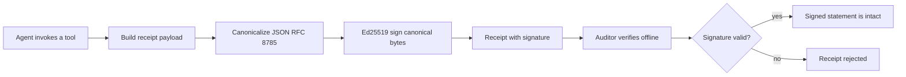
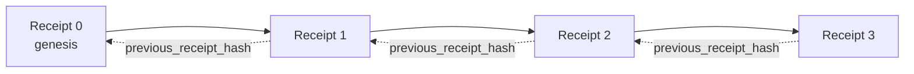

[Vaadake õppetunni videot: AI agentide turvamine krüptograafiliste kviitungitega](https://youtu.be/PLACEHOLDER_VIDEO_ID)

> _(Õppetunni video ja pisipilt lisab pärast ühildamist Microsofti sisutiim, järgides õppetunni 14 / 15 mustrit.)_

# AI agentide turvamine krüptograafiliste kviitungitega

## Sissejuhatus

Selles õppetunnis käsitletakse:

- Miks on auditijäljed AI agentide puhul olulised vastavuse, silumise ja usalduse tagamiseks.
- Mis on krüptograafiline kviitung ja kuidas see erineb allkirjastamata logireast.
- Kuidas toota agentide tööriistakutse jaoks allkirjastatud kviitungi tavalise Pythoniga.
- Kuidas kviitungit võrrelda võrguühenduseta ja tuvastada võltsimist.
- Kuidas kviitungeid ahelasse ühendada nii, et ühe eemaldamine või ümberjärjestamine katkestab ahela.
- Mida kviitungeid tõendavad ja mida nad otseselt ei tõenda.

## Õpieesmärgid

Pärast selle õppetunni lõpetamist oskate:

- Tuvastada tõrketüüpe, mis motiveerivad agentide tegevuste krüptograafilist päritolu jälgimist.
- Toota Ed25519 allkirjastatud kviitungi kanonilise JSON andmepaki kohta.
- Kontrollida kviitungit iseseisvalt, kasutades ainult allkirjastaja avalikku võtit.
- Tuvastada võltsimist, kontrollides muudetud kviitungit uuesti.
- Ehita räsi ahelaga kviitungite jada ja selgita, miks ahel on oluline.
- Tunnustada piiri selle vahel, mida kviitungeid tõendavad (attribuut, terviklikkus, järjestus) ja mida nad ei tõenda (tegevuse õigsus, poliitika kehtivus).

## Probleem: teie agendi auditeerimislõik

Kujutage ette, et olete välja andnud AI agendi Contoso Travel'ile. Agent loeb kliendi päringuid, kutsub lennupiletite API-d, et leida võimalused, ja broneerib klientide nimel kohti. Eelmisel kvartalil töötles agent 50 000 broneeringut.

Täna tuleb audiitor. Ta esitab lihtsa küsimuse: "Näita mulle, mida su agent tegi."

Anda üle oma logifailid. Audiitor vaatab neid ja esitab keerulisema küsimuse: "Kuidas ma tean, et neid logisid ei ole muudetud?"

See on auditijälje probleem. Enamik tänaseid agendi kasutuselevõtte sõltub:

- **Rakenduse logidest**: mida kirjutab agent ise, ja mida võib muuta igaüks, kellel on failisüsteemile ligipääs.
- **Pilveserveri logiteenustest**: süsteemiltasemel võltsimistuvastusega, kuid ainult juhul, kui audiitor usaldab platvormi operaatorit.
- **Andmebaasi tehingulogidest**: sobivad hästi andmebaasi muudatuste jaoks, kuid mitte suvalistele tööriistakutsele.

Ükski neist ei suuda audiitori küsimusele vastata ilma, et audiitor peaks kedagi usaldama (teid, teie pilvepakkujat, teie andmebaasi müüjat). Sisemiseks kasutamiseks on see usaldus sageli vastuvõetav. Reguleeritud töökoormade puhul (finants, tervishoid, kõik EL AI seaduse alla kuuluv) see nii ei ole.

Krüptograafilised kviitungid kitsendavad seda probleemi, muutes allkirjastatud avalduse iseseisvalt
kontrollitavaks. Audiitor vajab siiski väljaspool kanalit põhjendust allkirjavõtme ja
avalduse tootnud komponendi usaldamiseks. Sisemiselt manustatud võti tõendab enesekooskõla,
mitte väljaandja identiteeti ega jõustamise asukohta.

## Mis on krüptograafiline kviitung?

Kviitung on JSON-objekt, mis salvestab, mida agent tegi, allkirjastatud digitaalse allkirjaga.



Minimaalne kviitung näeb välja selline:

```json
{
  "type": "agent.tool_call.v1",
  "agent_id": "contoso-travel-bot",
  "tool_name": "lookup_flights",
  "tool_args_hash": "sha256:a3f9c1...",
  "result_hash": "sha256:7b2e1d...",
  "policy_id": "contoso-travel-policy-v3",
  "timestamp": "2026-04-25T14:30:00Z",
  "sequence": 47,
  "previous_receipt_hash": "sha256:9d4e6a...",
  "signature": {
    "alg": "EdDSA",
    "sig": "c5af83...",
    "public_key": "8f3b2c..."
  }
}
```

Kolm omadust töötavad:

1. **Allkiri**. Kviitungi allkirjastab agendi värav Ed25519 privaatvõtmega. Kõik, kellel on selle vastu vastav avalik võti, saavad allkirja võrguühenduseta kontrollida. Usalduspartner peab selle võtme fikseerima või leidma usaldusväärsest registrist väljaspool kviitungit. Mis tahes allkirjastatud välja võltsimine tühistab allkirja.

2. **Kanoniline kodeerimine**. Enne allkirjastamist serialiseeritakse kviitung JSON Kanoniseerimisskeemi (JCS, RFC 8785) abil. See tagab, et kaks sama loogilist kviitungit tootevat rakendust toodavad bait- identse väljundi. Ilma kanoniseerimiseta toodaksid erinevad JSON-sarjastajad sama sisu korral erinevaid allkirju.

3. **Räsi ahel**. `previous_receipt_hash` väli seob iga kviitungi eelnevaga. Kviitungi eemaldamine või ümberjärjestamine katkestab esitatud järjestuse. Lõikamise või allkirjastaja kontrollitud ümberkirjutuse tuvastamine nõuab ka fikseeritud hetkel ahela pead, iseseisvalt tunnistatud kontrollpunkti või autentitud suletud populatsiooni kohustust.

Need omadused koos annavad kolm garantiid:

- **Võtmepädevus**: see võti allkirjastas selle sisu. Organisatsiooni või inimese identiteet nõuab usaldusväärset võtme sidumist.
- **Terviklikkus**: sisu pole allkirjastamisest alates muutunud.
- **Järjestus kontrollitud järjestuses**: see kviitung seob end eelkäijaga.

## Kviitungi tootmine Pythonis

Kviitungi tootmiseks pole vaja spetsiaalset teeki. Krüptograafilised primitiivid on laialdaselt saadaval ja loogika on mõnesajarealine Python.

Käed-külge harjutused `code_samples/18-signed-receipts.ipynb` juhendavad kogu protsessi. Versioonihalduses olev `code_samples/18-signed-receipts.execution-receipt.json` salvestab täpse sülearvuti räsiväärtuse, Python keskkonna, rakuridade arvu ja viimase puhastamise kontrollid, ilma et muudaks õppetunni salvestatud väljundit. Kokkuvõte:

```python
import json
import hashlib
import base64
from nacl import signing
from jcs import canonicalize  # RFC 8785 canonical JSON

def b64url_nopad(data: bytes) -> str:
    return base64.urlsafe_b64encode(data).decode("ascii").rstrip("=")

def sha256_canonical(obj) -> str:
    """SHA-256 of a Python object's JCS-canonical JSON form."""
    return f"sha256:{hashlib.sha256(canonicalize(obj)).hexdigest()}"

# Generate or load a signing key (in production, store in a key vault)
signing_key = signing.SigningKey.generate()
verify_key = signing_key.verify_key
TRUSTED_PUBLIC_KEYS = {b64url_nopad(bytes(verify_key))}  # pinned out of band by the verifier

# Build the receipt payload (no signature yet)
tool_args = {"origin": "SYD", "destination": "LAX"}
tool_result = [{"flight": "QF11", "price": 1850, "stops": 0}]

payload = {
    "type": "agent.tool_call.v1",
    "agent_id": "contoso-travel-bot",
    "tool_name": "lookup_flights",
    "tool_args_hash": sha256_canonical(tool_args),
    "result_hash": sha256_canonical(tool_result),
    "policy_id": "contoso-travel-policy-v3",
    "timestamp": "2026-04-25T14:30:00Z",
    "sequence": 0,
    "previous_receipt_hash": None,
}

# Canonicalize and sign the JCS bytes directly. PureEdDSA hashes internally.
canonical_bytes = canonicalize(payload)
signature_bytes = signing_key.sign(canonical_bytes).signature

# Attach a structured signature object.
receipt = {
    **payload,
    "signature": {
        "alg": "EdDSA",
        "sig": b64url_nopad(signature_bytes),
        "public_key": b64url_nopad(bytes(verify_key)),
    },
}
```

See on kogu allkirjastamispipeline. Sülearvuti harjutused juhendavad iga sammu.

## Kviitungi kontroll ja võltsimise tuvastamine

Kontrollimine on vastupidine toiming:

```python
import base64
import hashlib
from nacl import signing
from nacl.exceptions import CryptoError
from jcs import canonicalize

def b64url_decode(s: str) -> bytes:
    # Strict: Python's decoder skips characters outside the alphabet and also
    # accepts padding, the standard +/ alphabet and non-zero spare bits.
    # Re-encoding and comparing accepts only the one unpadded base64url form.
    padding = "=" * ((4 - len(s) % 4) % 4)
    data = base64.urlsafe_b64decode(s + padding)
    if base64.urlsafe_b64encode(data).decode("ascii").rstrip("=") != s:
        raise ValueError("not canonical unpadded base64url")
    return data

def verify_receipt(receipt: dict, trusted_public_key: str) -> bool:
    # trusted_public_key is the issuer's key, obtained from somewhere other
    # than this receipt. Never use receipt["signature"]["public_key"] here:
    # see "What Receipts Prove (and What They Do Not)" below.
    # Fails closed: anything malformed returns False instead of raising.
    if not isinstance(receipt, dict) or not isinstance(trusted_public_key, str):
        return False
    sig_obj = receipt.get("signature")
    if not isinstance(sig_obj, dict) or sig_obj.get("alg") != "EdDSA":
        return False
    sig_b64 = sig_obj.get("sig")
    if not isinstance(sig_b64, str):
        return False

    try:
        # Reconstruct the payload that was actually signed (everything except signature).
        payload = {k: v for k, v in receipt.items() if k != "signature"}
        canonical_bytes = canonicalize(payload)
        verify_key = signing.VerifyKey(b64url_decode(trusted_public_key))
        verify_key.verify(canonical_bytes, b64url_decode(sig_b64))
        return True
    except (CryptoError, TypeError, ValueError, KeyError, OverflowError):
        return False
    except Exception:
        # An undecodable key or signature, or a payload that cannot be
        # canonicalized: fail closed rather than raise.
        return False
```

See funktsioon võtab vastu kviitungi ja väljaandja avaliku võtme ning tagastab `True`, kui allkiri on kehtiv, ja `False` muul juhul, sh kui sisend on vigane. Võrguühendust ega kontrolliteenust ei ole vaja: kui hoiate väljaandja võtit, on kontroll täiesti lokaalne ja võrguühenduseta. Mida see siiski vajab, on see võti, mis tuleb kuskilt mujalt kui kviitung ise.

Võltsimise tuvastamise nägemiseks juhendab sülearvuti:

1. Kehtiva kviitungi tootmine ja selle kontrollimise kinnitamine.
2. Ühe `tool_args_hash` välja baidi muutmine.
3. Kontrollimist uuesti läbi viies ja ebaõnnestumist näha.
4. Võltsimist uuesti, kuid seekord ümberallkirjastades ründaja loodud võtmega ja selle võtme kviitungisse lisades.

4. samm väärib peatumist. See kviitung on sisemiselt kooskõlaline: selle allkiri on ehtne selle sisu ja selle võtme jaoks, mida see kannab, nii et see kinnitab sisemise võtmega. See ebaõnnestub alles siis, kui kontrollida väljaandja päris võtmega. Sammud 2 ja 3 tabavad ründajat, kes ei viitsinud ümberallkirjastada; samm 4 tabab selle, kes tegi.

See on praktiline näide, et kviitungid on võltsimistuvastavad: mis tahes muutus allkirjastatud väljas purustab allkirja, eeldusel et kontrollite võtit, mida ründaja ei ole esitanud. `signature` objekt ise on allkirjastatud baitidest väljas, mistõttu peab kontrolliks kasutatav võti tulema mujalt kui kviitung ise.

## Kviitungite aheldamine mitmeastmeliste agentide jaoks

Üks allkirjastatud kviitung kaitseb ühte tegevust. Kviitungite ahel kaitseb järjekorda.



Iga kviitung salvestab eelneva kviitungi räsi. Kviitungi 2 vaikimisi eemaldamiseks peaks ründaja kas:

- Muutma kviitungi 3 `previous_receipt_hash` välja (purustab kviitungi 3 allkirja), VÕI
- Valmista võltsallkiri muudetud kviitungile 3 (nõuab agendi privaatvõtit).

Kui privaatvõti asub riistvaralises võtmekapslis ja kontrollijad kontrollivad iga kviitungi väljaandja avaliku võtmega, mis on iseseisvalt hangitud (avaldatud JWK komplekt või fikseeritud konfiguratsiooniväärtus), pole kumbki rünnak teostatav ilma avastamata. Võtme avaldamine iga kviitungi sees ei piisa: ründaja saab ümberallkirjastada oma võtmega ja lisada selle asemel, mis on fikstur `04_resigned_receipt.json`.

Sülearvuti juhendab:

1. Kolme kviitungi ahela loomist.
2. Iga kviitungi `previous_receipt_hash` vastavuse kontrollimist eelmise kviitungi tegeliku räsi vastu.
3. Ühe kviitungi võltsimist keskel ja ahela katkemist täpselt sellel kohal.

See on, kuidas toodate auditeerimisjälje, mida väline audiitor saab kinnitada oma
endi fikseeritud väljaandja võtmete ja ahela kontrollpunktidega, ilma et usaldaks teie muutuvat logipoega.

## Mida kviitungeid tõendavad (ja mida mitte)

See on selle õppetunni kõige olulisem osa. Kviitungid on võimsad, kuid nende võimsus on piiratud.

**Kviitungid tõendavad kolme asja:**

1. **Võtmepädevus**: konkreetne võti allkirjastas konkreetse andmepaki.
2. **Terviklikkus**: andmepakett pole allkirjastamisest saadik muutunud.
3. **Järjestus esitatud ja kinnitatud järjestuses**: see kviitung seob end eelkäijaga.

**Kviitungid EI tõenda:**

1. **Õigsust**: et agendi tegevus oli õige tegevus. Kviitungit saab allkirjastada nii valedele kui ka õigetele vastustele.
2. **Poliitikate järgimist**: et `policy_id` poliitika oleks tegelikult hinnatud või et see oleks selle tegevuse lubanud, kui kontrollitud. Kviitung salvestab, mida väideti, mitte mida jõustati.
3. **Identiteeti väljaspool võtme ulatust**: kviitung ütleb "see võti allkirjastas selle sisu." See ei ütle "see inimene volitas seda." Võtme ühendamine isiku või organisatsiooniga nõuab eraldi identiteedistruktuuri (kataloog, avalike võtmete register jms).
4. **Sisendite tõesust**: kui agent saab manipuleeritud sisendi ja tegutseb selle põhjal, siis kviitung salvestab tegevuse truult. Kviitungid on allutud sisendite valideerimisele, mitte selle asendajad.
5. **Täideviimist või reaalse maailma mõju**: järellkviitung kirjeldab, mida väljaandja väidab juhtunud olevat. Sissepääsu tõendamine või väline mõju nõuab tõendeid tegelikult tegutsejalt või teenuse piirilt.
6. **Täielikkust**: kviitungi puudumine võib tähendada blokeerimist, vahelejätmist, kaotamist või mõõtmata jätmist. Puudumine saab tõendiks vaid autentitud suletud populatsiooni raames.
7. **Usaldusväärset aega**: allkirjastatud ajatempli tõend on, et allkirjastajal oli see väärtus, mitte et see väärtus oleks õige. Usaldusväärne aeg nõuab eraldi ajaametit või tunnistatud kontrollpunkti.

**Kviitungis olev võti ei ole see võti, millega te kontrollite.** See tuleneb punktist 3 ja see on ainus koht, kus mõistmise asemel peab see eristus teie koodi muutma. Ülaltoodud näites olev `public_key` on seal selleks, et näidis oleks iseseisev. Kontrollija ei tohi sellele kunagi usaldada. Keegi võib võtta kviitungi, muuta seda, allkirjastada selle genereeritud võtmega ja lisada selle võtme; tulemus tõendab end ise ideaalselt. See on fikstuur `04_resigned_receipt.json` sees `sample_receipts/` ja sellepärast võtab ülaltoodud `verify_receipt` võtme argumendina, selle asemel et seda kviitungist lugeda. Hankige väljaandja võti iseseisvalt, allpool toodud tootmisjärjekorras oleva JWK Seti või mõne muu eelnevalt kindlaksmääratud ankrupunkti kaudu, ja kontrollige selle vastu. Allkirja kontrollimine võtmega, mis tuli samas ümbrikus, tõendab vaid ümbriku enesesisestlikkust.

See piir on oluline kahes mõttes:

- See ütleb, milleks kviitungid kasulikud on: agendi käitumise audititavaks ja pettustuvastatavaks muutmine isegi organisatsiooniüleselt.
- See ütleb, milliseid täiendavaid kihti veel vajate: sisendi valideerimine (Õppetund 6), poliitikate jõustamine (allpool lühidalt käsitletud) ja identiteedi infrastruktuur (selle õppetunni raamist välja).

Levinud viga on eeldada, et "meil on kviitungid" tähendab "me oleme juhitud". See ei kehti. Kviitungid on alus. Juhtimine on süsteem, mille peale ehitate.

## Kinnitaja allkirja sidumine täpse toiminguga

Punkt 3 eespool väärib eraldi lõiku: toimingu kviitung ütleb „see võti allkirjastas selle sisu”, mitte kunagi „inimene volitas selle”. Kõrge riskiga toimingute (tagasimaksed, kustutamised, pangasiirded) jaoks võib eraldi kinnitaja allkiri siduda täpse toimingu. Selle võtme sidumine inimesega ja inimese kohaloleku kontrollimine jääb eraldi kohustuseks.

Järgmine märkmik `code_samples/human-authorization-receipts.ipynb` lisab teise kviitungitüübi, `human.approval.v1`, samas ümbriku vormis nagu selle õppetunni kviitungid (tüübitud koormus, mida allkirjastab Ed25519 selle kanoniliste JCS baitide üle, kus `signature` objekt asub allkirjastatud baitide väljaspool). Kinnitaja võti allkirjastab **täieliku kanonilise toimingu ja selle digesti**; agendi võti allkirjastab väite, mis kannab **sama toimingu digesti** ja `parent_approval_ref`, kinnituse `receipt_hash`, sama konventsioon, mis `previous_receipt_hash` ahelas, mille te eespool ehitasite. Üks `verify_chain` kontrollib mõlemat artefakti **eraldiseisvates kindlaksmääratud võtme registrites** (kinnitaja võtmed vs agendi võtmed), nii et koodirada on jagatud, kuid volitused pole kunagi ühesugused.

Ostetud omadus, hoolikalt väljendatult: *kindlaksmääratud kinnitaja võti allkirjastas just selle
täpse toimingu ja agendi võti allkirjastas hiljem avalduse, mis kandis sama toimingu digesti.*
See on kasulik tõend, kuid see iseenesest ei tõenda, et toiming teostati. Teostuse
kontrollimiseks peab täpne kinnitus olema samuti reserveeritud ja tarbitud täpselt korra
tegeliku täitja piiril; tundmatud pakkuja tulemused peavad jääma tundmatuks, mitte neid
pimedalt uuesti proovima. Märkmiku tagasilükkamiste fikstuurid testivad kviitungi-ahela kihti:

- pettus, segadusse ajav esindaja, võltsitud võtmed kummalgi poolel ja valesti vormistatud sisend;
- **vananenud volitus**: allkiri, mis ikka veel kontrollib, kuid lükatakse tagasi, sest poliitika versioon on muutunud, kinnitaja võti on registrist eemaldatud või kinnitus aegus enne esitatud kontrollimise aega;
- **digesti asendamine**: kehtivalt allkirjastatud toimingu kviitung, mis osutab *tõelisele* kinnitusele, mis seob *teistsuguse* kanonilise toimingu.

Iga rike lükkab tagasi erilise põhjusega, nii et audiitor saab lugeda tagasilükkamist ja öelda, kas volitus vananes või väidetud toiming muutus. Kontrollimine on lugemiseks ja korduvaks: see ei tarbi kinnitus ega kutsu esindajat esile. Eraldi täitja vajab vastupidavat, aatomilist korduvkaitset ning selget edu, ebaõnnestumise ja määramatu tulemuse märget. Inimese kinnitus-kviitung on selle õppetunni hariduslik koostis, mitte `draft-farley-acta-signed-receipts` poolt määratletud kviitungitüüp.

## Tootmiskonsoolid

Selles õppetüki Pythoni kood on tahtlikult minimaalne, et saaksite lugeda iga rida ja mõista täpselt, mis toimub. Tootmises on teil kaks võimalust:

1. **Ehitage otse krüptograafiliste primitiivide peale.** Ülaltoodud 50 rida on paljude kasutusjuhtude jaoks piisavad. PyNaCl (Ed25519) ja `jcs` pakett (kanooniline JSON) on hästi hooldatud ja auditeeritud raamatukogud.

2. **Kasutage tootmisliibloraari.** Mitmed avatud lähtekoodiga projektid rakendavad sama mustrit täiendavate funktsioonidega (võtme rotatsioon, partiikinnitus, JWK Set jagamine, poliitika mootoritega integratsioon):
   - Allkirjastamise torujuhe kasutab JCS ja allkirja ulatuse konventsioone sõltumatus IETF Internet-kirjas ([`draft-farley-acta-signed-receipts`](https://datatracker.ietf.org/doc/draft-farley-acta-signed-receipts/), revisjon 02). Selle õppetüki lihtne hariduslik kviitung erineb kirja `{payload, signature}` ümbrisest ja seda ei esitata vastavust tagava rakendusena. Kirjas avaldatakse ühine vastavuskontrolli komplekt ([agent-governance-testvectors](https://github.com/ScopeBlind/agent-governance-testvectors)) rakendustele, mis on suunatud selle juhtme formaadile.
   - Microsoft Agent Governance Toolkit koostab kviitungeid Cedar-põhiste poliitikotsustega; vaata juhendit 33 selles repositooriumis lõplikuks näidiseks.
   - `protect-mcp` (npm) ja `@veritasacta/verify` (npm) paketid pakuvad Node-põhist rakendust kviitungite allkirjastamiseks ja võrguvabaks kontrollimiseks, mõeldud mis tahes MCP serveri murtõendeid andva auditeeritava jälgimise ümbermähkimiseks, sealhulgas hoidmiseks kaasallkirjastuse voog, kus peatatud tegevus väljastab heakskiidukviitungi, mis on seotud tegevuse kokkuvõttega (töölaua voos toetatud WebAuthniga), sama heakskiidu kviitungi muster mis ülaltoodud inimautoriseerimise märkmes.
   - **[nobulex](https://github.com/arian-gogani/nobulex)** Python SDK (`pip install nobulex`) pakub sama Ed25519 + JCS allkirjastamise mustrit Pythonis koos LangChain ja CrewAI integratsioonidega, sealhulgas avaldatud ristvalideerimise testvektorid ja vastavuse kaardistus, mis on panustatud [OWASP PR #2210](https://github.com/OWASP/CheatSheetSeries/pull/2210) kaudu.
   - **[EMILIA Protocol](https://github.com/emiliaprotocol/emilia-protocol)** pakub täiendavat täpse-tegevuse jõustamise kihti: võrguvabalt kontrollitavad heakskiidukviitunid, fikseeritud WebAuthn või kvoorumi autoriteet, ühekordne tarbimine täitja piirialal ja selge määramatu tulemuse tee. Selle raamistikus adapterid käsitlevad kviitungit vajalikuna tõendusmaterjalina, mitte tõendusena, et väline efekt toimus.

Otsus kas ise ehitada või kasutada liibloraari peegeldab otsust kas kirjutada oma JWT liibloraari või kasutada testitud: mõlemad on mõistlikud; liibloraari kasutamine säästab aega ja vähendab auditipinda; algusest peale ise ehitamine sunnib teid mõistma iga primitiivi. See õppetükk õpetab algusest peale lähenemist, et teil oleks alus mõlemaks valikuks.

## Teadmiste kontroll

Kontrollige oma arusaamist enne harjutust.

**1. Kviitung on allkirjastatud agendi privaatse Ed25519 võtmega. Audiitoril on ainult avalik võti. Kas audiitor saab kviitungit võrguvabalt kinnitada?**

<details>
<summary>Vastus</summary>

Jah, krüptograafiliseks kontrolliks on vaja ainult avalikku võtit ja allkirjastatud baiti. Audiitor peab siiski saama ja fikseerima aktsepteeritud avaliku võtme sõltumatult kviitungist.
Mitte mingit võrgu kõnet pole vaja pärast usalduse konfiguratsiooni loomist.
</details>


**2. Ründaja muudab tšeki `policy_id` välja, et väita, et see kuulus lubavama poliitika alla. Allkiri oli tehtud algse koormuse tarvis. Mis juhtub verifitseerimise ajal?**

<details>
<summary>Vastus</summary>

Verifitseerimine ebaõnnestub. Allkiri arvutati algse koormuse kanooniliste baitide üle; iga koormuse välja muutmine muudab neid baite, mis muudab allkirja kehtetuks. Ründajal oleks vaja privaatvõtit, et toota uus kehtiv allkiri, mida tal pole.
</details>

**3. Miks tšekk sisaldab `tool_args_hash` ja `result_hash` selle asemel, et sisaldada puhast argumente ja tulemust?**

<details>
<summary>Vastus</summary>

Kaks põhjust. Esiteks võib tšeki vaja olla arhiveeritud või edastatud keskkondades, kus puhast sisu (PII, äriline info) lekkimine on probleem. Räsi kasutamine hoiab tšeki väikese ja sisu privaatse; audiitor kontrollib, et räsi vastab eraldi salvestatud sisule. Teiseks on räside suurus fikseeritud; tšekk räsidega on suuruselt piiratud olenemata sisendite ja väljundite suurusest.
</details>

**4. `previous_receipt_hash` väli seob iga tšeki selle eelkäijaga. Kui ründaja kustutab vaikselt ühe tšeki ketis keskelt, mis muutub kehtetuks?**

<details>
<summary>Vastus</summary>

Iga tšekk, mis tuli pärast kustutatut. Nende `previous_receipt_hash` väljad ei sobi enam tõelise ketiga (sest tšekk, millele nad viitasid, enam ei eksisteeri või ketis on nüüd teistsugune eelkäija). Kustutamise varjamiseks peaks ründaja kõik hilisemad tšekid uuesti allkirjastama, mis nõuab väljastaja privaatvõtit. Teise võtmega uuesti allkirjastamine ebaõnnestub, kui kontrollitakse võtme vastu.
</details>

**5. Tšekk verifitseerub puhtalt. Kas see tõendab, et agendi tegevus oli korrektne, kõlblik või vastavuses poliitikaga?**

<details>
<summary>Vastus</summary>

Ei. Kinnitatud võtme ja ketikonteksti korral tõendab kehtiv tšekk allkirja atribuutimist,
sisu terviklikkust ja esitatud eelkäijaga seotud linki. See EI tõenda, et
tegevus oli korrektne või täidetud, et poliitika hindamine toimus, et ajatempli
usaldusväärsus on tagatud või et andmekogum on täielik. See on kõige olulisem õppetunni piir.
</details>

## Praktikaülesanne

Ava `code_samples/18-signed-receipts.ipynb` ja lõpeta kõik neli sektsiooni:

1. **1. sektsioon**: Allekirjasta oma esimene tšekk ja kinnita see.
2. **2. sektsioon**: Manipuleeri tšekiga ja vaata, kuidas verifitseerimine ebaõnnestub.
3. **3. sektsioon**: Ehita kolmenumbriline tšeki ahel ja kontrolli ahela terviklikkust.
4. **4. sektsioon**: Rakenda muster Microsoft Agent Frameworkiga ehitatud agendi tööriistakutsesse tšeki allkirjastamine ja seejärel kinnita tšekk iseseisvalt.

**Vaheülesanne 1:** laienda tšeki skeemi oma valitud täiendava väljaga (näiteks päringu ID jälgimiseks), uuenda kanoonilist allkirjastamise loogikat selle arvestamiseks ja kinnita, et tšekk läbib endiselt verifitseerimise. Seejärel muuda välja pärast allkirjastamist ja veendu verifitseerimise ebaõnnestumises. See sunnib sind mõistma kuidas iga kanoonilise kodeeringu bait panustab allkirja.

**Vaheülesanne 2:** SHA-256 räsi kaks oma tšekki koos (liites nende kanoonilised baidid deterministlikus järjekorras) ja lisa tulemuseks saadud räsi uue väljana kolmandale tšekile enne selle allkirjastamist. Kontrolli, et kõik kolm tšekki läbivad verifitseerimise. Sa just ehitasid üheetapilise kaasatustõendi: keegi, kellel on kolmas tšekk, saab tõendada esimeste kahe olemasolu allkirjastamise ajal ilma nende sisu avaldamata. See muster on valikuliselt avalikustavate tšekkide skaala aluseks (Merkle kohustused, RFC 6962).

## Kokkuvõte

Krüptograafilised tšekid annavad AI agentidele auditeerimistraati, mis on:

- **Iseseisvalt kinnitatav püsivõtme usalduse all**: osapool, kes omab aktsepteeritud avalikke võtmeid ja allkirjastatud baite, saab kinnitada sõltumata teenuse sõltuvusest.
- **Muudatustest teavitav**: iga muudatus muudab allkirja kehtetuks.
- **Ülekanne võimalik**: tšekk on väike JSON-fail; seda saab arhiveerida, edastada ja kinnitada kõikjal.
- **Standarditega kooskõlas**: ehitatud Ed25519 (RFC 8032), JCS (RFC 8785) ja SHA-256 peale, kõik laialt kasutatavad primitiivid.

Need ei asenda sisendi valideerimist, poliitika rakendamist, täitja lubamist,
tulemuse tõendeid, täielikkuse kontrolli ega identiteeditaristut. Need on alus
nendele kihtidele. Reguleeritud või mitme organisatsiooni töövoogudes võimaldavad tšekid spetsiifiliste
väljastajate avalduste iseseisva kontrollimise audiitori enda usalduse konfiguratsiooni all.

Kõige olulisem meelespidamine: tšekid tõendavad, et konkreetne võti allkirjastas konkreetse
sisu. Kandvat ajatemplit loetakse allkirjastaja väiteks, kui seda pole eraldi aegkinnitusega tõestatud. Tšekk
ei tõenda, et selle sisu oli tõene, et mingi tegevus täideti või et
kirje komplekt on täielik. Hoia neid eristusi kindlalt.

## Tootmise kontrollnimekiri

Kui oled valmis selle õppetunni järel kasutusele võtma tšekki allkirjastavaid agente päriskeskkonnas:

- [ ] **Eralda allkirjastamisvõti arendaja sülearvutist.** Kasuta Azure Key Vaulti, AWS KMS-i või riistvaralist turvaseadet. Privaatvõti, mis allkirjastab sinu tšekid, ei tohi kunagi elada lähtekoodi halduses ega plaindtekstina rakenduse masinatel.
- [ ] **Loo kontrollija võtme usaldus.** Avalikusta võtmed JWK seadistuse või registri kaudu, seejärel lase sõltuvatel poolel kinnitada aktsepteeritud väljastaja identiteet, võtmekomplekt ja rotatsioonipoliitika väljaspool üksikuid tšekke. Inline võti üksinda ei ole usaldusankur.
- [ ] **Kinnita ahel välimiselt.** Kirjuta perioodiliselt hiliseima ahela pea räsi läbipaistvuse logisse (Sigstore Rekor, RFC 3161 ajatempli autoriteet või teine sisemine süsteem), et väline osapool saaks kinnitada "see ahel eksisteeris sellel ajal."
- [ ] **Säilita tšekke muutumatult.** Lisa-ainult blob-salvestus (Azure Storage immutability poliitikaga, AWS S3 Object Lock) takistab sisemist manipuleerimist ajaloo ümberkirjutamisel salvestuskihis.
- [ ] **Otsusta säilitamisperioodi üle.** Paljud nõuetele vastavuse režiimid vajavad mitmeaastast säilitamist. Planeeri tšekkide kasvu (iga tšekk on umbes 500 baiti; agent, kes teeb 10K kõnet päevas, toodab ~1.8 GB aastas).
- [ ] **Dokumendeeri, mida tšekid ei kata.** Tšekid tõendavad atribuutimist, terviklikkust ja järjekorda. Sinu tööjuhend peaks selgelt loetlema, millised lisakontrollid (sisendi valideerimine, poliitika rakendus, limiidi jälgimine, identiteeditaristu) käivad tšekkidega koos sinu juhtimispoliitikas.

### Kas sul on rohkem küsimusi AI agentide turvalisuse kohta?

Liitu [Microsoft Foundry Discordiga](https://aka.ms/ai-agents/discord), et kohtuda teiste õppuritega, osaleda konsultatsioonidel ja saada vastused oma AI Agente puudutavatele küsimustele.

## Edasi sellest õppetunnist

See õppetund hõlmab ühe tšegi allkirjastamist ja räsi ketidena järjestuste moodustamist. Samad primitiivid koos moodustavad mitu keerukamat mustrit, millega võid kohtuda, kui sinu juhtimispoliitika areneb:

- **Valikuline avalikustamine.** Kui tšeki väljad on iseseisvalt seotud (RFC 6962 stiilis Merkle puu), saab esitada konkreetseid välju konkreetsetele audiitoritele ja tõestada, et ülejäänud väljad on muutumatud ilma neid avaldamata. Kasulik, kui sama tšekk peab vastama nii põhjalikule auditi vajadusele (mis soovib täielikkust) kui ka andmekaitsenõuetele nagu GDPR (mis tahavad audiitorit nägema vaid miinimumi).
- **Tšekkide tagasivõtmine.** Kui allkirjastamisvõti kompromiteerub, vajad võimalust märgistada kõik selle võtmega allkirjastatud tšekid tunnetusetahtmatu usaldamatutena kindlast hetkest alates. Standardmustrid: lühiajalised allkirjastamisvõtmed pluss avalikustatud tagasivõtmise nimekiri või läbipaistvuse logi tagasivõtmise kirjetega.
- **Kahesuunaline / jaotatud allkirjastusega tšekid.** Mõned lahendused jagavad allkirjastatud koormuse pre-eksekutsiooniks (`authorization_*`) ja post-eksekutsiooniks (`result_*`) poolteks iseseisvate allkirjadega, kasulik, kui autoriseerimisotsuse ja täheldatud tulemuse annavad erinevad tegijad või eri aegadel. See can't komposeerub selle õppetunni tšekkide formaadi peale.
- **Koormuse koostis.** Tšekk sulgeb kõik baidid, mida paned `result_hash` sisse. Reaalsed koormused on sageli rikkamad kui ühe tööriistakutse tulemus: pre-otsuse mõtlemine (mudeli ennustus, kaalutud valikud, tõendid ja nende täielikkus, riskipositsioon, vastutus ahelas, luku tulemus) võivad kõik elada koormuses, mille sulgeb üks tšekk. See hoiab tšeki formaadi minimaalne samas võimaldades koormuse skeemidel domeenipõhiselt areneda.
- **Rakendustevaheline vastavus.** Mitmed sõltumatud rakendused samale tšeki formaadile (Python, TypeScript, Rust, Go) ristkontrollivad ühiste testvektoritega. Kui ehitad oma versiooni, kinnitab avaldatud vektorite valideerimiskontroll traadipõhise ühilduvuse.
- **Järg-põhise migratsioon.** Ed25519 on laialdaselt kasutusel, kuid ei ole kvantkaitsevõti. `alg` silt üksinda ei ole migratsioon: profiil peab defineerima ML-DSA võtme kodeeringu, kanoonilised allkirjastatud baidid, verifitseerimise, sõltuvate poolte poliitika, tagasilangusvastupidavuse ja ülemineku semantika. Planeeri ja testi kahesignatuuri üleminek koos jagatud vektoritega enne ühilduvusdeklaratsiooni.

## Lisamaterjalid

- <a href="https://datatracker.ietf.org/doc/draft-farley-acta-signed-receipts/" target="_blank">IETF Internet-Draft: Masin-to-Masina juurdepääsukontrolli allkirjastatud otsusetšekid</a>
- <a href="https://learn.microsoft.com/azure/ai-studio/responsible-use-of-ai-overview" target="_blank">Vastutustundliku tehisintellekti ülevaade (Azure AI)</a>
- <a href="https://datatracker.ietf.org/doc/html/rfc8032" target="_blank">RFC 8032: Edwards-kõvera digiallkirja algoritm (EdDSA)</a>
- <a href="https://datatracker.ietf.org/doc/html/rfc8785" target="_blank">RFC 8785: JSON kanoonilise formaadi skeem (JCS)</a>
- <a href="https://datatracker.ietf.org/doc/html/rfc6962" target="_blank">RFC 6962: Sertifikaadi läbipaistvus</a> (Merkle puu konstruktsioon, mida kasutavad valikuliselt avalikustavad tšekid)
- <a href="https://github.com/microsoft/agent-governance-toolkit/blob/main/docs/tutorials/33-offline-verifiable-receipts.md" target="_blank">Microsoft Agent Governance Toolkit, juhend 33: Offline-kinnitatavad otsusetšekid</a>
- <a href="https://github.com/ScopeBlind/agent-governance-testvectors" target="_blank">Ristpraktilised kontrolltestvektorid</a> selle õppetunni tšeki formaadi jaoks (Apache-2.0)
- <a href="https://pynacl.readthedocs.io/" target="_blank">PyNaCl dokumentatsioon</a> (Ed25519 Pythoni jaoks)

## Eelmine õppetund

[Kohalike AI agentide loomine](../17-creating-local-ai-agents/README.md)

---

<!-- CO-OP TRANSLATOR DISCLAIMER START -->
**Lahtiütlus**:
See dokument on tõlgitud kasutades AI tõlketeenust [Co-op Translator](https://github.com/Azure/co-op-translator). Kuigi me püüdleme täpsuse poole, palun pange tähele, et automatiseeritud tõlgetes võib esineda vigu või ebatäpsusi. Originaaldokument selle emakeeles tuleks pidada autoriteetseks allikaks. Olulise teabe puhul soovitatakse kasutada professionaalset inimtõlget. Me ei vastuta selle tõlkega seotud eksimustest või valesti mõistmistest.
<!-- CO-OP TRANSLATOR DISCLAIMER END -->