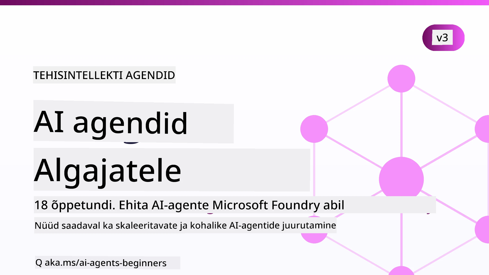

# AI Agendid Algajatele - Kursus



## Kursus, mis õpetab kõike, mida pead teadma AI Agentide loomise alustamiseks

[](https://github.com/microsoft/ai-agents-for-beginners/blob/master/LICENSE?WT.mc_id=academic-105485-koreyst)
[](https://GitHub.com/microsoft/ai-agents-for-beginners/graphs/contributors/?WT.mc_id=academic-105485-koreyst)
[](https://GitHub.com/microsoft/ai-agents-for-beginners/issues/?WT.mc_id=academic-105485-koreyst)
[](https://GitHub.com/microsoft/ai-agents-for-beginners/pulls/?WT.mc_id=academic-105485-koreyst)
[](http://makeapullrequest.com?WT.mc_id=academic-105485-koreyst)

### 🌐 Mitmekeelne Tugi

#### Tõlked hooldatud [Co-op Translator](https://github.com/Azure/co-op-translator) abil

<!-- CO-OP TRANSLATOR LANGUAGES TABLE START -->
[Arabic](../ar/README.md) | [Bengali](../bn/README.md) | [Bulgarian](../bg/README.md) | [Burmese (Myanmar)](../my/README.md) | [Chinese (Simplified)](../zh-CN/README.md) | [Chinese (Traditional, Hong Kong)](../zh-HK/README.md) | [Chinese (Traditional, Macau)](../zh-MO/README.md) | [Chinese (Traditional, Taiwan)](../zh-TW/README.md) | [Croatian](../hr/README.md) | [Czech](../cs/README.md) | [Danish](../da/README.md) | [Dutch](../nl/README.md) | [Estonian](./README.md) | [Finnish](../fi/README.md) | [French](../fr/README.md) | [German](../de/README.md) | [Greek](../el/README.md) | [Hebrew](../he/README.md) | [Hindi](../hi/README.md) | [Hungarian](../hu/README.md) | [Indonesian](../id/README.md) | [Italian](../it/README.md) | [Japanese](../ja/README.md) | [Kannada](../kn/README.md) | [Khmer](../km/README.md) | [Korean](../ko/README.md) | [Lithuanian](../lt/README.md) | [Malay](../ms/README.md) | [Malayalam](../ml/README.md) | [Manipuri (Meitei Mayek)](../mni/README.md) | [Marathi](../mr/README.md) | [Nepali](../ne/README.md) | [Nigerian Pidgin](../pcm/README.md) | [Norwegian](../no/README.md) | [Persian (Farsi)](../fa/README.md) | [Polish](../pl/README.md) | [Portuguese (Brazil)](../pt-BR/README.md) | [Portuguese (Portugal)](../pt-PT/README.md) | [Punjabi (Gurmukhi)](../pa/README.md) | [Romanian](../ro/README.md) | [Russian](../ru/README.md) | [Serbian (Cyrillic)](../sr/README.md) | [Slovak](../sk/README.md) | [Slovenian](../sl/README.md) | [Spanish](../es/README.md) | [Swahili](../sw/README.md) | [Swedish](../sv/README.md) | [Tagalog (Filipino)](../tl/README.md) | [Tamil](../ta/README.md) | [Telugu](../te/README.md) | [Thai](../th/README.md) | [Turkish](../tr/README.md) | [Ukrainian](../uk/README.md) | [Urdu](../ur/README.md) | [Vietnamese](../vi/README.md)

> **Eelistad kloonida kohalikult?**
>
> See hoidlasse kuulub üle 50 keele tõlked, mis suurendab oluliselt allalaadimismahu. Kloonimiseks ilma tõlgeteta, kasuta õhulist (sparse) checkout'i:
>
> **Bash / macOS / Linux:**
> ```bash
> git clone --filter=blob:none --sparse https://github.com/microsoft/ai-agents-for-beginners.git
> cd ai-agents-for-beginners
> git sparse-checkout set --no-cone '/*' '!translations' '!translated_images'
> ```
>
> **CMD (Windows):**
> ```cmd
> git clone --filter=blob:none --sparse https://github.com/microsoft/ai-agents-for-beginners.git
> cd ai-agents-for-beginners
> git sparse-checkout set --no-cone "/*" "!translations" "!translated_images"
> ```
>
> See annab sulle kõik vajaliku kursuse lõpetamiseks palju kiiremaks allalaadimiseks.
<!-- CO-OP TRANSLATOR LANGUAGES TABLE END -->

**Lisakeele valikute jaoks vaata [Co-op Translator'i toetatud keeli](https://github.com/Azure/co-op-translator/blob/main/docs/supported-languages.md).**

[](https://GitHub.com/microsoft/ai-agents-for-beginners/watchers/?WT.mc_id=academic-105485-koreyst)
[](https://GitHub.com/microsoft/ai-agents-for-beginners/network/?WT.mc_id=academic-105485-koreyst)
[](https://GitHub.com/microsoft/ai-agents-for-beginners/stargazers/?WT.mc_id=academic-105485-koreyst)

[](https://discord.com/invite/ATgtXmAS5D)


## 🌱 Alustamine

See kursus sisaldab õppetunde, mis käsitlevad AI Agentide loomise põhitõdesid. Iga õppetund käsitleb konkreetset teemat, nii et alusta sealt, kus soovid!

Sellel kursusel on mitmekeelne tugi. Vaata meie [saadaval keeli siit](#-multi-language-support).

Kui see on su esimene kord, kui ehitad generatiivsete AI mudelitega, vaata meie [Generative AI Algajatele](https://aka.ms/genai-beginners) kursust, mis sisaldab 21 õppetundi GenAI-ga ehitamise kohta.

Ära unusta [märkida seda repositooriumi tärniga (🌟)](https://docs.github.com/en/get-started/exploring-projects-on-github/saving-repositories-with-stars?WT.mc_id=academic-105485-koreyst) ja [harutada see repositoorium](https://github.com/microsoft/ai-agents-for-beginners/fork), et käivitada kood.

### Kohtu teiste õppuritega, saa vastused oma küsimustele

Kui jääd hätta või on AI Agentide loomise kohta küsimusi, liitu meie pühendatud Discord kanaliga aadressil [Microsoft Foundry Discord](https://aka.ms/ai-agents/discord).

### Mida vajad

Igas kursuse õppetunnis on koodinäited, mis asuvad code_samples kaustas. Sa võid [harutada selle repositooriumi](https://github.com/microsoft/ai-agents-for-beginners/fork), et luua oma koopia.

Nendes harjutustes kasutatavad koodinäited kasutavad Microsoft Agent Framework'i koos Microsoft Foundry Agent Service V2-ga:

- [Microsoft Foundry](https://aka.ms/ai-agents-beginners/ai-foundry) - Azure konto nõutud

See kursus kasutab järgmisi Microsofti AI Agent raamistikke ja teenuseid:

- [Microsoft Agent Framework (MAF)](https://learn.microsoft.com/agent-framework/overview/)
- [Microsoft Foundry Agent Service V2](https://aka.ms/ai-agents-beginners/ai-agent-service)

Mõned koodinäited toetavad ka alternatiivseid OpenAI-ga ühilduvaid pakkujaid nagu [MiniMax](https://platform.minimaxi.com/), mis pakub suuri kontekstimudeleid (kuni 204K tokenit). Vaata konfiguratsiooni üksikasju [Kursuse seadistamine](./00-course-setup/README.md).

Lisainfo jaoks selle kursuse koodi käivitamiseks vaata [Kursuse seadistamine](./00-course-setup/README.md).

## 🙏 Tahad aidata?

Kas sul on ettepanekuid või oled leidnud õigekirja- või koodivigu? [Esita probleem](https://github.com/microsoft/ai-agents-for-beginners/issues?WT.mc_id=academic-105485-koreyst) või [loo sisselõige](https://github.com/microsoft/ai-agents-for-beginners/pulls?WT.mc_id=academic-105485-koreyst)


## 📂 Igas õppetunnis on

- Kirjalik õppetund README-s ja lühike video
- Python koodinäited kasutades Microsoft Agent Framework'i koos Microsoft Foundry-ga
- Lingid lisamaterjalidele, et jätkata õppimist


## 🗃️ Õppetunnid

| **Õppetund**                                   | **Tekst & Kood**                                    | **Video**                                                  | **Lisaõpe**                                                                     |
|----------------------------------------------|----------------------------------------------------|------------------------------------------------------------|----------------------------------------------------------------------------------------|
| Sissejuhatus AI Agentidesse ja Agentide Kasutusjuhtudesse       | [Link](./01-intro-to-ai-agents/README.md)          | [Video](https://youtu.be/3zgm60bXmQk?si=z8QygFvYQv-9WtO1)  | [Link](https://aka.ms/ai-agents-beginners/collection?WT.mc_id=academic-105485-koreyst) |
| AI Agentraamistike Uurimine              | [Link](./02-explore-agentic-frameworks/README.md)  | [Video](https://youtu.be/ODwF-EZo_O8?si=Vawth4hzVaHv-u0H)  | [Link](https://aka.ms/ai-agents-beginners/collection?WT.mc_id=academic-105485-koreyst) |
| AI Agentliku Disainimustri Mõistmine     | [Link](./03-agentic-design-patterns/README.md)     | [Video](https://youtu.be/m9lM8qqoOEA?si=BIzHwzstTPL8o9GF)  | [Link](https://aka.ms/ai-agents-beginners/collection?WT.mc_id=academic-105485-koreyst) |
| Tööriista Kasutamise Disainimuster                      | [Link](./04-tool-use/README.md)                    | [Video](https://youtu.be/vieRiPRx-gI?si=2z6O2Xu2cu_Jz46N)  | [Link](https://aka.ms/ai-agents-beginners/collection?WT.mc_id=academic-105485-koreyst) |
| Agentne RAG                                  | [Link](./05-agentic-rag/README.md)                 | [Video](https://youtu.be/WcjAARvdL7I?si=gKPWsQpKiIlDH9A3)  | [Link](https://aka.ms/ai-agents-beginners/collection?WT.mc_id=academic-105485-koreyst) |
| Usaldusväärsete AI Agentide Loomine               | [Link](./06-building-trustworthy-agents/README.md) | [Video](https://youtu.be/iZKkMEGBCUQ?si=jZjpiMnGFOE9L8OK ) | [Link](https://aka.ms/ai-agents-beginners/collection?WT.mc_id=academic-105485-koreyst) |
| Planeerimisdisaini Muster                      | [Link](./07-planning-design/README.md)             | [Video](https://youtu.be/kPfJ2BrBCMY?si=6SC_iv_E5-mzucnC)  | [Link](https://aka.ms/ai-agents-beginners/collection?WT.mc_id=academic-105485-koreyst) |
| Mitme Agendi Disainimuster                   | [Link](./08-multi-agent/README.md)                 | [Video](https://youtu.be/V6HpE9hZEx0?si=rMgDhEu7wXo2uo6g)  | [Link](https://aka.ms/ai-agents-beginners/collection?WT.mc_id=academic-105485-koreyst) |
| Metakognitsiooni Disainimuster                 | [Link](./09-metacognition/README.md)               | [Video](https://youtu.be/His9R6gw6Ec?si=8gck6vvdSNCt6OcF)  | [Link](https://aka.ms/ai-agents-beginners/collection?WT.mc_id=academic-105485-koreyst) |
| AI Agendid Tootmises                      | [Link](./10-ai-agents-production/README.md)        | [Video](https://youtu.be/l4TP6IyJxmQ?si=31dnhexRo6yLRJDl)  | [Link](https://aka.ms/ai-agents-beginners/collection?WT.mc_id=academic-105485-koreyst) |
| Agentlike Protokollide Kasutamine (MCP, A2A ja NLWeb) | [Link](./11-agentic-protocols/README.md)           | [Video](https://youtu.be/X-Dh9R3Opn8)                                 | [Link](https://aka.ms/ai-agents-beginners/collection?WT.mc_id=academic-105485-koreyst) |
| Konteksti Inseneriteadus AI Agentidele            | [Link](./12-context-engineering/README.md)         | [Video](https://youtu.be/F5zqRV7gEag)                                 | [Link](https://aka.ms/ai-agents-beginners/collection?WT.mc_id=academic-105485-koreyst) |
| Agendi Mälu Halduse                      | [Link](./13-agent-memory/README.md)     |      [Video](https://youtu.be/QrYbHesIxpw?si=vZkVwKrQ4ieCcIPx)                                                      |                                                                                        |
| Microsoft Agent Framework'i Uurimine                         | [Link](./14-microsoft-agent-framework/README.md)                            |                                                            |                                                                                        |
| Arvuti Kasutusagentide Loomine (CUA)           | [Link](./15-browser-use/README.md)     |                                                            | [Link](https://docs.browser-use.com/examples/templates/playwright-integration)         |
| Laiendatavate Agentide Väljalase                    | [Link](./16-deploying-scalable-agents/README.md) |                                                    | [Link](https://learn.microsoft.com/azure/ai-foundry/agents/overview)                   |
| Kohalike AI Agentide Loomine                     | [Link](./17-creating-local-ai-agents/README.md)  |                                                    | [Link](https://learn.microsoft.com/azure/ai-foundry/foundry-local/)                    |
| AI Agentide Turvamine                           | [Link](./18-securing-ai-agents/README.md)  |                                                            | [Link](https://aka.ms/ai-agents-beginners/collection?WT.mc_id=academic-105485-koreyst) |

## 🎒 Teised Kursused

Meie meeskond toodab teisi kursuseid! Vaata neid:

<!-- CO-OP TRANSLATOR OTHER COURSES START -->
### LangChain
[](https://aka.ms/langchain4j-for-beginners)
[](https://aka.ms/langchainjs-for-beginners?WT.mc_id=m365-94501-dwahlin)
[](https://github.com/microsoft/langchain-for-beginners?WT.mc_id=m365-94501-dwahlin)
---

### Azure / Edge / MCP / Agenid
[](https://github.com/microsoft/AZD-for-beginners?WT.mc_id=academic-105485-koreyst)
[](https://github.com/microsoft/edgeai-for-beginners?WT.mc_id=academic-105485-koreyst)
[](https://github.com/microsoft/mcp-for-beginners?WT.mc_id=academic-105485-koreyst)
[](https://github.com/microsoft/ai-agents-for-beginners?WT.mc_id=academic-105485-koreyst)

---
 
### Generatiivse AI Seeria
[](https://github.com/microsoft/generative-ai-for-beginners?WT.mc_id=academic-105485-koreyst)
[-9333EA?style=for-the-badge&labelColor=E5E7EB&color=9333EA)](https://github.com/microsoft/Generative-AI-for-beginners-dotnet?WT.mc_id=academic-105485-koreyst)
[-C084FC?style=for-the-badge&labelColor=E5E7EB&color=C084FC)](https://github.com/microsoft/generative-ai-for-beginners-java?WT.mc_id=academic-105485-koreyst)
[-E879F9?style=for-the-badge&labelColor=E5E7EB&color=E879F9)](https://github.com/microsoft/generative-ai-with-javascript?WT.mc_id=academic-105485-koreyst)

---
 
### Põhiteadmised
[](https://aka.ms/ml-beginners?WT.mc_id=academic-105485-koreyst)
[](https://aka.ms/datascience-beginners?WT.mc_id=academic-105485-koreyst)
[](https://aka.ms/ai-beginners?WT.mc_id=academic-105485-koreyst)
[](https://github.com/microsoft/Security-101?WT.mc_id=academic-96948-sayoung)
[](https://aka.ms/webdev-beginners?WT.mc_id=academic-105485-koreyst)
[](https://aka.ms/iot-beginners?WT.mc_id=academic-105485-koreyst)
[](https://github.com/microsoft/xr-development-for-beginners?WT.mc_id=academic-105485-koreyst)

---
 
### Copiloti sari
[](https://aka.ms/GitHubCopilotAI?WT.mc_id=academic-105485-koreyst)
[](https://github.com/microsoft/mastering-github-copilot-for-dotnet-csharp-developers?WT.mc_id=academic-105485-koreyst)
[](https://github.com/microsoft/CopilotAdventures?WT.mc_id=academic-105485-koreyst)
<!-- CO-OP TRANSLATOR OTHER COURSES END -->

## 🌟 Kogukonna tänud

Tänud [Shivam Goyal](https://www.linkedin.com/in/shivam2003/) oluliste koodinäidete panustamise eest, mis demonstreerivad Agentic RAG-i.

## Panustamine

See projekt ootab panuseid ja ettepanekuid. Enamik panustamist nõuab, et nõustute
panustaja litsentsilepinguga (CLA), mis kinnitab, et teil on õigus ja te annate meile tegelikult
õiguse teie panust kasutada. Lisateabe saamiseks vaadake <https://cla.opensource.microsoft.com>.

Kui esitate tõmbepäringu, tuvastab CLA-robot automaatselt, kas peate esitama
CLA ja kaunistab tõmbepäringu sobivalt (nt oleku kontroll, kommentaar). Järgige lihtsalt roboti juhiseid.
Seda peate tegema vaid korra kõigis meie CLA-d kasutavates hoidlates.

See projekt on vastu võtnud [Microsofti avatud lähtekoodi käitumiskoodeksi](https://opensource.microsoft.com/codeofconduct/).
Lisateabe saamiseks vaadake [käitumiskoodeksi korduma kippuvad küsimused](https://opensource.microsoft.com/codeofconduct/faq/) või
võtke ühendust [opencode@microsoft.com](mailto:opencode@microsoft.com) täiendavate küsimuste või kommentaaride korral.

## Kaubamärgid

Selles projektis võib olla kaubamärke või logosid projektide, toodete või teenuste jaoks. Microsofti
kaubamärkide või logode lubatud kasutamine on tingitud ja peab järgima
[Microsofti kaubamärkide ja brändi juhiseid](https://www.microsoft.com/legal/intellectualproperty/trademarks/usage/general).
Microsofti kaubamärkide või logode kasutamine muudetud versioonides ei tohi tekitada segadust ega viidata Microsofti toele.
Kolmandate osapoolte kaubamärkide või logode kasutamine allub nende kolmandate osapoolte poliitikatele.

## Abi saamine


Kui jänni jääte või teil on küsimusi AI-rakenduste loomisel, liituge:

[](https://aka.ms/foundry/discord)

Kui teil on toote tagasisidet või tekib ehitamisel vigu, külastage:

[](https://aka.ms/foundry/forum)

---

<!-- CO-OP TRANSLATOR DISCLAIMER START -->
**Lahtiütlus**:
See dokument on tõlgitud kasutades AI tõlketeenust [Co-op Translator](https://github.com/Azure/co-op-translator). Kuigi me püüdleme täpsuse poole, palun pange tähele, et automatiseeritud tõlgetes võib esineda vigu või ebatäpsusi. Originaaldokument selle emakeeles tuleks pidada autoriteetseks allikaks. Olulise teabe puhul soovitatakse kasutada professionaalset inimtõlget. Me ei vastuta selle tõlkega seotud eksimustest või valesti mõistmistest.
<!-- CO-OP TRANSLATOR DISCLAIMER END -->