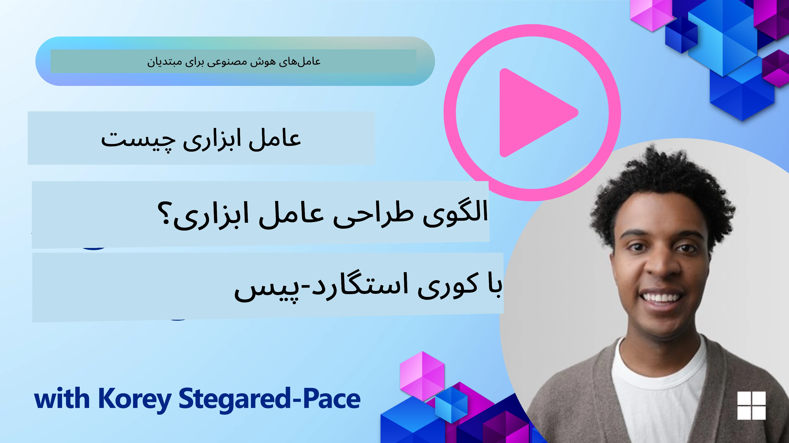
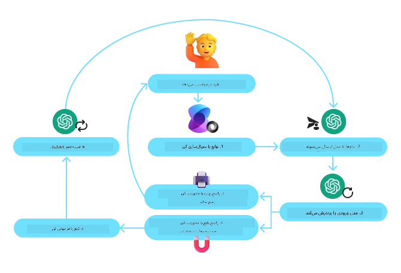
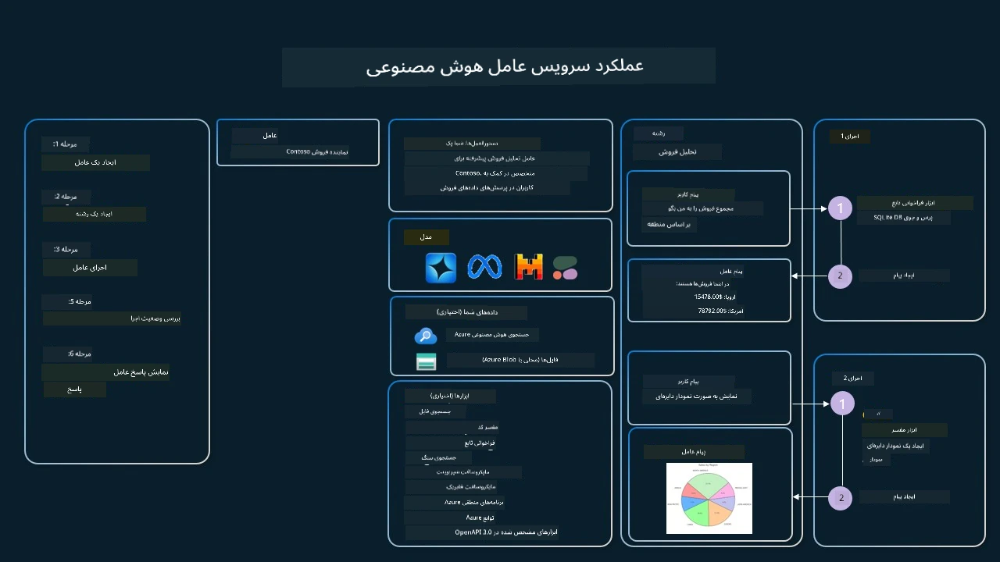

[](https://youtu.be/vieRiPRx-gI?si=cEZ8ApnT6Sus9rhn)

> _(برای مشاهده ویدئو این درس روی تصویر بالا کلیک کنید)_

# الگوی طراحی استفاده از ابزار

ابزارها جالب هستند زیرا به عامل‌های هوش مصنوعی امکان می‌دهند دامنه گسترده‌تری از قابلیت‌ها را داشته باشند. به جای اینکه عامل مجموعه محدودی از اقداماتی که می‌تواند انجام دهد داشته باشد، با افزودن یک ابزار، عامل می‌تواند مجموعه وسیعی از اقدامات را انجام دهد. در این فصل، به الگوی طراحی استفاده از ابزار می‌پردازیم که توضیح می‌دهد چگونه عامل‌های هوش مصنوعی می‌توانند از ابزارهای خاص برای رسیدن به اهداف خود استفاده کنند.

## مقدمه

در این درس، قصد داریم به پرسش‌های زیر پاسخ دهیم:

- الگوی طراحی استفاده از ابزار چیست؟
- در چه مواردی می‌توان از آن استفاده کرد؟
- عناصر/ساختمان‌های لازم برای پیاده‌سازی این الگو چیستند؟
- ملاحظات ویژه در استفاده از الگوی طراحی استفاده از ابزار برای ساخت عامل‌های هوش مصنوعی قابل اعتماد چیست؟

## اهداف آموزشی

پس از اتمام این درس، خواهید توانست:

- الگوی طراحی استفاده از ابزار و هدف آن را تعریف کنید.
- موارد کاربردی که این الگو در آن‌ها قابل استفاده است را شناسایی کنید.
- عناصر کلیدی مورد نیاز برای پیاده‌سازی این الگو را درک کنید.
- ملاحظات مربوط به اطمینان از اعتبار عامل‌های هوش مصنوعی با استفاده از این الگو را بشناسید.

## الگوی طراحی استفاده از ابزار چیست؟

**الگوی طراحی استفاده از ابزار** روی توانایی مدل‌های زبان بزرگ برای تعامل با ابزارهای خارجی به منظور رسیدن به اهداف خاص تمرکز دارد. ابزارها کدهایی هستند که توسط عامل برای انجام عملیات اجرا می‌شوند. یک ابزار می‌تواند یک تابع ساده مانند ماشین حساب باشد، یا یک فراخوانی API به سرویس شخص ثالث مانند جستجوی قیمت سهام یا پیش‌بینی آب و هوا. در زمینه عامل‌های هوش مصنوعی، ابزارها به گونه‌ای طراحی شده‌اند که توسط عامل‌ها در پاسخ به **فراخوانی‌های تابع تولید شده توسط مدل** اجرا شوند.

## موارد کاربردی که می‌توان در آن‌ها استفاده کرد چیست؟

عامل‌های هوش مصنوعی می‌توانند از ابزارها استفاده کنند تا وظایف پیچیده را انجام دهند، اطلاعات را بازیابی کنند یا تصمیم‌گیری نمایند. الگوی طراحی استفاده از ابزار اغلب در سناریوهایی به کار می‌رود که نیاز به تعامل پویا با سیستم‌های خارجی مانند پایگاه‌های داده، سرویس‌های وب یا مفسرهای کد دارند. این قابلیت برای بسیاری از موارد کاربردی مفید است از جمله:

- **بازیابی اطلاعات پویا:** عامل‌ها می‌توانند از APIهای خارجی یا پایگاه‌های داده برای گرفتن داده‌های به‌روز استفاده کنند (مثلاً پرس و جو از پایگاه داده SQLite برای تحلیل داده، گرفتن قیمت سهام یا اطلاعات آب و هوا).
- **اجرای کد و تفسیر:** عامل‌ها می‌توانند کد یا اسکریپت‌ها را اجرا کنند تا مسائل ریاضی را حل کنند، گزارش تولید کنند یا شبیه‌سازی انجام دهند.
- **اتوماسیون گردش کار:** خودکارسازی گردش کارهای تکراری یا چند مرحله‌ای با استفاده از ابزارهایی مانند زمان‌بند وظایف، سرویس‌های ایمیل یا خطوط داده.
- **پشتیبانی مشتری:** عامل‌ها می‌توانند با سیستم‌های مدیریت ارتباط با مشتری (CRM)، سامانه‌های تیکت و پایگاه‌های دانش تعامل کنند تا پرسش‌های کاربران را حل کنند.
- **تولید و ویرایش محتوا:** عامل‌ها می‌توانند از ابزارهایی مانند اشکال‌زدای دستور زبان، خلاصه‌سازی متن یا ارزیابی ایمنی محتوا برای کمک به تولید محتوا استفاده کنند.

## عناصر/ساختمان‌های لازم برای پیاده‌سازی الگوی استفاده از ابزار چیست؟

این اجزا به عامل هوش مصنوعی امکان می‌دهند مجموعه وسیعی از وظایف را انجام دهد. بیایید به عناصر کلیدی مورد نیاز برای پیاده‌سازی الگوی طراحی استفاده از ابزار نگاه کنیم:

- **طرح‌های توابع/ابزارها**: تعاریف دقیق ابزارهای موجود، شامل نام تابع، هدف، پارامترهای مورد نیاز و خروجی‌های مورد انتظار. این طرح‌ها به مدل زبان بزرگ کمک می‌کنند تا بفهمد چه ابزارهایی در دسترس هستند و چگونه درخواست‌های معتبر بسازد.

- **منطق اجرای تابع**: کنترل می‌کند که چگونه و چه زمانی ابزارها بر اساس قصد کاربر و زمینه گفتگو فراخوانی شوند. این ممکن است شامل ماژول‌های برنامه‌ریز، مکانیزم‌های مسیریابی یا جریان‌های شرطی باشد که استفاده از ابزار را به صورت پویا تعیین می‌کنند.

- **سیستم مدیریت پیام‌ها**: اجزایی که جریان گفتگو بین ورودی‌های کاربر، پاسخ‌های مدل زبان بزرگ، فراخوانی ابزارها و خروجی‌های ابزار را مدیریت می‌کنند.

- **چارچوب یکپارچه‌سازی ابزار**: زیرساختی که عامل را به ابزارهای مختلف متصل می‌کند، چه توابع ساده و چه سرویس‌های خارجی پیچیده.

- **مدیریت خطا و اعتبارسنجی**: مکانیزم‌هایی برای مدیریت خطاهای اجرای ابزار، اعتبارسنجی پارامترها و مدیریت پاسخ‌های غیرمنتظره.

- **مدیریت حالت**: پیگیری زمینه گفتگو، تعاملات قبلی با ابزارها و داده‌های پایدار برای تضمین سازگاری در تعاملات چند مرحله‌ای.

حالا بیایید به جزئیات بیشتری درباره فراخوانی تابع/ابزار نگاه کنیم.
 
### فراخوانی تابع/ابزار

فراخوانی تابع روش اصلی است که به مدل‌های زبان بزرگ (LLM) امکان می‌دهد با ابزارها تعامل کنند. اغلب 'تابع' و 'ابزار' به جای یکدیگر به کار می‌روند، زیرا 'توابع' (بلاک‌های کد قابل استفاده مجدد) همان 'ابزارهایی' هستند که عامل‌ها برای انجام وظایف استفاده می‌کنند. برای اینکه کد یک تابع اجرا شود، LLM باید درخواست کاربر را با توصیف توابع مقایسه کند. برای این کار، یک طرح شامل توصیف تمام توابع موجود به مدل زبان بزرگ ارسال می‌شود. سپس LLM مناسب‌ترین تابع را برای کار انتخاب می‌کند و نام و آرگومان‌های آن را بازمی‌گرداند. تابع انتخاب شده فراخوانی می‌شود، پاسخ آن به LLM ارسال می‌شود و LLM از این اطلاعات برای پاسخ به درخواست کاربر استفاده می‌کند.

برای توسعه‌دهندگان جهت پیاده‌سازی فراخوانی تابع برای عامل‌ها، موارد زیر نیاز است:

1. یک مدل LLM که از فراخوانی تابع پشتیبانی کند
2. یک طرح حاوی توضیحات توابع
3. کد هر تابع توصیف شده

اجازه دهید با مثال گرفتن زمان فعلی در یک شهر توضیح دهیم:

1. **یک مدل LLM که از فراخوانی تابع پشتیبانی می‌کند را راه‌اندازی کنید:**

    همه مدل‌ها از فراخوانی تابع پشتیبانی نمی‌کنند، بنابراین مهم است بررسی کنید که مدل شما این قابلیت را دارد. <a href="https://learn.microsoft.com/azure/ai-services/openai/how-to/function-calling" target="_blank">Azure OpenAI</a> از فراخوانی تابع پشتیبانی می‌کند. می‌توانیم با راه‌اندازی کلاینت OpenAI برای استفاده از **API پاسخ‌ها** Azure OpenAI شروع کنیم (نقطه انتهایی `/openai/v1/` پایدار — بدون نیاز به `api_version`).

    ```python
    # Initialize the OpenAI client for Azure OpenAI (Responses API, v1 endpoint)
    client = OpenAI(
        base_url=f"{os.environ['AZURE_OPENAI_ENDPOINT'].rstrip('/')}/openai/v1/",
        api_key=os.environ["AZURE_OPENAI_API_KEY"],
    )
    deployment_name = os.environ["AZURE_OPENAI_DEPLOYMENT"]
    ```

1. **ایجاد یک طرح برای تابع:**

    سپس یک طرح JSON تعریف می‌کنیم که شامل نام تابع، توضیح کاری که انجام می‌دهد و نام‌ها و توضیحات پارامترهای تابع باشد.
    سپس این طرح را به کلاینت قبلی همراه با درخواست کاربر برای یافتن زمان در سان فرانسیسکو می‌دهیم. نکته مهم این است که **فراخوانی ابزار** بازگردانده می‌شود، نه پاسخ نهایی به سوال. همانطور که پیش‌تر ذکر شد، مدل نام تابع انتخابی و پارامترهایی که به آن ارسال می‌شود را بازمی‌گرداند.

    ```python
    # Function description for the model to read (Responses API flat tool format)
    tools = [
        {
            "type": "function",
            "name": "get_current_time",
            "description": "Get the current time in a given location",
            "parameters": {
                "type": "object",
                "properties": {
                    "location": {
                        "type": "string",
                        "description": "The city name, e.g. San Francisco",
                    },
                },
                "required": ["location"],
            },
        }
    ]
    ```
   
    ```python
  
    # Initial user message
    messages = [{"role": "user", "content": "What's the current time in San Francisco"}]

    # First API call: Ask the model to use the function
    response = client.responses.create(
        model=deployment_name,
        input=messages,
        tools=tools,
        tool_choice="auto",
        store=False,
    )

    # The Responses API returns tool calls as function_call items in response.output.
    # Append them to the conversation so the model has full context on the next turn.
    messages += response.output

    print("Model's response:")
    print(response.output)
  
    ```

    ```bash
    Model's response:
    [ResponseFunctionToolCall(arguments='{"location":"San Francisco"}', call_id='call_pOsKdUlqvdyttYB67MOj434b', name='get_current_time', type='function_call')]
    ```
  
1. **کد تابع مورد نیاز برای انجام وظیفه:**

    حال که مدل تابع مورد نیاز را انتخاب کرده، کدی که وظیفه را اجرا می‌کند باید پیاده‌سازی و اجرا شود.
    می‌توانیم کد گرفتن زمان فعلی را به زبان Python پیاده کنیم. همچنین باید کدی بنویسیم که نام و آرگومان‌ها را از response_message استخراج کند تا نتیجه نهایی بدست آید.

    ```python
      def get_current_time(location):
        """Get the current time for a given location"""
        print(f"get_current_time called with location: {location}")  
        location_lower = location.lower()
        
        for key, timezone in TIMEZONE_DATA.items():
            if key in location_lower:
                print(f"Timezone found for {key}")  
                current_time = datetime.now(ZoneInfo(timezone)).strftime("%I:%M %p")
                return json.dumps({
                    "location": location,
                    "current_time": current_time
                })
      
        print(f"No timezone data found for {location_lower}")  
        return json.dumps({"location": location, "current_time": "unknown"})
    ```

     ```python
    # Handle function calls
    tool_calls = [item for item in response.output if item.type == "function_call"]
    if tool_calls:
        for tool_call in tool_calls:
            if tool_call.name == "get_current_time":

                function_args = json.loads(tool_call.arguments)

                time_response = get_current_time(
                    location=function_args.get("location")
                )

                # Return the tool result as a function_call_output item
                messages.append({
                    "type": "function_call_output",
                    "call_id": tool_call.call_id,
                    "output": time_response,
                })
    else:
        print("No tool calls were made by the model.")

    # Second API call: Get the final response from the model
    final_response = client.responses.create(
        model=deployment_name,
        input=messages,
        tools=tools,
        store=False,
    )

    return final_response.output_text
     ```

     ```bash
      get_current_time called with location: San Francisco
      Timezone found for san francisco
      The current time in San Francisco is 09:24 AM.
     ```

فراخوانی تابع در مرکز بیشتر، اگر نگوییم تمام، طراحی استفاده از ابزار عامل‌ها قرار دارد، اما پیاده‌سازی آن از ابتدا گاهی چالش‌برانگیز است.
همانطور که در [درس ۲](../../../02-explore-agentic-frameworks) یاد گرفتیم، چارچوب‌های عاملی بلوک‌های ساخت از پیش ساخته شده را برای پیاده‌سازی استفاده از ابزار فراهم می‌کنند.
 
## مثال‌هایی از استفاده از ابزار با چارچوب‌های عاملی

در اینجا چند مثال از نحوه پیاده‌سازی الگوی طراحی استفاده از ابزار با استفاده از چارچوب‌های عاملی مختلف آورده شده است:

### چارچوب عامل مایکروسافت

<a href="https://learn.microsoft.com/azure/ai-services/agents/overview" target="_blank">چارچوب عامل مایکروسافت</a> یک چارچوب متن‌باز هوش مصنوعی برای ساخت عامل‌های هوش مصنوعی است. این چارچوب فرایند استفاده از فراخوانی تابع را ساده می‌کند و به شما امکان می‌دهد ابزارها را به صورت توابع Python با دکوراتور `@tool` تعریف کنید. چارچوب ارتباط رفت و برگشت بین مدل و کد شما را مدیریت می‌کند. همچنین به ابزارهای آماده‌ای مانند جستجوی فایل و مفسر کد از طریق `FoundryChatClient` دسترسی می‌دهد.

نمودار زیر فرایند فراخوانی تابع با چارچوب عامل مایکروسافت را به تصویر می‌کشد:



در چارچوب عامل مایکروسافت، ابزارها به صورت توابع دکور شده تعریف می‌شوند. می‌توانیم تابع `get_current_time` که قبلاً دیدیم را به ابزار تبدیل کنیم با استفاده از دکوراتور `@tool`. چارچوب به طور خودکار تابع و پارامترهای آن را سریالایز می‌کند و طرحی برای ارسال به مدل زبان بزرگ می‌سازد.

```python
import os
from agent_framework import tool
from agent_framework.foundry import FoundryChatClient
from azure.identity import AzureCliCredential

@tool(approval_mode="never_require")
def get_current_time(location: str) -> str:
    """Get the current time for a given location"""
    ...

# Create the client
provider = FoundryChatClient(
    project_endpoint=os.environ["AZURE_AI_PROJECT_ENDPOINT"],
    model=os.environ["AZURE_AI_MODEL_DEPLOYMENT_NAME"],
    credential=AzureCliCredential(),
)

# Create an agent and run with the tool
agent = provider.as_agent(name="TimeAgent", instructions="Use available tools to answer questions.", tools=get_current_time)
response = await agent.run("What time is it?")
```

#### ابزارها از سرور MCP

ابزارها الزاماً توابع در کد شما نیستند. سروری که پروتکل مدل زمینه (MCP، پوشش داده شده در [درس ۱۱](../11-agentic-protocols/README.md)) را پیاده‌سازی می‌کند، ابزارهای خود را همراه با طرح‌هایشان منتشر می‌کند و چارچوب می‌تواند آن‌ها را مانند تابع دکور شده سریالایز کند. `MCPStreamableHTTPTool` به چنین سروری از طریق HTTP متصل می‌شود، طرح ابزارها را می‌خواند و آن‌ها را در کنار ابزارهای محلی به مدل ارائه می‌دهد.

مثال زیر از سرور جستجوی وب میزبانی شده توسط <a href="https://keenable.ai" target="_blank">Keenable</a> استفاده می‌کند. استفاده از آن بدون حساب کاربری یا کلید API رایگان است (درخواست‌ها بر اساس IP محدود می‌شوند)، بنابراین تنها اعتبارنامه‌هایی که نیاز دارید، متعلق به مدل شماست. همانند هر ابزار راه دور، پرسش‌هایی که مدل می‌نویسد به آن سرور ارسال می‌شود.

```python
from agent_framework import MCPStreamableHTTPTool

web_search = MCPStreamableHTTPTool(
    name="Keenable web search",
    url="https://api.keenable.ai/mcp",
)

# Connecting loads the server's tool schemas; the agent decides when to call them
async with web_search:
    agent = provider.as_agent(
        name="ResearchAgent",
        instructions="Use available tools to answer questions.",
        tools=[web_search],
    )
    response = await agent.run("What is new in the latest Python release?")
    print(response.text)
```

سرور دو ابزار `search_web_pages` و `fetch_page_content` را منتشر می‌کند. وقتی سوالی به اطلاعات جاری نیاز دارد، مدل `search_web_pages` را فراخوانی می‌کند، عنوان‌ها، آدرس‌های URL و قطعات متن را دریافت می‌کند و پاسخ خود را از آن‌ها می‌نویسد، همان چرخه‌ای که در مثال `get_current_time` بالا بود.
  
### سرویس عامل Microsoft Foundry

<a href="https://learn.microsoft.com/azure/ai-services/agents/overview" target="_blank">سرویس عامل Microsoft Foundry</a> یک چارچوب عاملی جدیدتر است که برای توانمندسازی توسعه‌دهندگان در ساخت، استقرار و مقیاس‌دهی عامل‌های هوش مصنوعی با کیفیت و قابل توسعه به صورت امن طراحی شده است، بدون نیاز به مدیریت منابع زیرساختی محاسباتی و ذخیره‌سازی. این سرویس به ویژه برای برنامه‌های سازمانی مفید است زیرا کاملاً مدیریت شده با امنیت در سطح سازمانی می‌باشد.

در مقایسه با توسعه مستقیم با API مدل زبان بزرگ، سرویس عامل Microsoft Foundry برخی مزایا دارد، از جمله:

- فراخوانی خودکار ابزار – نیازی به پردازش فراخوانی ابزار، اجرای ابزار و مدیریت پاسخ نیست؛ همه این‌ها در سمت سرور انجام می‌شود
- داده‌های به صورت ایمن مدیریت شده – به جای مدیریت حالت گفتگو خود، می‌توانید به رشته‌ها (threads) برای ذخیره تمام اطلاعات مورد نیاز تکیه کنید
- ابزارهای آماده – ابزاری که می‌توانید برای تعامل با منابع داده خود استفاده کنید، مانند Bing، Azure AI Search، و Azure Functions.

ابزارهای موجود در سرویس عامل Microsoft Foundry به دو دسته تقسیم می‌شوند:

1. ابزارهای دانش:
    - <a href="https://learn.microsoft.com/azure/ai-services/agents/how-to/tools/bing-grounding?tabs=python&pivots=overview" target="_blank">مبنابخشی با جستجوی Bing</a>
    - <a href="https://learn.microsoft.com/azure/ai-services/agents/how-to/tools/file-search?tabs=python&pivots=overview" target="_blank">جستجوی فایل</a>
    - <a href="https://learn.microsoft.com/azure/ai-services/agents/how-to/tools/azure-ai-search?tabs=azurecli%2Cpython&pivots=overview-azure-ai-search" target="_blank">جستجوی Azure AI</a>

2. ابزارهای عملیاتی:
    - <a href="https://learn.microsoft.com/azure/ai-services/agents/how-to/tools/function-calling?tabs=python&pivots=overview" target="_blank">فراخوانی تابع</a>
    - <a href="https://learn.microsoft.com/azure/ai-services/agents/how-to/tools/code-interpreter?tabs=python&pivots=overview" target="_blank">مفسر کد</a>
    - <a href="https://learn.microsoft.com/azure/ai-services/agents/how-to/tools/openapi-spec?tabs=python&pivots=overview" target="_blank">ابزارهای تعریف شده با OpenAPI</a>
    - <a href="https://learn.microsoft.com/azure/ai-services/agents/how-to/tools/azure-functions?pivots=overview" target="_blank">Azure Functions</a>

سرویس عامل به ما اجازه می‌دهد این ابزارها را به عنوان یک `toolset` استفاده کنیم. همچنین از `threads` استفاده می‌کند که تاریخچه پیام‌های یک گفتگو را پیگیری می‌کند.

فرض کنید شما یک نماینده فروش در شرکتی به نام Contoso هستید. می‌خواهید یک عامل محاوره‌ای ایجاد کنید که بتواند به سوالات درباره داده‌های فروش شما پاسخ دهد.

تصویر زیر نشان می‌دهد چگونه می‌توانید از سرویس عامل Microsoft Foundry برای تحلیل داده‌های فروش خود استفاده کنید:



برای استفاده از هر یک از این ابزارها با این سرویس می‌توانیم یک کلاینت بسازیم و یک ابزار یا مجموعه ابزار تعریف کنیم. برای پیاده‌سازی عملی می‌توانیم از کد Python زیر استفاده کنیم. مدل زبان بزرگ قادر خواهد بود به ابزارهای تعریف شده نگاهی بیندازد و تصمیم بگیرد که از تابع تولید شده توسط کاربر، `fetch_sales_data_using_sqlite_query`، یا مفسر کد پیش‌ساخته بسته به درخواست کاربر استفاده کند.

```python 
import os
from azure.ai.projects import AIProjectClient
from azure.identity import DefaultAzureCredential
from fetch_sales_data_functions import fetch_sales_data_using_sqlite_query # fetch_sales_data_using_sqlite_query function which can be found in a fetch_sales_data_functions.py file.
from azure.ai.projects.models import ToolSet, FunctionTool, CodeInterpreterTool

project_client = AIProjectClient.from_connection_string(
    credential=DefaultAzureCredential(),
    conn_str=os.environ["PROJECT_CONNECTION_STRING"],
)

# Initialize toolset
toolset = ToolSet()

# Initialize function calling agent with the fetch_sales_data_using_sqlite_query function and adding it to the toolset
fetch_data_function = FunctionTool(fetch_sales_data_using_sqlite_query)
toolset.add(fetch_data_function)

# Initialize Code Interpreter tool and adding it to the toolset. 
code_interpreter = CodeInterpreterTool()toolset.add(code_interpreter)

agent = project_client.agents.create_agent(
    model="gpt-5-mini", name="my-agent", instructions="You are helpful agent", 
    toolset=toolset
)
```

## ملاحظات ویژه در استفاده از الگوی طراحی استفاده از ابزار برای ساخت عامل‌هایی با قابلیت اعتماد؟

نگرانی رایج درباره SQL تولید شده پویا توسط مدل‌های زبان بزرگ، امنیت است، به ویژه خطر تزریق SQL یا اقدامات مخرب مانند حذف یا دستکاری پایگاه داده. در حالی که این نگرانی‌ها معتبر هستند، می‌توان به طور مؤثر از طریق تنظیم صحیح مجوزهای دسترسی پایگاه داده آن‌ها را کاهش داد. برای اکثر پایگاه‌های داده، این شامل پیکربندی به صورت فقط‌خواندنی می‌شود. برای سرویس‌های پایگاه داده مانند PostgreSQL یا Azure SQL، برنامه باید نقش فقط‌خواندنی (SELECT) داشته باشد.

اجرای برنامه در محیط امن محافظت را بیشتر می‌کند. در سناریوهای سازمانی، داده‌ها معمولاً از سیستم‌های عملیاتی استخراج و تبدیل شده و به یک پایگاه داده یا انبار داده فقط‌خواندنی با طرح قابل فهم منتقل می‌شوند. این روش تضمین می‌کند که داده‌ها امن، بهینه برای کارایی و دسترسی هستند و برنامه دسترسی محدود فقط‌خواندنی دارد.

## نمونه کدها

- Python: [چارچوب عامل](./code_samples/04-python-agent-framework.ipynb)
- .NET: [چارچوب عامل](./code_samples/04-dotnet-agent-framework.md)

## سوالات بیشتری درباره الگوهای طراحی استفاده از ابزار دارید؟

به [دیسکورد Microsoft Foundry](https://discord.com/invite/ATgtXmAS5D) بپیوندید تا با سایر فراگیران ملاقات کنید، در ساعات حضوری شرکت کنید و سوالات خود را درباره عامل‌های هوش مصنوعی مطرح کنید.

## منابع اضافی

- <a href="https://microsoft.github.io/build-your-first-agent-with-azure-ai-agent-service-workshop/" target="_blank">کارگاه سرویس عامل هوش مصنوعی Azure</a>
- <a href="https://github.com/Azure-Samples/contoso-creative-writer/tree/main/docs/workshop" target="_blank">کارگاه چندعامله نویسنده خلاق Contoso</a>
- <a href="https://learn.microsoft.com/azure/ai-services/agents/overview" target="_blank">بررسی کلی چارچوب عامل مایکروسافت</a>

## تست دود این عامل (اختیاری)

پس از یادگیری استقرار عوامل در [درس 16](../16-deploying-scalable-agents/README.md)، می‌توانید این `TravelToolAgent` درس را با [`tests/lesson-04-smoke-tests.json`](../../../tests/lesson-04-smoke-tests.json) تست دود کنید (آیا هنوز ابزارهای خود را فراخوانی می‌کند و پاسخ می‌دهد؟). برای نحوه اجرای آن به [`tests/README.md`](../tests/README.md) مراجعه کنید.

## درس قبلی

[درک الگوهای طراحی عاملی](../03-agentic-design-patterns/README.md)

## درس بعدی

[RAG عاملی](../05-agentic-rag/README.md)

---

<!-- CO-OP TRANSLATOR DISCLAIMER START -->
**سلب مسئولیت**:
این سند با استفاده از سرویس ترجمه هوش مصنوعی [Co-op Translator](https://github.com/Azure/co-op-translator) ترجمه شده است. در حالی که ما در تلاش برای دقت هستیم، لطفاً توجه داشته باشید که ترجمه‌های خودکار ممکن است شامل خطاها یا نادرستی‌هایی باشند. سند اصلی به زبان مادری خود باید به عنوان منبع معتبر در نظر گرفته شود. برای اطلاعات حیاتی، ترجمه حرفه‌ای انسانی توصیه می‌شود. ما در قبال هرگونه سوء تفاهم یا برداشت نادرست ناشی از استفاده از این ترجمه مسئولیتی نداریم.
<!-- CO-OP TRANSLATOR DISCLAIMER END -->