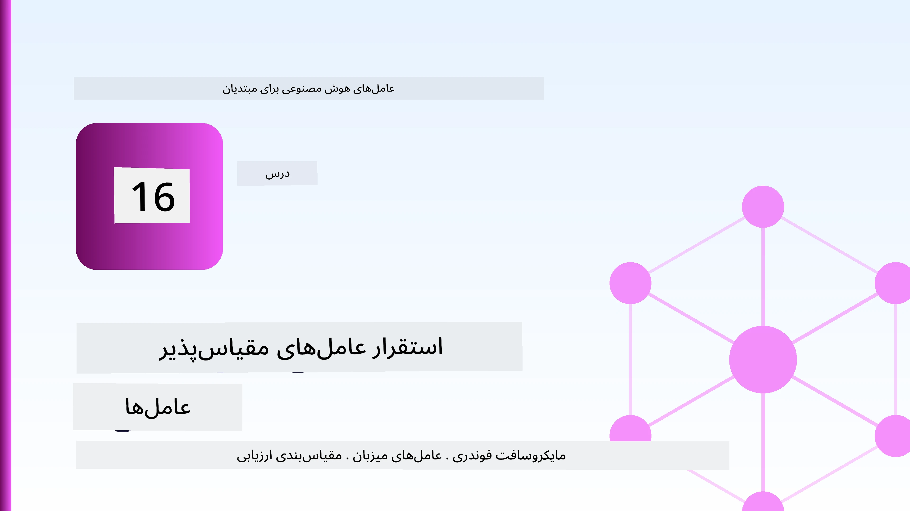
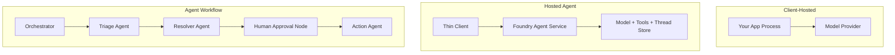
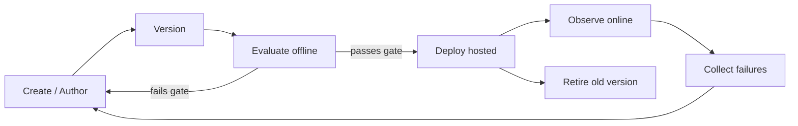
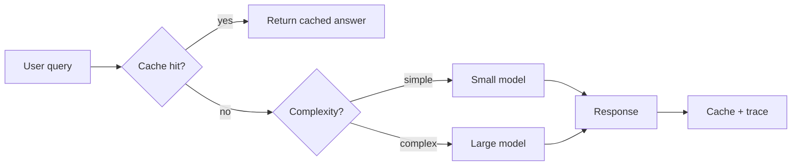
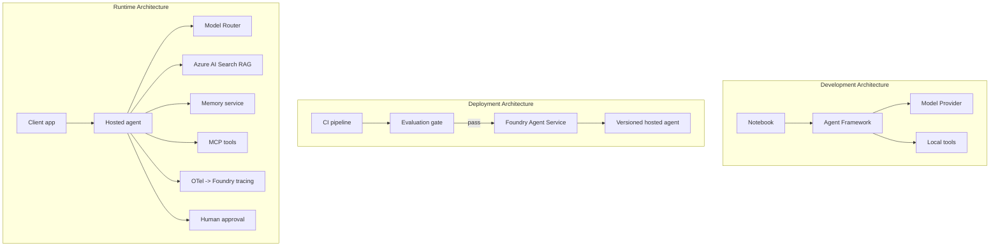

# استقرار عامل‌های مقیاس‌پذیر با مایکروسافت فاندری



تا اینجا در دوره، عامل‌هایی ساخته‌اید که روی لپ‌تاپ شما، داخل یک نوت‌بوک، با استفاده از `az login` و چند متغیر محیطی اجرا می‌شوند. این دقیقاً روش درستی برای یادگیری است. اما این روش درست برای اجرای عاملی که هزاران مشتری به آن در ساعت 3 صبح وابسته‌اند، نیست.

این درس درباره شکاف بین «روی دستگاه من کار می‌کند» و «به‌طور قابل‌اعتماد و مقرون به صرفه در محیط تولید کار می‌کند» است. این شکاف را با استفاده از **مایکروسافت فاندری** و **خدمات عامل مایکروسافت فاندری** پر می‌کنیم، و این کار را با ساخت یک عامل پشتیبانی مشتری واقعی انجام می‌دهیم که ابزار، بازیابی، حافظه، ارزیابی و نظارت دارد.

## مقدمه

این درس موارد زیر را شامل می‌شود:

- تفاوت بین **عامل نمونه اولیه** و **عامل مستقر شده**، و اینکه چرا گذار عمدتاً درباره همه چیز *اطراف* مدل است.
- **الگوهای استقرار** برای عامل‌ها: میزبانی شده روی کلاینت، میزبانی شده به عنوان سرویس (Hosted Agents)، و گردش کار سازماندهی شده.
- **چرخه عمر عامل** در مایکروسافت فاندری — ایجاد، نسخه‌گذاری، استقرار، ارزیابی، مشاهده، بازنشسته کردن.
- **استراتژی‌های مقیاس‌پذیری**: هدایت مدل، کشینگ، همزمانی، و طراحی بدون حالت.
- **قابلیت مشاهده** با OpenTelemetry و ردیابی فاندری.
- **بهینه‌سازی هزینه** از طریق انتخاب مدل، هدایت، و گیت‌های ارزیابی.
- **ملاحظات سازمانی**: حاکمیت، تأیید انسانی، و اجرای امن سرورهای MCP در تولید.

## اهداف یادگیری

پس از اتمام این درس، شما خواهید دانست چگونه:

- الگوی استقرار مناسب برای بار کاری عامل مورد نظر را انتخاب کنید.
- عاملی را به خدمات عامل مایکروسافت فاندری مستقر کنید تا نسخه‌گذاری، حاکمیت و قابل مشاهده باشد.
- عاملی را برای ردیابی تجهیز کنید و یک خط لوله ارزیابی که قبل از هر انتشار اجرا می‌شود، متصل کنید.
- مدل هدایت و کشینگ را به منظور کنترل تأخیر و هزینه در مقیاس اعمال کنید.
- گیت تأیید انسانی را برای اقدامات پرریسک اضافه کنید و سرور MCP را به شکلی امن در تولید ادغام کنید.

## پیش‌نیازها

این درس فرض می‌کند که شما درس‌های قبلی را گذرانده‌اید و به:

- ساخت عامل‌ها با [چارچوب عامل مایکروسافت](../14-microsoft-agent-framework/README.md) (درس ۱۴).
- [استفاده از ابزار](../04-tool-use/README.md) (درس ۴) و [RAG عامل‌محور](../05-agentic-rag/README.md) (درس ۵).
- [حافظه عامل](../13-agent-memory/README.md) (درس ۱۳) و [پروتکل‌های عامل / MCP](../11-agentic-protocols/README.md) (درس ۱۱).
- [قابلیت مشاهده و ارزیابی](../10-ai-agents-production/README.md) (درس ۱۰) — این درس مستقیماً بر آن بنا شده است.

همچنین موارد زیر را نیاز خواهید داشت:

- یک **اشتراک Azure** و یک **پروژه مایکروسافت فاندری** با حداقل یک مدل چت مستقر شده.
- **Azure CLI** احراز هویت شده (`az login`).
- پایتون 3.12+ و بسته‌های موجود در مخزن [`requirements.txt`](../../../requirements.txt).

## از نمونه اولیه تا تولید: واقعاً چه چیزی تغییر می‌کند

یک عامل نمونه اولیه و یک عامل تولید همان حلقه اصلی را دارند — استدلال، فراخوانی ابزارها، پاسخ. تغییر چیزی که دور این حلقه پیچیده شده است. مدل شاید ۲۰٪ از یک عامل تولید باشد؛ ۸۰٪ باقی‌مانده اسکلت عملیاتی است.

| ملاحظه | نمونه اولیه | تولید |
| --- | --- | --- |
| **میزبانی** | در نوت‌بوک شما اجرا می‌شود | به عنوان یک سرویس میزبانی شده، نسخه‌گذاری شده و پیاده‌سازی می‌شود |
| **هویت** | توکن `az login` شما | هویت مدیریت شده با RBAC محدوده‌بندی‌شده |
| **حالت** | درون‌حافظه، در زمان راه‌اندازی مجدد از دست می‌رود | برون‌سپاری شده (فروشگاه رشته، سرویس حافظه) |
| **خطا** | شما استک‌تریس را می‌بینید | تلاش مجدد، جایگزین‌ها، پیام‌های مرده، هشدارها |
| **هزینه** | "چند سنت است" | بر اساس درخواست ردیابی، هدایت شده، کش شده، بودجه‌بندی شده |
| **کیفیت** | خروجی را مستقیم نگاه می‌کنید | به‌طور خودکار قبل از هر انتشار ارزیابی می‌شود |
| **اعتماد** | شما هر عمل را تأیید می‌کنید | سیاست + حلقه انسانی برای اقدامات پرریسک |

این جدول را به ذهن بسپارید. هر بخش زیر به یکی از این ردیف‌ها مربوط می‌شود.

## الگوهای استقرار عامل

سه الگو وجود دارد که اغلب به صورت ترکیبی استفاده می‌کنید.

### ۱. عامل‌های میزبانی شده روی کلاینت

شیء عامل داخل فرایند برنامه *شما* زندگی می‌کند. کد شما مستقیماً به ارائه‌دهنده مدل فراخوانی می‌کند؛ حلقه استدلال در سرویس شما اجرا می‌شود. این همان کاری است که همه درس‌های قبلی انجام داده‌اند.

- **وقتی استفاده کنید که** نیاز به کنترل کامل روی حلقه، میان‌افزار سفارشی، یا جاسازی عامل داخل بک‌اند موجود دارید.
- **معامله معکوس**: شما خودتان مقیاس‌دهی، وضعیت و مقاومت را مدیریت می‌کنید.

### ۲. عامل‌های میزبانی شده (خدمات عامل فاندری)

عامل به‌عنوان یک *منبع ثبت شده* در مایکروسافت فاندری است. فاندری حلقه استدلال را میزبانی می‌کند، رشته‌ها را ذخیره می‌کند، امنیت محتوا و RBAC را اجرا می‌کند و عامل را در پرتال فاندری قابل مشاهده می‌کند. برنامه شما یک کلاینت سبک می‌شود که رشته‌ها را می‌سازد و پاسخ‌ها را می‌خواند.

- **وقتی استفاده کنید که** دوام، قابلیت مشاهده داخلی، حاکمیت و سطح عملیات کمتر می‌خواهید.
- **معامله معکوس**: کنترل کم‌سطح کمتر در ازای یک محیط زمان اجرا مدیریت شده.

### ۳. گردش کار عامل

چندین عامل (و ابزار) در یک گراف با جریان کنترل صریح ترکیب می‌شوند — مراحل متوالی، انشعاب، گره‌های تأیید انسانی، و نقاط بازبینی دائمی که می‌توانند توقف و ادامه پیدا کنند. این قابلیت **گردش کارها** چارچوب عامل مایکروسافت است که در مقیاس استقرار به‌کار می‌رود.

- **وقتی استفاده کنید که** یک کار خاص چند عامل تخصصی دارد یا به مرحله تأیید در میانه نیاز دارد.
- **معامله معکوس**: قسمت‌های متحرک بیشتر؛ نیاز به قابلیت مشاهده سطح سازماندهی.



## چرخه عمر عامل در مایکروسافت فاندری

استقرار یک عامل یک `push` یک‌باره نیست. این یک حلقه است، و بسیار شبیه چرخه انتشار نرم‌افزار است چون دقیقاً همان است.



ایده کلیدی، که از [درس ۱۰](../10-ai-agents-production/README.md) منتقل شده: **ارزیابی آفلاین یک دروازه است، نه یک فکر بعدی.** نسخه جدید عامل تا وقتی که معیارهای ارزیابی شما را پاس نکند منتشر نمی‌شود. قابلیت مشاهده آنلاین سپس خطاهای واقعی را به مجموعه آزمایش آفلاین شما برمی‌گرداند. این کل حلقه است.

## استراتژی‌های مقیاس‌پذیری

مقیاس‌دهی یک عامل با مقیاس‌دهی یک API وب بدون حالت متفاوت است، چون هر درخواست می‌تواند چندین فراخوانی ابزار و مدل پرهزینه را فعال کند. چهار تکنیک بیشتر بار را حمل می‌کنند.

**پردازش درخواست بدون حالت.** هیچ حالت کاربر به ازای هر درخواست در حافظه فرایند نگه ندارید. رشته‌های مکالمه را در فروشگاه رشته فاندری یا سرویس حافظه ذخیره کنید تا هر نمونه‌ای بتواند هر درخواستی را مدیریت کند. این چیزی است که به شما امکان مقیاس‌پذیری افقی را می‌دهد — اضافه کردن نمونه‌ها، بدون جلسات چسبیده.

**هدایت مدل.** هر درخواستی نیازمند مدل قدرتمند (و پرهزینه) شما نیست. درخواست‌های ساده — طبقه‌بندی قصد، پاسخ‌های کوتاه و واقعی — را به مدل کوچک و سریع هدایت کنید، و مدل بزرگ را برای استدلال واقعی نگه دارید. **مدل روتر** فاندری می‌تواند این کار را برای شما انجام دهد، یا می‌توانید خودتان یک طبقه‌بند سبک بسازید. نسخه DIY را در آزمایشگاه خواهید ساخت.

**کشینگ پاسخ.** بسیاری از سوالات پشتیبانی تقریباً تکراری‌اند ("چگونه رمز عبورم را ریست کنم؟"). پاسخ به سوالات رایج را کش کنید و بدون تماس با مدل به آنها سرویس دهید. حتی نرخ برخورد کش متوسط به‌طور معنی‌داری هزینه و تأخیر را کاهش می‌دهد.

**همزمانی و فشار بازگشتی.** ارائه‌دهندگان مدل محدودیت نرخ دارند. همزمانی خود را محدود کنید، از تلاش‌های مجدد با تأخیر نمایی استفاده کنید، و با نرمی شکست بخورید (یک پاسخ صف شده «روی آن هستیم» بهتر از ارور 500 است).



## قابلیت مشاهده در تولید

نمی‌توانید چیزی را اداره کنید که نمی‌توانید ببینید. همان‌طور که در درس ۱۰ پوشش داده شد، چارچوب عامل مایکروسافت به طور بومی ردگیری‌های **OpenTelemetry** را صادر می‌کند — هر فراخوان مدل، فراخوان ابزار، و مرحله سازماندهی به یک span تبدیل می‌شود. در تولید این spans را به مایکروسافت فاندری (یا هر backend سازگار با OTel) صادر می‌کنید تا بتوانید:

- یک شکایت مشتری را انتها به انتها در هر فراخوان مدل و ابزار ردگیری کنید.
- تاخیر p50/p95 و هزینه هر درخواست را در طول زمان مشاهده کنید.
- قبل از اینکه کاربران شما (یا تیم مالی) متوجه شوند، بر افزایش نرخ خطا و ناهنجاری‌های هزینه هشدار دهید.

```python
from agent_framework.observability import get_tracer

tracer = get_tracer()

with tracer.start_as_current_span("support_request") as span:
    span.set_attribute("customer.tier", "enterprise")
    span.set_attribute("routed.model", "gpt-5-nano")
    # agent execution is traced automatically inside this span
```

ویژگی‌هایی مانند `customer.tier` و `routed.model` چیزی هستند که یک دیوار ردگیری‌ها را به سوالات قابل پاسخ تبدیل می‌کنند («آیا مشتریان سازمانی خیلی اغلب به مدل کوچک هدایت می‌شوند؟»).

## بهینه‌سازی هزینه

هزینه در عوامل تولیدی تحت سلطه توکن‌ها است. سه دسته دسته اهرم به ترتیب تأثیر:

۱. **اندازه مناسب مدل.** یک مدل کوچک که گیت ارزیابی شما را پاس کند تقریباً همیشه ارزان‌تر از یک مدل بزرگ است که همچنین پاس می‌کند. از ارزیابی برای *اثبات* کافی بودن مدل کوچک استفاده کنید، نه اینکه از روی احتیاط به بزرگ‌ترین مدل پیش‌فرض دهید.
۲. **هدایت بر اساس پیچیدگی.** همان‌طور که بالاتر گفتیم — فقط برای درخواست‌هایی که به استدلال مدل بزرگ نیاز دارند هزینه مدل بزرگ را بپردازید.
۳. **کشینگ قوی.** ارزان‌ترین فراخوان مدل همان است که هرگز نمی‌زنید.

گیت‌های ارزیابی و کنترل هزینه همان رشته‌ای هستند که از دو زاویه دیده می‌شوند: ارزیابی به شما *کف کیفیت* را می‌گوید، هدایت و کشینگ هزینه را به *کف* نزدیک نگه می‌دارند.

## ملاحظات استقرار سازمانی

**حاکمیت.** عامل‌های میزبانی شده از RBAC، امنیت محتوا، و ثبت حسابرسی فاندری ارث می‌برند. به هر عامل یک هویت مدیریت شده با حداقل دسترسی که نیاز دارد بدهید — دسترسی فقط خواندنی به پایگاه دانش، دسترسی محدوده‌دار به API تیکتینگ، و بس.

**انسان در حلقه.** برخی اقدامات خیلی مهم هستند که به طور کامل خودکار نشوند — صدور بازپرداخت، حذف حساب، ارجاع به تیم حقوقی. چارچوب عامل مایکروسافت ابزارهای **نیازمند تأیید** را پشتیبانی می‌کند: عامل پیشنهاد عمل را می‌دهد، اجرا متوقف می‌شود، انسان تأیید یا رد می‌کند، و گردش کار ادامه می‌یابد. شما این ابزار ساده را در [درس ۶](../06-building-trustworthy-agents/README.md) دیده‌اید؛ اینجا آن را مستقر می‌کنید.

**MCP در تولید.** [MCP](../11-agentic-protocols/README.md) به عامل شما اجازه می‌دهد ابزارهای خارجی را از طریق یک رابط استاندارد مصرف کند. در تولید، هر سرور MCP را به عنوان مرز غیرقابل اعتماد در نظر بگیرید: نسخه سرور را تعیین کنید، آن را با هویت محدوده‌دار اجرا کنید، خروجی‌هایش را اعتبارسنجی کنید، و هرگز اسرار را به آن ندهید. یک سرور MCP یک وابستگی است، و وابستگی‌ها وصله، حسابرسی، و محدودیت نرخ می‌گیرند.



آن سه نمودار — توسعه، استقرار، زمان اجرا — همان عامل در سه مرحله زندگی است. آزمایشگاهی که در ادامه می‌آید، شما را در ساخت آن راهنمایی می‌کند.

## آزمایشگاه عملی: یک عامل پشتیبانی مشتری آماده تولید

[`code_samples/16-python-agent-framework.ipynb`](./code_samples/16-python-agent-framework.ipynb) را باز کنید و کامل آن را پیش بروید. شما یک **عامل پشتیبانی مشتری Contoso** با همه ملاحظات تولیدی متصل شده جمع‌آوری خواهید کرد:

۱. **فراخوانی ابزار** — وضعیت سفارش و تیکت‌های پشتیبانی باز را بررسی کنید.
۲. **RAG** — به سوالات سیاستی از پایگاه دانش پاسخ دهید (Azure AI Search، با جایگزین درون‌حافظه تا نوت‌بوک بدون منبع جستجو اجرا شود).
۳. **حافظه** — مشتری را در طول چرخش‌های مکالمه به خاطر بسپارید.
۴. **هدایت مدل** — طبقه‌بندی پیچیدگی هر درخواست را به مدل کوچک یا بزرگ هدایت می‌کند.
۵. **کشینگ پاسخ** — سوالات تکراری از کش سرو می‌شوند.
۶. **تأیید انسانی** — بازپرداخت‌ها بالاتر از آستانه برای تأیید انسانی متوقف می‌شوند.
۷. **خط لوله ارزیابی** — یک مجموعه آزمایش کوچک آفلاین عامل را امتیاز می‌دهد و به عنوان دروازه انتشار عمل می‌کند.
۸. **قابلیت مشاهده** — ردگیری OpenTelemetry دور هر درخواست.

### راهنمای گام به گام

نوت‌بوک طوری سازماندهی شده که هر ملاحظه تولیدی یک بخش مستقل و قابل اجرا باشد. قلب آن، هندلر درخواست هدایت بعلاوه کش است:

```python
async def handle_support_request(query: str, customer_id: str) -> str:
    # 1. Serve from cache when we can.
    cached = response_cache.get(normalize(query))
    if cached:
        return cached

    # 2. Route by complexity to control cost.
    model = "gpt-5-nano" if is_simple(query) else "gpt-5-mini"

    # 3. Run the agent inside a trace span for observability.
    with tracer.start_as_current_span("support_request") as span:
        span.set_attribute("routed.model", model)
        span.set_attribute("customer.id", customer_id)
        response = await support_agent.run(query, model=model)

    # 4. Cache and return.
    response_cache.set(normalize(query), response.text)
    return response.text
```

دروازه ارزیابی که از انتشار محافظت می‌کند این‌گونه به نظر می‌رسد:

```python
async def evaluation_gate(agent, test_cases, threshold: float = 0.8) -> bool:
    passed = 0
    for case in test_cases:
        result = await agent.run(case["input"])
        if score_response(result.text, case["expected"]) >= 0.8:
            passed += 1
    pass_rate = passed / len(test_cases)
    print(f"Evaluation pass rate: {pass_rate:.0%} (gate: {threshold:.0%})")
    return pass_rate >= threshold  # only deploy if the gate passes
```

هر خط را بخوانید — نوت‌بوک primitves را عمداً کوچک نگه داشته تا چیزی پشت فراخوان چارچوب مخفی نباشد.

## اعتبارسنجی یک عامل مستقر شده با تست‌های دود

دروازه ارزیابی بالا به صورت *آفلاین* روی شیء عامل شما اجرا می‌شود. وقتی عامل به عنوان یک عامل میزبانی شده مستقر می‌شود، یک بررسی ارزان‌تر دیگر نیاز دارید: **آیا نقطه پایانی مستقر شده در واقع پاسخ می‌دهد؟**

استقرار «موفقیت‌آمیز» فقط نشان می‌دهد کنترل پلین تعریف را پذیرفته است — این ثابت نمی‌کند که عامل پاسخگو است. یک وابستگی گمشده، هدایت بد مدل، یا اتصال منقضی می‌تواند باعث استقرار سبز بدون هیچ پاسخی شود. یک **تست دود** این موضوع را در چند ثانیه، در هر استقرار، بدون هزینه کامل ارزیابی پیدا می‌کند.

این مخزن خط لوله تست دود آماده استفاده را بر پایه [عمل GitHub آزمون دود AI](https://github.com/marketplace/actions/ai-smoke-test) ارائه می‌دهد:

- **کتالوگ** — [`tests/lesson-16-smoke-tests.json`](../../../tests/lesson-16-smoke-tests.json) شامل پرامپت‌ها و اظهارات برای عامل پشتیبانی Contoso (پاسخ‌های سیاستی با منبع، جستجوی سفارش، ماندن در موضوع و تداوم رشته چندمرحله‌ای). کتالوگ‌های عوامل دیگر درس‌ها در کنار آن هستند — ببینید [`tests/README.md`](../tests/README.md).
- **گردش کار** — [`.github/workflows/smoke-test.yml`](../../../.github/workflows/smoke-test.yml) با Azure OIDC لاگین می‌کند و هر پرامپت را به نقطه پایانی پاسخ‌های عامل POST می‌کند، عملیات را در صورت هر اظهار خطا رد می‌کند.

```yaml
- name: Smoke-test hosted agent
  uses: JFolberth/ai-smoketest@v1
  with:
    project_endpoint: ${{ inputs.project_endpoint }}
    agent_name: ContosoSupportAgent
    tests_file: tests/lesson-16-smoke-tests.json
```

آن را از برگه **Actions** اجرا کنید پس از استقرار عامل خود، نقطه انتهایی پروژه Foundry و نام عامل خود را وارد نمایید. هویت فدرال‌شده نیاز به نقش **Azure AI User** در حوزه پروژه Foundry دارد. لایه‌ها را مانند یک هرم در نظر بگیرید: تست‌های دود (قابل دسترسی و پاسخگو بودن؟) در هر استقرار اجرا می‌شوند، ارزیابی آفلاین (برای عرضه کافی است؟) قبل از ارتقاء اجرا می‌شود، و ارزیابی آنلاین (عملکرد در شرایط واقعی چگونه است؟) به طور مداوم اجرا می‌شود.

## بررسی دانش

قبل از رفتن به تمرین، درک خود را آزمایش کنید.

**1. تقریباً چقدر از یک عامل تولیدی "مدل" است و بقیه چیست؟**

<details>
<summary>پاسخ</summary>

مدل بخش کوچکی از سیستم است — اغلب حدود ۲۰٪ ذکر می‌شود. بقیه ساختار عملیاتی است: میزبانی و نسخه‌بندی، هویت و RBAC، وضعیت خارجی‌شده، مدیریت خطا، ردیابی هزینه، ارزیابی و کنترل انسانی. رفتن به تولید عمدتاً درباره ساخت همه چیز *دور* حلقه استدلال است.
</details>

**2. چه زمانی یک Hosted Agent را به جای عامل میزبانی‌شده توسط مشتری انتخاب می‌کنید؟**

<details>
<summary>پاسخ</summary>

وقتی می‌خواهید یک محیط زمان اجرا مدیریت‌شده با دوام داخلی (رشته‌هایی که باقی می‌مانند و می‌توانند ادامه پیدا کنند)، قابلیت مشاهده، ایمنی محتوا و RBAC داشته باشید و حاضر به معامله کمی کنترل سطح پایین حلقه استدلال برای کاهش سطح عملیات باشید. میزبانی‌شده توسط مشتری ترجیح داده می‌شود وقتی نیاز به کنترل کامل روی حلقه دارید یا عامل را در یک بک‌اند موجود جاسازی می‌کنید.
</details>

**3. چرا یک عامل مقیاس‌پذیر باید بدون حالت در حافظه فرایند خود باشد؟**

<details>
<summary>پاسخ</summary>

تا هر نمونه‌ای بتواند هر درخواست را پردازش کند، که این امکان مقیاس‌پذیری افقی بدون نشست‌های چسبنده را فراهم می‌کند. وضعیت مکالمه در هر کاربر به یک فروشگاه رشته یا سرویس حافظه انتقال داده می‌شود. اگر وضعیت در حافظه فرایند بود، هنگام راه‌اندازی مجدد آن را از دست می‌دادید و نمی‌توانستید بار را آزادانه توزیع کنید.
</details>

**4. مدل مسیریابی چه مشکلی را حل می‌کند و چگونه به ارزیابی مرتبط است؟**

<details>
<summary>پاسخ</summary>

مسیریابی درخواست‌های ساده را به یک مدل کوچک، ارزان و سریع می‌فرستد و مدل بزرگ را برای استدلال واقعی نگه می‌دارد، که هم تأخیر و هم هزینه را کنترل می‌کند. این به ارزیابی مرتبط است زیرا ارزیابی است که *اثبات* می‌کند مدل کوچک برای کلاس خاصی از درخواست‌ها کافی است — مسیریابی بدون ارزیابی حدس زدن است.
</details>

**5. «دروازه ارزیابی» چیست و در چرخه زندگی کجا قرار دارد؟**

<details>
<summary>پاسخ</summary>

دروازه ارزیابی یک مجموعه آزمایش آفلاین را علیه نسخه جدید عامل اجرا می‌کند و مستقر شدن را مسدود می‌کند مگر این که نرخ گذرآزمایش از یک آستانه عبور کند. این در چرخه زندگی بین «نسخه» و «استقرار» قرار دارد و کیفیت را یک پیش‌نیاز برای انتشار می‌کند، نه چیزی که بعد از عرضه بررسی شود.
</details>

**6. چرا باید سرور MCP در تولید به عنوان یک مرز غیرقابل اعتماد محسوب شود؟**

<details>
<summary>پاسخ</summary>

زیرا یک وابستگی خارجی است که عامل شما به آن فراخوانی می‌کند. باید نسخه آن را ثابت کنید، آن را با هویتی محدود اجرا کنید، خروجی‌هایش را اعتبار سنجی کنید، محدودیت نرخ اعمال کنید و هیچ وقت اسرار را به آن ندهید — همان انضباطی که به هر وابستگی شخص ثالث اعمال می‌کنید. خروجی‌های آن به استدلال عامل شما جریان می‌یابد، پس اعتماد بدون اعتبارسنجی یک خطر امنیتی است.
</details>

**7. کدام تغییر معمولاً بیشترین تأثیر را بر هزینه عامل تولید دارد و چرا؟**

<details>
<summary>پاسخ</summary>

تعیین اندازه صحیح مدل — استفاده از کوچک‌ترین مدلی که هنوز دروازه ارزیابی شما را می‌گذراند. هزینه بیشتر توسط توکن‌ها تعیین می‌شود، و مدلی کوچکتر که معیار کیفیت را داشته باشد تقریباً همیشه ارزان‌تر از مدل بزرگ‌تر است. سپس کشینگ و مسیریابی هزینه را بیشتر کاهش می‌دهند، اما انتخاب مدل پایه مناسب بزرگ‌ترین تأثیر مرتبه اول را دارد.
</details>

**۸. ویژگی‌های اسپن مانند `customer.tier` و `routed.model` چه نقشی در قابلیت مشاهده دارند؟**

<details>
<summary>پاسخ</summary>

آن‌ها ردهای خام را به پرسش‌های تجاری پاسخ‌دادنی تبدیل می‌کنند. بدون ویژگی‌ها شما دیواری از اسپن دارید؛ با آن‌ها می‌توانید بپرسید «آیا مشتریان سازمانی بیش از حد به مدل کوچک هدایت می‌شوند؟» یا «کدام مدل درخواست‌های کند ما را مدیریت می‌کند؟» ویژگی‌ها نحوه برش تلومتری بر اساس ابعادی است که برای عملیات شما اهمیت دارد.
</details>

## تمرین

عامل پشتیبانی مشتری از آزمایشگاه را بردارید و آن را به ‌صورت سخت برای یک سناریوی خاص آماده کنید: **عامل پشتیبانی صورت‌حساب اشتراک برای یک شرکت SaaS.**

ارسال شما باید شامل موارد زیر باشد:

۱. **ابزارها را جایگزین کنید** با ابزارهای مرتبط با صورت‌حساب: `get_subscription_status`، `get_invoice`، و `issue_credit` (اعتبارهای بالای ۵۰ دلار نیازمند تأیید انسانی است).
۲. **سه سند RAG اضافه کنید** که شامل سیاست بازپرداخت شرکت، دوره صورتحساب و سیاست لغو است.
۳. **مجموعه ارزیابی را** به حداقل هشت مورد گسترش دهید که حداقل دو مورد باید مسیر تأیید انسانی را فعال کند، و تأیید کنید دروازه ارزیابی شما به درستی عبور یا رد می‌کند.
۴. **یک گزارش هزینه اضافه کنید**: پس از اجرای ده پرسش ترکیبی از طریق عامل، تعداد مواردی که به مدل کوچک ارسال شده، مدل بزرگ و موارد سرو شده از کش را چاپ کنید.

یک پاراگراف کوتاه (در یک سلول مارک‌داون) بنویسید که توضیح می‌دهد کدام قانون مسیریابی مدل را انتخاب کرده‌اید و چگونه آن را با ترافیک واقعی اعتبارسنجی می‌کنید. پاسخ واحد صحیحی وجود ندارد — ارزیابی شما بر اساس این است که آیا نگرانی‌های تولید به هم پیوسته و منسجم هستند یا خیر.

## خلاصه

در این درس، شما یک عامل را از نمونه اولیه به تولید با Microsoft Foundry منتقل کردید:

- جهش به تولید بیشتر در مورد **ساختار عملیاتی** اطراف مدل است — میزبانی، هویت، حالت، مدیریت خطا، هزینه، کیفیت و اعتماد.
- سه **الگوی استقرار** را یاد گرفتید — میزبانی‌شده توسط مشتری، Hosted Agents، و Agent Workflows — و زمان مناسب هرکدام.
- چرخه عمر **عامل** را طی کردید، جایی که ارزیابی آفلاین به عنوان دروازه انتشار عمل می‌کند و قابلیت مشاهده آنلاین خطاها را به مجموعه آزمون بازمی‌گرداند.
- استراتژی‌های **مقیاس‌پذیری** را به کار گرفتید — طراحی بدون حالت، مسیریابی مدل، کشینگ، و همزمانی محدود — و آن‌ها را به **بهینه‌سازی هزینه** متصل کردید.
- کنترل‌های **سازمانی** را وارد کردید: RBAC، تصویب انسانی، و یکپارچه‌سازی امن MCP.
- یک عامل پشتیبانی مشتری **آماده تولید** ساختید که همه این نگرانی‌ها را در کد قابل اجرا به هم پیوند می‌دهد.

درس بعدی مسیر مخالف را طی می‌کند: به جای مقیاس دادن عوامل در ابر، آن‌ها را *به پایین* روی یک ماشین توسعه‌دهنده می‌آورید و کاملاً به صورت محلی اجرا می‌کنید.

## منابع اضافی

- <a href="https://learn.microsoft.com/azure/ai-foundry/what-is-azure-ai-foundry" target="_blank">مستندات Microsoft Foundry</a>
- <a href="https://learn.microsoft.com/azure/ai-foundry/agents/overview" target="_blank">نمای کلی سرویس Agent مایکروسافت Foundry</a>
- <a href="https://learn.microsoft.com/en-us/agent-framework/overview/?wt.mc_id=youtube_26688_organicsocial_reactor&pivots=programming-language-python" target="_blank">چارچوب عامل مایکروسافت</a>
- <a href="https://learn.microsoft.com/en-us/azure/ai-foundry/openai/concepts/model-router" target="_blank">مدل روتر در Microsoft Foundry</a>
- <a href="https://learn.microsoft.com/azure/search/search-what-is-azure-search" target="_blank">Azure AI Search</a>
- <a href="https://opentelemetry.io/" target="_blank">OpenTelemetry</a>
- <a href="https://github.com/marketplace/actions/ai-smoke-test" target="_blank">عملیات AI Smoke Test در GitHub</a>
- <a href="https://modelcontextprotocol.io/" target="_blank">پروتکل زمینه مدل (MCP)</a>

## درس قبلی

[ساخت عوامل استفاده از کامپیوتر (CUA)](../15-browser-use/README.md)

## درس بعدی

[ایجاد عوامل هوش مصنوعی محلی](../17-creating-local-ai-agents/README.md)

---

<!-- CO-OP TRANSLATOR DISCLAIMER START -->
**سلب مسئولیت**:
این سند با استفاده از سرویس ترجمه هوش مصنوعی [Co-op Translator](https://github.com/Azure/co-op-translator) ترجمه شده است. در حالی که ما در تلاش برای دقت هستیم، لطفاً توجه داشته باشید که ترجمه‌های خودکار ممکن است شامل خطاها یا نادرستی‌هایی باشند. سند اصلی به زبان مادری خود باید به عنوان منبع معتبر در نظر گرفته شود. برای اطلاعات حیاتی، ترجمه حرفه‌ای انسانی توصیه می‌شود. ما در قبال هرگونه سوء تفاهم یا برداشت نادرست ناشی از استفاده از این ترجمه مسئولیتی نداریم.
<!-- CO-OP TRANSLATOR DISCLAIMER END -->