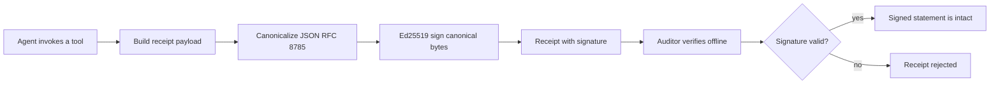
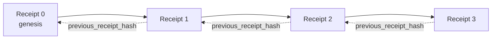

[تماشای ویدیوی درس: امن‌سازی عامل‌های هوش مصنوعی با رسیدهای رمزنگاری‌شده](https://youtu.be/PLACEHOLDER_VIDEO_ID)

> _(ویدیوی درس و تصویر کوچک توسط تیم محتوای Microsoft پس از ادغام اضافه خواهد شد، مطابق الگوی درس ۱۴/۱۵.)_

# امن‌سازی عامل‌های هوش مصنوعی با رسیدهای رمزنگاری‌شده

## مقدمه

این درس شامل موارد زیر است:

- چرا ردپاهای حسابرسی برای عامل‌های هوش مصنوعی برای رعایت مقررات، اشکال‌زدایی و اعتماد اهمیت دارند.
- رسید رمزنگاری‌شده چیست و چگونه با یک خط لاگ بدون امضا متفاوت است.
- چگونه در پایتون ساده یک رسید امضا شده برای فراخوانی ابزار توسط عامل تولید کنیم.
- چگونه یک رسید را به‌صورت آفلاین بررسی کرده و دستکاری را تشخیص دهیم.
- چگونه رسیدها را زنجیره‌ای کنیم به‌طوری که حذف یا تغییر ترتیب یک مورد زنجیره را بشکند.
- رسیدها چه چیزهایی را ثابت می‌کنند و به‌طور صریح چه چیزهایی را ثابت نمی‌کنند.

## اهداف یادگیری

پس از پایان این درس، شما خواهید دانست چگونه:

- حالت‌های خطا را که باعث نیاز به اثبات منشأ رمزنگاری‌شده برای اقدامات عامل می‌شوند، شناسایی کنید.
- تولید یک رسید امضا شده با Ed25519 روی یک بارِ دادهٔ JSON کاننیکال.
- بررسی مستقل یک رسید با استفاده تنها از کلید عمومی امضا‌کننده.
- تشخیص دستکاری با اجرای مجدد بررسی روی یک رسید تغییر یافته.
- ساخت یک دنبالهٔ رسیدها که با هش زنجیره‌ای شده‌اند و توضیح دلیل اهمیت زنجیره.
- شناخت مرزی بین آنچه رسیدها ثابت می‌کنند (نسبت‌دهی، یکپارچگی، ترتیب) و آنچه ثابت نمی‌کنند (صحّت عمل، درستی سیاست).

## مشکل: ردپای حسابرسی عامل شما

فرض کنید شما یک عامل هوش مصنوعی برای Contoso Travel مستقر کرده‌اید. این عامل درخواست‌های مشتری را می‌خواند، یک API پروازها را برای جستجوی گزینه‌ها فراخوانی می‌کند، و به نمایندگی از مشتری صندلی رزرو می‌کند. در فصل گذشته، عامل 50,000 رزرو را پردازش کرد.

امروز یک ممیز می‌آید. او سوال ساده‌ای می‌پرسد: "به من نشان دهید عامل شما چه کرده است."

شما فایل‌های لاگ خود را تحویل می‌دهید. ممیز آنها را بررسی می‌کند و سوال سخت‌تری می‌پرسد: "چطور بدانم این لاگ‌ها ویرایش نشده‌اند؟"

این همان مسئلهٔ ردپای حسابرسی است. بیشتر استقرارهای عامل امروزه متکی به موارد زیر هستند:

- **لاگ‌های برنامه**: توسط خود عامل نوشته می‌شوند، و توسط هر کسی که دسترسی به سیستم فایل دارد قابل ویرایش‌اند.
- **خدمات لاگ‌گیری ابری**: در سطح پلتفرم آشکارکنندهٔ دستکاری هستند اما تنها در صورتی که ممیز به اپراتور پلتفرم اعتماد کند.
- **لاگ‌های تراکنش پایگاه‌داده**: برای تغییرات پایگاه‌داده مناسب‌اند اما برای فراخوانی‌های دلخواه ابزار مناسب نیستند.

هیچ‌یک از این‌ها نمی‌توانند بدون ایجاب اینکه ممیز به کسی اعتماد کند (شما، ارائه‌دهندهٔ ابری‌تان، فروشندهٔ پایگاه‌داده‌تان) به سوال ممیز پاسخ دهند. برای استفادهٔ داخلی، آن اعتماد اغلب پذیرفتنی است. برای بار کاری تنظیم‌شده (مالی، بهداشت و درمان، هر چیزی مشمول EU AI Act)، پذیرفتنی نیست.

رسیدهای رمزنگاری‌شده این مشکل را با ساختن یک گزارهٔ امضا‌شده که به‌طور مستقل
قابل‌اثبات است، محدود می‌کنند. ممیز هنوز به دلیلی خارج از زنجیره نیاز دارد تا به کلید امضا‌کننده و
مولفه‌ای که گزاره را تولید کرده اعتماد کند. کلید تعبیه‌شده، خودسازگاری را اثبات می‌کند،
نه هویت صادرکننده یا محل اعمال اجرا را.

## رسید رمزنگاری‌شده چیست؟

رسید یک شیء JSON است که کاری را که یک عامل انجام داده ثبت می‌کند و با یک امضای دیجیتال امضا شده است.



یک رسید حداقلی شبیه این است:

```json
{
  "type": "agent.tool_call.v1",
  "agent_id": "contoso-travel-bot",
  "tool_name": "lookup_flights",
  "tool_args_hash": "sha256:a3f9c1...",
  "result_hash": "sha256:7b2e1d...",
  "policy_id": "contoso-travel-policy-v3",
  "timestamp": "2026-04-25T14:30:00Z",
  "sequence": 47,
  "previous_receipt_hash": "sha256:9d4e6a...",
  "signature": {
    "alg": "EdDSA",
    "sig": "c5af83...",
    "public_key": "8f3b2c..."
  }
}
```

سه ویژگی وظیفه را انجام می‌دهند:

1. **امضا**. رسید توسط دروازهٔ عامل با استفاده از یک کلید خصوصی Ed25519 امضا می‌شود. هر کسی که کلید عمومی متناظر را داشته باشد می‌تواند به‌صورت آفلاین امضا را بررسی کند. طرف متکی باید آن کلید را پین کند یا آن را از یک رجیستری مورد اعتماد خارج از رسید حل‌وفصل کند. هر دستکاری در هر فیلد امضا‌شده امضا را نامعتبر می‌کند.

2. **کدگذاری کاننیکال**. قبل از امضا، رسید با استفاده از JSON Canonicalization Scheme (JCS, RFC 8785) سریالایز می‌شود. این اطمینان می‌دهد که دو پیاده‌سازی که همان رسید منطقی را تولید می‌کنند، خروجی بایت‌به‌بایت یکسانی تولید می‌کنند. بدون کاننیکال‌سازی، سریالایزرهای مختلف JSON امضاهای متفاوتی برای یک محتوای یکسان تولید می‌کردند.

3. **زنجیره‌ای کردن با هش**. فیلد `previous_receipt_hash` هر رسید را به رسید قبلی پیوند می‌دهد. حذف یا تغییر ترتیب یک رسید، دنبالهٔ ارائه‌شده را می‌شکند. تشخیص قطع‌شدگی یا بازنویسی کنترل‌شده توسط امضاکننده همچنین به یک سر زنجیرهٔ جاری پین‌شده، یک نقطهٔ بازبینی با شاهد مستقل، یا یک تعهد تصدیق‌شده در جمعیت بسته نیاز دارد.

با هم این ویژگی‌ها سه تضمین فراهم می‌کنند:

- **نسبت‌دهی به یک کلید**: این کلید این محتوا را امضا کرده است. هویت سازمانی یا انسانی نیاز به پیوند قابل‌اعتماد کلید دارد.
- **یکپارچگی**: محتوا از زمان امضا تغییر نکرده است.
- **ترتیب درون دنبالهٔ تاییدشده**: این رسید به پیشینیِ خود لینک می‌دهد.

## تولید یک رسید در پایتون

برای تولید یک رسید نیازی به کتابخانهٔ خاصی ندارید. اجزای اولیهٔ رمزنگاری به‌طور گسترده در دسترس‌اند و منطق کار چند ده خط پایتون است.

تمرین‌های عملی در `code_samples/18-signed-receipts.ipynb` کل جریان را قدم‌به‌قدم توضیح می‌دهند. `code_samples/18-signed-receipts.execution-receipt.json` کنترل‌شده از نظر منبع، هش دقیق نوت‌بوک، محیط پایتون، شمار سلول‌ها و بررسی‌ها از آخرین اجرای پاک را بدون تغییر خروجی‌های ذخیره‌شدهٔ درس ثبت می‌کند. نسخهٔ خلاصه:

```python
import json
import hashlib
import base64
from nacl import signing
from jcs import canonicalize  # RFC 8785 canonical JSON

def b64url_nopad(data: bytes) -> str:
    return base64.urlsafe_b64encode(data).decode("ascii").rstrip("=")

def sha256_canonical(obj) -> str:
    """SHA-256 of a Python object's JCS-canonical JSON form."""
    return f"sha256:{hashlib.sha256(canonicalize(obj)).hexdigest()}"

# Generate or load a signing key (in production, store in a key vault)
signing_key = signing.SigningKey.generate()
verify_key = signing_key.verify_key
TRUSTED_PUBLIC_KEYS = {b64url_nopad(bytes(verify_key))}  # pinned out of band by the verifier

# Build the receipt payload (no signature yet)
tool_args = {"origin": "SYD", "destination": "LAX"}
tool_result = [{"flight": "QF11", "price": 1850, "stops": 0}]

payload = {
    "type": "agent.tool_call.v1",
    "agent_id": "contoso-travel-bot",
    "tool_name": "lookup_flights",
    "tool_args_hash": sha256_canonical(tool_args),
    "result_hash": sha256_canonical(tool_result),
    "policy_id": "contoso-travel-policy-v3",
    "timestamp": "2026-04-25T14:30:00Z",
    "sequence": 0,
    "previous_receipt_hash": None,
}

# Canonicalize and sign the JCS bytes directly. PureEdDSA hashes internally.
canonical_bytes = canonicalize(payload)
signature_bytes = signing_key.sign(canonical_bytes).signature

# Attach a structured signature object.
receipt = {
    **payload,
    "signature": {
        "alg": "EdDSA",
        "sig": b64url_nopad(signature_bytes),
        "public_key": b64url_nopad(bytes(verify_key)),
    },
}
```

این کل مسیر امضا است. تمرین‌ها در نوت‌بوک هر مرحله را توضیح می‌دهند.

## بررسی یک رسید و تشخیص دستکاری

بررسی عملیات معکوس است:

```python
import base64
import hashlib
from nacl import signing
from nacl.exceptions import CryptoError
from jcs import canonicalize

def b64url_decode(s: str) -> bytes:
    # Strict: Python's decoder skips characters outside the alphabet and also
    # accepts padding, the standard +/ alphabet and non-zero spare bits.
    # Re-encoding and comparing accepts only the one unpadded base64url form.
    padding = "=" * ((4 - len(s) % 4) % 4)
    data = base64.urlsafe_b64decode(s + padding)
    if base64.urlsafe_b64encode(data).decode("ascii").rstrip("=") != s:
        raise ValueError("not canonical unpadded base64url")
    return data

def verify_receipt(receipt: dict, trusted_public_key: str) -> bool:
    # trusted_public_key is the issuer's key, obtained from somewhere other
    # than this receipt. Never use receipt["signature"]["public_key"] here:
    # see "What Receipts Prove (and What They Do Not)" below.
    # Fails closed: anything malformed returns False instead of raising.
    if not isinstance(receipt, dict) or not isinstance(trusted_public_key, str):
        return False
    sig_obj = receipt.get("signature")
    if not isinstance(sig_obj, dict) or sig_obj.get("alg") != "EdDSA":
        return False
    sig_b64 = sig_obj.get("sig")
    if not isinstance(sig_b64, str):
        return False

    try:
        # Reconstruct the payload that was actually signed (everything except signature).
        payload = {k: v for k, v in receipt.items() if k != "signature"}
        canonical_bytes = canonicalize(payload)
        verify_key = signing.VerifyKey(b64url_decode(trusted_public_key))
        verify_key.verify(canonical_bytes, b64url_decode(sig_b64))
        return True
    except (CryptoError, TypeError, ValueError, KeyError, OverflowError):
        return False
    except Exception:
        # An undecodable key or signature, or a payload that cannot be
        # canonicalized: fail closed rather than raise.
        return False
```

این تابع یک رسید و کلید عمومی صادرکننده را می‌گیرد، و اگر امضا معتبر باشد `True` را برمی‌گرداند و در غیر این صورت `False` را، از جمله زمانی که ورودی خراب باشد. هیچ فراخوان شبکه‌ای و هیچ سرویس بررسی لازم نیست: وقتی کلید صادرکننده را داشته باشید، بررسی کاملاً محلی و آفلاین است. چیزی که هنوز لازم است همان کلید است، که باید از جایی غیر از خود رسید به‌دست آید.

برای دیدن تشخیص دستکاری در عمل، نوت‌بوک مراحل زیر را مرور می‌کند:

1. تولید یک رسید معتبر و تأیید اینکه بررسی آن موفق است.
2. تغییر یک بایت از فیلد `tool_args_hash`.
3. اجرای مجدد بررسی و مشاهدهٔ شکست آن.
4. دوباره دستکاری کردن، اما این‌بار با دوباره‌امضا کردن با کلیدی که حمله‌کننده تولید کرده و تعبیهٔ آن کلید در رسید.

گام ۴ شایستهٔ تأمل است. آن رسید از نظر داخلی سازگار است: امضای آن برای محتوایش و برای کلیدی که حمل می‌کند، اصیل است، بنابراین در برابر کلید داخل آن تایید می‌شود. فقط زمانی شکست می‌خورد که در برابر کلید واقعی صادرکننده بررسی شود. گام‌های ۲ و ۳ حمله‌کننده‌ای را که زحمت دوباره‌امضا را به خود نداده است، می‌گیرند؛ گام ۴ کسی را می‌گیرد که این کار را انجام داده است.

این نشان عملی است که رسیدها آشکارکنندهٔ دستکاری هستند: هر تغییری در یک فیلد امضا‌شده امضا را می‌شکند، به شرطی که شما در برابر کلیدی بررسی کنید که حمله‌کننده آن را فراهم نکرده است. خودِ شیء `signature` بیرون از بایت‌های امضا شده است، که به همین دلیل کلیدی که با آن بررسی می‌کنید باید از جایی جز خود رسید بیاید.

## زنجیره‌سازی رسیدها برای عامل‌های چندمرحله‌ای

یک رسید امضا‌شدهٔ واحد از یک عمل محافظت می‌کند. یک زنجیرهٔ رسیدها از یک دنباله محافظت می‌کند.



هر رسید هش رسید قبلی را ثبت می‌کند. برای حذف بی‌صدا رسید ۲، یک حمله‌کننده باید یا:

- فیلد `previous_receipt_hash` رسید ۳ را تغییر دهد (امضای رسید ۳ را می‌شکند)، یا
- یک امضای جدید روی رسید ۳ تغییر یافته جعل کند (نیاز به کلید خصوصی عامل دارد).

اگر کلید خصوصی در یک خزانهٔ کلید سخت‌افزاری باشد و مراجعان هر رسید را در برابر کلید عمومی صادرکننده بررسی کنند، که به‌صورت مستقل به‌دست آمده است (یک JWK Set منتشرشده یا یک مقدار پیکربندی پین‌شده)، هیچ‌کدام از این حملات بدون کشف قابل انجام نیست. انتشار کلید داخل هر رسید کافی نیست: حمله‌کننده می‌تواند با کلید خود دوباره امضا کند و آن را به‌جای آن تعبیه کند، که یک نمونهٔ `04_resigned_receipt.json` است.

نوت‌بوک مراحل زیر را بررسی می‌کند:

1. ساخت یک زنجیره از سه رسید.
2. بررسی اینکه `previous_receipt_hash` هر رسید با هش واقعی رسید قبلی منطبق است.
3. دستکاری یکی از رسیدها در وسط و دیدن اینکه زنجیره دقیقاً در همان نقطه می‌شکند.

این روش تولید یک ردپای حسابرسی است که یک ممیز خارجی می‌تواند تحت
کلیدهای صادرکنندهٔ پین‌شدهٔ خود و نقاط بازبینی زنجیره آن را بررسی کند، بدون اینکه به ذخیرهٔ لاگ قابل تغییر شما اعتماد کند.

## رسیدها چه چیزهایی را ثابت می‌کنند (و چه چیزهایی را ثابت نمی‌کنند)

این مهم‌ترین بخش این درس است. رسیدها قدرتمندند اما قدرت‌شان محدود است.

**رسیدها سه چیز را ثابت می‌کنند:**

1. **نسبت‌دهی**: یک کلید مشخص یک بار دادهٔ مشخص را امضا کرده است.
2. **یکپارچگی**: بار داده از زمان امضا تغییر نکرده است.
3. **ترتیب درون یک دنبالهٔ ارائه‌شده و تأییدشده**: این رسید به پیشینیِ خود لینک می‌دهد.

**رسیدها ثابت نمی‌کنند:**

1. **درستی**: اینکه عمل عامل عملِ درستی بوده است. یک رسید می‌تواند به‌سادگی برای یک پاسخ نادرست امضا شود همان‌طور که برای یک پاسخ درست امضا می‌شود.
2. **رعایت سیاست**: اینکه سیاست مورد اشاره در `policy_id` واقعاً ارزیابی شده است، یا اینکه اگر بررسی می‌شد این اقدام را مجاز می‌دانست. رسید آنچه ادعا شده را ثبت می‌کند، نه آنچه اعمال شده است.
3. **هویت فراتر از کلید**: رسید می‌گوید "این کلید این محتوا را امضا کرده است." این نمی‌گوید "این انسان این را مجوز داده است." وصل کردن یک کلید به یک شخص یا سازمان نیازمند زیرساخت هویت جداگانه است (یک دایرکتوری، یک رجیستری کلید عمومی، و غیره).
4. **صحت ورودی‌ها**: اگر عامل یک پرامپت دستکاری‌شده دریافت کند و بر اساس آن عمل کند، رسید عمل را با صداقت ثبت می‌کند. رسیدها بعد از مرحلهٔ اعتبارسنجی ورودی قرار می‌گیرند، نه جایگزینی برای آن.
5. **اجرا یا اثر دنیای واقعی**: یک رسید پس از فراخوان، آنچه صادرکننده مدعی است رخ داده را ثبت می‌کند. اثبات پذیرش یا تطبیق یک اثر خارجی نیاز به شواهد از اجرای واقعی یا مرز ارائه‌دهنده دارد.
6. **کامل بودن**: نبود یک رسید می‌تواند به معنی مسدود شدن، حذف شدن، گم شدن، یا عدم ابزاردهی باشد. فقدان تنها در یک جمعیت بستهٔ تصدیق‌شده تبدیل به مدرک می‌شود.
7. **زمان قابل‌اعتماد**: یک زمان‌مند امضا‌شده ثابت می‌کند که امضاکننده آن مقدار را داشته است، نه اینکه آن مقدار درست بوده است. زمان قابل‌اعتماد نیاز به یک مرجع زمان یا یک نقطهٔ بازبینی شاهد دارد.

**کلیدی که در رسید است همان کلیدی نیست که با آن بررسی می‌کنید.** این از بند ۳ نتیجه می‌شود، و این تنها جایی است که این تمایز باید کد شما را تغییر دهد نه فهم شما. `public_key` در نمونهٔ بالا وجود دارد تا مثال خودکفا باشد. یک بررسی‌کننده هرگز نباید به آن اعتماد کند. هر کسی می‌تواند یک رسید را بردارد، آن را تغییر دهد، با کلیدی که تولید کرده است امضا کند و آن کلید را درون آن تعبیه کند؛ نتیجه در برابر خودِ آن کاملأ تایید می‌شود. این همان fixture `04_resigned_receipt.json` در `sample_receipts/` است، و به همین دلیل `verify_receipt` بالا کلید را به‌عنوان یک آرگومان می‌گیرد به‌جای خواندن آن از داخل رسید. کلید صادرکننده را به‌طور مستقل به‌دست آورید، از JWK Set در چک‌لیست تولید زیر یا یک لنگر دیگری که قبلاً پین کرده‌اید، و در برابر آن بررسی کنید. امضایی که با کلیدی که در همان پاکت آمده بررسی می‌شود تنها اثبات می‌کند که پاکت خودسازگار است.

این مرز به دو دلیل مهم است:

- به شما می‌گوید رسیدها برای چه چیزی مفید هستند: قابل حسابرسی و آشکارکنندهٔ دستکاری کردن رفتار عامل، حتی در عرض مرزهای سازمانی.
- به شما می‌گوید چه لایه‌های اضافی دیگری هنوز نیاز دارید: اعتبارسنجی ورودی (درس ۶)، اعمال سیاست (مختصراً در ادامه پوشش داده شده)، و زیرساخت هویت (خارج از دامنهٔ این درس).

یک اشتباه رایج فرض کردن اینکه "ما رسید داریم" یعنی "ما تحت حاکمیت هستیم." این‌طور نیست. رسیدها پایه‌ای هستند. حاکمیت سیستمی است که شما بر روی آن می‌سازید.

## پیوند زدن امضای یک تصویب‌کننده به عمل دقیق

مورد ۳ بالا ارزش آن را دارد که بخش مستقلی داشته باشد: یک رسید عمل می‌گوید "این کلید این محتوا را امضا کرده است"، هرگز "این انسان این را مجوز داده است." برای اقدامات پرخطر (بازپرداخت‌ها، حذف‌ها، انتقال وجه)، یک امضای تصویب‌کنندهٔ جداگانه می‌تواند عمل دقیق را محکم کند. وصل کردن آن کلید به یک انسان و بررسی حضور انسانی همچنان مسئولیت‌های جداگانه‌ای باقی می‌ماند.

نوت‌بوک پیرو `code_samples/human-authorization-receipts.ipynb` نوع دومی از رسید را اضافه می‌کند، `human.approval.v1`، با همان قالب پاکت مانند رسیدهای درس (یک بار دادهٔ تایپ‌شده که با Ed25519 روی بایت‌های JCS کاننیکال آن امضا شده، و شیء `signature` خارج از بایت‌های امضا شده). یک کلید تصویب‌کننده، **عمل کاننیکال کامل و digest آن** را امضا می‌کند؛ یک کلید عامل ادعایی را امضا می‌کند که **همان digest عمل** و یک `parent_approval_ref`، `receipt_hash` تصویب را حمل می‌کند، همان قرارداد مثل `previous_receipt_hash` در زنجیره‌ای که بالاتر ساختید. یک `verify_chain` هر دو اثر را تحت **رجیستری‌های کلید پین‌شدهٔ جداگانه** (کلیدهای تصویب‌کننده در برابر کلیدهای عامل) می‌برد، بنابراین مسیر کد مشترک است اما مقامات هرگز مشترک نیستند.

ویژگی‌ای که این به‌دست می‌دهد، با دقت بیان شده: *کلید تصویب‌کنندهٔ پین‌شده این عمل دقیق را امضا کرده است، و
کلید عامل بعداً یک گزاره را امضا کرده است که همان digest عمل را حمل می‌کند.*
این مدرک مفیدی است، اما به خودی خود اثبات اینکه عمل اجرا شده نیست. برای
کنترل اجرا، تصویبِ دقیق همچنین باید رزرو شود و در یک‌بار در
مرز مجری واقعی مصرف گردد؛ نتایج نامعلوم ارائه‌دهنده باید ناشناخته باقی بماند تا اینکه دوباره به‌طور کورکورانه تلاش شود.
ابزارهای رد نوت‌بوک لایهٔ زنجیرهٔ رسید را آزمایش می‌کنند:

- دستکاری، نمایندهٔ گیج، کلیدهای جعلی در هر طرف، و ورودی بدفرم؛
- **اختیار منقضی**: امضایی که هنوز تأیید می‌شود، اما به‌هرحال رد می‌شود زیرا نسخهٔ سیاست تغییر کرده، کلید تصویب‌کننده از رجیستری پین‌شده خارج شده، یا تصویب قبل از زمان تأیید ارائه‌شده منقضی شده است؛
- **جانشینی digest**: یک رسید عمل که به‌طور معتبر امضا شده و به یک تصویب *واقعی* اشاره می‌کند که یک عمل کاننیکال *مختلف* را متصل می‌کند.

هر شکست با یک دلیل متمایز رد می‌شود، بنابراین ممیزی که یک رد را می‌خواند می‌تواند بگوید آیا اختیار منقضی شده یا عمل ادعاشده تغییر کرده است. بررسی خواندنی-تنها و قابل تکرار است: این کار تصویب را مصرف نمی‌کند و ارائه‌دهنده را فراخوانی نمی‌کند. یک مجری جداگانه به حفاظت از بازپخش اتمیک و بادوام و نتایج صریح موفقیت، شکست، و نامشخص نیاز دارد. رسید تصویب انسانی یک ترکیب آموزشی تعریف‌شده توسط این درس است، نه یک نوع رسید تعریف‌شده توسط `draft-farley-acta-signed-receipts`.

## منابع تولید

کد پایتون در این درس به‌طور عمدی حداقلی است تا بتوانید هر خط را بخوانید و دقیقاً بفهمید چه می‌گذرد. در محیط تولید، دو گزینه دارید:

1. **مستقیماً روی سازوکارهای پایهٔ رمزنگاری بسازید.** پنجاه خطی که بالاتر دیدید برای بسیاری از موارد استفاده کافی است. PyNaCl (Ed25519) و بستهٔ `jcs` (canonical JSON) کتابخانه‌هایی با نگهداری و حسابرسی مناسب هستند.

2. **از یک کتابخانهٔ تولیدی برای رسید استفاده کنید.** چندین پروژهٔ متن‌باز همین الگو را با ویژگی‌های اضافی پیاده‌سازی می‌کنند (چرخش کلید، بررسی دسته‌ای، توزیع JWK Set، ادغام با موتورهای سیاست):
   - The signing pipeline uses the JCS and signature-scope conventions in an independent IETF Internet-Draft ([`draft-farley-acta-signed-receipts`](https://datatracker.ietf.org/doc/draft-farley-acta-signed-receipts/), revision 02). This lesson's flat educational receipt differs from the draft's `{payload, signature}` envelope and is not presented as a conformant implementation. The draft publishes a shared conformance suite ([agent-governance-testvectors](https://github.com/ScopeBlind/agent-governance-testvectors)) for implementations targeting its wire format.
   - The Microsoft Agent Governance Toolkit composes receipts with Cedar-based policy decisions; see Tutorial 33 in that repository for an end-to-end example.
   - The `protect-mcp` (npm) and `@veritasacta/verify` (npm) packages provide a Node-based implementation of receipt signing and offline verification, intended for wrapping any MCP server with a tamper-evident audit trail, including a held-for-co-sign flow in which a paused action emits an approval receipt bound to the action digest (WebAuthn-backed in the desktop flow), the same approval-receipt pattern as the human-authorization notebook above.
   - The **[nobulex](https://github.com/arian-gogani/nobulex)** Python SDK (`pip install nobulex`) provides the same Ed25519 + JCS signing pattern in Python with LangChain and CrewAI integrations, including published cross-validation test vectors and a compliance mapping contributed via [OWASP PR #2210](https://github.com/OWASP/CheatSheetSeries/pull/2210).
   - **[EMILIA Protocol](https://github.com/emiliaprotocol/emilia-protocol)** provides a complementary exact-action enforcement layer: offline-verifiable approval receipts, pinned WebAuthn or quorum authority, one-time consumption at the executor boundary, and an explicit indeterminate-outcome path. Its framework adapters treat a receipt as necessary evidence rather than proof that an external effect occurred.

تصمیم بین ساختن از صفر و استفاده از یک کتابخانه مشابه تصمیم بین نوشتن کتابخانهٔ JWT خودتان و استفاده از یکی آزمایش‌شده است: هردو معقول‌اند؛ کتابخانه زمان را ذخیره می‌کند و سطح حسابرسی را کاهش می‌دهد؛ رویکرد از صفر شما را مجبور می‌کند هر پریمیتیو را بفهمید. این درس مسیر از صفر را آموزش می‌دهد تا پایهٔ لازم برای هر دو انتخاب را داشته باشید.

## Knowledge Check

قبل از رفتن به تمرین عملی، درک خود را بسنجید.

**1. A receipt is signed with the agent's private Ed25519 key. The auditor has only the public key. Can the auditor verify the receipt offline?**

<details>
<summary>پاسخ</summary>

بله، تأیید رمزنگاری‌شده تنها به کلید عمومی و بایت‌های امضا‌شده نیاز دارد. این
ممیزی‌کننده باید همچنان کلید عمومی پذیرفته‌شده را مستقل از رسید به‌دست‌آورد و پین کند.
پس از آن‌که پیکربندی اعتماد برقرار شد، هیچ فراخوانی شبکه‌ای لازم نیست.
</details>

**2. An attacker modifies the `policy_id` field of a receipt to claim it was governed by a more permissive policy. The signature was over the original payload. What happens during verification?**

<details>
<summary>پاسخ</summary>

تأیید شکست می‌خورد. امضا روی بایت‌های کاننیکالِ بارِ اصلی محاسبه شده بود؛ تغییر هر فیلدی در بار آن بایت‌ها را تغییر می‌دهد و در نتیجه امضا نامعتبر می‌شود. مهاجم برای تولید یک امضای معتبر تازه به کلید خصوصی نیاز دارد که در اختیار ندارد.
</details>

**3. Why does the receipt include a `tool_args_hash` and `result_hash` rather than the raw arguments and result?**

<details>
<summary>پاسخ</summary>

دو دلیل دارد. اول، ممکن است نیاز باشد رسید بایگانی یا در محیط‌هایی منتقل شود که افشای محتوای خام (اطلاعات شناسایی شخصی، داده‌های تجاری) مشکل‌ساز است. هش‌کردن رسید را کوچک نگه می‌دارد و محتوا را خصوصی می‌کند؛ ممیزی‌کننده تأیید می‌کند که هش با نسخهٔ جداگانهٔ ذخیره‌شدهٔ محتوای واقعی تطابق دارد. دوم، هش‌ها اندازهٔ ثابتی دارند؛ رسیدی که شامل هش‌ها است از نظر اندازه محدود است صرف‌نظر از بزرگ بودن ورودی‌ها و خروجی‌ها.
</details>

**4. The `previous_receipt_hash` field links each receipt to its predecessor. If an attacker silently deletes one receipt from the middle of a chain, what becomes invalid?**

<details>
<summary>پاسخ</summary>

هر رسیدی که بعد از رسید حذف‌شده آمده است. فیلدهای `previous_receipt_hash` آن‌ها دیگر با زنجیرهٔ واقعی مطابقت ندارند (چون رسیدی که به آن ارجاع داده بودند وجود ندارد، یا زنجیره اکنون به پیشینی متفاوتی اشاره می‌کند). برای مخفی کردن حذف باید مهاجم هر رسید بعدی را دوباره امضا کند که نیازمند کلید خصوصی صادرکننده است. دوباره‌امضا با هر کلید دیگری هنگام بررسی در برابر کلید صادرکننده شکست می‌خورد.
</details>

**5. A receipt verifies cleanly. Does that prove the agent's action was correct, sound, or compliant with policy?**

<details>
<summary>پاسخ</summary>

خیر. تحت یک کلید پین‌شده و زمینهٔ زنجیره، یک رسید معتبر انتساب امضا، یکپارچگی محتوا و پیوندی به پیشینی ارائه‌شده را اثبات می‌کند،
و این‌که محتوا سالم است. اما ثابت نمی‌کند که
اقدام درست اجرا شده، که سیاست ارزیابی شده، که مهرزمان مورد اعتماد است،
یا اینکه مجموعهٔ رکوردها کامل است. این مهم‌ترین مرز در این درس است.
</details>

## Practice Exercise

فایل `code_samples/18-signed-receipts.ipynb` را باز کنید و هر چهار بخش را کامل کنید:

1. **بخش 1**: اولین رسید خود را امضا کرده و آن را بررسی کنید.
2. **بخش 2**: با رسید دستکاری کنید و مشاهده کنید که بررسی شکست بخورد.
3. **بخش 3**: یک زنجیرهٔ سه‌تایی از رسید بسازید و یکپارچگی زنجیره را بررسی کنید.
4. **بخش 4**: الگو را روی یک عامل ساخته‌شده با Microsoft Agent Framework اعمال کنید: فراخوانی یک ابزار را در امضای رسید بپیچید، سپس رسید را به‌طور مستقل بررسی کنید.

**Stretch challenge 1:** اسکیمای رسید را با یک فیلد اضافی که خودتان انتخاب می‌کنید گسترش دهید (برای مثال، یک شناسهٔ درخواست برای ردیابی)، منطق امضای کاننیکال را برای شامل کردن آن به‌روزرسانی کنید، و تأیید کنید که رسید هنوز از طریق بررسی دورمی‌چرخد. سپس فیلد را بعد از امضا تغییر دهید و تأیید کنید که بررسی شکست می‌خورد. این شما را مجبور می‌کند بفهمید چگونه هر بایت از رمزگذاری کاننیکال به امضا کمک می‌کند.

**Stretch challenge 2:** دو تا از رسیدهای خود را با SHA-256 هش کنید (بایت‌های کاننیکال آن‌ها را به‌صورت قطعی به هم الحاق کنید) و دیژست حاصل را به‌عنوان یک فیلد جدید در یک رسید سوم قبل از امضا جاسازی کنید. تأیید کنید که هر سه رسید هنوز دورمی‌چرخند. شما همین الآن یک اثبات گنجایش یک‌مرحله‌ای ساخته‌اید: هر کس که رسید سوم را دارد می‌تواند ثابت کند دو رسید اول در زمان امضا وجود داشته‌اند، بدون نیاز به افشای محتویات آن‌ها. این الگویی است که رسیدهای افشای انتخابی در مقیاس از آن استفاده می‌کنند (تعهدات مرکل، RFC 6962).

## Conclusion

رسیدهای رمزنگاری‌شده یک مسیر حسابرسی به عوامل AI می‌دهند که:

- **به‌طور مستقل تحت اعتماد پین‌شده قابل‌تأیید**: یک طرف دارای کلیدهای عمومی پذیرفته‌شده و بایت‌های امضا‌شده می‌تواند بدون وابستگی به سرویس تأیید کند.
- **قابل‌مشاهده‌بودن دستکاری**: هرگونه تغییر، امضا را نامعتبر می‌کند.
- **قابل‌حمل**: یک رسید فایل JSON کوچکی است؛ می‌توان آن را بایگانی، منتقل و در هرجا بررسی کرد.
- **همسو با استانداردها**: مبتنی بر Ed25519 (RFC 8032)، JCS (RFC 8785) و SHA-256، که همگی پریمیتیوهای پراکند‌ه‌شده‌ای هستند.

آن‌ها جایگزینی برای اعتبارسنجی ورودی، اجرای سیاست، پذیرش اجراکننده،
شواهد نتیجه، کنترل‌های کامل بودن، یا زیرساخت هویت نیستند. آن‌ها پایه‌ای
برای آن لایه‌ها هستند. در جریان‌های کاری تنظیم‌شده یا چندسازمانی، رسیدها اظهارات مشخص
صادرکننده را تحت پیکربندی اعتماد ممیزی‌کننده به‌صورت مستقل قابل‌بررسی می‌سازند.

مهم‌ترین نکتهٔ قابل‌برداشت: رسیدها اثبات می‌کنند که یک کلید خاص محتوای خاصی را امضا کرده است.
یک مهرزمانِ حمل‌شده، ادعای امضا‌کننده است مگر اینکه جداگانه به‌صورت زمان-مستند تأیید شده باشد.
یک رسید ثابت نمی‌کند که محتوای آن درست بوده، که یک اقدام اجرا شده، یا اینکه
مجموعهٔ رکوردها کامل است. این تمایزها را محکم نگه دارید.

## Production Checklist

وقتی آماده‌اید از این درس فارغ‌التحصیل شوید و عوامل امضاکنندهٔ رسید را در یک محیط واقعی مستقر کنید:

- [ ] **کلید امضا را از لپ‌تاپ توسعه‌دهنده خارج کنید.** از Azure Key Vault، AWS KMS یا یک ماژول امنیتی سخت‌افزاری استفاده کنید. کلید خصوصی که رسیدهای شما را امضا می‌کند نباید هرگز در کنترل منبع یا به‌صورت متنی ساده روی ماشین‌های برنامه وجود داشته باشد.
- [ ] **اعتماد کلید وارسی‌کننده را برقرار کنید.** کلیدها را از طریق یک JWK Set یا رجیستری منتشر کنید، سپس طرف‌های متکی هویت صادرکنندهٔ پذیرفته‌شده، مجموعهٔ کلیدها و سیاست چرخش را خارج از رسیدهای منفرد پین کنند. یک کلید درون‌خطی به‌تنهایی لنگر اعتماد نیست.
- [ ] **زنجیره را به‌صورت خارجی لنگر بیندازید.** دوره‌ای هش سرِ زنجیرهٔ آخر را در یک لاگ شفافیت (Sigstore Rekor، مرجع مهرزمان RFC 3161، یا یک سیستم داخلی دوم) بنویسید تا یک طرف خارجی بتواند تأیید کند «این زنجیره در این زمان وجود داشته است».
- [ ] **رسیدها را به‌صورت غیرقابل‌تغییر ذخیره کنید.** ذخیرهٔ blob پیوست-فقط (Azure Storage با سیاست‌های عدم تغییر، AWS S3 Object Lock) مانع از آن می‌شود که یک نفوذگر داخلی تاریخچه را در سطح ذخیره‌سازی بازنویسی کند.
- [ ] **در مورد نگهداری تصمیم بگیرید.** بسیاری از رژیم‌های تطبیق نیاز به نگهداری چندساله دارند. برای رشد رسید برنامه‌ریزی کنید (هر رسید حدود ~500 بایت است؛ یک عامل که روزانه 10K فراخوانی دارد حدود ~1.8 گیگابایت در سال تولید می‌کند).
- [ ] **اسناد آنچه رسیدها پوشش نمی‌دهند را تهیه کنید.** رسیدها انتساب، یکپارچگی و ترتیب را اثبات می‌کنند. دفترچهٔ راهنمای عملیات شما باید به‌صراحت فهرست کند کنترل‌های اضافی چه هستند (اعتبارسنجی ورودی، اجرای سیاست، محدودسازی نرخ، زیرساخت هویت) که در کنار رسیدها در موضع حکمرانی شما قرار دارند.

### Got More Questions about Securing AI Agents?

به [Microsoft Foundry Discord](https://aka.ms/ai-agents/discord) بپیوندید تا با دیگر یادگیرندگان ملاقات کنید، در ساعات مشاوره شرکت کنید و سوالات خود دربارهٔ AI Agents را پاسخ بگیرید.

## Beyond This Lesson

این درس امضای تک‌رسید و توالی‌های زنجیره‌ای هش‌شده را پوشش می‌دهد. همان پریمیتیوها در چندین الگوی پیشرفته‌تر که ممکن است با بلوغ موضع حاکمیتی شما با آن‌ها مواجه شوید ترکیب می‌شوند:

- **افشای انتخابی.** هنگامی که فیلدهای یک رسید به‌طور مستقل متعهد می‌شوند (درخت مرکل به سبک RFC 6962)، می‌توانید فیلدهای خاصی را به ممیزی‌کنندگان مشخصی افشا کنید و ثابت کنید بقیه تغییر نکرده‌اند بدون اینکه آن‌ها را آشکار سازید. مفید است وقتی همان رسید باید هم یک ممیزی جامع (که کامل بودن می‌خواهد) و هم قوانین حداقل‌سازی داده مانند GDPR (که می‌خواهند ممیزی‌کننده کمترین دید ممکن را داشته باشد) را برآورده سازد.
- **ابطال رسید.** اگر یک کلید امضا به خطر بیفتد، نیاز دارید روشی برای علامت‌گذاری همهٔ رسیدهای امضاشده با آن کلید به‌عنوان غیرقابل‌اعتماد از یک زمان مشخص به بعد داشته باشید. الگوهای استاندارد: کلیدهای امضای کوتاه‌مدت به‌علاوه یک فهرست ابطال منتشرشده، یا یک لاگ شفافیت با ورودی‌های ابطال.
- **رسیدهای دو‌جانبه / با امضای تقسیم‌شده.** برخی پیاده‌سازی‌ها بارِ امضاشده را به دو نیمهٔ پیش‌اجرایی (`authorization_*`) و پس‌اجرایی (`result_*`) با امضاهای مستقل تقسیم می‌کنند، که زمانی مفید است که تصمیم مجوز و نتیجهٔ مشاهده‌شده توسط بازیگران مختلف یا در زمان‌های مختلف تولید شوند. این به‌صورت افزایشی روی فرمت رسید آموزش‌داده‌شده در این درس ترکیب می‌شود.
- **ترکیب بار.** یک رسید هر بایتی را که در `result_hash` قرار می‌دهید مهر و موم می‌کند. بارهای دنیای واقعی اغلب غنی‌تر از نتیجهٔ یک فراخوان ابزار واحد هستند: استدلال پیش‌تصمیم (پیش‌بینی مدل، گزینه‌های در نظر گرفته‌شده، شواهد و کامل بودن آن‌ها، موقف ریسک، زنجیره مسئولیت‌پذیری، نتیجهٔ گیت) همگی می‌توانند داخل بار باشند و توسط یک رسید مهر شوند. این فرمت رسید را کم‌حجم نگه می‌دارد در حالی که اجازه می‌دهد اسکیمای بار حوزه‌به‌حوزه تکامل یابد.
- **تطابق بین پیاده‌سازی‌ها.** چندین پیاده‌سازی مستقل از همان فرمت رسید (Python, TypeScript, Rust, Go) با استفاده از بردارهای آزمون مشترک یکدیگر را متقاطع بررسی می‌کنند. اگر خودتان پیاده‌سازی کنید، اعتبارسنجی در برابر بردارهای منتشرشده سازگاری سیمی را تأیید می‌کند.
- **مهاجرت پساکوانتومی.** Ed25519 امروزه به‌طور گسترده مستقر شده اما مقاوم در برابر کوانتوم نیست. یک برچسب `alg` به‌تنهایی مهاجرت نیست: یک پروفایل باید رمزگذاری کلید ML-DSA، بایت‌های کاننیکال امضا‌شده، بررسی، سیاست طرف متکی، مقاومت در برابر تنزل و معناشناسی انتقال را تعریف کند. قبل از مطرح کردن ادعاهای سازگاری، یک گذار دو-امضایی را در برابر بردارهای مشترک برنامه‌ریزی و آزمایش کنید.

## Additional Resources

- <a href="https://datatracker.ietf.org/doc/draft-farley-acta-signed-receipts/" target="_blank">پیشنویس اینترنتی IETF: رسیدهای تصمیم امضاشده برای کنترل دسترسی ماشین‌به‌ماشین</a>
- <a href="https://learn.microsoft.com/azure/ai-studio/responsible-use-of-ai-overview" target="_blank">مروری بر هوش مصنوعی مسئول (Azure AI)</a>
- <a href="https://datatracker.ietf.org/doc/html/rfc8032" target="_blank">RFC 8032: الگوریتم امضای دیجیتال منحنی ادواردز (EdDSA)</a>
- <a href="https://datatracker.ietf.org/doc/html/rfc8785" target="_blank">RFC 8785: طرح کانونی‌سازی JSON (JCS)</a>
- <a href="https://datatracker.ietf.org/doc/html/rfc6962" target="_blank">RFC 6962: شفافیت گواهی‌ها</a> (ساختار درخت مرکل که توسط رسیدهای افشای انتخابی استفاده می‌شود)
- <a href="https://github.com/microsoft/agent-governance-toolkit/blob/main/docs/tutorials/33-offline-verifiable-receipts.md" target="_blank">Microsoft Agent Governance Toolkit, Tutorial 33: Offline-Verifiable Decision Receipts</a>
- <a href="https://github.com/ScopeBlind/agent-governance-testvectors" target="_blank">بردارهای آزمون هم‌خوانی بین‌پیاده‌سازی</a> برای فرمت رسید مورد استفاده در این درس (Apache-2.0)
- <a href="https://pynacl.readthedocs.io/" target="_blank">مستندات PyNaCl</a> (Ed25519 در پایتون)

## Previous Lesson

[ایجاد عامل‌های محلی هوش مصنوعی](../17-creating-local-ai-agents/README.md)

---

<!-- CO-OP TRANSLATOR DISCLAIMER START -->
**سلب مسئولیت**:
این سند با استفاده از سرویس ترجمه هوش مصنوعی [Co-op Translator](https://github.com/Azure/co-op-translator) ترجمه شده است. در حالی که ما در تلاش برای دقت هستیم، لطفاً توجه داشته باشید که ترجمه‌های خودکار ممکن است شامل خطاها یا نادرستی‌هایی باشند. سند اصلی به زبان مادری خود باید به عنوان منبع معتبر در نظر گرفته شود. برای اطلاعات حیاتی، ترجمه حرفه‌ای انسانی توصیه می‌شود. ما در قبال هرگونه سوء تفاهم یا برداشت نادرست ناشی از استفاده از این ترجمه مسئولیتی نداریم.
<!-- CO-OP TRANSLATOR DISCLAIMER END -->