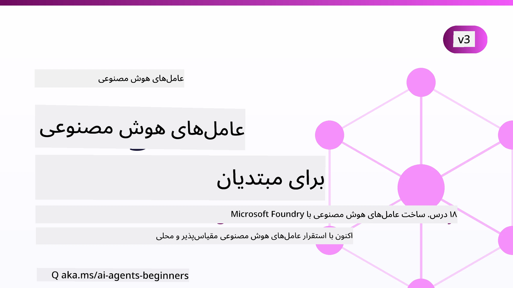

# عوامل هوش مصنوعی برای مبتدیان - یک دوره



## دوره‌ای که همه چیز لازم برای شروع ساخت عوامل هوش مصنوعی را آموزش می‌دهد

[](https://github.com/microsoft/ai-agents-for-beginners/blob/master/LICENSE?WT.mc_id=academic-105485-koreyst)
[](https://GitHub.com/microsoft/ai-agents-for-beginners/graphs/contributors/?WT.mc_id=academic-105485-koreyst)
[](https://GitHub.com/microsoft/ai-agents-for-beginners/issues/?WT.mc_id=academic-105485-koreyst)
[](https://GitHub.com/microsoft/ai-agents-for-beginners/pulls/?WT.mc_id=academic-105485-koreyst)
[](http://makeapullrequest.com?WT.mc_id=academic-105485-koreyst)

### 🌐 پشتیبانی چند زبانه

#### ترجمه‌ها با [مترجم همکاری](https://github.com/Azure/co-op-translator) نگهداری می‌شوند

<!-- CO-OP TRANSLATOR LANGUAGES TABLE START -->
[عربی](../ar/README.md) | [بنگالی](../bn/README.md) | [بلغاری](../bg/README.md) | [برمه‌ای (میانمار)](../my/README.md) | [چینی (ساده‌شده)](../zh-CN/README.md) | [چینی (سنتی، هنگ کنگ)](../zh-HK/README.md) | [چینی (سنتی، ماکائو)](../zh-MO/README.md) | [چینی (سنتی، تایوان)](../zh-TW/README.md) | [کرواسی](../hr/README.md) | [چکی](../cs/README.md) | [دانمارکی](../da/README.md) | [هلندی](../nl/README.md) | [استونیایی](../et/README.md) | [فنلاندی](../fi/README.md) | [فرانسوی](../fr/README.md) | [آلمانی](../de/README.md) | [یونانی](../el/README.md) | [عبری](../he/README.md) | [هندی](../hi/README.md) | [مجارستانی](../hu/README.md) | [اندونزیایی](../id/README.md) | [ایتالیایی](../it/README.md) | [ژاپنی](../ja/README.md) | [کانناда](../kn/README.md) | [خمری](../km/README.md) | [کره‌ای](../ko/README.md) | [لیتوانیایی](../lt/README.md) | [مالایی](../ms/README.md) | [مالایالام](../ml/README.md) | [مانیپوری (میتئی مایک)](../mni/README.md) | [مراتی](../mr/README.md) | [نپالی](../ne/README.md) | [پیدجین نیجریه‌ای](../pcm/README.md) | [نروژی](../no/README.md) | [فارسی](./README.md) | [لهستانی](../pl/README.md) | [پرتغالی (برزیل)](../pt-BR/README.md) | [پرتغالی (پرتغال)](../pt-PT/README.md) | [پنجابی (گرمکھی)](../pa/README.md) | [رومانیایی](../ro/README.md) | [روسی](../ru/README.md) | [صربی (سیریلیک)](../sr/README.md) | [اسلواکی](../sk/README.md) | [اسلوونیایی](../sl/README.md) | [اسپانیایی](../es/README.md) | [سواهایلی](../sw/README.md) | [سوئدی](../sv/README.md) | [تاگالوگ (فیلیپینی)](../tl/README.md) | [تامیلی](../ta/README.md) | [تلوگو](../te/README.md) | [تایلندی](../th/README.md) | [ترکی](../tr/README.md) | [اوکراینی](../uk/README.md) | [اردو](../ur/README.md) | [ویتنامی](../vi/README.md)

> **ترجیح می‌دهید به صورت محلی کلون کنید؟**
>
> این مخزن بیش از ۵۰ ترجمه زبان دارد که حجم دانلود را به طور قابل توجهی افزایش می‌دهد. برای کلون کردن بدون ترجمه‌ها، از sparse checkout استفاده کنید:
>
> **بش / مک‌اواس / لینوکس:**
> ```bash
> git clone --filter=blob:none --sparse https://github.com/microsoft/ai-agents-for-beginners.git
> cd ai-agents-for-beginners
> git sparse-checkout set --no-cone '/*' '!translations' '!translated_images'
> ```
>
> **CMD (ویندوز):**
> ```cmd
> git clone --filter=blob:none --sparse https://github.com/microsoft/ai-agents-for-beginners.git
> cd ai-agents-for-beginners
> git sparse-checkout set --no-cone "/*" "!translations" "!translated_images"
> ```
>
> این روش همه چیز لازم برای تکمیل دوره را با دانلود بسیار سریع‌تر در اختیار شما قرار می‌دهد.
<!-- CO-OP TRANSLATOR LANGUAGES TABLE END -->

**برای گزینه‌های بیشتر زبان، به [زبان‌های پشتیبانی‌شده مترجم همکاری](https://github.com/Azure/co-op-translator/blob/main/docs/supported-languages.md) مراجعه کنید.**

[](https://GitHub.com/microsoft/ai-agents-for-beginners/watchers/?WT.mc_id=academic-105485-koreyst)
[](https://GitHub.com/microsoft/ai-agents-for-beginners/network/?WT.mc_id=academic-105485-koreyst)
[](https://GitHub.com/microsoft/ai-agents-for-beginners/stargazers/?WT.mc_id=academic-105485-koreyst)

[](https://discord.com/invite/ATgtXmAS5D)


## 🌱 شروع به کار

این دوره شامل درس‌هایی است که اصول ساخت عوامل هوش مصنوعی را پوشش می‌دهد. هر درس موضوع خود را دارد، پس از هر جایی که دوست دارید شروع کنید!

این دوره پشتیبانی چندزبانه دارد. به [زبان‌های در دسترس ما مراجعه کنید](#-multi-language-support).

اگر این اولین بار است که با مدل‌های هوش مصنوعی تولیدی کار می‌کنید، دوره [هوش مصنوعی تولیدی برای مبتدیان](https://aka.ms/genai-beginners) را که شامل ۲۱ درس در مورد ساخت با GenAI است، ببینید.

فراموش نکنید که به این مخزن [ستاره (🌟) بدهید](https://docs.github.com/en/get-started/exploring-projects-on-github/saving-repositories-with-stars?WT.mc_id=academic-105485-koreyst) و آن را [فورک کنید](https://github.com/microsoft/ai-agents-for-beginners/fork) تا کد را اجرا کنید.

### ملاقات با سایر یادگیرندگان، دریافت پاسخ سوالات‌تان

اگر گیر کردید یا سوالی درباره ساخت عوامل هوش مصنوعی داشتید، به کانال دیسکورد اختصاصی ما در [دیسکورد Microsoft Foundry](https://aka.ms/ai-agents/discord) بپیوندید.

### آنچه نیاز دارید

هر درس در این دوره شامل نمونه‌های کد است که در پوشه code_samples موجود است. می‌توانید این مخزن را [فورک کنید](https://github.com/microsoft/ai-agents-for-beginners/fork) و یک نسخه از آن برای خود بسازید.

نمونه‌های کد این تمرین‌ها از Microsoft Agent Framework با Microsoft Foundry Agent Service V2 استفاده می‌کنند:

- [Microsoft Foundry](https://aka.ms/ai-agents-beginners/ai-foundry) - نیازمند حساب Azure

این دوره از چارچوب‌ها و سرویس‌های عوامل هوش مصنوعی زیر از مایکروسافت استفاده می‌کند:

- [Microsoft Agent Framework (MAF)](https://learn.microsoft.com/agent-framework/overview/)
- [Microsoft Foundry Agent Service V2](https://aka.ms/ai-agents-beginners/ai-agent-service)

برخی نمونه‌های کد همچنین از ارائه‌دهندگان سازگار با OpenAI مانند [MiniMax](https://platform.minimaxi.com/) که مدل‌های با زمینه بزرگ (تا ۲۰۴ هزار توکن) ارائه می‌دهد، پشتیبانی می‌کنند. برای جزئیات پیکربندی به [تنظیمات دوره](./00-course-setup/README.md) مراجعه کنید.

برای اطلاعات بیشتر درباره اجرای کد این دوره، به [تنظیمات دوره](./00-course-setup/README.md) مراجعه کنید.

## 🙏 مایلید کمک کنید؟

اگر پیشنهادی دارید یا خطاهای املایی یا کد پیدا کردید، [یک مسئله ایجاد کنید](https://github.com/microsoft/ai-agents-for-beginners/issues?WT.mc_id=academic-105485-koreyst) یا [یک درخواست pull ارسال کنید](https://github.com/microsoft/ai-agents-for-beginners/pulls?WT.mc_id=academic-105485-koreyst)


## 📂 هر درس شامل

- یک درس مکتوب در README و یک ویدیو کوتاه
- نمونه‌های کد پایتون با استفاده از Microsoft Agent Framework با Microsoft Foundry
- لینک‌هایی به منابع اضافی برای ادامه یادگیری شما


## 🗃️ دروس

| **درس**                                   | **متن و کد**                                    | **ویدیو**                                                  | **یادگیری اضافی**                                                                     |
|----------------------------------------------|----------------------------------------------------|------------------------------------------------------------|----------------------------------------------------------------------------------------|
| مقدمه‌ای بر عوامل هوش مصنوعی و موارد کاربرد عامل       | [لینک](./01-intro-to-ai-agents/README.md)          | [ویدیو](https://youtu.be/3zgm60bXmQk?si=z8QygFvYQv-9WtO1)  | [لینک](https://aka.ms/ai-agents-beginners/collection?WT.mc_id=academic-105485-koreyst) |
| کاوش در چارچوب‌های عامل هوش مصنوعی              | [لینک](./02-explore-agentic-frameworks/README.md)  | [ویدیو](https://youtu.be/ODwF-EZo_O8?si=Vawth4hzVaHv-u0H)  | [لینک](https://aka.ms/ai-agents-beginners/collection?WT.mc_id=academic-105485-koreyst) |
| درک الگوهای طراحی عامل هوش مصنوعی     | [لینک](./03-agentic-design-patterns/README.md)     | [ویدیو](https://youtu.be/m9lM8qqoOEA?si=BIzHwzstTPL8o9GF)  | [لینک](https://aka.ms/ai-agents-beginners/collection?WT.mc_id=academic-105485-koreyst) |
| الگوی طراحی استفاده از ابزار                      | [لینک](./04-tool-use/README.md)                    | [ویدیو](https://youtu.be/vieRiPRx-gI?si=2z6O2Xu2cu_Jz46N)  | [لینک](https://aka.ms/ai-agents-beginners/collection?WT.mc_id=academic-105485-koreyst) |
| عامل RAG                                  | [لینک](./05-agentic-rag/README.md)                 | [ویدیو](https://youtu.be/WcjAARvdL7I?si=gKPWsQpKiIlDH9A3)  | [لینک](https://aka.ms/ai-agents-beginners/collection?WT.mc_id=academic-105485-koreyst) |
| ساخت عوامل هوش مصنوعی قابل اعتماد               | [لینک](./06-building-trustworthy-agents/README.md) | [ویدیو](https://youtu.be/iZKkMEGBCUQ?si=jZjpiMnGFOE9L8OK ) | [لینک](https://aka.ms/ai-agents-beginners/collection?WT.mc_id=academic-105485-koreyst) |
| الگوی طراحی برنامه‌ریزی                      | [لینک](./07-planning-design/README.md)             | [ویدیو](https://youtu.be/kPfJ2BrBCMY?si=6SC_iv_E5-mzucnC)  | [لینک](https://aka.ms/ai-agents-beginners/collection?WT.mc_id=academic-105485-koreyst) |
| الگوی طراحی چند عاملی                   | [لینک](./08-multi-agent/README.md)                 | [ویدیو](https://youtu.be/V6HpE9hZEx0?si=rMgDhEu7wXo2uo6g)  | [لینک](https://aka.ms/ai-agents-beginners/collection?WT.mc_id=academic-105485-koreyst) |
| الگوی طراحی خودآگاهی                 | [لینک](./09-metacognition/README.md)               | [ویدیو](https://youtu.be/His9R6gw6Ec?si=8gck6vvdSNCt6OcF)  | [لینک](https://aka.ms/ai-agents-beginners/collection?WT.mc_id=academic-105485-koreyst) |
| عوامل هوش مصنوعی در تولید                      | [لینک](./10-ai-agents-production/README.md)        | [ویدیو](https://youtu.be/l4TP6IyJxmQ?si=31dnhexRo6yLRJDl)  | [لینک](https://aka.ms/ai-agents-beginners/collection?WT.mc_id=academic-105485-koreyst) |
| استفاده از پروتکل‌های عاملی (MCP، A2A و NLWeb) | [لینک](./11-agentic-protocols/README.md)           | [ویدیو](https://youtu.be/X-Dh9R3Opn8)                                 | [لینک](https://aka.ms/ai-agents-beginners/collection?WT.mc_id=academic-105485-koreyst) |
| مهندسی زمینه برای عوامل هوش مصنوعی            | [لینک](./12-context-engineering/README.md)         | [ویدیو](https://youtu.be/F5zqRV7gEag)                                 | [لینک](https://aka.ms/ai-agents-beginners/collection?WT.mc_id=academic-105485-koreyst) |
| مدیریت حافظه عامل                      | [لینک](./13-agent-memory/README.md)     |      [ویدیو](https://youtu.be/QrYbHesIxpw?si=vZkVwKrQ4ieCcIPx)                                                      |                                                                                        |
| کاوش Microsoft Agent Framework                         | [لینک](./14-microsoft-agent-framework/README.md)                            |                                                            |                                                                                        |
| ساخت عوامل کامپیوتری (CUA)           | [لینک](./15-browser-use/README.md)     |                                                            | [لینک](https://docs.browser-use.com/examples/templates/playwright-integration)         |
| استقرار عوامل مقیاس‌پذیر                    | [لینک](./16-deploying-scalable-agents/README.md) |                                                    | [لینک](https://learn.microsoft.com/azure/ai-foundry/agents/overview)                   |
| ایجاد عوامل هوش مصنوعی محلی                     | [لینک](./17-creating-local-ai-agents/README.md)  |                                                    | [لینک](https://learn.microsoft.com/azure/ai-foundry/foundry-local/)                    |
| امن‌سازی عوامل هوش مصنوعی                           | [لینک](./18-securing-ai-agents/README.md)  |                                                            | [لینک](https://aka.ms/ai-agents-beginners/collection?WT.mc_id=academic-105485-koreyst) |

## 🎒 دوره‌های دیگر

تیم ما دوره‌های دیگری تولید می‌کند! این‌ها را ببینید:

<!-- CO-OP TRANSLATOR OTHER COURSES START -->
### LangChain
[](https://aka.ms/langchain4j-for-beginners)
[](https://aka.ms/langchainjs-for-beginners?WT.mc_id=m365-94501-dwahlin)
[](https://github.com/microsoft/langchain-for-beginners?WT.mc_id=m365-94501-dwahlin)
---

### Azure / Edge / MCP / عوامل
[](https://github.com/microsoft/AZD-for-beginners?WT.mc_id=academic-105485-koreyst)
[](https://github.com/microsoft/edgeai-for-beginners?WT.mc_id=academic-105485-koreyst)
[](https://github.com/microsoft/mcp-for-beginners?WT.mc_id=academic-105485-koreyst)
[](https://github.com/microsoft/ai-agents-for-beginners?WT.mc_id=academic-105485-koreyst)

---
 
### سری هوش مصنوعی تولیدی
[](https://github.com/microsoft/generative-ai-for-beginners?WT.mc_id=academic-105485-koreyst)
[-9333EA?style=for-the-badge&labelColor=E5E7EB&color=9333EA)](https://github.com/microsoft/Generative-AI-for-beginners-dotnet?WT.mc_id=academic-105485-koreyst)
[-C084FC?style=for-the-badge&labelColor=E5E7EB&color=C084FC)](https://github.com/microsoft/generative-ai-for-beginners-java?WT.mc_id=academic-105485-koreyst)
[-E879F9?style=for-the-badge&labelColor=E5E7EB&color=E879F9)](https://github.com/microsoft/generative-ai-with-javascript?WT.mc_id=academic-105485-koreyst)

---
 
### یادگیری اصلی
[](https://aka.ms/ml-beginners?WT.mc_id=academic-105485-koreyst)
[](https://aka.ms/datascience-beginners?WT.mc_id=academic-105485-koreyst)
[](https://aka.ms/ai-beginners?WT.mc_id=academic-105485-koreyst)
[](https://github.com/microsoft/Security-101?WT.mc_id=academic-96948-sayoung)
[](https://aka.ms/webdev-beginners?WT.mc_id=academic-105485-koreyst)
[](https://aka.ms/iot-beginners?WT.mc_id=academic-105485-koreyst)
[](https://github.com/microsoft/xr-development-for-beginners?WT.mc_id=academic-105485-koreyst)

---
 
### سری کوپایلوت
[](https://aka.ms/GitHubCopilotAI?WT.mc_id=academic-105485-koreyst)
[](https://github.com/microsoft/mastering-github-copilot-for-dotnet-csharp-developers?WT.mc_id=academic-105485-koreyst)
[](https://github.com/microsoft/CopilotAdventures?WT.mc_id=academic-105485-koreyst)
<!-- CO-OP TRANSLATOR OTHER COURSES END -->

## 🌟 قدردانی از جامعه

از [شوام گویال](https://www.linkedin.com/in/shivam2003/) برای مشارکت نمونه‌های کد مهم که Agentic RAG را نشان می‌دهند، تشکر می‌کنیم.

## مشارکت

این پروژه پذیرای مشارکت‌ها و پیشنهادات است. بیشتر مشارکت‌ها نیازمند این است که با
قرارداد مجوز مشارکت‌کننده (CLA) موافقت کنید که اعلام می‌کند شما حق دارید و در واقع این حق را به ما می‌دهید
که از مشارکت شما استفاده کنیم. برای جزئیات به <https://cla.opensource.microsoft.com> مراجعه کنید.

هنگام ارسال درخواست pull، ربات CLA به‌طور خودکار تعیین می‌کند که آیا نیاز به ارائه
قرارداد مجوز دارید و PR را به‌طور مناسب علامت‌گذاری می‌کند (مثل بررسی وضعیت، نظر). فقط دستورالعمل‌های
ارائه شده توسط ربات را دنبال کنید. شما فقط یک بار نیاز به انجام این کار در تمام مخازنی که از CLA ما استفاده می‌کنند دارید.

این پروژه «[کد رفتار منبع باز مایکروسافت](https://opensource.microsoft.com/codeofconduct/)» را پذیرفته است.
برای اطلاعات بیشتر به [پرسش‌های متداول کد رفتار](https://opensource.microsoft.com/codeofconduct/faq/) مراجعه کنید یا
با [opencode@microsoft.com](mailto:opencode@microsoft.com) برای هر سوال یا نظر اضافی تماس بگیرید.

## علائم تجاری

این پروژه ممکن است شامل علائم تجاری یا لوگوهایی برای پروژه‌ها، محصولات یا خدمات باشد. استفاده مجاز از علائم تجاری یا لوگوهای مایکروسافت
مشروط به این است که باید از
[راهنمای علائم تجاری و برند مایکروسافت](https://www.microsoft.com/legal/intellectualproperty/trademarks/usage/general) پیروی کند.
استفاده از علائم تجاری یا لوگوهای مایکروسافت در نسخه‌های تعدیل شده این پروژه نباید موجب سردرگمی شود یا دلالت بر حمایت مایکروسافت داشته باشد.
هرگونه استفاده از علائم تجاری یا لوگوهای شخص ثالث مشمول سیاست‌های آن شخص ثالث است.

## دریافت کمک


اگر گیر کرده‌اید یا سوالی درباره ساخت برنامه‌های هوش مصنوعی دارید، به اینجا بپیوندید:

[](https://aka.ms/foundry/discord)

اگر بازخورد محصول یا خطا هنگام ساخت دارید، مراجعه کنید به:

[](https://aka.ms/foundry/forum)

---

<!-- CO-OP TRANSLATOR DISCLAIMER START -->
**سلب مسئولیت**:
این سند با استفاده از سرویس ترجمه هوش مصنوعی [Co-op Translator](https://github.com/Azure/co-op-translator) ترجمه شده است. در حالی که ما در تلاش برای دقت هستیم، لطفاً توجه داشته باشید که ترجمه‌های خودکار ممکن است شامل خطاها یا نادرستی‌هایی باشند. سند اصلی به زبان مادری خود باید به عنوان منبع معتبر در نظر گرفته شود. برای اطلاعات حیاتی، ترجمه حرفه‌ای انسانی توصیه می‌شود. ما در قبال هرگونه سوء تفاهم یا برداشت نادرست ناشی از استفاده از این ترجمه مسئولیتی نداریم.
<!-- CO-OP TRANSLATOR DISCLAIMER END -->