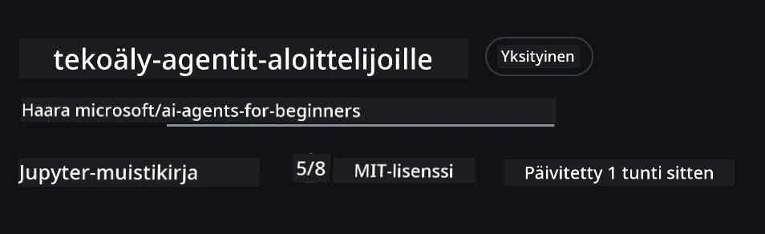
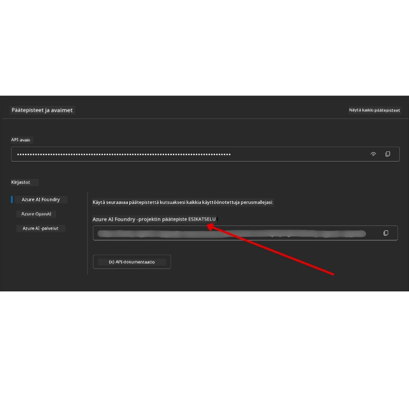

# Kurssin asetukset

## Johdanto

Tässä oppitunnissa käydään läpi, miten suoritat tämän kurssin koodiesimerkit.

## Liity muiden oppijoiden seuraan ja saa apua

Ennen kuin alat kloonata repositoriotasi, liity [AI Agents For Beginners Discord -kanavalle](https://aka.ms/ai-agents/discord) saadaksesi apua asennuksessa, vastauksia kurssin kysymyksiin tai yhteyden muihin oppijoihin.

## Kloonaa tai haarauta tämä repo

Aloita kloonaamalla tai haarauttamalla GitHub-repositorio. Tämä luo oman version kurssimateriaalista, jotta voit suorittaa, testata ja muokata koodia!

Tämä onnistuu klikkaamalla linkkiä <a href="https://github.com/microsoft/ai-agents-for-beginners/fork" target="_blank">haaraaksesi repoon</a>

Sinulla tulisi nyt olla oma haarautettu versio tästä kurssista seuraavassa linkissä:



### Shallow-kloonaus (suositeltu työpajoihin / Codespaces-ympäristöihin)

  >Koko repositorio voi olla suuri (~3 GB), jos lataat koko historian ja kaikki tiedostot. Jos osallistut vain työpajaan tai tarvitset vain muutaman oppituntikansion, shallow-kloonaus (tai sparse-kloonaus) lataa paljon vähemmän.

#### Nopea shallow-kloonaus — minimaalinen historia, kaikki tiedostot

Korvaa alla komentojen `<your-username>` omalla haarautus-URL-osoitteellasi (tai upstream URL-osoitteella, jos haluat).

Kloonaa vain uusin commit-historia (pieni lataus):

```bash
git clone --depth 1 https://github.com/<your-username>/ai-agents-for-beginners.git
```

Kloonaa tietty haara:

```bash
git clone --depth 1 --branch <branch-name> https://github.com/<your-username>/ai-agents-for-beginners.git
```

#### Osittainen (sparse) kloonaus — minimaalinen blobit + vain valitut kansiot

Tämä käyttää osittaista kloonausta ja sparse-checkoutia (vaatii Git 2.25+ ja suositellaan modernia Gitiä osittaisella kloonaustuesta):

```bash
git clone --depth 1 --filter=blob:none --sparse https://github.com/<your-username>/ai-agents-for-beginners.git
```

Siirry repositorion kansioon:

```bash
cd ai-agents-for-beginners
```

Sitten määrittele, mitkä kansiot haluat (alla esimerkissä kaksi kansiota):

```bash
git sparse-checkout set 00-course-setup 01-intro-to-ai-agents
```

Kun kloonaus ja tiedostojen varmistus on valmis, jos tarvitset vain tiedostot ja haluat vapauttaa tilaa (ilman git-historiaa), poista repositorion metatiedot (💀peruuttamaton — menetät kaiken Git-toiminnallisuuden):

```bash
# zsh/bash
rm -rf .git
```

```powershell
# PowerShell
Remove-Item -Recurse -Force .git
```

#### GitHub Codespacesin käyttö (suositellaan paikallisten isojen latausten välttämiseksi)

- Luo uusi Codespace tälle repolle [GitHubin käyttöliittymän](https://github.com/codespaces) kautta.  

- Käynnistä terminaalissa joko shallow- tai sparse-kloonauskomento yllä tuodaksesi vain tarvitsemiasi oppituntikansioita Codespace-työtilaan.
- Valinnainen: kloonauksen jälkeen Codespacesissa, poista .git saadaksesi lisää tilaa (katso poistokomennot yllä).
- Huom: Jos avaat repoon suoraan Codespacesissa (ilman erillistä kloonausta), ota huomioon, että Codespaces muodostaa devcontainer-ympäristön ja saattaa silti varata enemmän kuin tarvitset.

#### Vinkkejä

- Vaihda aina kloonaus-URL omaan haarautukseesi, jos haluat muokata tai tehdä committeja.
- Jos myöhemmin tarvitset lisää historiaa tai tiedostoja, voit hakea niitä tai säätää sparse-checkoutia mukaan ottamaan lisää kansioita.

## Koodin suorittaminen

Tämä kurssi tarjoaa sarjan Jupyter Notebookeja, joita voit suorittaa saadaksesi käytännön kokemusta tekoälyagenttien rakentamisesta.

Esimerkkikoodit käyttävät **Microsoft Agent Framework (MAF)** -kehyksiä `FoundryChatClient` kanssa, jotka yhdistävät **Microsoft Foundry Agent Service V2** (Responses API) -palveluun **Microsoft Foundryn** kautta.

Kaikki Python-muistikirjat on merkitty `*-python-agent-framework.ipynb`.

## Vaatimukset

- Python 3.12+
  - **HUOM**: Jos Python 3.12 ei ole asennettuna, varmista sen asentaminen. Luo sitten virtuaaliympäristösi python3.12:lla varmistaaksesi, että vaatimustiedostosta asennetaan oikeat versiot.
  
    >Esimerkki

    Luo Python virtuaaliympäristön kansio:

    ```bash
    python -m venv venv
    ```

    Aktivoi sitten virtuaaliympäristö seuraavasti:

    ```bash
    # zsh/bash
    source venv/bin/activate
    ```
  
    ```dos
    # Command Prompt for Windows
    venv\Scripts\activate
    ```

- .NET 10+: .NET:ää käyttävissä esimerkkikoodeissa varmista, että sinulla on asennettuna [.NET 10 SDK](https://dotnet.microsoft.com/download/dotnet/10.0) tai uudempi. Tarkista asennettu .NET SDK -versiosi:

    ```bash
    dotnet --list-sdks
    ```

- **Azure CLI** — Välttämätön todennukseen. Asenna osoitteesta [aka.ms/installazurecli](https://aka.ms/installazurecli).
- **Azure-tilaus** — Pääsyä Microsoft Foundryyn ja Microsoft Foundry Agent Serviceen varten.
- **Microsoft Foundry -projekti** — Projekti, jossa on otettu käyttöön malli (esim. `gpt-5-mini`). Katso [Vaihe 1](#step-1-create-a-microsoft-foundry-project) alla.

Projektin juuressa on mukana `requirements.txt` -tiedosto, joka sisältää kaikki tarvittavat Python-paketit koodiesimerkkien suorittamiseen.

Voit asentaa ne suorittamalla seuraavan komennon terminaalissasi projektin juuressa:

```bash
pip install -r requirements.txt
```

Suosittelemme luomaan Python-virtuaaliympäristön ristiriitojen ja ongelmien välttämiseksi.

## VSCode-asetukset

Varmista, että käytät oikeaa Python-versiota VSCodessa.


## Ota käyttöön Microsoft Foundry ja Microsoft Foundry Agent Service

### Vaihe 1: Luo Microsoft Foundry -projekti

Sinun on oltava Microsoft Foundry -**projekti**, jossa on käyttöön otettu malli, jotta voit suorittaa muistikirjat. Luo projekti suoraan nykyisessä Microsoft Foundry -ympäristössä; hubia ei tarvita.

1. Siirry osoitteeseen [ai.azure.com](https://ai.azure.com) ja kirjaudu sisään Azure-tililläsi.
2. Valitse **Luo projekti** ja seuraa ohjeita projektisi luomiseksi.
3. Ota projektissa käyttöön malli (esim. `gpt-5-mini`) valitsemalla **Mallit + Päätepisteet** → **Ota malli käyttöön**.

### Vaihe 2: Hae projektisi päätepisteen URL ja mallin käyttöönoton nimi

Microsoft Foundry -portaalissa projektissasi:

- **Projektin päätepiste** — Mene **Yleiskatsaus**-sivulle ja kopioi päätepisteen URL-osoite.



- **Mallin käyttöönoton nimi** — Siirry **Mallit + Päätepisteet** -kohtaan, valitse käyttöönotettu mallisi ja huomaa **Käyttöönoton nimi** (esim. `gpt-5-mini`).

### Vaihe 3: Kirjaudu sisään Azureen `az login` avulla

Useimmat muistikirjat todennetaan sinun **Azure CLI -kirjautumisesi** kautta — käyttämällä `AzureCliCredential` tai `DefaultAzureCredential` (molemmat käyttävät sinun `az login` istuntoasi) paketista `azure-identity` — joten ne eivät vaadi API-avaimia. Muutama opetus ja valinnaiset integraatiot käyttävät API-avaimia; tarkista kunkin oppitunnin edellytykset mahdollisten lisäympäristömuuttujien varalta. Tämä vaatii, että olet kirjautuneena Azure CLI:llä.

1. **Asenna Azure CLI**, jos et ole vielä tehnyt sitä: [aka.ms/installazurecli](https://aka.ms/installazurecli)

2. **Kirjaudu sisään** suorittamalla:

    ```bash
    az login
    ```

    Tai jos olet etä- tai Codespace-ympäristössä ilman selainta:

    ```bash
    az login --use-device-code
    ```

3. **Valitse tilauksesi**, jos saat kehotteen — valitse se, joka sisältää Foundry-projektisi.

4. **Varmista** että olet kirjautuneena sisään:

    ```bash
    az account show
    ```

> **Miksi `az login`?** Muistikirjat todennetaan käyttämällä `AzureCliCredential` (tai `DefaultAzureCredential`, joka myös noutaa Azure CLI -kirjautumisesi) paketista `azure-identity`. Tämä tarkoittaa, että Azure CLI -istuntosi tarjoaa tunnistetiedot — ei API-avaimia tai salaisuuksia `.env` tiedostossasi. Tämä on [turvallisuuden paras käytäntö](https://learn.microsoft.com/azure/developer/ai/keyless-connections).

### Vaihe 4: Luo `.env` tiedostosi

Kopioi esimerkkitiedosto:

```bash
# zsh/bash
cp .env.example .env
```

```powershell
# PowerShell
Copy-Item .env.example .env
```

Avaa `.env` ja täytä nämä kaksi arvoa:

```env
AZURE_AI_PROJECT_ENDPOINT=https://<your-project>.services.ai.azure.com/api/projects/<your-project-id>
AZURE_AI_MODEL_DEPLOYMENT_NAME=gpt-5-mini
```

| Muuttuja | Missä löytää |
|----------|-----------------|
| `AZURE_AI_PROJECT_ENDPOINT` | Foundry-portaali → projektisi → **Yhteenveto**-sivu |
| `AZURE_AI_MODEL_DEPLOYMENT_NAME` | Foundry-portaali → **Mallit + Päätepisteet** → käyttöönotetun mallisi nimi |

Siinä se suurimmaksi osaksi! Muistikirjat todennetaan automaattisesti `az login`-istuntosi kautta.

### Vaihe 5: Asenna Python-riippuvuudet

```bash
pip install -r requirements.txt
```

Suosittelemme suorittamaan tämän aiemmin luomassasi virtuaaliympäristössä.

## Valinnainen asennus: Azure AI Search (Oppitunnit 5 ja 16)

Oppitunnin 5 (Agentic RAG) ja Oppitunnin 16 muistikirjat toimivat suoraan **muistissa olevan tietopohjan** kanssa — eivät vaadi ylimääräisiä Azure-resursseja. Jos haluat käyttää todellista **Azure AI Search** -hakemistoa, huomaa että **Oppitunnin 16 muistikirja käyttää tällä hetkellä avainpohjaista todennusta**: se vaihtaa muistissa olevan haun ja Azure AI Searchin välillä vain, kun **molemmat** `AZURE_SEARCH_SERVICE_ENDPOINT` **ja** `AZURE_SEARCH_API_KEY` on asetettu, ja muuten pysyy muistihauissa — joten todellista hakemistoa vasten ajaaksesi sinun täytyy asettaa myös hallinta-avain. Avaimeton todennus Microsoft Entra ID:llä (RBAC) on suositeltu lähestymistapa omaan tuotantokoodiin, vastaavasti kuin `az login` -virtausta käytetään muualla kurssilla.

Alla olevat RBAC-vaiheet koskevat asennusoppaan esimerkkejä ja omaa koodiasi. Ne eivät ota käyttöön avaimetonta todennusta Oppitunnin 16 muistikirjassa; Oppitunti 16 vaatii yhä sekä päätepiste- että hallinta-avaimen Azure AI Searchin käyttöön.

1. **Ota roolipohjainen käyttöoikeus käyttöön** hakupalvelussasi:

    ```bash
    az search service update --name <service-name> --resource-group <resource-group> --auth-options aadOrApiKey
    ```

2. **Määritä itsellesi vaaditut roolit** (luo/lataa indeksit ja tee kyselyjä):

    ```bash
    az role assignment create --assignee <your-user-or-principal-id> --role "Search Service Contributor" --scope $(az search service show -g <resource-group> -n <service-name> --query id -o tsv)
    az role assignment create --assignee <your-user-or-principal-id> --role "Search Index Data Contributor" --scope $(az search service show -g <resource-group> -n <service-name> --query id -o tsv)
    ```

3. **Lisää päätepiste** tiedostoosi `.env`:

| Muuttuja | Missä se löytyy |
|----------|-----------------|
| `AZURE_SEARCH_SERVICE_ENDPOINT` | Azure-portaali → oma **Azure AI Search** -resurssisi → **Yleiskatsaus** → URL |
| `AZURE_SEARCH_API_KEY` | Tarvitaan (päätepisteen kanssa) Azure AI Searchin käyttämiseen Oppitunti 16:n muistikirjassa, joka käyttää avainpohjaista todennusta. Azure-portaali → **Asetukset** → **Avaimet** → ensisijainen ylläpitäjän avain |

> **Miksi avaimettomuus?** Hallintavaimet antavat täydet kirjoitusoikeudet hakupalveluusi ja voivat vuotaa `.env`-tiedostojen kautta. RBAC:in avulla sen sijaan käytetään `az login`-tunnustettasi — samaa avaimetonta Entra ID -kuviota, jota kurssimuistikirjat käyttävät (kautta `AzureCliCredential` / `DefaultAzureCredential`). Katso [Yhdistä Azure AI Search -hakupalveluun roolien avulla](https://learn.microsoft.com/azure/search/search-security-rbac).

Katso [Azure AI Search -asennusopas](./AzureSearch.md) saadaksesi täydelliset esimerkit indeksin luomisesta Pythonilla ja .NETillä.

## Lisäasetukset oppitunteihin, jotka kutsuvat Azure OpenAI:ta suoraan (oppitunnit 6 ja 8)

Joissakin oppituntien 6 ja 8 muistikirjoissa kutsutaan **Azure OpenAI:ta** suoraan (käyttäen **Responses API:a**) sen sijaan, että mentäisiin Microsoft Foundryn projektin kautta. Nämä esimerkit käyttivät aiemmin GitHub-malleja, jotka ovat vanhentuneita eivätkä tue Responses API:a. Lisää nämä muuttujat `.env` tiedostoosi:

| Muuttuja | Mistä se löytyy |
|----------|-----------------|
| `AZURE_OPENAI_ENDPOINT` | Azure-portaali → oma **Azure OpenAI** -resurssisi → **Avain ja päätepiste** → Päätepiste (esim. `https://<your-resource>.openai.azure.com`) |
| `AZURE_OPENAI_DEPLOYMENT` | Käyttöönotetun mallisi nimi (esim. `gpt-5-mini`), joka tukee Responses-rajapintaa |
| `AZURE_OPENAI_API_KEY` | Valinnainen — vain jos käytät avainpohjaista todennusta `az login` / Entra ID sijaan |

> Responses-rajapinta käyttää vakaata `/openai/v1/`-päätepistettä, joten `api-version` ei ole tarpeen. Kirjaudu sisään `az login` käyttämällä avaintonta Entra ID -todennusta.

## Vaihtoehtoinen tarjoaja: MiniMax (OpenAI-yhteensopiva)

[MiniMax](https://platform.minimaxi.com/) tarjoaa laajakonemallin (jopa 204K tokenia) OpenAI-yhteensopivan rajapinnan kautta. Koska Microsoft Agent Frameworkin `OpenAIChatClient` toimii minkä tahansa OpenAI-yhteensopivan päätepisteen kanssa, voit käyttää MiniMaxia suoraan `OpenAIChatClient`-oppitunneissa vaihtoehtona.

Lisää nämä muuttujat `.env`-tiedostoosi:

| Muuttuja | Mistä se löytyy |
|----------|-----------------|
| `MINIMAX_API_KEY` | [MiniMax-alusta](https://platform.minimaxi.com/) → API-avaimet |
| `MINIMAX_BASE_URL` | Käytä `https://api.minimax.io/v1` (oletusarvo) |
| `MINIMAX_MODEL_ID` | Käytettävän mallin nimi (esim. `MiniMax-M3`) |

**Esimerkkimallit**: `MiniMax-M3` (suositeltu), `MiniMax-M2.7`, `MiniMax-M2.7-highspeed` (nopeammat vastaukset). Mallien nimet ja saatavuus voivat muuttua ajan myötä, ja pääsy tiettyyn malliin voi riippua tilistäsi.

Koodiesimerkit, jotka käyttävät `OpenAIChatClient` (esim. Oppitunti 14 hotellivarauksen työnkulku), tunnistavat ja käyttävät automaattisesti MiniMax-konfiguraatiotasi, kun `MINIMAX_API_KEY` on asetettu.

## Vaihtoehtoinen tarjoaja: Novita AI (OpenAI-yhteensopiva)

[Novita AI](https://novita.ai/llm-api) tarjoaa OpenAI-yhteensopivan API:n avoimen lähdekoodin ja uusimpien LLM-mallien (DeepSeek, Llama, Qwen ja muut) käyttöön. Koska Microsoft Agent Frameworkin `OpenAIChatClient` toimii minkä tahansa OpenAI-yhteensopivan rajapinnan kanssa, voit käyttää Novita AI:ta suoraan Azure OpenAI:n tai OpenAI:n sijaan.

Lisää nämä muuttujat `.env` tiedostoosi:

| Muuttuja | Missä löytää |
|----------|---------------|
| `NOVITA_API_KEY` | [Novita AI Dashboard](https://novita.ai/settings/key-management) → API-avain |
| `NOVITA_BASE_URL` | Käytä `https://api.novita.ai/openai/v1` (oletusarvo) |
| `NOVITA_MODEL_ID` | Käytettävän mallin nimi (esim. `moonshotai/kimi-k3`) |

**Esimerkkimalleja**: `moonshotai/kimi-k3`, `zai-org/glm-5.2`, `deepseek/deepseek-v4-flash-0731`. Novita AI isännöi myös monia muita avoimen lähdekoodin malliperheitä (Llama, Qwen, GLM ja lisää) — katso [Novita AI mallikirjasto](https://novita.ai/llm-api) saadaksesi ajantasaisen listan saatavilla olevista malleista ja niiden mallitunnuksista.

Nykyiset esimerkit eivät automaattisesti käytä `NOVITA_*` -muuttujia. Jos haluat käyttää Novita AI:ta, anna nämä arvot eksplisiittisesti rakentaessasi `OpenAIChatClient` ajamassasi esimerkissä.

## Vaihtoehtoinen tarjoaja: Foundry Local (Suorita mallit laitteellasi)

[Foundry Local](https://foundrylocal.ai) on kevyt ajonaikainen ympäristö, joka lataa, hallinnoi ja tarjoaa kielimalleja **kokonaan omalla koneellasi** OpenAI-yhteensopivan API:n kautta — pilveä ei tarvita.

Koska Microsoft Agent Frameworkin `OpenAIChatClient` toimii minkä tahansa OpenAI-yhteensopivan päätepisteen kanssa, Foundry Local on paikallinen suora vaihtoehto Azure OpenAI:lle.

**1. Asenna Foundry Local**

```bash
# Windows
winget install Microsoft.FoundryLocal

# macOS
brew install foundrylocal
```

**2. Lataa ja suorita malli** (tämä myös käynnistää paikallisen palvelun):

```bash
foundry model list          # see available models
foundry model run phi-4-mini
```

**3. Asenna Python SDK** paikallisen päätepisteen löytämiseen:

```bash
pip install foundry-local-sdk
```

**4. Ohjaa Microsoft Agent Framework paikalliseen malliisi:**

```python
from foundry_local import FoundryLocalManager
from agent_framework.openai import OpenAIChatClient

# Downloads (if needed) and serves the model locally, then discovers the endpoint/port.
manager = FoundryLocalManager("phi-4-mini")

chat_client = OpenAIChatClient(
    base_url=manager.endpoint,      # e.g. http://localhost:<port>/v1
    api_key=manager.api_key,        # always "not-required" for Foundry Local
    model_id=manager.get_model_info("phi-4-mini").id,
)

agent = chat_client.as_agent(
    name="LocalAgent",
    instructions="You are a helpful assistant running fully on-device.",
)
```

> **Huom:** Foundry Local tarjoaa OpenAI-yhteensopivan **Chat Completions** -rajapinnan. Käytä sitä paikalliseen kehitykseen ja offline-tilanteisiin. Täydellistä **Responses API** -ominaisuusarvostelua (tilalliset keskustelut jne.) varten käytä Azure OpenAI:ta tai Microsoft Foundry -projektia.

## Lisäasetukset Oppitunti 8:lle (Bing Grounding -työnkulku)

Oppitunnin 8 ehdollinen työnkulkumuistio käyttää **Bing grounding** -ominaisuutta Microsoft Foundryn kautta. Jos aiot ajaa tämän esimerkin, lisää tämä muuttuja `.env` -tiedostoosi:

| Muuttuja | Missä löytää |
|----------|---------------|
| `BING_CONNECTION_ID` | Microsoft Foundry portaali → projektisi → **Management** → **Connected resources** → Bing-yhteytesi → kopioi yhteystunnus |

## Vianetsintä

### SSL-varmenteiden varmennusvirheet macOS:llä

Jos käytössäsi on macOS ja kohtaat virheilmoituksen kuten:

```plaintext
ssl.SSLCertVerificationError: [SSL: CERTIFICATE_VERIFY_FAILED] certificate verify failed: self-signed certificate in certificate chain
```

Tämä on tunnettu ongelma Pythonissa macOS:llä, jossa järjestelmän SSL-varmenteita ei automaattisesti luoteta. Kokeile seuraavia ratkaisuja tässä järjestyksessä:

**Vaihtoehto 1: Suorita Pythonin Install Certificates -skripti (suositeltu)**

```bash
# Replace 3.XX with your installed Python version (e.g., 3.12 or 3.13):
/Applications/Python\ 3.XX/Install\ Certificates.command
```

**Vaihtoehto 2: Käytä `connection_verify=False` muistiossasi (vain GitHub-mallien muistioille)**

Oppitunnin 6 muistiossa (`06-building-trustworthy-agents/code_samples/06-system-message-framework.ipynb`) on jo kommentoitu ohitusratkaisu valmiina. Poista kommenttimerkintä `connection_verify=False`, jos kohtaat varmennevirheitä:

```python
client = ChatCompletionsClient(
    endpoint=endpoint,
    credential=AzureKeyCredential(token),
    connection_verify=False,  # Disable SSL verification if you encounter certificate errors
)
```

> **⚠️ Varoitus:** SSL-varmennuksen pois käytöstä ottaminen (`connection_verify=False`) heikentää tietoturvaa ohittamalla varmenteiden tarkistuksen. Käytä tätä vain tilapäisenä ratkaisuna kehitysympäristöissä. Älä koskaan käytä sitä tuotannossa.

**Vaihtoehto 3: Asenna ja käytä `truststore`**

```bash
pip install truststore
```

Lisää sitten seuraava rivi muistiosi tai skriptisi alkuun ennen kuin teet verkko- tai API-kutsuja:

```python
import truststore
truststore.inject_into_ssl()
```

## Jumiuduitko johonkin?

Jos sinulla on ongelmia tämän asennuksen kanssa, liity <a href="https://discord.gg/kzRShWzttr" target="_blank">Azure AI Community Discordiin</a> tai <a href="https://github.com/microsoft/ai-agents-for-beginners/issues?WT.mc_id=academic-105485-koreyst" target="_blank">luo issue</a>.

## Seuraava oppitunti

Olet nyt valmis ajamaan tämän kurssin koodin. Iloisia opiskeluhetkiä tekoälyagenttien maailmassa!

[Introduction to AI Agents and Agent Use Cases](../01-intro-to-ai-agents/README.md)

---

<!-- CO-OP TRANSLATOR DISCLAIMER START -->
**Vastuuvapauslauseke**:
Tämä asiakirja on käännetty käyttämällä tekoälypohjaista käännöspalvelua [Co-op Translator](https://github.com/Azure/co-op-translator). Vaikka pyrimme tarkkuuteen, otathan huomioon, että automaattiset käännökset saattavat sisältää virheitä tai epätarkkuuksia. Alkuperäinen asiakirja sen alkuperäiskielellä on virallinen lähde. Tärkeissä asioissa suositellaan ammattimaista ihmiskäännöstä. Emme ole vastuussa tämän käännöksen käytöstä aiheutuvista väärinymmärryksistä tai tulkinnoista.
<!-- CO-OP TRANSLATOR DISCLAIMER END -->