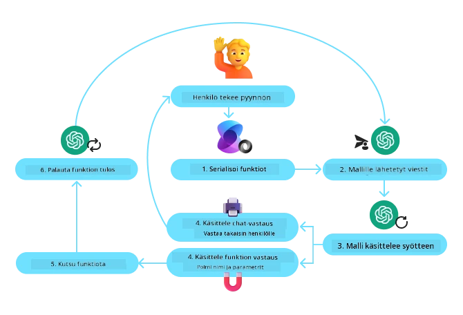
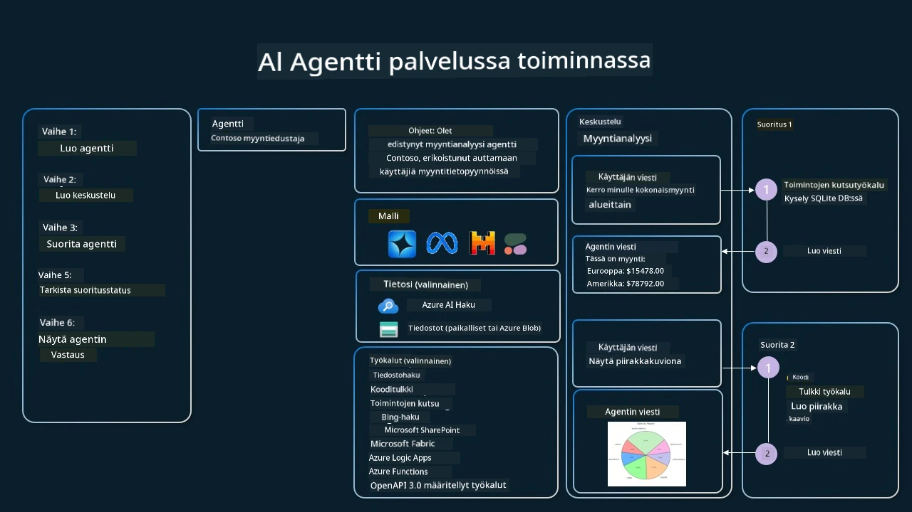

[](https://youtu.be/vieRiPRx-gI?si=cEZ8ApnT6Sus9rhn)

> _(Napsauta yllä olevaa kuvaa nähdäksesi tämän oppitunnin videon)_

# Työkalun Käyttö -suunnittelumalli

Työkalut ovat kiinnostavia, koska ne antavat tekoälyagenteille laajemman kyvykkyysvalikoiman. Sen sijaan, että agentilla olisi rajallinen joukko toimintoja, joita se voi suorittaa, lisäämällä työkalun agentti voi nyt suorittaa laajan valikoiman toimintoja. Tässä luvussa tarkastelemme työkalun käyttö -suunnittelumallia, joka kuvaa, miten tekoälyagentit voivat käyttää tiettyjä työkaluja saavuttaakseen tavoitteensa.

## Johdanto

Tässä oppitunnissa pyrimme vastaamaan seuraaviin kysymyksiin:

- Mikä on työkalun käyttö -suunnittelumalli?
- Mihin käyttötapauksiin sitä voidaan soveltaa?
- Mitä elementtejä/rakennuspalikoita tarvitaan suunnittelumallin toteuttamiseen?
- Mitä erityishuomioita liittyy työkalun käyttö -suunnittelumallin käyttöön luotettavien tekoälyagenttien rakentamisessa?

## Oppimistavoitteet

Tämän oppitunnin suorittamisen jälkeen osaat:

- Määritellä työkalun käyttö -suunnittelumalli ja sen tarkoitus.
- Tunnistaa käyttötapaukset, joissa työkalun käyttö -suunnittelumallia voidaan soveltaa.
- Ymmärtää suunnittelumallin toteuttamiseen tarvittavat keskeiset elementit.
- Tunnistaa luotettavuutta varmistavat näkökohdat tekoälyagenteilla käyttäen tätä suunnittelumallia.

## Mikä on työkalun käyttö -suunnittelumalli?

**Työkalun käyttö -suunnittelumalli** keskittyy antamaan LLM-malleille kyvyn olla vuorovaikutuksessa ulkoisten työkalujen kanssa tiettyjen tavoitteiden saavuttamiseksi. Työkalut ovat koodia, jota agentti voi suorittaa toimenpiteiden tekemiseen. Työkalu voi olla yksinkertainen funktio, kuten laskin, tai kolmannen osapuolen palvelun API-kutsu, kuten osakekurssin haku tai sääennuste. Tekoälyagenttien yhteydessä työkalut on suunniteltu suoritettaviksi agenttien toimesta vastauksena **mallin luomiin funktiokutsuihin**.

## Mihin käyttötapauksiin sitä voidaan soveltaa?

Tekoälyagentit voivat hyödyntää työkaluja suorittaakseen monimutkaisia tehtäviä, hakeakseen tietoa tai tehdäkseen päätöksiä. Työkalun käyttö -suunnittelumallia käytetään usein tilanteissa, joissa tarvitaan dynaamista vuorovaikutusta ulkoisten järjestelmien kanssa, kuten tietokantojen, verkko palveluiden tai koodintulkintaohjelmien kanssa. Tämä kyky on hyödyllinen useissa eri käyttötapauksissa, kuten:

- **Dynaaminen tiedonhaku:** Agentit voivat kysyä ulkoisia API-rajapintoja tai tietokantoja saadakseen ajantasaista dataa (esim. SQLite-tietokannan kysely tietoanalyysiin, osakekurssien tai säätietojen haku).
- **Koodin suoritus ja tulkinta:** Agentit voivat suorittaa koodia tai skriptejä ratkaistakseen matemaattisia ongelmia, luodakseen raporteja tai suorittaakseen simulaatioita.
- **Työnkulun automaatio:** Toistuvien tai monivaiheisten työnkulkujen automatisointi integroimalla työkaluja kuten tehtäväajastimia, sähköpostipalveluja tai dataputkia.
- **Asiakastuki:** Agentit voivat olla vuorovaikutuksessa CRM-järjestelmien, lippujärjestelmien tai tietopankkien kanssa käyttäjäkyselyjen ratkaisemiseksi.
- **Sisällön generointi ja muokkaus:** Agentit voivat hyödyntää työkaluja kuten kielioppitarkistimia, tekstin tiivistelijöitä tai sisältöturvallisuuden arvioijia auttamaan sisällöntuotantotehtävissä.

## Mitä elementtejä/rakennuspalikoita suunnittelumallin toteuttamisessa tarvitaan?

Nämä rakennuspalikat antavat tekoälyagentille mahdollisuuden suorittaa laajan valikoiman tehtäviä. Tarkastellaan työkalun käyttö -suunnittelumallin toteutuksessa tarvittavia keskeisiä elementtejä:

- **Funktio/Työkaluskeemat:** Tarkat määritelmät käytettävissä olevista työkaluista, mukaan lukien funktion nimi, tarkoitus, vaaditut parametrit ja odotetut tulokset. Nämä skeemat mahdollistavat LLM:n ymmärtämään, mitä työkaluja on saatavilla ja miten muodostaa päteviä pyyntöjä.

- **Funktion suorituslogiikka:** Ohjaa, miten ja milloin työkaluja kutsutaan käyttäjän aikomuksen ja keskustelukontekstin perusteella. Tämä voi sisältää suunnittelumoduuleja, reititysmahdollisuuksia tai ehdollisia virtauksia, jotka määräävät työkalun käytön dynaamisesti.

- **Viestinkäsittelyjärjestelmä:** Komponentit, jotka hallinnoivat keskustelun kulkua käyttäjän syötteiden, LLM:n vastausten, työkalukutsujen ja työkaluvastausten välillä.

- **Työkalujen integrointikehys:** Infrastruktuuri, joka yhdistää agentin erilaisiin työkaluihin, olipa kyse yksinkertaisista funktioista tai monimutkaisista ulkoisista palveluista.

- **Virheiden käsittely ja validointi:** Mekanismit, jotka käsittelevät työkalun suorituksessa tapahtuvat epäonnistumiset, validoivat parametrit ja hallinnoivat odottamattomia vastauksia.

- **Tilanhallinta:** Seuraa keskustelukontekstia, aiempia työkalukäyttöjä ja pysyvää dataa varmistaakseen johdonmukaisuuden monivaiheisissa vuorovaikutuksissa.

Seuraavaksi katsomme funktio-/työkalukutsua tarkemmin.
 
### Funktio-/työkalukutsu

Funktiokutsu on pääasiallinen tapa, jolla mahdollistamme suurten kielimallien (LLM) vuorovaikutuksen työkalujen kanssa. Näet usein 'funktion' ja 'työkalun' käytettävän vaihtokelpoisesti, koska 'funktiot' (uudelleenkäytettävän koodin palaset) ovat 'työkaluja', joita agentit käyttävät tehtävien suorittamiseen. Jotta funktion koodi voidaan kutsua, LLM:n täytyy vertailla käyttäjän pyyntöä funktion kuvaukseen. Tätä varten LLM:lle lähetetään skeema, joka sisältää kaikkien käytettävissä olevien funktioiden kuvaukset. LLM valitsee sitten tehtävään sopivimman funktion ja palauttaa sen nimen sekä argumentit. Valittu funktio kutsutaan, sen vastaus lähetetään takaisin LLM:lle, joka käyttää tätä tietoa vastatakseen käyttäjän pyyntöön.

Kehittäjille, jotka haluavat toteuttaa funktiokutsun agenteille, tarvitaan:

1. LLM-malli, joka tukee funktiokutsuja
2. Skeema, joka sisältää funktioiden kuvaukset
3. Koodi kaikille kuvattaville funktioille

Käytetään esimerkkinä ajan saamista jostakin kaupungista:

1. **Alusta LLM, joka tukee funktiokutsuja:**

    Kaikki mallit eivät tue funktiokutsuja, joten on tärkeää varmistaa, että käyttämäsi LLM tukee niitä. <a href="https://learn.microsoft.com/azure/ai-services/openai/how-to/function-calling" target="_blank">Azure OpenAI</a> tukee funktiokutsuja. Voimme aloittaa luomalla OpenAI-asiakkaan Azure OpenAI **Responses API** -rajapintaan (vakaa `/openai/v1/`-päätepiste — ei tarvita `api_version`).

    ```python
    # Initialize the OpenAI client for Azure OpenAI (Responses API, v1 endpoint)
    client = OpenAI(
        base_url=f"{os.environ['AZURE_OPENAI_ENDPOINT'].rstrip('/')}/openai/v1/",
        api_key=os.environ["AZURE_OPENAI_API_KEY"],
    )
    deployment_name = os.environ["AZURE_OPENAI_DEPLOYMENT"]
    ```

1. **Luo funktioskeema**:

    Määrittelemme seuraavaksi JSON-skeeman, joka sisältää funktion nimen, kuvauksen siitä, mitä funktio tekee, sekä funktion parametrien nimet ja kuvaukset.
    Tämä skeema toimitetaan aiemmin luodulle asiakkaalle yhdessä käyttäjän pyynnön kanssa ajan hakemiseksi San Franciscosta. On tärkeää huomata, että **työkalukutsu** on mitä palautetaan, **ei** lopullinen vastaus kysymykseen. Kuten aiemmin mainittiin, LLM palauttaa valitun funktion nimen ja sille annettavat argumentit.

    ```python
    # Function description for the model to read (Responses API flat tool format)
    tools = [
        {
            "type": "function",
            "name": "get_current_time",
            "description": "Get the current time in a given location",
            "parameters": {
                "type": "object",
                "properties": {
                    "location": {
                        "type": "string",
                        "description": "The city name, e.g. San Francisco",
                    },
                },
                "required": ["location"],
            },
        }
    ]
    ```
   
    ```python
  
    # Initial user message
    messages = [{"role": "user", "content": "What's the current time in San Francisco"}]

    # First API call: Ask the model to use the function
    response = client.responses.create(
        model=deployment_name,
        input=messages,
        tools=tools,
        tool_choice="auto",
        store=False,
    )

    # The Responses API returns tool calls as function_call items in response.output.
    # Append them to the conversation so the model has full context on the next turn.
    messages += response.output

    print("Model's response:")
    print(response.output)
  
    ```

    ```bash
    Model's response:
    [ResponseFunctionToolCall(arguments='{"location":"San Francisco"}', call_id='call_pOsKdUlqvdyttYB67MOj434b', name='get_current_time', type='function_call')]
    ```
  
1. **Funktion koodi tehtävän suorittamiseksi:**

    Kun LLM on valinnut suoritettavan funktion, tehtävän suorittava koodi täytyy toteuttaa ja suorittaa.
    Voimme toteuttaa Pythonilla koodin, jolla saamme nykyisen ajan. Meidän täytyy myös kirjoittaa koodi, joka purkaa nimen ja argumentit response_message-viestistä saadaksemme lopullisen tuloksen.

    ```python
      def get_current_time(location):
        """Get the current time for a given location"""
        print(f"get_current_time called with location: {location}")  
        location_lower = location.lower()
        
        for key, timezone in TIMEZONE_DATA.items():
            if key in location_lower:
                print(f"Timezone found for {key}")  
                current_time = datetime.now(ZoneInfo(timezone)).strftime("%I:%M %p")
                return json.dumps({
                    "location": location,
                    "current_time": current_time
                })
      
        print(f"No timezone data found for {location_lower}")  
        return json.dumps({"location": location, "current_time": "unknown"})
    ```

     ```python
    # Handle function calls
    tool_calls = [item for item in response.output if item.type == "function_call"]
    if tool_calls:
        for tool_call in tool_calls:
            if tool_call.name == "get_current_time":

                function_args = json.loads(tool_call.arguments)

                time_response = get_current_time(
                    location=function_args.get("location")
                )

                # Return the tool result as a function_call_output item
                messages.append({
                    "type": "function_call_output",
                    "call_id": tool_call.call_id,
                    "output": time_response,
                })
    else:
        print("No tool calls were made by the model.")

    # Second API call: Get the final response from the model
    final_response = client.responses.create(
        model=deployment_name,
        input=messages,
        tools=tools,
        store=False,
    )

    return final_response.output_text
     ```

     ```bash
      get_current_time called with location: San Francisco
      Timezone found for san francisco
      The current time in San Francisco is 09:24 AM.
     ```

Funktiokutsut ovat useimpien, elleivät kaikkien agenttien työkalukäytön suunnittelun ytimessä, mutta niiden toteutus alusta asti voi joskus olla haastavaa.
Kuten opimme [Oppitunnissa 2](../../../02-explore-agentic-frameworks), agenttipohjaiset kehykset tarjoavat valmiita rakenteita työkalukäytön toteutukseen.
 
## Työkalun käyttöesimerkkejä agenttipohjaisilla kehyksillä

Tässä on esimerkkejä siitä, miten voit toteuttaa työkalun käyttö -suunnittelumallin eri agenttipohjaisia kehyksiä käyttäen:

### Microsoft Agent Framework

<a href="https://learn.microsoft.com/azure/ai-services/agents/overview" target="_blank">Microsoft Agent Framework</a> on avoimen lähdekoodin tekoälykehys tekoälyagenttien rakentamiseen. Se yksinkertaistaa funktiokutsujen käyttöä sallimalla työkalujen määrittelyn Python-funktioina käyttäen `@tool`-koristetta. Kehys hoitaa mallin ja koodisi välisen kommunikoinnin. Se tarjoaa myös valmiita työkaluja, kuten File Searchin ja Code Interpreterin, `FoundryChatClient` kautta.

Seuraava kaavio havainnollistaa funktiokutsuprosessia Microsoft Agent Frameworkissa:



Microsoft Agent Frameworkissa työkalut määritellään koristelluiksi funktioiksi. Voimme muuntaa edellä näkemämme `get_current_time`-funktion työkaluksi käyttämällä `@tool`-koristetta. Kehys sarjoittaa automaattisesti funktion ja sen parametrit, luoden skeeman LLM:lle lähetettäväksi.

```python
import os
from agent_framework import tool
from agent_framework.foundry import FoundryChatClient
from azure.identity import AzureCliCredential

@tool(approval_mode="never_require")
def get_current_time(location: str) -> str:
    """Get the current time for a given location"""
    ...

# Create the client
provider = FoundryChatClient(
    project_endpoint=os.environ["AZURE_AI_PROJECT_ENDPOINT"],
    model=os.environ["AZURE_AI_MODEL_DEPLOYMENT_NAME"],
    credential=AzureCliCredential(),
)

# Create an agent and run with the tool
agent = provider.as_agent(name="TimeAgent", instructions="Use available tools to answer questions.", tools=get_current_time)
response = await agent.run("What time is it?")
```

#### Työkalut MCP-palvelimelta

Työkalujen ei tarvitse olla koodisi funktioita. Palvelin, joka käyttää Model Context Protocolia (MCP, käsitelty [Oppitunnissa 11](../11-agentic-protocols/README.md)), julkaisee työkalunsa skeemoineen, ja kehys voi ladata ne samalla tavoin kuin sarjoittaa koristellun funktion. `MCPStreamableHTTPTool` yhdistää tällaiseen palvelimeen HTTP:n yli, lukee työkalu skeemat ja tarjoaa ne mallille paikallisten työkalujen rinnalla.

Alla oleva esimerkki käyttää verkon hakupalvelinta, jonka isännöi <a href="https://keenable.ai" target="_blank">Keenable</a>. Sen käyttö on ilmaista ilman tiliä tai API-avainta (pyynnöt rajoitetaan IP-kohtaisesti), joten ainoat tarvittavat todennustiedot ovat mallillesi. Kuten minkä tahansa etätyökalun kanssa, mallin kirjoittamat haut lähetetään tälle palvelimelle.

```python
from agent_framework import MCPStreamableHTTPTool

web_search = MCPStreamableHTTPTool(
    name="Keenable web search",
    url="https://api.keenable.ai/mcp",
)

# Connecting loads the server's tool schemas; the agent decides when to call them
async with web_search:
    agent = provider.as_agent(
        name="ResearchAgent",
        instructions="Use available tools to answer questions.",
        tools=[web_search],
    )
    response = await agent.run("What is new in the latest Python release?")
    print(response.text)
```

Palvelin julkaisee kaksi työkalua, `search_web_pages` ja `fetch_page_content`. Kun kysymys vaatii ajantasaista tietoa, malli kutsuu `search_web_pages`, saa takaisin otsikot, URL-osoitteet ja tekstikatkelmat, ja kirjoittaa niistä vastauksen, sama silmukka kuin edellä olevassa `get_current_time`-esimerkissä.
  
### Microsoft Foundry Agent Service

<a href="https://learn.microsoft.com/azure/ai-services/agents/overview" target="_blank">Microsoft Foundry Agent Service</a> on uudempi agenttipohjainen kehys, joka on suunniteltu antamaan kehittäjille mahdollisuus rakentaa, ottaa käyttöön ja skaalata korkealaatuisia ja laajennettavia tekoälyagentteja turvallisesti ilman, että heidän tarvitsee hallita taustalla olevia laskenta- ja tallennusresursseja. Se on erityisen hyödyllinen yrityssovelluksissa, koska kyseessä on täysin hallinnoitu palvelu yritystason tietoturvalla.

Verrattuna suoraan LLM-rajapinnan käyttöön, Microsoft Foundry Agent Service tarjoaa seuraavia etuja:

- Automaattinen työkalukutsu – ei tarvitse jäsentää työkalukutsua, kutsua työkalua tai käsitellä vastausta; kaikki tehdään nyt palvelinpuolella
- Turvallisesti hallittu data – oman keskustelutilan hallinnan sijaan voit luottaa ketjuihin tallentamaan kaiken tarvittavan tiedon
- Valmiit työkalut – Työkaluja, joilla voit olla vuorovaikutuksessa tietolähteidesi kanssa, kuten Bing, Azure AI Search ja Azure Functions.

Microsoft Foundry Agent Servicen työkalut voidaan jakaa kahteen kategoriaan:

1. Tietotyökalut:
    - <a href="https://learn.microsoft.com/azure/ai-services/agents/how-to/tools/bing-grounding?tabs=python&pivots=overview" target="_blank">Grounding Bing-haun avulla</a>
    - <a href="https://learn.microsoft.com/azure/ai-services/agents/how-to/tools/file-search?tabs=python&pivots=overview" target="_blank">Tiedostohaku</a>
    - <a href="https://learn.microsoft.com/azure/ai-services/agents/how-to/tools/azure-ai-search?tabs=azurecli%2Cpython&pivots=overview-azure-ai-search" target="_blank">Azure AI Search</a>

2. Toimintotyökalut:
    - <a href="https://learn.microsoft.com/azure/ai-services/agents/how-to/tools/function-calling?tabs=python&pivots=overview" target="_blank">Funktiokutsu</a>
    - <a href="https://learn.microsoft.com/azure/ai-services/agents/how-to/tools/code-interpreter?tabs=python&pivots=overview" target="_blank">Koodintulkkaaja</a>
    - <a href="https://learn.microsoft.com/azure/ai-services/agents/how-to/tools/openapi-spec?tabs=python&pivots=overview" target="_blank">OpenAPI-määritellyt työkalut</a>
    - <a href="https://learn.microsoft.com/azure/ai-services/agents/how-to/tools/azure-functions?pivots=overview" target="_blank">Azure Functions</a>

Agent Service mahdollistaa näiden työkalujen käytön yhdessä yhtenä `toolset`. Se hyödyntää myös `threads`-ketjuja, jotka pitävät kirjaa viestihistoriasta tietyssä keskustelussa.

Kuvittele, että olet myyntiedustaja yrityksessä nimeltä Contoso. Haluat kehittää keskustelevaa agenttia, joka voi vastata kysymyksiin myyntitiedoistasi.

Seuraava kuva havainnollistaa, miten voisit käyttää Microsoft Foundry Agent Serviä analysoimaan myyntitietojasi:



Käyttääksesi näitä työkaluja palvelun kanssa, voimme luoda asiakkaan ja määritellä työkalun tai työkaluryhmän. Käytännössä toteutamme tämän seuraavalla Python-koodilla. LLM voi tarkastella työkaluryhmää ja päättää käyttääkö käyttäjän luomaa funktiota, `fetch_sales_data_using_sqlite_query`, vai valmista Koodintulkkaajaa käyttäjäpyynnön perusteella.

```python 
import os
from azure.ai.projects import AIProjectClient
from azure.identity import DefaultAzureCredential
from fetch_sales_data_functions import fetch_sales_data_using_sqlite_query # fetch_sales_data_using_sqlite_query function which can be found in a fetch_sales_data_functions.py file.
from azure.ai.projects.models import ToolSet, FunctionTool, CodeInterpreterTool

project_client = AIProjectClient.from_connection_string(
    credential=DefaultAzureCredential(),
    conn_str=os.environ["PROJECT_CONNECTION_STRING"],
)

# Initialize toolset
toolset = ToolSet()

# Initialize function calling agent with the fetch_sales_data_using_sqlite_query function and adding it to the toolset
fetch_data_function = FunctionTool(fetch_sales_data_using_sqlite_query)
toolset.add(fetch_data_function)

# Initialize Code Interpreter tool and adding it to the toolset. 
code_interpreter = CodeInterpreterTool()toolset.add(code_interpreter)

agent = project_client.agents.create_agent(
    model="gpt-5-mini", name="my-agent", instructions="You are helpful agent", 
    toolset=toolset
)
```

## Mitä erityishuomioita liittyy työkalun käyttö -suunnittelumallin käyttöön luotettavien tekoälyagenttien rakentamisessa?

Yleinen huoli LLM:ien dynaamisesti generoiman SQL:n yhteydessä on tietoturva, erityisesti riski SQL-injektioon tai haitallisiin toimiin, kuten tietokannan poistamiseen tai väärentämiseen. Vaikka nämä huolet ovat perusteltuja, ne voidaan tehokkaasti ehkäistä konfiguroimalla tietokannan käyttöoikeudet oikein. Useimmissa tietokannoissa tämä tarkoittaa tietokannan asettamista vain luku -tilaan. Tietokantapalveluissa kuten PostgreSQL tai Azure SQL sovellus tulisi määrittää vain luku -oikeuksiin (SELECT).

Sovelluksen suorittaminen turvallisessa ympäristössä parantaa suojaa entisestään. Yritysskenaarioissa data tyypillisesti puretaan ja muunnetaan operatiivisista järjestelmistä vain luku -tilaiseen tietokantaan tai tietovarastoon käyttäjäystävällisellä skeemalla. Tämä varmistaa, että data on turvallista, optimoitua suorituskyvyn ja saavutettavuuden kannalta, ja että sovelluksella on rajoitettu, vain luku -pääsy.

## Esimerkkikoodit

- Python: [Agent Framework](./code_samples/04-python-agent-framework.ipynb)
- .NET: [Agent Framework](./code_samples/04-dotnet-agent-framework.md)

## Onko sinulla lisää kysymyksiä työkalun käyttö -suunnittelumalleista?

Liity [Microsoft Foundry Discordiin](https://discord.com/invite/ATgtXmAS5D) tavata muiden oppijoiden kanssa, osallistua toimistoaikoihin ja saada vastauksia tekoälyagentteihin liittyviin kysymyksiisi.

## Lisäresurssit

- <a href="https://microsoft.github.io/build-your-first-agent-with-azure-ai-agent-service-workshop/" target="_blank">Azure AI Agents Service -työpaja</a>
- <a href="https://github.com/Azure-Samples/contoso-creative-writer/tree/main/docs/workshop" target="_blank">Contoso Creative Writer Multi-Agent -työpaja</a>
- <a href="https://learn.microsoft.com/azure/ai-services/agents/overview" target="_blank">Microsoft Agent Framework -yleiskatsaus</a>

## Tämän agentin pika-testauksen suorittaminen (valinnainen)

Kun opit ottamaan agentit käyttöön [Oppitunnissa 16](../16-deploying-scalable-agents/README.md), voit pika-testata tämän oppitunnin `TravelToolAgent` (kutsutaanko se edelleen työkalujaan ja vastataanko?) [`tests/lesson-04-smoke-tests.json`](../../../tests/lesson-04-smoke-tests.json) avulla. Katso [`tests/README.md`](../tests/README.md) ohjeet suorittamiseen.

## Edellinen oppitunti

[Agenttisuunnittelumallien ymmärtäminen](../03-agentic-design-patterns/README.md)

## Seuraava oppitunti

[Agenttipohjainen RAG](../05-agentic-rag/README.md)

---

<!-- CO-OP TRANSLATOR DISCLAIMER START -->
**Vastuuvapauslauseke**:
Tämä asiakirja on käännetty käyttämällä tekoälypohjaista käännöspalvelua [Co-op Translator](https://github.com/Azure/co-op-translator). Vaikka pyrimme tarkkuuteen, otathan huomioon, että automaattiset käännökset saattavat sisältää virheitä tai epätarkkuuksia. Alkuperäinen asiakirja sen alkuperäiskielellä on virallinen lähde. Tärkeissä asioissa suositellaan ammattimaista ihmiskäännöstä. Emme ole vastuussa tämän käännöksen käytöstä aiheutuvista väärinymmärryksistä tai tulkinnoista.
<!-- CO-OP TRANSLATOR DISCLAIMER END -->