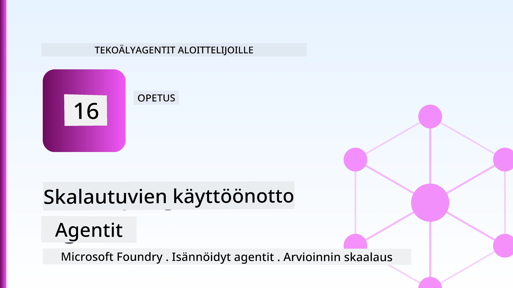
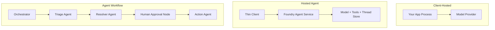
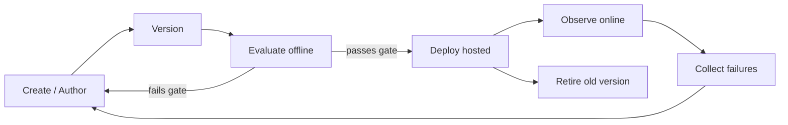
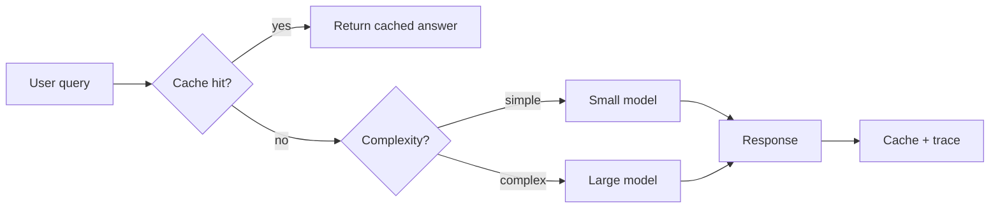
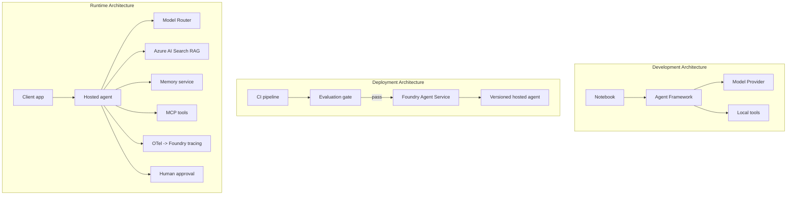

# Skaalautuvien agenttien käyttöönotto Microsoft Foundryn avulla



Tähän asti kurssilla olet rakentanut agentteja, jotka toimivat kannettavassasi tietokoneessa, muistiinpanossa, joita ohjaa `az login` ja kourallinen ympäristömuuttujia. Tämä on juuri oikea tapa oppia. Se ei kuitenkaan ole oikea tapa ajaa agenttia, johon tuhannet asiakkaat luottavat aamuyöllä kello 3.

Tämä oppitunti käsittelee kuilua "se toimii koneellani" ja "se toimii luotettavasti ja edullisesti tuotannossa" välillä. Suljemme sen kuilun käyttämällä **Microsoft Foundrya** ja **Microsoft Foundryn Agenttipalvelua**, ja teemme sen rakentamalla todellisen asiakastukiedustajan, jolla on työkalut, haku, muisti, arviointi ja valvonta.

## Johdanto

Tämä oppitunti käsittelee:

- Erot **prototyyppi-agentin** ja **käyttöönottAgentin** välillä sekä miksi siirtymä koskee enimmäkseen kaikkea mallin *ympärillä olevaa*.
- Agenttien **käyttöönotto-mallit**: klienttipalvelin, palvelin-isännöity (Isännöidyt agentit) ja työnkulun orkestroitu.
- **Agentin elinkaaren** Microsoft Foundryssa — luo, versiota, ota käyttöön, arvioi, tarkkaile, eläköidy.
- **Skaalausstrategiat**: mallin reititys, välimuisti, rinnakkaisuus ja tilaton suunnittelu.
- **Havaittavuus** OpenTelemetryn ja Foundryn jäljityksen avulla.
- **Kustannusten optimointi** mallin valinnan, reitityksen ja arviointiapujen avulla.
- **Yritysjohdon näkökulmat**: hallinto, ihmisen hyväksyntä ja MCP-palvelimien turvallinen ajaminen tuotannossa.

## Oppimistavoitteet

Tämän oppitunnin jälkeen osaat:

- Valita oikean käyttöönotto-mallin tietylle agentin kuormitukselle.
- Ottaa agentin käyttöön Microsoft Foundryn Agenttipalvelussa siten, että se on versioitu, hallinnoitu ja havaittavissa.
- Instrumentoida agentti jäljitystä varten ja kytkeä arviointiputki, joka suoritetaan ennen jokaista julkaisua.
- Soveltaa mallin reititystä ja välimuistia pitämään viive ja kustannukset hallinnassa laajassa mittakaavassa.
- Lisätä ihmisen hyväksyntäportti korkean riskin toimenpiteille ja integroida MCP-palvelin tuotantoturvallisesti.

## Ennakkovaatimukset

Tämä oppitunti olettaa, että olet suorittanut aiemmat oppitunnit ja tunnet olosi mukavaksi:

- Rakentaa agentteja [Microsoft Agent Frameworkilla](../14-microsoft-agent-framework/README.md) (Oppitunti 14).
- [Työkalujen käyttö](../04-tool-use/README.md) (Oppitunti 4) ja [Agentic RAG](../05-agentic-rag/README.md) (Oppitunti 5).
- [Agentin muisti](../13-agent-memory/README.md) (Oppitunti 13) ja [Agentic Protocols / MCP](../11-agentic-protocols/README.md) (Oppitunti 11).
- [Havaittavuus ja arviointi](../10-ai-agents-production/README.md) (Oppitunti 10) — tämä oppitunti rakentuu suoraan sen päälle.

Tarvitset myös:

- **Azure-tilauksen** ja **Microsoft Foundry -projektin**, jossa on vähintään yksi otettu käyttöön chat-malli.
- **Azure CLI:n** todennetun käyttöoikeuden (`az login`).
- Python 3.12+ ja varaston paketit [`requirements.txt`](../../../requirements.txt).

## Prototyyppi tuottavaksi: mikä oikeastaan muuttuu

Prototyyppi-agentti ja tuotantoagentti jakavat saman ydinsilmukan — päättely, työkalujen kutsuminen, vastaaminen. Se, mikä muuttuu, on kaikki tuo silmukka ympäröivä. Malli on ehkä 20 % tuotantoagentista; muut 80 % on operatiivinen runko.

| Huolenaihe | Prototyyppi | Tuotanto |
| --- | --- | --- |
| **Isännöinti** | Ajetaan muistikirjassasi | Ajetaan isännöitynä palveluna, versioituna ja julkaistuna |
| **Identiteetti** | Sinun `az login`-tunnisteesi | Hallinnoitu identiteetti rajatulla RBAC:lla |
| **Tila** | Muistissa, katoaa uudelleenkäynnistyksessä | Ulkoistettu (keskustelulokipaikka, muistipalvelu) |
| **Vikahallinta** | Näet virheenkäsittelyn jäljityksen | Uudelleenyritykset, varajärjestelmät, kuolleiden kirjeiden käsittely, hälytykset |
| **Kustannukset** | "Se on vain muutama sentti" | Seurataan pyynnön mukaan, reititetään, välimuistitetaan, budjetoidaan |
| **Laadun** | Arvioit tulosteen silmämääräisesti | Arvioidaan automaattisesti ennen jokaista julkaisua |
| **Luottamus** | Hyväksyt jokaisen toimenpiteen | Politiikka + ihmisen hyväksyntä riskialttiille toimenpiteille |

Pidä tämä taulukko mielessä. Jokainen alla olevista osioista liittyy yhteen taulukon riviin.

## Agenttien käyttöönottomallit

On kolme mallia, joita käytät usein yhdessä.

### 1. Asiakas-isännöidyt agentit

Agentti-objekti sijaitsee *sovelluksessasi*. Koodisi kutsuu mallin tarjoajaa suoraan; päättelysilmukka pyörii palvelussasi. Tätä on kaikki aiemmat oppitunnit tehneet.

- **Käytä sitä, kun** tarvitset täyden kontrollin silmukasta, mukautettua välikerrosta tai upotat agentin olemassa olevaan taustajärjestelmään.
- **Kompromissi**: skaalautuminen, tila ja luotettavuus ovat sinun vastuullasi.

### 2. Isännöidyt agentit (Foundry Agent Service)

Agentti on *rekisteröity resurssiksi* Microsoft Foundryssä. Foundry isännöi päättelysilmukkaa, tallentaa keskustelulankoja, valvoo sisällön turvallisuutta ja RBAC:ta, ja tekee agentin näkyväksi Foundryn portaalissa. Sovelluksesi muuttuu kevyeksi klientiksi, joka luo lankoja ja lukee vastauksia.

- **Käytä sitä, kun** haluat kestävämmän ratkaisun, sisäänrakennetun havaittavuuden, hallinnan ja vähemmän operatiivista pinta-alaa.
- **Kompromissi**: vähemmän matalan tason kontrollia vastineeksi hallitusta suoritusaikaympäristöstä.

### 3. Agenttien työnkulut

Useat agentit (ja työkalut) koostetaan graafiksi, jossa on eksplisiittinen ohjausvirtaus — peräkkäiset vaiheet, haarautuminen, ihmisen hyväksyntäsolmut ja kestävät tarkistuspisteet, jotka voivat tauottaa ja jatkaa. Tämä on Microsoft Agent Frameworkin **Työnkulut** -ominaisuus tuotannon mittakaavassa.

- **Käytä sitä, kun** yksittäinen tehtävä kattaa useita erikoistuneita agenteja tai vaatii hyväksyntävaiheen keskellä.
- **Kompromissi**: useampi liikkuva osa; tarvitsee orkestroinnin tason havaittavuutta.



## Agentin elinkaari Microsoft Foundryssä

Agentin käyttöönotto ei ole kertaluonteinen `push`. Se on silmukka, joka muistuttaa paljon ohjelmistojulkaisusykliä, koska se on juuri sitä.



Keskeinen ajatus, joka on siirretty [Oppitunnista 10](../10-ai-agents-production/README.md): **offline-arviointi on portti, ei jälkeenpäin tehty ajatus.** Uusi agentin versio ei lähde jakeluun, ellei se läpäise arviointikynnysten. Online-havaittavuus syöttää sitten reaalimaailman virheet takaisin offline-testisettiin. Se on koko silmukka.

## Skaalausstrategiat

Agentin skaalaus eroaa tilattoman web-API:n skaalaamisesta, koska jokainen pyyntö voi käynnistää useita kalliita malli- ja työkalukutsuja. Neljä tekniikkaa kantaa suurimman osan kuormasta.

**Tilaton pyyntöjen käsittely.** Älä säilytä käyttäjäkohtaista tilaa palveluprosessissa. Tallenna keskustelulangat Foundryn langan tallennuspaikkaan tai muistipalveluun, jotta mikä tahansa instanssi voi käsitellä minkä tahansa pyynnön. Tämä mahdollistaa horisontaalisen skaalaamisen — lisää instansseja, ei sitovia istuntoja.

**Mallin reititys.** Kaikki pyynnöt eivät tarvitse kyvykkäintä (ja kalleinta) malliasi. Reititä yksinkertaiset pyynnöt — tarkoituksen luokittelu, lyhyet faktavastaukset — pienelle, nopealle mallille, ja varaa suuri malli aitoon päättelyyn. Foundryn **Model Router** voi tehdä tämän puolestasi, tai voit toteuttaa itse kevyen luokittelijan. Rakennat tee-se-itse-version laboratoriossa.

**Vastausten välimuisti.** Monet tukikyselyt ovat lähes identtisiä ("kuinka nollaan salasanani?"). Vältä mallikutsuja tavallisiin kysymyksiin vastaamalla välimuistista. Jopa kohtuullinen välimuistin osuma vähentää merkittävästi kustannuksia ja viivettä.

**Rinnakkaisuus ja takapaine.** Mallin tarjoajilla on nopeusrajoituksia. Rajaa rinnakkaisuus, käytä eksponentiaalista takaisinkäyntiä uudelleenyrityksissä, ja epäonnistu siististi (jonotettu "hoidamme tätä" -vastaus on parempi kuin 500-virhe).



## Havaittavuus tuotannossa

Et voi hallita sitä, mitä et näe. Kuten Oppitunnissa 10 käsiteltiin, Microsoft Agent Framework lähettää **OpenTelemetry**-jäljityksiä sisäänrakennetusti — jokainen malli-, työkalukutsu ja orkestrointivaihe muuttuu spaniksi. Tuotannossa viet nämä spanit Microsoft Foundryyn (tai mihin tahansa OTel-yhteensopivaan palvelimeen), jotta voit:

- Jäljittää yhden asiakasvalituksen päästä päähän jokaisen malli- ja työkalukutsun yli.
- Tarkkailla p50/p95-viivettä ja kustannusta per pyyntö ajan yli.
- Hälyttää virheiden määrän piikeistä ja kustannuspoikkeamista ennen kuin käyttäjät (tai talousosasto) huomaavat ne.

```python
from agent_framework.observability import get_tracer

tracer = get_tracer()

with tracer.start_as_current_span("support_request") as span:
    span.set_attribute("customer.tier", "enterprise")
    span.set_attribute("routed.model", "gpt-5-nano")
    # agent execution is traced automatically inside this span
```

Attribuutit kuten `customer.tier` ja `routed.model` muuttavat jättimäisen jäljityksen seinän kysyttäväksi ("osoittaako yritysasiakkaille varattu pieni malli liian usein?").

## Kustannusten optimointi

Tuotantoagenttien kustannukset koostuvat lähinnä tokeista. Kolme vipua, tärkeysjärjestyksessä:

1. **Säädä mallin koko oikein.** Pieni malli, joka läpäisee arviointisi, on lähes aina halvempi kuin suuri malli, joka myös läpäisee. Käytä arviointia *todistaaksesi*, että pieni malli on tarpeeksi hyvä sen sijaan, että olet varovainen ja valitsisit oletusarvoisesti suurimman mallin.
2. **Reititä monimutkaisuuden mukaan.** Kuten yllä — maksa suurimallin hinnat vain pyynnöistä, jotka tarvitsevat suurimallin päättelyä.
3. **Välimuistita aggressiivisesti.** Halvin mallikutsu on se, mitä et koskaan tee.

Arviointiportit ja kustannusten hallinta ovat saman kurinalaisuuden kaksi näkökulmaa: arviointi kertoo *laadun alarajan*, reititys ja välimuisti pitävät kustannukset mahdollisimman lähellä sitä rajaa.

## Yrityksen käyttöönottoon liittyvät näkökohdat

**Hallinto.** Isännöidyt agentit perivät Foundryn RBAC:n, sisällön turvallisuuden ja auditointilokit. Anna jokaiselle agentille hallittu identiteetti, jolla on vähiten oikeuksia, joita se tarvitsee — vain lukuoikeus tietopohjaan, rajattu pääsy lippujen käsittelyrajapintaan, ei enempää.

**Ihmisen hyväksyntä.** Jotkin toimet ovat liian merkittäviä automatisoitavaksi kokonaan — hyvityksen myöntäminen, tilin poistaminen, asian eskaloiminen lakitiimille. Microsoft Agent Framework tukee **hyväksyntää vaativia** työkaluja: agentti ehdottaa toimenpidettä, suoritus taukoaa, ihminen hyväksyy tai hylkää, ja työnkulku jatkuu. Näit tämän primitiivin [Oppitunnissa 6](../06-building-trustworthy-agents/README.md); tässä otat sen käyttöön.

**MCP tuotannossa.** [MCP](../11-agentic-protocols/README.md) antaa agentillesi mahdollisuuden käyttää ulkopuolisia työkaluja standardirajapinnan kautta. Tuotannossa käsittele jokaista MCP-palvelinta epäluotettavana rajapintana: sidota palvelimen versio, aja rajatulla identiteetillä, validoi sen tulosteet, älä koskaan paljasta sille salaisuuksia. MCP-palvelin on riippuvuus, ja riippuvuudet korjataan, auditoidaan ja rajoitetaan.



Nuo kolme kaaviota — kehitys, käyttöönotto, suoritusaika — kuvaavat samaa agenttia sen kolmessa elämänvaiheessa. Seuraava laboratorio johdattaa sinut sen rakentamisessa.

## Käytännön laboratorio: tuotantovalmiin asiakastukiedustajan rakentaminen

Avaa [`code_samples/16-python-agent-framework.ipynb`](./code_samples/16-python-agent-framework.ipynb) ja käy se läpi alusta loppuun. Kootaan **Contoso-asiakastukiedustaja**, jossa on kaikki tuotannon huolet kytkettyinä:

1. **Työkalujen kutsuminen** — tilatilan tarkistus ja tukipyyntöjen avaaminen.
2. **RAG** — vastaa politiikkakysymyksiin tietokannasta (Azure AI Search, muistinvarainen varajärjestelmä, jotta muistikirja toimii ilman Search-resurssia).
3. **Muisti** — muistaa asiakkaan keskustelun eri vaiheissa.
4. **Mallin reititys** — monimutkaisuusluokittelija reitittää jokaisen pyynnön pieneen tai suureen malliin.
5. **Vastausten välimuisti** — toistuvat kysymykset palvellaan välimuistista.
6. **Ihmisen hyväksyntä** — hyvitykset yli kynnyksen tauottuvat ihmisen vahvistusta varten.
7. **Arviointiputki** — pieni offline-testisarja pisteyttää agentin ja toimii julkaisun porttina.
8. **Havaittavuus** — OpenTelemetry-jäljitykset jokaisen pyynnön ympärillä.

### Läpikäynti

Muistikirja on järjestetty siten, että jokainen tuotannon haaste on itsenäinen, suoritettava osio. Sen ydin on reititys- ja välimuistipyyntöjen käsittelijä:

```python
async def handle_support_request(query: str, customer_id: str) -> str:
    # 1. Serve from cache when we can.
    cached = response_cache.get(normalize(query))
    if cached:
        return cached

    # 2. Route by complexity to control cost.
    model = "gpt-5-nano" if is_simple(query) else "gpt-5-mini"

    # 3. Run the agent inside a trace span for observability.
    with tracer.start_as_current_span("support_request") as span:
        span.set_attribute("routed.model", model)
        span.set_attribute("customer.id", customer_id)
        response = await support_agent.run(query, model=model)

    # 4. Cache and return.
    response_cache.set(normalize(query), response.text)
    return response.text
```

Julkaisua suojaava arviointiväylä näyttää tältä:

```python
async def evaluation_gate(agent, test_cases, threshold: float = 0.8) -> bool:
    passed = 0
    for case in test_cases:
        result = await agent.run(case["input"])
        if score_response(result.text, case["expected"]) >= 0.8:
            passed += 1
    pass_rate = passed / len(test_cases)
    print(f"Evaluation pass rate: {pass_rate:.0%} (gate: {threshold:.0%})")
    return pass_rate >= threshold  # only deploy if the gate passes
```

Lue jokainen rivi — muistikirja pitää primitiivit tahallaan pieniä, jotta mikään ei jää kehysfunktion taakse piiloon.

## Käyttöönotetun agentin validointi savutesteillä

Yllä oleva arviointiväylä ajetaan *offline*-tilassa agentti-objektiisi vastaan. Kun agentti on otettu käyttöön isännöitynä agenttina, tarvitset vielä yhden, vieläkin edullisemman tarkistuksen: **vastaaako otettu käyttöön oleva päätepiste todella?**

"Onnistunut" käyttöönotto todistaa vain, että ohjaustasolla hyväksyttiin määritelmä — se ei todista, että agentti vastaa. Puuttuva riippuvuus, väärä mallin reititys tai vanhentunut yhteys voi jättää vihreän käyttöönoton, joka ei palauta mitään. **Savutin testi** havaitsee tämän sekunneissa, jokaisella käyttöönotolla, ilman täyden arvioinnin kustannuksia.

Tämä varasto tarjoaa käyttövalmiin savutestin putken, joka perustuu [AI Smoke Test](https://github.com/marketplace/actions/ai-smoke-test) GitHub-toimintoon:

- **Katalogi** — [`tests/lesson-16-smoke-tests.json`](../../../tests/lesson-16-smoke-tests.json) sisältää kehotteita ja väitteitä Contoso-tukiedustajalle (perustellut politiikkavastaukset, tilauksen tarkistus, aiheen pysyminen, usean kierroksen keskustelulangan jatkuvuus). Muiden oppituntien agenttien katalogit ovat vierekkäin — katso [`tests/README.md`](../tests/README.md).
- **Työnkulku** — [`.github/workflows/smoke-test.yml`](../../../.github/workflows/smoke-test.yml) kirjautuu sisään Azure OIDC:llä ja lähettää POST-pyynnön jokaiseen kehotteeseen agentin Responses-päätepisteelle, epäonnistuen työssä jokaisesta väitetyn virheestä.

```yaml
- name: Smoke-test hosted agent
  uses: JFolberth/ai-smoketest@v1
  with:
    project_endpoint: ${{ inputs.project_endpoint }}
    agent_name: ContosoSupportAgent
    tests_file: tests/lesson-16-smoke-tests.json
```

Suorita se **Actions**-välilehdeltä, kun agenttisi on otettu käyttöön, syöttämällä Foundry-projektin päätepiste ja agentin nimi. Hajautettu identiteetti tarvitsee **Azure AI User** -roolin Foundry-projektin laajuudessa. Ajattele kerroksia pyramidina: savutestit (saavutettavissa ja vastaavatko?) ajetaan jokaisen käyttöönoton yhteydessä, offline-arviointi (riittävän hyvä julkaistavaksi?) ajetaan ennen ylennystä ja online-arviointi (miten se pärjää luonnossa?) ajetaan jatkuvasti.

## Tiedon tarkistus

Testaa ymmärrystäsi ennen tehtävään siirtymistä.

**1. Kuinka suuri osa tuotantoagentista on suunnilleen "malli" ja mitä muuta siinä on?**

<details>
<summary>Vastaus</summary>

Malli on vähemmistönä järjestelmässä — usein mainitaan noin 20 %. Muuta on operatiivinen runko: isännöinti ja versiointi, identiteetti ja RBAC, ulkoistettu tila, virheenkäsittely, kustannusten seuranta, arviointi ja ihmisen osallistuminen ohjauksessa. Siirtyminen tuotantoon on pääasiassa kaiken rakentamista *järkisyklit* ympärille.
</details>

**2. Milloin valitsisit Hosted Agentin asiakasisännöidyn agentin sijaan?**

<details>
<summary>Vastaus</summary>

Kun haluat hallitun suoritusaikaympäristön, jossa on sisäänrakennettu kestävyys (säikeet säilyvät ja voivat jatkua), näkyvyys, sisällön turvallisuus ja RBAC, ja olet valmis luopumaan jonkin verran matalan tason kontrollista järkisyklin suhteen saadaksesi vähemmän operatiivista pinta-alaa. Asiakasisännöity on parempi, kun tarvitset täyden kontrollin syklin yli tai upotat agentin olemassa olevaan backend-järjestelmään.
</details>

**3. Miksi skaalautuvan agentin tulee olla tilaton omassa prosessin muistissaan?**

<details>
<summary>Vastaus</summary>

Jotta mikä tahansa instanssi voi käsitellä minkä tahansa pyynnön, mikä mahdollistaa vaakasuoran skaalautumisen ilman istunnon kytkeytymistä tiettyyn palvelimeen. Käyttäjäkohtaista keskustelutilaa säilytetään ulkoistetussa säietiedostossa tai muistipalvelussa. Jos tila säilytettäisiin prosessimuistissa, se häviäisi uudelleenkäynnistyksen yhteydessä eikä kuormaa voisi vapaasti jakaa.
</details>

**4. Mikä ongelma mallien reititys ratkaisee ja miten se liittyy arviointiin?**

<details>
<summary>Vastaus</summary>

Reititys lähettää yksinkertaiset pyynnöt pieneen, halpaan, nopeaan malliin ja varaa suuren mallin aitoon päättelyyn, halliten sekä latenssia että kustannuksia. Se liittyy arviointiin, koska arviointi on se, mikä *todistaa*, että pieni malli on tarpeeksi hyvä tietylle pyyntöluokalle — reititys ilman arviointia on arvaamista.
</details>

**5. Mikä on "arviointiloukku" ja missä se sijaitsee elinkaaressa?**

<details>
<summary>Vastaus</summary>

Arviointiloukku suorittaa offline-testisarjan uudelle agenttiversiolle ja estää käyttöönoton, ellei läpäisyprosentti ylitä kynnystä. Se sijaitsee "versio" ja "käyttöönotto" vaiheiden välillä elinkaaressa, tehden laadusta julkaisuvaatimuksen sen sijaan, että se tarkistettaisiin vasta julkaisun jälkeen.
</details>

**6. Miksi MCP-palvelinta tulisi kohdella epäluotettavana rajapintana tuotannossa?**

<details>
<summary>Vastaus</summary>

Koska se on ulkoinen riippuvuus, johon agenttisi tekee kutsuja. Sen version tulisi olla lukittu, sitä tulisi ajaa rajatulla identiteetillä, tehdään sen tulosten validointi, rajoitetaan sen käyttöä ja salaisuuksia ei koskaan paljasteta sille — sama kurinalaisuus kuin muihinkin kolmannen osapuolen riippuvuuksiin. Sen tuottamat tulokset vaikuttavat agentin päättelyyn, joten validoimaton luottamus on turvallisuusriski.
</details>

**7. Mikä yksi muutos yleensä vaikuttaa eniten tuotantoagentin kustannuksiin ja miksi?**

<details>
<summary>Vastaus</summary>

Mallin oikea koko — käyttämällä pienintä mallia, joka silti läpäisee arviointiloukun. Kustannuksiin vaikuttavat eniten tokenit, ja pienempi malli, joka täyttää laatuvaatimukset, on lähes aina halvempi kuin suurempi. Välimuisti- ja reititysmekanismit vähentävät kustannuksia vielä lisää, mutta oikean perusmallin valinta on suurin yksittäinen tekijä.
</details>

**8. Millainen rooli `customer.tier` ja `routed.model` -tyyppisillä span-ominaisuuksilla on havaittavuudessa?**

<details>
<summary>Vastaus</summary>

Ne muuttavat raakajäljitykset vastausta vaativiksi liiketoimintakysymyksiksi. Ilman ominaisuuksia sinulla on vain möykky spaneja; niiden kanssa voit kysyä "kohdataanko yritysasiakkaat liian usein pienen mallin reititykseen?" tai "mikä malli käsittelee hitaimmat pyyntömme?" Ominaisuudet ovat keino pilkkoa telemetriaa niihin ulottuvuuksiin, jotka ovat toiminnallesi merkityksellisiä.
</details>

## Tehtävä

Ota laboratoriosta asiakastukagentti ja vahvista se tiettyä skenaariota varten: **tilauslaskutuksen asiakastukagentti SaaS-yritykselle.**

Tehtäväsi tulisi sisältää:

1. **Vaihda työkalut** laskutukseen liittyviin: `get_subscription_status`, `get_invoice` ja `issue_credit` (krediittien yli $50 vaatii ihmisen hyväksynnän).
2. **Lisää kolme RAG-asiakirjaa**, jotka käsittelevät yrityksen hyvityskäytäntöä, laskutusjaksoa ja peruutusehtoja.
3. **Laajenna arviointisarjaa** vähintään kahdeksaan tapaukseen, mukaan lukien vähintään kaksi, jotka *pitäisi* laukaista ihmisen hyväksyntäpolku, ja varmista, että arviointiloukku menee oikein läpi tai epäonnistuu.
4. **Lisää yksi kustannusraportti**: kymmenen erilaista kyselyä ajettaessa agentin läpi, tulosta kuinka monta meni pieneen malliin, kuinka monta suureen malliin ja kuinka monta palvelettiin välimuistista.

Kirjoita lyhyt kappale (markdown-soluun), jossa selität, minkä mallien reitityssäännön valitsit ja kuinka validoisit sen todellisella liikenteellä. Ei ole yhtä ainoaa oikeaa vastausta — arvioinnin kohteena on, onko tuotantoon liittyvät asiat kytketty yhteen johdonmukaisesti.

## Yhteenveto

Tässä oppitunnissa siirsit agentin prototyypistä tuotantoon Microsoft Foundryn avulla:

- Siirtyminen tuotantoon koskee pääasiassa **operatiivista runkoa** mallin ympärillä — isännöinti, identiteetti, tila, virheenkäsittely, kustannukset, laatu ja luottamus.
- Opit kolme **käyttöönottojen mallia** — asiakasisännöidyt, Hosted Agentit ja Agent Workflows — ja milloin kukin sopii.
- Kävit läpi **agentin elinkaaren**, jossa offline-**arviointi toimii julkaisulukkona** ja online-näkyvyys palauttaa virheitä testisarjaan.
- Käytit **skaalausstrategioita** — tilattomuus, mallin reititys, välimuisti ja rajattu samanaikaisuus — ja yhdistit ne **kustannusten optimointiin**.
- Integroi mukaan **yrityshallintaa**: RBAC, ihmisen hyväksyntä ja tuotantoturvallinen MCP-integraatio.
- Rakensit **tuotantovalmiin asiakastukiagentin**, joka yhdistää kaikki nämä asiat suoritettavaan koodiin.

Seuraava oppitunti tekee päinvastaisen matkan: skaalauksen sijaan pilveen, tuot niitä *alas* yhdelle kehittäjän koneelle ja ajat niitä kokonaan paikallisesti.

## Lisäresurssit

- <a href="https://learn.microsoft.com/azure/ai-foundry/what-is-azure-ai-foundry" target="_blank">Microsoft Foundryn dokumentaatio</a>
- <a href="https://learn.microsoft.com/azure/ai-foundry/agents/overview" target="_blank">Microsoft Foundry Agent Service - yleiskatsaus</a>
- <a href="https://learn.microsoft.com/en-us/agent-framework/overview/?wt.mc_id=youtube_26688_organicsocial_reactor&pivots=programming-language-python" target="_blank">Microsoft Agent Framework</a>
- <a href="https://learn.microsoft.com/en-us/azure/ai-foundry/openai/concepts/model-router" target="_blank">Mallien reititin Microsoft Foundryssä</a>
- <a href="https://learn.microsoft.com/azure/search/search-what-is-azure-search" target="_blank">Azure AI Search</a>
- <a href="https://opentelemetry.io/" target="_blank">OpenTelemetry</a>
- <a href="https://github.com/marketplace/actions/ai-smoke-test" target="_blank">AI Smoke Test GitHub Action</a>
- <a href="https://modelcontextprotocol.io/" target="_blank">Mallin kontekstiprotokolla (MCP)</a>

## Edellinen oppitunti

[Tietokoneen käyttöagenttien rakennus (CUA)](../15-browser-use/README.md)

## Seuraava oppitunti

[Paikallisten tekoälyagenttien luominen](../17-creating-local-ai-agents/README.md)

---

<!-- CO-OP TRANSLATOR DISCLAIMER START -->
**Vastuuvapauslauseke**:
Tämä asiakirja on käännetty käyttämällä tekoälypohjaista käännöspalvelua [Co-op Translator](https://github.com/Azure/co-op-translator). Vaikka pyrimme tarkkuuteen, otathan huomioon, että automaattiset käännökset saattavat sisältää virheitä tai epätarkkuuksia. Alkuperäinen asiakirja sen alkuperäiskielellä on virallinen lähde. Tärkeissä asioissa suositellaan ammattimaista ihmiskäännöstä. Emme ole vastuussa tämän käännöksen käytöstä aiheutuvista väärinymmärryksistä tai tulkinnoista.
<!-- CO-OP TRANSLATOR DISCLAIMER END -->