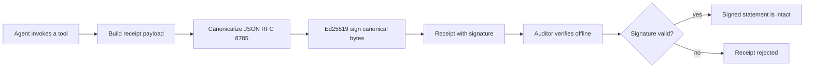
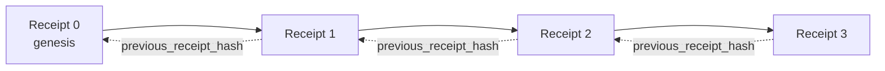

[Katso oppituntivideo: AI-agenttien turvaaminen kryptografisilla kuiteilla](https://youtu.be/PLACEHOLDER_VIDEO_ID)

> _(Oppituntivideo ja pikkukuva lisätään Microsoftin sisältötiimin toimesta yhdistämisen jälkeen, noudattaen oppituntien 14 / 15 mallia.)_

# AI-agenttien turvaaminen kryptografisilla kuiteilla

## Johdanto

Tässä oppitunnissa käsitellään:

- Miksi auditointijäljet AI-agenteille ovat tärkeitä vaatimustenmukaisuuden, virheenkorjauksen ja luottamuksen kannalta.
- Mitä kryptografinen kuitti on ja miten se eroaa allekirjoittamattomasta lokirivistä.
- Kuinka tuottaa allekirjoitettu kuitti agentin työkalukutsusta puhtaalla Pythonilla.
- Kuinka vahvistaa kuitti offline-tilassa ja havaita manipulointi.
- Kuinka ketjuttaa kuitteja niin, että yhden poistaminen tai uudelleenjärjestely rikkoo ketjun.
- Mitä kuitit todistavat ja mitä ne nimenomaisesti eivät todista.

## Oppimistavoitteet

Oppitunnin jälkeen osaat:

- Tunnistaa epäonnistumistavat, jotka motivoivat kryptografista alkuperää agenttitoimille.
- Tuottaa Ed25519-allekirjoitettu kuitti kanonisesta JSON-payloadista.
- Vahvistaa kuitti itsenäisesti käyttäen vain allekirjoittajan julkista avainta.
- Havaita manipulointi suorittamalla vahvistus uudelleen muokatuilla kuiteilla.
- Rakentaa hash-ketjullinen kuittijono ja selittää, miksi ketjulla on merkitystä.
- Tunnistaa raja, mitä kuitit todistavat (attribuutio, eheys, järjestys) ja mitä ne eivät (toiminnon oikeellisuus, politiikan pätevyys).

## Ongelma: Agenttisi auditointijälki

Kuvittele, että olet ottanut käyttöön AI-agentin Contoso Travelille. Agentti lukee asiakaspyyntöjä, kutsuu lentojen API:a etsiäkseen vaihtoehtoja ja varaa paikkoja asiakkaan puolesta. Viimeisellä neljänneksellä agentti käsitteli 50 000 varausta.

Tänään tarkastaja saapuu. Hän kysyy yksinkertaisen kysymyksen: "Näytä minulle, mitä agenttisi teki."

Luovutat lokitiedostosi. Tarkastaja katsoo niitä ja esittää vaikeamman kysymyksen: "Mistä tiedän, ettei näitä lokeja ole muokattu?"

Tämä on auditointijäljen ongelma. Suurin osa agenttien käyttöönotosta nykyään perustuu:

- **Sovelluslokeihin**: agentin itse kirjoittamia, joita kuka tahansa tiedostojärjestelmään pääsyllä voi muokata.
- **Pilvilokinpalveluihin**: alustatasolla manipuloinnin havaitsemiseen, mutta vain, jos tarkastaja luottaa alustan ylläpitäjään.
- **Tietokannan transaktiolokeihin**: hyvin sopivia tietokantamuutoksiin, mutta eivät mielivaltaisiin työkalukutsuihin.

Mikään näistä ei voi vastata tarkastajan kysymykseen ilman, että tarkastajan on luotettava johonkin (sinuun, pilvipalveluntarjoajaasi, tietokantatoimittajaasi). Sisäiseen käyttöön tämä luottamus on usein hyväksyttävää. Säännellyissä työkuormissa (rahoitus, terveydenhuolto, kaikki EU:n tekoälyasetuksen alaiset) se ei ole.

Kryptografiset kuitit kaventavat tätä ongelmaa tekemällä allekirjoitetusta lausumasta itsenäisesti
varmennettavan. Tarkastaja tarvitsee edelleen ulkoisen syyn luottaa allekirjoitusavaimeen ja
komponenttiin, joka lausuman tuotti. Upotettu avain todistaa itsejohdonmukaisuuden,
ei myöntäjän identiteettiä tai valvonnan asemointia.

## Mikä on kryptografinen kuitti?

Kuitti on JSON-objekti, joka tallentaa, mitä agentti teki, ja se on allekirjoitettu digitaalisesti.



Minimikuitti näyttää tältä:

```json
{
  "type": "agent.tool_call.v1",
  "agent_id": "contoso-travel-bot",
  "tool_name": "lookup_flights",
  "tool_args_hash": "sha256:a3f9c1...",
  "result_hash": "sha256:7b2e1d...",
  "policy_id": "contoso-travel-policy-v3",
  "timestamp": "2026-04-25T14:30:00Z",
  "sequence": 47,
  "previous_receipt_hash": "sha256:9d4e6a...",
  "signature": {
    "alg": "EdDSA",
    "sig": "c5af83...",
    "public_key": "8f3b2c..."
  }
}
```

Kolme ominaisuutta hoitaa työn:

1. **Allekirjoitus**. Kuitti on allekirjoitettu agentin portin Ed25519-yksityisavaimella. Kaikki, joilla on vastaava julkinen avain, voivat vahvistaa allekirjoituksen offline-tilassa. Luottava osapuoli on paikannettava kyseinen avain tai ratkaistava se luotettavasta rekisteristä kuitin ulkopuolella. Manipulointi millä tahansa allekirjoitetulla kentällä mitätöi allekirjoituksen.

2. **Kanoninen koodaus**. Ennen allekirjoitusta kuitti sarjoitetaan JSON-kanonisointiskaemalla (JCS, RFC 8785). Tämä varmistaa, että kaksi toteutusta, jotka tuottavat saman loogisen kuitin, tuottavat tismalleen saman tavujonon. Ilman kanonisointia eri JSON-sarjoittajat loisivat eri allekirjoituksia samalle sisällölle.

3. **Hash-ketju**. `previous_receipt_hash` kenttä linkittää jokaisen kuitin sitä edeltävään. Kuitin 2 hiljainen poistaminen vaatisi hyökkääjän joko:

Yhdessä nämä ominaisuudet tarjoavat kolme takuutta:

- **Avainattribuutio**: tämä avain allekirjoitti tämän sisällön. Organisatorinen tai inhimillinen identiteetti vaatii luotettavan avainliitännän.
- **Eheys**: sisältö ei ole muuttunut allekirjoittamisen jälkeen.
- **Järjestys vahvistetussa sekvenssissä**: tämä kuitti linkittää siihen edeltäjään.

## Kuitin tuottaminen Pythonilla

Kuittia ei tarvitse tuottaa erikoiskirjastolla. Kryptografiset primitiivit ovat laajalti saatavilla ja logiikka on muutaman kymmenen rivin Python-koodia.

Käytännön harjoitukset `code_samples/18-signed-receipts.ipynb` käyvät läpi koko prosessin. Versio-ohjatettu `code_samples/18-signed-receipts.execution-receipt.json` tallentaa täsmällisen muistikirjan hashin, Python-ympäristön, solujen määrän ja viimeisimmän puhtaan ajon tarkistukset muuttamatta oppitunnin tallennettuja tuloksia. Yhteenvetona:

```python
import json
import hashlib
import base64
from nacl import signing
from jcs import canonicalize  # RFC 8785 canonical JSON

def b64url_nopad(data: bytes) -> str:
    return base64.urlsafe_b64encode(data).decode("ascii").rstrip("=")

def sha256_canonical(obj) -> str:
    """SHA-256 of a Python object's JCS-canonical JSON form."""
    return f"sha256:{hashlib.sha256(canonicalize(obj)).hexdigest()}"

# Generate or load a signing key (in production, store in a key vault)
signing_key = signing.SigningKey.generate()
verify_key = signing_key.verify_key
TRUSTED_PUBLIC_KEYS = {b64url_nopad(bytes(verify_key))}  # pinned out of band by the verifier

# Build the receipt payload (no signature yet)
tool_args = {"origin": "SYD", "destination": "LAX"}
tool_result = [{"flight": "QF11", "price": 1850, "stops": 0}]

payload = {
    "type": "agent.tool_call.v1",
    "agent_id": "contoso-travel-bot",
    "tool_name": "lookup_flights",
    "tool_args_hash": sha256_canonical(tool_args),
    "result_hash": sha256_canonical(tool_result),
    "policy_id": "contoso-travel-policy-v3",
    "timestamp": "2026-04-25T14:30:00Z",
    "sequence": 0,
    "previous_receipt_hash": None,
}

# Canonicalize and sign the JCS bytes directly. PureEdDSA hashes internally.
canonical_bytes = canonicalize(payload)
signature_bytes = signing_key.sign(canonical_bytes).signature

# Attach a structured signature object.
receipt = {
    **payload,
    "signature": {
        "alg": "EdDSA",
        "sig": b64url_nopad(signature_bytes),
        "public_key": b64url_nopad(bytes(verify_key)),
    },
}
```

Tämä on koko allekirjoitusputki. Harjoitukset muistikirjassa käyvät jokaisen vaiheen läpi.

## Kuittien vahvistaminen ja manipuloinnin havaitseminen

Vahvistaminen on käänteinen operaatio:

```python
import base64
import hashlib
from nacl import signing
from nacl.exceptions import CryptoError
from jcs import canonicalize

def b64url_decode(s: str) -> bytes:
    padding = "=" * ((4 - len(s) % 4) % 4)
    return base64.b64decode(s + padding, altchars=b"-_", validate=True)

def verify_receipt(receipt: dict, trusted_public_keys: set[str]) -> bool:
    # The signature is a structured object: {"alg", "sig", "public_key"}.
    if not isinstance(receipt, dict):
        return False
    sig_obj = receipt.get("signature")
    if not isinstance(sig_obj, dict) or sig_obj.get("alg") != "EdDSA":
        return False
    try:
        # An inline key proves only self-consistency. Trust is configured out of band.
        public_key = sig_obj.get("public_key")
        signature = sig_obj.get("sig")
        if not isinstance(public_key, str) or not isinstance(signature, str):
            return False
        if public_key not in trusted_public_keys:
            return False
        payload = {k: v for k, v in receipt.items() if k != "signature"}
        canonical_bytes = canonicalize(payload)
        verify_key = signing.VerifyKey(b64url_decode(public_key))
        verify_key.verify(canonical_bytes, b64url_decode(signature))
        return True
    except (CryptoError, TypeError, ValueError, KeyError, OverflowError):
        return False
```

Tämä funktio ottaa kuitin ja luottavan osapuolen paikannetun avainjoukon ja palauttaa
`True` vain, jos allekirjoitus on pätevä hyväksytyn avaimen alla. Vahvistus ei vaadi
verkkoyhteyttä, mutta avaimen luottamus on edelleen ulkoinen asetuskysymys.

Näyttääkseen manipuloinnin havaintoa, muistikirja käy läpi:

1. Validin kuitin tuottamisen ja vahvistamisen onnistumisen.
2. Yhden tavun muokkaamisen `tool_args_hash` kentässä.
3. Vahvistuksen suorittamisen uudelleen ja sen epäonnistumisen.

Tämä on käytännön osoitus siitä, että kuitit ovat manipulointiin havaittavia: mikä tahansa muutos, kuinka pieni tahansa, rikkoo allekirjoituksen.

## Kuittien ketjuttaminen monivaiheisille agenteille

Yksi allekirjoitettu kuitti suojaa yhtä toimintoa. Ketju kuitteja suojaa sekvenssiä.



Jokainen kuitti tallentaa edeltävän kuitin hashin. Joskus poistaminen kuitista 2 vaatisi hyökkääjän:

- Muuttaa kuitin 3 `previous_receipt_hash` kenttää (rikkoutuu kuitin 3 allekirjoitus), TAI
- Taivuttaa uuden allekirjoituksen muokattuun kuitin 3 (vaatii agentin yksityisavaimen).

Jos yksityisavain on suojattu ja vahvistaja paikantaa riippumattoman ketjun
pään, nämä hyökkäykset ovat havaittavissa. Avaimen julkaiseminen jokaisessa kuitissa ei riitä:
allekirjoittaja tai hyökkääjä voi esittää eri avaimen, kirjoittaa uudelleen loppuosan tai
lyhentää ketjua, ellei luottava osapuoli omaa ulkoista luottamus- ja täydellisyysankkurointia.

Muistikirja käy läpi:

1. Kolmen kuitin ketjun rakentamisen.
2. Vahvistamisen, että jokaisen kuitin `previous_receipt_hash` vastaa edeltävän kuitin todellista hash-arvoa.
3. Yhden kuitin manipuloinnin keskellä ja näkymän, että ketju katkeaa juuri siinä vaiheessa.

Näin tuotat auditointijäljen, jonka ulkoinen tarkastaja voi vahvistaa omilla
paikannetun myöntäjän avaimillaan ja ketjutarkistuspisteillään, luottamatta muuttuvaan lokikauppaasi.

## Mitä kuitit todistavat (ja mitä ne eivät todista)

Tämä on tämän oppitunnin tärkein osa. Kuitit ovat tehokkaita, mutta niiden voima on rajattu.

**Kuitit todistavat kolme asiaa:**

1. **Attribuutio:** tietty avain allekirjoitti tietyn sisällön.
2. **Eheys:** sisältöä ei ole muutettu allekirjoittamisen jälkeen.
3. **Järjestys esitetyn, varmennetun sekvenssin sisällä:** tämä kuitti linkittää siihen edeltäjään.

**Kuitit eivät todista:**

1. **Oikeellisuus**: että agentin toiminta oli oikea toiminta. Kuittaus voidaan allekirjoittaa yhtä hyvin väärästä vastauksesta kuin oikeastakin.
2. **Politiikan noudattaminen**: että `policy_id`-politiikka arvioitiin tai että se olisi sallinut tämän toiminnan, jos sitä olisi tarkastettu. Kuitti tallentaa sen, mitä väitettiin, ei sitä, mitä toteutettiin.
3. **Tunnistautuminen avaimen takana**: kuitti sanoo "tämä avain allekirjoitti tämän sisällön." Se ei sano "tämä ihminen valtuutti tämän." Avaimen yhdistäminen henkilöön tai organisaatioon vaatii erillisen tunnistusrakenteen (hakemisto, julkisen avaimen rekisteri jne.).
4. **Syötteiden totuudenmukaisuus**: jos agentti saa manipuloidun kehotteen ja toimii sen mukaan, kuitti tallentaa toiminnan uskollisesti. Kuitit tulevat syötteen validoinnin jälkeen, eivät ole sen korvike.
5. **Suoritus tai todellinen vaikutus**: jälkikäteen annettu kuitti tallentaa, mitä sen tekijä väittää tapahtuneen. Pääsyä todistamiseen tai ulkoisen vaikutuksen sovittamiseen tarvitaan todistuksia varsinaiselta suorittajalta tai palveluntarjoajan rajapinnalta.
6. **Täydellisyys**: puuttuva kuitti voi tarkoittaa estettyä, jätettyä pois, kadonnutta tai rekisteröimätöntä. Puuttuminen on todistusaineistoa vain todennetun suljetun joukon sisällä.
7. **Luotettu aika**: allekirjoitettu aikaleima todistaa allekirjoittajan kantaneen tuon arvon, ei että arvo olisi ollut oikea. Luotettu aika tarvitsee erillisen aika-autoriteetin tai todistetun tarkastuspisteen.

Tämä rajapinta on tärkeä kahdesta syystä:

- Se kertoo, mihin kuitit ovat hyödyllisiä: mahdollistamaan agentin toiminnan tarkastettavuuden ja manipulointisuojan, jopa organisaatiorajojen yli.
- Se kertoo, mitä lisäkerroksia vielä tarvitaan: syötteen validointi (Oppitunti 6), politiikan täytäntöönpano (käsitelty lyhyesti alla) ja tunnistusrakenne (ei tämän oppitunnin aihe).

Yleinen virhe on olettaa, että "meillä on kuitteja" tarkoittaa "meitä hallitaan." Näin ei ole. Kuitit ovat perusta. Hallinto on järjestelmä, jonka päälle rakennat.

## Hyväksyjän allekirjoituksen sitominen tarkkaan toimintaan

Edellä mainittu kohta 3 ansaitsee oman osionsa: toimintakuitti sanoo "tämä avain allekirjoitti tämän sisällön," ei koskaan "ihminen valtuutti tämän." Korkean riskin toiminnoissa (hyvitykset, poistot, tilisiirrot) erillinen hyväksyjän allekirjoitus voi sitoa täsmällisen toiminnan. Avaimen yhdistäminen ihmiseen ja henkilön läsnäolon tarkistaminen ovat edelleen erillisiä vastuuita.

Seuraava muistikirja `code_samples/human-authorization-receipts.ipynb` lisää kolmannen kuittilajin, `human.approval.v1`, samaan kuorimuotoon kuin tämän oppitunnin kuitit (tyypitetty sisältö allekirjoitettuna Ed25519:llä sen kanonistettujen JCS-tavujen yli, ja `signature`-objekti allekirjoitettujen tavujen ulkopuolella). Hyväksyjän avain allekirjoittaa **kokonaisen kanonisen toimenpiteen ja sen tiivisteen**; agentin avain allekirjoittaa väitteen kantavan **saman toimenpidetiivisteen** ja `parent_approval_ref`, hyväksynnän `receipt_hash`-tiedot, sama käytäntö kuin `previous_receipt_hash` ketjussa, jonka loit aiemmin. Yksi `verify_chain` vahvistaa molemmat artefaktit **erillisissä kiinnitetyissä avainrekistereissä** (hyväksyjän avaimet vs. agentin avaimet), joten koodipolku on yhteinen, mutta valtuudet eivät koskaan.

Tähän liittyvä ominaisuus, ilmaistuna huolellisesti: *kiinnitetty hyväksyjän avain allekirjoitti tämän tarkan
toiminnon, ja agentin avain allekirjoitti myöhemmin lausuman kantavan saman toimenpidetiivisteen.*
Se on hyödyllinen todistus, mutta se ei yksin todista toiminnan suoritusta. Ohjaten
suoritusta täsmällinen hyväksyntä on myös varattava ja kulutettava kerran
varsinaisessa suorittajan rajapinnassa; tuntemattomat palveluntarjoajan tulokset on pidettävä tuntemattomina eikä niitä saa
yrittää toistaa sokeasti. Muistikirjan kieltäytymistestit testaavat kuittiketjutasoa:

- manipulointia, sekaannuksia, väärentämisiä kummallakin puolella sekä virheellisiä syötteitä;
- **vanhentunut valtuutus**: allekirjoitus, joka yhä hyväksytään, mutta hylätään silti, koska politiikkaversio on vaihtunut, hyväksyjän avain on poistettu kiinnitetyistä rekistereistä tai hyväksyntä on vanhentunut aiemmin kuin toimitetun varmennusajan mukaan;
- **tiivisteen vaihto**: laillisesti allekirjoitettu toimintakuitti osoittaa *todelliseen* hyväksyntään, joka sitoo *toisen* kanonisen toimenpiteen.

Jokainen epäonnistuminen hylätään eri syyllä, joten tarkastaja voi kieltäytymistä lukiessaan erottaa, menikö valtuutus vanhaksi vai muuttuiko väitetty toiminto. Varmennus on vain luku -ja toistettavissa: se ei kuluta hyväksyntää eikä kutsu palveluntarjoajaa. Erillinen suorittaja tarvitsee kestävän, atomisen uudelleenajonsuojan ja eksplisiittiset onnistumisen, epäonnistumisen ja epämääräisten lopputulosten merkinnät. Ihmisen hyväksyntäkuitti on tämän oppitunnin määrittelemä opettavainen koostumus, ei `draft-farley-acta-signed-receipts`-määritelty kuittityyppi.

## Tuotantoviitteet

Tämän oppitunnin Python-koodi on tarkoituksella minimaalinen, jotta voit lukea jokaisen rivin ja ymmärtää tarkkaan, mitä tapahtuu. Tuotannossa sinulla on kaksi vaihtoehtoa:

1. **Rakenna suoraan kryptografisten perustoimintojen päälle.** Yllä esitetyt 50 riviä riittävät moniin käyttötarkoituksiin. PyNaCl (Ed25519) ja `jcs`-paketti (kanoninen JSON) ovat hyvin ylläpidettyjä ja auditoituja kirjastoja.

2. **Käytä tuotantokuitteihin tarkoitettua kirjastoa.** Useat avoimen lähdekoodin projektit toteuttavat saman mallin lisäominaisuuksilla (avaimien kierto, erävarmennus, JWK Set -jakelu, integrointi politiikkamoottoreihin):
   - Allekirjoitusputki käyttää JCS- ja allekirjoitusaluekäytäntöjä itsenäisessä IETF Internet-Draftissa ([`draft-farley-acta-signed-receipts`](https://datatracker.ietf.org/doc/draft-farley-acta-signed-receipts/), versio 02). Tämän oppitunnin yksinkertainen opetuskuitti eroaa luonnoksen `{payload, signature}`-kuoressa eikä ole conformantti toteutus. Luonnos julkaisee yhteisen yhteensopivuussarjan ([agent-governance-testvectors](https://github.com/ScopeBlind/agent-governance-testvectors)) implementaatioille, jotka tavoittelevat sen siirtomuotoa.
   - Microsoft Agent Governance Toolkit yhdistää kuitit Cedar-pohjaisiin politiikkapäätöksiin; katso esimerkki koko ketjusta sen repositoriosta opetusohjelmasta 33.
   - `protect-mcp` (npm) ja `@veritasacta/verify` (npm) paketit tarjoavat Node-pohjaisen toteutuksen kuitin allekirjoitukseen ja offline-varmennukseen, tarkoitettu minkä tahansa MCP-palvelimen ympärille manipuloinnin estävää tarkastuspolkua varten, mukaan lukien pidettyyn yhteisallekirjoitusprosessiin, jossa keskeytetty toiminto tuottaa hyväksyntäkuitin sidottuna toimenpidetiivisteeseen (WebAuthn-tuetussa työpöytäprosessissa), sama hyväksyntäkuittimalli kuin yllä ihmisen valtuutuksia käsittelevässä muistikirjassa.
   - **[nobulex](https://github.com/arian-gogani/nobulex)** Python SDK (`pip install nobulex`) tarjoaa saman Ed25519 + JCS -allekirjoitusmallin Pythonilla, sisältäen LangChain- ja CrewAI-integraatiot sekä julkaistut ristiin validoidut testivektorit ja vaatimustenmukaisuuskartoituksen, jotka on kontribuoitu [OWASP PR #2210](https://github.com/OWASP/CheatSheetSeries/pull/2210) kautta.
   - **[EMILIA Protocol](https://github.com/emiliaprotocol/emilia-protocol)** tarjoaa täydentävän tarkan-toiminnon valvontakerroksen: offline-verifioitavat hyväksyntäkuittaukset, lukitut WebAuthn- tai kvorumivaltuudet, yhden käyttökerran kulutus toimeenpanorajalla sekä eksplisiittinen epäselvän lopputuloksen polku. Sen kehysadapterit käsittelevät kuittauksen välttämättömänä todisteena eikä todisteena, että ulkoinen vaikutus olisi tapahtunut.

Päätös rakentaa oma kirjasto tai käyttää valmista kirjastoa vastaa päätöstä kirjoittaa oma JWT-kirjasto tai käyttää testattua: molemmat ovat perusteltuja; kirjasto säästää aikaa ja vähentää tarkastusalaa; alusta alkaen tehtävä lähestymistapa pakottaa ymmärtämään kaikki primitiivit. Tämä opetus johtaa alusta alkaen polkua, jotta sinulla on perusta kummallekin valinnalle.

## Tietojen tarkastus

Testaa ymmärryksesi ennen siirtymistä harjoitukseen.

**1. Kuittaus allekirjoitetaan agentin yksityisellä Ed25519-avaimella. Tarkastajalla on vain julkinen avain. Voiko tarkastaja varmentaa kuitin offline-tilassa?**

<details>
<summary>Vastaus</summary>

Kyllä, kryptografinen varmennus vaatii vain julkisen avaimen ja allekirjoitetut tavut. 
Tarkastajan on kuitenkin saatava ja lukittava hyväksytty julkinen avain itsenäisesti kuitista.
Verkko-operaatioita ei tarvita sen jälkeen, kun tämä luottamus on määritetty.
</details>

**2. Hyökkääjä muuttaa kuittiin `policy_id`-kenttää väittääkseen, että sitä hallinnoi sallivampi käytäntö. Allekirjoitus tehtiin alkuperäisen tietosisällön perusteella. Mitä tapahtuu vahvistuksen aikana?**

<details>
<summary>Vastaus</summary>

Vahvistus epäonnistuu. Allekirjoitus laskettiin alkuperäisen tietosisällön kanonisten tavujen perusteella; minkä tahansa kentän muuttaminen muuttaa näitä tavujaja, mikä tekee allekirjoituksen kelvottomaksi. Hyökkääjä tarvitsisi yksityisen avaimen tuottaakseen uuden kelvollisen allekirjoituksen, jota hänellä ei ole.
</details>

**3. Miksi kuitti sisältää `tool_args_hash` ja `result_hash` raakojen argumenttien ja tuloksen sijaan?**

<details>
<summary>Vastaus</summary>

Kahdesta syystä. Ensiksi, kuitti saatetaan tarvita arkistoitavaksi tai lähetettäväksi ympäristöissä, joissa raakan sisällön (henkilökohtaiset tiedot, liiketoimintadata) paljastuminen on ongelma. Tiivisteiden avulla kuitti pysyy pienenä ja sisältö yksityisenä; tarkastaja varmistaa, että tiiviste vastaa erikseen tallennettua sisältökopiota. Toiseksi, tiivisteillä on kiinteä koko; kuitissa, jossa on tiivisteet, koko on rajattu riippumatta syötteiden ja tulosten koosta.
</details>

**4. `previous_receipt_hash`-kenttä linkittää jokaisen kuitin edeltäjäänsä. Jos hyökkääjä poistaa hiljaisesti yhden kuitin ketjun keskeltä, mikä muuttuu kelvottomaksi?**

<details>
<summary>Vastaus</summary>

Seuraava esitetty kuitti ei enää linkity odotettuun edeltäjäänsä, minkä vuoksi esitetyn ketjun vahvistus epäonnistuu aukosta eteenpäin. Jos allekirjoittajalla on hallussaan yksityinen avain, se voi kirjoittaa uudelleen tai katkaista loppuosan. Tämän havaitseminen vaatii kiinnitetyn nykyisen pään, ulkoisen tarkistuspisteen tai todennetun populoinnin sitoumuksen.


</details>

**5. Kuitti vahvistaa puhtaasti. Todistaako se agentin toiminnan oikeaksi, päteväksi tai käytäntöjen mukaiseksi?**

<details>
<summary>Vastaus</summary>

Ei. Kiinnitetyn avaimen ja ketju kontekstissa voimassa oleva kuitti todistaa allekirjoituksen omistajuuden,
sisällön eheyyden ja linkin esitettyyn edeltäjään. Se EI todista, että
toiminto oli oikea tai suoritettu, että käytäntö arvioitiin, että aikaleimaa voidaan
luottaa tai että tietuejoukko on täydellinen. Tämä on oppitunnin tärkein rajaus.
</details>

## Harjoitustehtävä

Avaa `code_samples/18-signed-receipts.ipynb` ja suorita kaikki neljä osiota:

1. **Osa 1**: Allekirjoita ensimmäinen kuittaus ja vahvista se.
2. **Osa 2**: Muokkaa kuittausta ja huomaa varmistuksen epäonnistuminen.
3. **Osa 3**: Rakenna kolmesta kuittauksesta ketju ja varmista ketjun eheys.
4. **Osa 4**: Käytä kaavaa Microsoft Agent Frameworkilla rakennetussa agentissa: kiedo työkalukutsu kuittauksen allekirjoittamiseen, ja vahvista sitten kuittaus itsenäisesti.

**Haastetehtävä 1:** laajenna kuittauskaaviota omalla lisäkentällä (esimerkiksi pyyntö-ID jäljitystä varten), päivitä allekirjoituksen kanoninen logiikka sisällyttämään tämä kenttä ja varmista, että kuittaus kulkee edelleen onnistuneesti varmennusprosessin läpi. Muuta sitten kenttää allekirjoituksen jälkeen ja varmista, että varmennus epäonnistuu. Tämä pakottaa sinut ymmärtämään, miten jokainen kanonisen koodauksen tavu vaikuttaa allekirjoitukseen.

**Haastetehtävä 2:** Tee SHA-256-hash kahdesta kuitistasi yhdistämällä niiden kanoniset tavut määrätetyssä järjestyksessä ja upota tuloksena syntyvä tiiviste kolmannen kuitin uudeksi kentäksi ennen allekirjoitusta. Varmista, että kaikki kolme kuittia kulkevat edelleen läpi. Olet juuri rakentanut yhden askeleen sisällyttämistodistuksen: kuka tahansa, jolla on kolmas kuitti, voi todistaa, että kaksi ensimmäistä oli olemassa allekirjoitushetkellä paljastamatta niiden sisältöä. Tämä on kaava, jota valikoivasti paljastavat kuitit käyttävät suuressa mittakaavassa (Merkle-sitoumukset, RFC 6962).

## Yhteenveto

Kryptografiset kuitit antavat tekoälyagenteille auditointijäljen, joka on:

- **Itsenäisesti varmennettavissa kiinnitetyn luottamuksen alla**: osapuoli, jolla on hyväksytyt julkiset avaimet ja allekirjoitetut tavut, voi varmistaa ilman palveluriippuvuutta.
- **Muokkausta havaitseva**: mikä tahansa muutos mitätöi allekirjoituksen.
- **Kannettava**: kuitti on pieni JSON-tiedosto; se voidaan arkistoida, siirtää ja varmistaa missä tahansa.
- **Standardienmukainen**: perustuu Ed25519:ään (RFC 8032), JCS:ään (RFC 8785) ja SHA-256:een, kaikki laajasti käytettyjä perusmenetelmiä.

Ne eivät ole korvaavia toimenpiteitä syötteen validoimiselle, politiikan noudattamisen varmistamiselle, suorittajapalvelun hyväksynnälle,
tulosten todistamiselle, täydellisyyden valvonnalle tai identiteettirakenteelle. Ne ovat perusta
näille tasoille. Säädellyissä tai moniorganisaatioprosesseissa kuitit tekevät erityiset
myöntäjien lausunnot riippumattomasti tarkistettaviksi tarkastajan oman luottamusasetuksen mukaan.

Tärkein opetus: kuitit todistavat, että tietty avain allekirjoitti tietyn
sisällön. Kanssa kulkeva aikaleima on allekirjoittajan väite, ellei sitä ole erikseen aika-sertifioitu. Kuitti
ei todista, että sen sisältö olisi totta, että toiminto olisi suoritettu, tai että
tietuejoukko olisi täydellinen. Pidä nämä erot tarkasti mielessä.

## Tuotantotarkistuslista

Kun olet valmis siirtymään tästä oppitunnista ja ottamaan käyttöön kuittaus-allekirjoitettuja agenteja oikeassa ympäristössä:

- [ ] **Siirrä allekirjoitusavain pois kehittäjän kannettavalta.** Käytä Azure Key Vaultia, AWS KMS:ää tai laitteistoturvamoduulia. Yksityisavaimen, joka allekirjoittaa kuittauksesi, ei koskaan pidä olla lähdekoodissa tai selväkielisenä sovelluslaitteissa.
- [ ] **Vahvista vahvistimen avainluottamus.** Julkaise avaimet JWK-setin tai rekisterin kautta, ja anna luottavien osapuolten kiinnittää hyväksytty julkaisijan identiteetti, avainsarja ja kierrätyskäytäntö yksittäisten kuittien ulkopuolelle. Pelkkä upotettu avain ei ole luottamuksen ankkuri.
- [ ] **Ankkuroi ketju ulkoisesti.** Kirjoita ajoittain viimeisimmän ketjupään hajautusarvo läpinäkyvyyslokiin (Sigstore Rekor, RFC 3161 -aikaleimamainen auktoriteetti tai toinen sisäinen järjestelmä) niin, että ulkopuolinen osapuoli voi varmentaa "tämä ketju oli olemassa tällä hetkellä."
- [ ] **Tallenna kuitit muuttumattomasti.** Lisää vain -tyyppinen bloatallennus (Azure Storage immuuttisuuskäytännöillä, AWS S3 Object Lock) estää sisäpiiriläisen muuttamasta historiaa tallennustasolla.
- [ ] **Päätä säilytysajasta.** Monet sääntelyjärjestelmät vaativat monivuotista säilytystä. Suunnittele kuitin kasvulle (jokainen kuitti on ~500 tavua; agentti joka tekee 10 000 kutsua päivässä tuottaa ~1,8 Gt vuodessa).
- [ ] **Dokumentoi, mitä kuitit eivät kata.** Kuitit todistavat attribuution, eheyden ja järjestyksen. Toimintaohjeiden tulee nimenomaisesti luetella, mitkä lisävalvonnat (syötteen validointi, politiikan noudattaminen, nopeusrajoitukset, identiteetti-infrastruktuuri) toimivat kuittien rinnalla hallintapolitiikassa.

### Onko sinulla lisää kysymyksiä tekoälyagenttien suojaamisesta?

Liity [Microsoft Foundry Discordiin](https://aka.ms/ai-agents/discord) tavata muita oppijoita, osallistua aukioloaikoihin ja saada vastauksia tekoälyagenttien kysymyksiisi.

## Tämän oppitunnin jälkeen

Tämä oppitunti käsittelee yksittäisen kuitin allekirjoitusta ja hajautettuja ketjusarjoja. Samat perusosat muodostavat useita kehittyneempiä malleja, joita saatat kohdata hallintapolitiikkasi kehityttyä:

- **Valikoiva paljastus.** Kun kuitin kentät sitoutuvat itsenäisesti (RFC 6962 -tyylinen Merkle-puu), voit paljastaa tietyt kentät tietyille tarkastajille ja todistaa, että muut kentät eivät ole muuttuneet paljastamatta niitä. Hyödyllistä, kun saman kuitin on tyydytettävä sekä kokonaisvaltainen auditointi (joka haluaa täydellisyyttä) että tietosuoja-asetukset kuten GDPR (jotka haluavat tarkastajan näkevän mahdollisimman vähän).
- **Kuitin peruutus.** Jos allekirjoitusavain vaarantuu, tarvitset tavan merkitä kaikki kyseisellä avaimella allekirjoitetut kuitit epäluotettaviksi tietystä ajankohdasta eteenpäin. Tavalliset mallit: lyhytaikaiset allekirjoitusavaimet ja julkaistu peruutuslista, tai läpinäkyvyysloki, jossa on peruutustietueita.
- **Kaksipuoliset / jaetun allekirjoituksen kuitit.** Jotkut toteutukset jakavat allekirjoitetun sisältökuorman ennen suorittamista (`authorization_*`) ja suorittamisen jälkeen (`result_*`) itsenäisillä allekirjoituksilla, hyödyllistä, kun valtuutuspäätöksen ja havainnoidun tuloksen tuottavat eri toimijat tai eri aikaan. Tämä rakentuu tässä oppitunnissa opetetun kuitin muodon päälle.
- **Sisällön koostaminen.** Kuitti sinetöi `result_hash` -kohdassa laitetut tavut. Todellisen maailman sisällöt ovat usein monipuolisempia kuin yksittäinen työkalukutsu: päätösprosessin ennakkoselvitys (mallin ennuste, tarkastellut vaihtoehdot, näyttö ja sen täydellisyys, riskiasema, vastuuketju, portin tulos) voi kaikki olla sisällössä ja sinetöity yhdessä kuitissa. Tämä pitää kuitin muodon minimalistisena samalla kun sisältökaaviot voivat kehittyä toimialakohtaisesti.
- **Ristikkäinen toteutusten yhteensopivuus.** Useat itsenäiset toteutukset samasta kuitin muodosta (Python, TypeScript, Rust, Go) varmentavat keskinäisesti jaetun testiaineiston perusteella. Jos rakennat oman toteutuksen, validoimalla julkaistuja vektoreita vastaan varmistat yhteensopivuuden.
- **Jälkikvanttisiirtymä.** Ed25519 on laajalti käytössä nykyään mutta ei kvanttikestävä. Pelkkä `alg` -tunniste ei ole siirtymä: profiilin tulee määritellä ML-DSA -avainten koodaus, kanoniset allekirjoitetut tavut, varmennus, luottavan osapuolen politiikka, alennuskestävyys ja siirtymäsemantiikka. Suunnittele ja testaa kaksoisallekirjoitussiirtymä yhteisten vektorien avulla ennen yhteensopivuusväitteitä.

## Lisäresurssit

- <a href="https://datatracker.ietf.org/doc/draft-farley-acta-signed-receipts/" target="_blank">IETF Internet-Draft: Alleikjoitetut päätöskuittaukset koneiden väliseen käyttöoikeusvalvontaan</a>
- <a href="https://learn.microsoft.com/azure/ai-studio/responsible-use-of-ai-overview" target="_blank">Vastuullisen tekoälyn yleiskatsaus (Azure AI)</a>
- <a href="https://datatracker.ietf.org/doc/html/rfc8032" target="_blank">RFC 8032: Edwards-käyrän digitaalinen allekirjoitusalgoritmi (EdDSA)</a>
- <a href="https://datatracker.ietf.org/doc/html/rfc8785" target="_blank">RFC 8785: JSON-kanonisointikaavio (JCS)</a>
- <a href="https://datatracker.ietf.org/doc/html/rfc6962" target="_blank">RFC 6962: Sertifikaattien läpinäkyvyys</a> (Merkle-puun rakenne, jota käytetään valikoivapaljastuskuiteissa)
- <a href="https://github.com/microsoft/agent-governance-toolkit/blob/main/docs/tutorials/33-offline-verifiable-receipts.md" target="_blank">Microsoft Agent Governance Toolkit, opas 33: Offline-varmennettavat päätöskuittaukset</a>
- <a href="https://github.com/ScopeBlind/agent-governance-testvectors" target="_blank">Ristikkäistoteutusten yhteensopivuustestivektorit</a> tässä oppitunnissa käytetylle kuittimuodolle (Apache-2.0)
- <a href="https://pynacl.readthedocs.io/" target="_blank">PyNaCl-dokumentaatio</a> (Ed25519 Pythonissa)

## Edellinen oppitunti

[Paikallisten tekoälyagenttien luominen](../17-creating-local-ai-agents/README.md)

---

<!-- CO-OP TRANSLATOR DISCLAIMER START -->
**Vastuuvapauslauseke**:
Tämä asiakirja on käännetty käyttämällä tekoälypohjaista käännöspalvelua [Co-op Translator](https://github.com/Azure/co-op-translator). Vaikka pyrimme tarkkuuteen, otathan huomioon, että automaattiset käännökset saattavat sisältää virheitä tai epätarkkuuksia. Alkuperäinen asiakirja sen alkuperäiskielellä on virallinen lähde. Tärkeissä asioissa suositellaan ammattimaista ihmiskäännöstä. Emme ole vastuussa tämän käännöksen käytöstä aiheutuvista väärinymmärryksistä tai tulkinnoista.
<!-- CO-OP TRANSLATOR DISCLAIMER END -->